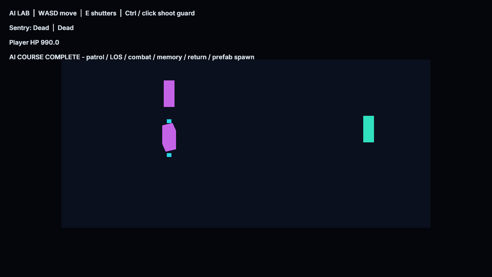

# AI Workshop

Open AIWorkshop.zproject, choose AI2D or AI3D and Play. No native game module or game compiler is
required. A purple sentry patrols behind two navigation-carving shutters. WASD moves; E opens or
closes both shutters; Ctrl strikes the sentry. Approach it to trigger chase and attacks, move away
and close the shutters to trigger investigation and return. Defeating the sentry spawns an independent
NPC prefab with its own patrol controller. The HUD shows health, mode and course progress.

Player, brain and course director have separate reusable Blueprint graphs in both dimensions.
The unlit shapes deliberately expose navigation and state transitions. All content is engine-owned.
Auto and Checks default to false; the acceptance harness enables them only in private project copies.
Mutable AI/combat state is not a persistent save.

See [AI configuration and limits](../../docs/GameplayAI.md).
Run `python3 Tests/ai_workflow_test.py --build build --exports` from the repository root.
Regenerate assets with `python3 Tools/samples/gen_ai_workshop.py`; the thumbnail is preserved.
