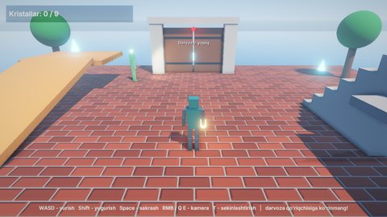

# Adventure3D — an island adventure (3D)

On an island, a hero controlled from a third-person view (a glTF model, with an Animator) collects crystals. A guard
robot patrols in front of the gate; when it spots the hero it chases them, and if it catches them the hero is sent
back to the starting point. When every crystal has been collected the island starts over. This scene uses the 3D
renderer, Jolt physics, skeletal animation and AI together in one game.

## Running

| How | Command |
|---|---|
| Editor | `./build/bin/ZaminEditor Projects/Adventure3D`, then Play |
| Game | `./build/bin/ZaminPlayer Projects/Adventure3D` |
| Headless test | `Tests/samples_test.py --game Adventure3D` |

## Controls

| Action | Keyboard / mouse | Gamepad |
|---|---|---|
| Walk (`Horizontal`, `Vertical`) | W A S D, arrows | left stick, D-pad |
| Run (`Sprint`) | Shift | RT, left stick press |
| Jump (`Jump`) | Space | A |
| Orbit the camera | with the right mouse button held | right stick |
| Slow motion (on / off) | T | Y |

## The game and the features it shows

- **The hero** (`ThirdPersonController`) walks with a `CharacterController3D` (Jolt) and also stands on moving
  platforms. The Animator state machine switches clips by the `Speed` and `Grounded` parameters. Footstep sounds come
  from animation events (`Footsteps`). An item is attached to the hand with `BoneAttachment`.
- **The camera** (`OrbitFollowCamera`) follows smoothly behind the hero. It can be orbited with the right mouse
  button or the right stick.
- **The guard** (`IslandGuard`) walks along a `PatrolPath` and looks around at the corners. When the `SightSensor`
  sees the hero it chases them with a `NavAgent` on the `NavGrid3D`; if it loses them it searches and then returns to
  its patrol.
- **The world**: crystals (a prefab effect plays when one is collected), moving platforms, spinning obstacles, a door
  that opens when you come near.
- **Slow motion**: the T key smoothly slows the game clock down with `Time::SetTimeScale` and brings it back.
- **Graphics**: the sky, fog, shadows, point and spot lights, post-processing
  ([Rendering.md](../../docs/Rendering.md), [Animation.md](../../docs/Animation.md), [AI.md](../../docs/AI.md)).

## A tour of the code (`Source/`)

| File | What is in it |
|---|---|
| `Player.cpp` | `ThirdPersonController`: walking from the input map, the direction relative to the camera, jumping, the Animator parameters |
| `World.cpp` | `OrbitFollowCamera`, `AdventureGame` (the crystal count, HUD, victory, slow motion), `Crystal`, `MovingPlatform3D`, `Spinner`, `ProximityDoor`, `AutoDestroy` |
| `Guard.cpp` | `IslandGuard`: an AI state machine — patrol → spotted → chase → search → back to patrol |
| `Adventure.h` | Shared declarations |

The [3D tutorial](../../docs/Tutorial-3D.md) points to this project as the full example of controlling a hero.

## Tests

`Tests/samples_test.py --game Adventure3D` (smoke): the scene loads, the hero gets ready, the game runs without errors
and renders a picture. The project is also used by the `Tests/player_bench.sh` and `Tests/package_games.sh` tests.
