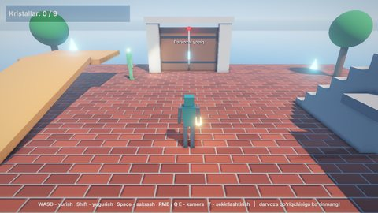

# Adventure3D — orol sarguzashti (3D)

Orolda uchinchi shaxsdan boshqariladigan qahramon (glTF modeli, Animator bilan) kristallar teradi. Darvoza oldida
patrulda yurgan qo'riqchi robot qahramonni ko'rib qolsa, uni quvadi. Ushlab olsa, qahramon boshlang'ich joyga
qaytariladi. Hamma kristallar yig'ilganda orol qaytadan boshlanadi. Bu sahnada 3D renderer, Jolt fizikasi, skeletli
animatsiya va AI bitta o'yinda birga ishlatilgan.

## Ishga tushirish

| Qanday | Buyruq |
|---|---|
| Editor | `./build/bin/ZaminEditor Projects/Adventure3D`, keyin Play |
| O'yin | `./build/bin/ZaminPlayer Projects/Adventure3D` |
| Headless test | `Tests/samples_test.py --game Adventure3D` |

## Boshqaruv

| Harakat | Klaviatura / sichqoncha | Gamepad |
|---|---|---|
| Yurish (`Horizontal`, `Vertical`) | W A S D, strelkalar | chap stik, D-pad |
| Yugurish (`Sprint`) | Shift | RT, chap stik bosilishi |
| Sakrash (`Jump`) | Space | A |
| Kamerani aylantirish | sichqoncha o'ng tugmasi bosilgan holda | o'ng stik |
| Sekinlashtirish (yoqish / o'chirish) | T | Y |

## O'yin va ko'rsatilgan imkoniyatlar

- **Qahramon** (`ThirdPersonController`): `CharacterController3D` (Jolt) bilan yuradi, harakatlanuvchi platformalar
  ustida ham turadi. Animator holat mashinasi kliplarni `Speed` va `Grounded` parametrlariga qarab almashtiradi.
  Qadam tovushlari animatsiya event'lari orqali chiqadi (`Footsteps`). Qo'liga `BoneAttachment` bilan buyum
  ulangan.
- **Kamera** (`OrbitFollowCamera`) qahramon ortidan silliq ergashadi. Uni sichqonchaning o'ng tugmasi yoki o'ng
  stik bilan aylantirish mumkin.
- **Qo'riqchi** (`IslandGuard`): `PatrolPath` bo'ylab yuradi va burchaklarda atrofga qaraydi. `SightSensor` uni
  ko'rsa, `NavGrid3D` ustida `NavAgent` bilan quvadi, yo'qotib qo'ysa qidiradi va keyin patrulga qaytadi.
- **Dunyo**: kristallar (yig'ilganda prefab effekt chiqadi), harakatlanuvchi platformalar, aylanuvchi to'siqlar,
  yaqinlashganda ochiladigan eshik.
- **Sekinlashtirish**: T tugmasi o'yin soatini `Time::SetTimeScale` bilan silliq sekinlashtiradi va qaytaradi.
- **Grafika**: osmon, tuman, soyalar, nuqtali va projektor yorug'liklar, post-processing
  ([Rendering.md](../../docs/Rendering.md), [Animation.md](../../docs/Animation.md), [AI.md](../../docs/AI.md)).

## Kod bo'ylab sayohat (`Source/`)

| Fayl | Nima bor |
|---|---|
| `Player.cpp` | `ThirdPersonController`: input xaritasidan yurish, kameraga nisbatan yo'nalish, sakrash, Animator parametrlari |
| `World.cpp` | `OrbitFollowCamera`, `AdventureGame` (kristallar hisobi, HUD, g'alaba, sekinlashtirish), `Crystal`, `MovingPlatform3D`, `Spinner`, `ProximityDoor`, `AutoDestroy` |
| `Guard.cpp` | `IslandGuard`: AI holat mashinasi — patrul → ko'rdi → quvish → qidirish → patrulga qaytish |
| `Adventure.h` | Umumiy e'lonlar |

[3D qo'llanma](../../docs/Tutorial-3D.md) qahramonni boshqarishning to'liq misoli sifatida shu loyihaga ishora
qiladi.

## Testlar

`Tests/samples_test.py --game Adventure3D` (smoke): sahna yuklanadi, qahramon tayyor bo'ladi, o'yin xatosiz ishlaydi
va rasm chiqaradi. Loyiha `Tests/player_bench.sh` va `Tests/package_games.sh` testlarida ham ishlatiladi.
