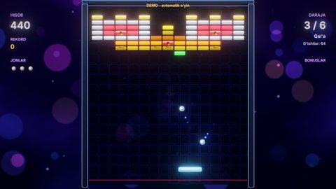

# Zamin Breakout (2D)

Klassik g'isht sindirish o'yini. Raketka bilan to'pni qaytarib, maydondagi g'ishtlarni sindirasiz. G'ishtlarning besh
turi, oltita bonus va oltita daraja bor (Kamalak, Piramida, Qal'a, Shaxmat, Yurak, Labirint). Oltinchi daraja
tugagach, o'yin birinchidan tezroq aylanadi. Gameplay C++ skriptlarda, rasm va ovozlar
`Tools/samples/gen_breakout.py` generatorida yaratilgan.

## Ishga tushirish

| Qanday | Buyruq |
|---|---|
| Editor | `./build/bin/ZaminEditor Projects/Breakout`, keyin Play |
| O'yin | `./build/bin/ZaminPlayer Projects/Breakout` |
| Demo (bot o'ynaydi) | `ZAMIN_DEMO=1 ./build/bin/ZaminPlayer Projects/Breakout` |
| Darajani sinash | `ZAMIN_START_LEVEL=4 ./build/bin/ZaminPlayer Projects/Breakout` (yoki `BreakoutGame.StartLevel` maydoni) |
| Headless test | `Tests/samples_test.py --game Breakout` |

## Boshqaruv

| Harakat | Klaviatura / sichqoncha | Gamepad |
|---|---|---|
| Raketka (`MoveX`) | sichqoncha, A / D, strelkalar | chap stik, D-pad |
| To'pni otish, lazer (`Action`) | Space, sichqoncha chap tugmasi, W, yuqori strelka | A, RT |
| Pauza (`Pause`) | Esc, P | Start |

## O'yin

- **To'p**: devor va g'ishtlardan Box2D bilan qaytadi (restitution 1, ishqalanishsiz). Skript har kadr tezlikni
  darajaga mos holda ushlab turadi va to'pning juda yotiq uchishiga yo'l qo'ymaydi. Raketkaga tegishni skriptning
  o'zi hisoblaydi: o'rtaga tegsa to'p tik ketadi, chetiga tegsa 62 darajagacha qiyshayadi.
- **G'ishtlar**: oddiy (bir zarba), qattiq (ikki zarba, birinchisidan keyin yoriladi), po'lat (uch zarba), oltin
  (sinmaydi), bomba (sinsa, atrofdagilarni ham zanjir bo'lib portlatadi).
- **Bonuslar** (taxminan har 7-g'ishtdan tushadi): keng raketka, uchta to'p, sekin to'p, olov to'pi (g'ishtlarni
  teshib o'tadi), lazer (raycast nurlari) va +1 jon.
- **Hisob**: g'isht ochkosi kombo bilan ko'paytiriladi (raketkaga tegmasdan ketma-ket singan g'ishtlar), daraja
  tugaganda bonus qo'shiladi. Rekord SaveData'da (`Breakout.BestScore`, `Breakout.BestLevel`).
- **Menyular**: bosh menyu (orqada bot 1-darajani o'ynaydi), pauza, o'yin tugadi / g'alaba oynasi.

## Dvigatelning qaysi imkoniyatlari ko'rsatiladi

- Box2D: dinamik to'p (`Bullet` — tez jism devordan o'tib ketmaydi), statik devor va g'ishtlar, fizika qatlamlari
  (`LayerMask`), to'qnashuv callback'lari (`OnCollisionBegin`), lazer uchun `Raycast2D`
  ([Physics.md](../../docs/Physics.md)). Raketka fizika jismisiz: unga tegishni skript hisoblaydi.
- `Instantiate` bilan darajani shablondan qurish: g'ishtlar `Levels.cpp` dagi matndan qatorma-qator "paydo bo'ladi"
  (tween bilan).
- 2D yorug'lik, bloom, zarralar (g'isht parchalari, uchqunlar), kamera silkinishi
  ([Rendering.md](../../docs/Rendering.md)).
- UI menyular va HUD, lokalizatsiya (uz / en), SaveData, ovozlar ([UI.md](../../docs/UI.md),
  [Audio.md](../../docs/Audio.md)).

## Kod bo'ylab sayohat (`Source/`)

| Fayl | Nima bor |
|---|---|
| `Breakout.h` | Skript klasslari: `BreakoutGame`, `PaddleController`, `Ball`, `Brick`, `PowerUp`, `FxAnimator`; `LevelLayout`, `PowerKind` |
| `BreakoutGame.cpp` | O'yin oqimi (bosh menyu, o'yin, pauza, daraja tugashi, o'yin tugashi / g'alaba), darajani qurish (`LoadLevel`), jonlar, hisob va kombo, bonuslarni qo'llash (`OnPowerUpCaught`), lazer (`FireLasers`), HUD, bot (`UpdateBot` — to'p qayerga tushishini oldindan hisoblab, qolgan g'ishtlarga qaratadi) |
| `Pieces.cpp` | Raketka (input xaritasi, sichqoncha), to'p (tezlikni to'g'rilash, raketkadan qaytish burchagi), g'isht (zarbalar, yorilish), bonus kapsulasi, effektlar |
| `Levels.cpp` | Olti daraja — 13 ustunli matn qatorlari: `r o y g c b p k w` oddiy, katta harflar qattiq, `S` po'lat, `#` oltin, `X` bomba |

Yangi daraja qo'shish: `Levels.cpp` ga yana bitta `LevelLayout` yozing va lokalizatsiya fayllariga
(`Assets/Localization/uz.json`, `en.json`) `level.7` nomini qo'shing.

Inspektorda sozlanadigan maydonlar: `BreakoutGame.StartLives`, `PowerUpChance`, `FieldHalfWidth`, `StartLevel`,
`AutoDemo`; `PaddleController.Speed`, `Width`; `Ball.Speed`, `MaxSpeed`; `Brick.HitPoints`, `Points`.

## Assetlar va ovozlar

`python3 Tools/samples/gen_breakout.py` (numpy kerak) sprite atlas, maydon va fon teksturalari, 15 ta WAV ovoz
(raketka, g'isht, po'lat, bomba, lazer, bonus, daraja tugashi, musiqa ...), sahna va loyiha faylini qayta yozadi.
Assetlar ~1.2 MB. `Tests/samples_assets.py --regen` ularni generator natijasi bilan solishtiradi.

## Testlar

`Tests/samples_test.py --game Breakout`: demo (bot 1-darajani tugatib, 2-darajaga o'tadi), `level6`
(`ZAMIN_START_LEVEL=6` bilan oxirgi daraja quriladi va o'ynaladi) va menyular.
