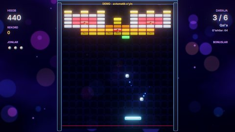

# Zamin Breakout (2D)

The classic brick-breaking game. You bounce the ball with the paddle and break the bricks on the field. There are five
kinds of brick, six power-ups and six levels (Rainbow, Pyramid, Castle, Chessboard, Heart, Labyrinth). After the sixth
level the game loops from the first one, faster. The gameplay is in C++ scripts; the pictures and sounds are made by
the `Tools/samples/gen_breakout.py` generator.

## Running

| How | Command |
|---|---|
| Editor | `./build/bin/ZaminEditor Projects/Breakout`, then Play |
| Game | `./build/bin/ZaminPlayer Projects/Breakout` |
| Demo (the bot plays) | `ZAMIN_DEMO=1 ./build/bin/ZaminPlayer Projects/Breakout` |
| Trying a level | `ZAMIN_START_LEVEL=4 ./build/bin/ZaminPlayer Projects/Breakout` (or the `BreakoutGame.StartLevel` field) |
| Headless test | `Tests/samples_test.py --game Breakout` |

## Controls

| Action | Keyboard / mouse | Gamepad |
|---|---|---|
| Paddle (`MoveX`) | mouse, A / D, arrows | left stick, D-pad |
| Launch the ball, laser (`Action`) | Space, left mouse button, W, up arrow | A, RT |
| Pause (`Pause`) | Esc, P | Start |

## The game

- **The ball**: bounces off the walls and bricks with Box2D (restitution 1, no friction). Every frame the script keeps
  the speed at the level's value and never lets the ball fly too flat. The script itself works out a paddle
  hit: in the middle the ball goes straight up, at the edge it tilts up to 62 degrees.
- **Bricks**: plain (one hit), hard (two hits, it cracks after the first), steel (three hits), gold
  (unbreakable), bomb (when it breaks it blows up the ones around it in a chain).
- **Power-ups** (dropped by about every 7th brick): wide paddle, three balls, slow ball, fireball (goes through
  bricks), laser (raycast beams) and +1 life.
- **Score**: a brick's points are multiplied by the combo (bricks broken in a row without touching the paddle), and a
  bonus is added when a level is cleared. The record is in SaveData (`Breakout.BestScore`, `Breakout.BestLevel`).
- **Menus**: the main menu (a bot plays level 1 behind it), pause, the game over / victory window.

## Which engine features it shows

- Box2D: a dynamic ball (`Bullet` — a fast body does not tunnel through a wall), static walls and bricks, physics layers
  (`LayerMask`), collision callbacks (`OnCollisionBegin`), `Raycast2D` for the laser
  ([Physics.md](../../docs/Physics.md)). The paddle has no physics body: the script works out its hits.
- Building a level from a template with `Instantiate`: the bricks "appear" row by row from the text in `Levels.cpp`
  (with a tween).
- 2D lighting, bloom, particles (brick debris, sparks), camera shake
  ([Rendering.md](../../docs/Rendering.md)).
- UI menus and the HUD, localization (uz / en), SaveData, sounds ([UI.md](../../docs/UI.md),
  [Audio.md](../../docs/Audio.md)).

## A tour of the code (`Source/`)

| File | What is in it |
|---|---|
| `Breakout.h` | The script classes: `BreakoutGame`, `PaddleController`, `Ball`, `Brick`, `PowerUp`, `FxAnimator`; `LevelLayout`, `PowerKind` |
| `BreakoutGame.cpp` | The game flow (main menu, game, pause, level clear, game over / victory), building a level (`LoadLevel`), lives, score and combo, applying power-ups (`OnPowerUpCaught`), the laser (`FireLasers`), the HUD, the bot (`UpdateBot` — works out ahead where the ball will land and aims it at the remaining bricks) |
| `Pieces.cpp` | The paddle (input map, mouse), the ball (speed correction, the bounce angle off the paddle), the brick (hits, cracking), the power-up capsule, effects |
| `Levels.cpp` | Six levels — rows of text 13 columns wide: `r o y g c b p k w` plain, capitals hard, `S` steel, `#` gold, `X` bomb |

Adding a level: write one more `LevelLayout` in `Levels.cpp` and add the `level.7` name to the localization files
(`Assets/Localization/uz.json`, `en.json`).

Fields that can be tuned in the inspector: `BreakoutGame.StartLives`, `PowerUpChance`, `FieldHalfWidth`, `StartLevel`,
`AutoDemo`; `PaddleController.Speed`, `Width`; `Ball.Speed`, `MaxSpeed`; `Brick.HitPoints`, `Points`.

## Assets and sounds

`python3 Tools/samples/gen_breakout.py` (needs numpy) rewrites the sprite atlas, the field and backdrop textures, 15 WAV sounds
(paddle, brick, steel, bomb, laser, power-up, level clear, music ...), the scene and the project file.
The assets are ~1.2 MB. `Tests/samples_assets.py --regen` compares them with the generator's output.

## Tests

`Tests/samples_test.py --game Breakout`: demo (the bot clears level 1 and moves on to level 2), `level6`
(with `ZAMIN_START_LEVEL=6` the last level is built and played) and menus.
