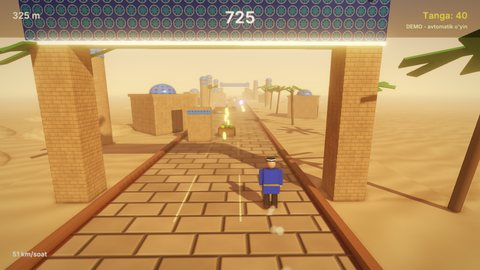

# Silk Road — a 3D endless runner

A merchant runs along the Silk Road. The road has three lanes; you jump over carts, barriers, gates hung with carpets,
walls and caravans, slide under them or go around them. You pick up coins on the way.
The speed grows with the distance. The world is built procedurally ahead, and the road never ends.

## Running

| How | Command |
|---|---|
| Editor | `./build/bin/ZaminEditor Projects/EndlessRunner`, then Play |
| Game | `./build/bin/ZaminPlayer Projects/EndlessRunner` |
| Demo (the bot runs) | `ZAMIN_DEMO=1 ./build/bin/ZaminPlayer Projects/EndlessRunner` |
| Headless test | `Tests/samples_test.py --game EndlessRunner` |

## Controls

| Action | Keyboard | Gamepad |
|---|---|---|
| Left / right lane (`Left`, `Right`) | A / D, arrows | D-pad, LB / RB, a flick of the left stick (`Steer`) |
| Jump (`Jump`) | Space, W, up arrow | A |
| Slide (`Slide`; pressed in the air it drops fast) | S, down arrow | B |
| Pause (`Pause`) | Esc, P | Start |

## The game

- **Obstacles** (one pattern per segment, at least one way through always remains): a cart (jump over it or
  go around), a low barrier (across the whole road — jump), a gate with a carpet (slide under it), a tall wall and
  a long caravan (you have to change lanes).
- **Coins** stand in a row or an arc. **Power-ups**: the magnet pulls nearby coins in, the shield saves you from one
  crash (the obstacle falls apart).
- **Speed** grows with the distance: from `StartSpeed` 11 m/s to `MaxSpeed` 30 m/s. An announcement comes every 500 m.
- **Score**: distance + coins x 10. The record is in SaveData (`EndlessRunner.Best`, `EndlessRunner.BestDistance`).
- **A crash**: the runner falls, the camera shakes, debris flies. Then the results window comes up.
- **Menus**: the main menu (a bot runs behind it), pause, the results window (points, distance, coins, record).

## Which engine features it shows

- An endless world: `Instantiate` from templates up to `SpawnAhead` metres ahead, destroying what is left behind. The road
  and sand planes move along with the runner while their texture stays in place (the material's UV offset). That is
  why the road never breaks.
- Collisions are checked without physics, with plain boxes: the run is computed in small steps and checked after
  every step, so even in a slow frame a thin obstacle is never "jumped through".
- Procedural animation: arms and legs swing with the run phase, the legs tuck in a jump, the body leans back in a
  slide, dust rises from under the feet.
- 3D: a sunny sky, fog, shadows, bloom, PBR (brick and road normal maps), particles
  ([Rendering.md](../../docs/Rendering.md)); UI and localization ([UI.md](../../docs/UI.md)).

## A tour of the code (`Source/`)

| File | What is in it |
|---|---|
| `Runner.h` | `RunnerGame`, `Runner`; the obstacle and power-up kinds (`ObstacleKind`, `PickupKind`); the `Hazard` lookup for the bot |
| `RunnerGame.cpp` | The world: segments and obstacle patterns (`SpawnSegment`), coins, power-ups, scenery (minarets, palms, dunes, houses, arches), speed, the small-step simulation and collisions, score, the record, the HUD, menus, the demo |
| `Runner.cpp` | The runner: smooth moves between lanes, jumping and gravity, sliding, animation. The bot (`ThinkBot`) rates every lane's free distance and coins. It works out the jump point from the speed and the obstacle's length, and slides under a gate |

Fields that can be tuned in the inspector: `RunnerGame.StartSpeed`, `MaxSpeed`, `SpeedGain`, `SegmentLength`,
`SpawnAhead`, `AutoDemo`; `Runner.LaneWidth`, `JumpSpeed`, `Gravity`, `SlideTime`.

## Assets and sounds

`python3 Tools/samples/gen_endlessrunner.py` (needs numpy) makes the road, brick, sand, tile, carpet, cloth and wood
textures (with the road and brick normal maps), 11 WAV sounds (coin, jump, landing, slide,
crash, power-up, shield, wind, music ...), the scene and the project file. The assets are ~1.3 MB.
`Tests/samples_assets.py --regen` compares them with the generator's output.

## Tests

`Tests/samples_test.py --game EndlessRunner` checks two cases:

- demo: in 700 frames the bot runs at least 400 m without a crash, collects coins, and the speed grows;
- menus: with nobody steering the runner hits the first obstacle and the results window comes up, then it goes back
  to the main menu.
