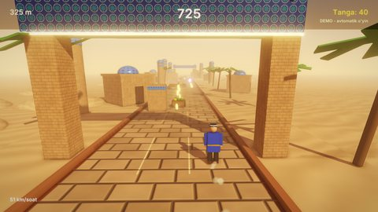

# Ipak Yo'li — 3D cheksiz yuguruvchi

Ipak yo'li bo'ylab savdogar yuguradi. Yo'lning uch yo'lagi bor; aravalar, to'siqlar, gilam osilgan darvozalar,
devorlar va karvonlar ustidan sakraysiz, tagidan sirpanib o'tasiz yoki yonidan aylanib o'tasiz. Yo'lda tangalar
terasiz. Masofa oshgan sari tezlik ham oshadi. Dunyo oldinda protsedurali quriladi, yo'l esa hech qachon tugamaydi.

## Ishga tushirish

| Qanday | Buyruq |
|---|---|
| Editor | `./build/bin/ZaminEditor Projects/EndlessRunner`, keyin Play |
| O'yin | `./build/bin/ZaminPlayer Projects/EndlessRunner` |
| Demo (bot yuguradi) | `ZAMIN_DEMO=1 ./build/bin/ZaminPlayer Projects/EndlessRunner` |
| Headless test | `Tests/samples_test.py --game EndlessRunner` |

## Boshqaruv

| Harakat | Klaviatura | Gamepad |
|---|---|---|
| Chap / o'ng yo'lak (`Left`, `Right`) | A / D, strelkalar | D-pad, LB / RB, chap stikni siltash (`Steer`) |
| Sakrash (`Jump`) | Space, W, yuqori strelka | A |
| Sirpanish (`Slide`; havoda bosilsa tez tushadi) | S, pastki strelka | B |
| Pauza (`Pause`) | Esc, P | Start |

## O'yin

- **To'siqlar** (har segmentda bitta naqsh, har doim kamida bitta o'tish yo'li qoladi): arava (ustidan sakrash yoki
  aylanib o'tish), past to'siq (butun yo'l bo'ylab — sakrash), gilamli darvoza (tagidan sirpanish), baland devor va
  uzun karvon (yo'lakni almashtirish kerak).
- **Tangalar** qator yoki yoy bo'lib turadi. **Bonuslar**: magnit yaqin tangalarni o'ziga tortadi, qalqon bitta
  urilishdan saqlaydi (to'siq parchalanib ketadi).
- **Tezlik** masofa bilan oshadi: `StartSpeed` 11 m/s dan `MaxSpeed` 30 m/s gacha. Har 500 m'da e'lon chiqadi.
- **Hisob**: masofa + tanga x 10. Rekord SaveData'da (`EndlessRunner.Best`, `EndlessRunner.BestDistance`).
- **Urilish**: yuguruvchi yiqiladi, kamera silkinadi, parchalar sochiladi. So'ng natija oynasi chiqadi.
- **Menyular**: bosh menyu (orqada bot yuguradi), pauza, natija oynasi (ochko, masofa, tangalar, rekord).

## Dvigatelning qaysi imkoniyatlari ko'rsatiladi

- Cheksiz dunyo: oldinda `SpawnAhead` metrgacha shablonlardan `Instantiate`, orqada qolganini o'chirish. Yo'l va qum
  tekisliklari yuguruvchi bilan birga siljiydi, teksturasi esa joyida turadi (materialning UV siljishi). Shu tufayli
  yo'l uzilmaydi.
- To'qnashuvlar fizikasiz, oddiy qutilar bilan tekshiriladi: yugurish kichik qadamlarda hisoblanadi va har qadamdan
  keyin tekshiriladi, shuning uchun sekin kadrda ham ingichka to'siqdan "sakrab o'tib" ketilmaydi.
- Protsedurali animatsiya: yugurish fazasiga qarab qo'l-oyoqlar tebranadi, sakrashda oyoqlar yig'iladi, sirpanishda
  tana orqaga yotadi, oyoq ostidan chang ko'tariladi.
- 3D: quyoshli osmon, tuman, soyalar, bloom, PBR (g'isht va yo'l normal map'lari), zarralar
  ([Rendering.md](../../docs/Rendering.md)); UI va lokalizatsiya ([UI.md](../../docs/UI.md)).

## Kod bo'ylab sayohat (`Source/`)

| Fayl | Nima bor |
|---|---|
| `Runner.h` | `RunnerGame`, `Runner`; to'siq va bonus turlari (`ObstacleKind`, `PickupKind`); bot uchun `Hazard` qidiruvi |
| `RunnerGame.cpp` | Dunyo: segmentlar va to'siq naqshlari (`SpawnSegment`), tangalar, bonuslar, manzara (minoralar, palmalar, qum tepalari, uylar, ravoqlar), tezlik, kichik qadamli simulyatsiya va to'qnashuvlar, hisob, rekord, HUD, menyular, demo |
| `Runner.cpp` | Yuguruvchi: yo'laklar orasida silliq o'tish, sakrash va gravitatsiya, sirpanish, animatsiya. Bot (`ThinkBot`) har yo'lakning bo'sh masofasini va tangalarini baholaydi. Sakrash nuqtasini tezlik va to'siq uzunligidan hisoblaydi, darvoza tagidan sirpanib o'tadi |

Inspektorda sozlanadigan maydonlar: `RunnerGame.StartSpeed`, `MaxSpeed`, `SpeedGain`, `SegmentLength`,
`SpawnAhead`, `AutoDemo`; `Runner.LaneWidth`, `JumpSpeed`, `Gravity`, `SlideTime`.

## Assetlar va ovozlar

`python3 Tools/samples/gen_endlessrunner.py` (numpy kerak) yo'l, g'isht, qum, koshin, gilam, mato va yog'och
teksturalarini (yo'l va g'isht normal map'lari bilan), 11 ta WAV ovozni (tanga, sakrash, qo'nish, sirpanish,
urilish, bonus, qalqon, shamol, musiqa ...), sahnani va loyiha faylini yaratadi. Assetlar ~1.3 MB.
`Tests/samples_assets.py --regen` ularni generator natijasi bilan solishtiradi.

## Testlar

`Tests/samples_test.py --game EndlessRunner` ikki holatni tekshiradi:

- demo: bot 700 kadrda urilmasdan kamida 400 m yuguradi, tangalar yig'adi, tezlik oshadi;
- menyular: hech kim boshqarmasa yuguruvchi birinchi to'siqqa urilib, natija oynasi chiqadi, so'ng bosh menyuga
  qaytiladi.
