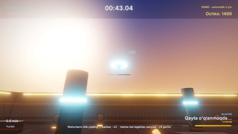

# FPS Arena — birinchi shaxs boshqaruvi va nishonga otish (3D)

Quyosh botayotgan arenada birinchi shaxsdan yuguriladi va otiladi. O'yinning ikki rejimi bor:

- **Parkur**: oltita yorqin nuqtadan ketma-ket o'tib, aylana vaqtini yaxshilaysiz;
- **Nishon otish**: 60 soniyalik raund, unda iloji boricha ko'p nishon urish kerak.

Gameplay C++ skriptlarda yozilgan, teksturalar (normal map'lari bilan) va ovozlar esa koddan yaratilgan
(`Tools/samples/gen_fpsarena.py`).

## Ishga tushirish

| Qanday | Buyruq |
|---|---|
| Editor | `./build/bin/ZaminEditor Projects/FPSArena`, keyin Play |
| O'yin | `./build/bin/ZaminPlayer Projects/FPSArena` |
| Demo: parkur | `ZAMIN_DEMO=1 ./build/bin/ZaminPlayer Projects/FPSArena` |
| Demo: nishon otish | `ZAMIN_DEMO=range ./build/bin/ZaminPlayer Projects/FPSArena` |
| Headless test | `Tests/samples_test.py --game FPSArena` |

## Boshqaruv

O'yin paytida kursor qulflanadi va yashiriladi. Menyularda u yana ko'rinadi.

| Harakat | Klaviatura / sichqoncha | Gamepad |
|---|---|---|
| Yurish (`MoveX`, `MoveY`) | W A S D, strelkalar | chap stik |
| Qarash (`LookX`, `LookY`) | sichqoncha | o'ng stik |
| Sakrash (`Jump`) | Space | A |
| Yugurish (`Sprint`) | chap Shift | chap stik bosilishi |
| Cho'kkalash (`Crouch`) | C, chap Ctrl | B |
| Otish (`Fire`) | sichqoncha chap tugmasi (bosib turilsa ketma-ket otadi) | RT, RB |
| Qayta o'qlash (`Reload`) | R | X |
| Pauza (`Pause`) | Esc, P | Start |

Sichqoncha sezgirligini pauza menyusidagi slayder o'zgartiradi. Qiymat SaveData'da (`FPSArena.Sensitivity`)
saqlanib qoladi.

## O'yin

- **Harakat**: yugurish chidamlilikni sarflaydi (to'liq yugurish 4 s yetadi). Platformadan chiqqandan keyin ham
  0.12 s ichida sakrash mumkin (coyote time), yerga tushishdan oldinroq bosilgan sakrash ham hisobga olinadi
  (input buferi). Cho'kkalaganda ko'z balandligi va tezlik pasayadi. Sakratgich o'yinchini yuqoriga otadi.
- **Kamera hissi**: qadam bilan bosh tebranadi va qadam tovushlari eshitiladi. Yonga yurganda kamera biroz qiyshayadi,
  yugurganda ko'rish burchagi (FOV) kengayadi. Qattiq qo'nganda kamera pastga cho'kadi va silkinadi.
- **Qurol** (`Blaster`): sekundiga 7 marta otadi, magazinda 12 ta o'q, qayta o'qlash 1.1 s. Harakatda va havoda
  o'q ko'proq tarqaladi. Har otishda tepki, nur izi, uchqunlar va yorug'lik chaqnashi bo'ladi; qutilarni o'q itarib
  yuboradi.
- **Nishonlar**: turg'un, relsda sirpanuvchi, vaqti-vaqti bilan chiquvchi va aylana bo'ylab uchuvchi dron. Markazga
  tegish ikki baravar ochko beradi. Urilgan nishon yiqiladi (dron portlaydi) va birozdan keyin qaytadi.
- **Nishon otish raundi**: ketma-ket tegishlar seriyasi ochkoni x4 gacha oshiradi. Raund oxirida aniqlik va eng
  uzun seriya ko'rsatiladi. Rekordlar SaveData'da (`FPSArena.BestLap`, `FPSArena.BestRange`).
- **Menyular**: bosh menyu (orqada bot parkur qilib, nishon otib yuradi), pauza (sezgirlik slayderi bilan),
  natijalar oynasi.

## Dvigatelning qaysi imkoniyatlari ko'rsatiladi

- `CharacterController3D` (Jolt), `Raycast3DAll` (o'yinchining o'z kapsulasi tashlab o'tiladi), dinamik jismlarga
  impuls ([Physics.md](../../docs/Physics.md)).
- `Cursor` API (qulflash va yashirish), sichqoncha harakati, gamepad o'qlari va input xaritasi
  ([Scripting.md](../../docs/Scripting.md)).
- PBR materiallar va normal map'lar, quyosh botishi osmoni, tuman, soyalar, SSAO, bloom, emissive chiziqlar, nuqtali
  yorug'liklar, zarralar ([Rendering.md](../../docs/Rendering.md)).
- Kamera silkinishi, `OnLateUpdate` (o'q kamera shu kadrda burilganidan keyin otiladi), prujinalarni kichik qat'iy
  qadamlarda hisoblash (sekin kadrlarda ham barqaror ishlaydi).
- UI: HUD, `UISlider`, natijalar oynasi, lokalizatsiya (uz / en) ([UI.md](../../docs/UI.md)).

## Kod bo'ylab sayohat (`Source/`)

| Fayl | Nima bor |
|---|---|
| `Arena.h` | Skript klasslari: `FirstPersonController`, `Blaster`, `Target`, `TracerFx`, `ArenaGame` |
| `FirstPersonController.cpp` | Tana (`CharacterController3D`) faqat chapga-o'ngga (yaw) buriladi, bosh / kamera bolasi esa yuqoriga-pastga (pitch) qaraydi. Bu yerda yurish, yugurish, chidamlilik, sakrash (coyote time, bufer), cho'kkalash, sakratgich, bosh tebranishi, FOV, qo'nish va tepki bor. Bot nuqtalar marshruti bo'ylab yuradi |
| `Weapon.cpp` | `Blaster`: otish, tarqoqlik, o'q-dori, qayta o'qlash, nur izi, uchqunlar, qutilarni itarish. Qurol devorga yaqinlashganda orqaga tortiladi. Botning nishon tanlashi ham shu yerda: yaqin va ko'rinib turgan nishon |
| `Targets.cpp` | `Target` (to'rt tur, `Hinge` atrofida yiqilish, qaytish, markazga yaqinlikka qarab ochko) va `TracerFx` |
| `ArenaGame.cpp` | Rejimlar, nazorat nuqtalari va aylana vaqti, raund, ochko va seriya, aniqlik, rekordlar, HUD ("+ochko" yozuvlari, tegish belgisi, tezlik, chidamlilik), menyular, demo |

Qayerdan boshlash kerak: `FirstPersonController::OnUpdate` (input → tezlik → `CharacterController3D::Move`) va
`Blaster::OnLateUpdate`.

Inspektorda sozlanadigan maydonlar: `FirstPersonController.WalkSpeed`, `SprintSpeed`, `JumpHeight`,
`MouseSensitivity`, `InvertY`, `FieldOfView`, `HeadBob`, `StaminaSeconds`; `Blaster.FireRate`, `MagazineSize`,
`ReloadTime`, `Spread`, `Recoil`, `PushImpulse`; `Target.Kind`, `Speed`, `RespawnTime`, `Points`;
`ArenaGame.RangeSeconds`, `AutoDemo`.

## Assetlar va ovozlar

`python3 Tools/samples/gen_fpsarena.py` (numpy kerak) beton, metall, quti teksturalari va ularning normal map'larini,
22 ta WAV ovozni (otish, qayta o'qlash, qadamlar, qo'nish, nishonlar, dron, muhit shovqini ...), sahnani va loyiha
faylini yaratadi. Assetlar ~1.5 MB. `Tests/samples_assets.py --regen` ularni generator natijasi bilan solishtiradi.

## Testlar

`Tests/samples_test.py --game FPSArena`: demo (bot 700 kadrda kamida bir aylana yuguradi, nuqtalardan o'tadi va
nishonlarni uradi) va menyular (pauzaning sezgirlik slayderidan o'tib bosh menyuga qaytiladi).
