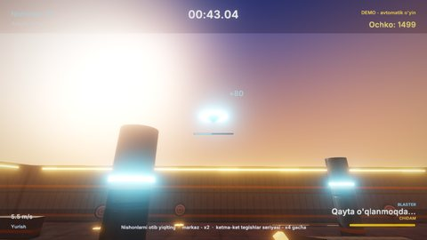

# FPS Arena — a first-person controller and target shooting (3D)

You run and shoot in first person in an arena at sunset. The game has two modes:

- **Parkour**: pass six bright checkpoints in order and improve your lap time;
- **Target range**: a 60-second round in which you have to hit as many targets as you can.

The gameplay is written in C++ scripts, and the textures (with their normal maps) and sounds are made from code
(`Tools/samples/gen_fpsarena.py`).

## Running

| How | Command |
|---|---|
| Editor | `./build/bin/ZaminEditor Projects/FPSArena`, then Play |
| Game | `./build/bin/ZaminPlayer Projects/FPSArena` |
| Demo: parkour | `ZAMIN_DEMO=1 ./build/bin/ZaminPlayer Projects/FPSArena` |
| Demo: target range | `ZAMIN_DEMO=range ./build/bin/ZaminPlayer Projects/FPSArena` |
| Headless test | `Tests/samples_test.py --game FPSArena` |

## Controls

While playing the cursor is locked and hidden. In menus it is shown again.

| Action | Keyboard / mouse | Gamepad |
|---|---|---|
| Move (`MoveX`, `MoveY`) | W A S D, arrows | left stick |
| Look (`LookX`, `LookY`) | mouse | right stick |
| Jump (`Jump`) | Space | A |
| Sprint (`Sprint`) | left Shift | left stick click |
| Crouch (`Crouch`) | C, left Ctrl | B |
| Fire (`Fire`) | left mouse button (fires repeatedly while held) | RT, RB |
| Reload (`Reload`) | R | X |
| Pause (`Pause`) | Esc, P | Start |

The slider in the pause menu changes the mouse sensitivity. The value is kept in SaveData
(`FPSArena.Sensitivity`).

## The game

- **Movement**: sprinting spends stamina (a full sprint lasts 4 s). A jump is still possible for 0.12 s after
  leaving a platform (coyote time), and a jump pressed a little before landing counts too
  (the input buffer). Crouching lowers the eye height and the speed. The jump pad throws the player upwards.
- **Camera feel**: the head bobs with the steps and footsteps are heard. The camera tilts a little when strafing,
  the field of view (FOV) widens when sprinting. On a hard landing the camera dips and shakes.
- **The weapon** (`Blaster`): fires 7 times a second, 12 shots in the magazine, reloading takes 1.1 s. Shots spread
  more when moving and in the air. Every shot has recoil, a tracer, sparks and a flash of light; shots push
  crates away.
- **Targets**: standing, sliding on a rail, popping up from time to time, and a drone flying in a circle. A hit in the
  centre gives double points. A target that is hit falls (the drone explodes) and comes back a little later.
- **The target range round**: a streak of hits in a row raises the points up to x4. At the end of the round the accuracy
  and the longest streak are shown. Records are in SaveData (`FPSArena.BestLap`, `FPSArena.BestRange`).
- **Menus**: the main menu (a bot does parkour and shoots targets behind it), pause (with the sensitivity slider),
  the results window.

## Which engine features it shows

- `CharacterController3D` (Jolt), `Raycast3DAll` (the player's own capsule is skipped), impulses on dynamic
  bodies ([Physics.md](../../docs/Physics.md)).
- The `Cursor` API (locking and hiding), mouse movement, gamepad axes and the input map
  ([Scripting.md](../../docs/Scripting.md)).
- PBR materials and normal maps, a sunset sky, fog, shadows, SSAO, bloom, emissive strips, point
  lights, particles ([Rendering.md](../../docs/Rendering.md)).
- Camera shake, `OnLateUpdate` (the shot is fired after the camera has turned in this frame), springs computed in small
  fixed steps (stable in slow frames too).
- UI: the HUD, `UISlider`, the results window, localization (uz / en) ([UI.md](../../docs/UI.md)).

## A tour of the code (`Source/`)

| File | What is in it |
|---|---|
| `Arena.h` | The script classes: `FirstPersonController`, `Blaster`, `Target`, `TracerFx`, `ArenaGame` |
| `FirstPersonController.cpp` | The body (`CharacterController3D`) only turns left and right (yaw), while the head / camera child looks up and down (pitch). Walking, sprinting, stamina, jumping (coyote time, buffer), crouching, the jump pad, head bob, FOV, landing and recoil are here. The bot walks along a route of points |
| `Weapon.cpp` | `Blaster`: firing, spread, ammo, reloading, the tracer, sparks, pushing crates. The weapon is pulled back close to a wall. The bot's choice of target is here too: a near and visible target |
| `Targets.cpp` | `Target` (four kinds, falling around the `Hinge`, coming back, points by closeness to the centre) and `TracerFx` |
| `ArenaGame.cpp` | The modes, checkpoints and lap time, the round, points and streak, accuracy, records, the HUD (the "+points" popups, the hit marker, speed, stamina), menus, the demo |

Where to start: `FirstPersonController::OnUpdate` (input → velocity → `CharacterController3D::Move`) and
`Blaster::OnLateUpdate`.

Fields that can be tuned in the inspector: `FirstPersonController.WalkSpeed`, `SprintSpeed`, `JumpHeight`,
`MouseSensitivity`, `InvertY`, `FieldOfView`, `HeadBob`, `StaminaSeconds`; `Blaster.FireRate`, `MagazineSize`,
`ReloadTime`, `Spread`, `Recoil`, `PushImpulse`; `Target.Kind`, `Speed`, `RespawnTime`, `Points`;
`ArenaGame.RangeSeconds`, `AutoDemo`.

## Assets and sounds

`python3 Tools/samples/gen_fpsarena.py` (needs numpy) makes the concrete, metal and crate textures and their normal maps,
22 WAV sounds (shot, reload, footsteps, landing, targets, drone, ambience ...), the scene and the project
file. The assets are ~1.5 MB. `Tests/samples_assets.py --regen` compares them with the generator's output.

## Tests

`Tests/samples_test.py --game FPSArena`: demo (in 700 frames the bot runs at least one lap, passes the checkpoints and
hits the targets) and menus (going past the pause menu's sensitivity slider back to the main menu).
