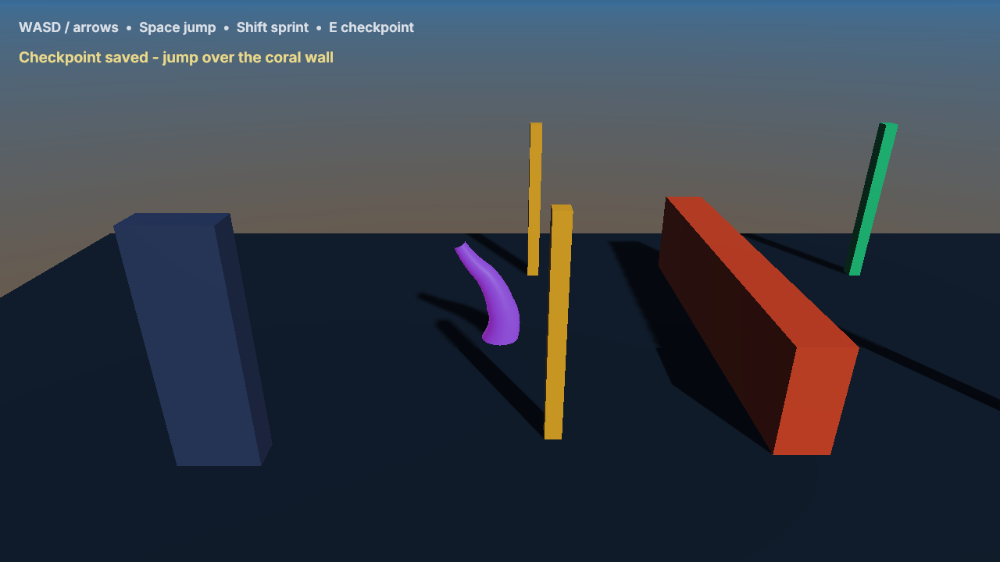

# Gameplay Workshop

Open `GameplayWorkshop.zproject` in ZaminEditor, select Course2D or Course3D and Play.
No C++ game module or compiler is required. The launcher discovers this project automatically.

- WASD / arrows: move. Space: jump (release early for a shorter jump).
- Shift: sprint. E: restore checkpoint. Mouse: orbit in 3D.
- Golden marker saves; jump over the coral wall; green gate completes the course.
- Falling restores the checkpoint. Player resumes a persistent checkpoint after restarting.

Player graphs own input, motor, velocity→Animator binding, triggers and checkpoint routing.
Camera graphs follow in LateUpdate. CourseDirector's Auto/Checks overrides are disabled by default;
the acceptance harness enables them only in temporary copies. The 3D runner is a procedural skeletal
model with three clips, shared from the engine's VisualWorkshop sample.

See [Gameplay documentation](../../docs/Gameplay.md) and run
`python3 Tests/gameplay_workflow_test.py --build build --exports` from the repository root.
