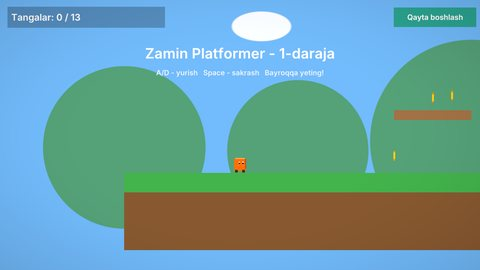

# Zamin Platformer — a 2D sample project

The engine's very first sample. It has a three-level 2D platformer: a tilemap, moving platforms, enemies, coins, a
parallax background and 2D lights. On top of that there is a separate showcase scene for each 2D feature (physics,
joints, ragdoll, UI, AI, the scene flow). The start scene is `Level1`.

## Running

| How | Command |
|---|---|
| Editor | `./build/bin/ZaminEditor Projects/Platformer2D` (open any scene from `Scenes/` in the content browser, then Play) |
| Game | `./build/bin/ZaminPlayer Projects/Platformer2D` (`--scene Scenes/Menu.zscene` — from the main menu) |
| Another scene | `./build/bin/ZaminPlayer Projects/Platformer2D --scene Scenes/Ragdoll2D.zscene` |
| Headless test | `Tests/samples_test.py --game Platformer2D` |

## Controls (levels 1-3)

| Action | Keyboard / mouse | Gamepad |
|---|---|---|
| Walk (`Horizontal`) | A / D, arrows | left stick, D-pad |
| Jump (`Jump`) | Space, W, up arrow | A |
| Run (`Sprint`) | left Shift | left stick press |
| Shoot / throw (`Fire`, in the showcase scenes) | left mouse button, left Ctrl | RT |
| Interact (`Interact`) | E | X |
| Pause (`Pause`) | Esc | Start |

The pause menu has "Resume", "Settings" (sound groups, display, language) and "Quit".

## Scenes

| Scene | What it shows |
|---|---|
| `Menu`, `Loading`, `Level1`-`Level3` | The main menu (`Prefabs/GameMenu.zprefab`) → a loading screen (`LoadSceneAsync`, a progress bar, a fade) → three levels: a tilemap, coins, enemies, moving platforms, clouds, the end of the level, a pause menu; the collected coins are in SaveData (`TotalCoins`) |
| `Showcase2D` | Sprites and sprite animation, a parallax background, 2D physics, camera follow (`Camera2DFollow`) |
| `Tilemap2D` | The tilemap and its colliders |
| `Shapes2D` | Polygon and edge colliders, physics materials, collision layers, one-way platforms |
| `Effectors2D` | Area / Buoyancy Effector 2D, an `OverlapCircle2D` explosion, a `Raycast2DAll` laser |
| `Joints2D` | A Wheel Joint 2D car, motorized joints, a breakable joint |
| `Ragdoll2D` | An 11-part ragdoll prefab (10 limited Revolute Joint 2D) |
| `TopDown2D`, `NavDemo2D`, `Chase2D` | A top-down hero (sprite animation clips and events), NavGrid 2D and Nav Agents, guards: Patrol Path, Sight Sensor, a state machine |
| `UILayout`, `UIWidgets` | The UI hierarchy, anchors, Canvas scaling, layout groups; a slider, a toggle, a progress bar, a text field |
| `SubScenes` | `SubSceneComponent`: placing the `Parts/Camp.zscene` piece in several places and loading it later |

## A tour of the code (`Source/`)

| File | What is in it |
|---|---|
| `Player.cpp` | `PlayerController`: walking and jumping with the input map (Rigidbody 2D) |
| `Gameplay.cpp` | `Coin`, `CameraFollow`, `MovingPlatform`, `Cloud`, `LevelGoal` (the next level), `AutoDestroy`, `RestartButton` |
| `GameManager.cpp/.h` | The score, coins, the HUD text |
| `GameMenu.cpp`, `PauseMenu.cpp`, `SceneFlow.cpp` | The main menu (settings: display, quality, gamma, sound, language), the pause menu, the loading screen and the scene flow |
| `Shapes.cpp`, `Effectors.cpp`, `Joints.cpp`, `Ragdoll.cpp` | The physics showcases |
| `TopDown.cpp`, `Chase.cpp` | The top-down hero and the AI guards |
| `UILayoutDemo.cpp`, `UIWidgetsDemo.cpp` | The UI showcases |

The [2D tutorial](../../docs/Tutorial-2D.md) uses this project too.

## Tests

`Tests/samples_test.py --game Platformer2D` checks two cases:

- smoke: `Level1` runs without errors and renders a picture;
- menus: in `Menu.zscene`, pressing Enter makes the loading screen load level 1, and Esc opens the pause menu.

This project is also used by the `Tests/export_test.sh` export test.
