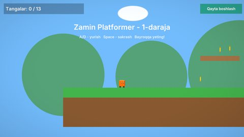

# Zamin Platformer — 2D namuna loyihasi

Dvigatelning eng birinchi namunasi. Uch darajali 2D platformer bor: tilemap, harakatlanuvchi platformalar,
dushmanlar, tangalar, parallaks fon va 2D yorug'lik. Unga qo'shimcha ravishda har bir 2D imkoniyat uchun alohida
ko'rgazma sahnalari bor (fizika, joint'lar, ragdoll, UI, AI, sahnalar oqimi). Boshlang'ich sahna — `Level1`.

## Ishga tushirish

| Qanday | Buyruq |
|---|---|
| Editor | `./build/bin/ZaminEditor Projects/Platformer2D` (Kontent brauzerida `Scenes/` dan istalgan sahnani oching, keyin Play) |
| O'yin | `./build/bin/ZaminPlayer Projects/Platformer2D` (`--scene Scenes/Menu.zscene` — bosh menyudan) |
| Boshqa sahna | `./build/bin/ZaminPlayer Projects/Platformer2D --scene Scenes/Ragdoll2D.zscene` |
| Headless test | `Tests/samples_test.py --game Platformer2D` |

## Boshqaruv (1-3 darajalar)

| Harakat | Klaviatura / sichqoncha | Gamepad |
|---|---|---|
| Yurish (`Horizontal`) | A / D, strelkalar | chap stik, D-pad |
| Sakrash (`Jump`) | Space, W, yuqori strelka | A |
| Yugurish (`Sprint`) | chap Shift | chap stik bosilishi |
| Otish / tashlash (`Fire`, ko'rgazma sahnalarida) | sichqoncha chap tugmasi, chap Ctrl | RT |
| O'zaro ta'sir (`Interact`) | E | X |
| Pauza (`Pause`) | Esc | Start |

Pauza menyusida "Davom etish", "Sozlamalar" (ovoz guruhlari, ekran, til) va "Chiqish" bor.

## Sahnalar

| Sahna | Nima ko'rsatadi |
|---|---|
| `Menu`, `Loading`, `Level1`-`Level3` | Bosh menyu (`Prefabs/GameMenu.zprefab`) → yuklanish ekrani (`LoadSceneAsync`, progress bar, so'nib o'tish) → uch daraja: tilemap, tangalar, dushmanlar, harakatlanuvchi platformalar, bulutlar, darajaning oxiri, pauza menyusi; yig'ilgan tangalar SaveData'da (`TotalCoins`) |
| `Showcase2D` | Sprite'lar va sprite animatsiyasi, parallaks fon, 2D fizika, kamera kuzatuvi (`Camera2DFollow`) |
| `Tilemap2D` | Tilemap va uning collider'lari |
| `Shapes2D` | Ko'pburchak va chiziq kolliderlari, fizik materiallar, to'qnashuv qatlamlari, bir tomonlama platformalar |
| `Effectors2D` | Area / Buoyancy Effector 2D, `OverlapCircle2D` portlash, `Raycast2DAll` lazer |
| `Joints2D` | Wheel Joint 2D mashina, motorli joint'lar, uziladigan joint |
| `Ragdoll2D` | 11 bo'lakli ragdoll prefabi (10 ta chegarali Revolute Joint 2D) |
| `TopDown2D`, `NavDemo2D`, `Chase2D` | Top-down qahramon (sprite animatsiya kliplari va event'lar), NavGrid 2D va Nav Agent'lar, qo'riqchilar: Patrol Path, Sight Sensor, holat mashinasi |
| `UILayout`, `UIWidgets` | UI ierarxiyasi, anchor'lar, Canvas masshtabi, layout guruhlari; slayder, belgilash, progress bar, matn maydoni |
| `SubScenes` | `SubSceneComponent`: `Parts/Camp.zscene` bo'lagini bir necha joyga qo'yish va keyinroq yuklash |

## Kod bo'ylab sayohat (`Source/`)

| Fayl | Nima bor |
|---|---|
| `Player.cpp` | `PlayerController`: input xaritasi bilan yurish va sakrash (Rigidbody 2D) |
| `Gameplay.cpp` | `Coin`, `CameraFollow`, `MovingPlatform`, `Cloud`, `LevelGoal` (keyingi daraja), `AutoDestroy`, `RestartButton` |
| `GameManager.cpp/.h` | Hisob, tangalar, HUD matni |
| `GameMenu.cpp`, `PauseMenu.cpp`, `SceneFlow.cpp` | Bosh menyu (sozlamalar: ekran, sifat, gamma, ovoz, til), pauza menyusi, yuklanish ekrani va sahnalar oqimi |
| `Shapes.cpp`, `Effectors.cpp`, `Joints.cpp`, `Ragdoll.cpp` | Fizika ko'rgazmalari |
| `TopDown.cpp`, `Chase.cpp` | Top-down qahramon va AI qo'riqchilar |
| `UILayoutDemo.cpp`, `UIWidgetsDemo.cpp` | UI ko'rgazmalari |

Bu loyihadan [2D qo'llanma](../../docs/Tutorial-2D.md) ham foydalanadi.

## Testlar

`Tests/samples_test.py --game Platformer2D` ikki holatni tekshiradi:

- smoke: `Level1` xatosiz ishlaydi va rasm chiqaradi;
- menyular: `Menu.zscene` da Enter bosilganda yuklanish ekrani 1-darajani yuklaydi, Esc pauza menyusini ochadi.

Bu loyiha `Tests/export_test.sh` eksport testida ham ishlatiladi.
