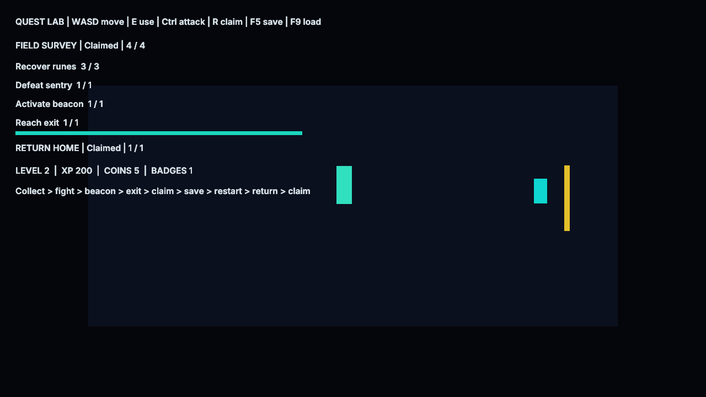

# Quest Workshop

Open QuestWorkshop.zproject and choose Quest2D or Quest3D. No native game module or game compiler
is required. WASD moves, E interacts, Ctrl attacks, R claims, F5 saves and F9 loads.

Walk right, collect the three purple runes, defeat the sentry, activate the turquoise beacon and
cross the golden exit line. Claim the survey reward: five coins and 150 XP. This unlocks Return Home.
Save, close/reopen the Player and load, then walk back left and claim the badge and another 50 XP.
Save again. Restart/load and press R: the book remains at 200 XP, five coins and one badge.

The tracker/progress bar reads native quest state. Collect, kill and interaction objectives observe
committed shared-rule actions; the exit/return triggers use stable receipts. The sentry is a saved
prefab slot and deactivates its body on death. Runes/beacon save their used state, preventing another
pickup after restart. Player, NPC and director are reusable Blueprint graphs.

Auto, Checks and Phase start false/zero. Acceptance runs use private project copies. Auto mode stores
a small preference to choose its next restart phase; actual quest progress and rewards live in the
versioned gameplay snapshot. All content is engine-owned.

See [quest/progression API and limits](../../docs/GameplayQuest.md).
Run `python3 Tests/quest_workflow_test.py --build build --exports` from the repository root.
Regenerate with `python3 Tools/samples/gen_quest_workshop.py`; the thumbnail is preserved.
