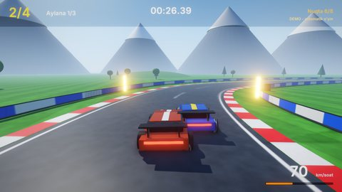

# Vodiy Poygasi — oddiy mashina fizikasi bilan poyga (3D)

Tog' vodiysidagi 750 metrlik aylanma trassada uchta bot raqib bilan uch aylana poyga qilasiz. Start svetofori
yonib-o'chadi, keyin GO! Trassada 8 ta nazorat nuqtasi bor, aylana vaqti hisoblanadi va eng yaxshisi saqlanadi.
Mashina fizikasi arkada uslubida: tezlanish, tormoz, tezlikka bog'liq rul, yon ilashish va qo'l tormozida drift.

## Ishga tushirish

| Qanday | Buyruq |
|---|---|
| Editor | `./build/bin/ZaminEditor Projects/Racing`, keyin Play |
| O'yin | `./build/bin/ZaminPlayer Projects/Racing` |
| Demo (o'yinchi mashinasini bot haydaydi) | `ZAMIN_DEMO=1 ./build/bin/ZaminPlayer Projects/Racing` |
| Headless test | `Tests/samples_test.py --game Racing` |

## Boshqaruv

| Harakat | Klaviatura | Gamepad |
|---|---|---|
| Gaz (`Throttle`) | W, yuqori strelka | RT |
| Tormoz / orqaga (`Brake`) | S, pastki strelka | LT |
| Rul (`Steer`) | A / D, chap / o'ng strelka | chap stik |
| Qo'l tormozi — drift (`Handbrake`) | Space | X, A |
| Trassaga qaytish (`Reset`) | R | Y |
| Pauza (`Pause`; start sanog'ida ham) | Esc, P | Start |

## O'yin

- **Fizika** (`Car`): mashina tekislikda harakatlanadi (x, z va burilish burchagi). Tezlik oldinga va yonga
  ajratiladi:
  - dvigatel oldinga itaradi, lekin maksimal tezlikka yaqinlashgan sari kuchsizlanadi;
  - tormoz va orqaga yurish bor, havo qarshiligi tezlikni pasaytiradi;
  - yon tezlik `Grip` bilan so'nadi. Qo'l tormozida ilashish kamayadi (`DriftGrip`), shunda mashina sirpanadi;
  - rul tezlikka bog'liq: joyida turganda burilmaydi, yuqori tezlikda kamroq buriladi;
  - asfaltdan chiqib o'tga tushsa, mashina sekinlashadi va kamroq ilashadi;
  - trassa chetidagi to'siq mashinani qaytaradi va sekinlashtiradi. Mashinalar bir-biriga tegsa, itarishadi.
- **Poyga** (`RaceGame`): start svetoforida beshta chiroq birin-ketin yonadi, so'ng hammasi o'chadi. Aylana
  hisoblanishi uchun nazorat nuqtalaridan tartib bilan o'tib, start chizig'ini kesib o'tish kerak. O'rinlar trassa
  bo'ylab bosib o'tilgan masofadan aniqlanadi. Marradan keyin natija oynasi chiqadi (o'rin, umumiy vaqt, eng yaxshi
  aylana). Rekord SaveData'da (`Racing.BestLap`).
- **Effektlar**: g'ildiraklar aylanadi va buriladi, kuzov og'adi, tormoz chiroqlari yonadi. Drift va o'tda tutun
  hamda chang chiqadi. Dvigatel ovozining balandligi va toni tezlikka bog'liq, sirpanishning o'z ovozi bor.
- **Menyular**: bosh menyu (orqada to'rt bot poyga qiladi), pauza (start sanog'ida ham ishlaydi), natija oynasi.

## Dvigatelning qaysi imkoniyatlari ko'rsatiladi

- Koddan yaratilgan `.obj` mesh'lar: trassaning markaziy chizig'i Catmull-Rom spline bo'yicha quriladi, yo'l,
  bordyur va to'siqlar shu chiziq bo'ylab "lenta" qilib yasaladi. Daraxtlar (trassadan uzoqroqda), tepaliklar va
  tog'lar ham sahnaga generator tomonidan joylanadi.
- Skriptdagi fizika: Jolt'siz, oddiy tekislik modeli (arkada mashinalar uchun yetarli va barqaror), kichik
  qadamlarda hisoblanadi (`Car::Simulate`). `Math::Damp` bilan kuzov og'ishi, rul va kamera silliq ergashadi.
- Ovoz manbasining balandligi va tonini har kadr o'zgartirish: `SetAudioPitch`, `SetAudioVolume` (dvigatel,
  sirpanish) ([Audio.md](../../docs/Audio.md)).
- 3D: osmon, tuman, soyalar, bloom, zarralar (tutun, chang, uchqunlar) ([Rendering.md](../../docs/Rendering.md));
  HUD (`UIProgressBar` spidometr), menyular va lokalizatsiya ([UI.md](../../docs/UI.md)).

## Kod bo'ylab sayohat (`Source/`)

| Fayl | Nima bor |
|---|---|
| `Race.h` | `Track` (markaziy chiziq: nuqtalar va ulargacha masofa), `Car`, `RaceGame` |
| `Car.cpp` | `Track` (eng yaqin nuqta, masofadagi nuqta va yo'nalish), mashina fizikasi (`Simulate`: gaz, tormoz, rul, ilashish, drift, o't, to'siqlar), g'ildirak va kuzov animatsiyasi, tutun, ovoz. Botda trassa chizig'idagi oldinroq nuqtaga rul buriladi, tezlik oldindagi burilish keskinligiga qarab tanlanadi, keskin burilishda qo'l tormozi bilan sirpaniladi. Tiqilib qolgan bot trassaga qaytadi |
| `RaceGame.cpp` | Poyga oqimi: start svetofori va sanoq, nazorat nuqtalari, aylanalar, o'rinlar, mashinalar to'qnashuvi, kamera, HUD, menyular, rekord, demo |

Inspektorda sozlanadigan maydonlar: `Car.EngineAccel`, `MaxSpeed`, `BrakeDecel`, `SteerRate`, `Grip`, `DriftGrip`,
`Skill` (botning tezligi), `LineOffset` (botning chizig'i); `RaceGame.Laps`, `CheckpointCount`, `AutoDemo`.

## Assetlar va ovozlar

`python3 Tools/samples/gen_racing.py` (numpy kerak) quyidagilarni yaratadi:

- trassa: markaziy chiziq va undan yasalgan `Models/road.obj`, `kerbs.obj`, `barriers.obj`;
- teksturalar: asfalt, o't, bordyur, to'siq, marra katakchalari, g'ildirak;
- 10 ta WAV ovoz: dvigatel, sirpanish, urilish, signal, GO, nazorat nuqtasi, aylana, marra, musiqa va boshqalar;
- sahna va loyiha fayli.

Assetlar ~1.9 MB. `Tests/samples_assets.py --regen` ularni generator natijasi bilan solishtiradi.

## Testlar

`Tests/samples_test.py --game Racing` ikki holatni tekshiradi:

- demo: bot birinchi aylanani tugatadi va o'rin hisoblanadi;
- menyular: Enter bilan poyga boshlanadi, start sanog'ida pauza ochiladi va yopiladi, pauzadan bosh menyuga
  qaytiladi.
