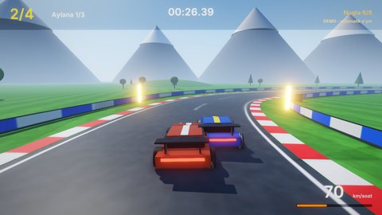

# Valley Race — a race with simple car physics (3D)

You race three laps against three bot rivals on a 750-metre circuit in a mountain valley. The start lights
come on and go out, then GO! The track has 8 checkpoints, the lap time is measured and the best one is kept.
The car physics is arcade style: acceleration, braking, speed-dependent steering, sideways grip and drifting on the handbrake.

## Running

| How | Command |
|---|---|
| Editor | `./build/bin/ZaminEditor Projects/Racing`, then Play |
| Game | `./build/bin/ZaminPlayer Projects/Racing` |
| Demo (a bot drives the player's car) | `ZAMIN_DEMO=1 ./build/bin/ZaminPlayer Projects/Racing` |
| Headless test | `Tests/samples_test.py --game Racing` |

## Controls

| Action | Keyboard | Gamepad |
|---|---|---|
| Throttle (`Throttle`) | W, up arrow | RT |
| Brake / reverse (`Brake`) | S, down arrow | LT |
| Steering (`Steer`) | A / D, left / right arrow | left stick |
| Handbrake — drift (`Handbrake`) | Space | X, A |
| Back on track (`Reset`) | R | Y |
| Pause (`Pause`; during the start countdown too) | Esc, P | Start |

## The game

- **Physics** (`Car`): the car moves on a plane (x, z and the heading angle). The velocity is split into forward
  and sideways:
  - the engine pushes forward but gets weaker as the car nears its top speed;
  - there is braking and reversing, and air drag lowers the speed;
  - the sideways velocity dies with `Grip`. On the handbrake the grip drops (`DriftGrip`), so the car slides;
  - steering depends on speed: no turning at a standstill, less turning at high speed;
  - when it leaves the asphalt for the grass, the car slows down and grips less;
  - the barrier at the track's edge bounces the car back and slows it. Cars push each other when they touch.
- **The race** (`RaceGame`): five start lights come on one after another, then all go out. For a lap to
  count you have to pass the checkpoints in order and cross the start line. Positions are worked out from the
  distance covered along the track. After the finish the results window comes up (position, total time, best
  lap). The record is in SaveData (`Racing.BestLap`).
- **Effects**: the wheels spin and steer, the body rolls, the brake lights come on. Drifting and the grass raise smoke
  and dust. The engine sound's volume and pitch depend on the speed, and skidding has its own sound.
- **Menus**: the main menu (four bots race behind it), pause (it works during the start countdown too), the results window.

## Which engine features it shows

- `.obj` meshes made from code: the track's centre line is built along a Catmull-Rom spline, and the road,
  kerbs and barriers are made as "ribbons" along that line. The trees (away from the track), hills and
  mountains are placed in the scene by the generator too.
- Physics in a script: no Jolt, a simple plane model (enough and stable for arcade cars), computed in small
  steps (`Car::Simulate`). The body roll, the steering and the camera follow smoothly with `Math::Damp`.
- Changing an audio source's volume and pitch every frame: `SetAudioPitch`, `SetAudioVolume` (the engine,
  skidding) ([Audio.md](../../docs/Audio.md)).
- 3D: sky, fog, shadows, bloom, particles (smoke, dust, sparks) ([Rendering.md](../../docs/Rendering.md));
  the HUD (a `UIProgressBar` speedometer), menus and localization ([UI.md](../../docs/UI.md)).

## A tour of the code (`Source/`)

| File | What is in it |
|---|---|
| `Race.h` | `Track` (the centre line: points and the distance to them), `Car`, `RaceGame` |
| `Car.cpp` | `Track` (the nearest point, the point and direction at a distance), the car physics (`Simulate`: throttle, brake, steering, grip, drift, grass, barriers), the wheel and body animation, smoke, sound. The bot steers at a point further along the track line, picks its speed by how sharp the coming bend is and slides with the handbrake in a sharp bend. A bot that gets stuck returns to the track |
| `RaceGame.cpp` | The race flow: the start lights and countdown, checkpoints, laps, positions, car collisions, the camera, the HUD, menus, the record, the demo |

Fields that can be tuned in the inspector: `Car.EngineAccel`, `MaxSpeed`, `BrakeDecel`, `SteerRate`, `Grip`, `DriftGrip`,
`Skill` (the bot's speed), `LineOffset` (the bot's line); `RaceGame.Laps`, `CheckpointCount`, `AutoDemo`.

## Assets and sounds

`python3 Tools/samples/gen_racing.py` (needs numpy) makes the following:

- the track: the centre line and the `Models/road.obj`, `kerbs.obj`, `barriers.obj` built from it;
- textures: asphalt, grass, kerb, barrier, the finish chequers, wheel;
- 10 WAV sounds: engine, skid, crash, beep, GO, checkpoint, lap, finish, music and others;
- the scene and the project file.

The assets are ~1.9 MB. `Tests/samples_assets.py --regen` compares them with the generator's output.

## Tests

`Tests/samples_test.py --game Racing` checks two cases:

- demo: the bot finishes the first lap and the position is worked out;
- menus: Enter starts the race, the pause menu opens and closes during the start countdown, and from pause it goes
  back to the main menu.
