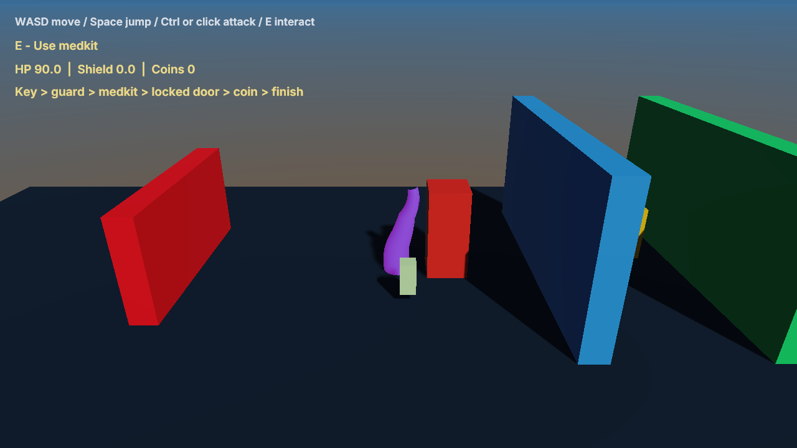

# Rules Workshop

A compiler-free 2D/3D combat and interaction course. Open RulesWorkshop.zproject and choose Rules2D
or Rules3D, then Play. The project appears automatically in the launcher's sample gallery.

WASD moves, Space jumps, Ctrl/left click attacks, E interacts. First touch the red hazard to die and
respawn. Then collect the golden key, defeat the guard, use the medkit, unlock the blue door,
collect the coin and enter the green finish. HP, shield and coins are shown live.

Player, enemy, hazard, key, medkit, door, coin, goal and camera have separate reusable Blueprint
graphs. Health, bags and interaction records are shared within the scene. Respawn restores the
memory checkpoint and retains collected progress during that run. Restarting the game reloads
the authored scene; inventory and combat state are not persistent game saves.

Auto and Checks defaults are false. The acceptance harness enables them only in private copies.
The procedural skeletal runner is reused from GameplayWorkshop; all content is engine-owned.

See [gameplay rules](../../docs/GameplayRules.md).
Run `python3 Tests/rules_workflow_test.py --build build --exports` from the repository root.
Regenerate assets with `python3 Tools/samples/gen_rules_workshop.py`.
