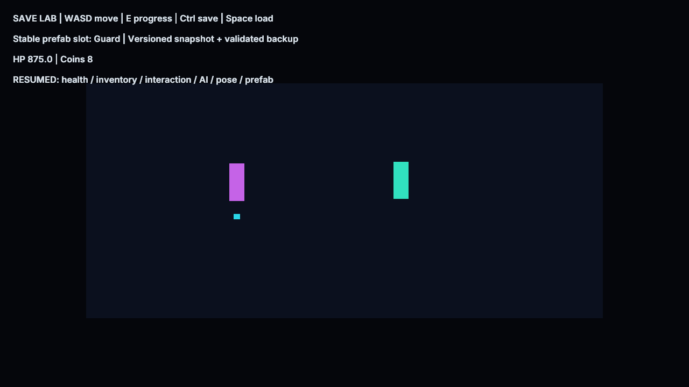

# Save Workshop

Open SaveWorkshop.zproject, choose Save2D or Save3D and Play. No game compiler or native game
module is required. WASD moves, E applies example progress, Ctrl saves and Space loads.

E awards a key and coins, consumes a key at the golden door, damages the player and the independently
spawned guard. Move the player, save, close the Player, reopen and press Space: HP 875, eight coins,
the used door, guard HP 40, player pose and AI patrol progress resume. The guard is recreated into
its stable Guard slot with a new UUID before loading. It continues navigating after restoration.

Player, director and NPC have separate Blueprint graphs. Auto, Checks and Resume default to false.
Tests enable them in private copies; automatic export runs write once and then resume in later
processes. That QA phase flag is a separate GameState preference; health/bag/interaction/AI are
verified through native runtime reads. The geometry is intentionally simple engine-owned content.

See [snapshot scope, limits and recovery](../../docs/GameplaySave.md).
Run `python3 Tests/save_workflow_test.py --build build --exports` from the repository root.
Regenerate assets with `python3 Tools/samples/gen_save_workshop.py`; the thumbnail is preserved.
