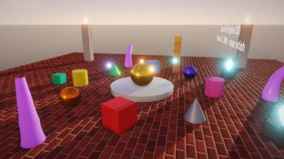

# Showcase3D — 3D imkoniyatlar ko'rgazmasi

Bu o'yin emas, ko'rgazma: har bir sahna dvigatelning bitta 3D imkoniyatini ko'rsatadi (renderer, materiallar,
fizika, animatsiya, zarralar, ovoz, AI, matematika). Har sahnani editorda ochib, Play bilan o'ynab ko'rish va
inspektorda sozlamalarini o'zgartirish mumkin. Boshlang'ich sahna — `Showcase`.

## Ishga tushirish

| Qanday | Buyruq |
|---|---|
| Editor | `./build/bin/ZaminEditor Projects/Showcase3D` (Kontent brauzeri yoki "Sahnalar" paneli orqali sahna tanlanadi) |
| O'yin | `./build/bin/ZaminPlayer Projects/Showcase3D --scene Scenes/Particles.zscene` |
| Headless test | `Tests/samples_test.py --game Showcase3D` |

Sahnalarning ko'pida kamera sichqoncha bilan aylantiriladi (`OrbitCamera`), ba'zilarida W A S D bilan yuriladi
(`PlayerMover3D`), sichqoncha bosilganda shar otiladi (`BallShooter`) yoki ragdoll tashlanadi.

## Sahnalar

| Sahna | Nima ko'rsatadi |
|---|---|
| `Showcase`, `Sunset`, `Lights`, `MaterialGallery` | PBR materiallar (metall, g'adir-budirlik, emissiya, normal map'lar), yo'naltirilgan / nuqtali / projektor yorug'liklar, soyalar, osmon, tuman, post-processing (bloom, SSAO, tonemapping) |
| `Physics3D`, `Joints3D`, `Ragdoll3D`, `Queries3D`, `PhysicsDebug3D` | Jolt fizikasi: jismlar, materiallar, joint'lar, ragdoll, raycast / sweep / overlap so'rovlari, trigger'lar, fizika debug chizish |
| `Animation`, `Animator` | glTF skeletli animatsiya, Animator holat mashinasi, blend tree, morph target'lar, animatsiya event'lari |
| `Particles`, `ParticlesII`-`ParticlesIV` | Zarralar: rang gradienti, o'lcham va tezlik egri chiziqlari, sprite sheet, sub-emitter'lar, to'qnashuv, shovqin, izlar, GPU instancing, burst'lar, kamera atrofidagi yomg'ir va qor |
| `Audio` | 3D ovoz, Doppler effekti, muhit zonalari (suv ostida past chastota filtri), musiqa, ovoz guruhlari |
| `AI3D`, `Navigation3D`, `Squad3D` | NavGrid 3D va Nav Agent'lar, Nav Obstacle eshik, holat mashinasi va Sight Sensor, steering (qo'ylar suruvi), behavior tree va guruh harakati |
| `Olomon` | 169 ta animatsiyali personaj: Animator keshlash, ko'rinmaydiganlarini o'tkazib yuborish, `ParallelFor` |
| `Splines`, `Geometry`, `DebugDraw` | Spline yo'llar va Spline Follower, AnimationCurve, shovqin, rang (HSV); `Math/Geometry.h` nur testlari; debug chizish |

## Kod bo'ylab sayohat (`Source/`)

| Fayl | Nima bor |
|---|---|
| `Showcase.cpp` | Ko'p sahnalar uchun kichik skriptlar: `Rotator`, `Bobbing`, `Orbit`, `OrbitCamera`, `PlayerMover3D`, `BallShooter`, `TowerBuilder`, fizika so'rovlari (`SphereSweep3D`, `OverlapGlow3D`, `LaserAll3D` ...), ragdoll, ovoz (`MusicDirector`, `DopplerFlyby`, `UnderwaterZone` ...), animatsiya (`AnimatorDemo`, `BlendShapeDemo` ...) |
| `AI.cpp`, `Squad.cpp` | AI sahnalari: siljiydigan eshik, qorovul (holat mashinasi), kuzatuv kamerasi, qo'ylar suruvi; komandir (behavior tree) va otryad |
| `Splines.cpp`, `Geometry.cpp` | Egri chiziqlar, shovqin va rang; geometriya testlari |

Sahnalar bir-biridan mustaqil. Biror imkoniyatni o'rganish uchun tegishli sahnani oching, inspektorda uning
skriptini toping va `Source/` dagi klassini o'qing. Qo'llanmalar: [Rendering.md](../../docs/Rendering.md),
[Physics.md](../../docs/Physics.md), [Animation.md](../../docs/Animation.md), [Audio.md](../../docs/Audio.md),
[AI.md](../../docs/AI.md).

## Testlar

`Tests/samples_test.py --game Showcase3D` (smoke): boshlang'ich sahna xatosiz ishlaydi va rasm chiqaradi. Editor
smoke testi (`Tests/editor_smoke.sh`) va rendering regressiya testi (`Showcase3D` holati) ham shu loyihadan
foydalanadi.
