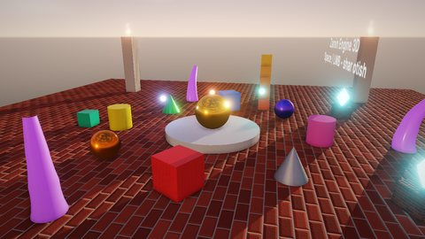

# Showcase3D — a showcase of the 3D features

This is not a game but a showcase: each scene shows one 3D feature of the engine (the renderer, materials, physics,
animation, particles, sound, AI, math). Every scene can be opened in the editor, tried out with Play, and its settings
changed in the inspector. The start scene is `Showcase`.

## Running

| How | Command |
|---|---|
| Editor | `./build/bin/ZaminEditor Projects/Showcase3D` (pick a scene in the content browser or the "Scenes" panel) |
| Game | `./build/bin/ZaminPlayer Projects/Showcase3D --scene Scenes/Particles.zscene` |
| Headless test | `Tests/samples_test.py --game Showcase3D` |

In most scenes the camera is orbited with the mouse (`OrbitCamera`); in some you walk with W A S D
(`PlayerMover3D`), and a mouse click shoots a ball (`BallShooter`) or drops a ragdoll.

## Scenes

| Scene | What it shows |
|---|---|
| `Showcase`, `Sunset`, `Lights`, `MaterialGallery` | PBR materials (metal, roughness, emission, normal maps), directional / point / spot lights, shadows, the sky, fog, post-processing (bloom, SSAO, tonemapping) |
| `Physics3D`, `Joints3D`, `Ragdoll3D`, `Queries3D`, `PhysicsDebug3D` | Jolt physics: bodies, materials, joints, a ragdoll, raycast / sweep / overlap queries, triggers, physics debug drawing |
| `Animation`, `Animator` | glTF skeletal animation, the Animator state machine, a blend tree, morph targets, animation events |
| `Particles`, `ParticlesII`-`ParticlesIV` | Particles: a color gradient, size and velocity curves, a sprite sheet, sub-emitters, collision, noise, trails, GPU instancing, bursts, rain and snow around the camera |
| `Audio` | 3D sound, the Doppler effect, ambient zones (a low-pass filter under water), music, sound groups |
| `AI3D`, `Navigation3D`, `Squad3D` | NavGrid 3D and Nav Agents, a Nav Obstacle door, a state machine and Sight Sensor, steering (a flock of sheep), a behavior tree and group movement |
| `Olomon` | A crowd of 169 animated characters: Animator caching, skipping the invisible ones, `ParallelFor` |
| `Splines`, `Geometry`, `DebugDraw` | Spline paths and the Spline Follower, AnimationCurve, noise, color (HSV); the ray tests of `Math/Geometry.h`; debug drawing |

## A tour of the code (`Source/`)

| File | What is in it |
|---|---|
| `Showcase.cpp` | Small scripts for many scenes: `Rotator`, `Bobbing`, `Orbit`, `OrbitCamera`, `PlayerMover3D`, `BallShooter`, `TowerBuilder`, physics queries (`SphereSweep3D`, `OverlapGlow3D`, `LaserAll3D` ...), the ragdoll, sound (`MusicDirector`, `DopplerFlyby`, `UnderwaterZone` ...), animation (`AnimatorDemo`, `BlendShapeDemo` ...) |
| `AI.cpp`, `Squad.cpp` | The AI scenes: a sliding door, a guard (a state machine), a follow camera, a flock of sheep; a commander (a behavior tree) and a squad |
| `Splines.cpp`, `Geometry.cpp` | Curves, noise and color; the geometry tests |

The scenes are independent of each other. To study a feature, open its scene, find its script in the inspector and
read its class in `Source/`. Guides: [Rendering.md](../../docs/Rendering.md),
[Physics.md](../../docs/Physics.md), [Animation.md](../../docs/Animation.md), [Audio.md](../../docs/Audio.md),
[AI.md](../../docs/AI.md).

## Tests

`Tests/samples_test.py --game Showcase3D` (smoke): the start scene runs without errors and renders a picture. The
editor smoke test (`Tests/editor_smoke.sh`) and the rendering regression test (the `Showcase3D` case) use this
project too.
