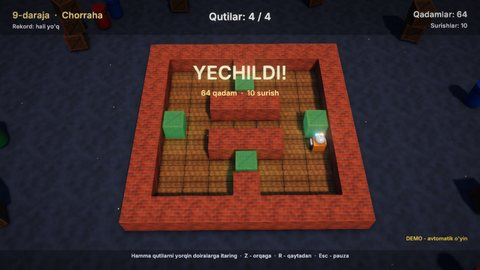

# Omborchi — 3D Sokoban

Kichik robot omborda qutilarni yorqin doiralarga itarib qo'yadi. Qutini faqat itarish mumkin, tortib bo'lmaydi.
O'yinda oddiydan murakkabga qarab 10 ta daraja bor ("Birinchi qadam" dan "Katta ombor" gacha). Xato qadamni orqaga
qaytarish (undo) yoki darajani boshidan boshlash mumkin. Har daraja uchun eng kam qadamlar soni saqlanadi. Demo bot
darajalarni yechuvchi (BFS) yordamida o'zi yechadi.

## Ishga tushirish

| Qanday | Buyruq |
|---|---|
| Editor | `./build/bin/ZaminEditor Projects/Sokoban`, keyin Play |
| O'yin | `./build/bin/ZaminPlayer Projects/Sokoban` |
| Demo (bot yechadi) | `ZAMIN_DEMO=1 ./build/bin/ZaminPlayer Projects/Sokoban` (`ZAMIN_START_LEVEL=5` — 5-darajadan) |
| Darajalar menyusi darhol | `ZAMIN_SHOW_LEVELS=1 ./build/bin/ZaminPlayer Projects/Sokoban` |
| Headless test | `Tests/samples_test.py --game Sokoban` |

## Boshqaruv

| Harakat | Klaviatura | Gamepad |
|---|---|---|
| Qadam (`MoveX`, `MoveY`; bosib turilsa takrorlanadi) | W A S D, strelkalar | D-pad, chap stik |
| Orqaga qaytarish (`Undo`) | Z, Backspace | X |
| Qaytadan boshlash (`Restart`) | R | Y |
| Pauza (`Pause`) | Esc, P | Start |
| Menyularda | strelkalar + Enter | D-pad + A |

## O'yin

- Har qadam katakdan katakka silliq animatsiya bilan bo'ladi. Robot yurgan tomonga buriladi, devorga urilsa
  "qaytib" chiqadi. Quti maqsadga tushganda yashil tusga kiradi va uchqun sochadi.
- Daraja boshlanganda bloklar yuqoridan birin-ketin tushib keladi. Daraja yechilganda konfetti otiladi, robot aylanadi
  va natija oynasi chiqadi (qadamlar, surishlar, rekord; "Keyingi daraja", "Qaytadan", "Bosh menyu").
- **Darajalar menyusi**: 10 ta katakli grid. Yechilgan darajalar belgilanadi va har birida eng yaxshi natija ko'rinadi.
- **Rekordlar** SaveData'da: har daraja uchun eng kam qadam (`Sokoban.Best.<N>`) va oxirgi o'ynalgan daraja
  (`Sokoban.Level`). "O'ynash" tugmasi birinchi yechilmagan darajani ochadi.
- **Menyular**: bosh menyu (orqada bot darajalarni yechib turadi), darajalar, pauza, natija oynasi.

## Dvigatelning qaysi imkoniyatlari ko'rsatiladi

- O'yin mantiqini dvigateldan ajratish: `Board.h` / `Board.cpp` oddiy C++ (sahna ham, komponent ham yo'q), uni
  test qilish oson. Skript esa faqat ko'rinish va input bilan shug'ullanadi.
- Sahnani koddan qurish: devor, pol, maqsad va quti shablonlari `Instantiate` qilinadi, ortiqcha devorlar
  (`IsVisibleWall`) chizilmaydi.
- 3D: PBR materiallar (g'isht devor, yog'och quti, pol) normal map'lar bilan, soyalar, nuqtali yorug'liklar, bloom, zarralar (chang, konfetti,
  maqsad chaqnashi) ([Rendering.md](../../docs/Rendering.md)).
- UI: grid layout (`UILayoutGroup`), ko'p tugmali navigatsiya, `UIAnimation`, lokalizatsiya (uz / en)
  ([UI.md](../../docs/UI.md)).

## Kod bo'ylab sayohat (`Source/`)

| Fayl | Nima bor |
|---|---|
| `Board.h`, `Board.cpp` | `Sokoban::Board`: daraja matnini o'qish (`Load`), qadam va surish (`Step`), orqaga qaytarish tarixi (`Undo`), `Reset`, yechilganini tekshirish va yechuvchi (BFS — surishlar soni bo'yicha eng qisqa yo'l; qutini hech qachon maqsadga olib bo'lmaydigan "o'lik" kataklar oldindan chiqarib tashlanadi) |
| `Levels.cpp` | 10 ta daraja, Sokoban'ning odatiy yozuvida: `#` devor, `.` maqsad, `$` quti, `*` maqsaddagi quti, `@` o'yinchi, `+` maqsaddagi o'yinchi. O'zbekcha va inglizcha nomlari bilan |
| `Sokoban.h`, `SokobanGame.cpp` | `SokobanGame`: darajani 3D bloklardan qurish, robot harakati va animatsiyasi, kamera, HUD, menyular, rekordlar, bot (`UpdateBot` — yechimni qadamma-qadam bajaradi; 2-darajadan boshlab bitta xato qadam qo'yib, uni orqaga qaytaradi, shunda undo ham ko'rinadi) |

Yangi daraja qo'shish uchun `Levels.cpp` ga matn yozing. Generator (`Tools/samples/gen_sokoban.py`) har darajaning
yechilishini tekshiradi.

Inspektorda sozlanadigan maydonlar: `SokobanGame.StepTime` (bir qadam necha soniya), `CameraPitch`, `AutoDemo`.

## Assetlar va ovozlar

`python3 Tools/samples/gen_sokoban.py` (numpy kerak) g'isht, quti, pol, maqsad va yer teksturalarini (g'isht, quti
va polning normal map'lari bilan), 10 ta WAV ovozni (qadam, surish, urilish, maqsad, undo, qaytadan boshlash, daraja
boshlanishi va tugashi, musiqa), sahnani va loyiha faylini yaratadi. Assetlar ~1.5 MB. `Tests/samples_assets.py --regen` ularni generator natijasi bilan
solishtiradi.

## Testlar

`Tests/samples_test.py --game Sokoban` uch holatni tekshiradi:

- demo: bot kamida 3 ta darajani yechadi va undo'dan foydalanadi;
- menyular: Enter bilan 1-daraja boshlanadi, pauza ochiladi va yopiladi, ikki marta D bosilsa daraja yechiladi,
  natija oynasidan bosh menyuga qaytiladi;
- darajalar menyusi ochiladi va yopiladi.
