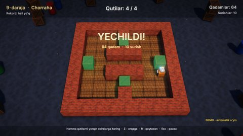

# Warehouse Keeper — 3D Sokoban

A small robot pushes crates onto the bright circles in a warehouse. A crate can only be pushed, never pulled.
The game has 10 levels from simple to hard (from "First step" to "Big warehouse"). A wrong move can be
undone, or the level can be started again. The fewest moves are kept for every level. The demo bot
solves the levels by itself with the solver (BFS).

## Running

| How | Command |
|---|---|
| Editor | `./build/bin/ZaminEditor Projects/Sokoban`, then Play |
| Game | `./build/bin/ZaminPlayer Projects/Sokoban` |
| Demo (the bot solves) | `ZAMIN_DEMO=1 ./build/bin/ZaminPlayer Projects/Sokoban` (`ZAMIN_START_LEVEL=5` — from level 5) |
| The level menu at once | `ZAMIN_SHOW_LEVELS=1 ./build/bin/ZaminPlayer Projects/Sokoban` |
| Headless test | `Tests/samples_test.py --game Sokoban` |

## Controls

| Action | Keyboard | Gamepad |
|---|---|---|
| Move (`MoveX`, `MoveY`; repeats while held) | W A S D, arrows | D-pad, left stick |
| Undo (`Undo`) | Z, Backspace | X |
| Restart (`Restart`) | R | Y |
| Pause (`Pause`) | Esc, P | Start |
| In menus | arrows + Enter | D-pad + A |

## The game

- Every move goes from cell to cell with a smooth animation. The robot turns the way it walks and "bounces
  back" when it bumps into a wall. A crate that lands on a goal turns green and throws sparks.
- When a level starts the blocks drop in from above one after another. When a level is solved confetti flies, the robot spins
  and the results window comes up (moves, pushes, the record; "Next level", "Restart", "Main menu").
- **The level menu**: a grid of 10 cells. Solved levels are marked and each shows its best result.
- **Records** are in SaveData: the fewest moves for every level (`Sokoban.Best.<N>`) and the level played last
  (`Sokoban.Level`). The "Play" button opens the first unsolved level starting from the one the player played last
  (which level the bot behind the main menu has reached does not matter).
- Keys pressed during a move animation are not lost: the next move or undo waits in a queue and runs as soon as the
  animation ends.
- **Menus**: the main menu (a bot keeps solving levels behind it), levels, pause, the results window.

## Which engine features it shows

- Keeping game logic apart from the engine: `Board.h` / `Board.cpp` are plain C++ (no scene and no component), so they
  are easy to test. The script only deals with the view and input.
- Building a scene from code: the wall, floor, goal and crate templates are `Instantiate`d, and needless walls
  (`IsVisibleWall`) are not drawn.
- 3D: PBR materials (brick wall, wooden crate, floor) with normal maps, shadows, point lights, bloom, particles (dust, confetti,
  the goal flash) ([Rendering.md](../../docs/Rendering.md)).
- UI: a grid layout (`UILayoutGroup`), navigation over many buttons, `UIAnimation`, localization (uz / en)
  ([UI.md](../../docs/UI.md)).

## A tour of the code (`Source/`)

| File | What is in it |
|---|---|
| `Board.h`, `Board.cpp` | `Sokoban::Board`: reading the level text (`Load`), moving and pushing (`Step`), the undo history (`Undo`), `Reset`, checking for solved and the solver (BFS — the shortest path by number of pushes; "dead" cells from which a crate can never be taken to a goal are ruled out beforehand) |
| `Levels.cpp` | 10 levels in Sokoban's usual notation: `#` wall, `.` goal, `$` crate, `*` crate on a goal, `@` player, `+` player on a goal. With their Uzbek and English names |
| `Sokoban.h`, `SokobanGame.cpp` | `SokobanGame`: building the level from 3D blocks, the robot's movement and animation, the camera, the HUD, menus, records, the bot (`UpdateBot` — carries out the solution move by move; from level 2 on it makes one wrong move and undoes it, so undo is seen too) |

To add a level, write its text in `Levels.cpp`. The generator (`Tools/samples/gen_sokoban.py`) checks that every level
can be solved.

Fields that can be tuned in the inspector: `SokobanGame.StepTime` (how many seconds one move takes), `CameraPitch`, `AutoDemo`.

## Assets and sounds

`python3 Tools/samples/gen_sokoban.py` (needs numpy) makes the brick, crate, floor, goal and ground textures (with the normal
maps of the brick, the crate and the floor), 10 WAV sounds (move, push, bump, goal, undo, restart, level
start and end, music), the scene and the project file. The assets are ~1.5 MB. `Tests/samples_assets.py --regen` compares them with the
generator's output.

## Tests

`Tests/samples_test.py --game Sokoban` checks three cases:

- demo: the bot solves at least 3 levels and uses undo;
- menus: Enter starts level 1, the pause menu opens and closes, pressing D twice solves the level,
  the results window leads back to the main menu;
- the level menu opens and closes.
