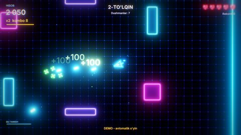

# Neon Maydon — top-down shooter (2D)

Neon chiroqli maydonda kema boshqariladi. Dushmanlar to'lqin-to'lqin bo'lib portallardan chiqadi, siz esa ularni
otib, ochko va kombo yig'asiz. Har 5-to'lqinda tank keladi. O'yindagi hamma narsa C++ skriptlarda yozilgan, rasm va
ovozlar esa koddan yaratilgan (`Tools/samples/gen_topdownshooter.py`).

## Ishga tushirish

| Qanday | Buyruq |
|---|---|
| Editor | `./build/bin/ZaminEditor Projects/TopDownShooter`, keyin Play (yoki launcher'dagi "Namuna o'yinlar" kartasi) |
| O'yin | `./build/bin/ZaminPlayer Projects/TopDownShooter` |
| Demo (bot o'ynaydi) | `ZAMIN_DEMO=1 ./build/bin/ZaminPlayer Projects/TopDownShooter` |
| Headless test | `Tests/samples_test.py --game TopDownShooter` (yoki `ctest -R SampleTopDownShooter`) |

Bosh menyu orqasida ham bot o'ynab turadi ("attract" rejimi).

## Boshqaruv

Bog'lashlar loyiha input xaritasida (Project settings > Input), ularni o'yinni qayta build qilmasdan o'zgartirish
mumkin.

| Harakat | Klaviatura / sichqoncha | Gamepad |
|---|---|---|
| Yurish (`MoveX`, `MoveY`) | W A S D | chap stik, D-pad |
| Nishon olish (`AimX`, `AimY`) | sichqoncha yoki strelkalar | o'ng stik (og'dirilsa o'zi otadi) |
| Otish (`Fire`) | sichqoncha chap tugmasi, J | RT, RB |
| Siltanish (`Dash`) | Space, chap Shift | A, LB |
| Pauza (`Pause`) | Esc, P | Start |
| Menyularda | strelkalar + Enter, sichqoncha | D-pad + A |

## O'yin

- **Kema**: 5 ta jon, siltanish paytida o'q tegmaydi (qisqa vaqt, keyin qayta tiklanadi), sichqoncha bilan aniq
  nishon olinadi.
- **Dushmanlar** (bitta `Enemy` klassi, `Kind` maydoni): quvg'in (kemaga qarab yuguradi va tegsa portlaydi), to'da
  (kichik, tez, guruh bo'lib keladi), o'qchi (masofa saqlab otadi), hujumchi (kuch yig'ib to'g'ri chiziqda
  otiladi), tank (sekin va qalin, halqa shaklida o'q sochadi, o'lganda to'daga bo'linadi).
- **To'lqinlar**: har to'lqinning "budjeti" oldingisidan katta. Dushmanlar portaldan "o'sib" chiqadi, hammasi
  o'ldirilganda "to'lqin tozalandi" va bonus beriladi.
- **Hisob va kombo**: dushman ochkosi kombo ko'paytuvchisiga ko'paytiriladi. Ketma-ket o'ldirishlar `ComboWindow`
  (2.6 s) ichida bo'lsa kombo davom etadi; HUD'da kombo taymeri chizig'i ko'rinadi, ochko ekranga "+ochko" bo'lib
  chiqadi.
- **Bonuslar**: +1 jon, tez otish, uchtalik o'q (vaqtinchalik).
- **Rekord**: eng yaxshi hisob va to'lqin SaveData'da saqlanadi (`Neon.BestScore`, `Neon.BestWave`).
- **Menyular**: bosh menyu (o'ynash, til, chiqish), pauza (davom etish, qaytadan, bosh menyu), o'yin tugadi oynasi
  (hisob, to'lqin, yangi rekord).

## Dvigatelning qaysi imkoniyatlari ko'rsatiladi

- 2D: sprite atlas (`SpriteRenderer` + kadrlar), Box2D jismlar va sensorlar ([Physics.md](../../docs/Physics.md)),
  `Camera2DFollow`, `Parallax` fon.
- 2D yorug'lik (`Light2D`, yoritiladigan pol), bloom, vinyetka ([Rendering.md](../../docs/Rendering.md)); portlash
  zarralari, yorug'lik chaqnashlari, zarb to'lqini halqasi, kamera silkinishi.
- Skript API: `Instantiate` bilan shablonlardan yaratish, `SendMessage` / xabar ishlovchilari, `SetTimeScale`
  (o'lim paytidagi sekinlashuv), `PauseGame`, SaveData, lokalizatsiya (`Localize`, uz / en)
  ([Scripting.md](../../docs/Scripting.md)).
- UI: `UICanvas`, tugmalar, klaviatura / gamepad navigatsiyasi, `UIAnimation`, `UIProgressBar`
  ([UI.md](../../docs/UI.md)).
- Ovoz: `PlaySound` (balandlik va tovush tonini o'zgartirib), musiqa guruhi, pauzada past chastota filtri
  ([Audio.md](../../docs/Audio.md)).

## Kod bo'ylab sayohat (`Source/`)

| Fayl | Nima bor |
|---|---|
| `Shooter.h` | Hamma skript klasslari: `ShooterGame`, `PlayerShip`, `Enemy`, `Projectile`, `Pickup`, `FxAnimator`; dushman va bonus turlari (`EnemyKind`, `PickupKind`) |
| `ShooterGame.cpp` | O'yin oqimi: holatlar (`Menu`, `Playing`, `Paused`, `GameOver`), to'lqinlar (`BuildWaveQueue` — budjet bo'yicha dushmanlar ro'yxati, `UpdateWaves`, portal joyini tanlash), hisob / kombo (`OnEnemyKilled`), effektlar (`Explode`, `Popup`, chaqnash chiroqlari puli), HUD, menyular, rekord, demo jurnali |
| `PlayerShip.cpp` | Kema: input xaritasidan yurish va nishon, otish tezligi, siltanish, bonuslar. Shu yerda bot ham bor: dushman va o'qlardan qochadi, devordan uzoqlashadi, eng yaqin dushmanni oldindan mo'ljallab otadi |
| `Enemies.cpp` | `Enemy` (beshala turning xatti-harakati, o'q tekkanda oq chaqnash va orqaga surilish), `Projectile`, `Pickup`, `FxAnimator` (halqa va ochko yozuvlari animatsiyasi) |

Qayerdan boshlash kerak: `ShooterGame::OnStart` (xabar ishlovchilari va menyu) → `ShooterGame::OnUpdate` →
`StartWave`. Sahna (`Assets/Scenes/Arena.zscene`) generator yozgan oddiy JSON: dushman, o'q va effekt shablonlari
sahnada o'chirilgan holda turadi, skript ularni `EntityRef` maydonlari orqali topib nusxalaydi.

Inspektorda sozlanadigan maydonlar: `ShooterGame.ComboWindow`, `ArenaHalfSize`, `AutoDemo`; `PlayerShip.MoveSpeed`,
`FireRate`, `DashSpeed`, `DashCooldown`, `MaxHealth`; `Enemy.Health`, `Speed`, `Score`.

## Assetlar va ovozlar

Hech qanday qo'lda chizilgan fayl yo'q: `python3 Tools/samples/gen_topdownshooter.py` (numpy kerak) sprite atlas,
pol va fon teksturalari, 15 ta WAV ovoz (otish, portlash, to'lqin, bonus, musiqa ...), sahna, `.zproject` va
`CMakeLists.txt` ni qayta yozadi. Assetlar ~1.5 MB. `Tests/samples_assets.py --regen` generator natijasi
repozitoriydagi fayllar bilan bir xil ekanini tekshiradi.

## Testlar

`Tests/samples_test.py --game TopDownShooter`: demo (bot 900 kadrda hisob, o'ldirilgan dushmanlar, ikkinchi to'lqin
va kombo yig'adi) va menyular (Enter — o'ynash, Esc — pauza, yana Esc — davom, pauzadan bosh menyuga) — jurnaldagi
`Demo: ...` va `Menyu: ...` qatorlari bo'yicha.
