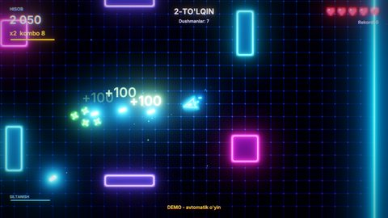

# Neon Arena — top-down shooter (2D)

You fly a ship in a neon-lit arena. Enemies come out of portals wave after wave, and you shoot them
for points and combos. A tank comes every 5th wave. Everything in the game is written in C++ scripts, and the pictures
and sounds are made from code (`Tools/samples/gen_topdownshooter.py`).

## Running

| How | Command |
|---|---|
| Editor | `./build/bin/ZaminEditor Projects/TopDownShooter`, then Play (or the "Sample games" card in the launcher) |
| Game | `./build/bin/ZaminPlayer Projects/TopDownShooter` |
| Demo (the bot plays) | `ZAMIN_DEMO=1 ./build/bin/ZaminPlayer Projects/TopDownShooter` |
| Headless test | `Tests/samples_test.py --game TopDownShooter` (or `ctest -R SampleTopDownShooter`) |

A bot keeps playing behind the main menu too ("attract" mode).

## Controls

The bindings are in the project's input map (Project settings > Input); they can be changed without rebuilding
the game.

| Action | Keyboard / mouse | Gamepad |
|---|---|---|
| Move (`MoveX`, `MoveY`) | W A S D | left stick, D-pad |
| Aim (`AimX`, `AimY`) | mouse or arrows | right stick (it fires by itself when tilted) |
| Fire (`Fire`) | left mouse button, J | RT, RB |
| Dash (`Dash`) | Space, left Shift | A, LB |
| Pause (`Pause`) | Esc, P | Start |
| In menus | arrows + Enter, mouse | D-pad + A |

## The game

- **The ship**: 5 lives, shots do not hit during a dash (a short time, then it recharges), precise aiming
  with the mouse.
- **Enemies** (one `Enemy` class, the `Kind` field): the chaser (runs at the ship and explodes on contact), the swarm
  (small, fast, comes in groups), the shooter (keeps its distance and fires), the charger (winds up and shoots off in
  a straight line), the tank (slow and thick, sprays shots in a ring, splits into a swarm when it dies).
- **Waves**: every wave's "budget" is bigger than the one before. Enemies "grow" out of a portal; when all are
  killed, "wave cleared" and a bonus is given.
- **Score and combo**: an enemy's points are multiplied by the combo multiplier. The combo goes on while kills in a row
  fall within `ComboWindow` (2.6 s); the HUD shows the combo timer bar, and points pop up on screen as
  "+points".
- **Power-ups**: +1 life, rapid fire, triple shot (temporary).
- **Record**: the best score and wave are kept in SaveData (`Neon.BestScore`, `Neon.BestWave`).
- **Menus**: the main menu (play, language, quit), pause (resume, restart, main menu), the game over window
  (score, wave, new record).

## Which engine features it shows

- 2D: a sprite atlas (`SpriteRenderer` + frames), Box2D bodies and sensors ([Physics.md](../../docs/Physics.md)),
  `Camera2DFollow`, a `Parallax` background.
- 2D lighting (`Light2D`, a lit floor), bloom, vignette ([Rendering.md](../../docs/Rendering.md)); explosion
  particles, light flashes, the shockwave ring, camera shake.
- The script API: creating from templates with `Instantiate`, `SendMessage` / message handlers, `SetTimeScale`
  (the slow motion at death), `PauseGame`, SaveData, localization (`Localize`, uz / en)
  ([Scripting.md](../../docs/Scripting.md)).
- UI: `UICanvas`, buttons, keyboard / gamepad navigation, `UIAnimation`, `UIProgressBar`
  ([UI.md](../../docs/UI.md)).
- Sound: `PlaySound` (with varied volume and pitch), the music group, a low-pass filter while paused
  ([Audio.md](../../docs/Audio.md)).

## A tour of the code (`Source/`)

| File | What is in it |
|---|---|
| `Shooter.h` | All the script classes: `ShooterGame`, `PlayerShip`, `Enemy`, `Projectile`, `Pickup`, `FxAnimator`; the enemy and power-up kinds (`EnemyKind`, `PickupKind`) |
| `ShooterGame.cpp` | The game flow: states (`Menu`, `Playing`, `Paused`, `GameOver`), waves (`BuildWaveQueue` — the list of enemies by budget, `UpdateWaves`, choosing a portal spot), score / combo (`OnEnemyKilled`), effects (`Explode`, `Popup`, the pool of flash lights), the HUD, menus, the record, the demo log |
| `PlayerShip.cpp` | The ship: movement and aim from the input map, the fire rate, the dash, power-ups. The bot is here too: it dodges enemies and shots, keeps away from walls, and leads the nearest enemy when firing |
| `Enemies.cpp` | `Enemy` (the behaviour of all five kinds, the white flash and knock-back when a shot hits), `Projectile`, `Pickup`, `FxAnimator` (the animation of the ring and the score popups) |

Where to start: `ShooterGame::OnStart` (the message handlers and the menu) → `ShooterGame::OnUpdate` →
`StartWave`. The scene (`Assets/Scenes/Arena.zscene`) is plain JSON written by the generator: the enemy, shot and effect
templates sit in the scene switched off, and the script finds them through `EntityRef` fields and copies them.

Fields that can be tuned in the inspector: `ShooterGame.ComboWindow`, `ArenaHalfSize`, `AutoDemo`; `PlayerShip.MoveSpeed`,
`FireRate`, `DashSpeed`, `DashCooldown`, `MaxHealth`; `Enemy.Health`, `Speed`, `Score`.

## Assets and sounds

There is no hand-drawn file: `python3 Tools/samples/gen_topdownshooter.py` (needs numpy) rewrites the sprite atlas,
the floor and background textures, 15 WAV sounds (shot, explosion, wave, power-up, music ...), the scene, the `.zproject` and
`CMakeLists.txt`. The assets are ~1.5 MB. `Tests/samples_assets.py --regen` checks that the generator's output is
the same as the files in the repository.

## Tests

`Tests/samples_test.py --game TopDownShooter`: demo (in 900 frames the bot gathers score, kills, a second wave
and a combo) and menus (Enter — play, Esc — pause, Esc again — resume, from pause to the main menu) — by the
`Demo: ...` and `Menu: ...` lines of the log.
