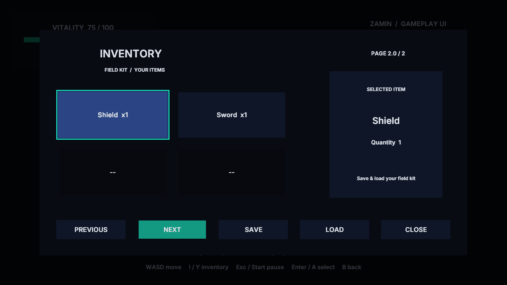

# Gameplay UI Workshop

Open UIWorkshop.zproject, choose UI2D or UI3D and Play. No native game module or game compiler is
required. WASD moves, I / gamepad Y opens inventory and Escape / Start opens pause. Arrows / D-pad
navigate, Enter / A selects and Escape / B returns. Controls opens a nested modal and Back restores
its previous focus. Pause stops the world; inventory blocks player input while the world keeps moving.

HUD health, coins and bag capacity read shared gameplay state. Four reusable inventory buttons show
six items over two pages. Empty cells disable themselves. Details follow the selected item. Save and
Load work while a menu is open. To make the result visible, saving deliberately reduces HP from 75
to 40 and coins from eight to five; loading restores 75/eight and updates the HUD and rows.
The guard is an independent persistent prefab slot. Menu state itself is not part of the save.

Player, UI controller and NPC use separate reusable Blueprint graphs. Auto, Checks and Capture
start false; acceptance scripts enable them in private copies. UI time stays live during pause.
All content is engine-owned. See [gameplay UI API and limits](../../docs/GameplayUI.md).

Run `python3 Tests/ui_workflow_test.py --build build --exports` from the repository root.
Regenerate assets with `python3 Tools/samples/gen_ui_workshop.py`; the thumbnail is preserved.
