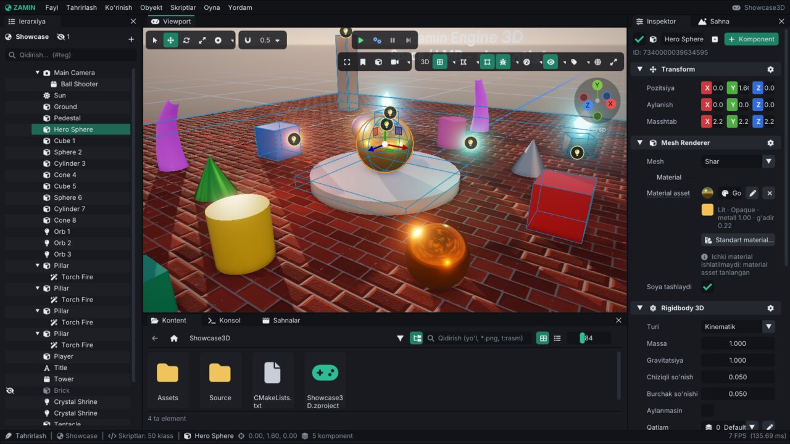
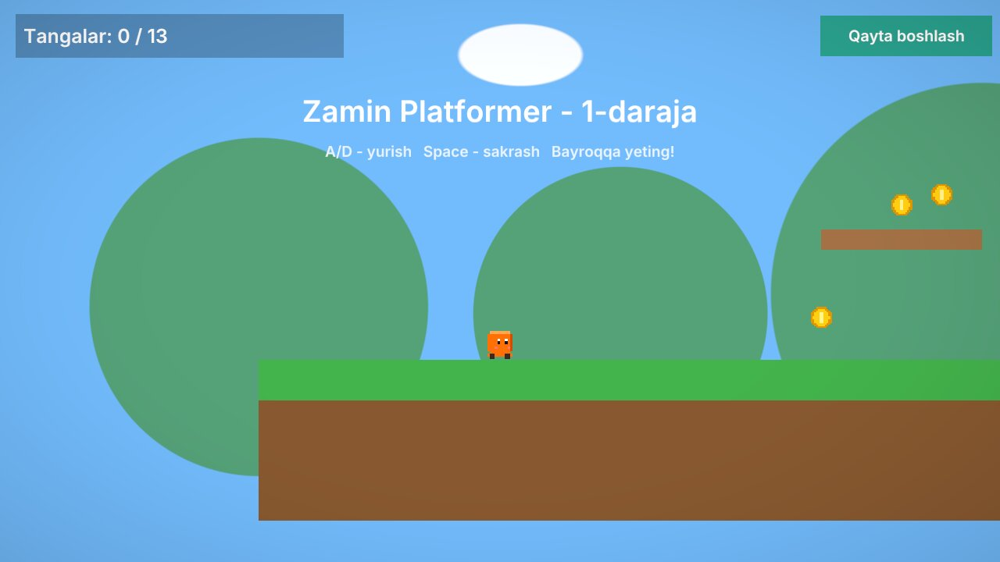
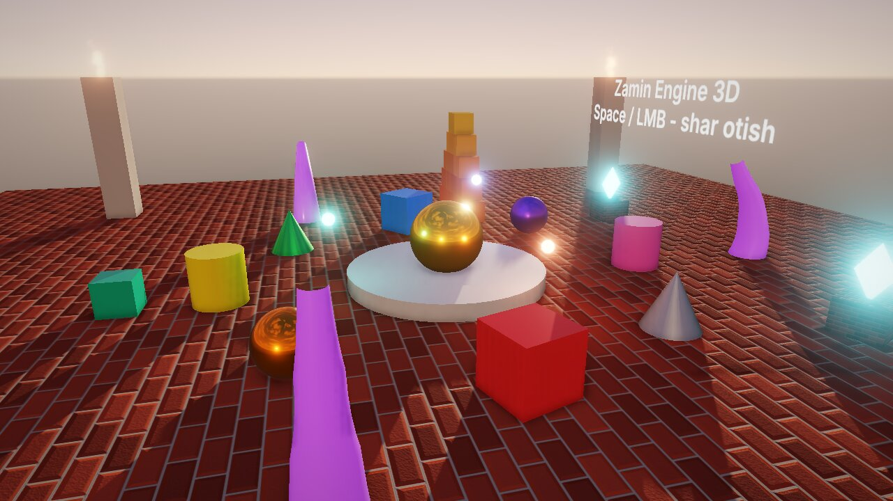
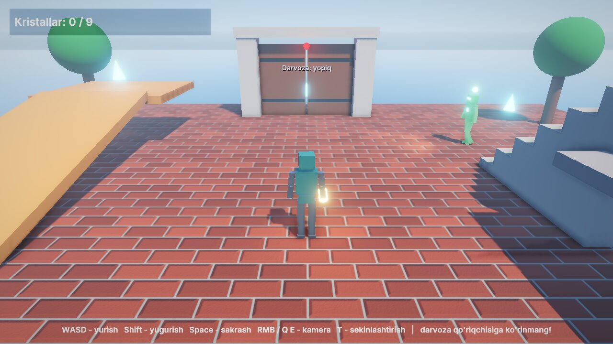
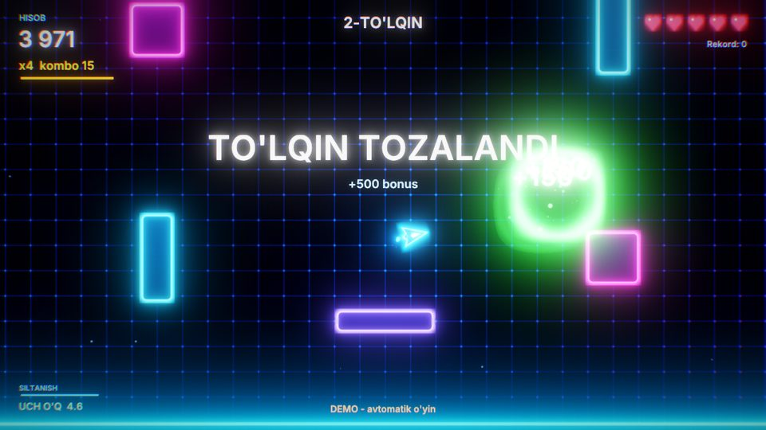
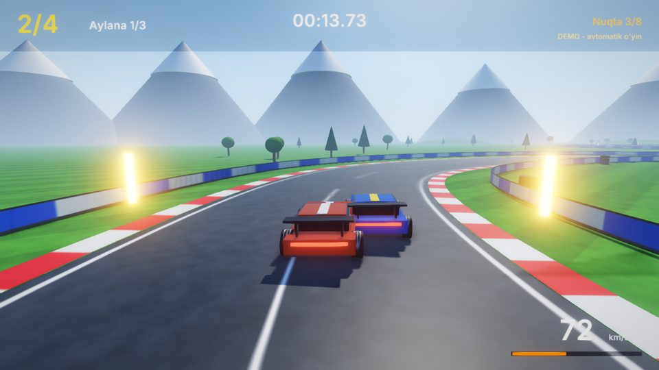
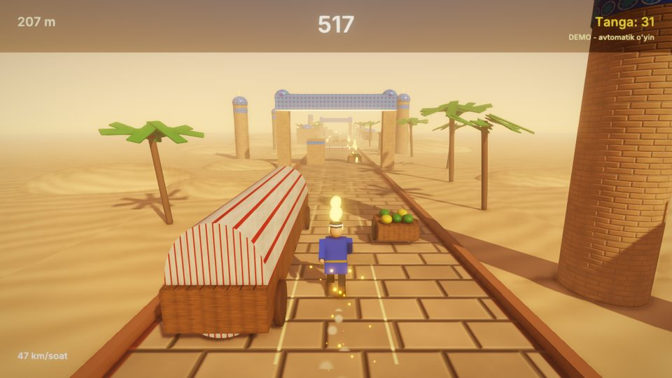
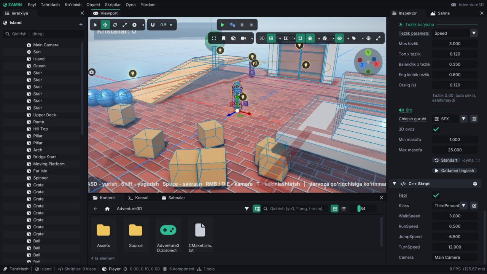

# 🌍 Zamin Engine

**Zamin** is a 2D/3D game engine written in C++20. Its editor is in the style of Unity/Unreal, and game logic is
written in **C++ scripts**: the editor compiles the scripts itself and reloads them without restarting the editor
(hot reload). The interface and the documentation are in English.

For now **Linux** is supported (OpenGL 4.1 core). Windows, macOS, Android and iOS come in later stages:
the renderer sits behind RHI interfaces and platform-specific code lives in the `Platform/` folder ([Architecture.md](docs/Architecture.md)).

**SSE2** is enough for the standard x86-64 build; AVX2/FMA are not required. When the accelerated build is chosen
with `-DZAMIN_ENABLE_AVX2=ON`, the CPU must support AVX2, FMA, BMI1, LZCNT, POPCNT and F16C.
Such a build is not distributed for older CPUs. [Build and runtime settings](docs/BuildAndExport.md).



| Platformer2D | Showcase3D | Adventure3D |
|---|---|---|
|  |  |  |

| Neon Arena | Valley Race | Silk Road |
|---|---|---|
|  |  |  |

*The sample games are in the `Projects/` folder; the pictures were taken headless from `ZaminPlayer`. All of them on one page:
**[the sample games gallery](docs/Samples.md)**. Every sample has a README (controls, the features it shows,
a tour of the code):*
[Neon Arena](Projects/TopDownShooter/README.md) ·
[Zamin Breakout](Projects/Breakout/README.md) ·
[FPS Arena](Projects/FPSArena/README.md) ·
[Warehouse Keeper](Projects/Sokoban/README.md) ·
[Silk Road](Projects/EndlessRunner/README.md) ·
[Valley Race](Projects/Racing/README.md) ·
[Platformer2D](Projects/Platformer2D/README.md) ·
[Showcase3D](Projects/Showcase3D/README.md) ·
[Adventure3D](Projects/Adventure3D/README.md) ·
[WorldWorkshop3D](Projects/WorldWorkshop3D/README.md) ·
[WorldWorkshop2D](Projects/WorldWorkshop2D/README.md) ·
[WorldGallery3D](Projects/WorldGallery3D/README.md)

---

## ✨ Features

- **Editor** — docking windows, the hierarchy and the inspector, gizmos and snapping, undo history, prefab mode, the content
  browser (assets with UUIDs, search, thumbnails), several scene views, the profiler, an English interface with an optional Uzbek translation
  — [Editor.md](docs/Editor.md)
- **C++ scripts** — `ScriptableEntity`, fields edited in the inspector (`ZM_FIELD`), the life cycle and events,
  timers, tweens, messages, hot reload — [Scripting.md](docs/Scripting.md)
- **Rendering** — a 2D batch renderer (sprite atlas, 9-slice, tilemap, 2D lighting, pixel-perfect) and PBR 3D (glTF,
  `.zmat` materials, cascaded shadows, HDRI sky and IBL, SSAO, bloom, auto exposure), a particle system —
  [Rendering.md](docs/Rendering.md)
- **Terrain / map** — sculpting and painting, four GPU albedo/normal/ORM layers, tiling tied to metres, patch LOD,
  heightmap and Jolt collision; the `MapWorkshop` sample — [Terrain.md](docs/Terrain.md)
- **Packed foliage** — up to 65536 static instances per component, two model LODs, GPU compute culling (GL 4.3)
  and a CPU fallback (GL 4.1); [FoliageWorkshop with 4096 trees](Projects/FoliageWorkshop/README.md). GPU shadow culling and real asset residency are still planned.
- **World streaming v1:** camera radius/hysteresis, shared 2D/3D physics, lifecycle/unload, the editor grid/policy and export;
  the [16-cell 3D](Projects/WorldWorkshop3D/README.md) and [12-cell 2D](Projects/WorldWorkshop2D/README.md) demos.
  [Limits and tuning](docs/Terrain.md).
- **World asset streaming:** a cell's textures/models are decoded/parsed on workers and uploaded to the GPU in a queue
  under a per-frame byte budget; RSS / requested GPU limits evict far cells; a `.ztour` camera path
  gives a frame-time and RSS report — [the 24-cell WorldGallery3D](Projects/WorldGallery3D/README.md),
  [details](docs/Terrain.md#the-asset-budget-residency-limits-and-the-camera-path).
- **Physics** — 2D (Box2D) and 3D (Jolt): colliders, joints, effectors, the Character Controller, queries,
  collision layers, determinism — [Physics.md](docs/Physics.md)
- **Quest/progression** — [objectives, prerequisites, one-time rewards, XP and save v2](docs/GameplayQuest.md), the compiler-free QuestWorkshop.
- **Equipment and abilities** — [4 equipment slots, combat stats, energy, cooldowns, potions and save v3](docs/GameplayLoadout.md), the compiler-free [LoadoutWorkshop](Projects/LoadoutWorkshop/README.md).
- **Projectiles and effects** — [2D/3D projectiles, area damage, stacking status effects, the combat HUD and save v4](docs/GameplayCombat.md), the compiler-free [CombatWorkshop](Projects/CombatWorkshop/README.md).
- **Gameplay UI** — [live HUD, inventory pages, modal focus and pause](docs/GameplayUI.md), the compiler-free UIWorkshop.
- **Gameplay save/load** — [stable-key snapshots, atomic slots and backups](docs/GameplaySave.md), the compiler-free SaveWorkshop.
- **Gameplay AI** — [patrol/chase/attack/investigate/return, LOS and nav recovery](docs/GameplayAI.md), the compiler-free 2D/3D AIWorkshop.
- **Combat and interaction** — [health/shield, inventory, keys/collectibles and respawn](docs/GameplayRules.md), the compiler-free RulesWorkshop.
- **Gameplay** — [2D/3D motor, camera and checkpoints](docs/Gameplay.md), the compiler-free GameplayWorkshop courses.
- **Animation** — property clips and the timeline, skeletal animation, the Animator (prioritized states, 1D/2D blends, typed parameters/damping, layers),
  root motion, sprite clips — [Animation.md](docs/Animation.md)
- **Audio** — miniaudio: mixer groups, music crossfade, 3D sound, filters, ambient zones —
  [Audio.md](docs/Audio.md)
- **UI** — the screen interface: anchors, layout groups, widgets, navigation, UI animations — [UI.md](docs/UI.md)
- **Scenes and prefabs** — additive loading, background loading, transitions, sub-scenes; linked prefab instances,
  overrides, variants — [Scenes.md](docs/Scenes.md), [Prefabs.md](docs/Prefabs.md)
- **AI** — NavGrid 2D / 3D and A*, the Nav Agent, steering, sight, patrol, formations, behavior trees — [AI.md](docs/AI.md)
- **Player and export** — a standalone game folder with one button (`.sh`, `.desktop`, icons), the log, the crash report,
  the command line — [Runtime.md](docs/Runtime.md), [BuildAndExport.md](docs/BuildAndExport.md)
- **Quality** — headless unit tests, the rendering regression test, the editor smoke test, sanitizers, code coverage,
  benchmarks, the documentation check — [Testing.md](docs/Testing.md), [Quality.md](docs/Quality.md)
- **Performance** — batching, caches, background loading, the shader cache, parallel particles / animation, start-up
  time and memory measurements — [Performance.md](docs/Performance.md), [Benchmarks.md](docs/Benchmarks.md)

**The full list** (with the details of every feature): [docs/Features.md](docs/Features.md).

---

## 🚀 Quick start

Requirements: a C++20 compiler (GCC 13+ or Clang 17+), CMake 3.20+, Ninja (optional), an OpenGL 4.1+ driver, the X11 /
Wayland dev packages. Ubuntu / Debian:

```bash
sudo apt install build-essential cmake ninja-build git \
    libgl-dev libx11-dev libxrandr-dev libxinerama-dev libxcursor-dev libxi-dev \
    libwayland-dev libxkbcommon-dev wayland-protocols zenity
```

Fedora, Arch, the CMake options, presets and exporting a game: [BuildAndExport.md](docs/BuildAndExport.md).
The other libraries (GLFW, EnTT, ImGui, Box2D, Jolt ...) are downloaded by CMake itself.

```bash
git clone https://github.com/abbosjon-dev/zamin-game-engine.git
cd zamin-game-engine
cmake -S . -B build -G Ninja -DCMAKE_BUILD_TYPE=Release
cmake --build build

./build/bin/ZaminEditor                          # the launcher: a new project, recent projects, samples
./build/bin/ZaminEditor Projects/Platformer2D    # the sample 2D game (Showcase3D and Adventure3D too)
./build/bin/ZaminPlayer Projects/Adventure3D     # the game without the editor (options: --help)
ctest --test-dir build -LE gui                   # the quick tests
```

**Your first game**: the [2D tutorial](docs/Tutorial-2D.md) and the [3D tutorial](docs/Tutorial-3D.md) — step by step in the editor,
with the complete code. In short:

1. `ZaminEditor` → **New project** → a name and a location → **Create** (the C++ scripts are created from a template and compiled).
2. In the hierarchy `+` → create an entity (for example *2D → Physics box*).
3. In the inspector **+ Component → C++ Script** → choose the class.
4. **▶ Play** (`Ctrl+P`).
5. **File → Build game** — a finished game folder and a `.sh` launcher.

The project layout:

```
MyGame/
├── MyGame.zproject           # the project settings
├── CMakeLists.txt            # builds the script module (the editor creates it)
├── Source/                   # the game's C++ scripts
│   └── Scripts.cpp
├── Assets/                   # scenes, textures, sounds, models
│   ├── Scenes/Main.zscene
│   └── Scenes/Main.zscene.zmeta  # the asset's UUID and import settings (add it to version control)
├── .zamin/                   # the editor's cache: AssetRegistry.json, Thumbnails/ (rebuilt, in .gitignore)
└── Binaries/libMyGame.so     # the compiled scripts (automatic)
```

---

## 🧑‍💻 A C++ script



```cpp
#include <Zamin/Zamin.h>
using namespace Zamin;

class Player : public ScriptableEntity
{
public:
    float Speed = 6.0f;          // shown in the inspector
    float JumpImpulse = 9.0f;

    void OnCreate() override { ZM_INFO("Hello, {}!", GetName()); }

    void OnUpdate(Timestep) override
    {
        glm::vec2 v = GetVelocity();                 // Rigidbody2D
        v.x = Input::GetAxis("Horizontal") * Speed;  // A/D, arrows, gamepad
        SetVelocity(v);

        if (Input::IsActionJustPressed("Jump"))      // Space / gamepad A, once
            ApplyImpulse({ 0.0f, JumpImpulse });
    }

    void OnTriggerBegin(Entity other) override       // the coin's collider is a sensor
    {
        if (other.HasTag("Coin"))
        {
            SaveData::SetInt("Coins", SaveData::GetInt("Coins") + 1); // kept between runs of the game
            PlaySound("Audio/coin.wav");
            Destroy(other);                          // destroyed at the end of the frame
        }
    }
};

ZM_REGISTER_SCRIPT(Player,
    ZM_FIELD_RANGE(Player, Speed, 0.0f, 20.0f).Tooltip("Movement speed"),
    ZM_FIELD(Player, JumpImpulse))
```

After changing a script, **Scripts → Compile + reload** (`Ctrl+B`) — the module is reloaded without closing the editor.
If the game is running (Play), it is stopped first; the field values in the inspector are kept and the new code works
with them. The life cycle, all the callbacks and the API reference: [Scripting.md](docs/Scripting.md); the components:
[Components.md](docs/Components.md).

---

## 📚 Documentation

The full list: **[docs/README.md](docs/README.md)** (the documentation index).

| Getting started | Guides | Reference and internals |
|---|---|---|
| [2D tutorial](docs/Tutorial-2D.md), [3D tutorial](docs/Tutorial-3D.md) | [Rendering](docs/Rendering.md), [Physics](docs/Physics.md), [Animation](docs/Animation.md) | [Components](docs/Components.md), [Features](docs/Features.md) |
| [Editor](docs/Editor.md), [Sample games](docs/Samples.md) | [Audio](docs/Audio.md), [UI](docs/UI.md), [Scenes](docs/Scenes.md), [Prefabs](docs/Prefabs.md) | [Architecture](docs/Architecture.md), [Core](docs/Core.md) |
| [C++ scripts](docs/Scripting.md) | [AI](docs/AI.md), [Project settings](docs/ProjectSettings.md), [Player](docs/Runtime.md) | [Build and export](docs/BuildAndExport.md), [FAQ](docs/FAQ.md) |

The API reference (Doxygen): `cmake --build build --target docs` → `build/docs/html/index.html`
([BuildAndExport.md](docs/BuildAndExport.md#7-the-api-reference-doxygen)).

---

## 🤝 Contributing

Building, code style, tests, commit rules and documentation: [CONTRIBUTING.md](CONTRIBUTING.md). The history of changes
by milestone: [CHANGELOG.md](CHANGELOG.md); the plan: [docs/TASKS.md](docs/TASKS.md).

**Status:** all 500 tasks of the plan (25 milestones, M01–M25) are done — [docs/TASKS.md](docs/TASKS.md).
The results of the final regression (gcc Debug / Release, clang, unit and render tests, samples, editor smoke, hot reload, export,
ASan + UBSan): [docs/Quality.md](docs/Quality.md).

## 📦 Third-party libraries

GLFW (zlib), glad (MIT/Public), GLM (MIT), EnTT (MIT), Dear ImGui (MIT), ImGuizmo (MIT), Box2D (MIT), Jolt Physics (MIT), nlohmann/json (MIT), cgltf (MIT), stb (Public Domain/MIT), miniaudio (Public Domain/MIT-0), tinyobjloader (MIT). Fonts: Inter (SIL OFL 1.1), Font Awesome Free (SIL OFL 1.1) — the licences are in `Resources/fonts/`.

## License

MIT — [LICENSE](LICENSE).
