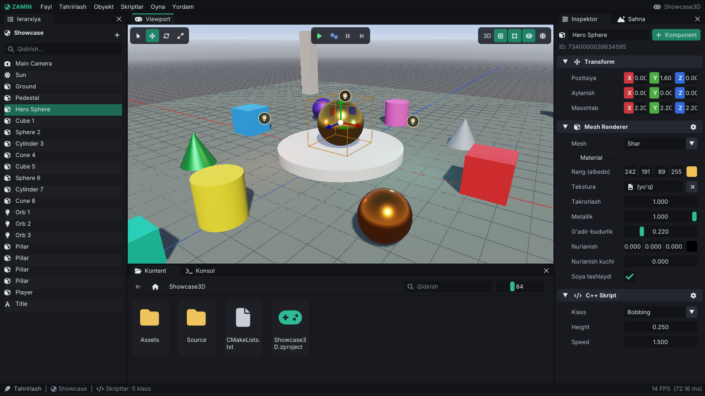
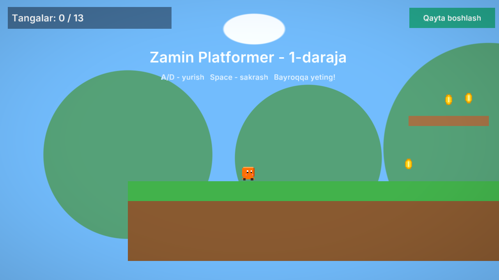
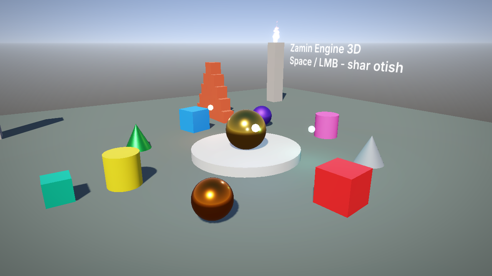
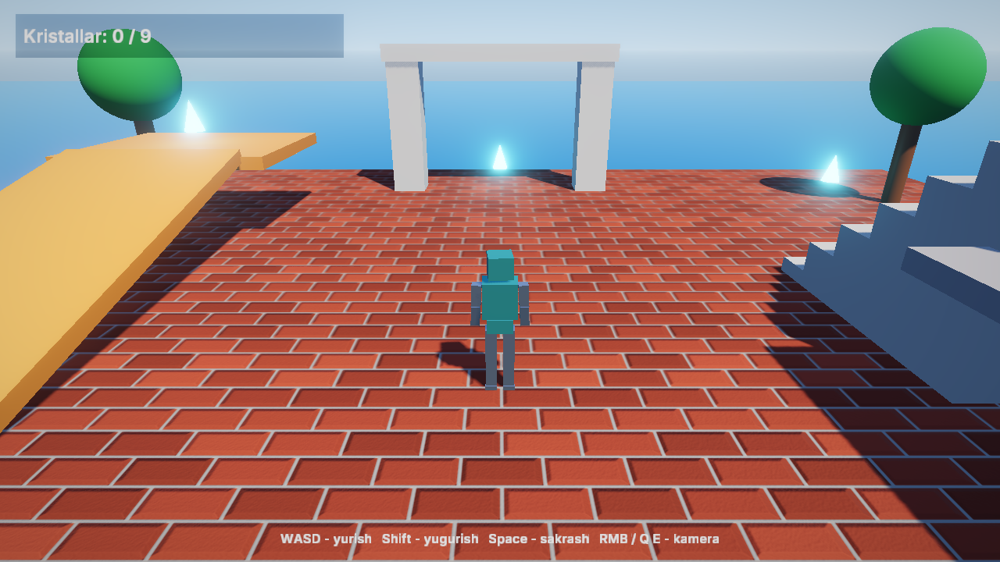
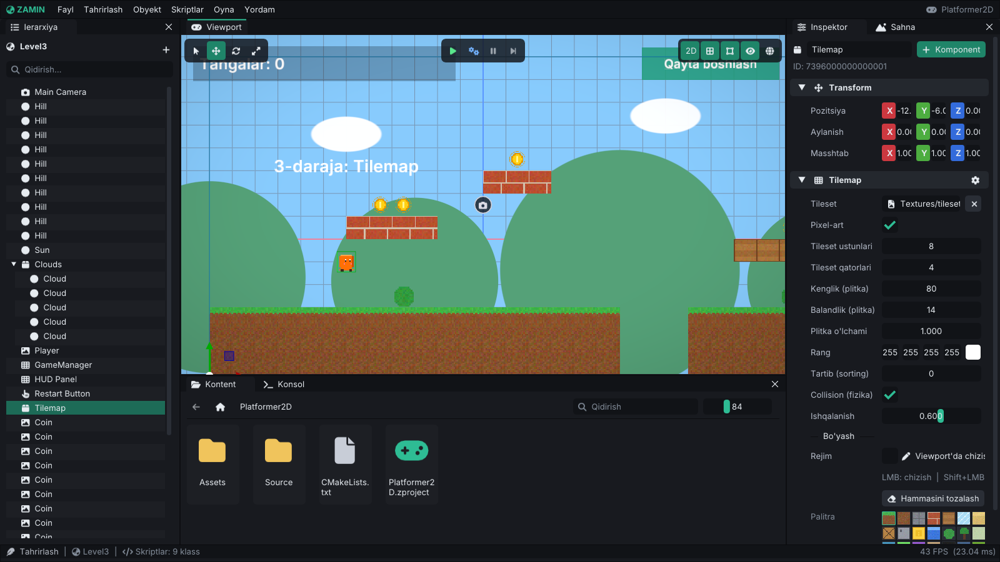

# 🌍 Zamin Engine

**Zamin** — C++20 da yozilgan 2D/3D o'yin dvigateli (game engine). Editor'i Unity/Unreal uslubida, o'yin mantiqi esa **C++ skriptlarda** yoziladi: editor skriptlarni o'zi kompilyatsiya qiladi va o'yinni to'xtatmasdan qayta yuklaydi (hot reload).

Hozircha **Linux** qo'llab-quvvatlanadi. Windows, macOS, Android va iOS keyingi bosqichlarda qo'shiladi (arxitektura bunga tayyorlangan, pastga qarang).



| 2D Platformer (namuna) | 3D Showcase (namuna) |
|---|---|
|  |  |

**Adventure3D** — uchinchi shaxs o'yini: animatsiyali robot, character controller, kristallar yig'ish:





---

## ✨ Imkoniyatlar

**Editor**
- Docking interfeys: Viewport, Ierarxiya, Inspektor, Kontent brauzer, Konsol, Sahna sozlamalari, Statistika
- **Undo/Redo** (`Ctrl+Z` / `Ctrl+Y`), **Copy/Paste** (`Ctrl+C` / `Ctrl+V`), nusxa olish (`Ctrl+D`)
- **Parent/child ierarxiya**: daraxt ko'rinishi, drag & drop bilan ota-ona belgilash va tartibni o'zgartirish (qator chetiga — oldiga/ortiga, o'rtasiga — ichiga), bola obyekt yaratish
- **Ko'p obyekt tanlash**: `Ctrl`+bosish (qo'shish/olib tashlash), `Shift`+bosish (oraliq), `Ctrl+A`; tanlanganlarni birga o'chirish, nusxalash, sudrash va gizmo bilan ko'chirish/aylantirish/masshtablash (pivot: asosiy obyekt yoki tanlov markazi)
- Inspektorda Transform menyusi (⚙ yoki o'ng tugma): tiklash, nusxalash, joylash (hammasi yoki faqat pozitsiya/aylanish/masshtab) — barcha tanlanganlarga
- **Komponentlar tartibi**: komponent menyusida (⚙ / o'ng tugma) yuqoriga / pastga / eng yuqoriga / eng pastga yoki sarlavhani sudrab qo'yish; tartib har bir obyekt uchun sahnada saqlanadi (Transform doim tepada)
- **Komponentni nusxalash va joylash**: ⚙ → *Komponentni nusxalash*, boshqa obyektda ⚙ → *Qiymatlarni joylash* yoki **+ Komponent → Buferdan joylash** (yo'q bo'lsa qo'shiladi) — barcha tanlanganlarga, tizim buferi orqali boshqa editor oynasiga ham
- Inspektor komponent sarlavhalarining yig'ilgan/ochiq holati eslab qolinadi (komponent turi bo'yicha, skriptlar klass bo'yicha; keyingi ishga tushirishda ham), ⊟/⊞ tugmasi hammasini yig'adi/ochadi
- Ierarxiyada **ko'z** va **qulf** tugmalari: yashirilgan obyekt (va bolalari) editor sahnasida chizilmaydi — o'yinda (Play, Player) odatdagidek ko'rinadi; qulflangan obyekt viewport'da tanlanmaydi va gizmo bilan surilmaydi (ierarxiya/inspektorda tahrirlash mumkin). `H` — tanlanganlarni yashirish/ko'rsatish, `Alt+H` — hammasini ko'rsatish; holatlar sahna faylida saqlanadi (prefab'ga yozilmaydi)
- **Faol/nofaol obyektlar** (`TagComponent::Active`, o'yin holati — editordagi ko'zdan farqli): nofaol obyekt va uning butun ierarxiyasi chizilmaydi (mesh, sprite, matn, tilemap, particle, UI, yorug'lik), fizikada qatnashmaydi (2D/3D body, tilemap collision va qahramon olib tashlanadi, qayta yoqilganda joriy transformda yaratiladi; ichida turgan tomon `OnTriggerEnd`/`OnCollisionEnd` oladi), skripti `OnDisable` oladi va `OnUpdate`/`OnLateUpdate`/taymerlar to'xtaydi (yoqilganda `OnEnable`). Shuningdek: particle tizimi to'xtaydi (zarralar tozalanadi, `EmitParticles` ham ishlamaydi; qayta yoqilganda boshidan, burst bilan boshlanadi), audio manba to'xtaydi (qayta yoqilganda "Boshida ijro" belgilangani boshidan chalinadi), Animator va Sprite Animation yangilanmaydi (vaqt, poza va holat mashinasi joyida turadi, keyin davom etadi), UI tugmalar ko'rinmaydi va bosilmaydi (bosib turilgan tugma bekor qilinadi, sichqoncha ostidagi tugmaga o'tadi), kamera asosiy hisoblanmaydi (kameralarni obyektlarini yoqib/o'chirib almashtirish mumkin; tinglovchi va `ScreenToWorld` ham faol kameradan olinadi), yorug'lik hisobga olinmaydi (yoritmaydi, soya tushirmaydi, quyosh o'rnini yoki 32 ta nuqtali/spot yorug'lik o'rnidan birini egallamaydi — keyingi faol yorug'lik oladi; quyosh — sahna tartibidagi birinchi faol Directional Light, boshqalari ishlatilmaydi (inspektorda aytiladi); 32 tadan ko'p bo'lsa kameraga eng ko'p ta'sir qiladiganlari ishlatiladi; `GetScene().CollectLights(...)`, statistika oynasida ham ko'rinadi), tilemap collision o'chadi (qayta yoqilganda joriy plitkalar va transformdan qayta quriladi), Character Controller 3D dunyodan chiqariladi (gravitatsiya yo'q, `Grounded` false, `Jump` ishlamaydi; qayta yoqilganda joriy joyida, tinch holatda yaratiladi). Olib tashlangan jism ustida uxlab yotgan jismlar uyg'onadi va tushadi, qayta paydo bo'lgan jism ichidagilari ham uyg'onadi. Inspektorda bunday komponentlar ostida ⏻ izoh chiqadi. Holat sahna faylida (`"Active": false`, faqat o'chiq bo'lsa), nusxalarda va prefab'larda saqlanadi: prefab nusxasining har bir obyekti saqlangandagidek faol/nofaol boshlanadi; nofaol shablondan `Instantiate` qilingan nusxa ham nofaol (`SetActive(nusxa, true)` bilan yoqiladi), nofaol guruh ichidagi faol shablon nusxasi esa ildiz obyekt sifatida (shablon turgan joyda) faol yaratiladi. Inspektorda nom yonidagi **belgi** (bir nechta tanlangan bo'lsa hammasiga; o'yin davomida ham ishlaydi) yoki `Alt+Shift+A` bilan yoqiladi/o'chiriladi; ierarxiyada nofaol obyektlar (va ota-onasi nofaol bolalar) xira ko'rinadi, o'zi o'chirilganlarda ⏻ belgisi turadi
- **Prefab'lar** (`.zprefab`): obyektni prefab qilib saqlash, sahnaga/ierarxiyaga sudrab qo'yish
- 2D sahnalar uchun avtomatik ortografik kamera, 3D collider'larni wireframe ko'rinishda chizish
- Zamonaviy qorong'i tema, Inter shrifti, Font Awesome ikonkalari, o'zbekcha interfeys
- Gizmo'lar (ko'chirish / aylantirish / masshtab), sichqoncha bilan obyekt tanlash (picking)
- **Snapping** toolbar'da (magnit): ko'chirish / aylantirish / masshtab qadamlari va tayyor qiymatlar; `Ctrl` bosib turish vaqtincha teskari qiladi
- **Grid sozlamalari**: katak o'lchami, katta chiziqlar oralig'i, ranglar, o'qlar, ko'rinish masofasi (toolbar'dagi ▾ yoki o'ng tugma)
- **Kamera xatcho'plari**: `Ctrl+1..5` ko'rinishni saqlaydi, `1..5` unga silliq qaytaradi (har bir sahna uchun alohida)
- **Hammasini ko'rsatish** (`Shift+F`) va tanlanganlarni ko'rsatish (`F`): kamera obyektlarning chegaralariga moslanadi
- Viewport'da **nusxalab sudrash**: `Alt` + gizmo'ni sudrash nusxasini sudraydi, sudrash paytida `Ctrl+D` shu joyda nusxa qoldiradi
- Viewport sozlamalari (snapping, grid, xatcho'plar, inspektor sarlavhalari, kontent brauzer ko'rinishi va filtri) foydalanuvchi uchun `~/.config/zamin/editor-view.json` faylida saqlanadi
- **Play / Simulate / Pause / Step** — o'yinni editor ichida ishga tushirish (sahna nusxasida, tahrir buzilmaydi)
- Editor kamerasi: Unity kabi uchish (RMB + WASD) va Maya kabi orbit (Alt + sichqoncha)
- 2D/3D rejim, infinite grid, fizik collider'larni ko'rsatish, kamera/yorug'lik ikonkalari
- Kontent brauzerdan drag & drop (tekstura → sprite, model → model obyekti, ovoz → Audio Source, prefab, `.zscene` → sahnani ochish)
- **Kontent brauzer**: katakchalar yoki **ro'yxat** ko'rinishi (nomi / turi / hajmi / o'zgartirilgan sanasi bo'yicha saralash), **fayl turi filtri** (sahna, prefab, rasm, model, audio, shrift, HDRI, C++ ...; barcha ichki papkalardan qidiradi), **qidiruv to'liq yo'l bo'yicha** — standart holatda butun loyihada (yoki faqat ochiq papkada; `Ctrl+F`): papka nomlari ham hisobga olinadi (`textures` — `Textures` papkasidagi hammasi, `Textures/` — faqat ichidagilar; bosh `Assets/` va `Source/` papkalari faqat `/` bilan yozilganda hisobga olinadi — `a` yoki `set` butun loyihani emas, `assets/tex` esa kerakli joyni topadi), `tex/coin` — papkalar va nom shu tartibda, `*.png` — `*` istalgan matn, `t:rasm`, `t:model`, `t:audio` — fayl turi; bir nechta so'z — hammasi mos kelishi kerak; natijalar joylashgan papkasi bilan ko'rsatiladi. **Thumbnaillar**: rasm, HDRI (tonemap qilingan), shrift ("Aa") va **model** (3D ko'rinishda chizilgan) eskizlari — fon oqimida tayyorlanadi, GPU'ga kadrga bir nechtadan yuklanadi (katta papka editorni qotirmaydi), `.zamin/Thumbnails` papkasida keshlanadi (loyiha qayta ochilganda darhol chiqadi) va fayl o'zgarganda yangilanadi. `Ctrl`/`Shift` bilan ko'p fayl tanlash; fayllarni **papkaga sudrab ko'chirish** (papka katakchasi/qatori yoki yuqoridagi yo'l bo'laklariga) va nomini o'zgartirish — sahna/prefab'lardagi yo'llar, glTF modellardagi nisbiy fayl nomlari, ochiq sahna, undo tarixi va boshlang'ich sahna avtomatik yangilanadi (C++ kodidagi eski yo'llar haqida ogohlantiradi)
- **Tashqaridan import**: fayl yoki papkani editor oynasiga tashlang — `Assets`ga nusxalanadi (kontent brauzer ustiga — ochiq papkaga, aks holda turiga qarab `Textures/`, `Models/`, `Audio/` ...; C++ fayllar `Source/`ga); glTF bog'liq fayllari bilan o'z papkasiga ko'chadi; viewport ustiga tashlansa sahnaga obyekt ham qo'shiladi
- **Asset tizimi**: har bir asset (sahna, prefab, rasm, model, audio, shrift, HDRI, material) yonida `<fayl>.zmeta` fayli — doimiy **UUID**, turi va import sozlamalari; editor yetishmaganlarini loyiha ochilganda yaratadi (player faqat o'qiydi), kontent brauzerda ko'rinmaydi va asset bilan birga ko'chadi / nomlanadi / o'chiriladi; nusxalangan `.zmeta` yangi UUID oladi. Kontent brauzerda sichqoncha ustida UUID ko'rinadi
- **UUID havolalar**: sahna / prefab fayllarida har bir asset yo'li yonida uning UUID'si ham yoziladi (`"Texture"` + `"TextureUUID"`, loyiha faylida `StartSceneUUID`); fayl editor yopiq paytda tashqarida qayta nomlansa yoki ko'chirilsa (`.zmeta` bilan), yuklashda yangi yo'l UUID orqali topiladi (konsolga yoziladi, sahna "o'zgargan" deb belgilanadi). Editor ochiq paytda tashqarida ko'chirilgan assetlar aniqlanadi va sahna / prefab / glTF fayllaridagi havolalar darhol yangilanadi
- **Asset inspektori va import sozlamalari**: kontent brauzerda fayl tanlansa Inspektor o'sha assetni ko'rsatadi (yo'l, UUID, hajm, sana; papka — fayllar soni, hajmi va turlari; bir nechta tanlansa — umumiy ma'lumot). **Rasm**: ko'rinish (R / G / B / A kanallari kulrangda, RGB — shaffofliksiz, 1:1 ... 8:1 kattalashtirish, sichqoncha ostidagi piksel qiymati), o'lcham, fayldagi kanallar va bit chuqurligi, GPU formati, mipmap darajalari, taxminiy video xotira. **Model**: aylanadigan 3D ko'rinish (sudrash — aylantirish, g'ildirak — yaqinlashtirish), animatsiyalar ro'yxati (davomiylik, kanallar; tanlab o'ynatish va vaqt slayderi), submeshlar (uchlar, uchburchaklar, material rangi va xaritalari), skelet bo'g'inlari, fayldagi materiallar va bog'liq fayllar (topilmaganlari qizil). **Audio**: to'lqin shakli (bosilgan joydan ijro), ijro / to'xtatish, takrorlash, ovoz balandligi; format, davomiylik, kanallar, chastota, bitreyt. **Sahna / prefab**: obyektlar soni, ildiz obyektlar, komponentlar; **shrift**: atlas; **C++ fayl**: qatorlar va ro'yxatdan o'tgan skript klasslari. Har bir asset uchun **Ishlatilgan joylar** (qaysi sahna, prefab, model, loyiha fayli yoki C++ kod — yo'l, UUID, model fayli yoki kod orqali; bosilsa kontent brauzerda ochiladi) va sahna / prefab / model uchun **Ishlatadigan assetlar** (buzilgan havolalar bilan). Qo'llanmagan import sozlamalari bilan boshqa narsa tanlansa, ularni qo'llash yoki tashlab yuborish so'raladi. **Rasm**: filtr (silliq / piksel), wrap (takrorlash / chetda / ko'zgu), mipmap, sRGB (o'chirilsa — chiziqli ma'lumot, masalan maska); **model**: masshtab (sm -> m), yuqori o'q (Y / Z — skelet va animatsiyalar bilan aylantiriladi), UV aylantirish. **Qo'llash** — `.zmeta`ga yoziladi va asset darhol qayta import qilinadi (sahnadagi obyektlar o'sha zahoti yangilanadi), **Bekor qilish** — tahrirni tashlaydi. Player ham shu sozlamalar bilan yuklaydi
- **O'chirishdan oldin ogohlantirish**: ishlatilayotgan asset (yoki shunday assetli papka) o'chirilmoqchi bo'lsa, tasdiqlash oynasida qaysi sahna, prefab, model yoki C++ fayl uni ishlatishi ro'yxati chiqadi (havolalar soni bilan; birga o'chadigan fayllar hisobga olinmaydi; bosilsa o'sha fayl ko'rsatiladi) va tugma **Baribir o'chirish** bo'ladi
- **Import xatolari**: yuklanmagan asset (topilmagan, buzilgan yoki qo'llab-quvvatlanmaydigan rasm, model, shrift, HDRI, audio, sahna, prefab) konsolga **bir marta** — yo'li va sababi bilan (`Rasm yuklanmadi: 'Textures/x.png' - noma'lum rasm formati (stb: ...)`) yoziladi, har kadr yoki har yuklashda takrorlanmaydi (sabab o'zgarsa, fayl o'zgarsa yoki muvaffaqiyatli yuklansa — yana); o'zgarmagan buzilgan fayl qayta-qayta dekodlanmaydi. Kontent brauzerda bunday faylda qizil belgi va pastda **N ta import xatosi** ro'yxati (bosilsa fayl ochiladi), Inspektorda sabab va **Qayta urinish** tugmasi
- **Asset registry keshi**: registry (UUID, tur, yo'l, fayl hajmi va vaqti, import sozlamalari) bitta JSON hujjat sifatida `.zamin/AssetRegistry.json`ga saqlanadi. Editor yopiq paytda tashqarida ko'chirilgan yoki nomi o'zgargan fayllar keyingi ochilishda taniladi — hatto `.zmeta`siz ko'chirilgan bo'lsa ham (tur, hajm va vaqt bo'yicha, faqat bir xil mos kelsa) UUID va sozlamalari tiklanadi, eski `.zmeta` olib tashlanadi va sahna / prefab / glTF fayllaridagi havolalar yangilanadi. Editor ishlayotganda shell'da `.zmeta`siz qayta nomlangan fayl ham shunday taniladi. **O'yinni build qilish** `AssetRegistry.zreg` faylini yozadi — eksport qilingan o'yin har bir `.zmeta`ni o'qimasdan registry'ni shundan oladi (fayllar o'zgargan bo'lsa papkani o'qiydi). `.zamin/` papkasi versiya nazoratiga qo'shilmaydi
- **Ishlatilmagan assetlar** (Oyna menyusi yoki kontent brauzerda o'ng tugma): hech bir sahna, prefab, material, loyiha fayli, `.gltf` model yoki C++ koddagi satr (`"Prefabs/Ball.zprefab"`) havola qilmaydigan assetlar — o'lchami bilan; ochiq sahnaning saqlanmagan holati ham hisobga olinadi. **Chuqur tahlil**: faqat boshlang'ich sahna va koddan (sahnalar, prefablar, modellar orqali) yetib boriladigan assetlar ishlatilgan hisoblanadi. Tur filtri, qidiruv, belgilanganlarni tasdiq bilan o'chirish (`.zmeta` bilan) va **buzilgan havolalar** ro'yxati (mavjud bo'lmagan fayllarga havolalar)
- **Fayl kuzatuvchi va qayta yuklash**: `Assets` papkasi kuzatiladi (Linux'da inotify, aks holda har soniyada tekshiruv); tashqi dasturda o'zgartirilgan **rasm, model (glTF / OBJ, `.bin` buferi ham), material (`.zmat`), shrift va HDRI** fayllar editor'da darhol (o'sha obyektning o'zida — sprite, tilemap, model va uning teksturalari, skelet va animatsiyalar, osmon/yorug'lik, eskizlar) yangilanadi; buzilgan fayl xatosi konsolga chiqadi va avvalgi rasm qoladi; yangi / o'chirilgan fayllar ro'yxatga avtomatik tushadi. O'ng tugma → **Qayta yuklash** — qo'lda
- **Status bar**: tanlangan obyekt nomi, joylashuvi, komponentlar va bolalar soni, yashirin/qulf belgisi (bosish — kamerani yo'naltirish, sichqoncha ustida — batafsil, o'ng tugma — nom/UUID/yo'lni nusxalash); ko'p tanlovda soni va markazi
- C++ skript maydonlari (`ZM_FIELD`) inspektorda tahrirlanadi, o'yin paytida jonli o'zgartiriladi
- Loyiha launcher'i: yangi loyiha (shablondan), so'nggi loyihalar, namuna o'yinlar
- **Profiler** (ierarxik): har bir tizim (skriptlar, fizika, animatsiya, render, post-processing, UI) uchun CPU vaqti.
  Ichma-ich `ZM_PROFILE_SCOPE` bo'limlari daraxt bo'lib yig'iladi: Statistika panelida yoki Oyna > Profiler oynasida
  har bo'limning jami vaqti, o'z vaqti (ichki bo'limlarsiz), chaqiruvlar soni va kadrdagi ulushi; o'rtacha (silliqlangan)
  yoki oxirgi kadr, **Muzlatish** bilan bir kadrni ushlab ko'rish. Bir xil nomli bo'lim bir ota ostida bitta tugun,
  boshqa ota ostida alohida. `Profiler::Find("Kadr/Layer'lar (update)/Sahna")`, `GetHotspots`, `FormatTree`;
  `ZAMIN_EDITOR_STATS=1` / `ZAMIN_PLAYER_STATS=1` daraxtni logga ham yozadi
- **Statistika overlay** (viewport ustida, faqat editor; toolbar'dagi spidometr tugmasi yoki Ko'rinish > Statistika
  overlay): FPS va kadr vaqti, so'nggi 240 kadr grafigi (maqsad FPS chiziqlari, ranglar: yashil - sig'di, sariq - ikki
  baravarigacha, qizil - sekinroq), eng sekin 1% kadrlar, draw call'lar (sahna va editor alohida), uchburchaklar,
  meshlar / instanced, soyalar, 2D obyektlar, culling kesganlari (ulushi bilan) va eng sekin profiler bo'limlari.
  Burchagi, foni, bo'limlari va maqsad FPS sozlanadi (o'ng tugma yoki menyu), editor sozlamalarida saqlanadi
- **Maximize on Play**: o'yin rejimida viewport butun oynaga yoyiladi
- **O'yinni build qilish**: bitta tugma bilan mustaqil papkaga eksport (`./MeningOyinim.sh`)

**Dvigatel**
- ECS arxitektura (EnTT), UUID, JSON sahna formati (`.zscene`)
- **Renderer** (OpenGL 4.1 core, RHI abstraksiya qatlami orqasida):
  - 2D batch renderer: sprite, tekstura, doira, chiziq, **matn** (UTF-8, lotin/kirill, `oʻ gʻ`)
  - 3D PBR (metallic/roughness), yo'naltirilgan quyosh, gradient osmon, atrof-muhit aksi
  - **Bir nechta quyosh**: barcha faol Directional Light'lar (bir vaqtda 4 tagacha) sahnani yoritadi, soyani esa faqat
    bittasi beradi — sahna tartibida "Soyalar" yoqilgan birinchisi (asosiy quyosh; osmondagi quyosh diski ham unga
    ergashadi). Inspektorda har bir quyoshning roli yoziladi ("Soya bermaydi: soyani '...' beradi"), Statistika panelida
    asosiy quyosh va soyasiz quyoshlar soni
  - **Osmon gradienti va quyosh diski** (HDRI bo'lmaganda; Sahna panelining "Osmon gradienti va quyosh" bo'limi, sahnada
    saqlanadi): zenit / ufq / yer ranglari, zenit egriligi (tepa rangi qanchalik pastga tushadi), yerga o'tish (ufq
    chizig'ining kengligi), quyosh diski (o'lchami gradusda, yorqinligi, nur gardishi) — asosiy quyosh yo'nalishida va
    rangida. Gradient atrof yorug'lik va akslarda ham ishlatiladi. Namuna: `Showcase3D` ichidagi `Scenes/Sunset.zscene`
    (3 ta quyosh, quyosh botishi osmoni, bloom rangi, linza changi, xromatik aberratsiya, plyonka donasi)
  - **Nuqtali va spot yorug'liklar** — birgalikda 32 tagacha: **Spot Light** (obyektning -Z o'qi bo'ylab konus, ichki /
    tashqi burchak orasida yumshoq so'nish, masofa bo'yicha nuqtali yorug'lik kabi so'nish). Ko'proq bo'lsa kameraga eng
    ko'p ta'sir qiladiganlari tanlanadi (kuchi x rangi, kamera yorug'lik radiusidan tashqarida bo'lsa x (radius /
    masofa)^2; teng ta'sirda eng yaqini) — shuning uchun oddiy "eng yaqinlari"dan farqli, uzoqdagi kuchli yorug'lik
    yaqindagi kuchsizidan ustun bo'lishi mumkin, kamerani o'z radiusi ichida qamragan yorug'lik esa to'liq kuchi bilan.
    Editorda tanlangan nuqtali yorug'likning radiusi (3 ta aylana) va spot konusi (ichki konus xiraroq) ko'rinadi,
    viewport'da spot belgisi bor. Namuna: `Projects/Showcase3D` ichidagi `Scenes/Lights.zscene` (29 ta yorug'lik)
  - **HDRI osmon + IBL**: `.hdr` panorama — diffuz yorug'lik SH9 orqali, aks (specular) mip darajalari bo'yicha
  - **Cascaded Shadow Maps** (texel snapping), **tuman** (masofa + balandlik). Soya sifati sahna sozlamalarida (Sahna
    panelining "Soyalar" bo'limi, sahna faylida saqlanadi): atlas o'lchami (1024 / 2048 / 4096), filtr (o'chiq, PCF 3x3,
    PCF 5x5, Poisson 16 nuqta), kaskadlar soni (1-4, bitta kaskad butun atlasni oladi) va taqsimoti (teng .. logarifmik),
    soya masofasi, chuqurlik bias va normal bias. Standart qiymatlar (4096, PCF 3x3, 3 kaskad) avvalgi ko'rinishni saqlaydi
  - Primitivlar (kub, shar, tekislik, silindr, konus), `.obj` va `.gltf/.glb` modellar
  - **HDR pipeline**: sahna float bufferga chiziladi, tonemapping (ACES / Reinhard / yo'q), haqiqiy HDR bloom
  - Material xaritalari: **normal map**, metallic/roughness map, emissive map; tekstura **takrorlash va siljish** (vec2)
  - **Material assetlari (`.zmat`)**: JSON fayl — shader (Lit / Unlit), aralashtirish rejimi (Opaque / Cutout / Transparent),
    alfa chegarasi, ikki tomonlama, rang, metallik, g'adir-budurlik, nurlanish (rang + kuch), normal / metal-roughness /
    nurlanish teksturalari (loyiha yo'li + UUID), takrorlash va siljish. Bitta fayl — bitta umumiy obyekt (`MaterialLibrary`):
    Mesh Renderer'da **Material asset** maydoni (primitiv va modelning barcha qismlari, yoki har bir submesh uchun alohida)
    ichki materialni almashtiradi; eski sahnalar avvalgidek yuklanadi. Fayl yoki uning teksturalari o'zgarsa joyida qayta
    yuklanadi. Inspektorda **material muharriri**: aylanadigan preview (shar / kub / tekislik / silindr, osmon gradienti
    yoki sahna HDRI'si bilan), o'zgarishlar sahnada darhol ko'rinadi, **Saqlash** / **Bekor qilish**, saqlanmagan belgisi.
    Ichki materialni bir tugma bilan `.zmat`ga aylantirish mumkin
  - **Sirt turlari** (material asset va ichki materialda): **Opaque** — alfa e'tiborga olinmaydi; **Cutout** — alfasi
    (rang x tekstura) chegaradan past piksellar chizilmaydi, soyada ham shu teshiklar bo'ladi (barglar, panjaralar);
    **Transparent** — shaffof sirtlar opaque sahna va osmondan keyin, avval materialning **ustuvorligi** (Sort Priority,
    -100..100: kattasi boshqalar ustida chiziladi), keyin chegaralari markazining kameradan uzoqligi bo'yicha (ortografik
    kamerada — ko'rish yo'nalishi bo'yicha) orqadan oldinga saralanib, chuqurlik yozmasdan premultiplied alfa bilan
    chiziladi, soya tashlamaydi. Ko'rinish menyusidagi **Shaffoflar tartibi** viewport'da har bir shaffof sirt ustiga uning
    chizilish raqami, uzoqligi va ustuvorligini yozadi (o'yin rejimida ham), Statistika panelida — shaffof meshlar soni; **Aksni saqlash** yoqilsa aks va yaltirashlar
    alfa bilan susaymaydi (shisha), o'chirilsa butun sirt so'nadi. **Ikki tomonlama**: ikkala tomon chiziladi, orqa tomon
    teskari normal bilan yoritiladi (ikki tomonlama shaffof sirt — avval ichki, keyin tashqi tomoni); bayroq o'chiq bo'lsa
    orqa tomonlar kesiladi (manfiy masshtabli ko'zgu obyektlarda ham to'g'ri). **Unlit**: faqat rang x tekstura + nurlanish,
    yorug'lik va soya ta'sir qilmaydi. glTF `alphaMode` (MASK / BLEND), `alphaCutoff`, `doubleSided` va
    `KHR_materials_unlit` o'qiladi; eski sahnalarda alfasi 1 dan kichik rang avtomatik Transparent bo'ladi. Namuna:
    `Projects/Showcase3D` ichidagi `Scenes/MaterialGallery.zscene`
  - **Materiallar bilan ishlash**: kontent brauzerda o'ng tugma — **Yangi material** (standart `.zmat` takrorlanmas nom bilan
    yaratiladi, tanlanadi va inspektorda ochiladi). `.zmat`ni viewport'dagi mesh ustiga sudrash — qo'yishdan oldin material
    o'sha meshda ko'rinadi (ko'k ramka va yorliq), qo'yilsa Mesh Renderer'ga yoziladi (bitta undo qadami); ko'p qismli
    modelga **Shift** bilan qo'yilsa qaysi qism (submesh) olishini so'raydi. Ierarxiya qatoriga yoki Material asset maydoniga
    ham tashlash mumkin (faqat mos fayl qabul qilinadi). Model inspektorida **.zmat ga eksport qilish**: glTF materiallari
    `<model>_Materials` papkasiga `.zmat` bo'lib yoziladi, fayl ichidagi (.glb / data URI) rasmlar PNG/JPG bo'lib chiqariladi;
    Mesh Renderer'dagi **Modeldan .zmat yaratib biriktirish** ularni har bir qismga biriktiradi
  - **Material instansiyalari (skript)**: `GetMaterial()->SetColor(...)` — obyektning materialdan o'z nusxasi (birinchi
    chaqiriqda yaratiladi), o'zgarishi faqat shu obyektda ko'rinadi, umumiy `.zmat` va boshqa obyektlar o'zgarmaydi; o'yin
    to'xtaganda yo'qoladi. `GetMaterial(qism)`, `GetSharedMaterial()` (umumiy asset — o'zgartirilsa hammasi o'zgaradi, editorda
    o'yin to'xtaganda asl holiga qaytadi), `SetSharedMaterial("Materials/Red.zmat")`, `ResetMaterial()`. Tezkor tahrirlar:
    `SetColor`, `SetOpacity`, `SetEmission`, `SetMetallic`, `SetRoughness`, `SetTiling`, `SetOffset`, `SetAlbedoMap`.
    `SetEmissionColor`, `SetEmissionStrength`, `SetSortPriority`.
    Namuna: Showcase3D minorasidagi har bir g'isht `Clay.zmat`ning o'z nusxasini qavatiga qarab bo'yaydi
  - **Nurlanish (emissive)**: material rangi x kuchi (x nurlanish teksturasi) — HDR: 1 dan katta natija bloom yoqilgan sahnada
    porlaydi. Inspektorda bitta qatorda rang, kuch va **HDR / LDR** belgisi; nurlanishi o'chiq materialga nurlanish teksturasi
    berilsa nurlanish oq x 1 bo'ladi (aks holda tekstura ko'rinmasdi). Material preview va thumbnaillarda ham bloom bor;
    glTF `emissiveFactor` va `KHR_materials_emissive_strength` o'qiladi
  - **Standart materiallar kutubxonasi** (`MaterialPresets`): metall, cho'tkalangan metall, oltin, mis, plastik, rezina,
    yog'och, shisha, keramika, beton, neon, suv. Yog'och, beton va cho'tkalangan metall teksturalari protsedural
    (CPU'da, choksiz takrorlanadi) va loyihada bir marta `Assets/Materials/Standart/Textures/` ga PNG bo'lib yoziladi - har
    papkadagi nusxalar shu bitta teksturani ishlatadi. Kontent brauzerda
    **Yangi material** menyusidan tanlanganining nusxasi shu papkada yaratiladi; Mesh Renderer'dagi **Standart material...**
    loyihadagi umumiy nusxasini (`Assets/Materials/Standart/`) biriktiradi. Namuna: `MaterialGallery` sahnasidagi sharlar qatori
  - **Material thumbnaillari**: kontent brauzerda va Material asset maydonlarida `.zmat` shar ustida (yoritilgan, shaffof /
    kesilganlari shaxmat fon bilan, nurlilari bloom bilan) ko'rinadi; teksturasi o'zgarsa ham yangilanadi, ochiq material
    tahrir qilinayotganda jonli kuzatiladi, diskdagi keshga faqat fayldagiga mos holati yoziladi
  - **glTF 2.0** modellar (`.gltf` / `.glb`): bir nechta mesh, PBR materiallar, ichki (embedded) teksturalar
  - **Skeletal animatsiya**: glTF skin'lari, suyaklar, animatsiya kliplari (GPU skinning, soyalar bilan), `Animator` komponenti,
    kliplar orasida **silliq o'tish** (crossfade): `anim.Play("Run", true, 1.0f, 0.2f)`
  - **Post-processing**: SSAO (ambient occlusion), bloom (**rangi** — porlash shu rangga ko'paytiriladi; **linza changi** —
    yorqin yorug'likning keng porlashi protsedural chang/dog' teksturasini yoritadi), vinyetka, kontrast/to'yinganlik/rang
    tuslash, **xromatik aberratsiya** (chetlarga tomon qizil va ko'k siljiydi), **plyonka donasi** (har kadr o'zgaradigan
    shovqin, o'rta tonlarda kuchli, dona o'lchami bilan; FXAA yoqilgan bo'lsa undan keyin qo'shiladi) — yangi effektlar
    standart holatda o'chiq,
    **FXAA** anti-aliasing (tonemapping va rang sozlamalaridan keyin; Sahna panelida yoqiladi, subpiksel kuchi bilan),
    **avto ekspozitsiya** (ko'z moslashishi: o'rtacha log yorqinlik GPU'da kichraytirish zanjiri bilan o'lchanadi, vaqt
    bo'yicha moslashish tezligi, min/max EV, kompensatsiya; standart holatda o'chiq - qo'lda ekspozitsiya)
  - **Render masshtabi** (0.5 - 2.0): sahna tasviri ko'rinish o'lchamining shu barobarida chiziladi va chiziqli filtr bilan
    kattalashtiriladi / kichraytiriladi (editor viewport'i va player; Sahna panelining "Render" bo'limi)
  - **Frustum culling**: kamera ko'rmaydigan meshlar dunyo AABB'lari bo'yicha chizilmaydi (model qismlari alohida,
    skinned meshlar uchun barcha suyaklar bo'yicha kafolatli chegaralar), soyalarda har bir kaskad o'z hajmi bo'yicha;
    2D'da sprite, doira, matn (glif chegaralari bo'yicha), zarrachalar tizimi va tilemap'ning 16x16 plitkali bo'laklari
  - **GPU instancing**: bir xil mesh + material (shader oladigan barcha qiymatlar teng, skinned emas, opaque / cutout)
    bitta `glDrawElementsInstanced` chaqiruvida - transform, normal matritsa va entity ID har nusxa uchun atribut; soya
    kaskadlarida ham bir xil meshlar birlashtiriladi. Tasvir va tanlash (picking) buferi o'zgarmaydi
  - **Render statistikasi** (Statistika paneli): chizilgan / kesilgan / instanced meshlar va chaqiruvlar, soya chizishlari,
    2D obyektlar va tile bo'laklari. `ZAMIN_EDITOR_STATS=1` (editor) / `ZAMIN_PLAYER_STATS=1` (player) chiqishda oxirgi
    kadr statistikasini logga yozadi; `ZAMIN_EDITOR_NO_CULLING`, `ZAMIN_EDITOR_NO_INSTANCING` (player'da
    `ZAMIN_PLAYER_NO_...`) solishtirish uchun o'chiradi
  - **Editor ko'rinish rejimlari** (viewport toolbar'i): wireframe (faqat qirralar yoki sirt + qirralar) va debug
    ko'rinishlar - faqat yorug'lik, normallar, albedo, roughness, metallic (qiymat ko'rinishlari tonemappingsiz)
  - **Particle tizimi**: olov, uchqun, tutun (additive blending, billboard, editor'da jonli preview)
  - **Sprite animatsiya** (sprite sheet), pixel-art filtr, FlipX/FlipY
- **2D fizika** (Box2D): dinamik/statik/kinematik jismlar, box/circle collider, trigger'lar, to'qnashuv callback'lari
- **3D fizika** (Jolt Physics): Rigidbody3D, Box/Sphere/Capsule collider, trigger'lar, to'qnashuvlar
- **Character Controller 3D** (Jolt CharacterVirtual): qiyaliklar, zinapoyalar, yerni aniqlash, sakrash, harakatlanuvchi platformalarda yurish
- **Raycast** 2D va 3D
- **Debug chizish** (`DebugDraw`, `Zamin/Debug/DebugDraw.h`): skriptlardan va dvigateldan dunyo fazosida chiziq, nur, o'q,
  quti (AABB va burilgan), sfera, aylana, krest, nuqta, o'qlar, yo'l (path) va ekranga qaragan matn - rang, davomiylik
  (0 = bir kadr, > 0 = o'yin vaqtida soniyalar; pauzada to'xtaydi - oxirgi o'yin kadrining shakllari ekranda qoladi,
  pauza paytida boshqa kod chizgan bir kadrlik shakllar esa yig'ilib qolmaydi) va chuqurlik testi bilan. Sahna chizilgandan keyin
  post-processingdan o'tgan tasvir ustiga (aniq ranglar, silliq qalin chiziqlar) sahna chuqurligiga qarab chiziladi.
  Fizika ko'rinishlari: **raycast so'rovlari** (nur, tegish nuqtasi, normal; tegmasa qizil), **kontakt nuqtalari**
  (2D, 3D, personajlar; normallari bilan) va **tezlik vektorlari** (3D personajlarning haqiqiy tezligi o'q va m/s bilan,
  devor to'sganda skript so'ragan tezlik xira; dinamik 2D/3D jismlar). Navigatsiya yo'llari uchun
  `DebugDraw::NavigationPath(points)`: bo'laklar, yo'nalish uchlari, nuqtalar, boshi yashil va oxirida halqa.
  Editor'da viewport toolbar'idagi hasharot (bug) tugmasi va uning menyusi, player'da loyiha sozlamalari
  (Umumiy > Debug chizish) va `--no-debug-draw` / `--debug-raycasts` / `--debug-contacts` / `--debug-velocities` bayroqlari.
  Skript ularni o'yin vaqtida o'zgartira oladi (`DebugDraw::SetEnabled(false)`, `DebugDraw::GetSettings().ShowRaycasts = true`):
  editor'da o'yin viewport sozlamalari bilan boshlanadi, skript o'zgarishi o'yin to'xtaguncha (yoki menyuda biror narsa
  o'zgartirilguncha) saqlanadi.
  Shipping build'da (`-DZAMIN_SHIPPING=ON`; yoki `-DZAMIN_DEBUG_DRAW=OFF`) barcha chaqiruvlar bo'sh inline funksiyalar -
  skriptlarda qoldirsa bo'ladi. Namuna: `Projects/Showcase3D` > `Scenes/DebugDraw.zscene`
- **Editor gizmolari** (faqat editor viewport'ida, ko'z tugmasining menyusi yoki Ko'rinish > Gizmolar; har biri
  o'chiq / tanlanganda / hammasida, sozlamalar saqlanadi): **kamera frustumi** (perspektiv - 10 birlikkacha aniq piramida,
  far tekisligigacha xira; ortografik - quti; yuqori tomoni uchburchak), **yorug'lik yo'nalishi** (directional: halqa, nurlar
  va o'q; spot: o'qi bo'ylab o'q; yorug'lik rangida), **audio radiusi** (3D manbalar: Min va Max masofa sferalari),
  **chegaralar (bounding box)** - lokal (obyekt bilan aylanadigan quti), dunyo AABB (mesh'lar uchun frustum culling
  tekshiradigan chegara, skinned model'niki pozasi bilan) yoki ikkalasi, **skelet** (skinned model'lar: ota bo'g'indan
  bo'g'ingacha suyaklar va bo'g'inlar joriy animatsiya pozasida, mesh ustidan; ixtiyoriy bo'g'in nomlari), **normallar**
  (mesh va model vertekslarining normallari - har verteksdan chiziq, skinned model'larda joriy pozada; uzunligi, faqat
  kameraga qaraganlar, yo'nalish bo'yicha rang sozlanadi; kadrda ko'pi bilan 60000 ta, ko'p bo'lsa vertekslar namunasi.
  Dvigatelda: `Mesh::GetGeometry()` (vertekslar GPU'dan bir marta o'qiladi) va `AppendNormalLines`)
- **Tanlash konturi** (shader asosida, faqat editor): tanlangan obyektlar chizgan piksellar atrofida bir necha piksel
  qalinlikdagi silliq (anti-aliasing) kontur - mesh, model (skinned ham), sprite, doira, matn, tilemap. Viewport'ning
  entity ID rasmi ko'rinadigan piksellarni, tanlangan mesh'larning qaytadan chizilgan siluetlari esa butun shaklni beradi:
  boshqa obyekt orqasida qolgan qirralar xira chiziladi. Asosiy tanlangan obyekt to'q sariq, ko'p tanlovning qolganlari
  ochroq, bolalari xiraroq; sichqoncha ostidagi (bosilsa tanlanadigan) obyekt ingichka havorang kontur bilan ajratiladi.
  Qalinlik, ranglar, yashiringan qismlar, bolalar va hover sozlanadi (ko'z menyusi > Tanlash ko'rinishi); eski uslub -
  "Quti" (mesh chegaralari sim quti bilan) ham tanlanadi
- **Gizmo o'lchami**: ko'chirish / aylantirish / masshtab gizmosining ekrandagi o'lchami, chiziqlari qalinligi va viewport
  ikonkalari o'lchami (tanlash asboblari yonidagi menyu yoki Ko'rinish > Gizmo o'lchami; editor sozlamalarida saqlanadi)
- **Tilemap**: tileset'dan plitkali darajalar, editor'da chizish (palitra), avtomatik birlashtirilgan collider'lar
- **3D (spatial) ovoz**: tinglovchi — asosiy kamera, masofaga qarab so'nish
- **Ekran UI** (HUD): ekranga bog'langan matn/rasm/tugmalar, 9 ta langar (anchor), `OnClick()`
- **Gamepad** (Xbox/PlayStation) qo'llab-quvvatlash
- Skriptlardan **sahna almashtirish** (`LoadScene`), prefab'larni `Instantiate` qilish
- **Audio** (miniaudio): wav/mp3/flac/ogg
- **C++ skriptlar**: `ScriptableEntity` + `ZM_REGISTER_SCRIPT`, o'yin moduli `.so` sifatida yuklanadi, hot reload
- Zamin Player — eksport qilingan o'yinlarni ishga tushiruvchi runtime

---

## 🔧 Build qilish (Linux)

### Talablar
- C++20 kompilyator (GCC 13+ yoki Clang 17+), CMake 3.20+, Ninja (ixtiyoriy)
- OpenGL 4.1+ drayveri
- X11/Wayland dev paketlari

Ubuntu / Debian:
```bash
sudo apt install build-essential cmake ninja-build git \
    libgl-dev libx11-dev libxrandr-dev libxinerama-dev libxcursor-dev libxi-dev \
    libwayland-dev libxkbcommon-dev wayland-protocols zenity
```
Fedora:
```bash
sudo dnf install gcc-c++ cmake ninja-build mesa-libGL-devel libX11-devel libXrandr-devel \
    libXinerama-devel libXcursor-devel libXi-devel wayland-devel libxkbcommon-devel zenity
```
Arch:
```bash
sudo pacman -S base-devel cmake ninja mesa libx11 libxrandr libxinerama libxcursor libxi wayland libxkbcommon zenity
```

> `zenity` (yoki `kdialog`) — fayl ochish/saqlash dialoglari uchun.

### Build
```bash
git clone https://github.com/abbosjon-dev/zamin-game-engine.git
cd zamin-game-engine
cmake -S . -B build -G Ninja -DCMAKE_BUILD_TYPE=Release
cmake --build build
```
Boshqa barcha kutubxonalar (GLFW, GLM, EnTT, ImGui, ImGuizmo, Box2D, Jolt, nlohmann/json, stb, miniaudio, tinyobjloader) CMake orqali avtomatik yuklab olinadi (versiyalar qat'iy belgilangan).

### Ishga tushirish
```bash
./build/bin/ZaminEditor                          # launcher ochiladi
./build/bin/ZaminEditor Projects/Platformer2D    # namuna 2D o'yin
./build/bin/ZaminEditor Projects/Showcase3D      # namuna 3D sahna
./build/bin/ZaminEditor Projects/Adventure3D     # uchinchi shaxs 3D o'yin
./build/bin/ZaminPlayer Projects/Platformer2D    # o'yinni editor'siz ishga tushirish
./build/bin/ZaminPlayer Projects/Showcase3D --scene Scenes/DebugDraw.zscene --debug-raycasts --debug-contacts --debug-velocities
ctest --test-dir build                           # unit testlar
Tests/render_tests.sh                            # rendering regressiya testi (display kerak; yo'q bo'lsa xvfb-run)
```

**Rendering regressiya testi** (`ZaminRenderTests`, `Tests/RenderTests.cpp`): bir nechta etalon sahna (PBR + soyalar +
nuqtali/spot yorug'lik, materiallar, bir nechta quyosh va osmon, barcha post effektlar, debug ko'rinish, 2D, Showcase3D va
Platformer2D namunalari, editor tanlash konturi) 480x270 o'lchamda offscreen chiziladi va `Tests/Reference/*.png` bilan solishtiriladi: kanal farqi
`--threshold` (standart 8) dan katta piksellar `--max-percent` (standart 0.5%) dan oshsa test yiqiladi va
`build/RenderTests/` ga yangi rasm hamda farq rasmi (`<nom>.diff.png`, farqlar qizil) yoziladi. Ko'rinish ataylab
o'zgartirilganda etalonlar `Tests/render_tests.sh --update` yoki `cmake --build build --target update_render_references`
bilan qayta yaratiladi; `--filter`, `--list` ham bor. `render_tests` CMake target'i testni ishga tushiradi. Unit testlar
(`ZaminTests`) GPU'siz qoladi.

---

## 🎮 Birinchi o'yin

1. `ZaminEditor` ni oching → **Yangi loyiha** → nom va joy kiriting → **Yaratish**.
   Loyiha shablondan yaratiladi va C++ skriptlari avtomatik kompilyatsiya qilinadi.
2. Ierarxiyada `+` → obyekt yarating (masalan *2D → Fizik quti*).
3. Inspektorda **+ Komponent → C++ Script** → klassni tanlang.
4. **▶ O'ynash** (`Ctrl+P`).
5. **Fayl → O'yinni build qilish** — tayyor o'yin papkasi va `.sh` launcher hosil bo'ladi.

### Loyiha tuzilmasi
```
MeningOyinim/
├── MeningOyinim.zproject     # loyiha sozlamalari
├── CMakeLists.txt            # skript modulini build qilish (editor yaratadi)
├── Source/                   # C++ o'yin skriptlari
│   └── Scripts.cpp
├── Assets/                   # sahnalar, teksturalar, ovozlar, modellar
│   ├── Scenes/Main.zscene
│   └── Scenes/Main.zscene.zmeta  # asset UUID'si va import sozlamalari (versiya nazoratiga qo'shing)
├── .zamin/                   # editor keshi: AssetRegistry.json, Thumbnails/ (qayta yasaladi, .gitignore'da)
└── Binaries/libMeningOyinim.so   # kompilyatsiya qilingan skriptlar (avtomatik)
```

---

## 🧑‍💻 C++ skript yozish

```cpp
#include <Zamin/Zamin.h>
using namespace Zamin;

class Player : public ScriptableEntity
{
public:
    float Speed = 6.0f;          // inspektorda ko'rinadi
    float JumpImpulse = 9.0f;

    void OnCreate() override { ZM_INFO("Salom, {}!", GetName()); }

    void OnUpdate(Timestep ts) override
    {
        glm::vec2 v = GetVelocity();                 // Rigidbody2D
        v.x = Input::GetAxis("Horizontal") * Speed;  // A/D, strelkalar, gamepad
        SetVelocity(v);

        if (Input::IsActionJustPressed("Jump"))      // Space / gamepad A, bir marta
            ApplyImpulse({ 0.0f, JumpImpulse });
    }

    void OnTriggerBegin(Entity other) override       // tanganing collider'i - sensor
    {
        if (other.HasTag("Coin"))
        {
            SaveData::SetInt("Coins", SaveData::GetInt("Coins") + 1); // o'yinlar orasida saqlanadi
            PlaySound("Audio/coin.wav");
            Destroy(other);                          // kadr oxirida o'chiriladi
        }
    }
};

ZM_REGISTER_SCRIPT(Player,
    ZM_FIELD_RANGE(Player, Speed, 0.0f, 20.0f).Tooltip("Yurish tezligi"),
    ZM_FIELD(Player, JumpImpulse))
```

| Callback | Qachon |
|---|---|
| `OnCreate()` | Skript yaratilganda (o'yin boshlanganda / obyekt paydo bo'lganda). Sahnadagi hamma `OnCreate`'lar `OnEnable`'lardan oldin |
| `OnEnable()` | Skript yoqilganda: `OnCreate`'dan keyin va har safar `SetEnabled(true)` bo'lganda |
| `OnStart()` | Bir marta, birinchi `OnUpdate`'dan oldin (hamma skriptlar yaratilgan — boshqa obyektlarni qidirish uchun qulay) |
| `OnUpdate(ts)` | Har kadrda (fizikadan oldin), skript yoqilgan bo'lsa |
| `OnLateUpdate(ts)` | Har kadrda (fizikadan keyin — kamera kuzatish uchun qulay) |
| `OnCollisionBegin/End(other)` | Qattiq to'qnashuv (2D va 3D, ikkala collider ham sensor emas) |
| `OnTriggerBegin/End(other)` | Sensor (trigger) collider'ga kirish / chiqish (2D, 3D va Character Controller) |
| `OnDisable()` | Skript o'chirilganda (`SetEnabled(false)`) va `OnDestroy`'dan oldin |
| `OnDestroy()` | Obyekt o'chirilganda yoki o'yin to'xtaganda |
| `OnClick()` | Shu obyektdagi UI tugma bosilganda |
| `OnMessage(msg)` | Shu obyektga xabar kelganda (`SendMessage`, `Broadcast` ...) |

Tartib: `OnCreate → OnEnable → OnStart → (OnUpdate → OnLateUpdate)… → OnDisable → OnDestroy`. O'chirilgan skript (inspektorda **Faol** belgisi yoki `SetEnabled(false)`) `OnUpdate`/`OnLateUpdate` olmaydi va taymer/tween'lari to'xtab turadi; yoqilganda davom etadi (`OnStart` qayta chaqirilmaydi). To'qnashuv, trigger, xabar va `OnClick` o'chirilgan skriptga ham keladi — u o'zini javoban yoqishi mumkin. To'qnashuv/trigger har bir obyekt jufti uchun bir marta keladi (bir nechta collider yoki tilemap katakchalari bo'lsa ham); obyekt ichida turgan paytda o'chirilsa, qolgan tomon `OnTriggerEnd`/`OnCollisionEnd` oladi.

Obyekt nofaol bo'lsa (o'zi yoki ota-onalaridan biri: skriptda `SetActive(false)` yoki `SetActive(FindEntity("Eshik"), false)`, `entity.SetActive(false)`, `GetScene().SetActive(entity, false)`), skript ham o'chgan hisoblanadi: `OnDisable` darhol (`SetActive` qaytishidan oldin) keladi, `OnUpdate`/`OnLateUpdate`/taymerlar to'xtaydi, obyekt qayta faol bo'lganda `OnEnable` keladi (`OnStart` qayta chaqirilmaydi). Butun ierarxiya uchun tartib: avval ota, keyin bolalar; `OnDisable` paytida bolalarning fizik body'lari hali bor, `OnEnable` paytida esa allaqachon qayta yaratilgan. O'yin boshida nofaol bo'lgan (yoki nofaol shablondan `Instantiate` qilingan) obyekt skripti faqat `OnCreate` oladi — `OnEnable`/`OnStart` u faol bo'lganda chaqiriladi. Skriptning o'z `Enabled` belgisi o'zgarmaydi; `IsActiveAndEnabled()` ikkalasini birga tekshiradi. Xabarlar (`SendMessage`, `Broadcast`, event bus) nofaol obyekt skriptiga ham yetib boradi — u o'zini javoban qayta yoqishi mumkin; `OnClick` esa kelmaydi (nofaol tugma bosilmaydi). Obyekt o'chganda uning ovozi `OnDisable`dan keyin to'xtaydi, yoqilganda esa `OnEnable`dan oldin boshlanadi.

Foydali API:

| Soha | Funksiyalar |
|---|---|
| Obyektlar | `Transform()`, `GetComponent<T>()`, `AddComponent<T>()`, `FindEntity("Nom")`, `FindEntities("Nom")`, `SetName("Nom")`, `Destroy(e)`, `GetScript<T>(entity)` |
| Teglar | `HasTag("Enemy")`, `AddTag(...)`, `RemoveTag(...)`, `FindEntitiesWithTag("Enemy")`, `FindEntityWithTag(...)`, `entity.HasTag(...)` |
| Spawn | `Instantiate(entity, pos)`, `Instantiate("Prefabs/Ball.zprefab", pos)` |
| Ierarxiya | `GetParent()`, `SetParent(e)`, `GetWorldPosition()`, `GetChildren()`, `GetChild(i)`, `GetChildCount()`, `FindChild("Nom")`, `GetDescendants()`, `GetRoot()` |
| Bola/ota komponentlar | `GetComponentInChildren<T>()`, `GetComponentsInChildren<T>()`, `GetComponentInParent<T>()`, `GetComponentsInParent<T>()`, `FindInChildren<T>()`, `FindInParent<T>()` — `T` skript klassi ham bo'lishi mumkin |
| Xabarlar | `SendMessage(e, "Damage", 25.0f)`, `SendMessageToChildren(...)`, `SendMessageUpwards(...)`, `Broadcast("GameOver")`, `AddMessageHandler("Damage", fn)`, `msg.Get<float>()`, `msg.Sender` |
| Hodisalar (event bus) | `Subscribe("CoinCollected", fn)`, `Unsubscribe(id)`, `Emit("CoinCollected", qiymat)`, `EmitDeferred(...)` (kadr oxirida) |
| Tasodifiy sonlar | `Random::Range(1.0f, 5.0f)`, `Random::Int(1, 6)` (ikkala chegara ham kiradi), `Random::Float()`, `Random::Bool(0.3f)`, `Random::InsideCircle(r)`, `Random::OnSphere(r)`, `Random::InsideSphere(r)`, `Random::Rotation()`, `Random::Pick(v)`, `Random::Shuffle(v)`, `Random::SetSeed(42)`, alohida oqim: `RandomGenerator rng(seed)` |
| 2D fizika | `GetVelocity/SetVelocity/ApplyImpulse/ApplyForce/SetPosition2D`, `Raycast2D(origin, dir, dist)` |
| 3D fizika | `GetVelocity3D/SetVelocity3D/ApplyImpulse3D/ApplyForce3D/ApplyTorque3D/SetPosition3D`, `Raycast3D(...)` |
| Qahramon | `GetComponent<CharacterController3DComponent>()` → `.Move(velocity)`, `.Jump(speed)`, `.Grounded`, `.Velocity` (oxirgi fizika qadamidagi haqiqiy tezlik) |
| Animatsiya | `GetComponent<AnimatorComponent>().Play("Walk", loop, speed, fade)` yoki holat mashinasi: `SetFloat("Speed", v)`, `SetBool`, `SetTrigger` |
| Input harakatlari | `Input::IsActionPressed("Fire")`, `IsActionJustPressed("Jump")`, `IsActionJustReleased(...)`, `GetAxis("Horizontal")`, `GetAxis2D("Horizontal", "Vertical")` |
| Input (qurilma) | `Input::IsKeyPressed / IsKeyJustPressed / IsKeyJustReleased`, `IsMouseButtonPressed / ...JustPressed / ...JustReleased`, `GetMouseDelta()`, `GetMouseScrollDelta()`, `IsGamepadButtonPressed / ...JustPressed`, `GetGamepadAxis`, `GetMousePosition()`, `GetMouseWorldPosition()`, `ScreenToWorld()` |
| Saqlash | `SaveData::SetInt/SetFloat/SetString/SetBool(kalit, qiymat)`, `GetInt/GetFloat/GetString/GetBool(kalit, standart)`, `HasKey`, `DeleteKey`, `DeleteAll`, `Save()` |
| Hayot sikli | `SetEnabled(bool)`, `IsEnabled()`, `HasStarted()`, `GetScene().SetScriptEnabled(entity, bool)` |
| Faollik | `SetActive(bool)`, `SetActive(entity, bool)`, `IsActive()` (o'z belgisi), `IsActiveInHierarchy()` (ota-onalari bilan), `IsActiveAndEnabled()`; `entity.SetActive(bool)`, `entity.IsActive()`, `entity.IsActiveInHierarchy()`, `GetScene().SetActive(entity, bool)` |
| Taymerlar | `Invoke(sekund, fn)`, `InvokeRepeating(kechikish, interval, fn)`, `CancelInvokes()`, `IsInvoking()` |
| Tween | `Tween(davomiylik, [](float t){...}, Ease::OutBack, onComplete)`, `TweenPosition(target, sek, ease, onComplete)`, `TweenScale(...)`, `CancelTweens()`, `ApplyEase(ease, t)` |
| Havolalar | `EntityRef Target;` maydoni + `Resolve(Target)` → `Entity` |
| Audio manba | `PlayAudio()` (obyektning `AudioSourceComponent`'ini boshidan chaladi; obyekt nofaol bo'lsa `false`), `StopAudio()`, `IsAudioPlaying()`; `GetScene().PlayAudio(entity)` |
| Debug chizish | `DebugDraw::Line(a, b, DebugColor::Red)`, `Ray(o, dir)`, `Arrow(a, b)`, `Box(center, half)` / `Box(center, half, quat)` / `Box(worldTransform)`, `Bounds(aabb)`, `Rect(c, size)`, `WireSphere(c, r)`, `Circle(c, normal, r)`, `Cross(p, size)`, `Point(p)`, `Axes(transform)`, `Path(points)`, `NavigationPath(points)`, `Text(p, "matn")` — oxirgi parametrlar: rang, `duration` (soniya, 0 = bir kadr), `depthTest` |
| Boshqa | `LoadScene("Scenes/Level2.zscene")`, `EmitParticles(n)`, `PlaySound(path)`, `PlaySoundAt(path, pos)`, `GetTime()`, `ZM_INFO/ZM_WARN/ZM_ERROR` (editor konsoliga) |

`ZM_FIELD` turlari: `float`, `int`, `bool`, `glm::vec2`, `glm::vec3`, `glm::vec4`, `std::string`, istalgan `enum` / `enum class` (har qanday asosiy tur: `uint8_t` ... `int64_t`), `EntityRef` (boshqa obyektga havola: inspektorda ierarxiyadan tortib tashlanadi yoki ro'yxatdan tanlanadi; nusxalash/prefab'da ichki havolalar yangi nusxaga moslashadi).

Maydon atributlari (faqat inspektordagi ko'rinishni o'zgartiradi):

```cpp
// Enemy klassi ichida:
enum class State { Idle, Patrol, Chase };
State Mode = State::Idle;
glm::vec4 Tint{ 1.0f };
float Speed = 5.0f;
int Health = 100;
std::string Notes;

ZM_REGISTER_SCRIPT(Enemy,
    ZM_FIELD_ENUM(Enemy, Mode, "Kutish", "Patrul", "Quvish"),   // ochiladigan ro'yxat ({"Boss", 10} - aniq qiymat)
    ZM_FIELD_COLOR(Enemy, Tint),                                 // rang tanlagich (vec3/vec4); ZM_FIELD_COLOR_HDR - 1 dan katta
    ZM_FIELD_RANGE(Enemy, Speed, 0, 20).Tooltip("Tezlik (m/s)"), // slayder [0, 20] + yordam matni
    ZM_FIELD_TOOLTIP(Enemy, Health, "Boshlang'ich jon"),
    ZM_FIELD(Enemy, Notes).Header("Boshqa").Label("Izohlar").Multiline())
```

Atributlar zanjir qilib qo'shiladi: `.Range(min, max)`, `.Tooltip("...")`, `.Header("Bo'lim")`, `.Label("Nom")`, `.Color(hdr)`, `.Multiline()`, `.Options({...})`. `ZM_FIELD_ENUM` `int` maydon uchun ham ishlaydi. Maydon turi `int` ↔ `enum` o'zgarsa, sahnadagi qiymat saqlanib qoladi. Oddiy `glm::vec4` endi 4 ta son sifatida ko'rinadi — rang uchun `ZM_FIELD_COLOR` ishlating.

Yangi skript: **Skriptlar → Yangi C++ skript** (yoki Kontent brauzerida o'ng tugma). **To'liq** shablonda hamma callback'lar misollar bilan va har xil maydon turlari bor, **Minimal** — faqat `OnCreate`/`OnUpdate`. Oyna klass nomini darhol tekshiradi: C++ kalit so'zlari va `using namespace Zamin` bilan to'qnashadigan nomlar (`Camera`, `Entity`, `Input` ...) qabul qilinmaydi — masalan `CameraController` deb nomlang.

Input harakatlari (Jump, Fire, Horizontal, Vertical ...) **Fayl → Loyiha sozlamalari → Input** oynasida tugma, sichqoncha yoki gamepad'ga bog'lanadi va `.zproject` faylida saqlanadi. Oynada har bir harakat/o'qning jonli holati ko'rinadi — tugmani bosib sinab ko'rish mumkin. Qurilma holati har kadr boshida bir marta olinadi: `JustPressed` / `JustReleased` aynan bitta kadr davomida `true` bo'ladi (ikki kadr orasidagi juda tez bosish ham yo'qolmaydi). O'q qiymati: manfiy/musbat tugmalar (-1/+1) va gamepad o'qi (deadzone'dan keyin 0..1 ga qayta masshtablanadi) — kattarog'i olinadi; gamepad bog'lanishlari ulangan barcha gamepad'larni tinglaydi.

`SaveData` qiymatlari `~/.local/share/zamin/<loyiha>/savedata.json` faylida saqlanadi (`$XDG_DATA_HOME` bo'lsa o'sha joyda). Fayl o'yin to'xtaganda, sahna almashganda va dastur yopilganda avtomatik yoziladi (`SaveData::Save()` bilan darhol ham yozish mumkin). Editor'da **Loyiha sozlamalari → Saqlangan ma'lumotlar** oynasida qiymatlarni ko'rish, tahrirlash va o'chirish mumkin.

Teglar obyektlarni guruhlaydi: inspektorda **Komponent → Teglar** qo'shib, teg yozing (yoki ro'yxatdan tanlang). Loyihaning teg ro'yxati **Loyiha sozlamalari → Teglar** oynasida (qo'shish, qayta nomlash, sahnadagi foydalanish soni). Ierarxiya qidiruvida `#Enemy` deb yozsangiz, shu tegli obyektlar chiqadi. `FindEntity("Nom")` keshlangan: har kadrda chaqirish ham arzon (nomni `SetName` bilan o'zgartiring; `TagComponent::Tag` ga to'g'ridan-to'g'ri yozish keyingi kadrda seziladi).

Xabarlar va hodisalar:

```cpp
// Dushman: zarbani qabul qiladi
void OnCreate() override
{
    AddMessageHandler("Damage", [this](const ScriptMessage& m) { Health -= m.Get<float>(); });
    Subscribe("GameOver", [this](const ScriptMessage&) { Destroy(); }); // skript bilan birga o'chadi
}
// O'yinchi
SendMessage(FindEntityWithTag("Enemy"), "Damage", 25.0f);
Emit("CoinCollected");            // obuna bo'lganlarning hammasi darhol oladi
EmitDeferred("LevelDone", 2);     // shu kadrning OnLateUpdate'idan keyin
```

`Random` — PCG32 generatori: bir xil `seed` har qanday kompyuterda bir xil ketma-ketlik beradi (darajalarni qayta yaratish, replay uchun qulay).

Skriptni o'zgartirgach: **Skriptlar → Kompilyatsiya** (`Ctrl+B`) yoki loyihani tashqarida build qiling — editor `.so` o'zgarganini sezib, uni avtomatik qayta yuklaydi.

---

## ⌨️ Editor boshqaruvi

| Tugma | Amal |
|---|---|
| RMB + WASD / Q E | Kamerada uchish (Shift — tez, g'ildirak — tezlik) |
| Alt + LMB / MMB / RMB | Orbit / surish / zoom |
| G'ildirak | Yaqinlashtirish |
| Q / W / E / R | Tanlash / Ko'chirish / Aylantirish / Masshtab |
| F / Shift+F | Tanlanganlarga fokus / Butun sahnani ko'rsatish |
| Ctrl+1..5 / 1..5 | Kamera xatcho'pini saqlash / unga qaytish |
| Ctrl (gizmo bilan) | Snapping'ni vaqtincha yoqish/o'chirish (toolbar'dagi magnitga teskari) |
| Alt + gizmo'ni sudrash | Nusxasini sudrash (asl obyekt joyida qoladi) |
| Ctrl+D (sudrash paytida) | Shu joyda nusxa qoldirib, sudrashni davom ettirish |
| Ctrl+P | O'ynash / To'xtatish |
| Ctrl+S / Ctrl+Shift+S | Saqlash / Boshqacha saqlash |
| Ctrl+O / Ctrl+Shift+O | Sahna / Loyiha ochish |
| Ctrl+N | Yangi sahna |
| Ctrl+D / Delete / F2 | Nusxa / O'chirish / Nomini o'zgartirish (Ctrl+D va Delete — barcha tanlanganlarga) |
| Ctrl / Shift + bosish, Ctrl+A | Tanlovga qo'shish / oraliqni tanlash, hammasini tanlash |
| H / Alt+H | Tanlanganlarni editorda yashirish/ko'rsatish / Hammasini ko'rsatish |
| Alt+Shift+A | Tanlanganlarni nofaol qilish / faollashtirish (o'yin holati; Play paytida ierarxiyada ham) |
| Ctrl+Z / Ctrl+Y | Bekor qilish / Qaytarish |
| Ctrl+C / Ctrl+V | Nusxalash / Joylash |
| Ctrl+B | C++ skriptlarni kompilyatsiya qilish |
| Kontent brauzerda: Delete / F2 / Enter / Backspace | O'chirish / Nomini o'zgartirish / Ochish / Yuqori papka (`Ctrl+A` — hammasini tanlash, `Ctrl` + g'ildirak — katakcha o'lchami) |

---

## 🏗️ Arxitektura

```
Zamin/src/Zamin/
├── Core/        Application, Window, Layer, Input (+ harakatlar), SaveData, Log, UUID, Timestep
├── Events/      Oyna, klaviatura, sichqoncha hodisalari
├── Renderer/    RHI interfeyslari (Buffer, Shader, Texture, Framebuffer, RendererAPI),
│                Renderer2D, Renderer3D, PostProcess, Font, Mesh, EditorCamera
├── Scene/       Scene (EnTT), Entity, Components, SceneSerializer, SceneCamera
├── Scripting/   ScriptableEntity, ScriptRegistry, ScriptEngine (.so yuklash, hot reload), EventBus
├── Math/        Math (transform), Random (PCG32)
├── Physics/     PhysicsWorld3D (Jolt), raycast turlari
├── Audio/       AudioEngine (miniaudio)
├── Project/     Project, shablonlar, build fayllari
├── ImGui/       ImGuiLayer, tema, ikonkalar
└── Platform/
    ├── GLFW/    Oyna va input (Linux, Windows, macOS uchun umumiy)
    ├── OpenGL/  RHI ning OpenGL implementatsiyasi
    └── Linux/   Fayl dialoglari, jarayonlar
Editor/          Zamin Editor (ImGui)
Runtime/         Zamin Player (eksport qilingan o'yinlar uchun)
Projects/        Namuna o'yinlar (Platformer2D, Showcase3D, Adventure3D)
Tests/           Headless unit testlar
```

- `libZamin.so` — dvigatel **shared library**: editor, player va o'yin skript modullari bitta nusxadan foydalanadi.
- Renderer kodi faqat `RendererAPI`/`Shader`/`Texture`/... interfeyslari bilan ishlaydi — yangi backend (Vulkan, Metal, GLES) qo'shish uchun faqat `Platform/<API>/` implementatsiyasi yoziladi.
- Platformaga xos kod `Platform/` ichida izolyatsiya qilingan.

---

## 🗺️ Yo'l xaritasi

- [x] Linux: editor, 2D/3D renderer, 2D fizika, audio, C++ skriptlar + hot reload, eksport
- [x] Undo/Redo, obyektlar ierarxiyasi (parent/child), prefab'lar, copy/paste
- [x] 3D fizika (Jolt), raycast'lar
- [x] Sprite animatsiya, particle tizimi, ekran UI, gamepad
- [x] Post-processing (bloom, vinyetka, rang sozlamalari)
- [x] Tilemap (editor'da chizish), 3D ovoz
- [x] glTF import, HDR pipeline, normal/metal-roughness/emissive map'lar
- [x] Skeletal animatsiya (glTF skins), Animator, CPU profiler
- [x] Animatsiyalar orasida silliq o'tish (crossfade), Character Controller 3D
- [x] Animatsiya holat mashinasi (parametrlar, holatlar, shartli o'tishlar, exit time, trigger'lar)
- [ ] Root motion, animatsiya event'lari
- [x] Cascaded shadow maps, tuman
- [x] SSAO
- [x] HDRI osmon va IBL (SH9 + prefiltered mip)
- [ ] **Windows** (MSVC, `.dll` skript moduli)
- [ ] **macOS** (Metal backend)
- [ ] **Android** (OpenGL ES / Vulkan)
- [ ] **iOS** (Metal)

---

## 📦 Uchinchi tomon kutubxonalari

GLFW (zlib), glad (MIT/Public), GLM (MIT), EnTT (MIT), Dear ImGui (MIT), ImGuizmo (MIT), Box2D (MIT), Jolt Physics (MIT), nlohmann/json (MIT), cgltf (MIT), stb (Public Domain/MIT), miniaudio (Public Domain/MIT-0), tinyobjloader (MIT). Shriftlar: Inter (SIL OFL 1.1), Font Awesome Free (SIL OFL 1.1) — litsenziyalar `Resources/fonts/` ichida.

## Litsenziya

MIT — [LICENSE](LICENSE).
