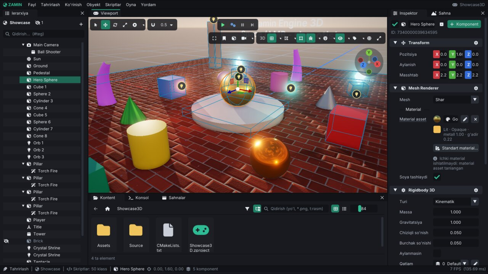
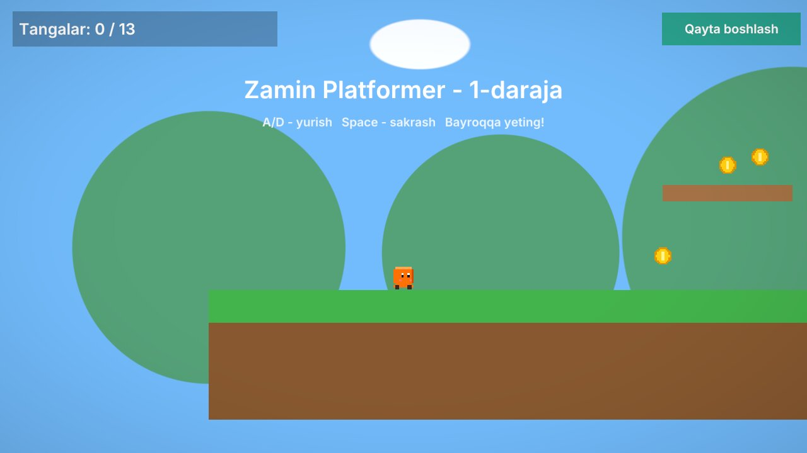
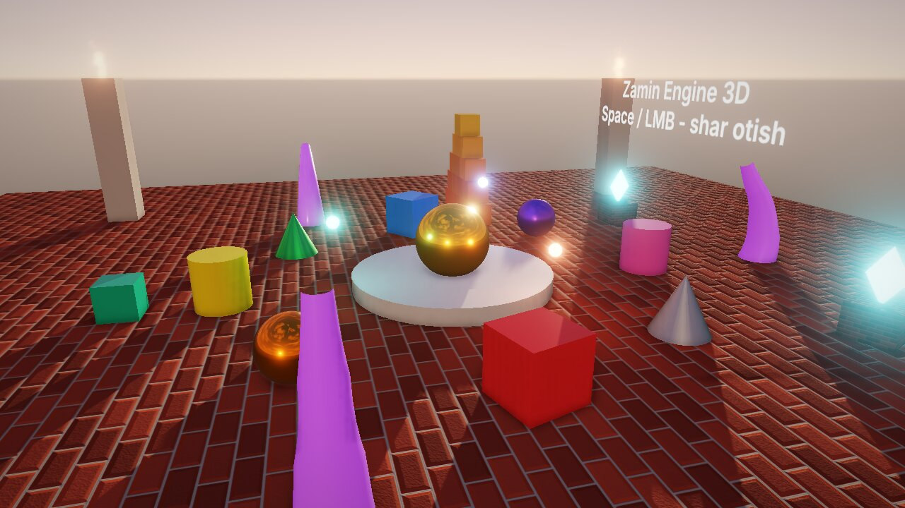
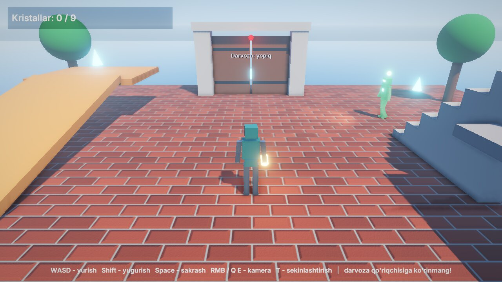
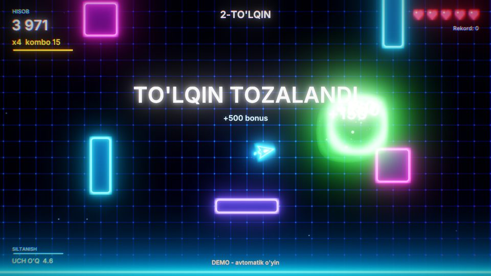
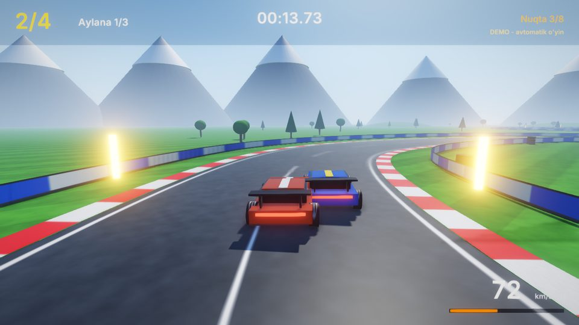
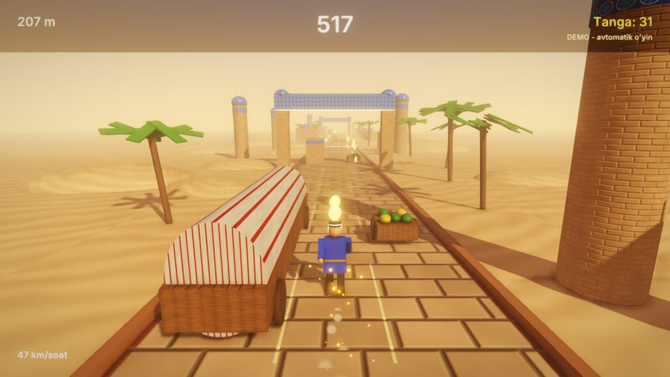
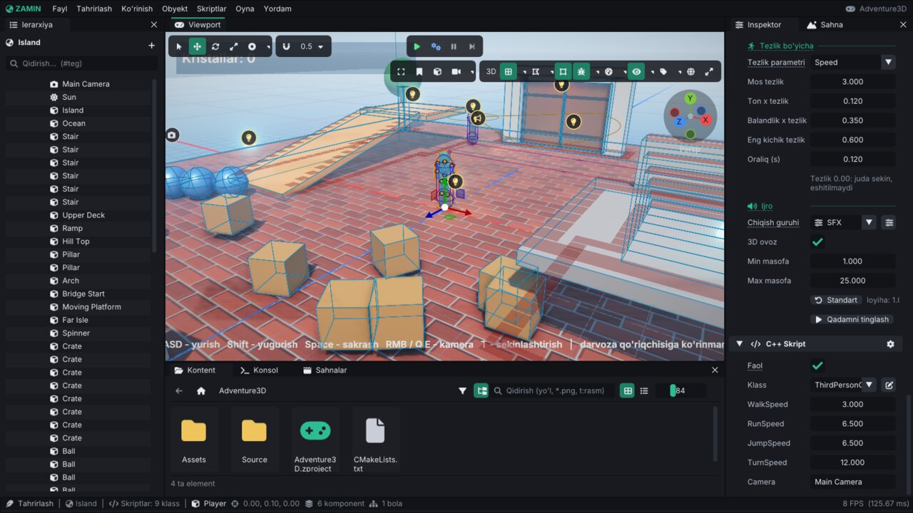

# 🌍 Zamin Engine

**Zamin** — C++20 da yozilgan 2D/3D o'yin dvigateli (game engine). Editor'i Unity/Unreal uslubida, o'yin mantiqi esa
**C++ skriptlarda** yoziladi: editor skriptlarni o'zi kompilyatsiya qiladi va editorni qayta ishga tushirmasdan
qayta yuklaydi (hot reload). Interfeys va hujjatlar o'zbek tilida.

Hozircha **Linux** qo'llab-quvvatlanadi (OpenGL 4.1 core). Windows, macOS, Android va iOS keyingi bosqichlarda:
renderer RHI interfeyslari orqasida, platformaga xos kod `Platform/` papkasida ([Architecture.md](docs/Architecture.md)).



| Platformer2D | Showcase3D | Adventure3D |
|---|---|---|
|  |  |  |

| Neon Maydon | Vodiy Poygasi | Ipak Yo'li |
|---|---|---|
|  |  |  |

*Namuna o'yinlar `Projects/` papkasida; rasmlar `ZaminPlayer` dan headless olingan. Hammasi bir sahifada:
**[namuna o'yinlar galereyasi](docs/Samples.md)**. Har bir namunaning README'si bor (boshqaruv, ko'rsatilgan
imkoniyatlar, kod bo'ylab sayohat):*
[Neon Maydon](Projects/TopDownShooter/README.md) ·
[Zamin Breakout](Projects/Breakout/README.md) ·
[FPS Arena](Projects/FPSArena/README.md) ·
[Omborchi](Projects/Sokoban/README.md) ·
[Ipak Yo'li](Projects/EndlessRunner/README.md) ·
[Vodiy Poygasi](Projects/Racing/README.md) ·
[Platformer2D](Projects/Platformer2D/README.md) ·
[Showcase3D](Projects/Showcase3D/README.md) ·
[Adventure3D](Projects/Adventure3D/README.md)

---

## ✨ Imkoniyatlar

- **Editor** — docking oynalar, ierarxiya va inspektor, gizmo'lar va snapping, undo tarixi, prefab rejimi, kontent
  brauzer (UUID'li assetlar, qidiruv, thumbnail'lar), bir nechta sahna ko'rinishi, profiler, o'zbek / ingliz interfeysi
  — [Editor.md](docs/Editor.md)
- **C++ skriptlar** — `ScriptableEntity`, inspektorda tahrirlanadigan maydonlar (`ZM_FIELD`), hayot sikli va hodisalar,
  taymerlar, tween'lar, xabarlar, hot reload — [Scripting.md](docs/Scripting.md)
- **Rendering** — 2D batch renderer (sprite atlas, 9-slice, tilemap, 2D yorug'lik, pixel-perfect) va PBR 3D (glTF,
  `.zmat` materiallar, cascaded soyalar, HDRI osmon va IBL, SSAO, bloom, avto ekspozitsiya), particle tizimi —
  [Rendering.md](docs/Rendering.md)
- **Fizika** — 2D (Box2D) va 3D (Jolt): collider'lar, joint'lar, effektorlar, Character Controller, so'rovlar,
  to'qnashuv qatlamlari, determinizm — [Physics.md](docs/Physics.md)
- **Animatsiya** — property kliplar va timeline, skelet animatsiya, Animator (holat mashinasi, blend tree, qatlamlar),
  root motion, sprite kliplar — [Animation.md](docs/Animation.md)
- **Audio** — miniaudio: mixer guruhlari, musiqa crossfade, 3D ovoz, filtrlar, ambient zonalar —
  [Audio.md](docs/Audio.md)
- **UI** — ekran interfeysi: langarlar, layout guruhlari, vidjetlar, navigatsiya, UI animatsiyalari — [UI.md](docs/UI.md)
- **Sahnalar va prefab'lar** — additive yuklash, fonda yuklash, o'tishlar, sub-sahnalar; bog'langan prefab nusxalari,
  override'lar, variantlar — [Scenes.md](docs/Scenes.md), [Prefabs.md](docs/Prefabs.md)
- **AI** — NavGrid 2D / 3D va A*, Nav Agent, steering, ko'rish, patrul, formatsiya, behavior tree — [AI.md](docs/AI.md)
- **Player va eksport** — bitta tugma bilan mustaqil o'yin papkasi (`.sh`, `.desktop`, ikonkalar), log, crash hisoboti,
  buyruq qatori — [Runtime.md](docs/Runtime.md), [BuildAndExport.md](docs/BuildAndExport.md)
- **Sifat** — headless unit testlar, rendering regressiya testi, editor smoke testi, sanitizerlar, kod qamrovi,
  benchmarklar, hujjatlar tekshiruvi — [Testing.md](docs/Testing.md), [Quality.md](docs/Quality.md)

**To'liq ro'yxat** (har bir imkoniyat tafsilotlari bilan): [docs/Features.md](docs/Features.md).

---

## 🚀 Tez boshlash

Talablar: C++20 kompilyator (GCC 13+ yoki Clang 17+), CMake 3.20+, Ninja (ixtiyoriy), OpenGL 4.1+ drayveri, X11 /
Wayland dev paketlari. Ubuntu / Debian:

```bash
sudo apt install build-essential cmake ninja-build git \
    libgl-dev libx11-dev libxrandr-dev libxinerama-dev libxcursor-dev libxi-dev \
    libwayland-dev libxkbcommon-dev wayland-protocols zenity
```

Fedora, Arch, CMake variantlari, presetlar va o'yinni eksport qilish: [BuildAndExport.md](docs/BuildAndExport.md).
Qolgan kutubxonalar (GLFW, EnTT, ImGui, Box2D, Jolt ...) CMake orqali o'zi yuklab olinadi.

```bash
git clone https://github.com/abbosjon-dev/zamin-game-engine.git
cd zamin-game-engine
cmake -S . -B build -G Ninja -DCMAKE_BUILD_TYPE=Release
cmake --build build

./build/bin/ZaminEditor                          # launcher: yangi loyiha, so'nggi loyihalar, namunalar
./build/bin/ZaminEditor Projects/Platformer2D    # namuna 2D o'yin (Showcase3D, Adventure3D ham)
./build/bin/ZaminPlayer Projects/Adventure3D     # o'yinni editorsiz (variantlar: --help)
ctest --test-dir build -LE gui                   # tezkor testlar
```

**Birinchi o'yin**: [2D qo'llanma](docs/Tutorial-2D.md) va [3D qo'llanma](docs/Tutorial-3D.md) — editorda qadam-baqadam,
to'liq kod bilan. Qisqasi:

1. `ZaminEditor` → **Yangi loyiha** → nom va joy → **Yaratish** (C++ skriptlar shablondan yaratilib kompilyatsiya qilinadi).
2. Ierarxiyada `+` → obyekt yarating (masalan *2D → Fizik quti*).
3. Inspektorda **+ Komponent → C++ Script** → klassni tanlang.
4. **▶ O'ynash** (`Ctrl+P`).
5. **Fayl → O'yinni build qilish** — tayyor o'yin papkasi va `.sh` launcher.

Loyiha tuzilmasi:

```
MeningOyinim/
├── MeningOyinim.zproject     # loyiha sozlamalari
├── CMakeLists.txt            # skript modulini build qilish (editor yaratadi)
├── Source/                   # C++ o'yin skriptlari
│   └── Scripts.cpp
├── Assets/                   # sahnalar, teksturalar, ovozlar, modellar
│   ├── Scenes/Main.zscene
│   └── Scenes/Main.zscene.zmeta  # asset UUID'si va import sozlamalari (versiya nazoratiga qo'shing)
├── .zamin/                   # editor keshi: AssetRegistry.json, Thumbnails/ (qayta yasaladi, .gitignore'da)
└── Binaries/libMeningOyinim.so   # kompilyatsiya qilingan skriptlar (avtomatik)
```

---

## 🧑‍💻 C++ skript



```cpp
#include <Zamin/Zamin.h>
using namespace Zamin;

class Player : public ScriptableEntity
{
public:
    float Speed = 6.0f;          // inspektorda ko'rinadi
    float JumpImpulse = 9.0f;

    void OnCreate() override { ZM_INFO("Salom, {}!", GetName()); }

    void OnUpdate(Timestep) override
    {
        glm::vec2 v = GetVelocity();                 // Rigidbody2D
        v.x = Input::GetAxis("Horizontal") * Speed;  // A/D, strelkalar, gamepad
        SetVelocity(v);

        if (Input::IsActionJustPressed("Jump"))      // Space / gamepad A, bir marta
            ApplyImpulse({ 0.0f, JumpImpulse });
    }

    void OnTriggerBegin(Entity other) override       // tanganing collider'i - sensor
    {
        if (other.HasTag("Coin"))
        {
            SaveData::SetInt("Coins", SaveData::GetInt("Coins") + 1); // o'yinlar orasida saqlanadi
            PlaySound("Audio/coin.wav");
            Destroy(other);                          // kadr oxirida o'chiriladi
        }
    }
};

ZM_REGISTER_SCRIPT(Player,
    ZM_FIELD_RANGE(Player, Speed, 0.0f, 20.0f).Tooltip("Yurish tezligi"),
    ZM_FIELD(Player, JumpImpulse))
```

Skriptni o'zgartirgach **Skriptlar → Kompilyatsiya + qayta yuklash** (`Ctrl+B`) — modul editorni yopmasdan qayta
yuklanadi. O'yin rejimi (Play) bo'lsa, u avval to'xtatiladi; inspektordagi maydon qiymatlari saqlanadi va yangi kod ular
bilan ishlaydi. Hayot sikli, barcha callback'lar va API ma'lumotnomasi: [Scripting.md](docs/Scripting.md); komponentlar:
[Components.md](docs/Components.md).

---

## 📚 Hujjatlar

To'liq ro'yxat: **[docs/README.md](docs/README.md)** (hujjatlar indeksi).

| Boshlash | Qo'llanmalar | Ma'lumotnoma va ichki tuzilma |
|---|---|---|
| [2D qo'llanma](docs/Tutorial-2D.md), [3D qo'llanma](docs/Tutorial-3D.md) | [Rendering](docs/Rendering.md), [Fizika](docs/Physics.md), [Animatsiya](docs/Animation.md) | [Komponentlar](docs/Components.md), [Imkoniyatlar](docs/Features.md) |
| [Editor](docs/Editor.md), [Namuna o'yinlar](docs/Samples.md) | [Audio](docs/Audio.md), [UI](docs/UI.md), [Sahnalar](docs/Scenes.md), [Prefab'lar](docs/Prefabs.md) | [Arxitektura](docs/Architecture.md), [Core](docs/Core.md) |
| [C++ skriptlar](docs/Scripting.md) | [AI](docs/AI.md), [Loyiha sozlamalari](docs/ProjectSettings.md), [Player](docs/Runtime.md) | [Build va eksport](docs/BuildAndExport.md), [FAQ](docs/FAQ.md) |

API ma'lumotnomasi (Doxygen): `cmake --build build --target docs` → `build/docs/html/index.html`
([BuildAndExport.md](docs/BuildAndExport.md#7-api-malumotnomasi-doxygen)).

---

## 🤝 Hissa qo'shish

Build, kod uslubi, testlar, commit qoidalari va hujjatlar: [CONTRIBUTING.md](CONTRIBUTING.md). O'zgarishlar tarixi
milestone'lar bo'yicha: [CHANGELOG.md](CHANGELOG.md); reja: [docs/TASKS.md](docs/TASKS.md).

## 📦 Uchinchi tomon kutubxonalari

GLFW (zlib), glad (MIT/Public), GLM (MIT), EnTT (MIT), Dear ImGui (MIT), ImGuizmo (MIT), Box2D (MIT), Jolt Physics (MIT), nlohmann/json (MIT), cgltf (MIT), stb (Public Domain/MIT), miniaudio (Public Domain/MIT-0), tinyobjloader (MIT). Shriftlar: Inter (SIL OFL 1.1), Font Awesome Free (SIL OFL 1.1) — litsenziyalar `Resources/fonts/` ichida.

## Litsenziya

MIT — [LICENSE](LICENSE).
