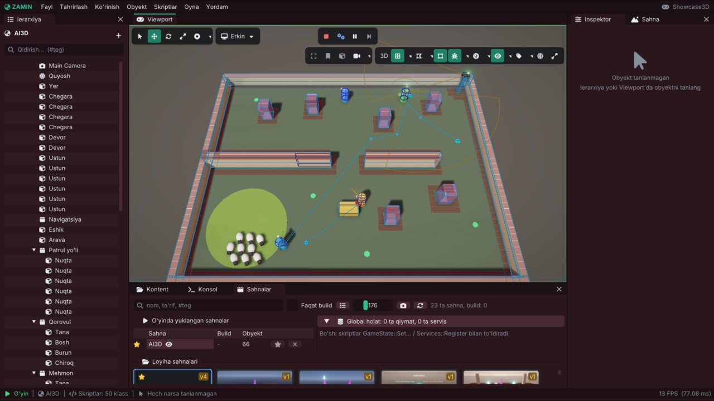

# Zamin Engine: navigatsiya va sun'iy intellekt (AI)

Bu qo'llanma o'yindagi personajlarni "aqlli" qiladigan hamma narsa haqida: yo'l topish uchun grid'lar (2D va 3D),
A* bilan yo'l qidirish va yo'lni silliqlash, yo'l bo'ylab yuradigan agentlar, harakatlanuvchi to'siqlar, steering
xatti-harakatlari va nurlar bilan to'siqdan qochish, ko'rish sensori (ko'rish maydoni va ko'rish chizig'i), patrul
yo'llari, guruh shakllari (formatsiya), AI holat mashinasi va behavior tree, navigatsiyani debug chizish, ishlash
tezligi (benchmark) va bake ma'lumotlarini saqlash (`.znav`).

Hamma narsa `#include <Zamin/Zamin.h>` bilan keladi; AI moduli `Zamin/src/Zamin/AI/` papkasida, sahnaga bog'liq
qismi `Scene/SceneNavigation.cpp`, `ScenePatrol.cpp`, `SceneFormation.cpp`, `SceneSight.cpp` fayllarida.

## Mundarija

1. [Umumiy tuzilma](#1-umumiy-tuzilma)
2. [NavGrid: yo'l topish grid'i](#2-navgrid-yol-topish-gridi)
3. [NavGrid 2D va NavGrid 3D komponentlari](#3-navgrid-2d-va-navgrid-3d-komponentlari)
4. [A* yo'l qidirish va yo'lni silliqlash](#4-a-yol-qidirish-va-yolni-silliqlash)
5. [Nav Agent: yo'l bo'ylab yurish](#5-nav-agent-yol-boylab-yurish)
6. [Nav Obstacle: harakatlanuvchi to'siqlar](#6-nav-obstacle-harakatlanuvchi-tosiqlar)
7. [Steering va to'siqdan qochish](#7-steering-va-tosiqdan-qochish)
8. [Sight Sensor: ko'rish](#8-sight-sensor-korish)
9. [Patrol Path: patrul yo'llari](#9-patrol-path-patrul-yollari)
10. [Formation: guruh harakati](#10-formation-guruh-harakati)
11. [AI holat mashinasi (StateMachine)](#11-ai-holat-mashinasi-statemachine)
12. [Behavior tree](#12-behavior-tree)
13. [Qaysi birini tanlash kerak?](#13-qaysi-birini-tanlash-kerak)
14. [Debug chizish](#14-debug-chizish)
15. [Ishlash tezligi va benchmark](#15-ishlash-tezligi-va-benchmark)
16. [Serializatsiya va .znav fayli](#16-serializatsiya-va-znav-fayli)
17. [Namuna sahnalar](#17-namuna-sahnalar)
18. [Testlar](#18-testlar)
19. [Qisqa API ma'lumotnomasi](#19-qisqa-api-malumotnomasi)

---

## 1. Umumiy tuzilma

AI uch qatlamdan iborat:

| Qatlam | Nima | Qayerda |
|---|---|---|
| Sof algoritmlar | `NavGrid`, `NavPathfinder` (A*), `NavPathSmoothing`, `Steering`, `Sight`, `Formation`, `StateMachine`, `BehaviorTree` | `AI/*.h` - sahnaga bog'liq emas, testlarda alohida ishlaydi |
| Komponentlar | NavGrid 2D / 3D, Nav Agent, Nav Obstacle, Sight Sensor, Patrol Path, Formation | `Scene/Components.h`, inspektorda "Navigatsiya va AI" bo'limi |
| Skript API | `SetDestination`, `CanSeeTarget`, `PausePatrol`, `SetFormationShape`, `WatchBehaviorTree` ... va callback'lar | `Scripting/ScriptableEntity.h` |

Har kadrda o'yin quyidagi tartibda ishlaydi (`Scene::OnUpdateRuntime`): skriptlarning `OnUpdate` -> grid'larni qayta
qurish (AutoRebuild) -> Nav Obstacle'lar kataklarni yopadi -> Patrol Path'lar keyingi nuqtani tanlaydi -> Formation'lar
a'zolarini joyiga yuboradi -> Nav Agent'lar yo'l topadi va yuradi -> fizika qadami -> Sight Sensor'lar qaraydi
(`OnTargetSpotted` / `OnTargetLost`) -> navigatsiya debug chizish -> `OnLateUpdate`.

Koordinatalar: 2D o'yinlarda grid dunyoning **XY** tekisligida, 3D'da **XZ** tekisligida (grid'ning `y` o'qi = dunyo
`z`). 3D obyekt `-Z` tomonga qaraydi, 2D obyekt `+X` tomonga.

## 2. NavGrid: yo'l topish grid'i

`AI/NavGrid.h`. Kvadrat kataklar to'ri: har katak yuriladigan yoki to'siq, o'z narxiga ega (1 - oddiy yer, 3 - loy:
undan o'tish 3 barobar qimmat). 3D grid'larda har katakning poli balandligi va qo'shni kataklar orasidagi eng katta
balandlik farqi (`MaxClimb`, zinapoya) bor.

```cpp
NavGrid grid(32, 32, 0.5f, { -8.0f, -8.0f });   // 32x32 katak, 0.5 birlik, (-8, -8) dan boshlab
grid.FillRect(10, 0, 11, 20, false);             // devor
grid.SetCost(5, 5, 3.0f);                        // loy
grid.Erode(0.3f);                                // agent radiusi: devorga 0.3 dan yaqin kataklar ham yopiq
glm::ivec2 cell = grid.WorldToCell({ 1.2f, -3.0f });
bool ok = grid.HasLineOfSight({ -7, -7 }, { 7, -7 }); // to'g'ri yurib bo'ladimi (burchak kesmasdan)
```

- `TraceLine` - kesma tegadigan kataklar (supercover: aynan burchakdan o'tsa ikkala yon katak ham);
- `FindNearestWalkable` - eng yaqin yuriladigan katak (devor ichiga bosilgan nishon uchun);
- `Carve` / `Uncarve` - Nav Obstacle'lar uchun: bake qilingan holatdan alohida hisoblanadi (bir katakni bir nechta
  to'siq yopishi mumkin), `GetCarveRevision` o'zgaradi - agentlar yo'li to'silganini tekshiradi;
- `GetRevision` - grid har o'zgarganda oshadi (agentlar yo'lni qaytadan topadi).

## 3. NavGrid 2D va NavGrid 3D komponentlari

Grid'ni qo'lda to'ldirish shart emas: komponent uni darajadan o'zi quradi ("bake").

**NavGrid 2D** (`NavGrid2DComponent`): tilemap'larning to'qnashuvchi plitkalari (tileset sozlamasi: Solid; `OneWayBlocks`
bilan OneWay ham) va statik 2D collider'lar (Rigidbody 2D Static, trigger'lar emas) ostidagi kataklar yopiq,
`AgentRadius` dan yaqinlari ham. Maydon - manbalar chegarasi (`AutoBounds`) yoki obyekt atrofidagi `Size`.
`AutoRebuild`: o'yin paytida plitka qo'yilsa / buzilsa yoki statik collider siljisa soniyasiga bir necha marta
tekshirib qayta quradi.

**NavGrid 3D** (`NavGrid3DComponent`): `Size` qutisidagi har katak markazidan pastga nur tashlanadi; birinchi tekkan
statik 3D collider - katak poli. Pol `MaxSlope` dan tik bo'lmasa va ustida `AgentHeight` gacha hech narsa bo'lmasa
(devor, yashik, past shift) - yuriladigan. Qo'shni pollar `StepHeight` dan ko'p farq qilsa bog'lanmaydi. Bu bitta
qavat (eng yuqori pol) - navmesh emas.

Ikkalasida ham `Paths` sozlamalari:

| Sozlama | Ma'nosi |
|---|---|
| `Diagonals` | 8 qo'shni (diagonal qadam sqrt 2 turadi), o'chiq - faqat 4 tomon |
| `CutCorners` | diagonal qadam bitta to'siq katak yonidan o'tishi mumkin |
| `BakeOnStart` | o'yin boshlanganda (skriptlardan oldin) quriladi; o'shanda nofaol grid - yoqilganda, o'yin paytida yaratilgani (`Instantiate`, prefab) - darhol; o'chiq bo'lsa - `GetScene().BakeNavGrid(e)` |
| `CacheBake` | bake sahna yonidagi `.znav` faylida saqlanadi ([16-bo'lim](#16-serializatsiya-va-znav-fayli)); faqat `BakeOnStart` bilan |

Editor grid'ni o'zi quradi va viewport'da ko'rsatadi (Gizmo'lar > Navigatsiya); inspektordagi "Grid'ni qurish"
tugmasi qaytadan quradi. Skriptdan: `Scene::BakeNavGrid(entity)`, `Scene::BakeNavGrids()`.

## 4. A* yo'l qidirish va yo'lni silliqlash

`AI/NavPathfinder.h`: indekslangan binar heap'li A*. Buferlari qayta ishlatiladi (grid'ga sig'gandan keyin xotira
ajratmaydi), shuning uchun har oqimga bitta pathfinder (grid'larni oqimlar baham ko'rishi mumkin - ular faqat
o'qiladi). Bir xil narxli yo'llar orasidan har doim bir xil tanlanadi (deterministik).

```cpp
NavPathfinder finder;
NavPathResult path;
NavPathOptions options;           // Diagonals, CutCorners, HeuristicWeight, MaxExpanded, SnapRadius, StartHeight
finder.FindPath(grid, glm::vec2(-7, -7), glm::vec2(7, 7), path, options);
if (path.IsComplete()) ...        // Complete - nishonga yetadi; Partial - unga eng yaqin joyga; Failed - umuman yo'q
```

- `HeuristicWeight` > 1 - kamroq katak ochadi, yo'l shunchalik uzunroq bo'lishi mumkin; 0 - Dijkstra.
- Nishon devor ichida yoki yopiq xonada bo'lsa natija **Partial**: unga eng yaqin yetib boriladigan katakkacha.
- Boshlanish yopiq katakda bo'lsa (eroziya qilingan devor yonida) `SnapRadius` ichidagi eng yaqin bo'sh katakdan.

`AI/NavPathSmoothing.h`: kataklar ketma-ketligidan nuqtalar (`ToPoints`), **string pulling** (`StringPull`: ko'rinadigan
eng uzoq burchakkacha to'g'ri chiziq - "zinapoya" yo'qoladi) va burchaklarni yumaloqlash (`SplineSmooth`:
Catmull-Rom, faqat yuriladigan joydan). Sahna darajasida: `Scene::FindNavPath(from, to, path)`.

## 5. Nav Agent: yo'l bo'ylab yurish

`NavAgentComponent` obyektni grid bo'ylab yurgizadi: `SetDestination` (yoki `Target` - doim ortidan quvadigan obyekt)
yo'lni topadi, agent esa unga `LookAhead` oldindagi nuqtaga qarab yuradi, `Acceleration` bilan tezlashadi / to'xtaydi,
`AngularSpeed` bilan buriladi va oxiridan `StoppingDistance` da to'xtaydi. Yo'l har `RepathInterval` soniyada va grid
o'zgarganda qaytadan topiladi.

Nimani suradi: Character Controller 3D (`Move` bilan), Rigidbody 2D / 3D (dinamik - tezlik bilan, kinematik -
transform bilan) yoki transform'ning o'zini (3D'da grid poli ustida, `BaseOffset` balandlikda).

```cpp
class Guard : public ScriptableEntity
{
public:
    void OnUpdate(Timestep) override
    {
        if (CanSeeTarget())
            SetDestination(GetScene().GetWorldPosition(GetSeenTarget()));
        else if (!IsMoving())
            SetDestination(m_Points[m_Next++ % m_Points.size()]);
    }

private:
    std::vector<glm::vec3> m_Points{ { 0, 0, 0 }, { 8, 0, 0 }, { 8, 0, 8 } };   // patrul nuqtalari
    size_t m_Next = 0;
};
```

Skript API: `SetDestination(p)` (yo'l darhol topiladi; topilmasa `false`), `StopMoving(immediate)`, `IsMoving()`,
`HasArrived()`, `GetRemainingDistance()`, `FindPath(from, to)`, `HasNavLineOfSight(a, b)`, `SetNavTarget(e)`.

`Target` li agent: `StopMoving()` (inspektordagi "To'xtatish" ham) va `SetDestination(p)` nishon ortidan yurishni
**to'xtatib turadi** - `Target` saqlanadi, lekin agent turib qoladi yoki yuborilgan joyga boradi. Yana ta'qib qilish
uchun: `SetNavTarget(e)` (komponentda `ResumeTarget()`, inspektorda "Nishon ortidan") yoki boshqa `Target` qo'yish;
`SetNavTarget({})` nishonni olib tashlaydi va agentni to'xtatadi.

> Maslahat: "yetib keldimi?" uchun `HasArrived()` emas, `IsMoving()` ni tekshiring - yo'l topilmagan agent "yetib
> kelmaydi", lekin harakatlanmaydi ham.

## 6. Nav Obstacle: harakatlanuvchi to'siqlar

`NavObstacleComponent` - eshik, surib yuriladigan yashik, to'xtab turgan arava: o'yin paytida o'z shakli (quti yoki
doira/silindr, `AgentRadius` ga kengaytirilgan) ostidagi kataklarni bake qilingan grid'dan "o'yib" oladi
(carving). `MoveThreshold` dan ko'p siljisa yoki burilsa faqat o'zgargan kataklarni qayta yopadi; o'chirilsa / nofaol
bo'lsa kataklarni qaytaradi. Yo'li to'silgan agentlar shu kadrning o'zida yangi yo'l topadi.

`CarveOnlyStationary`: faqat `StationaryTime` soniya turgandan keyin yopadi - harakat paytida uni agentlarning
nurlari (Avoidance) aylanib o'tadi. Inspektor jonli holatni ko'rsatadi: nechta katak yopiq, necha marta yangilandi.

## 7. Steering va to'siqdan qochish

`AI/Steering.h` - Reynolds steering xatti-harakatlari: kichik sof funksiyalar, har biri "steering kuchi" qaytaradi
(xohlangan tezlik - hozirgi tezlik). `glm::vec2` va `glm::vec3` uchun.

| Funksiya | Nima qiladi |
|---|---|
| `Seek` / `Flee` | to'liq tezlikda nishonga / undan (Flee faqat `panicDistance` ichida) |
| `Arrive` | nishonga, `slowingRadius` ichida sekinlashib, ustida to'xtaydi |
| `Pursue` / `Evade` | nishonning kelajakdagi joyiga (tezligi bo'yicha bashorat) |
| `Wander` | aylanadagi nuqta tasodifiy siljiydi - silliq, maqsadsiz yurish (o'z urug'i bilan) |
| `Separation` / `Alignment` / `Cohesion` | suruv (flocking): bir-biridan uzoqlashish, bir tomonga, markazga |
| `Accumulate` | ustuvorlik bilan qo'shish: avval muhimlari, `maxForce` tugasa qolgani kesiladi |
| `Integrate` | kuch -> tezlik -> pozitsiya (oddiy "transport vositasi") |

```cpp
glm::vec2 force(0.0f);
Steering::Accumulate(force, Steering::Separation(p, neighbours, 1.2f, MaxSpeed) * 1.5f, MaxForce);
Steering::Accumulate(force, Steering::Arrive(p, v, goal, MaxSpeed, 2.0f), MaxForce);
Steering::Accumulate(force, Steering::Wander(m_Wander, p, v, MaxSpeed, dt) * 0.5f, MaxForce);
Steering::Integrate(p, v, force, MaxForce, MaxSpeed, dt);
```

**To'siqdan qochish (Avoidance)**: Nav Agent'da `Avoidance` yoqilsa uchta fizika nuri ("mo'ylov": oldinga
`FeelerLength` va ikki yonga `FeelerAngle` ostida) grid bilmaydigan narsalarni - boshqa agentlar, yashiklar, harakatdagi
jismlar - aylanib o'tadi; turtki yo'l bilan `AvoidanceWeight` da aralashtiriladi va hech qachon grid yopiq deb
bilgan katakka yo'naltirmaydi. Statik jismlar faqat `AvoidStatic` bilan (ularni grid allaqachon biladi).
`Steering::MakeFeelers` / `AvoidObstacles` - shu mantiqning sof qismi (o'z skriptingizda ham ishlatish mumkin).

## 8. Sight Sensor: ko'rish

`SightSensorComponent` - "ko'zlar": nishon `ViewDistance` ichida va oldinga qaragan `FieldOfView` konusida bo'lsa (yoki
`NearDistance` dan yaqin bo'lsa har tomondan), ko'zdan (`EyeHeight`) nishonning nuqtalariga (collider markazi va
qirralari) tashlangan fizika nurlaridan biri `BlockingMask` qatlamlaridagi collider'ga tegmasa - ko'radi. Nishonlar:
`Target` obyekt yoki `TargetTag` tegli faol obyektlar. Har `CheckInterval` soniyada tekshiriladi.

```cpp
void OnTargetSpotted(Entity target) override { m_AI.SendEvent("ko'rdi"); }
void OnTargetLost(Entity target) override { m_AI.SendEvent("yo'qotdi"); }
// yoki har kadr: CanSeeTarget(), GetSeenTarget(), GetLastSeenPosition(), RemembersTarget()
```

`RemembersTarget()` - ko'ryapti yoki `MemoryTime` soniyadan kamroq oldin ko'rgan ("qidiruv" holati uchun). Istalgan
obyektni darhol tekshirish: `Scene::CanSee(viewer, target)`, skriptda `CanSee(entity)`. Editor konusni chizadi (ko'rsa
qizil) va oxirgi ko'rilgan joyni belgilaydi.

## 9. Patrol Path: patrul yo'llari

`PatrolPathComponent` - qorovul, hayvon, arava aylanib yuradigan yo'l. Nuqtalar manbai:

- **Ro'yxat** (`Points`): dunyo koordinatalari yoki `RelativeToStart` bilan boshlang'ich joydan siljish (prefab
  nusxalari o'z joyida patrul qiladi); har nuqtaning o'z kutish vaqti bo'lishi mumkin;
- **Bolalar**: `Route` obyektining faol bolalari, ierarxiya tartibida (viewport'da gizmo bilan suriladi);
- **Spline**: `Route` dagi Spline nuqtalari yoki egri chiziq bo'ylab har `SplineSpacing` da nuqta.

Rejimlar: `Loop` (oxiridan boshiga), `PingPong` (borib-qaytish), `Random` (bir nuqtaga ketma-ket ikki marta emas),
`Once` (oxirida to'xtaydi). Har nuqtada `WaitTime` (+/- `WaitVariance`) kutadi. Nav Agent bo'lsa grid bo'ylab yuradi
(agentning tezligi, avoidance ...), bo'lmasa to'g'ri chiziq bo'ylab `Speed` bilan. Yetib bo'lmaydigan nuqta qisqa
kutishdan yoki 5 s turib qolishdan keyin o'tkazib yuboriladi.

Skript API: `PausePatrol(stop)` (masalan ta'qib boshlanadi), `ResumePatrol(nearest)` (eng yaqin nuqtadan davom),
`IsPatrolling()`, `GetPatrolPoint()`, `GetPatrolTarget()`, `IsWaitingAtPatrolPoint()`, `SetPatrolPoint(i)`;
callback `OnPatrolPointReached(int index)` va event bus'da `"PatrolPointReached"` hodisasi.

## 10. Formation: guruh harakati

`FormationComponent` boshliq (leader) obyektda turadi: uning a'zolari - `Members` ro'yxati va (ixtiyoriy) `MemberTag`
tegli faol obyektlar - boshliq atrofidagi "joylar"da (slot) turadi va u bilan birga yuradi.

| Shakl | Joylar |
|---|---|
| `Line` (qator) | boshliq bilan yonma-yon: o'ngida, chapida, navbat bilan, `Spacing` oraliqda |
| `Column` (kolonna) | boshliq ortidan bir qator bo'lib |
| `Wedge` (pona) | V shaklida, boshliq uchida; `WedgeAngle` - V qanchalik ochiq |
| `Circle` (doira) | boshliq atrofida halqa (boshliq bilan burilmaydi; a'zolar tashqariga qaraydi) |

- **Yo'nalish**: boshliq yurgan tomon (Nav Agent tezligi yoki siljishi), turganda - oxirgi yo'nalish, boshida - u
  qaragan tomon. Burilish silliq (300 gradus / s).
- **Joy taqsimlash** (`AssignNearest`): har a'zo jami eng kam yuriladigan joyni oladi - Venger (Hungarian) usuli,
  64 tadan ko'p a'zoda - "eng yaqin bo'sh joy". Shakl, a'zolar o'zgarsa yoki yo'nalish 75 gradusdan ko'p burilsa -
  qaytadan (aks holda chapdagilar o'ngga o'tib bir-birini kesib o'tardi).
- **Grid ichida** (`KeepOnGrid`): to'siq katakdagi joy eng yaqin yuriladigan katakka, devor ortidagisi boshliq
  tomonga suriladi (yo'lakda qator o'z-o'zidan torayadi).
- **Harakat**: Nav Agent'li a'zolar har `UpdateInterval` da joyi siljigan bo'lsa yangi manzil oladi (boshliq yurganda -
  joyning keyingi yuborishgacha bo'ladigan o'rni: to'xtab-yurmaydi); Nav Agent'siz a'zolar to'g'ri chiziq bo'ylab
  `Speed` bilan (Character Controller, dinamik jism yoki transform). A'zolar boshliqdan bir oz tezroq bo'lsin.
- Joyida turgan a'zo (`SlotTolerance`) guruh qaragan tomonga buriladi (`FaceHeading`).

```cpp
// Komandir skripti: ko'rsa - pona, qidirganda - doira
if (CanSeeTarget()) SetFormationShape(FormationShape::Wedge);
AddFormationMember(recruit);
if (IsFormationInPlace()) StartNextOrder();
// a'zo skriptida:
Entity leader = GetFormationLeader();
glm::vec3 slot; GetFormationSlot(slot);
```

Sahna API: `GetFormationMembers`, `GetFormationSlots(leader, slots, &members)` (editor'da ham ishlaydi - gizmo shundan),
`SetFormationShape`, `AddFormationMember` / `RemoveFormationMember`, `GetFormationLeader`, `GetFormationSlot`.
Sof matematika: `AI/Formation.h` (`ComputeOffsets`, `ToWorld`, `AssignSlots`).

Inspektor: shakl tugmalari, a'zolar ro'yxati (ierarxiyadan tortib tashlash; "Tanlanganlar" - Ctrl bilan birga
tanlangan obyektlarni qo'shadi), o'yin paytida jonli holat ("4 / 6 joyida") va shaklni almashtirish tugmalari.

## 11. AI holat mashinasi (StateMachine)

`AI/StateMachine.h` - nomli holatlar (`OnEnter` / `OnUpdate` / `OnExit`) va o'tishlar: shartli, vaqtli, hodisali
(`SendEvent`) va "istalgan holatdan". Holatlar lambda yoki `AIState` dan meros klass.

```cpp
m_AI.AddState("Patrul", [this] { GoToNextWaypoint(); }, [this](float) { if (!IsMoving()) GoToNextWaypoint(); })
    .AddState("Ta'qib", {}, [this](float) { SetDestination(TargetPosition()); })
    .AddState("Qidiruv", [this] { SetDestination(GetLastSeenPosition()); })
    .AddTransition("Patrul", "Ta'qib", [this] { return CanSeeTarget(); })
    .AddEventTransition("Ta'qib", "Qidiruv", "yo'qotdi")
    .AddTimedTransition("Qidiruv", "Patrul", 4.0f);
m_AI.Start("Patrul");     // OnStart
m_AI.Update(ts);          // OnUpdate
WatchStateMachine(m_AI);  // inspektor holatni va o'tishlar tarixini ko'rsatadi
```

## 12. Behavior tree

`AI/BehaviorTree.h` - minimal behavior tree yordamchisi. Daraxt har kadr ildizdan "tik" qilinadi; har tugun javob
beradi: **Running** (hali tugamadi - keyingi kadrda yana), **Success** yoki **Failure**.

| Tugun | Turi | Nima qiladi |
|---|---|---|
| `Sequence` | kompozit | bolalarini ketma-ket; birinchi Failure'da Failure, hammasi Success bo'lsa Success |
| `Selector` | kompozit | birinchi Failure bo'lmagan bola ("A, bo'lmasa B, bo'lmasa C") |
| `ReactiveSequence` / `ReactiveSelector` | kompozit | har tikda birinchi boladan boshlaydi: shart o'zgarsa ishlayotgan shox to'xtatiladi (halt) |
| `Parallel` | kompozit | hamma bolalar har tikda; `successThreshold` muvaffaqiyat / `failureThreshold` xato yetganda tugaydi |
| `Inverter` / `Succeeder` / `Failer` | dekorator | javobni teskari qiladi / doim Success / doim Failure |
| `Repeat(n)` | dekorator | bolani n marta (n < 1 - abadiy); xato bo'lsa to'xtaydi; bir tikda ko'pi bilan bitta takror |
| `Wait(s)` | barg | `s` soniya Running, keyin Success |
| `Condition` | barg | shart: Success / Failure |
| `Action` | barg | skript ishi: `BTStatus`, `bool` yoki hech narsa qaytaradi; `onHalt` - to'xtatilganda |
| `CheckBlackboard` / `SetBlackboard` | barg | blackboard qiymatini tekshirish / yozish |

**Oddiy va reaktiv**: oddiy `Sequence` / `Selector` ishlayotgan bolani eslab qoladi va keyingi tikda undan davom
etadi. "Shart, keyin uzoq harakat" shoxi shart bajarilmay qolganda to'xtashi kerak bo'lsa - `ReactiveSequence`
ishlating (oddiy Sequence shartni qayta so'ramaydi). "Ko'rsa - ta'qib, bo'lmasa - patrul" uchun ildiz -
`ReactiveSelector`.

**Blackboard** - tugunlar va skript baham ko'radigan nomli qiymatlar: `bool`, `int`, `float`, matn, `vec2`, `vec3`,
`uint64_t` (obyekt UUID'i). Sonlar bir-biriga o'tadi (int float sifatida o'qiladi), UUID aniq saqlanadi.

```cpp
BehaviorTreeBuilder()
    .ReactiveSelector("Komandir")
        .ReactiveSequence("Hujum")
            .Condition("Ko'ryaptimi", [this] { return CanSeeTarget(); })
            .Action("Ta'qib", [this](BTContext& c) { return Chase(c); })
        .End()
        .ReactiveSequence("Qidiruv")
            .Condition("Esidami", [this] { return RemembersTarget(); })
            .Action("O'rab olish", [this](BTContext& c) { return Encircle(c); })
        .End()
        .Sequence("Patrul")
            .Action("Saf tortish", [this] { ResumePatrol(true); })  // void: Success
            .Action("Yurish", [this] { return IsPatrolling() ? BTStatus::Running : BTStatus::Failure; })
        .End()
    .End()
    .Build(m_Tree);
WatchBehaviorTree(m_Tree);   // OnStart
m_Tree.Tick(ts);             // OnUpdate
```

Quruvchi (`BehaviorTreeBuilder`): kompozit ochiladi, `End()` yopadi; dekorator bitta bolasini olgach o'zi yopiladi.
Xatolar (ikkinchi ildiz, ortiqcha `End()`, bolasiz dekorator) logga yoziladi va `GetErrorCount()` da sanaladi.
O'z barg klassingiz: `BTNode` dan meros (`OnStart`, `OnTick`, `OnHalt`) va `.Node(std::make_unique<...>())`.

Debug: `GetActivePath()` ("Komandir > Hujum > Ta'qib"), `Describe()`, `LogChanges = true` - har o'zgarish logga.
`WatchBehaviorTree(tree)` bilan inspektor (C++ Skript bo'limi) o'yin paytida butun daraxtni ko'rsatadi: har tugunning
oxirgi javobi (sariq - Running, yashil - Success, qizil - Failure, xira - oxirgi tikda tekshirilmagan) va blackboard.

## 13. Qaysi birini tanlash kerak?

- **Bir nechta aniq holat va ular orasidagi o'tishlar** (patrul / ta'qib / qidiruv / ushladi) - `StateMachine`:
  o'tishlar ko'rinib turadi, hodisalar bilan yaxshi ishlaydi.
- **Ustuvorliklar ro'yxati va qadamlar ketma-ketligi** ("ko'rsa hujum, esida bo'lsa qidir, bo'lmasa patrul; patrul =
  nuqtaga bor, kut, qara") - behavior tree: yangi shox qo'shish oson, reaktiv tugunlar uzilishlarni o'zi hal qiladi.
- **Guruh** - Formation; **harakat sifati** (suruv, qochish) - Steering; **qayerga borish** - Nav Agent.

## 14. Debug chizish

`AI/NavDebugDraw.h` - editor va o'yin baham ko'radigan chizish: grid'lar (to'siq kataklar qizil, Nav Obstacle yopgani
to'q sariq, tanlangan grid'ning yuriladigan kataklari yashil), agent yo'llari, manzillar va nurlari, to'siqlar
shakli, ko'rish konuslari, patrul yo'llari (raqamlangan nuqtalar, kutish vaqti) va formatsiyalar (joylar, yo'nalish
strelkasi, a'zodan joyiga chiziq; joyida turgani yashil).

- **Editor**: viewport > Gizmo'lar > **Navigatsiya** (o'yin paytida ham, qo'shimcha sahna ko'rinishlarida ham).
- **O'yin**: Loyiha sozlamalari > Debug chizish > Navigatsiya, yoki player'da `--debug-nav` (`--debug-nav-cells` -
  yuriladigan kataklar ham). Kodda: `Scene::DrawNavigationDebug()`.



*Showcase3D `Scenes/AI3D.zscene` editorda Play rejimida, Gizmo'lar > **Navigatsiya** yoqilgan: agentlarning yo'llari
(havorang chiziqlar va burilish nuqtalari), ko'rish konusi (to'q sariq yoy), qo'ra ichidagi qo'ylar suruvi.*

## 15. Ishlash tezligi va benchmark

Nav Agent'larning yo'l qidiruvlari **vazifalar tizimida guruhlab** bajariladi: har kadr avval qaysi agentlarga yangi
yo'l kerakligi aniqlanadi (asosiy oqimda), keyin qidiruvlar - kamida 4 ta bo'lsa - `JobSystem::ParallelFor` bilan
ishchi oqimlarga taqsimlanadi (har oqimning o'z pathfinder'i bor, grid'lar faqat o'qiladi), natijalar agentlar
tartibida qo'llanadi. Natija bir oqimdagi bilan aynan bir xil. Oxirgi kadr statistikasi: `Scene::GetNavFrameStats()`
(agentlar, yo'llar soni, ms, parallelmi).

Benchmark: `./build/bin/ZaminBench --nav [--agents N] [--grid N] [--frames N] [--jobs N]` yoki `nav_bench` maqsadi.
Standart: 256x256 grid (xonalar, eshiklar, tasodifiy to'siqlar), 200 agent. Debug build'da, 4 apparat oqimli mashinada
o'lchangan namuna:

| O'lchov | Bitta oqim | Vazifalar tizimi (3 ishchi) |
|---|---|---|
| 200 ta yo'l bir vaqtda (A* + string pulling) | 660 ms | 166 ms (4.0x) |
| Sahna: birinchi kadr (200 yo'l) | 655 ms | 185 ms |
| Sahna: o'rtacha kadr (har kadr ~7 yo'l) | 20.3 ms | 7.0 ms |
| NavGrid 2D bake (256x256 tilemap'dan) | ~61 ms | |
| NavGrid 3D bake (256x256 katak, ~1800 statik jism) | ~1300 ms | |

Release build bir necha barobar tezroq. Katta darajalar uchun maslahatlar: kataklar sonini kamaytiring (`CellSize`),
`RepathInterval` ni kattalashtiring (yoki 0 - faqat grid / manzil o'zgarganda), uzoq yo'llarda
`NavPathOptions::HeuristicWeight` > 1.

## 16. Serializatsiya va .znav fayli

Komponentlarning **sozlamalari** sahna faylida (`.zscene`, JSON; eksportdagi binar kesh `.zsceneb` ham) saqlanadi:
NavGrid 2D / 3D, Nav Agent (avoidance'i bilan), Nav Obstacle, Sight Sensor, Patrol Path (nuqtalar `[x, y, z]` yoki o'z
kutishi bilan `[x, y, z, kutish]`), Formation (a'zolar UUID bilan). Ish vaqtidagi holat (yo'llar, ko'rgan nishon,
patrul hisobi, taqsimlangan joylar) hech qachon yozilmaydi; nusxa olinganda (Duplicate, prefab, Play) tozalanadi,
nusxadagi `EntityRef`'lar (Grid, Target, Route, Members) nusxaning o'z obyektlariga ko'rsatadi.

**Bake ma'lumotlari: tanlov.** Grid'lar - darajadan hosil qilinadigan ma'lumot. Shuning uchun standart yo'l -
**yuklanganda qayta qurish**: o'yin sahnani boshlaganda (`BakeOnStart`) grid'lar darajaning o'zidan quriladi. Bu hech
qachon eskirmaydi, eksportga hech narsa qo'shmaydi va kichik grid'lar uchun arzon (namuna sahnalar: 1-25 ms).

Katta 3D grid'larni qurish esa qimmat (har katakka nur va overlap; yuqoridagi jadvalga qarang). Ular uchun -
**`.znav` fayli** (grid inspektorida "Faylda saqlash (.znav)" = `NavGridPathSettings::CacheBake`):

1. Editor sahnani saqlaganda shu grid'larni (`BakeOnStart` li, faol) quradi va sahna yoniga yozadi: `Level.zscene` -> `Level.znav`
   (`AI/NavBakeFile.h`: "ZNAV" sarlavhasi, versiya; har grid uchun UUID, o'lcham, **barmoq izi** va kataklar:
   yuriladigan bitlar, narxlar, pol balandliklari, `MaxClimb`). Hech bir grid so'ramasa eski fayl o'chiriladi.
2. Barmoq izi - grid nimadan qurilgan bo'lsa hammasining xeshi: sozlamalari va joyi, tilemap'lar (plitkalar, tileset
   to'qnashuv jadvali) yoki statik 2D / 3D collider'lar (transform, qatlam, shakl, model fayli yo'li va o'lchami),
   3D'da to'qnashuv matritsasi. Manbalar **tartibdan mustaqil** yig'iladi - editordagi sahna va fayldan yuklangani
   bir xil iz beradi.
3. Sahna yuklanganda (`SceneSerializer::Deserialize` ham, SceneManager'ning asinxron `SceneLoadJob` i ham) `.znav`
   o'qiladi; o'yin boshlanganda `CacheBake` li grid iz mos kelsagina fayldagini oladi (logda: "...grid'i .znav
   faylidan olindi"), inspektor "`.znav` faylidan o'qildi" deb ko'rsatadi. Iz mos kelmasa (devor surilgan,
   sozlama o'zgargan), fayl buzilgan, yo'q yoki yangiroq versiyada bo'lsa - grid odatdagidek quriladi.

Shunday qilib `.znav` darajani hech qachon noto'g'ri qilolmaydi - faqat yuklanishni tezlashtiradi (Squad3D namunasi:
24 ms bake o'rniga 0.1 ms). Fayl sahna bilan birga ko'chadi, nusxalanadi, o'chiriladi (Kontent paneli) va eksportga
sahnasi bilan kiradi. Kod: `Scene::GetNavGridSourceHash`, `Scene::CollectNavBakes`, `SceneSerializer::WriteNavBakes`.

## 17. Namuna sahnalar

| Loyiha / sahna | Nima ko'rsatadi | Skript |
|---|---|---|
| Platformer2D / `NavDemo2D` | tilemap va statik collider'lardan 2D grid; uchta ta'qibchi Nav Agent o'yinchi ortidan (`Target`) yo'l topib yuradi | `TopDown.cpp` |
| Platformer2D / `Chase2D` | ikki qo'riqchi: patrul, ko'rish (2D chiroq = konus), ta'qib, qidiruv, qaytish, ushlash | `Chase.cpp` |
| Showcase3D / `Navigation3D` | NavGrid 3D: uch NPC devorlar, ustunlar, qiyalik va supa orasida halqa bo'ylab yuruvchi mayoq ortidan yuradi | - |
| Showcase3D / `AI3D` | sirpanma eshik (Nav Obstacle), qorovul (StateMachine + Sight), kuzatuv kamerasi, hammollar (avoidance), qo'ylar suruvi (Steering) | `AI.cpp` |
| Showcase3D / `Squad3D` | komandir (behavior tree: patrul / ta'qib / o'rab olish) va olti askar: kolonna, pona, qator, doira; karvonni besh qo'riqchi doira bo'lib kuzatadi; `.znav` | `Squad.cpp` |
| Adventure3D / `Island` | orol qo'riqchisi robot: patrul, ko'rish, ta'qib, qaytish | `Guard.cpp` |

Player'da: `./build/bin/ZaminPlayer Projects/Showcase3D --scene Scenes/Squad3D.zscene --debug-nav`.

## 18. Testlar

`Tests/ZaminTests.cpp` dagi navigatsiya / AI testlari (headless):

- grid, A* (Dijkstra bilan optimallik, burchak kesmaslik, qisman yo'llar), tilemap / collider / 3D bake, string
  pulling va spline, tasodifiy grid'larda silliqlangan yo'llar;
- Nav Agent (2D / 3D, Character Controller, nishon ortidan), carving va qayta yo'l, avoidance;
- steering, holat mashinasi, ko'rish konusi va devorlar orqali ko'rish, skript callback'lari;
- patrul rejimlari, kutish, manbalar (ro'yxat, bolalar, spline), Nav Agent bilan;
- formatsiya: shakllar matematikasi, joy taqsimlash (barcha o'rin almashtirishlar bilan solishtiriladi), a'zolar
  boshliq ortidan, Nav Agent'li a'zolar grid ichida, serializatsiya va nusxalar;
- behavior tree: kompozitlar, reaktiv uzilishlar, dekoratorlar, Parallel, Wait, blackboard, quruvchi xatolari;
- `.znav`: format, buzilgan fayllar, sahna bilan saqlash / yuklash, manba o'zgarganda qayta qurish, asinxron yuklash;
- hamma AI komponentlarining to'liq serializatsiyasi (matn, binar kesh), namuna sahnalar headless ishlashi.

## 19. Qisqa API ma'lumotnomasi

**Skript (`ScriptableEntity`)**

| Guruh | Funksiyalar |
|---|---|
| Navigatsiya | `SetDestination`, `StopMoving`, `SetNavTarget`, `IsMoving`, `HasArrived`, `GetRemainingDistance`, `FindPath`, `HasNavLineOfSight` |
| Ko'rish | `CanSee(e)`, `CanSeeTarget`, `GetSeenTarget`, `GetLastSeenPosition`, `RemembersTarget`; `OnTargetSpotted`, `OnTargetLost` |
| Patrul | `PausePatrol`, `ResumePatrol`, `IsPatrolling`, `GetPatrolPoint`, `GetPatrolTarget`, `IsWaitingAtPatrolPoint`, `SetPatrolPoint`; `OnPatrolPointReached` |
| Formatsiya | `SetFormationShape`, `GetFormationShape`, `AddFormationMember`, `RemoveFormationMember`, `IsFormationInPlace`, `GetFormationLeader`, `GetFormationSlot` |
| AI ko'rinishi | `WatchStateMachine` / `UnwatchStateMachine`, `WatchBehaviorTree` / `UnwatchBehaviorTree` |

**Sahna (`Scene`)**: `BakeNavGrid(s)`, `GetNavGrid`, `FindNavGridEntity`, `GetNavAgentGrid`, `FindNavPath`,
`HasNavLineOfSight`, `SetNavDestination`, `IsNavPathBlocked`, `UpdateNavObstacles`, `CanSee`, `GetSightCone`,
`GetPatrolWaypoints`, `PausePatrol`, `ResumePatrol`, `SetPatrolWaypoint`, `GetFormationMembers`, `GetFormationSlots`,
`SetFormationShape`, `AddFormationMember`, `RemoveFormationMember`, `GetFormationLeader`, `GetFormationSlot`,
`DrawNavigationDebug`, `GetNavFrameStats`, `GetNavGridSourceHash`, `CollectNavBakes`, `SetNavBakes` / `GetNavBakes`.

**Modullar (`Zamin/AI/`)**: `NavGrid.h`, `NavGridBuilder.h`, `NavPathfinder.h`, `NavPathSmoothing.h`, `NavCarving.h`,
`Steering.h`, `Sight.h`, `StateMachine.h`, `BehaviorTree.h`, `Formation.h`, `NavDebugDraw.h`, `NavBakeFile.h`.

## Sparse world navigation va traversal

`NavAtlas` loaded tile'larni alohida, immutable nusxa sifatida saqlaydi. Masalan, ikki 8×8 tile
orasida 100000 world unit bo‘lsa ham atlas 128 katakdan iborat; bounding rectangle ajratilmaydi.
Bir xil cell size/lattice, height mode va climb rule talab qilinadi; overlap/mixed resolution rad
etiladi. Build transactional. 512 tile, 4096 link, ko‘pi bilan 1048576 loaded cell; world uchun
`NavigationMaxCells` default 262144. Unloaded maydon yurib o‘tilmaydi.

World runtime har tile serial/revision/carve o‘zgarganda yangi snapshot e’lon qiladi.
`WorldStreaming::GetNavigationAtlas()` owner thread'da olinadi; qaytgan
`shared_ptr<const NavAtlas>` saqlangan holda uning `FindRoute` metodini worker'larda parallel
chaqirish mumkin. World accessor va `SetNavigationLinks` owner thread API; ECS yoki source grid
worker'da o‘qilmaydi. Har query o‘z scratch buffer'ini ajratadi: loaded cell soniga bog‘liq.
`MaxExpanded` CPU expansion'ni cheklaydi, scratch allocation'ni emas; cheklanmagan parallel query
soni uchun umumiy memory cap yo‘q. Eski snapshot world unload/stop'dan keyin ham o‘qishga yaroqli,
ammo harakat uchun joriy revision bilan tekshirish kerak.

`FindNavigationRoute(from, to, options)` plane koordinatalarini oladi: 2D XY yoki 3D XZ.
`NavRoute` status/cost/expanded/revision va tile ID, plane position, floor height,
`IncomingLink` bo‘lgan nuqtalarni qaytaradi. Bular cell centre'laridir. World atlasdagi Tile qiymati
source nav-grid entity UUID'sidir. Snapping radius 0..64
katakka clamp qilinadi; loaded maydondan uzoq start `Failed`, yetishmayotgan/blocked goal yoki
expansion limiti `Partial`. StartHeight 3D floor tanlashni tekshiradi. Cost walk distance, height
farqi va destination cell cost'ni hisobga oladi; tile seam'da ham climb/corner qoidalari saqlanadi.

`NavTraversalLink`: unique nonzero ID, From/To plane endpoint, positive Cost, Bidirectional va
Enabled. Link endpoint'i loaded walkable cell'da bo‘lishi shart; yo‘q yoki carved endpoint inactive.
Link oddiy walk segment emas: jump, elevator, door yoki teleport'ni gameplay bajaradi. Link borida
A* geometric heuristic chegirma narxga mos kelmasligi sabab Dijkstra ishlatiladi; weight=1 shortest
cost saqlanadi. Teng narxlar source/link ID bo‘yicha deterministik yechiladi.

`WorldStreaming::Policy::NavigationLinks` `.zworld` dagi `Streaming.NavigationLinks` ichida saqlanadi.
`SetNavigationLinks` validatsiya qilib runtime ro‘yxatni almashtiradi, keyingi world tick'da snapshot
almashadi. Diskni o‘zgartirmaydi. Disable/re-enable, tile unload/return va carving keyingi route'ga
aks etadi. Atlas xatosida current query fail closed; retained eski snapshot avtomatik yangilanmaydi.

`NavRouteFollower` kinematic cursor: SetRoute, Advance(currentRevision, distance),
GetPosition/GetPendingLink va CompleteTraversal(currentRevision, linkID). Link kirishigacha yurib,
`AwaitingTraversal` holatida to‘xtaydi; explicit completion chiqish koordinatasini beradi. Topology
revision o‘zgarsa `Stale`, qayta SetRoute kerak. Complete va partial oxiri alohida
`Arrived`/`PartialEnd`; noto‘g‘ri link ID, negative/NaN distance harakat qilmaydi. Caller actor transform,
collision sweep, fizik controller va animatsiyani o‘zi qo‘llaydi. Demo teleport'i collision controller emas.

Default `NavAgentComponent` va `Scene::FindNavPath` dense mosaic yo‘lidan foydalanadi.
NavAgent uchun yangi opt-in WorldNavigation rejimi quyida; atlas/follower API ham alohida mavjud.
Sparse route smoothing portalni o‘chirib yubormasligi uchun bu API unsmoothed nuqtalar qaytaradi.
Bu grid navigation: polygon navmesh yoki ko‘p qavatli navmesh emas.

WorldWorkshop2D/3D'da **N** route preview/kinematic actor'ni yoqadi. Yashil nuqtalar walk, binafsha
portal chiqishi, sariq actor. QA rejimi portalni disable qiladi, empty region'ga chiqadi va qaytib
qayta rejalaydi. `Tests/world_navigation_test.py --build build --out navigation` haqiqiy Player va
editor route panelini tekshiradi; yangi workflow Linux GCC/Clang CI'ga ham ulangan.

Snapshot build owner thread'da sinxron nusxalaydi; incremental bake hali alohida ish.
Katta float koordinatalarda cell centre va qo‘shni qadam aniqligi yetmasa build rad etiladi;
katta world uchun floating origin hali kerak bo‘lishi mumkin.

## NavAgent world atlas rejimi

NavAgent inspector'da **World navigation** yoki graph'dagi **SetWorldDestination** sparse atlas
rejimini yoqadi. Default eski grid rejimi saqlangan. World rejimida Grid havolasi ishlatilmaydi;
streaming anchor sahna va NavigationMode 2/3 talab qilinadi. WorldMaxExpanded 1..1048576 (default
16384) har query expansion limitidir. Query hozir owner thread'da sinxron, umumiy hard frame budget emas.
Start/goal snapping radius 0: loaded walkable maydondan tashqaridagi start Failed. Partial oxirida
Arrived=true, PathStatus=Partial. Path so‘nggi haqiqiy manzilga boradi; ordinary replan boshlang‘ich
katak markaziga qaytmaydi. Harakat unsmoothed corner route; legacy LookAhead/Smooth/Spline/Avoidance
world rejimida qo‘llanmaydi. Speed/Acceleration/AutoBraking/StoppingDistance/UpdateRotation ishlaydi.

Agent nuqtalarni haqiqiy transform/physics pozitsiyasidan tekshiradi. Controller devorga urilganda
predicted cursor davom etmaydi, portalga yaqinlashgan deb belgilanmaydi. Rigidbody walking velocity
orqali; 3D transform/kinematic floor height va BaseOffset orqali. CharacterController oyoq koordinatasini
ishlatadi, BaseOffset unga qo‘llanmaydi. Controller yurish va gravity/grounding'ni o‘z fizikasida bajaradi.

Portal kirishida PendingTraversalLink, AtlasRevision, TraversalTicket, TraversalEntry va TraversalExit
mavjud; Velocity nol, IsMoving=false. Ticket yangi nonzero UUID bo‘lib, bekor qilingan so‘rovni yoki
oldingi sessiyadan qolgan tokenni yangi so‘rovga qo‘llashni oldini oladi. Bu gameplay identifikatori,
auth token yoki kriptografik avtorizatsiya emas. Link/revision/ticket uchalasi completion bilan yuboriladi:
Scene::CompleteNavTraversal(entity, link, revision, ticket), yoki ScriptableEntity::CompleteNavTraversal.
GetNavTraversalLink nol bo‘lsa pending yo‘q yoki atlas eskirgan; tokenlar NavAgent runtime fields'da.
CancelNavTraversal va Stop pending so‘rovni bekor qiladi. Topology/carve/links o‘zgarsa eski completion
rad etiladi, agent stop/replan qiladi. Serialize/copy/start/stop ticket/path holatini saqlamaydi.

Completion explicit teleport: transforms va live CharacterController uchun. Controller exit kapsulasi
collision-layer mask bilan, triggers'siz va kichik floor contact tolerance bilan tekshiriladi. Band exit,
wrong scene/token, entry'dan uzoqlashgan actor yoki yo‘qolgan atlas pozitsiyani o‘zgartirmaydi. Rigidbody
bor agentlar yuradi, lekin shape-clearance traversal hali yo‘q: completion false. Jump/elevator animatsiya
controller'i bu API tomonidan yaratilmaydi; caller completion vaqtini belgilaydi. Kechiktirilgan graph
so‘rovi event payload'dagi Link/Revision/Ticket'ni saqlashi kerak, yangi query'dan token o‘qib almashtirmaydi.

WorldWorkshop2D/3D'da **B** haqiqiy agent + Visual Graph demo'si, **N** avvalgi kinematic route preview.
Anchor'dagi World traversal actor built-in Zamin.VisualGraph bilan ishlaydi; 3D actor CharacterController
kapsulasi bilan yuradi. Graph Message → SetWorldDestination, NavTraversalRequested → Delay →
CompleteNavTraversal → Success branch ishlatadi. Unloaded demo maydonida persistent actor gravity'si
namuna driver'i tomonidan muzlatiladi; navigation o‘zi vertikal gravity'ni bekor qilmaydi.

## Bounded async world queries

World policy'dagi `AsyncNavigation=true` NavAgent yo‘l qidiruvini `NavQueryQueue` worker'lariga beradi.
Default false eski synchronous API'ni saqlaydi; WorldWorkshop2D/3D async rejimni yoqadi. Scene::SetNavDestination
accepted worker request uchun true qaytaradi, PathStatus hali None bo‘ladi; to‘liq/partial/failed natija keyin keladi.
Capacity sabab qabul bo‘lmagan request false, lekin agentning destination intent'i saqlanib, keyingi tick'da retry
qilinadi; uni bekor qilish uchun StopMoving/Stop ishlating. Missing yoki empty atlas Failed, queue-wait emas.
`NavQueryPending` graph pure node'i joriy agentning accepted queued/running/completed/published query'sini bildiradi;
portal kutish uchun NavTraversalState.Pending alohida. Sample graph'da Searching bool shu node'dan yangilanadi.

Worker faqat immutable atlas va copied primitive request data bilan ishlaydi. ECS, controller, ScriptInstance yoki
plugin callback worker'ga berilmaydi. Owner `WorldStreaming::Update`/SceneManager::ProcessRequests'da Pump qiladi;
so‘ng SceneManager::UpdateScenes natijani qo‘llaydi. Faqat UpdateScenes chaqirib world tick'ni tashlab ketmang.
Requestlar FIFO, replacement queued work'ni oxirga qo‘yadi; completion timing worker scheduling'ga bog‘liq,
route algoritmi deterministik. Bir tick'da start tokenlari default 4, publication 8, tokenlar yig‘ilmaydi.
Workers default 2 (1..4), capacity 64 (1..1024); queued/running/completed/published hammasi capacity'ga kiradi.

Generic queue default: max expanded 65536, max route points 32768, unique retained snapshot 64 MiB,
retained result buffers 8 MiB. Snapshot bir nechta job tomonidan ishlatilsa bir marta hisoblanadi. Cancelled running
job worker stop'ni ko‘rmaguncha charged bo‘lib qoladi. Oversize result explicit Failed/error, silent truncation yo‘q.
Bu payload hisoblari OS RSS hard cap emas; caller ushlab turgan snapshot/results va worker scratch alohida.
A* scratch loaded cell soniga, open heap bounded expansion/link soniga bog‘liq. Individual atlas limit 1048576 cell.
Shutdown stop signal beradi va worker'larni join qiladi. Queue'dan tashqarida snapshot mutable alias bilan
qayta Build qilinmasligi kerak; world wrapper faqat engine-owned immutable snapshot beradi.

Cancel/replace/atlas publication aktiv qidiruvga cooperative stop_token yuboradi; heap pop va path reconstruction
ichida signal davriy tekshiriladi. Result owner'da atlas revision, current destination, options, actual start drift,
walkable start-cell identity, floor tolerance, active/HasDestination/WorldNavigation va EnTT entity generation bilan
tekshiriladi. UUID qayta ishlatilgan actor eski natijani olmaydi. Deleted/inactive/stopped agentlar cleanup'da
bekor qilinadi. Pending paytida planar motion nol; gravity physics tizimida qoladi. Drift yoki stale natija discard
qilinib qayta query beriladi. Owner install faqat accepted current natijaga ruxsat beradi; traversal nonce tekshiruvi
avvalgi paketdagidek saqlangan. Async route'lar hozir sequential movement/corner tracking ishlatadi; crowd avoidance
va polygon navmesh alohida ish. Snapshot build va publication hali owner thread'da sinxron, hard deadline yo‘q.

### Streamed world smoothing va crowd steering

`NavPathOptions::SmoothAtlas` sparse atlas uchun opt-in. World NavAgent `SmoothPath` qiymatini
query options ichiga oladi; async rejimda silliqlash ham worker’da bajariladi. Qaytgan natijadagi
option agentning joriy qiymatiga mos bo‘lmasa, owner uni rad etadi va qayta so‘raydi. Legacy
`NavPathfinder` bu atlas option’ini ishlatmaydi. `SplinePath` world mode’da qo‘llanmaydi.

`NavAtlas::CanWalkSegment` baked navigation space ichida konservativ clearance tekshiradi:
yo‘q tile, bloklangan katak, burchakka tegish va floor/climb mos kelmasligi segmentni rad etadi.
Grid’dagi AgentRadius allaqachon statik clearance’ni hisobga olgan; world harakat guard’i uni
ikkinchi marta kengaytirmaydi. Alohida caller `NavSegmentOptions::Radius` bilan qo‘shimcha
clearance talab qilishi mumkin. Bu aylana o‘rniga konservativ swept rectangle tekshiruvi.
Bounding rectangle `MaxCells` limitidan oshsa, tekshiruv false; bu to‘siqsiz degani emas.

`SmoothRoute` faqat joriy revision bilan ishlaydi: har gal eng ko‘pi 32 nuqta oldinga, umumiy
64 shortcut probe, har probe eng ko‘pi 4096 katak. Byudjet tugasa qolgan original yo‘l saqlanadi.
Portalning entry/exit nuqtalari olib tashlanmaydi; kiruvchi link ID va gameplay handshake qoladi.
Yangi shortcut faqat cost=1 kataklardan o‘tadi. Original weighted qadamlar saqlanishi mumkin;
`Cost` qidiruvning graph narxi bo‘lib qoladi, silliqlangan geometrik uzunlik emas.

World agentlarda `CrowdAvoidance` alohida opt-in. `Radius` shaxsiy masofa, `CrowdNeighborDistance`
0.1..32, `CrowdTimeHorizon` 0.1..5 soniya, `CrowdPriority` 0.1..10, `CrowdHeight` 0.01..10.
Yuqori priority qo‘shni uchun kuchliroq yon berish xarajatini beradi; collision qoidalarini chetlab
qaror chiqarmaydi. 3D’da vertikal intervallari kesishmaydigan agentlar bir-birini chetlab o‘tmaydi.
Legacy physics feeler `Avoidance` va yangi crowd sampler boshqa rejimlar: feeler legacy grid’da,
crowd sparse world’da ishlaydi. Idle/pending/portal agentlar ham qo‘shni snapshot’iga to‘siq sifatida kiradi.

`NavCrowd::Solve` ECS va physics’siz sof CPU algoritm: kadr boshidagi pozitsiya/preferred velocity
snapshot’i, 4 birlik spatial buckets, masofa+UUID bo‘yicha tartiblangan yaqin qo‘shnilar, cheklangan
velocity candidate’lar. Update tartibi natijani o‘zgartirmaydi. 4096 agent, har biriga 128 candidate
tekshiruvi va 16 qo‘shni limit. Dense hududda limit oshsa o‘sha agentning tezligi nol, `Limited/Blocked`
true. Noto‘g‘ri/duplicate ID, NaN yoki umumiy capacity oshishi batch’ni rad etadi; Scene crowd
agentlarini xavfsiz to‘xtatadi. Bu ORCA implementatsiyasi yoki physics collision kafolati emas.

World update avval hamma agentning buyruqlarini tayyorlaydi, so‘ng snapshot’ni yechadi va harakatni
qo‘llaydi. Har qadam atlas clearance bilan tekshiriladi; kerak bo‘lsa olti marta yarim tezlik sinovi,
aks holda to‘xtash. CharacterController/Rigidbody collision yakuniy vakolatga ega.
`PreferredVelocity`, `CrowdNeighbors`, `CrowdLimited`, `CrowdBlocked` runtime diagnostika;
`Velocity` clearance’dan keyingi buyruq, fizik jismning haqiqiy o‘lchangan tezligi emas.
Sozlamalar scene/copy/checkpoint’da qoladi, runtime diagnostika reset qilinadi.
