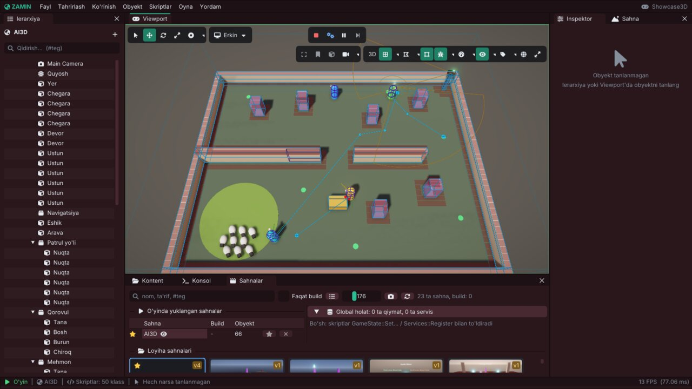

# Zamin Engine: navigation and artificial intelligence (AI)

This guide covers everything that makes the characters of a game "smart": grids for pathfinding (2D and 3D), A* path
search and path smoothing, agents that walk along a path, moving obstacles, steering behaviours and obstacle avoidance
with rays, the sight sensor (field of view and line of sight), patrol routes, group shapes (formations), the AI state
machine and the behavior tree, navigation debug drawing, performance (benchmarks) and storing bake data (`.znav`).

Everything comes with `#include <Zamin/Zamin.h>`; the AI module is in the `Zamin/src/Zamin/AI/` folder, the part that
depends on the scene is in `Scene/SceneNavigation.cpp`, `ScenePatrol.cpp`, `SceneFormation.cpp` and `SceneSight.cpp`.

## Contents

1. [Overview](#1-overview)
2. [NavGrid: the pathfinding grid](#2-navgrid-the-pathfinding-grid)
3. [The NavGrid 2D and NavGrid 3D components](#3-the-navgrid-2d-and-navgrid-3d-components)
4. [A* path search and path smoothing](#4-a-path-search-and-path-smoothing)
5. [Nav Agent: walking along a path](#5-nav-agent-walking-along-a-path)
6. [Nav Obstacle: moving obstacles](#6-nav-obstacle-moving-obstacles)
7. [Steering and obstacle avoidance](#7-steering-and-obstacle-avoidance)
8. [Sight Sensor: seeing](#8-sight-sensor-seeing)
9. [Patrol Path: patrol routes](#9-patrol-path-patrol-routes)
10. [Formation: moving as a group](#10-formation-moving-as-a-group)
11. [The AI state machine (StateMachine)](#11-the-ai-state-machine-statemachine)
12. [Behavior tree](#12-behavior-tree)
13. [Which one to choose?](#13-which-one-to-choose)
14. [Debug drawing](#14-debug-drawing)
15. [Performance and benchmarks](#15-performance-and-benchmarks)
16. [Serialization and the .znav file](#16-serialization-and-the-znav-file)
17. [Sample scenes](#17-sample-scenes)
18. [Tests](#18-tests)
19. [Short API reference](#19-short-api-reference)

---

## 1. Overview

The AI has three layers:

| Layer | What | Where |
|---|---|---|
| Pure algorithms | `NavGrid`, `NavPathfinder` (A*), `NavPathSmoothing`, `Steering`, `Sight`, `Formation`, `StateMachine`, `BehaviorTree` | `AI/*.h` - independent of the scene, they run on their own in the tests |
| Components | NavGrid 2D / 3D, Nav Agent, Nav Obstacle, Sight Sensor, Patrol Path, Formation | `Scene/Components.h`, the "Navigation and AI" section of the inspector |
| Script API | `SetDestination`, `CanSeeTarget`, `PausePatrol`, `SetFormationShape`, `WatchBehaviorTree` ... and callbacks | `Scripting/ScriptableEntity.h` |

Every frame the game runs in this order (`Scene::OnUpdateRuntime`): the scripts' `OnUpdate` -> grids are rebuilt
(AutoRebuild) -> Nav Obstacles close cells -> Patrol Paths choose the next point -> Formations send their members to
their places -> Nav Agents find paths and walk -> the physics step -> Sight Sensors look (`OnTargetSpotted` /
`OnTargetLost`) -> navigation debug drawing -> `OnLateUpdate`.

Coordinates: in 2D games the grid lies in the world's **XY** plane, in 3D in the **XZ** plane (the grid's `y` axis =
the world's `z`). A 3D object faces `-Z`, a 2D object faces `+X`.

## 2. NavGrid: the pathfinding grid

`AI/NavGrid.h`. A net of square cells: every cell is walkable or an obstacle and has its own cost (1 - ordinary
ground, 3 - mud: crossing it costs three times as much). 3D grids also store every cell's floor height and the largest
height difference between neighbouring cells (`MaxClimb`, stairs).

```cpp
NavGrid grid(32, 32, 0.5f, { -8.0f, -8.0f });   // 32x32 cells, 0.5 units, starting at (-8, -8)
grid.FillRect(10, 0, 11, 20, false);             // a wall
grid.SetCost(5, 5, 3.0f);                        // mud
grid.Erode(0.3f);                                // agent radius: cells closer than 0.3 to a wall are closed too
glm::ivec2 cell = grid.WorldToCell({ 1.2f, -3.0f });
bool ok = grid.HasLineOfSight({ -7, -7 }, { 7, -7 }); // can it walk straight there (without cutting corners)
```

- `TraceLine` - the cells a segment touches (supercover: when it passes exactly through a corner, both side cells);
- `FindNearestWalkable` - the nearest walkable cell (for a target pushed into a wall);
- `Carve` / `Uncarve` - for Nav Obstacles: counted separately from the baked state (several obstacles can close one
  cell), `GetCarveRevision` changes - agents check whether their path is blocked;
- `GetRevision` - grows every time the grid changes (agents find their path again).

## 3. The NavGrid 2D and NavGrid 3D components

You do not have to fill the grid by hand: the component builds it from the level itself ("bake").

**NavGrid 2D** (`NavGrid2DComponent`): the cells under the colliding tiles of tilemaps (tileset setting: Solid; with
`OneWayBlocks` OneWay too) and under static 2D colliders (Rigidbody 2D Static, not triggers) are closed, and so are the
cells closer than `AgentRadius`. The area is the bounds of the sources (`AutoBounds`) or `Size` around the object.
`AutoRebuild`: when a tile is placed / destroyed or a static collider moves while playing, it checks a few times a
second and rebuilds.

**NavGrid 3D** (`NavGrid3DComponent`): a ray is cast down from the centre of every cell in the `Size` box; the first
static 3D collider it hits is the cell's floor. If the floor is not steeper than `MaxSlope` and nothing (a wall, a
crate, a low ceiling) is above it up to `AgentHeight`, it is walkable. Neighbouring floors are not connected when they
differ by more than `StepHeight`. This is a single storey (the highest floor) - not a navmesh.

Both have the `Paths` settings:

| Setting | Meaning |
|---|---|
| `Diagonals` | 8 neighbours (a diagonal step costs sqrt 2), off - only the 4 sides |
| `CutCorners` | a diagonal step may pass next to one obstacle cell |
| `BakeOnStart` | built when the game starts (before the scripts); a grid that is inactive then - when it is enabled, one created while playing (`Instantiate`, prefab) - at once; when off - `GetScene().BakeNavGrid(e)` |
| `CacheBake` | the bake is stored in a `.znav` file next to the scene ([section 16](#16-serialization-and-the-znav-file)); only with `BakeOnStart` |

The editor builds the grid itself and shows it in the viewport (Gizmos > Navigation); the "Bake grid" button in the
inspector rebuilds it. From a script: `Scene::BakeNavGrid(entity)`, `Scene::BakeNavGrids()`.

## 4. A* path search and path smoothing

`AI/NavPathfinder.h`: A* with an indexed binary heap. Its buffers are reused (once they fit the grid it allocates no
memory), so use one pathfinder per thread (threads may share grids - they are only read). Among paths of equal cost the
same one is always chosen (deterministic).

```cpp
NavPathfinder finder;
NavPathResult path;
NavPathOptions options;           // Diagonals, CutCorners, HeuristicWeight, MaxExpanded, SnapRadius, StartHeight
finder.FindPath(grid, glm::vec2(-7, -7), glm::vec2(7, 7), path, options);
if (path.IsComplete()) ...        // Complete - reaches the target; Partial - the nearest place to it; Failed - none at all
```

- `HeuristicWeight` > 1 - opens fewer cells, the path may be that much longer; 0 - Dijkstra.
- When the target is inside a wall or in a closed room the result is **Partial**: up to the reachable cell nearest to it.
- When the start is in a closed cell (next to an eroded wall), the search starts from the nearest free cell within
  `SnapRadius`.

`AI/NavPathSmoothing.h`: points from a sequence of cells (`ToPoints`), **string pulling** (`StringPull`: a straight line
to the farthest visible corner - the "staircase" disappears) and rounding the corners (`SplineSmooth`: Catmull-Rom,
only over walkable ground). At the scene level: `Scene::FindNavPath(from, to, path)`.

## 5. Nav Agent: walking along a path

`NavAgentComponent` walks an object along the grid: `SetDestination` (or `Target` - an object it always follows) finds
the path, and the agent walks towards the point `LookAhead` ahead on it, speeds up / stops with `Acceleration`, turns
with `AngularSpeed` and stops `StoppingDistance` before the end. The path is found again every `RepathInterval` seconds
and whenever the grid changes.

What it moves: a Character Controller 3D (with `Move`), a Rigidbody 2D / 3D (dynamic - by velocity, kinematic - by the
transform) or the transform itself (in 3D on the grid's floor, at the `BaseOffset` height).

```cpp
class Guard : public ScriptableEntity
{
public:
    void OnUpdate(Timestep) override
    {
        if (CanSeeTarget())
            SetDestination(GetScene().GetWorldPosition(GetSeenTarget()));
        else if (!IsMoving())
            SetDestination(m_Points[m_Next++ % m_Points.size()]);
    }

private:
    std::vector<glm::vec3> m_Points{ { 0, 0, 0 }, { 8, 0, 0 }, { 8, 0, 8 } };   // patrol points
    size_t m_Next = 0;
};
```

Script API: `SetDestination(p)` (the path is found at once; `false` when there is none), `StopMoving(immediate)`,
`IsMoving()`, `HasArrived()`, `GetRemainingDistance()`, `FindPath(from, to)`, `HasNavLineOfSight(a, b)`, `SetNavTarget(e)`.

An agent with a `Target`: `StopMoving()` (also "Stop" in the inspector) and `SetDestination(p)` **pause** following the
target - the `Target` is kept, but the agent stands still or goes where it was sent. To chase again: `SetNavTarget(e)`
(`ResumeTarget()` on the component, "Follow target" in the inspector) or set another `Target`; `SetNavTarget({})`
removes the target and stops the agent.

> Tip: for "has it arrived?" check `IsMoving()`, not `HasArrived()` - an agent that found no path never "arrives", but
> it does not move either.

## 6. Nav Obstacle: moving obstacles

`NavObstacleComponent` - a door, a crate that can be pushed, a parked cart: while playing it "carves" the cells under
its shape (a box or a circle / cylinder, grown by `AgentRadius`) out of the baked grid. When it moves or turns by more
than `MoveThreshold` it closes only the cells that changed; when it is removed / inactive it gives the cells back.
Agents whose path is blocked find a new path in the same frame.

`CarveOnlyStationary`: closes only after standing still for `StationaryTime` seconds - while it moves, the agents' rays
(Avoidance) steer around it. The inspector shows the live state: how many cells are closed, how many times it updated.

## 7. Steering and obstacle avoidance

`AI/Steering.h` - Reynolds steering behaviours: small pure functions, each returns a "steering force"
(desired velocity - current velocity). For `glm::vec2` and `glm::vec3`.

| Function | What it does |
|---|---|
| `Seek` / `Flee` | at full speed towards the target / away from it (Flee only within `panicDistance`) |
| `Arrive` | towards the target, slowing down within `slowingRadius` and stopping on it |
| `Pursue` / `Evade` | towards the target's future position (predicted from its velocity) |
| `Wander` | a point on a circle drifts randomly - smooth, aimless walking (with its own seed) |
| `Separation` / `Alignment` / `Cohesion` | flocking: keeping apart, heading the same way, moving to the centre |
| `Accumulate` | adding by priority: the important ones first, the rest is cut when `maxForce` runs out |
| `Integrate` | force -> velocity -> position (a simple "vehicle") |

```cpp
glm::vec2 force(0.0f);
Steering::Accumulate(force, Steering::Separation(p, neighbours, 1.2f, MaxSpeed) * 1.5f, MaxForce);
Steering::Accumulate(force, Steering::Arrive(p, v, goal, MaxSpeed, 2.0f), MaxForce);
Steering::Accumulate(force, Steering::Wander(m_Wander, p, v, MaxSpeed, dt) * 0.5f, MaxForce);
Steering::Integrate(p, v, force, MaxForce, MaxSpeed, dt);
```

**Obstacle avoidance (Avoidance)**: with `Avoidance` on, a Nav Agent's three physics rays ("whiskers": `FeelerLength`
forward and two at `FeelerAngle` to the sides) steer around things the grid does not know - other agents, crates,
moving bodies; the push is blended with the path at `AvoidanceWeight` and never points into a cell the grid knows to
be closed. Static bodies only with `AvoidStatic` (the grid already knows them).
`Steering::MakeFeelers` / `AvoidObstacles` - the pure part of the same logic (you can use it in your own script too).

## 8. Sight Sensor: seeing

`SightSensorComponent` - "eyes": it sees the target when the target is within `ViewDistance` and inside the forward
`FieldOfView` cone (or from any side when closer than `NearDistance`) and one of the physics rays cast from the eye
(`EyeHeight`) to the target's points (the collider's centre and edges) hits no collider on the `BlockingMask` layers.
Targets: the `Target` object or active objects with the `TargetTag` tag. Checked every `CheckInterval` seconds.

```cpp
void OnTargetSpotted(Entity target) override { m_AI.SendEvent("spotted"); }
void OnTargetLost(Entity target) override { m_AI.SendEvent("lost"); }
// or every frame: CanSeeTarget(), GetSeenTarget(), GetLastSeenPosition(), RemembersTarget()
```

`RemembersTarget()` - it sees the target or saw it less than `MemoryTime` seconds ago (for a "search" state). To check
any object at once: `Scene::CanSee(viewer, target)`, in a script `CanSee(entity)`. The editor draws the cone (red when
it sees) and marks the last seen position.

## 9. Patrol Path: patrol routes

`PatrolPathComponent` - the route a guard, an animal or a cart walks around. The source of the points:

- **List** (`Points`): world coordinates, or with `RelativeToStart` offsets from the starting position (prefab
  instances patrol in their own place); every point can have its own wait time;
- **Children**: the active children of the `Route` object, in hierarchy order (moved with the gizmo in the viewport);
- **Spline**: the points of the Spline on `Route`, or a point every `SplineSpacing` along the curve.

Modes: `Loop` (from the end back to the start), `PingPong` (there and back), `Random` (never the same point twice in a
row), `Once` (stops at the end). It waits `WaitTime` (+/- `WaitVariance`) at every point. With a Nav Agent it walks
along the grid (the agent's speed, avoidance ...), without one in a straight line at `Speed`. A point it cannot reach
is skipped after a short wait or after being stuck for 5 s.

Script API: `PausePatrol(stop)` (a chase starts, for example), `ResumePatrol(nearest)` (continue from the nearest
point), `IsPatrolling()`, `GetPatrolPoint()`, `GetPatrolTarget()`, `IsWaitingAtPatrolPoint()`, `SetPatrolPoint(i)`;
the `OnPatrolPointReached(int index)` callback and the `"PatrolPointReached"` event on the event bus.

## 10. Formation: moving as a group

`FormationComponent` sits on the leader object: its members - the `Members` list and (optionally) active objects with
the `MemberTag` tag - stand in "slots" around the leader and walk with it.

| Shape | Slots |
|---|---|
| `Line` | side by side with the leader: on its right, on its left, in turn, `Spacing` apart |
| `Column` | in one file behind the leader |
| `Wedge` | a V shape with the leader at its tip; `WedgeAngle` - how open the V is |
| `Circle` | a ring around the leader (it does not turn with the leader; the members face outwards) |

- **Heading**: the direction the leader walks (the Nav Agent velocity or its movement), the last heading while it
  stands, at the start - the way it faces. Turning is smooth (300 degrees / s).
- **Slot assignment** (`AssignNearest`): the members get the slots with the least total walking - the Hungarian method,
  with more than 64 members - "the nearest free slot". Assigned again when the shape or the members change or the
  heading turns by more than 75 degrees (otherwise the ones on the left would cross over to the right through each
  other).
- **Inside the grid** (`KeepOnGrid`): a slot in an obstacle cell moves to the nearest walkable cell, one behind a wall
  moves towards the leader (a line narrows by itself in a corridor).
- **Movement**: members with a Nav Agent get a new destination every `UpdateInterval` when their slot has moved (while
  the leader walks - where the slot will be by the next update: no stop-and-go); members without a Nav Agent move in a
  straight line at `Speed` (Character Controller, dynamic body or transform). Make the members a little faster than
  the leader.
- A member standing in its slot (`SlotTolerance`) turns the way the group faces (`FaceHeading`).

```cpp
// Commander script: a wedge when it sees the target, a circle while searching
if (CanSeeTarget()) SetFormationShape(FormationShape::Wedge);
AddFormationMember(recruit);
if (IsFormationInPlace()) StartNextOrder();
// in a member's script:
Entity leader = GetFormationLeader();
glm::vec3 slot; GetFormationSlot(slot);
```

Scene API: `GetFormationMembers`, `GetFormationSlots(leader, slots, &members)` (works in the editor too - the gizmo
uses it), `SetFormationShape`, `AddFormationMember` / `RemoveFormationMember`, `GetFormationLeader`, `GetFormationSlot`.
The pure math: `AI/Formation.h` (`ComputeOffsets`, `ToWorld`, `AssignSlots`).

Inspector: shape buttons, the member list (drag from the hierarchy; "Selected" adds the objects selected with Ctrl),
the live state while playing ("4 / 6 in place") and buttons to switch the shape.

## 11. The AI state machine (StateMachine)

`AI/StateMachine.h` - named states (`OnEnter` / `OnUpdate` / `OnExit`) and transitions: conditional, timed, by event
(`SendEvent`) and "from any state". States are lambdas or classes derived from `AIState`.

```cpp
m_AI.AddState("Patrol", [this] { GoToNextWaypoint(); }, [this](float) { if (!IsMoving()) GoToNextWaypoint(); })
    .AddState("Chase", {}, [this](float) { SetDestination(TargetPosition()); })
    .AddState("Search", [this] { SetDestination(GetLastSeenPosition()); })
    .AddTransition("Patrol", "Chase", [this] { return CanSeeTarget(); })
    .AddEventTransition("Chase", "Search", "lost")
    .AddTimedTransition("Search", "Patrol", 4.0f);
m_AI.Start("Patrol");     // OnStart
m_AI.Update(ts);          // OnUpdate
WatchStateMachine(m_AI);  // the inspector shows the state and the history of transitions
```

## 12. Behavior tree

`AI/BehaviorTree.h` - a minimal behavior tree helper. The tree is "ticked" from the root every frame; every node
answers: **Running** (not finished yet - again next frame), **Success** or **Failure**.

| Node | Kind | What it does |
|---|---|---|
| `Sequence` | composite | its children one after another; Failure at the first Failure, Success when all succeed |
| `Selector` | composite | the first child that does not fail ("A, else B, else C") |
| `ReactiveSequence` / `ReactiveSelector` | composite | starts from the first child on every tick: when a condition changes, the running branch is stopped (halt) |
| `Parallel` | composite | all children every tick; finishes when `successThreshold` successes / `failureThreshold` failures are reached |
| `Inverter` / `Succeeder` / `Failer` | decorator | inverts the answer / always Success / always Failure |
| `Repeat(n)` | decorator | the child n times (n < 1 - forever); stops on a failure; at most one repetition per tick |
| `Wait(s)` | leaf | Running for `s` seconds, then Success |
| `Condition` | leaf | a condition: Success / Failure |
| `Action` | leaf | script work: returns a `BTStatus`, a `bool` or nothing; `onHalt` - when it is stopped |
| `CheckBlackboard` / `SetBlackboard` | leaf | checks / writes a blackboard value |

**Plain and reactive**: a plain `Sequence` / `Selector` remembers the running child and continues from it on the next
tick. When a "condition, then a long action" branch has to stop as soon as the condition no longer holds, use
`ReactiveSequence` (a plain Sequence does not ask the condition again). For "chase when it sees, else patrol" the root
is a `ReactiveSelector`.

**Blackboard** - named values the nodes and the script share: `bool`, `int`, `float`, text, `vec2`, `vec3`, `uint64_t`
(an object's UUID). Numbers convert to each other (an int reads as a float), a UUID is stored exactly.

```cpp
BehaviorTreeBuilder()
    .ReactiveSelector("Commander")
        .ReactiveSequence("Attack")
            .Condition("Sees target", [this] { return CanSeeTarget(); })
            .Action("Chase", [this](BTContext& c) { return Chase(c); })
        .End()
        .ReactiveSequence("Search")
            .Condition("Remembers", [this] { return RemembersTarget(); })
            .Action("Encircle", [this](BTContext& c) { return Encircle(c); })
        .End()
        .Sequence("Patrol")
            .Action("Fall in", [this] { ResumePatrol(true); })  // void: Success
            .Action("Walk", [this] { return IsPatrolling() ? BTStatus::Running : BTStatus::Failure; })
        .End()
    .End()
    .Build(m_Tree);
WatchBehaviorTree(m_Tree);   // OnStart
m_Tree.Tick(ts);             // OnUpdate
```

The builder (`BehaviorTreeBuilder`): a composite is opened and `End()` closes it; a decorator closes itself once it
has its one child. Mistakes (a second root, an extra `End()`, a decorator without a child) are logged and counted in
`GetErrorCount()`. Your own leaf class: derive from `BTNode` (`OnStart`, `OnTick`, `OnHalt`) and `.Node(std::make_unique<...>())`.

Debugging: `GetActivePath()` ("Commander > Attack > Chase"), `Describe()`, `LogChanges = true` - every change to the
log. With `WatchBehaviorTree(tree)` the inspector (the C++ Script section) shows the whole tree while playing: every
node's last answer (yellow - Running, green - Success, red - Failure, dim - not checked on the last tick) and the
blackboard.

## 13. Which one to choose?

- **A few clear states and the transitions between them** (patrol / chase / search / caught) - `StateMachine`: the
  transitions are easy to see, it works well with events.
- **A list of priorities and a sequence of steps** ("attack when it sees, search when it remembers, else patrol;
  patrol = go to a point, wait, look around") - a behavior tree: adding a new branch is easy, reactive nodes handle
  interruptions by themselves.
- **A group** - Formation; **the quality of movement** (flocking, fleeing) - Steering; **where to go** - Nav Agent.

## 14. Debug drawing

`AI/NavDebugDraw.h` - drawing the editor and the game share: grids (obstacle cells red, cells closed by a Nav Obstacle
orange, the walkable cells of the selected grid green), agent paths, destinations and rays, obstacle shapes, sight
cones, patrol routes (numbered points, wait times) and formations (slots, a heading arrow, a line from each member to
its slot; green when it is in place).

- **Editor**: viewport > Gizmos > **Navigation** (while playing too, and in additional scene views).
- **Game**: Project settings > Debug drawing > Navigation, or `--debug-nav` in the player (`--debug-nav-cells` - the
  walkable cells too). In code: `Scene::DrawNavigationDebug()`.



*Showcase3D `Scenes/AI3D.zscene` in the editor in Play mode with Gizmos > **Navigation** on: the agents' paths (light
blue lines and turning points), a sight cone (orange arc), a flock of sheep in a pen.*

## 15. Performance and benchmarks

The path searches of Nav Agents run **in batches on the job system**: every frame it first works out which agents
need a new path (on the main thread), then the searches - when there are at least 4 - are spread over the worker
threads with `JobSystem::ParallelFor` (every thread has its own pathfinder, the grids are only read), and the results
are applied in agent order. The result is exactly the same as on one thread. The last frame's statistics:
`Scene::GetNavFrameStats()` (agents, number of paths, ms, whether it ran in parallel).

Benchmark: `./build/bin/ZaminBench --nav [--agents N] [--grid N] [--frames N] [--jobs N]` or the `nav_bench` target.
Default: a 256x256 grid (rooms, doors, random obstacles), 200 agents. A sample measured in a Debug build on a machine
with 4 hardware threads:

| Measurement | One thread | Job system (3 workers) |
|---|---|---|
| 200 paths at once (A* + string pulling) | 660 ms | 166 ms (4.0x) |
| Scene: the first frame (200 paths) | 655 ms | 185 ms |
| Scene: an average frame (~7 paths a frame) | 20.3 ms | 7.0 ms |
| NavGrid 2D bake (from a 256x256 tilemap) | ~61 ms | |
| NavGrid 3D bake (256x256 cells, ~1800 static bodies) | ~1300 ms | |

A Release build is several times faster. Tips for large levels: reduce the number of cells (`CellSize`), raise
`RepathInterval` (or 0 - only when the grid / destination changes), `NavPathOptions::HeuristicWeight` > 1 for long
paths.

## 16. Serialization and the .znav file

The components' **settings** are stored in the scene file (`.zscene`, JSON; and in the export's binary cache
`.zsceneb`): NavGrid 2D / 3D, Nav Agent (with its avoidance), Nav Obstacle, Sight Sensor, Patrol Path (points as
`[x, y, z]` or with their own wait as `[x, y, z, wait]`), Formation (members by UUID). The runtime state (paths, the
seen target, patrol counters, assigned slots) is never written; it is cleared when a copy is made (Duplicate, prefab,
Play), and the `EntityRef`s of a copy (Grid, Target, Route, Members) point to the copy's own objects.

**Bake data: a choice.** Grids are data derived from the level. So the default is **rebuilding on load**: when the
game starts the scene (`BakeOnStart`) the grids are built from the level itself. That never goes stale, adds nothing
to an export and is cheap for small grids (the sample scenes: 1-25 ms).

Building large 3D grids is expensive, though (a ray and an overlap per cell; see the table above). For them there is
the **`.znav` file** ("Save to file (.znav)" in the grid inspector = `NavGridPathSettings::CacheBake`):

1. When the editor saves the scene it builds those grids (with `BakeOnStart`, active) and writes them next to the
   scene: `Level.zscene` -> `Level.znav`
   (`AI/NavBakeFile.h`: a "ZNAV" header, a version; for every grid its UUID, size, **fingerprint** and cells:
   walkable bits, costs, floor heights, `MaxClimb`). When no grid asks for it, the old file is deleted.
2. The fingerprint is a hash of everything the grid is built from: its settings and position, the tilemaps (tiles,
   the tileset's collision table) or the static 2D / 3D colliders (transform, layer, shape, model file path and size),
   in 3D the collision matrix. The sources are gathered **independently of their order** - the scene in the editor and
   the one loaded from a file give the same fingerprint.
3. When a scene is loaded (by `SceneSerializer::Deserialize` and by the SceneManager's asynchronous `SceneLoadJob`)
   the `.znav` is read; when the game starts, a grid with `CacheBake` takes the stored one only if the fingerprint
   matches (in the log: "...grid taken from the .znav file"), and the inspector shows "read from the .znav file". When
   the fingerprint does not match (a wall moved, a setting changed), or the file is damaged, missing or from a newer
   version, the grid is built as usual.

So a `.znav` can never make a level wrong - it only makes loading faster (the Squad3D sample: 0.1 ms instead of a
24 ms bake). The file moves, is copied and is deleted with the scene (the Content panel) and goes into the export with
its scene. Code: `Scene::GetNavGridSourceHash`, `Scene::CollectNavBakes`, `SceneSerializer::WriteNavBakes`.

## 17. Sample scenes

| Project / scene | What it shows | Script |
|---|---|---|
| Platformer2D / `NavDemo2D` | a 2D grid from tilemaps and static colliders; three chasing Nav Agents find their way after the player (`Target`) | `TopDown.cpp` |
| Platformer2D / `Chase2D` | two guards: patrol, sight (a 2D light = the cone), chase, search, return, catch | `Chase.cpp` |
| Showcase3D / `Navigation3D` | NavGrid 3D: three NPCs follow a beacon that circles between walls, pillars, a slope and a platform | - |
| Showcase3D / `AI3D` | a sliding door (Nav Obstacle), a guard (StateMachine + Sight), a surveillance camera, porters (avoidance), a flock of sheep (Steering) | `AI.cpp` |
| Showcase3D / `Squad3D` | a commander (behavior tree: patrol / chase / encircle) and six soldiers: column, wedge, line, circle; five guards escort a caravan in a circle; `.znav` | `Squad.cpp` |
| Adventure3D / `Island` | the island's guard robot: patrol, sight, chase, return | `Guard.cpp` |

In the player: `./build/bin/ZaminPlayer Projects/Showcase3D --scene Scenes/Squad3D.zscene --debug-nav`.

## 18. Tests

The navigation / AI tests in `Tests/ZaminTests.cpp` (headless):

- grid, A* (optimality against Dijkstra, no corner cutting, partial paths), tilemap / collider / 3D bake, string
  pulling and splines, smoothed paths on random grids;
- Nav Agent (2D / 3D, Character Controller, following a target), carving and re-pathing, avoidance;
- steering, the state machine, the sight cone and seeing through walls, the script callbacks;
- patrol modes, waiting, the sources (list, children, spline), with a Nav Agent;
- formations: the shape math, slot assignment (compared with every permutation), members following the leader,
  members with a Nav Agent inside the grid, serialization and copies;
- behavior tree: composites, reactive interruptions, decorators, Parallel, Wait, the blackboard, builder mistakes;
- `.znav`: the format, damaged files, saving / loading with the scene, rebuilding when a source changes, asynchronous
  loading;
- full serialization of every AI component (text, binary cache), the sample scenes running headless.

## 19. Short API reference

**Script (`ScriptableEntity`)**

| Group | Functions |
|---|---|
| Navigation | `SetDestination`, `StopMoving`, `SetNavTarget`, `IsMoving`, `HasArrived`, `GetRemainingDistance`, `FindPath`, `HasNavLineOfSight` |
| Sight | `CanSee(e)`, `CanSeeTarget`, `GetSeenTarget`, `GetLastSeenPosition`, `RemembersTarget`; `OnTargetSpotted`, `OnTargetLost` |
| Patrol | `PausePatrol`, `ResumePatrol`, `IsPatrolling`, `GetPatrolPoint`, `GetPatrolTarget`, `IsWaitingAtPatrolPoint`, `SetPatrolPoint`; `OnPatrolPointReached` |
| Formation | `SetFormationShape`, `GetFormationShape`, `AddFormationMember`, `RemoveFormationMember`, `IsFormationInPlace`, `GetFormationLeader`, `GetFormationSlot` |
| AI view | `WatchStateMachine` / `UnwatchStateMachine`, `WatchBehaviorTree` / `UnwatchBehaviorTree` |

**Scene (`Scene`)**: `BakeNavGrid(s)`, `GetNavGrid`, `FindNavGridEntity`, `GetNavAgentGrid`, `FindNavPath`,
`HasNavLineOfSight`, `SetNavDestination`, `IsNavPathBlocked`, `UpdateNavObstacles`, `CanSee`, `GetSightCone`,
`GetPatrolWaypoints`, `PausePatrol`, `ResumePatrol`, `SetPatrolWaypoint`, `GetFormationMembers`, `GetFormationSlots`,
`SetFormationShape`, `AddFormationMember`, `RemoveFormationMember`, `GetFormationLeader`, `GetFormationSlot`,
`DrawNavigationDebug`, `GetNavFrameStats`, `GetNavGridSourceHash`, `CollectNavBakes`, `SetNavBakes` / `GetNavBakes`.

**Modules (`Zamin/AI/`)**: `NavGrid.h`, `NavGridBuilder.h`, `NavPathfinder.h`, `NavPathSmoothing.h`, `NavCarving.h`,
`Steering.h`, `Sight.h`, `StateMachine.h`, `BehaviorTree.h`, `Formation.h`, `NavDebugDraw.h`, `NavBakeFile.h`.

## Sparse world navigation and traversal

`NavAtlas` keeps the loaded tiles as separate, immutable copies. For example, even when two 8×8 tiles are 100000 world
units apart, the atlas has 128 cells; no bounding rectangle is allocated. The same cell size / lattice, height mode
and climb rule are required; overlaps and mixed resolutions are rejected. The build is transactional. 512 tiles, 4096
links, at most 1048576 loaded cells; for a world `NavigationMaxCells` defaults to 262144. Unloaded areas cannot be
walked through.

The world runtime publishes a new snapshot whenever a tile's serial / revision / carving changes.
`WorldStreaming::GetNavigationAtlas()` is called on the owner thread; while the returned
`shared_ptr<const NavAtlas>` is held, its `FindRoute` method may be called in parallel on workers. The world accessor
and `SetNavigationLinks` are owner-thread API; the ECS and the source grids are not read on workers. Every query
allocates its own scratch buffer, proportional to the number of loaded cells. `MaxExpanded` limits the CPU expansion,
not the scratch allocation; there is no overall memory cap for an unlimited number of parallel queries. An old snapshot
stays readable even after the world unloads / stops, but for movement it has to be checked against the current
revision.

`FindNavigationRoute(from, to, options)` takes plane coordinates: 2D XY or 3D XZ.
`NavRoute` returns the status / cost / expanded / revision and points with a tile ID, plane position, floor height and
`IncomingLink`. These are cell centres. In a world atlas the Tile value is the source nav-grid entity's UUID. The
snapping radius is clamped to 0..64 cells; a start far from the loaded area is `Failed`, a missing / blocked goal or
the expansion limit is `Partial`. StartHeight checks the 3D floor choice. The cost counts the walking distance, the
height difference and the destination cell's cost; the climb / corner rules hold across tile seams too.

`NavTraversalLink`: a unique nonzero ID, From/To plane endpoints, a positive Cost, Bidirectional and Enabled. A link's
endpoints must be on loaded walkable cells; a missing or carved endpoint is inactive. A link is not an ordinary walk
segment: the gameplay performs the jump, elevator, door or teleport. When links exist Dijkstra is used, because the
A* geometric heuristic would not be consistent with the discounted cost; with weight=1 the shortest cost is kept. Ties
are broken deterministically by source / link ID.

`WorldStreaming::Policy::NavigationLinks` is stored in `Streaming.NavigationLinks` in the `.zworld`.
`SetNavigationLinks` validates and replaces the runtime list; the snapshot changes on the next world tick. It does not
change the disk. Disabling / re-enabling, tile unload / return and carving show up in the next route. On an atlas
error the current query fails closed; a retained old snapshot is not refreshed automatically.

`NavRouteFollower` is a kinematic cursor: SetRoute, Advance(currentRevision, distance), GetPosition/GetPendingLink and
CompleteTraversal(currentRevision, linkID). It walks up to a link's entry and stops in the `AwaitingTraversal` state;
an explicit completion gives the exit coordinate. When the topology revision changes it is `Stale` and needs SetRoute
again. A complete and a partial end are distinct: `Arrived` / `PartialEnd`; a wrong link ID or a negative / NaN
distance does not move it. The caller applies the actor transform, the collision sweep, the physics controller and the
animation itself. The demo's teleport is not a collision controller.

The default `NavAgentComponent` and `Scene::FindNavPath` use the dense mosaic path. A new opt-in WorldNavigation mode
for NavAgent is described below; the atlas / follower API is also available on its own. So that sparse route smoothing
does not remove a portal, this API returns unsmoothed points. This is grid navigation: not a polygon navmesh, nor a
multi-storey navmesh.

In WorldWorkshop2D/3D **N** turns on the route preview / kinematic actor. Green points are walking, purple a portal
exit, yellow the actor. The QA mode disables the portal, goes out into an empty region and comes back, planning again.
`Tests/world_navigation_test.py --build build --out navigation` checks the real Player and the editor's route panel;
the new workflow is also wired into the Linux GCC/Clang CI.

The snapshot build copies synchronously on the owner thread; incremental baking is still separate work. When large
float coordinates make the cell centre and neighbour step too imprecise, the build is rejected; a large world may
still need a floating origin.

## NavAgent world atlas mode

**World navigation** in the NavAgent inspector or **SetWorldDestination** in a graph turns on the sparse atlas mode.
The old grid mode stays the default. In world mode the Grid reference is not used; a streaming anchor scene and
NavigationMode 2/3 are required. WorldMaxExpanded 1..1048576 (default 16384) is the expansion limit of every query.
A query currently runs synchronously on the owner thread, with no overall hard frame budget. The start/goal snapping
radius is 0: a start outside the loaded walkable area is Failed. At a Partial end Arrived=true, PathStatus=Partial.
The path goes to the last real destination; an ordinary replan does not return to the centre of the starting cell.
Movement follows the unsmoothed corner route; the legacy LookAhead/Smooth/Spline/Avoidance are not applied in world
mode. Speed/Acceleration/AutoBraking/StoppingDistance/UpdateRotation work.

The agent checks the points against the real transform / physics position. When a controller hits a wall, a predicted
cursor does not carry on and is not marked as having reached the portal. A Rigidbody walks by velocity; in 3D the
transform / kinematic body uses the floor height and BaseOffset. A CharacterController uses its foot coordinate,
BaseOffset is not applied to it. The controller performs walking and gravity/grounding in its own physics.

At a portal entry there are PendingTraversalLink, AtlasRevision, TraversalTicket, TraversalEntry and TraversalExit;
Velocity is zero, IsMoving=false. The ticket is a new nonzero UUID, which prevents applying a cancelled request or a
token left over from an earlier session to a new request. It is a gameplay identifier, not an auth token or
cryptographic authorization. All three, link/revision/ticket, are sent with the completion:
Scene::CompleteNavTraversal(entity, link, revision, ticket), or ScriptableEntity::CompleteNavTraversal.
When GetNavTraversalLink is zero, nothing is pending or the atlas is stale; the tokens are in the NavAgent runtime
fields. CancelNavTraversal and Stop cancel the pending request. When the topology/carving/links change, an old
completion is rejected and the agent stops/replans. Serialize/copy/start/stop do not keep the ticket/path state.

Completion is an explicit teleport: for transforms and a live CharacterController. The controller's exit capsule is
checked with the collision-layer mask, without triggers and with a small floor contact tolerance. A blocked exit, the
wrong scene/token, an actor that moved away from the entry or a missing atlas leave the position unchanged. Agents
with a Rigidbody walk, but there is no shape-clearance traversal yet: completion returns false. This API does not
create a jump/elevator animation controller; the caller decides when to complete. A delayed graph request has to keep
the Link/Revision/Ticket from the event payload, not read the token from a new query instead.

In WorldWorkshop2D/3D **B** is the real agent + Visual Graph demo, **N** the earlier kinematic route preview.
The World traversal actor on the anchor works with the built-in Zamin.VisualGraph; the 3D actor walks with a
CharacterController capsule. The graph uses Message → SetWorldDestination, NavTraversalRequested → Delay →
CompleteNavTraversal → the Success branch. In the unloaded demo area the persistent actor's gravity is frozen by the
sample's driver; navigation itself does not cancel vertical gravity.

## Bounded async world queries

`AsyncNavigation=true` in the world policy hands NavAgent path searches to the `NavQueryQueue` workers.
The default false keeps the old synchronous API; WorldWorkshop2D/3D turns async mode on. Scene::SetNavDestination
returns true for an accepted worker request while PathStatus is still None; the complete/partial/failed result comes
later. A request not accepted because of capacity returns false, but the agent's destination intent is kept and
retried on the next tick; use StopMoving/Stop to cancel it. A missing or empty atlas is Failed, not a queue wait.
The `NavQueryPending` pure graph node tells whether the current agent has an accepted queued/running/completed/published
query; waiting at a portal is the separate NavTraversalState.Pending. In the sample graph the Searching bool is updated
from this node.

A worker only works with the immutable atlas and copied primitive request data. The ECS, controllers, ScriptInstance
and plugin callbacks are never handed to a worker. The owner pumps in `WorldStreaming::Update`/SceneManager::ProcessRequests;
then SceneManager::UpdateScenes applies the result. Do not call only UpdateScenes and skip the world tick.
Requests are FIFO, a replacement puts the queued work at the end; completion timing depends on worker scheduling, the
route algorithm is deterministic. Per tick the start tokens default to 4 and publications to 8; tokens do not
accumulate. Workers default to 2 (1..4), capacity 64 (1..1024); queued/running/completed/published all count against
the capacity.

Generic queue defaults: max expanded 65536, max route points 32768, unique retained snapshots 64 MiB, retained result
buffers 8 MiB. A snapshot used by several jobs is counted once. A cancelled running job stays charged until its worker
sees the stop. An oversized result is an explicit Failed/error, with no silent truncation. These payload counts are not
an OS RSS hard cap; snapshots/results held by the caller and the worker scratch are separate. The A* scratch depends
on the number of loaded cells, the open heap on the bounded expansion/link count. An individual atlas is limited to
1048576 cells. Shutdown signals stop and joins the workers. Outside the queue a snapshot must not be rebuilt through a
mutable alias; the world wrapper only hands out engine-owned immutable snapshots.

Cancel/replace/atlas publication sends a cooperative stop_token to an active search; the signal is checked
periodically in the heap pop and in path reconstruction. On the owner the result is checked against the atlas
revision, the current destination, the options, the actual start drift, the walkable start-cell identity, the floor
tolerance, active/HasDestination/WorldNavigation and the EnTT entity generation. An actor with a reused UUID does not
get an old result. Deleted/inactive/stopped agents are cancelled in cleanup. While pending, planar motion is zero;
gravity stays in the physics system. A drifted or stale result is discarded and the query is issued again. The owner
install only admits the accepted current result; the traversal nonce check is kept as in the previous package. Async
routes currently use sequential movement/corner tracking; crowd avoidance and a polygon navmesh are separate work.
Snapshot build and publication are still synchronous on the owner thread, with no hard deadline.

### Streamed world smoothing and crowd steering

`NavPathOptions::SmoothAtlas` is opt-in for the sparse atlas. A world NavAgent puts its `SmoothPath` value into the
query options; in async mode smoothing also runs on the worker. When the option in a returned result does not match
the agent's current value, the owner rejects it and asks again. The legacy `NavPathfinder` does not use this atlas
option. `SplinePath` is not applied in world mode.

`NavAtlas::CanWalkSegment` checks a conservative clearance inside the baked navigation space: a missing tile, a
blocked cell, touching a corner and a floor/climb mismatch reject the segment. The grid's AgentRadius already accounts
for static clearance; the world movement guard does not widen it a second time. A separate caller can require extra
clearance with `NavSegmentOptions::Radius`. This is a conservative swept-rectangle check instead of a circle. When the
bounding rectangle exceeds the `MaxCells` limit the check returns false; that does not mean there is an obstacle.

`SmoothRoute` only works with the current revision: at most 32 points ahead at a time, 64 shortcut probes in total,
at most 4096 cells per probe. When the budget runs out the rest of the original path is kept. A portal's entry/exit
points are never removed; the incoming link ID and the gameplay handshake stay. A new shortcut only crosses cost=1
cells. Original weighted steps may be kept; `Cost` stays the search's graph cost, not the smoothed geometric length.

On world agents `CrowdAvoidance` is a separate opt-in. `Radius` is the personal distance, `CrowdNeighborDistance`
0.1..32, `CrowdTimeHorizon` 0.1..5 seconds, `CrowdPriority` 0.1..10, `CrowdHeight` 0.01..10.
A higher priority gives a neighbour a stronger cost for giving way; it never decides by bypassing the collision rules.
In 3D agents whose vertical intervals do not overlap do not steer around each other. The legacy physics feeler
`Avoidance` and the new crowd sampler are different modes: the feelers work on the legacy grid, the crowd on the
sparse world. Idle/pending/portal agents also enter the neighbour snapshot as obstacles.

`NavCrowd::Solve` is a pure CPU algorithm without the ECS or physics: a snapshot of positions / preferred velocities at
the start of the frame, 4-unit spatial buckets, nearby neighbours sorted by distance+UUID, a bounded set of velocity
candidates. The update order does not change the result. Limits: 4096 agents, 128 candidate checks and 16 neighbours
per agent. When the limit is exceeded in a dense area, that agent's velocity is zero and `Limited/Blocked` is true.
A wrong/duplicate ID, NaN or exceeding the overall capacity rejects the batch; the Scene stops the crowd agents safely.
This is not an ORCA implementation nor a guarantee of physics collisions.

The world update first prepares the commands of all agents, then solves the snapshot and applies the movement. Every
step is checked against the atlas clearance; if needed up to six half-speed tries, otherwise it stops. The
CharacterController/Rigidbody collision has the final say.
`PreferredVelocity`, `CrowdNeighbors`, `CrowdLimited`, `CrowdBlocked` are runtime diagnostics;
`Velocity` is the command after the clearance check, not the physical body's actual measured velocity.
The settings survive scene/copy/checkpoint, the runtime diagnostics are reset.

### Dynamic obstacles and bounded recovery

Carving is done on the source tiles. The world mosaic is a derived compatibility view; it is not in the source list,
because carving it again would create a serial/rebuild feedback loop. When `NavObstacle.Grid` is bound to the world
mosaic, carving is redirected to the grids of the loaded world cells. An automatic obstacle sees all the relevant
baked grids as usual.

The owner's `WorldStreaming::SynchronizeNavigation()` checks the source serial/revision/carve stamps; when something
changed it publishes a new immutable atlas, cancels old async queries and requests a replan. It gives no queue
start/publication credit and runs no streaming/checkpoint command. The Scene syncs before movement; an explicit
`SetNavDestination` and `CompleteNavTraversal` also refresh the carving. So a door a script closed in this frame is not
teleported through with an old portal ticket. A tool that changes raw nav/collision transforms by hand calls
`Scene::UpdateNavObstacles()`, or the sync after the source has been updated, for read-after-write.

`NavAgent.RecoverySettings.Enabled` is opt-in for world mode, default false. `StallSeconds` 0.1..30,
`CooldownSeconds` 0.1..30, `ProgressDistance` 0.001..10 and `MaxRetries` 1..16.
The watchdog measures the real planar world position instead of the commanded velocity. Small jitter does not count
as progress; enough movement renews the retry budget. Async queue/pending admission, the portal handshake, an empty
atlas and zero speed do not count as a stall.

A partial path's end is not reaching the destination: with recovery on it tries a bounded number of replans. A failed
path and getting stuck in physics also go through this watchdog. When the budget runs out it is `Exhausted`, the
velocity is zero, `HasDestination` is kept and the automatic interval does not bypass it. A new destination, an
explicit re-path/ResumeTarget/manual retry or a new atlas revision resets the watchdog. When removing a physics-only
obstacle does not change the atlas, an explicit retry is needed; for fully automatic reopening, bind a `NavObstacle` to
the obstacle.

`NavRecovery` is a pure CPU state machine; it keeps no ECS/physics callbacks. The settings survive
serialize/copy/checkpoint; the progress/retry timers are cleared on play start/stop, a new intent and a component
runtime reset. An invalid config/pose stops the watchdog safely in the `Invalid` state; a config change in the
inspector resets it. A retry is not permission to teleport or to bypass an obstacle.

The world mosaic UUID is a runtime proxy. An explicit Grid binding to it is for runtime tools; a saved obstacle uses an
automatic Grid or an authored tile reference.
