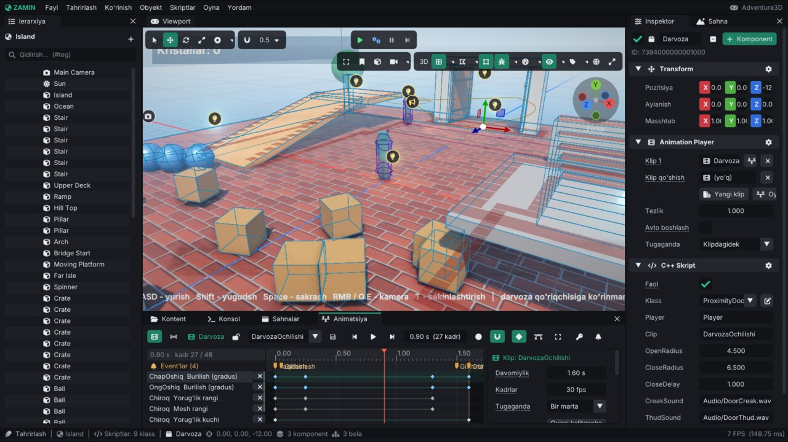

# Zamin Engine: animation

This document explains the animation system in Zamin: property clips and the Animation window (timeline), skeletal
animation and the Animator (state machine, blend trees, layers), events, root motion, attaching to bones, morph
targets, sprite animation and clips, tint (colour) animation, script tweens, AnimationCurve and spline paths,
performance (caching, culling), tests and common problems. Every section has C++ script examples
(`#include <Zamin/Zamin.h>`, `using namespace Zamin;`). The full fields of the components —
[Components.md](Components.md#2-rendering); UI animations — [UI.md](UI.md#10-ui-animations); the particles' texture
sheet (flipbook) module — [Rendering.md](Rendering.md#13-the-particle-system).



*Adventure3D with `Gate` selected: the **Animation** window at the bottom (tracks, keys, the event row, clip settings),
the Animation Player and the `ProximityDoor` script in the inspector.*

Contents:

1. [Two kinds of animation](#1-two-kinds-of-animation)
2. [Property clips (.zanim)](#2-property-clips-zanim)
3. [The Animation window (timeline)](#3-the-animation-window-timeline)
4. [Animation Player and scripts](#4-animation-player-and-scripts)
5. [Skeletal animation and the Animator](#5-skeletal-animation-and-the-animator)
6. [The state machine and the Animator graph](#6-the-state-machine-and-the-animator-graph)
7. [Blend tree 1D](#7-blend-tree-1d)
8. [Layers and the avatar mask](#8-layers-and-the-avatar-mask)
9. [Events](#9-events)
10. [Root motion](#10-root-motion)
11. [Attaching to a bone](#11-attaching-to-a-bone)
12. [Morph targets (blend shapes)](#12-morph-targets-blend-shapes)
13. [Trimming and splitting glTF clips](#13-trimming-and-splitting-gltf-clips)
14. [Several skins](#14-several-skins)
15. [Sprite animation and clips (.zsanim)](#15-sprite-animation-and-clips-zsanim)
16. [Performance: caching and culling](#16-performance-caching-and-culling)
17. [Sample: a gate that opens as you approach](#17-sample-a-gate-that-opens-as-you-approach)
18. [AnimationCurve: a curve in a script](#18-animationcurve-a-curve-in-a-script)
19. [Spline paths and the Spline Follower](#19-spline-paths-and-the-spline-follower)
20. [Tint animation (colour)](#20-tint-animation-colour)
21. [Script tweens](#21-script-tweens)
22. [UI animations](#22-ui-animations)
23. [Sample scenes](#23-sample-scenes)
24. [Common problems](#24-common-problems)
25. [Tests](#25-tests)
26. [Short API reference](#26-short-api-reference)

---

## 1. Two kinds of animation

| | Property animation | Skeletal animation |
|---|---|---|
| What changes | Properties of the object and its children: transform, colour, light, UI, script fields | The bones (GPU skinning) and blend shapes of a glTF model |
| Where the clip lives | A `.zanim` file (created in the Animation window) | Inside the glTF file (`.gltf` / `.glb`) |
| Component | **Animation Player** | **Animator** (with the model on the Mesh Renderer) |
| Example | a door, a beacon, a rising platform, a UI panel | walking / running, waving a hand, a facial expression |

Both have **events** (a message to the script at a given point of the clip), and both can be previewed in the editor
**without play mode** (by scrubbing the time in the Animation window).

The third kind — **sprite animation** for 2D (sprite sheet frames, `.zsanim` clips), in section 15.

**Which tool to choose:**

| Task | Tool | Section |
|---|---|---|
| A door, a lift, a beacon, a "cutscene" in the scene — movement drawn in advance | Animation Player + `.zanim` | [2](#2-property-clips-zanim)-[4](#4-animation-player-and-scripts) |
| A character walking, running, jumping (glTF) | Animator (+ state machine, blend tree) | [5](#5-skeletal-animation-and-the-animator)-[8](#8-layers-and-the-avatar-mask) |
| 2D character frames | Sprite Animation (+ `.zsanim`) | [15](#15-sprite-animation-and-clips-zsanim) |
| Blinking, a pulsing colour (2D) | Tint Animation | [20](#20-tint-animation-colour) |
| From code: "go here in 0.3 s", "fade out" | `TweenPosition`, `TweenScale`, `TweenColor`, `FadeTo`, `Tween` | [21](#21-script-tweens) |
| A menu appearing, a button "bouncing" | UI Animation, `UIScaleTo` ... | [22](#22-ui-animations) |
| Moving along a path (a platform, a train) | Spline + Spline Follower | [19](#19-spline-paths-and-the-spline-follower) |
| A script value over time (jump height) | `AnimationCurve` | [18](#18-animationcurve-a-curve-in-a-script) |

---

## 2. Property clips (.zanim)

A clip is a list of **tracks**. Every track animates one property of one object:

- **Path** (`Path`) — the names of children starting from the object with the Animation Player, separated by `/`:
  `""` — the object itself, `"Hinge"` — its child named `Hinge`, `"Door/Hinge/Handle"` — deeper. So one clip works on
  any object with the same structure (prefab instances too).
- **Property** (`Property`):

  | Name in the file | What | Components |
  |---|---|---|
  | `Transform.Position` | local position | 3 |
  | `Transform.Rotation` | local rotation (**degrees**) | 3 |
  | `Transform.Scale` | scale | 3 |
  | `SpriteRenderer.Color`, `CircleRenderer.Color`, `Text.Color`, `MeshRenderer.Color` | colour (RGBA) | 4 |
  | `Light.Color`, `Light.Intensity` | the first light on the object (point, spot, directional or 2D) | 3 / 1 |
  | `UITransform.Position`, `UITransform.Size`, `UITransform.Scale`, `UITransform.Alpha` | a UI element | 2 / 2 / 2 / 1 |
  | `UIImage.Color` | a UI image's colour | 4 |
  | `Script.Float` | a float field of the script (`ZM_FIELD`; the track's `Field` is the field name) | 1 |

  When a material asset is used, `MeshRenderer.Color` is written to this renderer's own copy (other objects do not
  change).

- **Keys** (`Keys`): a time (seconds), a value and the **interpolation** up to the next key:
  - `Step` — the value does not change until the next key (a lamp switched on / off);
  - `Linear` — a straight line;
  - `Bezier` — a smooth curve. Tangents: **Auto** (automatically smooth: flat at a peak — it does not overshoot, it
    eases in / out at the ends, monotonic over a rising run), **Flat** or **Free** (by hand: `InTangent` /
    `OutTangent` — value per second). The curve between two keys is a cubic Bezier through `a`, `a + a.Out·dt/3`,
    `b − b.In·dt/3`, `b`.

The clip itself: its length (`Duration`), frame rate (`FrameRate` — only for the timeline's frames), end mode (`Wrap`:
`Once` — once, and it stays at the last values, `Loop` — repeats, `PingPong` — there and back) and events.

What the file looks like (shortened; normally the Animation window writes it):

```json
{
  "Version": 1, "Duration": 1.6, "FrameRate": 30, "Wrap": "Once",
  "Tracks": [
    { "Path": "LeftHinge", "Property": "Transform.Rotation",
      "Keys": [ { "Time": 0,   "Value": [0, 0, 0],   "Interpolation": "Bezier" },
                { "Time": 1.3, "Value": [0, 104, 0], "Interpolation": "Bezier" },
                { "Time": 1.6, "Value": [0, 100, 0], "Interpolation": "Bezier" } ] },
    { "Path": "Light", "Property": "Light.Color",
      "Keys": [ { "Time": 0,   "Value": [1, 0.15, 0.1], "Interpolation": "Step" },
                { "Time": 1.3, "Value": [0.2, 1, 0.35], "Interpolation": "Step" } ] }
  ],
  "Events": [ { "Time": 0.05, "Name": "Creak", "Parameter": "opening" } ]
}
```

Clips appear in the content browser as the **Animation** asset type (right-click → **New animation clip**); when the
file is changed outside, objects playing it update at once.

---

## 3. The Animation window (timeline)

**Window > Animation**. When an object with an Animation Player is selected its clip opens (so does double-clicking a
`.zanim` in the content browser).

**The first clip — step by step** (a rising platform, for example):

1. Select the object, **Window > Animation**. When it has no Animation Player, the window's **Animation Player and a
   new clip on "Platform"** button adds the component and creates `Assets/Animations/Platform.zanim` (or right-click in
   the content browser → **New animation clip** and add it to the Animation Player's `Clips` list).
2. **+ Add track** → the object (itself or a child) → `Transform.Position`.
3. Turn on **Record** (●). Click 0 on the time ruler and set a key with the platform where it stands (double-click);
   move the time to 2 s and lift the platform with the gizmo — the key is set by itself.
4. Set the end mode to `PingPong` in the clip settings, ▶ — preview it in the scene view without play mode.
5. `Ctrl+S` (save the clip). With **Auto start** on in the Animation Player it plays by itself in the game; from a
   script — `PlayAnimation("Platform")` (section 4).

When you animate a kinematic body (Rigidbody 2D / 3D `Kinematic`) this way, a character standing on it rises with it
([Physics.md](Physics.md#1-core-concepts)).

- **The track list**: `+ Add track` — from the object (the path is automatic) and the list of its properties.
- **Dope sheet**: keys are diamonds; drag to move them, double-click — a new key, `Delete` — remove, right-click — the
  interpolation and tangent type. Above it, the **event row** (add events, drag them, name them).
- **Curves** (a toolbar button): every component of the selected track is a separate line; keys and Bezier handles can
  be dragged.
- **The time ruler**: click / drag to **scrub**; the wheel — zoom, pan; **Snap to frames**.
- **Preview without play mode**: when the time is moved or ▶ is pressed, the clip is applied in the scene view. When
  the window closes, the scene is saved, an undo happens or Play is pressed, the scene's own values come back (the
  preview never damages the scene).
- **Record** (●): while it is on, every change made with the inspector or the gizmo becomes a key at the current time
  (when the property has no track, a new track is added). Drag the object, move the time, drag again — the animation
  is ready.
- The window has its own undo/redo (with the window focused: `Ctrl+Z` / `Ctrl+Y`), `Ctrl+S` — save the clip.

**Skeletal mode**: when an object with an Animator (and no Animation Player) is selected, the window shows the glTF
clips — choose a clip, scrub (the model in the scene takes that pose), play, loop, speed; rows for the bones and blend
shapes the clip moves (clicking a row shows its values at that time); **Animator events** are added and dragged here
too (with the scene's undo).

---

## 4. Animation Player and scripts

The **Animation Player** component: a list of clips (`Clips`, paths relative to Assets), a speed (`Speed`), **Auto
start** (`PlayOnStart` — the first clip when the game starts), the end mode (`Wrap`: as in the clip, or Once / Loop /
PingPong). A stopped player writes nothing — a script is free to change those values.

```cpp
class Lift : public ScriptableEntity
{
public:
    void OnUpdate(Timestep) override
    {
        if (Input::IsKeyPressed(Key::E) && !IsAnimationPlaying())
            PlayAnimation("LiftUp");               // forwards from the start
        if (Input::IsKeyPressed(Key::Q) && !IsAnimationPlaying())
            PlayAnimation("LiftUp", -1.0f);        // backwards from the end
    }
};
ZM_REGISTER_SCRIPT(Lift)
```

More options through the component itself:

```cpp
auto& player = GetComponent<AnimationPlayerComponent>();
player.Play("Pulse");                 // a name (the file name without .zanim) or a path
player.PlayFrom("DoorOpen", player.GetTime(), -1.0f); // backwards from where it is (a half-open door closes)
player.Stop();                        // stops in place, the values stay
player.Resume();
player.SetTime(0.5f);                 // while stopped too: written on the next update
float t = player.GetNormalizedTime(); // 0..1
```

`PlayFrom` — unlike `Play`, it starts the clip from the given time rather than from the beginning, and does not fire
the events at exactly that time again (it is already standing there).

The player updates after physics and `OnUpdate`, before `OnLateUpdate`: camera-following scripts see the animated
position.

---

## 5. Skeletal animation and the Animator

When the Mesh Renderer has a skinned glTF model and there is an **Animator** component, the model is animated (GPU
skinning, up to 80 bones per skin, shadows too).

- `Clip` — the clip to play (`""` — the first one), `Speed`, `Loop`, `Playing`;
- **Show in editor** (`PlayInEditor`) — plays in edit mode too;
- **Transition time** (`DefaultFade`) — the crossfade length `Play` uses.

```cpp
auto& anim = GetComponent<AnimatorComponent>();
anim.Play("Run", true, 1.0f, 0.25f);   // clip, loop, speed, crossfade (seconds; < 0 — DefaultFade, 0 — at once)
anim.Speed = 1.5f;
float n = anim.GetNormalizedTime(GetComponent<MeshRendererComponent>().ModelAsset.get()); // 1 = one cycle
```

**Crossfade** between clips: the previous clip's time keeps running and the poses blend smoothly (smoothstep).

---

## 6. The state machine and the Animator graph

When the Animator has states, a **state machine** chooses the clip:

- **Parameters** — `Float`, `Bool`, `Trigger` (switches itself off when a condition consumes it);
- **States** — a clip (or a blend tree), a speed (optionally multiplied by a speed parameter), looping;
- **Transitions** — `From` → `To` (`From = -1`: **from any state**), a crossfade (`Fade`), conditions (`Greater`,
  `Less`, `IsTrue`, `IsFalse`, `Triggered`) and an optional **exit time** (normalized time, for example `1.0` — when
  the clip ends).

```cpp
void OnUpdate(Timestep) override
{
    auto& anim = GetComponent<AnimatorComponent>();
    anim.SetFloat("Speed", glm::length(m_Velocity));
    anim.SetBool("Grounded", cc.Grounded);
    if (Input::IsActionJustPressed("Attack"))
        anim.SetTrigger("Attack");
    if (std::string(anim.GetCurrentStateName()) == "Dead")
        return;
}
// Straight to a state: anim.SetState("Jump", 0.1f);
```

**Window > Animator graph** (or the button in the inspector): states are nodes (the initial state orange),
transitions are arrows, plus an "Any state" node. Drag nodes (their positions are saved in the scene), draw a
transition with **Shift + drag**, click to select and edit in the right panel (conditions, fade, exit time, blend
motions), `Delete`, the wheel — zoom, the middle / right button — pan; all with undo. Live while playing: the current
state and its time, the transition arrow in orange, the blend weights. The **State (live)** block in the inspector —
the normalized time, the transition progress, the weights and the parameters that can be changed while playing (with
a trigger button).

---

## 7. Blend tree 1D

The **Blend tree 1D** state type: several clips blend by a float parameter (`Speed`, for example). Every motion has a
clip, a **threshold** and a speed:

| Motion | Threshold |
|---|---|
| Idle | 0 |
| Walk | 3 |
| Run | 6.5 |

With `Speed = 4.75` Walk and Run blend equally (0.5 / 0.5); below the lowest / above the highest that clip plays on
its own. The thresholds may be in any order.

All the clips play at **one normalized time**: even when Walk is 1 s and Run 0.7 s, their steps are in phase (the feet
touch the ground at the same moment). The cycle length is the weighted average of the clip lengths. A blend tree works
with crossfades to other states, exit time, root motion (by the weights) and events (from the heaviest clip).

Match the thresholds to the walking speed (3 and 6.5 on the Adventure3D robot — `WalkSpeed` / `RunSpeed` in the
script): the feet do not slide on the ground.

```cpp
anim.SetFloat("Speed", speed);   // that alone is enough
// The weights (inspector, debugging): anim.BlendWeights[i] — for GetBlendTreeState()->Motions[i]
```

---

### 7.1. Cartesian 2D blend field

The **Blend field 2D** state type: two Float parameters (`MoveX`, `MoveY`, for example) blend the clips between the
motions' `(X,Y)` positions. The **2D blend** button in the Animator graph creates the state and the two parameters.
In the right panel you can drag the points or edit the Position fields; a yellow cross shows the live parameter.
Weights are never negative and add up to 1. The computation uses the Cartesian gradient band method: every sample
reduces its influence along the directions of the other samples, then the results are normalized. This does not mean
it is exactly the same algorithm as triangulation or an Unreal blend space.

| Point | Clip | Position |
|---|---|---|
| Centre | Idle | (0, 0) |
| Right | StrafeRight | (1, 0) |
| Left | StrafeLeft | (-1, 0) |
| Forward | WalkForward | (0, 1) |
| Back | WalkBack | (0, -1) |

Of samples at the same position the first one counts; the editor diagnostics show the duplicate. 1..64 motions; a
nonfinite coordinate is ignored. As in 1D, the clips use one normalized phase, a weighted cycle length, root motion and
the dominant clip's events. Layers and the pose cache apply to both blend kinds.

### 7.2. Parameters and transition policy

`SetFloat`, `SetBool`, `SetTrigger`, `ResetTrigger` return success as a bool: a missing parameter or one of another
type does not change. Float rejects a nonfinite value. `SetFloatDamped(name, target, dampingSeconds, delta)` uses
exponential smoothing: splitting the time into small steps barely changes the result.
Damping 0 — at once; with a positive damping, Delta 0 — stays where it is; a negative/nonfinite time is rejected.

Transition **Priority**: a larger number first, on a tie the order they were written in. Only the winning transition
consumes triggers. With **Transition during a fade** off, conditions and triggers wait until the current fade ends;
with it on, a new fade starts from the active destination state (the earlier blended pose is not snapshotted
separately). In old scenes the value is true and Priority 0.
A transition whose condition parameter is missing or of the wrong type does not fire. **Controller diagnostics** show
wrong names, references, the default index, timing and blend samples; for C++ there is `ValidateController(model)`.

`SetState` and a transition restart the state time, even when the two states use the same clip. A self transition
restarts it too. Old scene formats and the 1D motion thresholds are kept.

### 7.3. 2D states without a model and Blueprint

An Animator can have a state machine on an object without a model too. When the **2D state time**
(`AnimatorState::Duration`) is greater than 0, the normalized clock, exit time and Animator events work. In a clip
state the time is kept in seconds, in a blend state as the normalized phase; a non-looping state stops at its end.
Duration 0 keeps the old timing behaviour.
Sprite/property clips are not chosen automatically: depending on the state, set the colour/transform with a Blueprint
or call `PlayAnimation`. This way 2D and 3D use the same parameter/transition logic.

The **Animator** group in the Visual Script library has Set/GetFloat, Set/GetBool, Set/GetTrigger, ResetTrigger,
SetFloatDamped, SetState, StateIs, State (name, normalized time, fade and root motion), BlendWeight,
PlayClip, PlayLayer and LayerWeight/SetLayerWeight. The setters' Success output helps handle errors.
PlayLayer's `Restart` pin (off by default; graphs saved before it existed do not change) starts the clip the layer is
already playing from the beginning (with a crossfade from itself): the second swing of the same strike fires its
events (`Hit`) again.
Get with a wrong type/reference, a missing Animator or an out-of-range BlendWeight index gives a precise diagnostic.
PlayClip pauses the state machine at runtime; SetState turns it back on. After Play ends, a new instance starts with
the controller.

**Drive sprite clips** (`DriveSpriteClips`, off by default): an Animator without a model chooses the `.zsanim` clips of
the Sprite Animation on the same object by itself — the state's `Clip` name or the blend tree's motion with the largest
weight (on a tie the smaller index); during a transition the old state is shown until half of the fade, then the new
one (sprites are not blended). The frame follows the state's normalized time: `frame = floor(phase × frame count)`, a
non-looping clip stops on its last frame; so inside a 2D blend the walking phase is kept even when the direction
changes. The state and Animator speeds scale the phase; `.zsanim` frame events fire once for every frame crossed (at
20/30/60/144 Hz too); an unknown clip name changes nothing; an inactive object stands still.
When the clip changes while one state's clock keeps running (the 2D blend direction turned, walking stopped and went
to Idle), the frames already crossed count as crossed in the new clip's frame count too — a change of direction does
not fire one step's event twice (`AnimatorSpriteClipsDirectionSwitchesFireEachStepOnce`). When it is off (old scenes)
the sprite plays on its own clock. Tests: `AnimatorSpriteClips*`.

**The Animator update allocates nothing:** in a steady frame the Animator update (states, blend weights, layers,
events, poses, sprite clips) allocates nothing from the heap — the event and pose lists, blend tree samples and joint
matrices are reused in per-thread lists; on worker threads only the job system's `ParallelFor` dispatch allocates.
`ZaminBench --animation` measures this ([Benchmarks.md](Benchmarks.md)): 256 humans and 1 024 sprite Animators on one
thread, 0 allocations / frame.

**A human locomotion example** — *Beacon Pass* ([VerticalSlices.md](VerticalSlices.md), `Projects/BeaconPass`):
a 21-joint skeleton (`Tools/samples/gltfkit.py`), a `Locomotion` BlendTree1D on `Speed` — Idle 0, Walk 1.8, Run 5.4;
the thresholds equal the walking speeds and clip length = stride / speed (Walk 2.0 m / 1.8 m/s, Run 3.9 m / 5.4 m/s),
so a pure Walk or Run does not slide the feet; `Air`/`Land`/`Dead` states; an `UpperBody` layer (Override from the
Spine) plays Attack/Cast with `PlayLayer(..., restart)`, a `Hit` layer (Additive) plays Hurt; the `Hit`/`Release`
events give the strike and the fire bolt, the `Footstep` events at 0 and 0.5 of Walk/Run give the footstep sounds.
`Gameplay.BindAnimator` writes the parameters from the real speed. The `BeaconPassLocomotionHeadless` test checks the
pure Walk/Run weights, the step spacing (half a stride ±10 %) and the difference between the damped Speed and the
measured speed (≤ 0.05 m/s).

[VisualWorkshop](../Projects/VisualWorkshop/VisualWorkshop.zproject) runs the 2D blend → trigger/action → state resume
→ damping chain with `AnimatorGameplay.zgraph` in both scenes, without a compiler or a game module. The 2D display
changes its colour by state; the 3D actor blends the clips of a real skinned model.

```bash
python3 Tests/animator_workflow_test.py --build build-review --exports
ZAMIN_BUILD_DIR=build-review xvfb-run -a -s '-screen 0 1600x1000x24 -nolisten tcp' python3 Tests/animator_editor_test.py
```

## 8. Layers and the avatar mask

A **layer** plays its own clip on part of the body over the base animation (walking and waving):

- `Clip`, `Speed`, `Loop`, `Weight` (0..1; an optional `WeightParameter` — a float parameter multiplies it too);
- `Blend`: **Override** (the bones in the mask move to this clip's pose by the weight) or **Additive** (the clip's
  change relative to its own first frame is added — a nod, breathing);
- `MaskBones` — the **avatar mask**: the listed bones and everything below them (for example `Spine` — the upper body).
  Empty — the whole body.

```cpp
auto& anim = GetComponent<AnimatorComponent>();
anim.PlayLayer("UpperBody", "Wave");            // a clip on the layer (with a crossfade; an empty layer fades in)
anim.PlayLayer("UpperBody", "Attack", false, 1.25f, 0.08f, true); // from the start even if this clip is playing (restart)
anim.SetLayerWeight("UpperBody", 0.0f, 0.3f);   // fades out in 0.3 s
float w = anim.GetLayerWeight("UpperBody");
```

Layers are saved in the scene and start from their own weights when the game starts. A layer clip's events come too
(only the ones written with that clip's name).

---

## 9. Events

An event is a point of a clip: a **name** and an optional **parameter** text. When playback passes that point the
script gets a message.

- In property clips: the time in **seconds**, in the event row of the Animation window.
- In glTF clips: Animator > **Events** (or the timeline in skeletal mode): the clip name (`""` — any clip) and a time
  **0..1** (from the start of the clip to its end).

Guarantees: every event fires **exactly once** when it is passed — on every cycle when looping, in both directions
when ping-ponging, and when playing backwards. Even when one frame is longer than the whole cycle (a hitch) every event
fires at most once. A step that lands exactly on the clip's end fires the last event, and the start of the next cycle
comes on the next step. In the editor (without play mode) events do not fire.

Receiving them in a script — two ways:

```cpp
class Hero : public ScriptableEntity
{
public:
    void OnCreate() override
    {
        // 1) By name
        AddAnimationEventHandler("Hit", [this](const AnimationEventInfo& e) { DealDamage(e.Parameter); });
    }
    // 2) All in one place
    void OnAnimationEvent(const AnimationEventInfo& e) override
    {
        ZM_INFO("'{}' in clip {} (t={:.2f}, skeletal: {})", e.Name, e.Clip, e.Time, e.Skeletal);
    }

private:
    void DealDamage(const std::string& weapon) { ZM_INFO("Strike: {}", weapon); }
};
```

Events also go out on the scene's event bus as `"AnimationEvent"` (other objects can `Subscribe`).

**Footstep sounds** — the `Footsteps` component listens to the events by itself (no code needed): when `EventName`
(usually `Footstep`) comes it plays a random one from its list of sounds (never the same twice in a row), with a
random volume / pitch, scaled by the Animator's speed parameter (1 at `ReferenceSpeed`; faster — louder and higher),
silent below `MinSpeed`, events close together (`MinInterval`) count as one step, a 3D sound and a mixer group. Put
`Footstep` events at 0 and 0.5 of the Walk / Run clips — done (that is how the Adventure3D robot works).

---

## 10. Root motion

Many clips (mocap walks) move the root bone forward: when the Animator plays such a clip in place, the model walks
away from the object and then jumps back. **Root motion** (Animator > Root motion > **Apply**) takes the root bone's
XZ walk and its turn around Y and moves the **object**; the pose stays in place (its height — jumps, bobbing — is
kept).

- The root bone — automatic (the highest bone the clip moves, usually Hips / Root) or chosen (`RootMotionBone`).
- With a **Character Controller 3D** it walks (with collisions, stairs), otherwise the transform moves.
- Loops, crossfades and blend trees (by the weights) are taken into account; in the editor view the model stays in
  place.
- A script can read it: `anim.RootMotionVelocity` (m/s), `anim.RootMotionTurnRate` (radians/s).

```cpp
auto& anim = GetComponent<AnimatorComponent>();
anim.ApplyRootMotion = true;
anim.RootMotionBone = "Hips";
```

---

## 11. Attaching to a bone

The **Bone Attachment** component makes an object follow a bone of a skinned model — a sword in the hand, a hat on the
head, a lantern on the belt:

- `Target` — the model object with the Animator (empty — the nearest skinned parent);
- `Bone` — the bone name (from a list in the inspector);
- `InheritBoneScale` — take the bone's scale too.

The bone (with the Animator pose, in the editor too) takes the place of the object's parent, and the object's
Transform becomes an **offset relative to the bone** (the gizmo works in bone space too). The "Snap to bone (offset 0)"
button resets the offset and rotation to zero.
The position is taken every frame after the animation, so physics and the camera see the right place.

```cpp
glm::mat4 hand = GetScene().GetWorldTransform(sword);   // the world transform of the object on the bone
```

---

## 12. Morph targets (blend shapes)

glTF morph targets are read: every target's position and normal offsets, names and default weights. Every weight is
0..1 — the mesh changes towards that target (a facial expression, swelling, spikes).

- A slider for every target in the Mesh Renderer inspector; the weights are saved in the scene (`MorphWeights`).
- The glTF `weights` animation channels play in Animator clips (blended with crossfades and blend trees): the targets
  the clip animates come from the clip, the rest from the Mesh Renderer.
- The weights are applied on the CPU: every object whose weights differ from the model's gets its own mesh copy, which
  is rewritten when the weights change (works with skinning too).

```cpp
auto& mr = GetComponent<MeshRendererComponent>();
mr.SetMorphWeight("Smile", 0.8f);        // a name or "Group/Target"
mr.SetMorphWeight(2, 0.5f);              // or an index
float s = mr.GetMorphWeight("Smile");
mr.ResetMorphWeights();                  // the model's own weights
```

---

## 13. Trimming and splitting glTF clips

In the import settings of the model's `.zmeta` file (asset inspector > **Clips**) a part is cut from a clip in the file:

```json
"Import": {
    "Clips": [
        { "Source": "Take001", "Name": "Walk", "Start": 0.0, "End": 1.2 },
        { "Source": "Take001", "Name": "Run",  "Start": 1.2, "End": 2.0 },
        { "Source": "Wave", "Start": 0.25 }
    ],
    "KeepSourceClips": false,
    "ClipFPS": 30
}
```

- With another name — a separate clip (Walk / Run / Jump from one long recording); without a name or with the source's
  name — the source is trimmed.
- `End` < 0 or missing — to the end of the clip. `KeepSourceClips: false` — the split source itself is not kept.
- `ClipFPS` — so that the inspector shows the times in frames.

The inspector has a range bar for every row (its edges can be dragged), second and frame fields, warnings and a preview
before applying.

---

## 14. Several skins

One glTF file can have several skins: every skinned mesh node with its own skin — the body and the clothes in separate
skins, two characters in one file, or a rope bound to the bones of two armatures. Zamin loads all of them:

- The model's **skeleton** — the bones of all the skins (every node once, parents first). The nodes of armatures placed
  in different spots are added to the skeleton too — each part where it stands in the file. One Animator animates all
  of them in one pose.
- Every **skin** keeps its own bone list and inverse bind matrices (`Model::GetSkins()`). When it is the same as the
  skeleton's, the mesh is drawn directly with the skeleton matrices; when it differs (the mesh is bound in another
  space) — with its own **palette** (`GetSkinMatrices`). Up to 80 bones per skin (the GPU limit) — not per model.
- Bone Attachment, root motion and the skeleton gizmo in the editor work with the bones of all the skins.

Sample: Showcase3D `Models/TentaclePair.gltf` (in front of `Scenes/Crowd.zscene`): two armatures (one turned around)
and a golden rope joining both ends — three skins, one Animator.

---

## 15. Sprite animation and clips (.zsanim)

For 2D: the **Sprite Animation** component (`SpriteAnimationComponent`, *+ Component → Rendering → Sprite Animation*)
plays the frames of the Sprite Renderer's texture at an FPS. Frames are given in three ways:

- **Grid** — the texture is divided into `Columns` x `Rows` cells (numbered left to right, top to bottom),
  `FrameCount` frames from `StartFrame`, `FPS`, `Loop`;
- **Named frames** — a `Frames` list (names in the sprite sheet, cut in **Window > Sprite editor**; in the inspector
  `run_0, run_1, ...` sequences with one choice);
- **Clips** — `.zsanim` assets in the `Clips` list (below).

From a script:

```cpp
// Platformer2D PlayerController: states on the sprite sheet grid.
if (auto* anim = TryGetComponent<SpriteAnimationComponent>())
{
    if (m_GroundContacts == 0)             anim->Play(8, 1, 1.0f, true);   // jump: frame 8
    else if (std::abs(velocity.x) > 0.5f)  anim->Play(4, 4, 12.0f, true);  // run: 4..7, 12 frames/s
    else                                   anim->Play(0, 2, 3.0f, true);   // idle: 0..1
}
if (auto* sprite = TryGetComponent<SpriteRendererComponent>(); sprite && dir != 0.0f)
    sprite->FlipX = dir < 0.0f;                                            // mirrored when facing left

PlaySpriteSequence("run", 12.0f);   // the named "run_0", "run_1", ... (a Sprite Animation is added when missing)
SetSprite("idle");                  // one named frame ("" - the whole image)
anim->PlayFrames({ "hit_0", "hit_1" }, 15.0f, false);
```

`Play` does not restart those frames when they are already playing — it is safe to call every frame.

Clips as assets — `.zsanim`:

```json
{ "Version": 1, "Texture": "Textures/hero.png", "FPS": 10.0, "Loop": true,
  "Frames": [ "run_0", "run_1", "run_2", "run_3" ],
  "Events": [ { "Frame": 1, "Name": "Step" }, { "Frame": 3, "Name": "Step" } ] }
```

The component's **Clips** list (the first one starts with `PlayOnStart`); the playing clip also sets the renderer's
texture. Frame events fire once per cycle (with a long frame too).

```cpp
PlaySpriteClip("HeroSide");          // continues when it is already playing
PlaySpriteClip("HeroSide", true);    // from the start
std::string current = GetSpriteClip();
```

The content browser: **New sprite animation clip**; in the inspector "Clip from these frames"; in the asset inspector
a playing preview, a strip of frames and the events.

---

## 16. Performance: caching and culling

With many animated characters, computing the skeleton poses gets expensive. Animator > **Performance**:

**Same inputs — no work** (always on, nothing to set). When what the pose is made from (clips, times, weights,
crossfade, layers, morph weights, the root motion bone) is the same as in the previous frame — a pause, speed 0, a
finished (non-looping) clip — the previous pose stays.

**When not visible** (`Culling`): when the model was not visible in any view (the game camera, the editor's scene view
— whichever):

| Mode | What happens |
|---|---|
| **Always** (`AlwaysAnimate`) | as usual |
| **Without pose** (`CullPose`) | the time, the state machine, events (footstep sounds!) and root motion go on, the skeleton pose is not computed; it is posed again from the frame it becomes visible |
| **Full** (`CullCompletely`) | nothing is updated — when it becomes visible it continues from where it stood |

The bounds are the model's skinned bounds in its last pose (slightly enlarged). A new animator is posed at least once.
When the scene is not drawn at all (headless) nothing is culled. Note: a model whose shadow alone is visible is culled
too.

**Pose cache** (`CachePoses`, `PoseCacheRate` frames/s, 30 by default): the clip is sampled in advance at that rate and
stored (once for every clip and rate of the model, shared by all its animators at that rate; up to 8 different rates
per clip, beyond that the least recently requested one is replaced); every frame two stored frames are blended — no
key search on every channel. Cheaper for clips with many bones and many keys; slightly less accurate between the stored
frames, **step keys stay exact** (such bones are read from the clip itself). In a Debug build 100 animators with 60
bones (10 s, 30 keys/s): ~40 ms from the clip → ~24 ms from the cache; ~19 ms when half of them are paused.

**Measuring**: the Statistics window (Window > Statistics) > **Animation** — the number of animators and the time,
posed, unchanged, culled, samples from the cache / from the clip, the cache memory. In the profiler tree `Animation`
with `Poses` inside it (the number of calls — posed animators). From a script:

```cpp
const Scene::AnimationStats& a = GetScene().GetAnimationStats();
ZM_INFO("{} animators, {} posed, {} culled, {:.2f} ms", a.Animators, a.Posed, a.Culled, a.Milliseconds);
```

```cpp
auto& anim = GetComponent<AnimatorComponent>();
anim.Culling = AnimatorCulling::CullPose;
anim.CachePoses = true;
anim.PoseCacheRate = 30.0f;
```

Sample: Showcase3D `Scenes/Crowd.zscene` — 168 tentacles (cached, `CullPose`, some paused), the camera turns left and
right; the `AnimationStatsDemo` script writes the numbers in the scene.

---

## 17. Sample: a gate that opens as you approach

Adventure3D `Scenes/Island.zscene` — a two-leaf gate under the arch at the back (the `Gate` object):

```
Gate                   (Animation Player: Animations/GateOpening.zanim, Auto start off; the ProximityDoor script)
├── LeftHinge          (the left hinge — the clip turns it)
│   └── LeftLeaf       (the board: a kinematic Rigidbody 3D + Box Collider — blocks and pushes the character)
├── RightHinge
│   └── RightLeaf
└── Light              (a sphere + a point light: red -> yellow -> green)
```

The clip (1.6 s, `Once`): the hinges turn to ±104° with Bezier keys and settle back to 100°; the lamp colour with
`Step` keys, the light intensity `Linear`. Events:

| Time | Name | Parameter | When it is heard |
|---|---|---|---|
| 0.0 | `Thud` | | when it has closed (playing backwards and reaching 0) |
| 0.05 | `Creak` | `opening` | when it starts to open |
| 1.5 | `Creak` | `closing` | when it starts to close (backwards from the end) |
| 1.6 | `Opened` | | when it has opened |

An event comes when it is passed in either direction, so the parameter tells which direction it belongs to. The
script (`Projects/Adventure3D/Source/World.cpp`, shortened):

```cpp
class ProximityDoor : public ScriptableEntity
{
public:
    std::string Player = "Player";
    std::string Clip = "GateOpening";
    float OpenRadius = 4.5f, CloseRadius = 6.5f, CloseDelay = 1.0f;
    std::string CreakSound = "Audio/DoorCreak.wav", ThudSound = "Audio/DoorThud.wav";

    void OnCreate() override
    {
        AddAnimationEventHandler("Creak", [this](const AnimationEventInfo& e) {
            if ((e.Parameter == "opening") == m_Opening)   // the one for this direction
                Sound(CreakSound, 0.9f, { 0.9f, 1.1f });
        });
        AddAnimationEventHandler("Thud", [this](const AnimationEventInfo&) {
            if (!m_Opening)
                Sound(ThudSound, 1.0f, { 0.95f, 1.05f });
        });
    }

    void OnUpdate(Timestep ts) override
    {
        Entity player = FindEntity(Player);
        auto* anim = TryGetComponent<AnimationPlayerComponent>();
        if (!player || !anim) return;
        glm::vec3 d = GetScene().GetWorldPosition(player) - GetWorldPosition();
        d.y = 0.0f;
        const float distance = glm::length(d);
        if (!m_Opening && distance < OpenRadius)
            Turn(*anim, true);
        else if (m_Opening && distance > CloseRadius)
        {
            if ((m_Away += ts) >= CloseDelay) Turn(*anim, false);
        }
        else
            m_Away = 0.0f;
    }

private:
    void Turn(AnimationPlayerComponent& anim, bool open)
    {
        m_Opening = open;
        m_Away = 0.0f;
        // From where it is: a half-open gate closes from there (it does not jump to the end).
        const float from = anim.Current >= 0 ? anim.GetTime() : (open ? 0.0f : anim.GetDuration());
        anim.PlayFrom(Clip, from, open ? 1.0f : -1.0f);
    }
    void Sound(const std::string& path, float volume, glm::vec2 pitch)
    {
        SoundParams p;
        p.Volume = volume;
        p.PitchRandom = pitch;           // a little different every time
        p.Spatial = true;
        p.Position = GetWorldPosition() + glm::vec3(0.0f, 1.8f, 0.0f);
        PlaySound(path, p);
    }
    bool m_Opening = false;
    float m_Away = 0.0f;
};
ZM_REGISTER_SCRIPT(ProximityDoor, ZM_FIELD(ProximityDoor, OpenRadius), ZM_FIELD(ProximityDoor, CloseRadius) /* ... */)
```

Viewing the clip in the editor: select `Gate`, **Window > Animation** — scrub the time to watch the gate open without
play mode; the event row shows the four events.

---

## 18. AnimationCurve: a curve in a script

`AnimationCurve` (`Zamin/Math/AnimationCurve.h`) - one number over time: keys (time, value, in / out tangents),
stepped / linear / smooth (Bezier) transitions between them, and what happens before the first key / after the last
one (`PreWrap` / `PostWrap`: `Once` - the edge value, `Loop` - repeat, `PingPong` - there and back).
The keys and the arithmetic are the same as in property clips and particle curves (`Math/CurveKey.h`: `CurveKeys`).

As a script field it is edited in the inspector with the curve editor (drag a key, double-click - a new key,
right-click - interpolation / ready-made shapes, below - the behaviour at the edges) and saved with the scene:

```cpp
class Hopper : public ScriptableEntity
{
public:
    AnimationCurve Jump = AnimationCurve::EaseInOut(0.0f, 0.0f, 0.4f, 2.0f);

    void OnUpdate(Timestep ts) override
    {
        m_Time += (float)ts;
        Transform().Translation.y = m_Ground + Jump.Evaluate(m_Time);
    }
private:
    float m_Ground = 0.0f, m_Time = 0.0f;
};
// ZM_FIELD_RANGE: the editor shows at least these values.
ZM_REGISTER_SCRIPT(Hopper, ZM_FIELD_RANGE(Hopper, Jump, 0.0f, 2.0f))
```

In code: `AddKey(t, v)`, `AddKey(t)` (with the curve's value), `RemoveKey`, `MoveKey`, `SetTangents` (by hand),
`SmoothTangents()` / `FlattenTangents()`, `SetInterpolation`, `GetStartTime()` / `GetEndTime()`, `GetMin()` /
`GetMax()`, ready-made ones: `Constant`, `Linear`, `EaseInOut`. Sample: the Showcase3D `Splines` scene, the `CurveBob`
script.

## 19. Spline paths and the Spline Follower

The **Spline** component is a path through points in the object's own coordinates: Catmull-Rom (passes smoothly
through every point; `Alpha` 0.5 - centripetal, no loops or sharp cusps at close points), Bezier (two handles per
point) or linear; open or closed (a loop). In the inspector "Edit points" - the points are dragged in the viewport (3D:
in a plane facing the camera, an axis gizmo on the selected point), clicking the line - a new point, double-clicking an
empty spot - a point at the end, Ctrl + click / Delete - remove, Shift - a 0.1 step; with Bezier the selected point's
handles (separately with Ctrl). The paths are always drawn in the editor (View > Gizmos > "Spline paths").

The **Spline Follower** moves an object along the path at `Speed` (world units / s): `Once`, `Loop` or `Ping-pong`;
`Rotation offset` - facing along the path (3D: -Z forward; 2D: +X along the path), `Offset` - in the path's own axes
(x to the right, y up, z along the path), `Origin` - from which fraction of the path. A kinematic body is moved by
velocity - it carries a player standing on it (the platform that moves along an arc in Platformer2D `Level2`).

```cpp
auto& follower = GetComponent<SplineFollowerComponent>();
follower.Speed = 4.0f;
follower.Pause();          // Play(), Restart()
float progress = GetScene().GetSplineFollowerProgress(GetEntity());   // 0..1

// Sampling the path (world coordinates; the distance is in the path's own units):
Entity rail = FindEntity("Race path");
float d = GetScene().GetSplineClosestDistance(rail, playerPosition);  // the point nearest to the player
glm::vec3 p = GetScene().GetSplinePosition(rail, d);
glm::vec3 dir = GetScene().GetSplineTangent(rail, d);
```

The math is in `Zamin/Math/Spline.h`: `Spline::Evaluate(u)` / `EvaluateTangent(u)`, `SplineLengthTable` (distance <->
parameter), `FindClosest`, `InsertPoint` (keeps the Bezier shape), `AutoTangents` (handles in the Catmull-Rom shape).

## 20. Tint animation (colour)

**Tint Animation** (`TintAnimationComponent`, *+ Component → Rendering → Tint Animation (color)*) changes the colour of
a 2D renderer (Sprite, Circle, Text, Tilemap) and of a Light 2D along a gradient: the drawn colour = the renderer's
colour x the gradient colour (the renderer's own `Color` does not change).

| Field | Meaning |
|---|---|
| `Keys` (`TintKey`: time 0..1 + colour) | the gradient |
| `Duration` | one pass, in seconds |
| `Mode` (`TintPlayMode`): `Once`, `Loop`, `PingPong` | the end mode |
| `Easing` (`Ease`) | the time curve |
| `Cycles` | Loop / PingPong: that many cycles (0 — endless) |
| `StartOffset` | a start offset — so that identical copies do not blink in sync |
| `PlayOnStart` | at the start of the game |

The inspector has a gradient bar and "Preview in scene". From a script:

```cpp
PlayTint();                                                   // restart the component itself
PlayTint({ 1.0f, 1.0f, 1.0f, 0.2f }, 0.08f, TintPlayMode::PingPong, 6);   // blink 6 times (the component is added when missing)
StopTint();                                                   // stops in place; StopTint(true) - back to the first colour
bool on = IsTintPlaying();
```

For a short one-off flash `Flash(color, seconds)` is handier ([Rendering.md](Rendering.md#14-from-a-script-color-effects-camera)).
Sample: Platformer2D `Scenes/TopDown2D.zscene` (lanterns, a campfire, crystals).

---

## 21. Script tweens

Short smooth changes in code — no animation asset needed. All of them run in game time (they follow `SetTimeScale`
and wait during the pause; `SetTimersUnscaled(true)` — in real time) and pause while the script is disabled:

```cpp
TweenPosition(GetWorldPosition() + glm::vec3(0.0f, 2.0f, 0.0f), 0.5f, Ease::OutBack);   // 2 units up in 0.5 s
TweenScale(glm::vec3(1.3f), 0.2f);                                                    // Ease::OutBack by default
TweenColor({ 1.0f, 0.3f, 0.3f, 1.0f }, 0.25f);                                        // the 2D renderer's colour
FadeTo(0.0f, 0.5f, Ease::OutQuad, [this] { Destroy(); });                             // fade out and disappear

// General: t (0..1, with easing) comes every frame.
const float from = Transform().Rotation.y;
Tween(1.0f, [this, from](float t) { Transform().Rotation.y = from + t * glm::two_pi<float>(); },
      Ease::InOutCubic, [] { ZM_INFO("Finished turning"); });

CancelTweens();             // everything stops in place
bool busy = IsTweening();
```

Easing kinds (`Ease`, `Zamin/Math/Easing.h`): `Linear`, `InQuad`, `OutQuad`, `InOutQuad`, `OutCubic`, `InOutCubic`,
`OutBack`, `OutElastic`, `OutBounce`; the value itself — `ApplyEase(ease, t)`. A tween changes the transform, not a
dynamic body — for physics bodies use a velocity or the kinematic type. About timers and tweens:
[Scripting.md](Scripting.md#10-time-timers-tweens).

---

## 22. UI animations

For screen UI there are separate tweens that run in **UI time** (during the game pause too) (`UIScaleTo`, `UIFadeTo`,
`UIMoveTo`, `UIPunchScale`, `Scene::TweenUI`) and the **UI Animation** component (show / hide presets, scale on hover
and on press) — [UI.md](UI.md#10-ui-animations). UI properties (`UITransform.Position`, `Size`, `Scale`, `Alpha`,
`UIImage.Color`) can be animated in property clips too (section 2).

---

## 23. Sample scenes

| Project / scene | What it shows | Scripts |
|---|---|---|
| Showcase3D `Scenes/Animation.zscene` | property clips (a beacon, a door), glTF Animator events | `AnimationEventDemo` |
| Showcase3D `Scenes/Animator.zscene` | a blend tree, an "Any state" trigger, a masked layer, morph targets, attaching to a bone | `AnimatorDemo`, `BlendShapeDemo` |
| Showcase3D `Scenes/Crowd.zscene` | 168 animators: the pose cache, culling | `AnimationStatsDemo`, `SweepCamera` |
| Showcase3D `Scenes/Splines.zscene` | spline paths, AnimationCurve | `CurveBob`, `SplineMagnet` |
| Adventure3D `Scenes/Island.zscene` | the robot (Idle / Walk / Run blend tree, footstep sounds, a lantern in its hand), the gate | `ThirdPersonController`, `ProximityDoor` |
| Platformer2D `Scenes/Level1.zscene` | grid sprite animation | `PlayerController` |
| Platformer2D `Scenes/TopDown2D.zscene` | `.zsanim` clips, tint animations | `TopDownController` |

---

## 24. Common problems

| Symptom | Cause and fix |
|---|---|
| The Animation Player does not play | `Clips` is empty or the clip was not found (the Animation window: "Clip failed to load"), **Auto start** is off and no script called `PlayAnimation`, or the object is inactive |
| A track does nothing (the value does not change) | The track's path (`Path`) does not match the child's name — the child was renamed; the track shows red in the Animation window |
| The Animator does not move the model | The model on the Mesh Renderer is not skinned or the clip name is wrong (`""` — the first one); the state machine has no initial state |
| The feet slide on the ground | Match the blend tree thresholds to the walking speed (the `Speed` parameter in the same units as the script's speed) |
| The model walks away from the object, then jumps back | The clip has root movement — **Root motion > Apply** (section 10) |
| An event comes twice | The same event in two clips (crossfade) — `Footsteps` merges them with `MinInterval`; check the time for your own |
| The animation is not visible in the editor | Animator: **Show in editor** (`PlayInEditor`); property clip: scrub the time in the Animation window |
| Many characters are slow | `Culling = CullPose`, `CachePoses` (section 16); Statistics window > Animation |

---

## 25. Tests

```bash
./build/bin/ZaminTests "*Anim*:*Tint*:*Tween*:*Skin*:*Morph*:*Bone*:*Footstep*:*Clip*:*Blend*:*Pose*:*Spline*:*Curve*"
```

The main ones: `PropertyClipInterpolation`, `PropertyClipFileRoundtrip`, `PropertyClipAnimatesEveryProperty`,
`AnimationPlayerPlaysClips`, `AnimationPlayerPlayFromTurnsRound`, `AnimationEventsFireOnce`, `AnimationEventsExactlyOnceInScene`,
`SkeletalPoseEvaluation`, `AnimatorStateMachine`, `BlendTree1DWeights`, `AnimatorBlendTreeSyncsClips`, `AnimatorLayersMasks`,
`RootMotionExtraction`, `BoneAttachmentFollowsJoint`, `MorphTargetsApplyWeights`, `MultipleSkinsInOneGLTF`,
`AnimationClipTrimming`, `AnimationPoseCache`, `AnimatorSkipsUnchangedAndCulledPoses`, `SpriteAnimationFrames`,
`SpriteClipAssetsPlayWithEvents`, `TintGradientAndPhases`, `TintAnimationInScene`, `TweensRunAndChain`,
`FootstepsFromAnimationEvents`, `AnimationCurveEvaluateAndWrap`, `SplineEvaluation`. Catalogue: [Testing.md](Testing.md).

---

## 26. Short API reference

| What | API |
|---|---|
| Playing a property clip | `PlayAnimation("Clip", speed)`, `StopAnimation()`, `IsAnimationPlaying()` |
| Animation Player | `Play(name, speed)`, `PlayFrom(name, seconds, speed)`, `Stop()`, `Resume()`, `SetTime(s)`, `GetTime()`, `GetDuration()`, `GetNormalizedTime()`, `GetCurrentClipName()` |
| Animator clip | `Play("Run", loop, speed, fade)`, `Speed`, `Playing`, `GetNormalizedTime(model)`, `IsFading()`, `GetFadeProgress()` |
| State machine | `SetFloat`, `SetBool`, `SetTrigger`, `GetFloat`, `GetBool`, `SetState("Jump", fade)`, `GetCurrentStateName()` |
| Blend tree | `GetBlendTreeState()`, `BlendWeights` |
| Layers | `PlayLayer(layer, clip, loop, speed, fade, restart)`, `SetLayerWeight(layer, w, fade)`, `GetLayerWeight(layer)` |
| Events | `OnAnimationEvent(const AnimationEventInfo&)` (`Name`, `Parameter`, `Clip`, `Time`, `Source`, `Skeletal`), `AddAnimationEventHandler(name, fn)`, event bus: `"AnimationEvent"` |
| Root motion | `ApplyRootMotion`, `RootMotionBone`, `RootMotionVelocity`, `RootMotionTurnRate` |
| Morph targets | `MeshRendererComponent::SetMorphWeight(name / index, w)`, `GetMorphWeight`, `ResetMorphWeights()` |
| Sprite animation | `SpriteAnimationComponent::Play(start, count, fps, loop)`, `PlayFrames(frames, fps, loop)`; `PlaySpriteSequence(prefix, fps, loop)`, `SetSprite(name)` |
| Sprite clips | `PlaySpriteClip(name, restart)`, `GetSpriteClip()` |
| Tint | `TintAnimationComponent` (`Keys`, `Duration`, `Mode`, `Easing`, `Cycles`, `StartOffset`), `PlayTint`, `StopTint`, `IsTintPlaying` |
| Tweens | `Tween(duration, fn, ease, onComplete)`, `TweenPosition`, `TweenScale`, `TweenColor`, `FadeTo`, `CancelTweens`, `IsTweening`; `Ease`, `ApplyEase` |
| Performance | `AnimatorComponent::Culling`, `CachePoses`, `PoseCacheRate`, `Culled`; `Scene::GetAnimationStats()` |
| Curve and path | `AnimationCurve::Evaluate`, `AddKey`, `SmoothTangents`; `SplineFollowerComponent::Play` / `Pause` / `Restart`; `Scene::GetSplinePosition`, `GetSplineTangent`, `GetSplineLength`, `GetSplineClosestDistance`, `GetSplineFollowerProgress` |
| Low level | `SampleLocalPose`, `BlendLocalPose`, `AddLocalPose`, `ComposeJointMatrices`, `ComputeBlend1DWeights`, `BuildJointMask`, `ExtractRootMotion`, `TrimClip`, `BakeClip` / `SampleBakedPose`, `GetSkinMatrices` (`Zamin/Renderer/Animation.h`, `Model.h`) |
