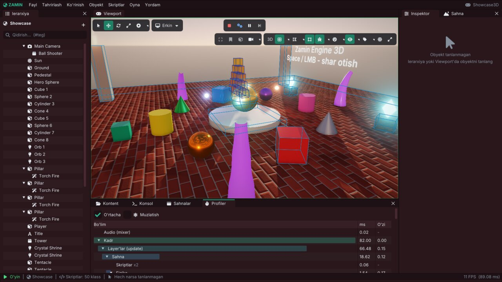

# Zamin Engine: internal architecture

This document is about where things are inside the engine and how the parts work together: the code layout, the
program's life and the main loop, the scene and the ECS, the script module, the renderer, physics, audio, assets,
threads, the editor and the player. It is for those who want to contribute to the engine and for those who wonder
"what is going on under the hood?". You do not need any of it to write a game: start with
[Scripting.md](Scripting.md), [Editor.md](Editor.md) and the tutorials.

The full list of classes and functions is the Doxygen API reference (`cmake --build build --target docs` or `doxygen`
in the repository root; [BuildAndExport.md, section 7](BuildAndExport.md#7-the-api-reference-doxygen)). Every class and
file mentioned here exists in the code - we also say which file to look at.

## Contents

1. [Overview: the targets](#1-overview-the-targets)
2. [Code layout](#2-code-layout)
3. [The program's life and the main loop](#3-the-programs-life-and-the-main-loop)
4. [Events and input](#4-events-and-input)
5. [The scene and the ECS](#5-the-scene-and-the-ecs)
6. [One frame of a scene](#6-one-frame-of-a-scene)
7. [Several scenes: SceneManager](#7-several-scenes-scenemanager)
8. [Files and serialization](#8-files-and-serialization)
9. [The script system](#9-the-script-system)
10. [Renderer](#10-renderer)
11. [Physics](#11-physics)
12. [Audio](#12-audio)
13. [Assets](#13-assets)
14. [Threads](#14-threads)
15. [Editor](#15-editor)
16. [Player](#16-player)
17. [Adding a new component](#17-adding-a-new-component)
18. [Code rules](#18-code-rules)
19. [Where to start reading](#19-where-to-start-reading)

---

## 1. Overview: the targets

It is all one CMake build (`CMakeLists.txt`): the engine as a **shared library**, and on top of it the editor, the
player, the tests and the games' script modules.

```
                 ┌──────────────────────────── libZamin.so ────────────────────────────┐
                 │ Core · Events · Renderer · Scene · Scripting · Physics · Audio · UI │
                 │ AI · Asset · Project · Math · Localization · Debug · ImGui · Editor │
                 │ Platform/GLFW · Platform/OpenGL · Platform/Linux                    │
                 └────▲───────────────▲───────────────▲─────────────────▲─────────────┘
                      │               │               │                 │ dlopen (at run time)
              ZaminEditor       ZaminPlayer     ZaminTests,        lib<Game>.so
              (Editor/src)      (Runtime/src)   ZaminBench ...     (Projects/<Game>/Source)
```

| Target | What | Source |
|---|---|---|
| `Zamin` (`libZamin.so`) | The engine and the vendor libraries; ImGui/ImGuizmo only with `ZAMIN_WITH_IMGUI=ON`. The editor services are not in it | `Zamin/src/Zamin` |
| `ZaminCoreObjects` | Engine OBJECT code shared by both frontends | `Zamin/src/Zamin` |
| `ZaminEditorSupport` | The editor services: Undo, preferences, language, autosave, diagnostics and more | `Zamin/src/Zamin/Editor` |
| `ZaminEditor` | The editor (ImGui docking), linked with `Zamin` and `ZaminEditorSupport` | `Editor/src` |
| `ZaminPlayer` | The runtime that runs exported games | `Runtime/src/ZaminPlayer.cpp` |
| `ZaminTests` | Headless unit tests (without a GPU) | `Tests/*Tests.cpp`, `Tests/TestFramework.*`, `Tests/TestAssertions.h` |
| `ZaminRenderTests` | The rendering regression test (with reference images) | `Tests/RenderTests.cpp` |
| `ZaminBench` | Benchmarks (`--ecs`, `--serialize`, `--render` ...) | `Tests/*Bench.cpp` |
| `ZaminScriptTemplateGen` | A helper for checking the new-script templates | `Tests/ScriptTemplateGen.cpp` |
| `Platformer2D`, `Showcase3D`, `Adventure3D` | The sample games' script modules (`Projects/<Game>/Binaries/lib<Game>.so`) | `Projects/*/Source` |

Why a **shared library**: the editor, the player and the game module use one copy of `libZamin.so` - there is one set
of static state (the active project, the ScriptRegistry, the audio engine, the log, the renderer caches). Reloading the
script module (hot reload) does not reload the engine. Every binary has `RPATH=$ORIGIN`: the engine is found next to it
(an exported game's folder can be moved anywhere).

The build system and its variants - [BuildAndExport.md](BuildAndExport.md).

## 2. Code layout

`Zamin/src/Zamin/` - everything is inside `namespace Zamin`; one shared header for games and tools:
`Zamin/Zamin.h`.

| Folder | Purpose | Main classes / files |
|---|---|---|
| `Core/` | Application, window, layers, input, time, log, assert, UUID, the job system, SaveData, services, crash handler | `Application`, `Window`, `Layer`/`LayerStack`, `Input`, `InputActions`, `Time`, `Timestep`, `Log`, `JobSystem`, `SaveData`, `Services`, `GameState`, `CrashHandler`, `BuildInfo` |
| `Events/` | Window, keyboard and mouse events | `Event`, `EventDispatcher` (`Event.h`) |
| `Renderer/` | The RHI interfaces and the renderers | `RendererAPI`, `RenderCommand`, `Shader`, `Texture2D`, `Framebuffer`, `VertexArray`, `Renderer`, `Renderer2D`, `Renderer3D`, `PostProcessor`, `DisplayPass`, `ParticleRenderer`, `Model`, `Mesh`, `MaterialAsset`, `EditorCamera` |
| `Scene/` | The scene, entities, components, serialization, prefabs, the scene manager | `Scene`, `Entity`, `Components.h`, `ComponentRegistry`, `SceneSerializer`, `SceneManager`, `SceneMigration`, `SceneRecovery`, `Prefab*`, `ParticleSystem` |
| `Scripting/` | C++ scripts | `ScriptableEntity`, `ScriptRegistry`, `ScriptEngine`, `ScriptField`, `EventBus`, `ScriptTemplate` |
| `Physics/` | 2D (Box2D) and 3D (Jolt) physics | `PhysicsWorld2D`, `PhysicsWorld3D`, `PhysicsMaterial`, `CollisionLayers`, `CollisionShapes3D`, `Polygon2D` |
| `Audio/` | Sound on top of miniaudio | `AudioEngine`, `AudioMixer`, `AudioFilter`, `AudioClip`, `Audio` (for scripts) |
| `UI/` | The game UI: layout, widgets, text, animation, scrolling | `UILayout`, `UIWidgets`, `TextLayout`, `TextEdit`, `UIAnimation`, `UIScroll` |
| `AI/` | Navigation, steering, state machine, behavior tree, sight | `NavGrid`, `NavPathfinder`, `Steering`, `StateMachine`, `BehaviorTree`, `Sight`, `Formation` |
| `Asset/` | The asset registry, import, `.zmeta`, the file watcher, thumbnails | `AssetRegistry`, `AssetImporter`, `AssetMetadata`, `FileWatcher`, `AssetHotReload`, `AssetThumbnails` |
| `Project/` | The project, its settings, the player settings, export | `Project`, `ProjectConfig`, `ProjectMigration`, `PlayerSettings`, `PlayerLaunch`, `ExportAssets`, `ExportBuild`, `PrefabExport`, `PlayerBenchmark` |
| `Math/` | Mathematics | `Math`, `MathUtils`, `Quaternion`, `Geometry`, `Noise`, `AnimationCurve`, `Easing`, `Spline`, `Color`, `Random` |
| `Localization/` | The game's languages | `Localization` |
| `Debug/` | Debug drawing | `DebugDraw`, `MeshNormals` |
| `Editor/` | The editor's parts without a GUI (tested): undo, shortcuts, layouts, preferences ... | `UndoHistory`, `ShortcutRegistry`, `EditorLayouts`, `EditorPreferences`, `EditorAutosave`, `CompilerDiagnostics` |
| `ImGui/` | The ImGui layer, theme, icons | `ImGuiLayer`, `Icons.h`, `ImGuiConfig.h` |
| `Utils/` | File system, text and platform helpers | `FileSystem`, `StringUtils`, `PlatformUtils.h` |
| `Platform/GLFW/` | The GLFW implementation of the window and input | `GlfwWindow`, `GlfwInput.cpp` |
| `Platform/OpenGL/` | The OpenGL 4.1 core implementation of the RHI | `OpenGLRendererAPI`, `OpenGLShader`, `OpenGLTexture`, `OpenGLFramebuffer`, `OpenGLBuffer`, `OpenGLContext` |
| `Platform/Linux/` | File dialogs, processes | `LinuxPlatformUtils.cpp` |

The rest of the repository:

| Folder | What |
|---|---|
| `Editor/src/` | `EditorLayer` (the main layer, ~12 thousand lines, split into `Editor*.cpp` files), `Panels/` (hierarchy + inspector, content browser, console, project settings, animation windows ...), `UI.h` (ImGui helpers) |
| `Runtime/src/` | `ZaminPlayer.cpp`: `RuntimeLayer`, the crash window, `CreateApplication` |
| `Projects/` | The sample games: `Platformer2D`, `Showcase3D`, `Adventure3D` |
| `Tests/` | Unit tests, benchmarks, test scripts, documentation checks ([Testing.md](Testing.md)) |
| `cmake/` | `Dependencies.cmake` (vendor libraries), `ZaminGame.cmake` (`zamin_add_game_module`, `zamin_target_settings`), `Sanitizers.cmake`, `Coverage.cmake`, `GenerateBuildInfo.cmake`, `GenerateEngineNames.cmake` |
| `Resources/` | Engine resources (fonts); copied to `bin/Resources` by the build |
| `vendor/` | Third-party code checked into the repository |

## 3. The program's life and the main loop

### Startup

The `main` in `Zamin/Core/EntryPoint.h` calls the program's (editor's, player's) `CreateApplication` function, calls
`Run()` and returns `GetExitCode()`:

```cpp
int main(int argc, char** argv)
{
    Zamin::Application* app = Zamin::CreateApplication({ argc, argv });
    app->Run();
    const int code = app->GetExitCode();
    delete app;
    return code;
}
```

The `Application` constructor (`Core/Application.cpp`), in this order:

1. the working directory (`ApplicationSpecification::WorkingDirectory`), the build information to the log
   (`Zamin Engine 0.1.0 (commit ..., build ..., Release, GCC ...) is starting (...)`);
2. the window (`Window::Create` - GLFW + an OpenGL context), its events to `Application::OnEvent`;
3. `Renderer::Init()` - `RenderCommand`, `Renderer2D`, `Renderer3D`, `ParticleRenderer`, `PostProcessor`;
4. `AudioEngine::Init()` (the engine runs without a device too - nothing is heard);
5. `JobSystem::Init` (worker threads; `ZAMIN_JOBS`, `--jobs` in the player);
6. with `EnableImGui`, the `ImGuiLayer` as an overlay.

Then the program adds its own layer: the editor - `EditorLayer`, the player - `RuntimeLayer` (`PushLayer`).

### The main loop - `Application::Run`

Every frame:

1. When the window is minimized - nothing is updated or drawn, only events are waited for.
2. When the game does not run in the background (`SetRunInBackground(false)`) and the window has no focus - a pause
   frame (`Layer::OnRenderPaused`).
3. The frame time: real time, capped at the project's longest frame (Project settings > Time) - this becomes the
   `Timestep`; `Time::OnFrame`.
4. `Profiler::BeginFrame`, `JobSystem::EndFrame`, the main thread queue (what was queued with `SubmitToMainThread`).
5. `Input::Update()` - a snapshot of the keyboard, mouse and gamepad state for this frame.
6. `Cursor::Update()`, `AudioEngine::Update(ts)` (music fades, level meters, finished sounds).
7. Every layer's `OnUpdate(ts)` - from the first to the last (the game, the scenes and drawing happen here).
8. The ImGui frame: every layer's `OnImGuiRender()` (the editor UI).
9. Automation: `ZAMIN_SCREENSHOT`, `ZAMIN_MAX_FRAMES`.
10. `Window::OnUpdate()` - the buffers swap (VSync), window events are read.
11. The frame rate limit (the game's `--fps` / Project settings > Player; the editor slowing down while idle).

When the loop ends (the window was closed, `Close()`, `ZAMIN_MAX_FRAMES`) every layer gets `OnRunEnded()`; then the
destructor: `SaveData::Save()`, `JobSystem::Shutdown()`, `AudioEngine::Shutdown()`, `Renderer::Shutdown()`, after which
the layer stack removes the layers with `OnDetach`.



*Play in the editor, **Window > Profiler**: the tree of frame sections — the frame → `Layers (update)` → the scene →
the scripts ... (marked with `ZM_PROFILE_SCOPE`), each with its total and own time (ms). The tree repeats the stages of
the loop above.*

### Layers

The `LayerStack` has two parts: plain layers (`PushLayer`) and the overlays above them (`PushOverlay`, for example the
`ImGuiLayer`). Updates go from the bottom up, events from the top down (the overlay gets them first and can stop them
with `Event::Handled`).

## 4. Events and input

`GlfwWindow` makes `Event` objects from the GLFW callbacks (`WindowClose`, `WindowResize`, `WindowFocus`,
`WindowDrop`, `KeyPressed`, `KeyReleased`, `KeyTyped`, `MouseButtonPressed`, `MouseMoved`, `MouseScrolled` ...) and
hands them to `Application::OnEvent`. It:

- writes every device event to `Input` (`Input::OnKeyEvent`, `OnMouseButtonEvent` ...) - even when a layer "catches"
  it;
- handles closing and resizing itself too (`Renderer::OnWindowResize`);
- passes the event to the layers from the top down.

`Input` (`Core/Input.h`, `Platform/GLFW/GlfwInput.cpp`) takes a snapshot of the state once per frame: every query in a
frame gets the same answer, and "JustPressed" is true for exactly one frame. Named actions and axes
(`IsActionPressed("Jump")`, `GetAxis("Horizontal")`, `GetVector("Move")`) come from the input map in the project file
(Project settings > Input). Without a window (tests) `Input::OnKeyEvent` / `SimulateGamepad*` are the only source -
input is simulated headless. With a window, `Input::SimulateKey` holds the pressed key until it is released (polling
the keyboard does not clear it) - the player's `ZAMIN_PLAYER_INPUT` script works with this.

## 5. The scene and the ECS

`Scene` (`Scene/Scene.h`, `Scene.cpp` and the `Scene*.cpp` parts) is one level: an EnTT registry, the scene settings
(sky, fog, post-processing, gravity, physics step) and everything that uses them.

- **Entity** - a light handle (`entt::entity` + `Scene*`, `Scene/Entity.h`): `AddComponent<T>`,
  `GetComponent<T>`, `TryGetComponent<T>`, `HasComponent<T>`, `RemoveComponent<T>`.
- **Components** - plain structs (`Scene/Components.h`); the logic is not in them but in the scene's systems. Every
  `CreateEntity` gives the entity an `IDComponent` (UUID), a `TagComponent` (name and active state), a
  `TransformComponent` and a `RelationshipComponent` (the UUIDs of the parent and the children). `AllComponents` - the
  list of all other components (copying, memory statistics and prefabs work from this list). All of them:
  [Components.md](Components.md).
- **UUID** - the entity's permanent ID: kept by saving, copying and Play; references (`EntityRef`, the hierarchy) go by
  UUID.
- **Active state** - `TagComponent::Active`; an entity takes part in the game only when it and all its ancestors are
  active (`Scene::SetActive`, `IsActiveInHierarchy`).
- **Lookup** - indexes by name and tag (`FindEntityByName`, `FindEntitiesWithTag`): fast enough to call every frame.

A scene runs in three ways:

| Mode | Who | Calls | What runs |
|---|---|---|---|
| Edit | editor | `OnUpdateEditor` | animation previews, particles; nothing is simulated |
| Simulate | editor | `OnSimulationStart` / `OnUpdateSimulation` / `OnSimulationStop` | physics and animation, without scripts |
| Play | editor, player | `OnRuntimeStart` / `OnUpdateRuntime` / `OnRuntimeStop` | the game itself |

The editor does not play the edit scene: Play makes a copy of it (`Scene::Copy` - the same UUIDs, the entities in
hierarchy order, as if read from the scene file) and throws it away on Stop - the edit scene does not change.

The `OnRuntimeStart` order: the game clock (the project's `DefaultTimeScale`), the 2D and 3D physics worlds with the
bodies of the active entities, the audio sources, the navigation grids, then the scripts - first `OnCreate` of all of
them, then `OnEnable`. `OnRuntimeStop`: the scripts (`OnDisable` / `OnDestroy`), the physics worlds, the scene's
sounds (the music belongs to the game - it keeps playing), `SaveData::Save()`.

## 6. One frame of a scene

`Scene::OnUpdateRuntime(ts)` = `UpdateRuntime(ts)` + `RenderRuntime()`. The `UpdateRuntime` order (`Scene.cpp`):

1. Scripts removed between frames are cleaned up; when the language changed, `OnLanguageChanged` and the localized
   texts.
2. **UI** - on real time (it also runs while the game is paused): widgets, clicks, navigation, UI tweens.
3. When the game is paused (time scale 0) - only the scripts that run while paused (`SetUpdateWhenPaused`), and the
   frame ends here.
4. Time is scaled: `ts * TimeScale` - everything else runs on game time.
5. Active-state changes are applied; the new scripts' `OnStart`; every active script's **`OnUpdate`**, then its timers
   and tweens.
6. Navigation: grids, obstacles, patrol paths, formations, agents; movement along splines.
7. **Physics** (`StepPhysics`): the 2D and 3D worlds in fixed steps (`SceneSettings::PhysicsStep`: `StepRate` steps
   per second, at most `MaxStepsPerFrame` per frame), the bodies' transforms are written to the entities, collision
   and trigger callbacks, broken joints.
8. Sight sensors (`OnTargetSpotted` / `OnTargetLost`); navigation debug drawing.
9. Property animations (Animation Player) - the values are written, their events are called.
10. Every active script's **`OnLateUpdate`**, then the event bus's deferred events (`EmitDeferred`).
11. Camera follow and shake, sprite / tint animations, particles, Animators (skeleton poses), audio (sources, the
    listener, finished sounds → `OnSoundFinished`), memory statistics.
12. The entities `Destroy`ed during the frame are removed now (`FlushDestroyQueue`).

`RenderRuntime` draws the scene through the main camera (`GetRuntimeView`); without a main camera nothing is drawn -
this is how the unit tests run a game without a GPU.

## 7. Several scenes: SceneManager

`SceneManager` (`Scene/SceneManager.h`) holds the scenes of the running game (both the editor's Play and the player go
through it): one active scene, additive scenes next to it, the `DontDestroyOnLoad` scene, background loading
(`LoadSceneAsync`: the file is read and the JSON parsed on a worker thread, images are decoded ahead, while the
entities are made on the main thread, 4 ms per frame - `SetAsyncBudget`), transitions (fades) and sub-scenes. Every
scene has its own entities, scripts and physics worlds; all of them share one event bus and one game clock and are
drawn together through one camera. Switches requested during a frame (`LoadScene`, `UnloadScene`,
`DontDestroyOnLoad`) are carried out at the end of the frame (`ProcessRequests`) - never inside a script callback.
Details: [Scenes.md](Scenes.md).

## 8. Files and serialization

| File | Who reads / writes it | Format |
|---|---|---|
| `.zscene` | `SceneSerializer` | JSON: the scene settings and the entities (every component under its own key, for example `"Rigidbody2D"`). Versioned: old files are upgraded by the `SceneMigration` chain; `SceneRecovery` rescues what is left of a broken file |
| `.zsceneb` | `SceneSerializer` (binary cache) | A copy of the scene that is faster to read, in an exported game |
| `.zprefab` | `Prefab`, `PrefabDatabase` | A set of entities (in the scene format); instances with a link and overrides ([Prefabs.md](Prefabs.md)) |
| `.zproject` | `ProjectSerializer` | JSON: the project settings; versioned (`ProjectMigration`); unknown sections are kept ([ProjectSettings.md](ProjectSettings.md)) |
| `.zmeta` | `AssetMetadata` | Next to an asset: its UUID and import settings (added to version control) |
| `.zmat`, `.zphysmat`, `.zanim`, `.zsanim`, `.zparticle`, `.znav` | material, physics material, property / sprite clip, particle preset, navigation cache | JSON (`.znav` - baked grids next to the scene) |
| `.zamin/` | the editor cache | `AssetRegistry.json`, `Thumbnails/` - rebuilt, not in git |

Component fields are written to and read from the scene file in `SceneSerializer.cpp`; fields that exist only while
the game runs (runtime fields) are not written, and `ResetRuntimeData` in `Scene.cpp` clears them when copying.

## 9. The script system

The game logic is C++ classes in the project's `Source/` folder, compiled into a separate **script module**
(`lib<Game>.so`) (`cmake/ZaminGame.cmake`: `zamin_add_game_module`).

```
 Source/*.cpp ──cmake──▶ Binaries/lib<Game>.so ──ScriptEngine::LoadModule──▶ dlopen (a copy)
                                                         │
     ZM_REGISTER_SCRIPT(Player, ZM_FIELD(Player, Speed)) │ static ScriptRegistrar constructors
                                                         ▼
                                    ScriptRegistry: "Player" → { Factory, Fields }
                                                         │
     NativeScriptComponent { ClassName = "Player", Fields } ──Play──▶ Factory() → ScriptableEntity* Instance
```

- **Registration.** `ZM_REGISTER_SCRIPT` (`Scripting/ScriptEngine.h`) declares a static `ScriptRegistrar` in the
  module: when the module loads, its constructor writes the class to the `ScriptRegistry` (the name, a `new Class()`
  factory, the `ZM_FIELD` fields), and when the module is unloaded its destructor removes it. `ZM_FIELD` stores a
  function that reaches the field (`ScriptFieldInfo::Accessor`) - the inspector and the scene file read and write
  values through it.
- **Loading.** `ScriptEngine::LoadModule` copies the module to a temporary folder under a unique name
  (`<name>-<pid>-<n>.so`) and `dlopen(RTLD_NOW | RTLD_LOCAL)`s the copy: the original file can be rebuilt while the
  editor runs, and `dlopen` does not hand back the old module from its cache. With GCC the module is built with
  `-fno-gnu-unique` - otherwise `dlclose` does not unload it and hot reload does not work.
- **Instances.** In Play the scene creates an object for every `NativeScriptComponent` with
  `ScriptRegistry::Instantiate(ClassName)`, writes the `Fields` values into it and calls the life-cycle callbacks
  ([Scripting.md](Scripting.md)). A script uses the engine API through the `ScriptableEntity` methods (which forward
  to the `Scene` and the systems).
- **Hot reload (editor).** **Scripts → Compile + reload** (`Ctrl+B`) builds the project with `cmake` on a separate
  thread (`-DZamin_DIR=<the engine build folder>` - `ZaminConfig.cmake`, Release); the editor checks the module file
  once a second and reloads it when it changed and then stayed unchanged for one check (the linker writes it in
  place): Play stops, the old instances are deleted (`SetBeforeUnloadCallback`), the module is swapped.
- **Events.** Physics, UI, audio and animation events go to the script's virtual callbacks (`OnCollisionBegin`,
  `OnClick`, `OnSoundFinished` ...) and to the scene's `EventBus` (named events, subscribe / publish).

## 10. Renderer

### Layers

```
  Scene::RenderScene ──▶ Renderer3D · Renderer2D · ParticleRenderer · Scene::RenderUI
                                  │
                  RenderCommand / RendererAPI · Shader · Texture2D · Framebuffer · VertexArray · Buffer
                                  │  (interfaces: Renderer/*.h)
                          Platform/OpenGL/*  (OpenGL 4.1 core, glad)
```

The renderer code talks to the GPU only through the interfaces; a new backend means writing a `Platform/<API>/`
implementation. For now there is one - OpenGL.

### The path of a game frame (player)

1. The scene is drawn in **linear HDR** (an `RGBA16F` + depth framebuffer) at the render scale
   (`SceneSettings::RenderScale` x the quality level).
2. `Scene::RenderScene`:
   - **3D** - `Renderer3D::BeginScene` (camera, lights, sky, fog, shadows), `SubmitMesh` for every mesh, `EndScene`:
     frustum culling, the sun's shadow cascades, opaque and cutout surfaces, the sky, (the grid in the editor),
     transparent surfaces (back to front), instancing.
   - **2D** - by sorting layer and order (back to front): sprites, circles, texts, tilemap chunks, 2D particles -
     `Renderer2D` batches, with 2D lights.
   - **UI** - the screen UI (`RenderUI`).
3. `PostProcessor::Apply` - bloom, SSAO, color grading, tonemapping and more; the result is in display colors.
4. The UI of a pixel-perfect game (`RenderDeferredUI`), debug drawing (`DebugDraw::Render`), the scene transition's
   curtain.
5. `DisplayPass::Present` - to the window, with gamma and brightness.

The editor does the same scene drawing into its viewport framebuffer and draws the entity ID buffer (mouse picking),
the selection outline and the gizmos on top. Details: [Rendering.md](Rendering.md).

### Caches

Textures, meshes, materials, models, fonts and HDRI maps are cached by file path (`TextureLibrary`, `MeshLibrary`,
`MaterialLibrary`, `Model`, `Font`, `EnvironmentMap`); `Renderer::Shutdown` frees them.

## 11. Physics

Every running scene can have two worlds:

| | 2D | 3D |
|---|---|---|
| Class | `PhysicsWorld2D` | `PhysicsWorld3D` |
| Library | Box2D | Jolt (its own thread pool, up to 8 threads) |
| Body | `Rigidbody2DComponent` + 2D colliders | `Rigidbody3DComponent` + 3D colliders, `CharacterController3DComponent` |
| Step | the scene's `PhysicsStep` (a fixed step), `Physics2D.SubSteps` | `PhysicsStep` |

Bodies are created in `OnRuntimeStart` (and later for entities that are activated / created); after every step the
state of the dynamic bodies is written to the entity transforms, and kinematic bodies follow the entity's transform.
Collision events (`TakeEvents`) reach the scripts as `OnCollisionBegin` / `OnTriggerBegin` ... The library types do
not leak out: the Box2D and Jolt headers are only inside `Physics/*.cpp`. Determinism (the same result with GCC and
Clang: `-ffp-contract=off`) is guarded by tests. Details: [Physics.md](Physics.md).

## 12. Audio

`AudioEngine` (`Audio/AudioEngine.h`) is a static layer over miniaudio: sounds with handles (`Play`, `PlaySpatial`,
`Stop`, `SetVolume` ...), 3D sound (the listener - an Audio Listener or the main camera), a tree of mixer groups
(Master > Music, SFX, UI and the project's own groups: fader, mute, solo, filters), music (one track, streaming,
crossfade - it belongs to the game, not to a scene), a voice limit, preloading. Mixing happens on miniaudio's device
thread; `AudioEngine::Update` runs on the main thread every frame (Application) - fades, meters, finished sounds.
Scripts use the `Audio` class and the `ScriptableEntity` methods. Without a device (CI, xvfb) the engine still runs.
Details: [Audio.md](Audio.md).

## 13. Assets

- **AssetRegistry** - every file in the project's `Assets/` folder and its UUID (handle). Components refer to assets
  by path; the handle (from the `.zmeta` file) does not change when the file is renamed or moved. The editor writes
  missing `.zmeta` files; the player only reads (in an export the registry is a single `AssetRegistry.zreg` file).
- **AssetImporter** - import settings (textures, models, sounds: for example a model's clips, a sound's streaming /
  preload setting).
- **FileWatcher** - watches the asset folder on a background thread (inotify on Linux, otherwise checking times /
  sizes); the changes are taken on the main thread with `Poll()`. **AssetHotReload** builds on it: it updates the
  registry (a `.zmeta` for new files) and re-imports changed textures, models, fonts and HDRI maps into the objects that
  use them - components and renderers show the new content at once. The editor updates the instances of a changed
  prefab (`EditorPrefabReload.cpp`, [Prefabs.md](Prefabs.md)).
- **AssetThumbnails** - the thumbnails in the content browser (`.zamin/Thumbnails/`).

## 14. Threads

Almost all of the engine's code runs on the **main thread** (the scene, scripts, the renderer, ImGui). The other
threads:

| Thread | What it does | Link with the main thread |
|---|---|---|
| `JobSystem` workers | Independent particle systems and Animator poses (`ParallelFor`) | Waited for within the frame ([Core.md](Core.md#9-the-job-system-jobsystem)) |
| The Jolt thread pool | The inside of a 3D physics step | `PhysicsWorld3D::Step` waits until it is done |
| The miniaudio device thread | Mixing the sounds | Handles, mutexes (`AudioEngine`) |
| Background scene loading | File reading, JSON, decoding images | `AsyncOperation`; the entities on the main thread |
| `FileWatcher` | Watching the asset folder | `Poll()` (main thread) |
| Editor: compiling, export | `cmake` processes, export files | Result flags, output lines |

Work from another thread to the main thread: `Application::SubmitToMainThread`.

## 15. Editor

`ZaminEditor` (`Editor/src`) is one big layer, `EditorLayer`, plus panels:

- **State**: the edit scene (`m_EditorScene`), the active scene (in Edit - the edit scene itself, in Play - its copy),
  `SceneState` (Edit / Play / Simulate), the selection, the editor camera (`EditorCamera`).
- **Panels** (`Editor/src/Panels`): `SceneHierarchyPanel` (the hierarchy and the inspector - every component section
  with `AddSection<T>(...)`), `ContentBrowserPanel`, `ConsolePanel`, `ProjectSettingsPanel`,
  `AnimationTimelinePanel`, `AnimatorGraphPanel`, `AudioMixerPanel`, `SpriteEditorPanel`, `AssetInspectorPanel`,
  `LocalizationPanel`, `ScenesPanel`, `UnusedAssetsPanel`.
- **Undo** - `UndoHistory` (`Zamin/Editor`): text states of the scene and the selection; every action is a new state
  ([Editor.md, section 11](Editor.md#11-undo-autosave-and-recovery)).
- **Play** - `OnScenePlay`: `Scene::Copy`, resolving assets, the settings the game saved (audio, display, language),
  the services and `GameState` are cleared, and the copy starts in a new `SceneManager` - as in the player. Stop throws
  it all away and returns to the edit scene (even when the game switched scenes).
- **Scripts** - compiling and hot reload (section 9), the compiler errors window (`CompilerDiagnostics`).
- **Export** - `BuildGame` on a separate thread ([BuildAndExport.md](BuildAndExport.md)).
- **Automation** - the `ZAMIN_EDITOR_*` environment variables (screenshots, the smoke test, export;
  [Editor.md, section 15](Editor.md#15-automation-screenshots-ci)).

The editor's parts without a GUI (the undo history, shortcuts, layouts, preferences, autosave, statistics) are in the
engine (`Zamin/src/Zamin/Editor`) - that is why the unit tests can test them without a GPU.

## 16. Player

`ZaminPlayer` (`Runtime/src/ZaminPlayer.cpp`):

1. `CreateApplication` reads the command line (`PlayerCommandLine::Parse`; `--help` / `--version` - exit at once),
   finds the project file (the argument, otherwise `Game/*.zproject` next to it), resolves the window settings
   (`PlayerLaunchSettings::Resolve`: command line > saved choice > project), opens the log file (`LogFile`) and
   installs the crash handler (`CrashHandler::Install`).
2. `RuntimeLayer::OnAttach`: the project, the script module (`ScriptEngine::LoadModule`), the splash screen - the first
   scene loads in the background meanwhile.
3. Every frame: `SceneManager::OnUpdate` into the HDR target, post-processing, UI, debug drawing, the transition,
   `DisplayPass`; at the end of the frame `SceneManager::ProcessRequests`.

Details (command line, log, crash reports, benchmark): [Runtime.md](Runtime.md).

## 17. Adding a new component

Adding a new component to the engine changes these places (all of them exist in the code under these names):

1. **`Scene/Components.h`** - the struct (plain fields with default values; mark runtime fields with a comment) and
   adding it to the `AllComponents` list.
2. **`Scene/ComponentRegistry.h` / `.cpp`** - its key in the scene file (`ComponentKey<T>()`) and the
   `MakeTypeInfo<T>()` list (the inspector's copy / paste actions).
3. **`Scene/SceneSerializer.cpp`** - writing and reading (with the key; when new fields are missing from old files the
   default value stays).
4. **`Editor/src/Panels/SceneHierarchyPanel.cpp`** - the inspector section (`AddSection<T>(...)`) and the
   "+ Component" menu (`DisplayAddComponentEntry<T>(...)`).
5. **`Scene/Scene.cpp`** - with runtime fields, clearing them in both variants of `ResetRuntimeData`; when a system is
   needed, in `UpdateRuntime` / `RenderScene`.
6. **Tests** - `Tests/ZaminTests.cpp` (serialization and logic, without a GPU).
7. **Documentation** - a section and description in [Components.md](Components.md), then
   `python3 Tests/docs_components.py --update docs/Components.md` (the tables are generated from the code);
   `ctest -L docs` checks it.

## 18. Code rules

- C++20, `namespace Zamin`, 4 spaces, braces on a new line (`.clang-format`; `Tests/format_check.sh` checks only the
  changed lines).
- The product reads in **English** by default. The editor's UI texts are written in the code in Uzbek (Latin script)
  and go through `Tr("...")` / `TrFormat(...)`: the English comes from the `EditorLanguage.cpp` table, and Uzbek can be
  chosen in the editor preferences. Log and error messages (`ZM_CORE_INFO` ..., returned error texts) are written in
  English. Code comments - in English.
- Logging: `ZM_CORE_INFO` / `ZM_CORE_WARN` / `ZM_CORE_ERROR` (the engine), `ZM_INFO` / `ZM_WARN` / `ZM_ERROR` (games
  and programs), with `std::format` syntax.
- `Ref<T>` = `std::shared_ptr<T>`, `Scope<T>` = `std::unique_ptr<T>` (`Core/Base.h`).
- The build must be free of warnings (`-Wall -Wextra -Wpedantic`, GCC and Clang).
- A unit test for new engine logic ([Testing.md](Testing.md)).

## 19. Where to start reading

| Question | File |
|---|---|
| How does a frame go round? | `Zamin/src/Zamin/Core/Application.cpp` (`Application::Run`) |
| What happens inside a game frame? | `Zamin/src/Zamin/Scene/Scene.cpp` (`Scene::UpdateRuntime`, `Scene::RenderScene`) |
| What do the components look like? | `Zamin/src/Zamin/Scene/Components.h` |
| What can a script call? | `Zamin/src/Zamin/Scripting/ScriptableEntity.h` |
| How is a scene file written? | `Zamin/src/Zamin/Scene/SceneSerializer.cpp` |
| How is the script module loaded? | `Zamin/src/Zamin/Scripting/ScriptEngine.cpp` |
| How does the editor start Play? | `Editor/src/EditorLayer.cpp` (`EditorLayer::OnScenePlay`) |
| The player frame | `Runtime/src/ZaminPlayer.cpp` (`RuntimeLayer::OnUpdate`) |
| Export | `Editor/src/EditorLayer.cpp` (`EditorLayer::BuildGame`), `Zamin/src/Zamin/Project/Export*.h` |

Related documents: [BuildAndExport.md](BuildAndExport.md) (build and export), [Testing.md](Testing.md) (tests),
[Quality.md](Quality.md) (measured quality), [FAQ.md](FAQ.md) (questions and problems).


The editor's build/hot reload and export are in `Editor/src/EditorBuild.cpp`. The hierarchy tree is split into
`SceneHierarchyPanel.cpp`, the inspector's structure into `SceneComponentInspector.cpp` and the component-specific
fields into `SceneComponentFields.cpp`. The unit tests of the editor services are separate, in
`Tests/EditorServicesTests.cpp`; the safety and save regressions are in `Tests/SafetyTests.cpp`.

`Renderer/EditorCamera.cpp` and `Renderer/EditorViewSettings.cpp` are also built into `ZaminEditorSupport`.
The runtime library's linker refuses unresolved symbols (`--no-undefined`); a hidden dependency on the editor services
is caught by the very next build.

The `SceneStatisticsCollector` the Player's profiler uses is a shared engine service: the implementation is in
`Scene/SceneStatistics.cpp`. The old header path `Editor/SceneStatistics.h` is kept for compatibility.

### Loaded navigation atlas snapshot

`AI/NavAtlas` stores ordered tile storage + per-tile dense local grids + explicit directed traversal edges;
there is no world-sized dense rectangle. An automatic seam neighbour is found through integer lattice bounds,
and the source grids are copied. The build is bounded by max loaded cells/tiles/links and is
transactional. The A* query scratch is local and the snapshot const; explicit cheap links run Dijkstra.
WorldStreaming publication happens on the owner thread when the source serial/revision/carve or the links
change. A retained shared snapshot protects the worker's lifetime, while the current revision protects the actor's
route lifetime. NavRouteFollower waits for gameplay completion at a traversal entry.
The existing dense mosaic is built separately for compatibility with the NavAgent API; its budget does not depend on the atlas.

### Async navigation service

`AI/NavQueryQueue` keeps a jthread/CV, a bounded job registry and a latest-key mapping inside its Pimpl.
Start credits reset in the owner's Pump. The worker-owned math query runs with a cooperative stop_token;
a completed payload becomes visible to Poll only at the next bounded owner publication. Every retained snapshot is
charged references/bytes by its unique pointer, and a result is charged by its route buffer capacity. A cancelled active
job stays in the registry until it is acknowledged; a waiting/completed/published cancel releases its buffers/refs at once.
The World wrapper keeps the entity generation together with the UUID, and after a result is published it checks the
current owner pose, the destination and the atlas epoch. There are no ECS/plugin closures; the World destructor joins the queue.

World crowd movement runs on the owner thread in two phases: route/intent preparation, then `NavCrowd::Solve` for all
agents on a frozen snapshot, then clearance and the physics command. The solver is pure and, with a
UUID tie-break and a fixed candidate order, independent of the registry order. Sparse route smoothing
is part of the async query worker; the portal handshake stays with the owner/gameplay. The solver caps
show blocking in a dense scene openly; this is not a hard frame deadline or an unlimited crowd.

The order carve → source stamp sync → query cancellation/publication → agent commands prevents one frame of
movement on the old topology in the world. A synthetic mosaic is not re-carved as a source.
Recovery is an actual-displacement watchdog on the owner; waiting/traversal are a separate phase,
retries and cooldown are bounded. Updating the physics contact geometry and nav carving are separate systems.
