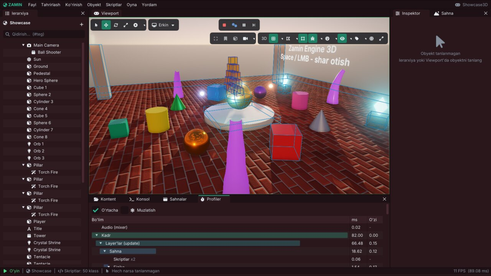

# Zamin Engine: ichki arxitektura

Bu hujjat dvigatel ichida nima qayerda ekani va qismlar bir-biri bilan qanday ishlashi haqida: kod tuzilmasi, dastur
hayoti va asosiy sikl, sahna va ECS, skript moduli, renderer, fizika, audio, assetlar, oqimlar, editor va player.
Dvigatelga hissa qo'shmoqchi bo'lganlar va "kapot ostida nima bo'lyapti?" deb qiziqqanlar uchun. O'yin yozish
uchun buni bilish shart emas: [Scripting.md](Scripting.md), [Editor.md](Editor.md) va qo'llanmalardan boshlang.

Klasslar va funksiyalarning to'liq ro'yxati - Doxygen API ma'lumotnomasi (`cmake --build build --target docs` yoki
repozitoriy ildizida `doxygen`; [BuildAndExport.md, 7-bo'lim](BuildAndExport.md#7-api-malumotnomasi-doxygen)).
Bu yerda tilga olingan har bir klass va fayl kodda bor - qaysi faylga qarashni ham ko'rsatamiz.

## Mundarija

1. [Umumiy ko'rinish: target'lar](#1-umumiy-korinish-targetlar)
2. [Kod tuzilmasi](#2-kod-tuzilmasi)
3. [Dastur hayoti va asosiy sikl](#3-dastur-hayoti-va-asosiy-sikl)
4. [Hodisalar va input](#4-hodisalar-va-input)
5. [Sahna va ECS](#5-sahna-va-ecs)
6. [Sahnaning bir kadri](#6-sahnaning-bir-kadri)
7. [Bir nechta sahna: SceneManager](#7-bir-nechta-sahna-scenemanager)
8. [Fayllar va serializatsiya](#8-fayllar-va-serializatsiya)
9. [Skript tizimi](#9-skript-tizimi)
10. [Renderer](#10-renderer)
11. [Fizika](#11-fizika)
12. [Audio](#12-audio)
13. [Assetlar](#13-assetlar)
14. [Oqimlar (threads)](#14-oqimlar-threads)
15. [Editor](#15-editor)
16. [Player](#16-player)
17. [Yangi komponent qo'shish](#17-yangi-komponent-qoshish)
18. [Kod qoidalari](#18-kod-qoidalari)
19. [Qayerdan o'qishni boshlash](#19-qayerdan-oqishni-boshlash)

---

## 1. Umumiy ko'rinish: target'lar

Hammasi bitta CMake build'i (`CMakeLists.txt`): dvigatel **shared library** sifatida, uning ustida editor, player,
testlar va o'yinlarning skript modullari.

```
                 ┌──────────────────────────── libZamin.so ────────────────────────────┐
                 │ Core · Events · Renderer · Scene · Scripting · Physics · Audio · UI │
                 │ AI · Asset · Project · Math · Localization · Debug · ImGui · Editor │
                 │ Platform/GLFW · Platform/OpenGL · Platform/Linux                    │
                 └────▲───────────────▲───────────────▲─────────────────▲─────────────┘
                      │               │               │                 │ dlopen (ishga tushganda)
              ZaminEditor       ZaminPlayer     ZaminTests,        lib<O'yin>.so
              (Editor/src)      (Runtime/src)   ZaminBench ...     (Projects/<O'yin>/Source)
```

| Target | Nima | Manba |
|---|---|---|
| `Zamin` (`libZamin.so`) | Dvigatel va vendor kutubxonalar; ImGui/ImGuizmo faqat `ZAMIN_WITH_IMGUI=ON` bo‘lsa. Editor xizmatlari kirmaydi | `Zamin/src/Zamin` |
| `ZaminCoreObjects` | Ikki frontend uchun umumiy engine OBJECT kodi | `Zamin/src/Zamin` |
| `ZaminEditorSupport` | Editor xizmatlari: Undo, sozlamalar, til, autosave, diagnostika va boshqalar | `Zamin/src/Zamin/Editor` |
| `ZaminEditor` | Editor (ImGui docking), `Zamin` va `ZaminEditorSupport` bilan link qilinadi | `Editor/src` |
| `ZaminPlayer` | Eksport qilingan o'yinlarni ishga tushiruvchi runtime | `Runtime/src/ZaminPlayer.cpp` |
| `ZaminTests` | Headless unit testlar (GPU'siz) | `Tests/*Tests.cpp`, `Tests/TestFramework.*`, `Tests/TestAssertions.h` |
| `ZaminRenderTests` | Rendering regressiya testi (etalon rasmlar bilan) | `Tests/RenderTests.cpp` |
| `ZaminBench` | Benchmarklar (`--ecs`, `--serialize`, `--render` ...) | `Tests/*Bench.cpp` |
| `ZaminScriptTemplateGen` | Yangi skript shablonlarini tekshirish uchun yordamchi | `Tests/ScriptTemplateGen.cpp` |
| `Platformer2D`, `Showcase3D`, `Adventure3D` | Namuna o'yinlarning skript modullari (`Projects/<O'yin>/Binaries/lib<O'yin>.so`) | `Projects/*/Source` |

Nega **shared library**: editor, player va o'yin moduli bitta `libZamin.so` nusxasidan foydalanadi - statik holat
(faol loyiha, ScriptRegistry, audio dvigateli, log, renderer keshlari) bitta. Skript modulini qayta yuklash
(hot reload) dvigatelni qayta yuklamaydi. Barcha binarlar `RPATH=$ORIGIN` bilan: dvigatel o'z yonidan topiladi
(eksport qilingan o'yin papkasini istalgan joyga ko'chirish mumkin).

Build tizimi va variantlari - [BuildAndExport.md](BuildAndExport.md).

## 2. Kod tuzilmasi

`Zamin/src/Zamin/` - hammasi `namespace Zamin` ichida; o'yinlar va asboblar uchun bitta umumiy header:
`Zamin/Zamin.h`.

| Papka | Vazifasi | Asosiy klasslar / fayllar |
|---|---|---|
| `Core/` | Ilova, oyna, layer'lar, input, vaqt, log, assert, UUID, vazifalar tizimi, SaveData, servislar, crash handler | `Application`, `Window`, `Layer`/`LayerStack`, `Input`, `InputActions`, `Time`, `Timestep`, `Log`, `JobSystem`, `SaveData`, `Services`, `GameState`, `CrashHandler`, `BuildInfo` |
| `Events/` | Oyna, klaviatura, sichqoncha hodisalari | `Event`, `EventDispatcher` (`Event.h`) |
| `Renderer/` | RHI interfeyslari va renderer'lar | `RendererAPI`, `RenderCommand`, `Shader`, `Texture2D`, `Framebuffer`, `VertexArray`, `Renderer`, `Renderer2D`, `Renderer3D`, `PostProcessor`, `DisplayPass`, `ParticleRenderer`, `Model`, `Mesh`, `MaterialAsset`, `EditorCamera` |
| `Scene/` | Sahna, entity, komponentlar, serializatsiya, prefab'lar, sahna menejeri | `Scene`, `Entity`, `Components.h`, `ComponentRegistry`, `SceneSerializer`, `SceneManager`, `SceneMigration`, `SceneRecovery`, `Prefab*`, `ParticleSystem` |
| `Scripting/` | C++ skriptlar | `ScriptableEntity`, `ScriptRegistry`, `ScriptEngine`, `ScriptField`, `EventBus`, `ScriptTemplate` |
| `Physics/` | 2D (Box2D) va 3D (Jolt) fizika | `PhysicsWorld2D`, `PhysicsWorld3D`, `PhysicsMaterial`, `CollisionLayers`, `CollisionShapes3D`, `Polygon2D` |
| `Audio/` | miniaudio ustida ovoz | `AudioEngine`, `AudioMixer`, `AudioFilter`, `AudioClip`, `Audio` (skriptlar uchun) |
| `UI/` | O'yin UI'si: joylashuv, vidjetlar, matn, animatsiya, scroll | `UILayout`, `UIWidgets`, `TextLayout`, `TextEdit`, `UIAnimation`, `UIScroll` |
| `AI/` | Navigatsiya, steering, holat mashinasi, behavior tree, ko'rish | `NavGrid`, `NavPathfinder`, `Steering`, `StateMachine`, `BehaviorTree`, `Sight`, `Formation` |
| `Asset/` | Asset registri, import, `.zmeta`, fayl kuzatuvchi, miniatyuralar | `AssetRegistry`, `AssetImporter`, `AssetMetadata`, `FileWatcher`, `AssetHotReload`, `AssetThumbnails` |
| `Project/` | Loyiha, uning sozlamalari, player sozlamalari, eksport | `Project`, `ProjectConfig`, `ProjectMigration`, `PlayerSettings`, `PlayerLaunch`, `ExportAssets`, `ExportBuild`, `PrefabExport`, `PlayerBenchmark` |
| `Math/` | Matematika | `Math`, `MathUtils`, `Quaternion`, `Geometry`, `Noise`, `AnimationCurve`, `Easing`, `Spline`, `Color`, `Random` |
| `Localization/` | O'yin tillari | `Localization` |
| `Debug/` | Debug chizish | `DebugDraw`, `MeshNormals` |
| `Editor/` | Editorning GUI'siz qismlari (testlanadi): undo, yorliqlar, joylashuvlar, sozlamalar ... | `UndoHistory`, `ShortcutRegistry`, `EditorLayouts`, `EditorPreferences`, `EditorAutosave`, `CompilerDiagnostics` |
| `ImGui/` | ImGui layer'i, tema, ikonkalar | `ImGuiLayer`, `Icons.h`, `ImGuiConfig.h` |
| `Utils/` | Fayl tizimi, matn, platforma yordamchilari | `FileSystem`, `StringUtils`, `PlatformUtils.h` |
| `Platform/GLFW/` | Oyna va input'ning GLFW implementatsiyasi | `GlfwWindow`, `GlfwInput.cpp` |
| `Platform/OpenGL/` | RHI'ning OpenGL 4.1 core implementatsiyasi | `OpenGLRendererAPI`, `OpenGLShader`, `OpenGLTexture`, `OpenGLFramebuffer`, `OpenGLBuffer`, `OpenGLContext` |
| `Platform/Linux/` | Fayl dialoglari, jarayonlar | `LinuxPlatformUtils.cpp` |

Repozitoriyning qolgani:

| Papka | Nima |
|---|---|
| `Editor/src/` | `EditorLayer` (asosiy layer, ~12 ming qator, `Editor*.cpp` fayllarga bo'lingan), `Panels/` (ierarxiya + inspektor, kontent brauzer, konsol, loyiha sozlamalari, animatsiya oynalari ...), `UI.h` (ImGui yordamchilari) |
| `Runtime/src/` | `ZaminPlayer.cpp`: `RuntimeLayer`, crash oynasi, `CreateApplication` |
| `Projects/` | Namuna o'yinlar: `Platformer2D`, `Showcase3D`, `Adventure3D` |
| `Tests/` | Unit testlar, benchmarklar, test skriptlari, hujjat tekshiruvlari ([Testing.md](Testing.md)) |
| `cmake/` | `Dependencies.cmake` (vendor kutubxonalar), `ZaminGame.cmake` (`zamin_add_game_module`, `zamin_target_settings`), `Sanitizers.cmake`, `Coverage.cmake`, `GenerateBuildInfo.cmake`, `GenerateEngineNames.cmake` |
| `Resources/` | Dvigatel resurslari (shriftlar); build'da `bin/Resources` ga nusxalanadi |
| `vendor/` | Repozitoriyga kiritilgan uchinchi tomon kodi |

## 3. Dastur hayoti va asosiy sikl

### Ishga tushish

`Zamin/Core/EntryPoint.h` dagi `main` dasturning (editor, player) `CreateApplication` funksiyasini chaqiradi,
`Run()` qiladi va `GetExitCode()` ni qaytaradi:

```cpp
int main(int argc, char** argv)
{
    Zamin::Application* app = Zamin::CreateApplication({ argc, argv });
    app->Run();
    const int code = app->GetExitCode();
    delete app;
    return code;
}
```

`Application` konstruktori (`Core/Application.cpp`) shu tartibda:

1. ishchi papka (`ApplicationSpecification::WorkingDirectory`), log'ga build ma'lumoti
   (`Zamin Engine 0.1.0 (kommit ..., build ..., Release, GCC ...) ishga tushmoqda (...)`);
2. oyna (`Window::Create` - GLFW + OpenGL konteksti), hodisalar `Application::OnEvent` ga;
3. `Renderer::Init()` - `RenderCommand`, `Renderer2D`, `Renderer3D`, `ParticleRenderer`, `PostProcessor`;
4. `AudioEngine::Init()` (qurilma bo'lmasa ham dvigatel ishlaydi - hech narsa eshitilmaydi);
5. `JobSystem::Init` (ishchi oqimlar; `ZAMIN_JOBS`, player'da `--jobs`);
6. `EnableImGui` bo'lsa `ImGuiLayer` overlay sifatida.

So'ng dastur o'z layer'ini qo'shadi: editor - `EditorLayer`, player - `RuntimeLayer` (`PushLayer`).

### Asosiy sikl - `Application::Run`

Har kadr:

1. Oyna kichraytirilgan bo'lsa - hech narsa yangilanmaydi va chizilmaydi, faqat hodisalar kutiladi.
2. O'yin fonda ishlamasa (`SetRunInBackground(false)`) va oyna fokusda bo'lmasa - pauza kadri
   (`Layer::OnRenderPaused`).
3. Kadr vaqti: haqiqiy vaqt, loyihaning eng uzun kadriga cheklangan (Project settings > Time) - shu `Timestep`
   bo'ladi; `Time::OnFrame`.
4. `Profiler::BeginFrame`, `JobSystem::EndFrame`, asosiy oqim navbati (`SubmitToMainThread` bilan qo'yilganlar).
5. `Input::Update()` - klaviatura, sichqoncha, gamepad holatining shu kadr uchun surati.
6. `Cursor::Update()`, `AudioEngine::Update(ts)` (musiqa so'nishi, daraja o'lchagichlar, tugagan ovozlar).
7. Har layer'ning `OnUpdate(ts)` - birinchisidan oxirgisigacha (o'yin, sahnalar, chizish shu yerda).
8. ImGui kadri: har layer'ning `OnImGuiRender()` (editor UI'si).
9. Avtomatlashtirish: `ZAMIN_SCREENSHOT`, `ZAMIN_MAX_FRAMES`.
10. `Window::OnUpdate()` - buferlar almashadi (VSync), oyna hodisalari o'qiladi.
11. Kadr chastotasi cheklovi (o'yinning `--fps` / Project settings > Player; editorning bo'sh turganda sekinlashuvi).

Sikl tugagach (oyna yopildi, `Close()`, `ZAMIN_MAX_FRAMES`) har layer'ning `OnRunEnded()`; keyin destruktor:
`SaveData::Save()`, `JobSystem::Shutdown()`, `AudioEngine::Shutdown()`, `Renderer::Shutdown()`, so'ng layer stack
layer'larni `OnDetach` qilib o'chiradi.



*Editorda Play, **Oyna > Profiler**: kadr bo'limlari daraxti — `Kadr` → `Layer'lar (update)` → `Sahna` → `Skriptlar` ...
(`ZM_PROFILE_SCOPE` bilan belgilangan), har birining jami va o'z vaqti (ms). Daraxt yuqoridagi sikl bosqichlarini takrorlaydi.*

### Layer'lar

`LayerStack` ikki qismli: oddiy layer'lar (`PushLayer`) va ularning ustidagi overlay'lar (`PushOverlay`, masalan
`ImGuiLayer`). Yangilash - pastdan yuqoriga, hodisalar - yuqoridan pastga (overlay birinchi oladi va
`Event::Handled` bilan to'xtatishi mumkin).

## 4. Hodisalar va input

`GlfwWindow` GLFW callback'laridan `Event` obyektlari yasaydi (`WindowClose`, `WindowResize`, `WindowFocus`,
`WindowDrop`, `KeyPressed`, `KeyReleased`, `KeyTyped`, `MouseButtonPressed`, `MouseMoved`, `MouseScrolled` ...) va
`Application::OnEvent` ga beradi. U:

- har qurilma hodisasini `Input` ga yozadi (`Input::OnKeyEvent`, `OnMouseButtonEvent` ...) - layer uni "ushlab"
  qolsa ham;
- yopish va o'lcham o'zgarishini o'zi ham ishlaydi (`Renderer::OnWindowResize`);
- hodisani layer'larga yuqoridan pastga beradi.

`Input` (`Core/Input.h`, `Platform/GLFW/GlfwInput.cpp`) holatni har kadr bir marta suratga oladi: kadr ichidagi
hamma so'rov bir xil javob oladi, "JustPressed" aniq bir kadr rost. Nomlangan harakatlar va o'qlar
(`IsActionPressed("Jump")`, `GetAxis("Horizontal")`, `GetVector("Move")`) loyiha faylidagi input xaritasidan
(Project settings > Input). Oynasiz (testlar) `Input::OnKeyEvent` / `SimulateGamepad*` yagona manba - input
headless taqlid qilinadi. Oyna bor paytda `Input::SimulateKey` bosilgan tugmani qo'yib yuborilguncha ushlab turadi
(klaviaturani so'rash uni o'chirmaydi) - player'ning `ZAMIN_PLAYER_INPUT` skripti shu bilan ishlaydi.

## 5. Sahna va ECS

`Scene` (`Scene/Scene.h`, `Scene.cpp` va `Scene*.cpp` bo'laklari) - bitta daraja: EnTT registri, sahna
sozlamalari (osmon, tuman, post-processing, gravitatsiya, fizika qadami) va uni ishlatadigan hamma narsa.

- **Entity** - yengil dastak (`entt::entity` + `Scene*`, `Scene/Entity.h`): `AddComponent<T>`,
  `GetComponent<T>`, `TryGetComponent<T>`, `HasComponent<T>`, `RemoveComponent<T>`.
- **Komponentlar** - oddiy struct'lar (`Scene/Components.h`); logika ularda emas, sahna tizimlarida. Har
  `CreateEntity` entity'ga `IDComponent` (UUID), `TagComponent` (nom va faollik), `TransformComponent` va
  `RelationshipComponent` (ota va bolalar UUID'lari) beradi. `AllComponents` - qolgan hamma komponentlar ro'yxati
  (nusxalash, xotira statistikasi, prefab'lar shu ro'yxat bo'yicha ishlaydi). Hammasi:
  [Components.md](Components.md).
- **UUID** - entity'ning doimiy ID'si: saqlashda, nusxalashda, Play'da saqlanadi; havolalar (`EntityRef`, ierarxiya)
  UUID bo'yicha.
- **Faollik** - `TagComponent::Active`; entity faqat o'zi va hamma ajdodi faol bo'lsa o'yinda qatnashadi
  (`Scene::SetActive`, `IsActiveInHierarchy`).
- **Qidiruv** - nom va teg bo'yicha indekslar (`FindEntityByName`, `FindEntitiesWithTag`): har kadr chaqirsa
  bo'ladigan darajada tez.

Sahna uch xil ishlaydi:

| Rejim | Kim | Chaqiruvlar | Nima ishlaydi |
|---|---|---|---|
| Tahrir | editor | `OnUpdateEditor` | animatsiya ko'rinishlari, particle'lar; hech narsa simulyatsiya qilinmaydi |
| Simulate | editor | `OnSimulationStart` / `OnUpdateSimulation` / `OnSimulationStop` | fizika va animatsiya, skriptlarsiz |
| Play | editor, player | `OnRuntimeStart` / `OnUpdateRuntime` / `OnRuntimeStop` | o'yinning o'zi |

Editor tahrir sahnasini o'ynamaydi: Play uning nusxasini (`Scene::Copy` - UUID'lar o'sha, entity'lar ierarxiya
tartibida, sahna faylidan o'qilgandek) yaratadi va Stop'da tashlab yuboradi - tahrir sahnasi o'zgarmaydi.

`OnRuntimeStart` tartibi: o'yin soati (loyihaning `DefaultTimeScale`), 2D va 3D fizika dunyolari faol entity'larning
jismlari bilan, ovoz manbalari, navigatsiya to'rlari, keyin skriptlar - avval hammasining `OnCreate`, keyin
`OnEnable`. `OnRuntimeStop`: skriptlar (`OnDisable` / `OnDestroy`), fizika dunyolari, sahnaning ovozlari (musiqa
o'yinniki - davom etadi), `SaveData::Save()`.

## 6. Sahnaning bir kadri

`Scene::OnUpdateRuntime(ts)` = `UpdateRuntime(ts)` + `RenderRuntime()`. `UpdateRuntime` tartibi
(`Scene.cpp`):

1. Kadr orasida o'chirilgan skriptlar tozalanadi; til o'zgargan bo'lsa `OnLanguageChanged`, lokalizatsiya qilingan
   matnlar.
2. **UI** - haqiqiy vaqtda (o'yin pauzada ham ishlaydi): vidjetlar, bosishlar, navigatsiya, UI tween'lari.
3. O'yin pauzada bo'lsa (vaqt masshtabi 0) - faqat pauzada ishlaydigan skriptlar (`SetUpdateWhenPaused`) va kadr
   shu yerda tugaydi.
4. Vaqt masshtablanadi: `ts * TimeScale` - qolgan hamma narsa o'yin vaqtida.
5. Faollik o'zgarishlari qo'llanadi; yangi skriptlarning `OnStart`i; har faol skriptning **`OnUpdate`**, keyin
   taymerlari va tween'lari.
6. Navigatsiya: to'rlar, to'siqlar, patrul yo'llari, formatsiyalar, agentlar; spline bo'ylab harakat.
7. **Fizika** (`StepPhysics`): 2D va 3D dunyolar qat'iy qadamlar bilan (`SceneSettings::PhysicsStep`: soniyasiga
   `StepRate` qadam, kadrga ko'pi bilan `MaxStepsPerFrame`), jismlarning transformlari entity'larga yoziladi,
   to'qnashuv va trigger callback'lari, uzilgan joint'lar.
8. Ko'rish sensorlari (`OnTargetSpotted` / `OnTargetLost`); navigatsiya debug chizishi.
9. Property animatsiyalari (Animation Player) - qiymatlar yoziladi, event'lari chaqiriladi.
10. Har faol skriptning **`OnLateUpdate`**, keyin event bus'ning kechiktirilgan hodisalari (`EmitDeferred`).
11. Kamera kuzatishi va silkinishi, sprite / tint animatsiyalari, particle'lar, Animator'lar (skelet pozalari),
    audio (manbalar, tinglovchi, tugagan ovozlar → `OnSoundFinished`), xotira statistikasi.
12. Kadr davomida `Destroy` qilingan entity'lar endi o'chiriladi (`FlushDestroyQueue`).

`RenderRuntime` sahnani asosiy kamera orqali chizadi (`GetRuntimeView`); asosiy kamera bo'lmasa hech narsa
chizilmaydi - unit testlar o'yinni GPU'siz shunday yuritadi.

## 7. Bir nechta sahna: SceneManager

`SceneManager` (`Scene/SceneManager.h`) - ishlab turgan o'yinning sahnalari (editorning Play'i ham, player ham shu
orqali): bitta faol sahna, uning yonida additive sahnalar, `DontDestroyOnLoad` sahnasi, fonda yuklash
(`LoadSceneAsync`: fayl ishchi oqimda o'qiladi va JSON tahlil qilinadi, rasmlar oldindan dekodlanadi, entity'lar
esa asosiy oqimda kadrga 4 ms'dan - `SetAsyncBudget`), o'tishlar
(so'nish), sub-sahnalar. Har sahnaning o'z entity'lari, skriptlari va fizika dunyolari bor; hammasi bitta event bus
va bitta o'yin soatini ulashadi va bitta kamera orqali birga chiziladi. Kadr davomida so'ralgan almashinuvlar
(`LoadScene`, `UnloadScene`, `DontDestroyOnLoad`) kadr oxirida (`ProcessRequests`) - hech qaysi skript callback'i
ichida emas - bajariladi. Batafsil: [Scenes.md](Scenes.md).

## 8. Fayllar va serializatsiya

| Fayl | Kim o'qiydi / yozadi | Format |
|---|---|---|
| `.zscene` | `SceneSerializer` | JSON: sahna sozlamalari va entity'lar (har komponent o'z kaliti bilan, masalan `"Rigidbody2D"`). Versiyali: eski fayllar `SceneMigration` zanjiri bilan yangilanadi; buzuq fayldan `SceneRecovery` qolganini qutqaradi |
| `.zsceneb` | `SceneSerializer` (binar kesh) | Eksport qilingan o'yinda sahnaning tezroq o'qiladigan nusxasi |
| `.zprefab` | `Prefab`, `PrefabDatabase` | Entity to'plami (sahna formatidagi); instansiyalar bog'lanish va o'zgartirishlar bilan ([Prefabs.md](Prefabs.md)) |
| `.zproject` | `ProjectSerializer` | JSON: loyiha sozlamalari; versiyali (`ProjectMigration`); noma'lum bo'limlar saqlanib qoladi ([ProjectSettings.md](ProjectSettings.md)) |
| `.zmeta` | `AssetMetadata` | Asset yonida: UUID'si va import sozlamalari (versiya nazoratiga qo'shiladi) |
| `.zmat`, `.zphysmat`, `.zanim`, `.zsanim`, `.zparticle`, `.znav` | material, fizik material, property / sprite klip, particle preseti, navigatsiya keshi | JSON (`.znav` - sahna yonidagi baked to'rlar) |
| `.zamin/` | editor keshi | `AssetRegistry.json`, `Thumbnails/` - qayta yasaladi, git'ga kirmaydi |

Komponent maydonlari sahna fayliga `SceneSerializer.cpp` da yoziladi va o'qiladi; faqat o'yin paytidagi
(runtime) maydonlar yozilmaydi va `Scene.cpp` dagi `ResetRuntimeData` nusxalashda ularni tozalaydi.

## 9. Skript tizimi

O'yin mantig'i - C++ klasslar, loyihaning `Source/` papkasida, alohida **skript moduli** (`lib<O'yin>.so`) bo'lib
kompilyatsiya qilinadi (`cmake/ZaminGame.cmake`: `zamin_add_game_module`).

```
 Source/*.cpp ──cmake──▶ Binaries/lib<O'yin>.so ──ScriptEngine::LoadModule──▶ dlopen (nusxa)
                                                         │
     ZM_REGISTER_SCRIPT(Player, ZM_FIELD(Player, Speed)) │ statik ScriptRegistrar konstruktorlari
                                                         ▼
                                    ScriptRegistry: "Player" → { Factory, Fields }
                                                         │
     NativeScriptComponent { ClassName = "Player", Fields } ──Play──▶ Factory() → ScriptableEntity* Instance
```

- **Ro'yxatga olish.** `ZM_REGISTER_SCRIPT` (`Scripting/ScriptEngine.h`) modulda statik `ScriptRegistrar`
  e'lon qiladi: modul yuklanganda konstruktori klassni `ScriptRegistry` ga yozadi (nom, `new Class()` fabrikasi,
  `ZM_FIELD` maydonlari), modul tushirilganda destruktori o'chiradi. `ZM_FIELD` maydonga kirish funksiyasini
  (`ScriptFieldInfo::Accessor`) saqlaydi - inspektor va sahna fayli qiymatlarni shu orqali o'qiydi va yozadi.
- **Yuklash.** `ScriptEngine::LoadModule` modulni vaqtinchalik papkaga noyob nom bilan nusxalaydi
  (`<nom>-<pid>-<n>.so`) va nusxani `dlopen(RTLD_NOW | RTLD_LOCAL)` qiladi: asl faylni editor ishlab turganda qayta
  build qilish mumkin, `dlopen` keshdagi eski modulni qaytarmaydi. GCC'da modul `-fno-gnu-unique` bilan build
  qilinadi - aks holda `dlclose` uni tushirmaydi va hot reload ishlamaydi.
- **Instansiyalar.** Play'da sahna har `NativeScriptComponent` uchun `ScriptRegistry::Instantiate(ClassName)`
  bilan obyekt yaratadi, `Fields` qiymatlarini unga yozadi va hayot sikli callback'larini chaqiradi
  ([Scripting.md](Scripting.md)). Skript dvigatel API'sini `ScriptableEntity` metodlari orqali ishlatadi
  (u `Scene` va tizimlarga yo'naltiradi).
- **Hot reload (editor).** **Skriptlar → Kompilyatsiya + qayta yuklash** (`Ctrl+B`) loyihani `cmake` bilan alohida oqimda build qiladi
  (`-DZamin_DIR=<dvigatel build papkasi>` - `ZaminConfig.cmake`, Release); editor modul faylini soniyada bir
  tekshiradi va o'zgarib, keyin bir so'rovda o'zgarmay qolganida (linker uni joyida yozadi) qayta yuklaydi:
  Play to'xtaydi, eski instansiyalar o'chiriladi (`SetBeforeUnloadCallback`), modul almashadi.
- **Hodisalar.** Fizika, UI, audio, animatsiya hodisalari skriptning virtual callback'lariga (`OnCollisionBegin`,
  `OnClick`, `OnSoundFinished` ...) va sahnaning `EventBus` iga (nomli hodisalar, obuna / e'lon) boradi.

## 10. Renderer

### Qatlamlar

```
  Scene::RenderScene ──▶ Renderer3D · Renderer2D · ParticleRenderer · Scene::RenderUI
                                  │
                  RenderCommand / RendererAPI · Shader · Texture2D · Framebuffer · VertexArray · Buffer
                                  │  (interfeyslar: Renderer/*.h)
                          Platform/OpenGL/*  (OpenGL 4.1 core, glad)
```

Renderer kodi GPU bilan faqat interfeyslar orqali gaplashadi; yangi backend uchun `Platform/<API>/`
implementatsiyasi yoziladi. Hozircha bittasi - OpenGL.

### O'yin kadrining yo'li (player)

1. Sahna **chiziqli HDR**da (`RGBA16F` + chuqurlik framebuffer'i) render masshtabi bilan chiziladi
   (`SceneSettings::RenderScale` x sifat darajasi).
2. `Scene::RenderScene`:
   - **3D** - `Renderer3D::BeginScene` (kamera, yorug'lik, osmon, tuman, soyalar), har mesh `SubmitMesh`,
     `EndScene`: frustum culling, quyosh soyasi kaskadlari, shaffof bo'lmagan va cutout yuzalar, osmon, (editorda
     to'r), shaffof yuzalar (orqadan oldinga), instancing.
   - **2D** - saralash qatlami va tartibi bo'yicha (orqadan oldinga): sprite'lar, aylanalar, matnlar, tilemap
     bo'laklari, 2D particle'lar - `Renderer2D` paketlari (batch), 2D yorug'lik bilan.
   - **UI** - ekran UI'si (`RenderUI`).
3. `PostProcessor::Apply` - bloom, SSAO, rang sozlamalari, tonemapping va boshqalar; natija ekran ranglarida.
4. Pixel-perfect o'yinning UI'si (`RenderDeferredUI`), debug chizish (`DebugDraw::Render`), sahna o'tishining
   pardasi.
5. `DisplayPass::Present` - gamma va yorqinlik bilan oynaga.

Editor xuddi shu sahna chizishini o'z viewport framebuffer'iga qiladi va ustiga entity ID buferini (sichqoncha
bilan tanlash), tanlash konturini, gizmo'larni chizadi. Batafsil: [Rendering.md](Rendering.md).

### Keshlar

Teksturalar, mesh'lar, materiallar, modellar, shriftlar, HDRI xaritalar fayl yo'li bo'yicha keshlanadi
(`TextureLibrary`, `MeshLibrary`, `MaterialLibrary`, `Model`, `Font`, `EnvironmentMap`); `Renderer::Shutdown`
ularni bo'shatadi.

## 11. Fizika

Har ishlab turgan sahnaning ikkita dunyosi bo'lishi mumkin:

| | 2D | 3D |
|---|---|---|
| Klass | `PhysicsWorld2D` | `PhysicsWorld3D` |
| Kutubxona | Box2D | Jolt (o'z oqimlar puli, 8 tagacha oqim) |
| Jism | `Rigidbody2DComponent` + 2D collider'lar | `Rigidbody3DComponent` + 3D collider'lar, `CharacterController3DComponent` |
| Qadam | sahnaning `PhysicsStep` i (qat'iy qadam), `Physics2D.SubSteps` | `PhysicsStep` |

Jismlar `OnRuntimeStart` da (va faollashtirilgan / yaratilgan entity'lar uchun keyin) yaratiladi; har qadamdan
keyin dinamik jismlarning holati entity transformlariga yoziladi, kinematik jismlar entity'ning transformiga
ergashadi. To'qnashuv hodisalari (`TakeEvents`) skriptlarga `OnCollisionBegin` / `OnTriggerBegin` ... bo'lib
boradi. Dvigatel tiplari tashqariga chiqmaydi: Box2D va Jolt sarlavhalari faqat `Physics/*.cpp` ichida.
Determinizm (GCC va Clang bir xil natija: `-ffp-contract=off`) testlar bilan qo'riqlanadi. Batafsil:
[Physics.md](Physics.md).

## 12. Audio

`AudioEngine` (`Audio/AudioEngine.h`) - miniaudio ustidagi statik qatlam: ovozlar handle'lar bilan
(`Play`, `PlaySpatial`, `Stop`, `SetVolume` ...), 3D ovoz (tinglovchi - Audio Listener yoki asosiy kamera),
mixer guruhlari daraxti (Master > Music, SFX, UI va loyihaning o'z guruhlari: fader, mute, solo, filtrlar),
musiqa (bitta trek, streaming, crossfade - sahnaga emas, o'yinga tegishli), ovozlar soni cheklovi, oldindan
yuklash. Aralashtirish miniaudio'ning qurilma oqimida; `AudioEngine::Update` asosiy oqimda har kadr
(Application) - so'nishlar, o'lchagichlar, tugagan ovozlar. Skriptlar `Audio` klassi va `ScriptableEntity`
metodlarini ishlatadi. Qurilma bo'lmasa (CI, xvfb) dvigatel baribir ishlaydi. Batafsil: [Audio.md](Audio.md).

## 13. Assetlar

- **AssetRegistry** - loyihaning `Assets/` papkasidagi har fayl va uning UUID'si (handle). Komponentlar assetlarga
  yo'l bilan murojaat qiladi; handle (`.zmeta` faylidan) fayl nomi o'zgarsa yoki ko'chsa ham o'zgarmaydi. Editor
  yetishmayotgan `.zmeta` larni yozadi; player faqat o'qiydi (eksportda registr bitta `AssetRegistry.zreg` fayli).
- **AssetImporter** - import sozlamalari (teksturalar, modellar, ovozlar: masalan model klipslari, ovozning
  streaming / preload sozlamasi).
- **FileWatcher** - asset papkasini fon oqimida kuzatadi (Linux'da inotify, bo'lmasa vaqt/hajm bo'yicha tekshirish);
  o'zgarishlar asosiy oqimda `Poll()` bilan olinadi. **AssetHotReload** shu asosda registrni yangilaydi (yangi
  fayllarga `.zmeta`) va o'zgargan teksturalar, modellar, shriftlar, HDRI xaritalarni ishlatilayotgan obyektlarning
  o'ziga qayta import qiladi - komponentlar va renderer'lar yangi mazmunni darhol ko'rsatadi. O'zgargan prefab'ning
  nusxalarini editor yangilaydi (`EditorPrefabReload.cpp`, [Prefabs.md](Prefabs.md)).
- **AssetThumbnails** - kontent brauzerdagi miniatyuralar (`.zamin/Thumbnails/`).

## 14. Oqimlar (threads)

Dvigatelning deyarli hamma kodi **asosiy oqimda** ishlaydi (sahna, skriptlar, renderer, ImGui). Boshqa oqimlar:

| Oqim | Nima qiladi | Asosiy oqim bilan aloqa |
|---|---|---|
| `JobSystem` ishchilari | Mustaqil particle tizimlari va Animator pozalari (`ParallelFor`) | Kadr ichida kutiladi ([Core.md](Core.md#9-vazifalar-tizimi-jobsystem)) |
| Jolt oqimlar puli | 3D fizika qadamining ichi | `PhysicsWorld3D::Step` tugaguncha kutadi |
| miniaudio qurilma oqimi | Ovozlarni aralashtirish | Handle'lar, mutex'lar (`AudioEngine`) |
| Fonda sahna yuklash | Fayl o'qish, JSON, rasmlarni dekodlash | `AsyncOperation`; entity'lar asosiy oqimda |
| `FileWatcher` | Asset papkasini kuzatish | `Poll()` (asosiy oqim) |
| Editor: kompilyatsiya, eksport | `cmake` jarayonlari, eksport fayllari | Natija bayroqlari, chiqish qatorlari |

Boshqa oqimdan asosiy oqimga ish: `Application::SubmitToMainThread`.

## 15. Editor

`ZaminEditor` (`Editor/src`) - bitta katta layer, `EditorLayer`, va panellar:

- **Holat**: tahrir sahnasi (`m_EditorScene`), faol sahna (tahrirda - o'zi, Play'da - nusxasi), `SceneState`
  (Edit / Play / Simulate), tanlov, editor kamerasi (`EditorCamera`).
- **Panellar** (`Editor/src/Panels`): `SceneHierarchyPanel` (ierarxiya va inspektor - har komponent bo'limi
  `AddSection<T>(...)` bilan), `ContentBrowserPanel`, `ConsolePanel`, `ProjectSettingsPanel`,
  `AnimationTimelinePanel`, `AnimatorGraphPanel`, `AudioMixerPanel`, `SpriteEditorPanel`, `AssetInspectorPanel`,
  `LocalizationPanel`, `ScenesPanel`, `UnusedAssetsPanel`.
- **Undo** - `UndoHistory` (`Zamin/Editor`): sahnaning matn holatlari va tanlov; har amal yangi holat
  ([Editor.md, 11-bo'lim](Editor.md#11-undo-avtosaqlash-va-tiklash)).
- **Play** - `OnScenePlay`: `Scene::Copy`, assetlarni yechish, o'yin saqlagan sozlamalar (audio, ekran, til),
  servislar va `GameState` tozalanadi, nusxa yangi `SceneManager` da ishga tushadi - player'dagi kabi. Stop
  hammasini tashlab, tahrir sahnasiga qaytadi (o'yin sahna almashtirgan bo'lsa ham).
- **Skriptlar** - kompilyatsiya va hot reload (9-bo'lim), kompilyator xatolari oynasi (`CompilerDiagnostics`).
- **Eksport** - `BuildGame` alohida oqimda ([BuildAndExport.md](BuildAndExport.md)).
- **Avtomatlashtirish** - `ZAMIN_EDITOR_*` muhit o'zgaruvchilari (skrinshotlar, smoke test, eksport;
  [Editor.md, 15-bo'lim](Editor.md#15-avtomatlashtirish-skrinshotlar-ci)).

Editorning GUI'siz qismlari (undo tarixi, yorliqlar, joylashuvlar, sozlamalar, avtosaqlash, statistikalar)
dvigatelda (`Zamin/src/Zamin/Editor`) - shuning uchun unit testlar ularni GPU'siz sinaydi.

## 16. Player

`ZaminPlayer` (`Runtime/src/ZaminPlayer.cpp`):

1. `CreateApplication` buyruq qatorini o'qiydi (`PlayerCommandLine::Parse`; `--help` / `--version` - darhol chiqish),
   loyiha faylini topadi (argument, bo'lmasa yonidagi `Game/*.zproject`), oyna sozlamalarini hal qiladi
   (`PlayerLaunchSettings::Resolve`: buyruq qatori > saqlangan tanlov > loyiha), log faylini ochadi
   (`LogFile`), crash handler'ni o'rnatadi (`CrashHandler::Install`).
2. `RuntimeLayer::OnAttach`: loyiha, skript moduli (`ScriptEngine::LoadModule`), splash ekran - shu payt birinchi
   sahna fonda yuklanadi.
3. Har kadr: `SceneManager::OnUpdate` HDR nishonga, post-processing, UI, debug chizish, o'tish, `DisplayPass`;
   kadr oxirida `SceneManager::ProcessRequests`.

Batafsil (buyruq qatori, log, crash hisobotlari, benchmark): [Runtime.md](Runtime.md).

## 17. Yangi komponent qo'shish

Dvigatelga yangi komponent qo'shganda shu joylar o'zgaradi (hammasi kodda shu nomlar bilan bor):

1. **`Scene/Components.h`** - struct (oddiy maydonlar, standart qiymatlar bilan; runtime maydonlarini izoh bilan
   belgilang) va `AllComponents` ro'yxatiga qo'shish.
2. **`Scene/ComponentRegistry.h` / `.cpp`** - sahna faylidagi kaliti (`ComponentKey<T>()`) va `MakeTypeInfo<T>()`
   ro'yxati (inspektorning nusxa / joylash amallari).
3. **`Scene/SceneSerializer.cpp`** - yozish va o'qish (kalit bilan; yangi maydonlar eski fayllarda bo'lmasa standart
   qiymat qoladi).
4. **`Editor/src/Panels/SceneHierarchyPanel.cpp`** - inspektor bo'limi (`AddSection<T>(...)`) va
   "+ Komponent" menyusi (`DisplayAddComponentEntry<T>(...)`).
5. **`Scene/Scene.cpp`** - runtime maydonlari bo'lsa `ResetRuntimeData` ning ikkala variantida tozalash; tizim
   kerak bo'lsa `UpdateRuntime` / `RenderScene` ga.
6. **Testlar** - `Tests/ZaminTests.cpp` (serializatsiya va mantiq, GPU'siz).
7. **Hujjat** - [Components.md](Components.md) da bo'lim va tavsif, keyin
   `python3 Tests/docs_components.py --update docs/Components.md` (jadvallar kodidan yaratiladi);
   `ctest -L docs` buni tekshiradi.

## 18. Kod qoidalari

- C++20, `namespace Zamin`, 4 bo'shliq, qavslar yangi qatorda (`.clang-format`; `Tests/format_check.sh` faqat
  o'zgargan qatorlarni tekshiradi).
- Foydalanuvchi ko'radigan hamma matn - editor UI'si va log xabarlari - **o'zbekcha** (lotin yozuvi); editor
  matnlari `Tr("...")` orqali (ingliz tiliga tarjima jadvali). Kod izohlari - inglizcha.
- Log: `ZM_CORE_INFO` / `ZM_CORE_WARN` / `ZM_CORE_ERROR` (dvigatel), `ZM_INFO` / `ZM_WARN` / `ZM_ERROR` (o'yin va
  dasturlar), `std::format` sintaksisi bilan.
- `Ref<T>` = `std::shared_ptr<T>`, `Scope<T>` = `std::unique_ptr<T>` (`Core/Base.h`).
- Build ogohlantirishsiz bo'lishi kerak (`-Wall -Wextra -Wpedantic`, GCC va Clang).
- Yangi dvigatel mantig'iga unit test ([Testing.md](Testing.md)).

## 19. Qayerdan o'qishni boshlash

| Savol | Fayl |
|---|---|
| Kadr qanday aylanadi? | `Zamin/src/Zamin/Core/Application.cpp` (`Application::Run`) |
| O'yin kadri ichida nima bo'ladi? | `Zamin/src/Zamin/Scene/Scene.cpp` (`Scene::UpdateRuntime`, `Scene::RenderScene`) |
| Komponentlar qanday? | `Zamin/src/Zamin/Scene/Components.h` |
| Skript nimani chaqira oladi? | `Zamin/src/Zamin/Scripting/ScriptableEntity.h` |
| Sahna fayli qanday yoziladi? | `Zamin/src/Zamin/Scene/SceneSerializer.cpp` |
| Skript moduli qanday yuklanadi? | `Zamin/src/Zamin/Scripting/ScriptEngine.cpp` |
| Editor Play'ni qanday boshlaydi? | `Editor/src/EditorLayer.cpp` (`EditorLayer::OnScenePlay`) |
| Player kadri | `Runtime/src/ZaminPlayer.cpp` (`RuntimeLayer::OnUpdate`) |
| Eksport | `Editor/src/EditorLayer.cpp` (`EditorLayer::BuildGame`), `Zamin/src/Zamin/Project/Export*.h` |

Bog'liq hujjatlar: [BuildAndExport.md](BuildAndExport.md) (build va eksport), [Testing.md](Testing.md) (testlar),
[Quality.md](Quality.md) (o'lchangan sifat), [FAQ.md](FAQ.md) (savollar va muammolar).


Editor'dagi build/hot reload va eksport `Editor/src/EditorBuild.cpp` da. Ierarxiya daraxti
`SceneHierarchyPanel.cpp`, inspektor tuzilishi `SceneComponentInspector.cpp`, komponentlarga xos
maydonlar `SceneComponentFields.cpp` ga ajratilgan. Editor xizmatlarining unit testlari alohida
`Tests/EditorServicesTests.cpp` da; xavfsizlik va saqlash regressiyalari `Tests/SafetyTests.cpp` da.

`Renderer/EditorCamera.cpp` va `Renderer/EditorViewSettings.cpp` ham `ZaminEditorSupport` da yig'iladi.
Runtime kutubxonasining linker'i yechilmagan symbol'larni rad etadi (`--no-undefined`); editor xizmatlariga
yashirin bog'liqlik yangi build'dayoq aniqlanadi.

Player profiler'i ishlatadigan `SceneStatisticsCollector` umumiy engine xizmatidir: implementatsiya
`Scene/SceneStatistics.cpp` da. Eski header yo'li `Editor/SceneStatistics.h` moslik uchun saqlangan.

### Loaded navigation atlas snapshot

`AI/NavAtlas` ordered tile storage + per-tile dense local grids + explicit directed traversal edges
saqlaydi; world-sized dense rectangle yo‘q. Auto seam qo‘shnisi integer lattice bounds orqali
aniqlanadi, source grid'lar nusxalanadi. Build max loaded cells/tiles/links bilan chegaralangan va
transactional. A* query scratch lokal, snapshot const; explicit arzon linklarda Dijkstra ishlaydi.
WorldStreaming publication owner thread'da source serial/revision/carve yoki links o‘zgarganda
bajariladi. Retained shared snapshot worker lifetime'ni himoya qiladi; current revision esa actor
route lifetime'ni himoya qiladi. NavRouteFollower traversal entry'da gameplay completion kutadi.
Mavjud dense mosaic NavAgent API bilan moslik uchun alohida quriladi, uning budjeti atlasga bog‘liq emas.

### Async navigation service

`AI/NavQueryQueue` Pimpl ichida jthread/CV, bounded job registry va latest-key mapping saqlaydi.
Start credits owner Pump'da reset bo‘ladi. Worker-owned math query cooperative stop_token bilan ishlaydi;
completed payload faqat keyingi bounded owner publication'da Poll'ga ko‘rinadi. Every retained snapshot unique
pointer bo‘yicha reference/byte charge, route buffer capacity bo‘yicha result charge oladi. Cancelled active job
acknowledge bo‘lguncha registry'da; waiting/completed/published cancel buffer/ref'larni darhol qo‘yib yuboradi.
World wrapper UUID bilan birga entity generation'ni saqlaydi, result publication'dan keyin current owner pose,
destination va atlas epoch'ni tekshiradi. ECS/plugin closures yo‘q; World destructor queue'ni join qiladi.

World crowd harakati owner thread’da ikki fazada: route/intent tayyorlash, barcha agentlar uchun
frozen snapshot asosida `NavCrowd::Solve`, keyin clearance va physics command. Solver pure,
UUID tie-break va fixed candidate order bilan registry tartibidan mustaqil. Sparse route smoothing
async query worker’ining bir qismi; portal handshake owner/gameplay’da qoladi. Solver cap’lari
dense sahnada bloklanish holatini ochiq ko‘rsatadi; bu hard frame deadline yoki cheksiz crowd emas.
