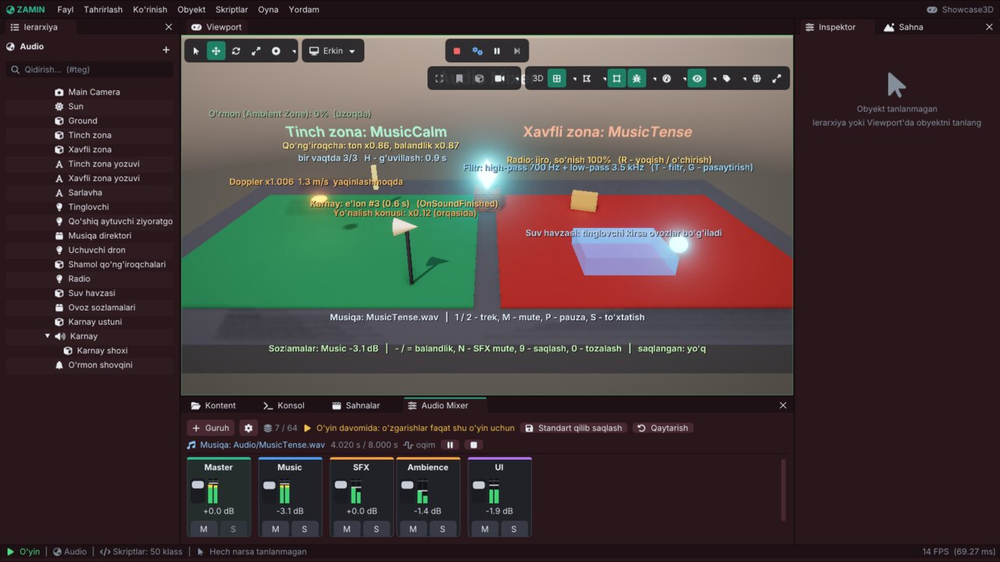

# Zamin Engine: audio

This guide explains Zamin's sound system: Audio Source and one-shot sounds, 3D sound and the listener,
mixer groups, music and crossfade, fades, filters, the voice limit and random variation, Doppler and the direction
cone, ambient zones, footsteps, sound-finished events, the import settings of audio files, saving the player's sound
settings and the audio profiler — in the editor and in C++ scripts.

The full fields of the components: [Components.md](Components.md#9-audio). The project's audio defaults (the mixer, the stream
threshold, the voice limit, the 3D distance model): [ProjectSettings.md](ProjectSettings.md#9-audio-standartlari). The examples use
`#include <Zamin/Zamin.h>` and `using namespace Zamin;`.



*Showcase3D `Scenes/Audio.zscene` in the editor (Play): the music zones, Doppler, the radio filter, the loudspeaker cone; below, the **Audio Mixer** —
the groups, the level meters, the current music.*

Contents:

1. [Basic concepts](#1-basic-concepts)
2. [Quick start](#2-quick-start)
3. [The Audio Source component](#3-the-audio-source-component)
4. [One-shot sounds and SoundParams](#4-one-shot-sounds-and-soundparams)
5. [3D sound, the listener, Doppler, the direction cone](#5-3d-sound-the-listener-doppler-the-direction-cone)
6. [Mixer groups and the Audio Mixer window](#6-mixer-groups-and-the-audio-mixer-window)
7. [Music](#7-music)
8. [Fades](#8-fades)
9. [Low-pass / high-pass filters](#9-low-pass--high-pass-filters)
10. [The voice limit and random variation](#10-the-voice-limit-and-random-variation)
11. [Ambient zones](#11-ambient-zones)
12. [Footsteps](#12-footsteps)
13. [A sound finishing: OnSoundFinished](#13-a-sound-finishing-onsoundfinished)
14. [Audio files and import settings](#14-audio-files-and-import-settings)
15. [The player's sound settings](#15-the-players-sound-settings)
16. [The profiler and views](#16-the-profiler-and-views)
17. [Sample scenes](#17-sample-scenes)
18. [Common problems](#18-common-problems)
19. [Tests](#19-tests)
20. [A short API reference](#20-a-short-api-reference)

---

## 1. Basic concepts

- **The engine** — miniaudio (`AudioEngine`, `Zamin/Audio/AudioEngine.h`); a simpler entry for scripts — the `Audio`
  class (`Zamin/Audio/Audio.h`) and the `PlaySound` / `PlayAudio` ... functions of `ScriptableEntity`.
- **Formats**: WAV, MP3, FLAC. `.ogg` files show up as audio assets, but there is no OGG Vorbis decoder:
  the asset inspector and the waveform view say `no OGG Vorbis decoder (use WAV, MP3 or FLAC)`, and when one is played
  the console says (once until the file changes) that `the audio file could not be read - it must be WAV, MP3 or FLAC
  (miniaudio: <reason>)`.
- **Paths** — relative to the project's `Assets` folder: `"Audio/Chime.wav"`.
- **Handle** — the number of every played sound (`uint32_t`, 0 — not played). `PlaySound` returns it; with it the
  sound can be stopped, faded out, its volume changed (`AudioEngine::Stop`, `SetVolume` ...).
- **Mixer group** — every sound plays in some group (Master > Music, SFX, UI and the project's own groups).
- **2D / 3D sound** — a plain sound is heard the same everywhere; the volume and the left / right side of a **3D (spatial)**
  sound depend on where it is relative to the listener.
- **When it works** — Audio Sources play during Play (and in the player); in edit mode a file can be listened to in the
  asset inspector ([section 14](#14-audio-files-and-import-settings)). Audio is updated last in the frame (once the transforms are ready).
- **Without a device** (headless, CI): `No audio device found - sound is off` — the game keeps running, the sounds
  do not play (the Audio Mixer window says "No audio device - setup only").
- **An inactive entity** — its sound stops; when it is turned on again, a source with **Play on start** plays from the start.
- **When the window loses the focus** (the player): the output pauses — every sound and the music stay
  where they are ([ProjectSettings.md](ProjectSettings.md#oyna), *Pause in the background*). `PauseGame()` does not stop sounds by itself (the pause menu needs its UI sounds) —
  filter the music or `PauseAudio` when needed ([section 9](#9-low-pass--high-pass-filters)).

---

## 2. Quick start

1. Drop a sound file (`.wav`) into the content browser or straight onto the editor window (it is copied to
   `Assets/Audio/`).
2. Drag the file onto the viewport — an entity with an **Audio Source** is created. Or *Object > Audio source*, then drop the file onto
   the **Audio file** field in the inspector.
3. For background music or a hum, turn on **Loop** and **Play on start**; for a sound heard from a particular place,
   **3D sound (spatial)** and **Min / Max distance**.
4. ▶ — the sound plays. During play the inspector shows the live state (playing / paused, the time bar, the audibility in dB).

A one-shot sound from a script — one line:

```cpp
void OnTriggerBegin(Entity other) override
{
    if (other.HasTag("Player"))
        PlaySound("Audio/Chime.wav");                       // in the SFX group
}
```

---

## 3. The Audio Source component

`AudioSourceComponent` — the entity's own sound (**Audio Source** in the inspector):

| Field (inspector) | Meaning |
|---|---|
| `Path` (**Audio file**) | the file, relative to `Assets` |
| `Volume` (**Volume**), `Pitch` (**Pitch**) | 0 ... 2 (1 — unchanged); pitch 2 — an octave higher |
| `Loop` (**Loop**), `PlayOnStart` (**Play on start**) | whether it loops, whether it plays at the start of the game (or when the entity is turned on) |
| `Spatial` (**3D sound (spatial)**), `MinDistance`, `MaxDistance` | [section 5](#5-3d-sound-the-listener-doppler-the-direction-cone); a new source gets the project's default distances |
| `Output` (**Output group**) | the mixer group; an unknown name — SFX (with a warning) |
| `Stream` (**Streaming**) | reading as a stream from disk (long music, backgrounds); files larger than the project threshold (4 MB) stream anyway |
| `VolumeRandom`, `PitchRandom` (**Volume / Pitch range**) | a random multiplier on every play, [section 10](#10-the-voice-limit-and-random-variation) |
| `Priority`, `MaxInstances`, `Steal` (**Priority**, **At once (this file)**, **When the limit is reached**) | the voice limit |
| `DopplerFactor` (**Doppler**) | the effect of a moving 3D sound on its pitch (0 — off) |
| `FadeIn`, `FadeOut` (**Fade in / Fade out**) | fades, seconds, [section 8](#8-fades) |
| `Filter` (**Low-pass**, **High-pass**) | [section 9](#9-low-pass--high-pass-filters) |
| `Cone` (**Direction cone**: inner / outer angle, behind) | [section 5](#5-3d-sound-the-listener-doppler-the-direction-cone) |

During play every change in the inspector is heard at once; there are **Again / Pause / Stop** buttons and a time bar
(click — to that place).

**Control from a script** (this entity's source; almost all of them have an `(Entity other, ...)` variant):

| Function | What it does |
|---|---|
| `PlayAudio()` / `PlayAudio(fadeIn)` | plays from the start (with a new random variation); `false` when the entity is inactive or the limit refuses |
| `StopAudio()` / `StopAudio(fadeOut)` | stops (fading with the source's `FadeOut` or the given time) |
| `PauseAudio()`, `ResumeAudio()`, `IsAudioPaused()` | pausing in place / resuming |
| `IsAudioPlaying()` | whether it is heard now (`false` while paused) |
| `SetAudioVolume(v)` / `GetAudioVolume()`, `SetAudioPitch(p)` / `GetAudioPitch()` | the source and the sound playing now |
| `GetAudioTime()` / `SetAudioTime(s)`, `GetAudioLength()` | the current time, seeking, the length (seconds) |
| `FadeAudio(volume, seconds)`, `GetAudioFade()` | changing the fade level (ducking) |
| `SetAudioLowPass(hz)`, `SetAudioHighPass(hz)` | a filter (0 — off) |

```cpp
// Showcase3D RadioToggle: R - turn on / off (with the source's FadeIn / FadeOut), T - the "radio" filter,
// G - duck.
void OnUpdate(Timestep) override
{
    if (Input::IsKeyJustPressed(Key::R))
    {
        if (IsAudioPlaying())
            StopAudio();          // fades out by itself
        else
            PlayAudio();
    }
    if (Input::IsKeyJustPressed(Key::T))
    {
        m_Filtered = !m_Filtered;
        SetAudioHighPass(m_Filtered ? 700.0f : 0.0f);
        SetAudioLowPass(m_Filtered ? 3500.0f : 0.0f);
    }
    if (Input::IsKeyJustPressed(Key::G) && IsAudioPlaying())
    {
        m_Ducked = !m_Ducked;
        FadeAudio(m_Ducked ? 0.3f : 1.0f, 0.6f);
    }
}
```

---

## 4. One-shot sounds and SoundParams

Short sounds not tied to an entity (a hit, a coin, a button) need no component:

```cpp
PlaySound("Audio/UiPing.wav", 0.6f, 1.0f, "UI");               // volume, pitch, mixer group
PlaySoundAt("Audio/DoorThud.wav", GetWorldPosition());         // 3D, with the project's default distances
uint32_t h = PlaySound("Audio/DroneBuzz.wav", params);         // with every option
Audio::StopSound(h, 0.5f);                                     // fades out and stops in 0.5 s
```

From a place without a script too: `Audio::PlaySound(...)`, `Audio::PlaySoundAt(...)`. When a sound a script played finishes, that script
gets `OnSoundFinished` ([section 13](#13-a-sound-finishing-onsoundfinished)).

**`SoundParams`** (`Zamin/Audio/AudioEngine.h`):

| Field | Default | Meaning |
|---|---|---|
| `Volume`, `Pitch`, `Loop` | 1, 1, false | |
| `Group` | `"SFX"` | the mixer group |
| `Stream` | false | a stream from disk |
| `Spatial`, `Position` | false, (0,0,0) | a 3D sound and its place |
| `MinDistance`, `MaxDistance` | -1 | negative — the project default |
| `VolumeRandom`, `PitchRandom` | (1, 1) | a multiplier from the [x, y] range on every play |
| `Priority`, `MaxInstances`, `Steal` | 128, 0, `Oldest` | the voice limit |
| `DopplerFactor`, `Velocity` | 1, (0,0,0) | Doppler |
| `Direction`, `Cone` | (0,0,-1), off | the direction cone |
| `FadeIn` | 0 | rises from silence over that many seconds |
| `Filter` | off | this sound's own filter |

The Adventure3D gate (`ProximityDoor`, `Projects/Adventure3D/Source/World.cpp`) plays its creak a little differently every
time:

```cpp
SoundParams p;
p.Volume = volume;
p.PitchRandom = pitch;            // for example { 0.9f, 1.1f }
p.Spatial = true;
p.Position = GetWorldPosition() + glm::vec3(0.0f, 1.8f, 0.0f);
PlaySound(path, p);
```

**Working with a handle** (`AudioEngine`): `IsPlaying(h)`, `IsPaused(h)`, `Pause(h)` / `Resume(h)`, `Stop(h)` /
`Stop(h, fadeSeconds)`, `FadeTo(h, volume, seconds)`, `SetVolume(h, v)`, `SetPitch(h, p)`, `Seek(h, s)`, `GetCursor(h)`,
`GetLength(h)`, `SetSoundPosition(h, p)` (a moving 3D sound), `SetLoopRegion(h, start, end)`,
`GetSoundInfo(h, info)` (`SoundInfo`: the state, group, time, audibility, random variation, Doppler, cone).

---

## 5. 3D sound, the listener, Doppler, the direction cone

**Distance.** A 3D sound is at full volume closer than `MinDistance` and falls off up to `MaxDistance` by the project's distance
model: `Inverse` (natural, the default), `Linear` (silent at the max distance), `Exponential`, `None` — the formulas and the
factor: [ProjectSettings.md](ProjectSettings.md#3d-ovoz-standartlari). In code: `Audio::GetSpatialDefaults()`
(`AudioSpatialSettings::ComputeGain(distance)`).

**The listener.** 3D sounds are heard from where the **Audio Listener** component (`AudioListenerComponent`) is — for example
the hero's head in a third-person game, not the camera. With several of them: the enabled one (`Enabled`), active in the hierarchy, with the
largest `Priority` (on a tie — the one created first). Without a listener — the main camera. The current
listener: `GetScene().GetAudioListenerEntity()`.

**Doppler.** The velocity of a moving 3D sound is measured from its motion (teleports are not counted);
the listener's comes from the Audio Listener's **Track velocity** (`TrackVelocity`). The pitch = the source's `DopplerFactor` x
the project's factor (*Audio Mixer > Settings*, `AudioSettings::DopplerFactor`); it changes smoothly and stays within 0.5 ... 2.
The Showcase3D `DopplerFlyby` script writes `info.DopplerPitch` above the drone flying past
(`GetScene().GetAudioInfo(GetEntity(), info)`).

**The direction cone** (`AudioConeSettings`: `Enabled`, `InnerAngle`, `OuterAngle`, `OuterGain`): the sound is full toward the
entity's front (-Z), falls off outside the inner cone, and beyond the outer cone stays at the `OuterGain` volume — a loudspeaker,
a TV, a person talking. When the entity turns, the sound turns too. The cone of the selected source is drawn in the viewport, and during play
the inspector shows the cone multiplier. In code: `SoundParams::Cone` / `Direction`, `AudioEngine::SetSoundCone`,
`SetSoundDirection`, `AudioEngine::ComputeConeGain`.

**Gizmo**: *Gizmos > Audio radius* — the Min and Max distance spheres of 3D sources.

---

## 6. Mixer groups and the Audio Mixer window

Every sound goes through a group (bus); a group mixes its own sounds and child groups, multiplies them by its fader and passes them to its parent
group. The root is **Master**. The main groups: `Master`, `Music`, `SFX`, `UI` (`AudioSettings::Master` ...,
they cannot be deleted); a project adds its own (for example `Ambience` → inside `SFX`: when SFX goes down, it goes down too).

**Window > Audio Mixer**: a channel strip for every group — a fader (dB, up to +6 dB), **mute**, **solo** (only this group and
its children are heard; not saved), a filter button (a label like `LP 450`), a post-fader level meter (stereo, with peak
hold). Right-click — add / delete a group / change its parent group. At the top — the music playing now
(pause, stop), **Settings** — the voice limit, the streaming threshold, the Doppler factor.

- In **edit mode** the changes are the project default (`"Audio"` in the `.zproject`), **during play** — for this run
  only ("While playing: changes are for this run only"); **Save as default** writes them to the project.
  The editor returns the mixer to the project default when the game stops.
- The same settings are in *Project settings > Audio* too.

From a script (the `Audio` class; an unknown group — `false`):

```cpp
Audio::SetGroupVolume("SFX", 0.5f);              // linear: 0 - silent, 1 - unchanged, 2 - +6 dB
float v = Audio::GetGroupVolume("Music");
Audio::SetGroupMuted("Music", !Audio::IsGroupMuted("Music"));
if (Audio::HasGroup("Ambience")) { /* ... */ }
Audio::ResetMixer();                             // to the state the project set

// In dB (Showcase3D AudioOptions): lowering Music by 3 dB
float db = AudioGain::ToDecibels(Audio::GetGroupVolume("Music")) - 3.0f;
Audio::SetGroupVolume("Music", db <= AudioGain::MinDecibels ? 0.0f : AudioGain::FromDecibels(db));
```

The lower level: `AudioEngine::SetGroupSolo`, `GetGroupEffectiveVolume` (with the parent groups), `GetGroupLevel` (the meter),
`GetMixerSettings()` / `SetMixerSettings(...)` (`AudioSettings`: `Groups`, `StreamThresholdMB`, `MaxVoices`,
`DopplerFactor`, `Spatial`).

---

## 7. Music

Music is in the **Music** group, always streamed from disk, one track at a time. It belongs to the game, not to the scene:
it goes on after `LoadScene` too (the editor stops it when Play stops).

| Function | What it does |
|---|---|
| `Audio::PlayMusic(path, fadeSeconds = 0.5, loop = true)` | fades the track in; when another track is playing it fades out first; when this track is playing it goes on |
| `Audio::CrossfadeTo(path, seconds = 2, loop = true)` | the new one comes in while the old one fades out (an equal-power crossfade) |
| `Audio::StopMusic(fadeSeconds = 0.5)` | fades out and stops |
| `Audio::PauseMusic()`, `ResumeMusic()`, `IsMusicPaused()`, `IsMusicPlaying()` | |
| `Audio::GetMusic()` | the current track path (`""` — none) |
| `Audio::SetMusicVolume(v)` / `GetMusicVolume()` | the music's own volume, on top of the Music fader (lowering it during dialogue) |

Showcase3D `MusicDirector` — the track of whichever zone the listener is in (shortened):

```cpp
class MusicDirector : public ScriptableEntity
{
public:
    std::string CalmTrack = "Audio/MusicCalm.wav";
    std::string TenseTrack = "Audio/MusicTense.wav";
    float Crossfade = 2.0f;
    float Border = 0.0f;

    void OnStart() override { Audio::PlayMusic(CalmTrack, 1.0f); }

    void OnUpdate(Timestep) override
    {
        Entity listener = GetScene().GetAudioListenerEntity();
        if (!listener)
            return;
        const float x = GetScene().GetWorldPosition(listener).x;
        const int zone = x < Border - 0.5f ? 0 : x > Border + 0.5f ? 1 : m_Zone;   // a small dead zone at the border
        if (zone != m_Zone)
        {
            m_Zone = zone;
            Audio::CrossfadeTo(zone == 0 ? CalmTrack : TenseTrack, Crossfade);
        }
        if (Input::IsKeyJustPressed(Key::P))
            Audio::IsMusicPaused() ? Audio::ResumeMusic() : Audio::PauseMusic();
    }

private:
    int m_Zone = 0;
};
ZM_REGISTER_SCRIPT(MusicDirector, ZM_FIELD(MusicDirector, CalmTrack), ZM_FIELD(MusicDirector, TenseTrack),
                   ZM_FIELD(MusicDirector, Crossfade), ZM_FIELD(MusicDirector, Border))
```

For looping music with "an intro + a repeating part" — the loop region in the file's import settings
([section 14](#14-audio-files-and-import-settings)).

---

## 8. Fades

- The Audio Source's **Fade in** / **Fade out** (seconds): every play starts slowly from silence, and when it is stopped
  (`StopAudio`, the entity turned off or destroyed) it is not cut off abruptly. A stopped source is free at once
  (`IsAudioPlaying()` false, `PlayAudio` starts anew), while the sound itself fades out; when the limit is reached, the ones fading out
  give way first.
- With your own time in a script: `PlayAudio(1.5f)`, `StopAudio(2.0f)`.
- **Ducking**: `FadeAudio(0.3f, 0.5f)` — the playing sound goes to 30% in 0.5 s (during dialogue), `GetAudioFade()`
  — the current level; shown live in the inspector.
- One-shot sounds: `SoundParams::FadeIn`, `AudioEngine::Stop(handle, seconds)`, `AudioEngine::FadeTo(handle, volume,
  seconds)`, `Audio::StopSound(handle, seconds)`.

---

## 9. Low-pass / high-pass filters

`AudioFilterSettings`: `LowPass` + `LowPassCutoff` (Hz — what is above it is muffled: behind a wall, under water, far away) and
`HighPass` + `HighPassCutoff` (cuts what is below it: a radio, a phone, a small speaker), each 12 dB / octave; when the cutoff
frequency changes it glides smoothly over ~30 ms (no clicks). In two places:

- **Audio Source** (and `SoundParams::Filter`) — only for this sound: `SetAudioLowPass(600.0f)`, `SetAudioHighPass(...)`
  (0 — off);
- **a mixer group** — for all the sounds and child groups of the group: `Audio::SetGroupLowPass("SFX", 500.0f)`,
  `SetGroupHighPass`, `SetGroupFilter` / `GetGroupFilter`; the filter button on the Audio Mixer strip. A group filter is saved
  with the project mixer to the `.zproject`.

Under water everything is muffled (Showcase3D `UnderwaterZone`):

```cpp
void Apply(bool underwater)
{
    Audio::SetGroupLowPass("SFX", underwater ? 450.0f : 0.0f);     // Ambience (a child of SFX) too
    Audio::SetGroupLowPass("Music", underwater ? 800.0f : 0.0f);
}
// The mixer belongs to the game: the filter must not stay on when the scene ends.
void OnDestroy() override { if (m_Inside) Apply(false); }
```

The pause menu muffles the music and gives the old filter back when it closes (Platformer2D `PauseMenu`):

```cpp
m_MusicFilter = Audio::GetGroupFilter("Music");   // when it opens
Audio::SetGroupLowPass("Music", MusicMuffle);
// ...
Audio::SetGroupFilter("Music", m_MusicFilter);    // when it closes
```

---

## 10. The voice limit and random variation

**The voice limit** — the sounds that play at the same time per project (`AudioSettings::MaxVoices`, 64 by default; the music
does not count; *Audio Mixer > Settings*). When the limit is reached, a new sound takes the place of a sound with a lower `Priority` (0 ... 255); between
equals the source's **When the limit is reached** rule decides (`AudioStealPolicy`):

| Rule | What happens |
|---|---|
| `Oldest` (**Oldest stops**) | the one that started first stops |
| `Quietest` (**Quietest stops**) | the one heard quietest right now (volume x group x distance) |
| `None` (**New one is not played**) | none stops, the new one does not play |

`MaxInstances` — the simultaneous copies of **one file** (for example even when 20 enemies roar, 3 are heard). When the limit
is full the console says: `The voice limit (64) is full: new sounds are not played (Audio Mixer > Settings)`.

**Random variation** — `VolumeRandom` / `PitchRandom` (x = min, y = max): a new multiplier on every play, so a sound played
again and again (a step, a hit) does not sound the same. `AudioEngine::SetRandomSeed(seed)` — repeatable (tests).
Showcase3D `ChimeRinger`:

```cpp
SoundParams chime;
chime.Spatial = true;
chime.Position = GetWorldPosition();
chime.MinDistance = 1.5f;
chime.MaxDistance = 12.0f;
chime.PitchRandom = { 0.75f, 1.35f };
chime.VolumeRandom = { 0.55f, 1.0f };
chime.MaxInstances = 3;                        // up to 3 at the same time
chime.Steal = AudioStealPolicy::Quietest;      // the fourth takes the place of the quietest
chime.Priority = 100;
if (uint32_t handle = PlaySound("Audio/Chime.wav", chime))
    m_Handles.push_back(handle);
```

---

## 11. Ambient zones

**Ambient Zone** (`AmbientZoneComponent`) — a looping background sound heard inside a volume: a forest, a cave, rain,
a crowd.

| Field | Meaning |
|---|---|
| `Path`, `Volume`, `Pitch`, `Output`, `Stream`, `Priority` | the sound (it always loops) |
| `Shape`: `Box` (`Size` — the full size) / `Sphere` (`Radius`) | the volume, with the entity's scale and rotation |
| `BlendDistance` | it fades slowly over this distance outside the edge |
| `FadeTime` | the fastest change of the level (a teleport, a zone being turned on are smooth) |

When the listener is inside, the sound is full and without a position (all around), and outside it fades over the blend distance. The sound
starts when it becomes audible and stops when it goes silent — distant zones do not take up the voice limit. Several zones are heard
together. In the viewport the volume and the blend boundary, in the inspector the live level. From a script:
`GetScene().GetAmbientZoneLevel(entity)` (0 ... 1, what is heard now), the component's `Target`, `Level`, `Distance`
fields, `Scene::GetAmbientZoneWeight(zone, world, point)` (for any point).

---

## 12. Footsteps

**Footsteps** (`FootstepsComponent`) listens to an animation event (`EventName`, `Footstep` by default) and plays a random one from the
`Sounds` list (no immediate repeats): by the Animator's speed parameter (`SpeedParameter`) it is louder and higher pitched
when walking faster (`ReferenceSpeed`, `SpeedVolume`, `SpeedPitch`), silent below `MinSpeed`, and steps closer than
`MinInterval` count as one; 3D, with a mixer group. More: [Animation.md](Animation.md#9-events).
Sample: the Adventure3D robot (`Audio/Step1.wav` ... `Step4.wav`).

---

## 13. A sound finishing: OnSoundFinished

When an entity's sound finishes **by itself** (a non-looping Audio Source, or a `PlaySound` / `PlaySoundAt` sound of this
script), the script gets `OnSoundFinished(const SoundFinished&)` — on the main thread, safely:

| `SoundFinished` field | Meaning |
|---|---|
| `Handle`, `Clip` | the sound handle, the file path |
| `Source` | which entity the sound belongs to |
| `FromAudioSource` | an Audio Source's (`false` — the script's `PlaySound`) |
| `Stolen` | it did not play to the end: the voice limit stopped it for another one |

Other scripts hear it on the event bus with `Subscribe("SoundFinished", ...)`. In the engine:
`AudioEngine::TakeFinishedSounds()`. Showcase3D `PaAnnouncer` — after a loudspeaker announcement finishes, a break and then the next one
(simplified):

```cpp
void OnSoundFinished(const SoundFinished& sound) override
{
    if (!sound.Stolen)
        m_Count++;
    Invoke(Pause, [this]() { PlayAudio(); });   // again after Pause seconds
}
```

---

## 14. Audio files and import settings

When an audio file is selected in the content browser, the **asset inspector** opens:

- **The waveform**: the wheel — zoom (around the mouse), Shift + wheel / the middle button — pan, below it a bar of the
  whole sound, a time ruler; click / drag to **scrub** (play from that place), a playback cursor; **the loop region** —
  marked with Shift + drag, its edges can be dragged, a right-click menu. Play / stop, loop, volume.
- Information: the format, duration, channels, sample rate, bitrate, how the file is read (stream or memory) and how much memory
  the decoded sound takes; **Used by**.
- **Import settings** (`"Import"` in the `.zmeta`, `AudioClipSettings`), saved with **Apply** and applied at once:

| Key | Meaning |
|---|---|
| `LoadMode`: `Auto` / `Decompress` / `Stream` (`AudioLoadMode`) | automatic (by size) / always decode into memory (short, frequently played) / always stream from disk (long music) |
| `Preload` | decoded when the scene starts (or on the first play) and kept in memory — the first play does not wait |
| `Volume` | the file's own volume (balancing a file recorded too loud) |
| `LoopStart`, `LoopEnd` | the loop region: a looping sound plays from the start to `LoopEnd`, then again and again from `LoopStart` (intro + loop) |

```json
"Import": { "LoadMode": "Stream", "Preload": false, "Volume": 1.0, "LoopStart": 1.5, "LoopEnd": 9.0 }
```

From a script: `Audio::GetClipLength("Audio/MusicCalm.wav")` (seconds), `Audio::GetClipInfo(path)` (`AudioFileInfo`),
`Audio::Preload(path)` / `Unload(path)` / `IsPreloaded(path)`. When the file changes, a preloaded one is decoded again.
An exported game loads with these settings too.

---

## 15. The player's sound settings

For the sound sliders in a game menu: `Audio::SaveSettings()` writes the fader / mute state of the mixer groups and the music
volume to **SaveData** (the key `Audio::SettingsKey` = `"Zamin.Audio"`) — separately from the project default. When the game
starts (in the player and with Play in the editor) they are loaded automatically. `Audio::LoadSettings()`, `HasSavedSettings()`,
`ClearSavedSettings()` (back to the project mixer).

The Platformer2D pause menu (`Projects/Platformer2D/Source/PauseMenu.cpp`, shortened) — the sliders are connected to the groups:

```cpp
Subscribe("UISliderChanged", [this](const ScriptMessage& m) {
    if (const char* group = GroupOf(m.Sender))          // a Music / SFX / UI slider
    {
        Audio::SetGroupVolume(group, m.Get<float>());
        m_Changed = true;
    }
});
// When the menu opens the sliders show the current values:
GetScene().SetSliderValue(slider, Audio::GetGroupVolume(group), false);
// When it closes:
if (m_Changed)
    Audio::SaveSettings();
```

About UI sliders: [UI.md](UI.md).

---

## 16. The profiler and views

- **The Statistics window** (*Window > Statistics*), the **Audio** section: active voices / the limit (colored by how full it is), a graph of
  the last 240 frames (with the limit line), the peak, the kinds of sounds (playing / paused / fading, 3D, streamed, filtered, music,
  preloaded files) and a table **by mixer group** (on its own / with the child groups, stopped / not played because of the
  limit, the level). The counters are reset when Play starts.
- The **Audio** section in the viewport's **statistics overlay** (right-click).
- API: `AudioEngine::GetProfile()` (`AudioProfile`, `Format()`), `ResetProfileCounters()`, `GetVoiceHistory()`,
  `GetVoiceStats()`.
- Player: `ZAMIN_PLAYER_STATS=1` on exit, and **F10** at any time writes the audio profile to the log.
- Editor automation: `ZAMIN_EDITOR_AUDIO_MIXER=1` — the Audio Mixer window opens (for screenshots,
  [Editor.md](Editor.md#15-automation-screenshots-ci)).

---

## 17. Sample scenes

Showcase3D `Scenes/Audio.zscene` — the whole system in one place (`Projects/Showcase3D/Source/Showcase.cpp`):

| Place | What | Script / keys |
|---|---|---|
| The calm (green) and dangerous (red) zones | music crossfade, Music mute / pause / stop, a signal in the UI group | `MusicDirector`: 1 / 2, M, P, S |
| The shrine | the hum in the Ambience group | `ChimeRinger`: H — pause |
| The flying drone | Doppler x2 | `DopplerFlyby` |
| The wind chimes | random pitch / volume, 3 at the same time | `ChimeRinger` |
| The radio | FadeIn / FadeOut, high-pass + low-pass | `RadioToggle`: R, T, G |
| The pool | the low-pass of the SFX and Music groups | `UnderwaterZone` |
| The loudspeaker on the pole | the direction cone, `OnSoundFinished` | `PaAnnouncer` |
| The forest | Ambient Zone | `AmbientZoneLabel` |
| Settings | the Music volume, SFX mute, saving | `AudioOptions`: - / =, N, 9, 0 |

Others: Adventure3D (`Footsteps`, the gate creak — `ProximityDoor`), Platformer2D (the sound sliders of `PauseMenu` and `GameMenu`,
`Audio/SessionTheme.wav`).

---

## 18. Common problems

| Symptom | Cause and solution |
|---|---|
| Nothing is heard, the console says `No audio device found - sound is off` | The system has no audio device (a server, CI) — expected |
| A file does not play, a red marker in the content browser | The file could not be read: `.ogg` — no decoder, use WAV / MP3 / FLAC; otherwise the reason is in the asset inspector (**Retry**) |
| `Unknown audio group 'X' - the sound plays in the SFX group` | The `Output` or `PlaySound` group is not in the mixer — add it in the Audio Mixer or fix the name |
| `The voice limit (...) is full ...` | Too many sounds at the same time: set `MaxInstances`, `Priority`, the limit |
| A 3D sound is very quiet / not heard at all | The listener is far away (`MaxDistance`; with the `Linear` distance model it is silent at the max distance), there is no listener and no main camera either, or another Audio Listener has a higher priority |
| The music does not stop when the scene changes | That is how it should be — the music belongs to the game; `Audio::StopMusic()` |
| The game sounds go on in the pause menu | `PauseGame()` does not stop sounds — `PauseAudio` or a group filter / mute |
| A long file is late on its first play | The `Preload` or `Stream` load mode |
| The saved settings do not work: `The saved audio settings could not be read (...)` | The SaveData entry is broken — `Audio::ClearSavedSettings()` |

---

## 19. Tests

The audio tests run without a device (`AudioEngine::Init(true)`, `RenderOffline`):

```bash
./build/bin/ZaminTests "Audio*:Footsteps*:InactiveAudioSourcesStop:PauseInBackgroundAudioOutput"
```

The main ones: `AudioMixerGroupMath`, `AudioMixerGroupsDeviceless`, `AudioMusicCrossfade`, `AudioListenerSelection`,
`AudioRandomVariation`, `AudioVoiceLimit`, `AudioSourceScriptControl`, `AudioDoppler`, `AudioFilterMath`,
`AudioFiltersDeviceless`, `AudioFades`, `AudioClipImportSettings`, `AudioPlayerSettingsSaveLoad`, `AudioProfiler`,
`AudioWaveformViewAndLoopRegion`, `AudioDirectionalCone`, `AudioAmbientZones`, `AudioOnSoundFinished`,
`AudioSpatialDefaults`, `AudioSampleScene`, `FootstepsFromAnimationEvents`. The catalogue: [Testing.md](Testing.md).

---

## 20. A short API reference

| What | API |
|---|---|
| Components | `AudioSourceComponent`, `AudioListenerComponent` (`Enabled`, `Priority`, `TrackVelocity`), `AmbientZoneComponent`, `FootstepsComponent` |
| One-shot (script) | `PlaySound(path, volume, pitch, group)`, `PlaySound(path, SoundParams)`, `PlaySoundAt(path, position, ...)` → handle |
| Audio Source (script) | `PlayAudio`, `StopAudio`, `PauseAudio`, `ResumeAudio`, `IsAudioPlaying`, `IsAudioPaused`, `SetAudioVolume`, `GetAudioVolume`, `SetAudioPitch`, `GetAudioPitch`, `GetAudioTime`, `SetAudioTime`, `GetAudioLength`, `FadeAudio`, `GetAudioFade`, `SetAudioLowPass`, `SetAudioHighPass` |
| Callback | `OnSoundFinished(const SoundFinished&)`; the event bus `"SoundFinished"` |
| Music | `Audio::PlayMusic`, `CrossfadeTo`, `StopMusic`, `PauseMusic`, `ResumeMusic`, `IsMusicPaused`, `IsMusicPlaying`, `GetMusic`, `SetMusicVolume`, `GetMusicVolume` |
| Mixer | `Audio::SetGroupVolume`, `GetGroupVolume`, `SetGroupMuted`, `IsGroupMuted`, `HasGroup`, `ResetMixer`, `SetGroupLowPass`, `SetGroupHighPass`, `SetGroupFilter`, `GetGroupFilter`; `AudioGain::ToDecibels` / `FromDecibels` |
| Files | `Audio::GetClipLength`, `GetClipInfo`, `Preload`, `Unload`, `IsPreloaded`; `AudioClipSettings`, `AudioLoadMode` |
| The player's settings | `Audio::SaveSettings`, `LoadSettings`, `HasSavedSettings`, `ClearSavedSettings`, `Audio::SettingsKey` |
| 3D | `Audio::GetSpatialDefaults()` (`AudioSpatialSettings`, `AudioRolloff`), `AudioConeSettings`, `Scene::GetAudioListenerEntity`, `Scene::GetAudioInfo` |
| Handle (engine) | `AudioEngine::IsPlaying`, `Stop`, `FadeTo`, `Pause`, `Resume`, `SetVolume`, `SetPitch`, `Seek`, `GetCursor`, `GetLength`, `SetSoundPosition`, `SetSoundCone`, `SetSoundDirection`, `SetLoopRegion`, `GetSoundInfo`, `WasStolen`, `TakeFinishedSounds`; `Audio::StopSound(handle, fade)` |
| Limit and variation | `SoundParams::Priority`, `MaxInstances`, `Steal` (`AudioStealPolicy`), `VolumeRandom`, `PitchRandom`; `AudioEngine::SetRandomSeed` |
| Ambient | `Scene::GetAmbientZoneLevel(entity)`, `Scene::GetAmbientZoneWeight(zone, world, point)` |
| Profiler | `AudioEngine::GetProfile()`, `ResetProfileCounters()`, `GetVoiceHistory()`, `GetVoiceStats()` |
