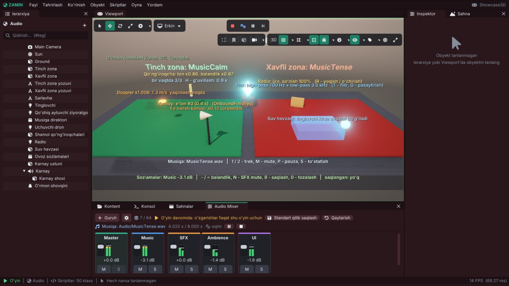

# Zamin Engine: audio

Bu qo'llanma Zamin'ning ovoz tizimini tushuntiradi: Audio Source va bir martalik ovozlar, 3D ovoz va tinglovchi,
mixer guruhlari, musiqa va crossfade, so'nish, filtrlar, ovozlar limiti va tasodifiy variatsiya, Doppler va yo'nalish
konusi, ambient zonalar, qadam tovushlari, ovoz tugashi hodisalari, audio fayllarning import sozlamalari, o'yinchi ovoz
sozlamalarini saqlash va audio profiler — editorda va C++ skriptda.

Komponentlarning to'liq maydonlari: [Components.md](Components.md#9-audio). Loyihaning audio standartlari (mixer, oqim
chegarasi, ovozlar limiti, 3D masofa modeli): [ProjectSettings.md](ProjectSettings.md#9-audio-standartlari). Misollar
`#include <Zamin/Zamin.h>` va `using namespace Zamin;` bilan.



*Showcase3D `Scenes/Audio.zscene` editorda (Play): musiqa zonalari, Doppler, radio filtri, karnay konusi; pastda **Audio Mixer** —
guruhlar, daraja o'lchagichlari, hozirgi musiqa.*

Mundarija:

1. [Asosiy tushunchalar](#1-asosiy-tushunchalar)
2. [Tez boshlash](#2-tez-boshlash)
3. [Audio Source komponenti](#3-audio-source-komponenti)
4. [Bir martalik ovozlar va SoundParams](#4-bir-martalik-ovozlar-va-soundparams)
5. [3D ovoz, tinglovchi, Doppler, yo'nalish konusi](#5-3d-ovoz-tinglovchi-doppler-yonalish-konusi)
6. [Mixer guruhlari va Audio Mixer oynasi](#6-mixer-guruhlari-va-audio-mixer-oynasi)
7. [Musiqa](#7-musiqa)
8. [So'nish (fade)](#8-sonish-fade)
9. [Low-pass / high-pass filtrlar](#9-low-pass--high-pass-filtrlar)
10. [Ovozlar limiti va tasodifiy variatsiya](#10-ovozlar-limiti-va-tasodifiy-variatsiya)
11. [Ambient zonalar](#11-ambient-zonalar)
12. [Qadam tovushlari](#12-qadam-tovushlari)
13. [Ovoz tugashi: OnSoundFinished](#13-ovoz-tugashi-onsoundfinished)
14. [Audio fayllar va import sozlamalari](#14-audio-fayllar-va-import-sozlamalari)
15. [O'yinchi ovoz sozlamalari](#15-oyinchi-ovoz-sozlamalari)
16. [Profiler va ko'rinishlar](#16-profiler-va-korinishlar)
17. [Namuna sahnalar](#17-namuna-sahnalar)
18. [Ko'p uchraydigan muammolar](#18-kop-uchraydigan-muammolar)
19. [Testlar](#19-testlar)
20. [Qisqa API ma'lumotnomasi](#20-qisqa-api-malumotnomasi)

---

## 1. Asosiy tushunchalar

- **Dvigatel** — miniaudio (`AudioEngine`, `Zamin/Audio/AudioEngine.h`); skriptlar uchun soddaroq kirish — `Audio`
  klassi (`Zamin/Audio/Audio.h`) va `ScriptableEntity` ning `PlaySound` / `PlayAudio` ... funksiyalari.
- **Formatlar**: WAV, MP3, FLAC. `.ogg` fayllar audio asset sifatida ko'rinadi, lekin OGG Vorbis dekoderi yo'q —
  konsolda `OGG Vorbis dekoderi yo'q (WAV, MP3 yoki FLAC ishlating)` chiqadi.
- **Yo'llar** — loyihaning `Assets` papkasiga nisbatan: `"Audio/Chime.wav"`.
- **Handle** — har ijro etilgan ovozning raqami (`uint32_t`, 0 — chalinmadi). `PlaySound` uni qaytaradi; u bilan
  ovozni to'xtatish, so'ndirish, balandligini o'zgartirish mumkin (`AudioEngine::Stop`, `SetVolume` ...).
- **Mixer guruhi** — har ovoz biror guruhda chalinadi (Master > Music, SFX, UI va loyihaning o'z guruhlari).
- **2D / 3D ovoz** — oddiy ovoz hamma joyda bir xil eshitiladi; **3D (spatial)** ovozning balandligi va chap / o'ng
  tomoni tinglovchidan qayerdaligiga bog'liq.
- **Qachon ishlaydi** — Audio Source'lar Play (va player) paytida chalinadi; tahrir rejimida asset inspektori va
  Audio Mixer orqali eshitib ko'rish mumkin. Kadrda audio eng oxirida yangilanadi (transformlar tayyor bo'lgach).
- **Qurilmasiz** (headless, CI): `Audio qurilmasi topilmadi - ovoz o'chirilgan` — o'yin ishlayveradi, ovozlar
  chalinmaydi (Audio Mixer oynasida "Audio qurilmasi yo'q - faqat sozlash").
- **Nofaol obyekt** — ovozi to'xtaydi; qayta yoqilganda **Boshida ijro** belgilangan manba boshidan chalinadi.
- **Oyna fokusni yo'qotsa** (player): chiqish pauzaga tushadi — hamma ovozlar va musiqa joyida
  turadi ([ProjectSettings.md](ProjectSettings.md#oyna), *Fonda pauza*). `PauseGame()` ovozlarni o'zi to'xtatmaydi (pauza menyusi UI ovozlari kerak) —
  kerak bo'lsa musiqani filtrlang yoki `PauseAudio` qiling ([9-bo'lim](#9-low-pass--high-pass-filtrlar)).

---

## 2. Tez boshlash

1. Ovoz faylini (`.wav`) kontent brauzerga yoki to'g'ridan-to'g'ri editor oynasiga tashlang (`Assets/Audio/` ga
   nusxalanadi).
2. Faylni viewport'ga sudrang — **Audio Source**'li obyekt yaratiladi. Yoki *Obyekt > Ovoz manbai*, keyin inspektorda
   **Ovoz fayli** maydoniga faylni tashlang.
3. Fon musiqasi yoki g'uvillash uchun **Takrorlash** va **Boshida ijro** ni yoqing; ma'lum joydan eshitilsin desangiz
   **3D ovoz (spatial)** va **Min / Max masofa**.
4. ▶ — ovoz chalinadi. Inspektor o'yin davomida jonli holatni ko'rsatadi (ijro / pauza, vaqt chizig'i, eshitilish dB).

Skriptdan bir martalik ovoz — bitta qator:

```cpp
void OnTriggerBegin(Entity other) override
{
    if (other.HasTag("Player"))
        PlaySound("Audio/Chime.wav");                       // SFX guruhida
}
```

---

## 3. Audio Source komponenti

`AudioSourceComponent` — obyektning o'z ovozi (inspektorda **Audio Source**):

| Maydon (inspektor) | Ma'nosi |
|---|---|
| `Path` (**Ovoz fayli**) | fayl, `Assets` ga nisbatan |
| `Volume` (**Balandlik**), `Pitch` (**Ton (pitch)**) | 0 ... 2 (1 — o'zgarishsiz); ton 2 — oktava yuqori |
| `Loop` (**Takrorlash**), `PlayOnStart` (**Boshida ijro**) | takrorlanadimi, o'yin (yoki obyekt yoqilishi) boshida chalinadimi |
| `Spatial` (**3D ovoz (spatial)**), `MinDistance`, `MaxDistance` | [5-bo'lim](#5-3d-ovoz-tinglovchi-doppler-yonalish-konusi); yangi manba loyihaning standart masofalarini oladi |
| `Output` (**Chiqish guruhi**) | mixer guruhi; noma'lum nom — SFX (ogohlantirish bilan) |
| `Stream` (**Streaming**) | diskdan oqim bilan o'qish (uzun musiqa, fon); loyiha chegarasidan (4 MB) katta fayllar baribir oqim |
| `VolumeRandom`, `PitchRandom` (**Balandlik / Ton oralig'i**) | har ijroda tasodifiy ko'paytuvchi, [10-bo'lim](#10-ovozlar-limiti-va-tasodifiy-variatsiya) |
| `Priority`, `MaxInstances`, `Steal` (**Ustuvorlik**, **Bir vaqtda (shu fayl)**, **Limit to'lsa**) | ovozlar limiti |
| `DopplerFactor` (**Doppler**) | harakatdagi 3D ovozning tonga ta'siri (0 — o'chiq) |
| `FadeIn`, `FadeOut` (**Kirish / Chiqish (fade in / out)**) | so'nish, soniya, [8-bo'lim](#8-sonish-fade) |
| `Filter` (**Low-pass**, **High-pass**) | [9-bo'lim](#9-low-pass--high-pass-filtrlar) |
| `Cone` (**Yo'nalish konusi**: ichki / tashqi burchak, orqada) | [5-bo'lim](#5-3d-ovoz-tinglovchi-doppler-yonalish-konusi) |

O'yin davomida inspektordagi har o'zgarish darhol eshitiladi; **Qayta / Pauza / To'xtatish** tugmalari va vaqt chizig'i
(bosib — o'sha joyga) bor.

**Skriptdan boshqarish** (shu obyektning manbasi; deyarli hammasining `(Entity other, ...)` varianti bor):

| Funksiya | Nima qiladi |
|---|---|
| `PlayAudio()` / `PlayAudio(fadeIn)` | boshidan chaladi (yangi tasodifiy variatsiya bilan); obyekt nofaol bo'lsa yoki limit rad etsa `false` |
| `StopAudio()` / `StopAudio(fadeOut)` | to'xtatadi (manbaning `FadeOut` i yoki berilgan vaqt bilan so'nib) |
| `PauseAudio()`, `ResumeAudio()`, `IsAudioPaused()` | joyida to'xtatish / davom ettirish |
| `IsAudioPlaying()` | hozir eshitilyaptimi (pauzada — `false`) |
| `SetAudioVolume(v)` / `GetAudioVolume()`, `SetAudioPitch(p)` / `GetAudioPitch()` | manba va hozir chalinayotgan ovoz |
| `GetAudioTime()` / `SetAudioTime(s)`, `GetAudioLength()` | joriy vaqt, sakrash, uzunlik (soniya) |
| `FadeAudio(volume, seconds)`, `GetAudioFade()` | so'nish darajasini o'zgartirish (pasaytirish) |
| `SetAudioLowPass(hz)`, `SetAudioHighPass(hz)` | filtr (0 — o'chirish) |

```cpp
// Showcase3D RadioToggle: R - yoqish / o'chirish (manbaning FadeIn / FadeOut i bilan), T - "radio" filtri,
// G - pasaytirish.
void OnUpdate(Timestep) override
{
    if (Input::IsKeyJustPressed(Key::R))
    {
        if (IsAudioPlaying())
            StopAudio();          // o'zi so'nib tugaydi
        else
            PlayAudio();
    }
    if (Input::IsKeyJustPressed(Key::T))
    {
        m_Filtered = !m_Filtered;
        SetAudioHighPass(m_Filtered ? 700.0f : 0.0f);
        SetAudioLowPass(m_Filtered ? 3500.0f : 0.0f);
    }
    if (Input::IsKeyJustPressed(Key::G) && IsAudioPlaying())
    {
        m_Ducked = !m_Ducked;
        FadeAudio(m_Ducked ? 0.3f : 1.0f, 0.6f);
    }
}
```

---

## 4. Bir martalik ovozlar va SoundParams

Obyektga bog'lanmagan qisqa ovozlar (zarba, tanga, tugma) uchun komponent shart emas:

```cpp
PlaySound("Audio/UiPing.wav", 0.6f, 1.0f, "UI");               // balandlik, ton, mixer guruhi
PlaySoundAt("Audio/DoorThud.wav", GetWorldPosition());         // 3D, loyihaning standart masofalari bilan
uint32_t h = PlaySound("Audio/DroneBuzz.wav", params);         // hamma imkoniyatlar bilan
Audio::StopSound(h, 0.5f);                                     // 0.5 s da so'nib to'xtaydi
```

Skriptsiz joydan ham: `Audio::PlaySound(...)`, `Audio::PlaySoundAt(...)`. Skript chalgan ovoz tugaganda shu skript
`OnSoundFinished` oladi ([13-bo'lim](#13-ovoz-tugashi-onsoundfinished)).

**`SoundParams`** (`Zamin/Audio/AudioEngine.h`):

| Maydon | Standart | Ma'nosi |
|---|---|---|
| `Volume`, `Pitch`, `Loop` | 1, 1, false | |
| `Group` | `"SFX"` | mixer guruhi |
| `Stream` | false | diskdan oqim |
| `Spatial`, `Position` | false, (0,0,0) | 3D ovoz va uning joyi |
| `MinDistance`, `MaxDistance` | -1 | manfiy — loyiha standarti |
| `VolumeRandom`, `PitchRandom` | (1, 1) | har ijroda [x, y] oralig'idan ko'paytuvchi |
| `Priority`, `MaxInstances`, `Steal` | 128, 0, `Oldest` | ovozlar limiti |
| `DopplerFactor`, `Velocity` | 1, (0,0,0) | Doppler |
| `Direction`, `Cone` | (0,0,-1), o'chiq | yo'nalish konusi |
| `FadeIn` | 0 | jimdan boshlab shuncha soniyada kuchayadi |
| `Filter` | o'chiq | shu ovozning o'z filtri |

Adventure3D darvozasi (`ProximityDoor`, `Projects/Adventure3D/Source/World.cpp`) g'ichirlashni har safar biroz boshqacha
chaladi:

```cpp
SoundParams p;
p.Volume = volume;
p.PitchRandom = pitch;            // masalan { 0.9f, 1.1f }
p.Spatial = true;
p.Position = GetWorldPosition() + glm::vec3(0.0f, 1.8f, 0.0f);
PlaySound(path, p);
```

**Handle bilan ishlash** (`AudioEngine`): `IsPlaying(h)`, `IsPaused(h)`, `Pause(h)` / `Resume(h)`, `Stop(h)` /
`Stop(h, fadeSeconds)`, `FadeTo(h, volume, seconds)`, `SetVolume(h, v)`, `SetPitch(h, p)`, `Seek(h, s)`, `GetCursor(h)`,
`GetLength(h)`, `SetSoundPosition(h, p)` (harakatlanuvchi 3D ovoz), `SetLoopRegion(h, start, end)`,
`GetSoundInfo(h, info)` (`SoundInfo`: holat, guruh, vaqt, eshitilish darajasi, tasodifiy variatsiya, Doppler, konus).

---

## 5. 3D ovoz, tinglovchi, Doppler, yo'nalish konusi

**Masofa.** 3D ovoz `MinDistance` dan yaqinda to'liq balandlikda, `MaxDistance` gacha loyihaning masofa modeli bo'yicha
pasayadi: `Inverse` (tabiiy, standart), `Linear` (max masofada jim), `Exponential`, `None` — formulalar va
koeffitsiyent: [ProjectSettings.md](ProjectSettings.md#3d-ovoz-standartlari). Kodda: `Audio::GetSpatialDefaults()`
(`AudioSpatialSettings::ComputeGain(distance)`).

**Tinglovchi.** 3D ovozlar **Audio Listener** komponenti (`AudioListenerComponent`) turgan joydan eshitiladi — masalan
uchinchi shaxs o'yinida kamera emas, qahramon boshi. Bir nechtasi bo'lsa: yoqilgan (`Enabled`), ierarxiyada faol va
`Priority` si eng kattasi (teng bo'lsa — birinchi yaratilgani). Tinglovchi bo'lmasa — asosiy kamera. Hozirgi
tinglovchi: `GetScene().GetAudioListenerEntity()`.

**Doppler.** Harakatlanayotgan 3D ovozning tezligi uning harakatidan o'lchanadi (teleport hisobga olinmaydi);
tinglovchinikini Audio Listener'ning **Tezlikni kuzatish** (`TrackVelocity`) beradi. Ton = manbaning `DopplerFactor` i x
loyihaning koeffitsiyenti (*Audio Mixer > Sozlamalar*, `AudioSettings::DopplerFactor`), silliq o'zgaradi va 0.5 ... 2
oralig'ida qoladi. Showcase3D `DopplerFlyby` skripti uchib o'tayotgan dron ustiga `info.DopplerPitch` ni yozadi
(`GetScene().GetAudioInfo(GetEntity(), info)`).

**Yo'nalish konusi** (`AudioConeSettings`: `Enabled`, `InnerAngle`, `OuterAngle`, `OuterGain`): ovoz obyektning old
tomoniga (-Z) qarab to'liq, ichki konusdan tashqarida pasayib, tashqi konusdan keyin `OuterGain` balandlikda — karnay,
televizor, gapirayotgan odam. Obyekt burilsa ovoz ham buriladi. Tanlangan manbaning konusi viewport'da chiziladi, o'yinda
inspektorda konus ko'paytuvchisi. Kodda: `SoundParams::Cone` / `Direction`, `AudioEngine::SetSoundCone`,
`SetSoundDirection`, `AudioEngine::ComputeConeGain`.

**Gizmo**: *Gizmolar > Audio radiusi* — 3D manbalarning Min va Max masofa sferalari.

---

## 6. Mixer guruhlari va Audio Mixer oynasi

Har ovoz guruh (bus) orqali o'tadi; guruh o'z ovozlari va bola guruhlarini aralashtirib faderiga ko'paytiradi va ota
guruhiga uzatadi. Ildiz — **Master**. Asosiy guruhlar: `Master`, `Music`, `SFX`, `UI` (`AudioSettings::Master` ...,
o'chirilmaydi); loyiha o'zinikini qo'shadi (masalan `Ambience` → `SFX` ichida: SFX pasaysa u ham pasayadi).

**Oyna > Audio Mixer**: har guruh uchun kanal tasmasi — fader (dB, +6 dB gacha), **mute**, **solo** (faqat shu guruh va
bolalari eshitiladi; saqlanmaydi), filtr tugmasi (`LP 450` kabi yozuv), post-fader daraja o'lchagich (stereo, cho'qqi
ushlab turish). O'ng tugma — guruh qo'shish / o'chirish / ota guruhini o'zgartirish. Yuqorida — hozir chalinayotgan
musiqa (pauza, to'xtatish), **Sozlamalar** — ovozlar limiti, streaming chegarasi, Doppler koeffitsiyenti.

- **Tahrir rejimida** o'zgarishlar loyiha standarti (`.zproject` dagi `"Audio"`), **o'yin davomida** — faqat shu o'yin
  uchun ("O'yin davomida: o'zgarishlar faqat shu o'yin uchun"); **Standart qilib saqlash** ularni loyihaga yozadi.
  Editor o'yin to'xtaganda mixerni loyiha standartiga qaytaradi.
- Xuddi shu sozlamalar *Loyiha sozlamalari > Audio* da ham.

Skriptdan (`Audio` klassi; noma'lum guruh — `false`):

```cpp
Audio::SetGroupVolume("SFX", 0.5f);              // chiziqli: 0 - jim, 1 - o'zgarishsiz, 2 - +6 dB
float v = Audio::GetGroupVolume("Music");
Audio::SetGroupMuted("Music", !Audio::IsGroupMuted("Music"));
if (Audio::HasGroup("Ambience")) { /* ... */ }
Audio::ResetMixer();                             // loyiha sozlagan holatiga

// dB bilan (Showcase3D AudioOptions): Music'ni 3 dB pasaytirish
float db = AudioGain::ToDecibels(Audio::GetGroupVolume("Music")) - 3.0f;
Audio::SetGroupVolume("Music", db <= AudioGain::MinDecibels ? 0.0f : AudioGain::FromDecibels(db));
```

Past daraja: `AudioEngine::SetGroupSolo`, `GetGroupEffectiveVolume` (ota guruhlar bilan), `GetGroupLevel` (o'lchagich),
`GetMixerSettings()` / `SetMixerSettings(...)` (`AudioSettings`: `Groups`, `StreamThresholdMB`, `MaxVoices`,
`DopplerFactor`, `Spatial`).

---

## 7. Musiqa

Musiqa — **Music** guruhida, doim diskdan oqim bilan, bir vaqtda bitta trek. U o'yinga tegishli, sahnaga emas:
`LoadScene` dan keyin ham davom etadi (editor Play to'xtaganda to'xtatadi).

| Funksiya | Nima qiladi |
|---|---|
| `Audio::PlayMusic(path, fadeSeconds = 0.5, loop = true)` | trekni so'nib kirgizadi; boshqa trek chalinayotgan bo'lsa avval u so'nadi; shu trek chalinayotgan bo'lsa davom etadi |
| `Audio::CrossfadeTo(path, seconds = 2, loop = true)` | eskisi so'nayotganda yangisi kiradi (teng quvvatli crossfade) |
| `Audio::StopMusic(fadeSeconds = 0.5)` | so'nib to'xtaydi |
| `Audio::PauseMusic()`, `ResumeMusic()`, `IsMusicPaused()`, `IsMusicPlaying()` | |
| `Audio::GetMusic()` | joriy trek yo'li (`""` — yo'q) |
| `Audio::SetMusicVolume(v)` / `GetMusicVolume()` | musiqaning o'z balandligi, Music faderi ustidan (dialog paytida pasaytirish) |

Showcase3D `MusicDirector` — tinglovchi qaysi zonada bo'lsa o'sha trek (qisqartirilgan):

```cpp
class MusicDirector : public ScriptableEntity
{
public:
    std::string CalmTrack = "Audio/MusicCalm.wav";
    std::string TenseTrack = "Audio/MusicTense.wav";
    float Crossfade = 2.0f;
    float Border = 0.0f;

    void OnStart() override { Audio::PlayMusic(CalmTrack, 1.0f); }

    void OnUpdate(Timestep) override
    {
        Entity listener = GetScene().GetAudioListenerEntity();
        if (!listener)
            return;
        const float x = GetScene().GetWorldPosition(listener).x;
        const int zone = x < Border - 0.5f ? 0 : x > Border + 0.5f ? 1 : m_Zone;   // chegarada kichik o'lik zona
        if (zone != m_Zone)
        {
            m_Zone = zone;
            Audio::CrossfadeTo(zone == 0 ? CalmTrack : TenseTrack, Crossfade);
        }
        if (Input::IsKeyJustPressed(Key::P))
            Audio::IsMusicPaused() ? Audio::ResumeMusic() : Audio::PauseMusic();
    }

private:
    int m_Zone = 0;
};
ZM_REGISTER_SCRIPT(MusicDirector, ZM_FIELD(MusicDirector, CalmTrack), ZM_FIELD(MusicDirector, TenseTrack),
                   ZM_FIELD(MusicDirector, Crossfade), ZM_FIELD(MusicDirector, Border))
```

Loop'li musiqa uchun "intro + takrorlanuvchi qism" — fayl import sozlamalaridagi takrorlash oralig'i
([14-bo'lim](#14-audio-fayllar-va-import-sozlamalari)).

---

## 8. So'nish (fade)

- Audio Source'ning **Kirish (fade in)** / **Chiqish (fade out)** (soniya): har ijro jimdan asta boshlanadi, to'xtatilganda
  (`StopAudio`, obyekt o'chirilsa yoki yo'q qilinsa) birdan uzilmaydi. To'xtatilgan manba darhol bo'shaydi
  (`IsAudioPlaying()` false, `PlayAudio` yangidan boshlaydi), ovozning o'zi so'nib tugaydi; limit to'lsa birinchi bo'lib
  so'nayotganlar o'rin beradi.
- Skriptda o'z vaqti bilan: `PlayAudio(1.5f)`, `StopAudio(2.0f)`.
- **Pasaytirish (ducking)**: `FadeAudio(0.3f, 0.5f)` — chalinayotgan ovoz 0.5 s da 30% ga (dialog paytida), `GetAudioFade()`
  — joriy daraja; inspektorda jonli ko'rinadi.
- Bir martalik ovozlar: `SoundParams::FadeIn`, `AudioEngine::Stop(handle, seconds)`, `AudioEngine::FadeTo(handle, volume,
  seconds)`, `Audio::StopSound(handle, seconds)`.

---

## 9. Low-pass / high-pass filtrlar

`AudioFilterSettings`: `LowPass` + `LowPassCutoff` (Hz — undan yuqorisi bo'g'iladi: devor ortida, suv ostida, uzoqda) va
`HighPass` + `HighPassCutoff` (undan pastini kesadi: radio, telefon, kichik karnay), har biri 12 dB / oktava; kesish
chastotasi o'zgarsa ~30 ms da silliq siljiydi (chiqillamaydi). Ikki joyda:

- **Audio Source** (va `SoundParams::Filter`) — faqat shu ovozga: `SetAudioLowPass(600.0f)`, `SetAudioHighPass(...)`
  (0 — o'chirish);
- **mixer guruhi** — guruhning hamma ovozlari va bola guruhlariga: `Audio::SetGroupLowPass("SFX", 500.0f)`,
  `SetGroupHighPass`, `SetGroupFilter` / `GetGroupFilter`; Audio Mixer tasmasidagi filtr tugmasi. Guruh filtri loyiha
  mixeri bilan `.zproject` ga saqlanadi.

Suv ostida hamma narsa bo'g'iladi (Showcase3D `UnderwaterZone`):

```cpp
void Apply(bool underwater)
{
    Audio::SetGroupLowPass("SFX", underwater ? 450.0f : 0.0f);     // Ambience (SFX bolasi) ham
    Audio::SetGroupLowPass("Music", underwater ? 800.0f : 0.0f);
}
// Mixer o'yinniki: sahna tugaganda filtr qolib ketmasin.
void OnDestroy() override { if (m_Inside) Apply(false); }
```

Pauza menyusi musiqani bo'g'adi va yopilganda eski filtrni qaytaradi (Platformer2D `PauseMenu`):

```cpp
m_MusicFilter = Audio::GetGroupFilter("Music");   // ochilganda
Audio::SetGroupLowPass("Music", MusicMuffle);
// ...
Audio::SetGroupFilter("Music", m_MusicFilter);    // yopilganda
```

---

## 10. Ovozlar limiti va tasodifiy variatsiya

**Ovozlar limiti** — loyiha bo'yicha bir vaqtda chalinadigan ovozlar (`AudioSettings::MaxVoices`, standart 64; musiqa
kirmaydi; *Audio Mixer > Sozlamalar*). Limit to'lsa yangi ovoz `Priority` si (0 ... 255) pastroq ovoz o'rnini oladi; tenglar
orasida manbaning **Limit to'lsa** qoidasi (`AudioStealPolicy`):

| Qoida | Nima bo'ladi |
|---|---|
| `Oldest` (**Eng eskisi to'xtaydi**) | eng oldin boshlangani to'xtaydi |
| `Quietest` (**Eng past eshitilgani to'xtaydi**) | hozir eng past eshitilayotgani (balandlik x guruh x masofa) |
| `None` (**Yangisi ijro etilmaydi**) | hech biri to'xtamaydi, yangisi chalinmaydi |

`MaxInstances` — **bitta faylning** bir vaqtdagi nusxalari (masalan 20 dushman o'kirsa ham 3 tasi eshitiladi). Limit
to'lganda konsolda: `Ovozlar limiti (64) to'ldi: yangi ovozlar ijro etilmayapti (Audio Mixer > Sozlamalar)`.

**Tasodifiy variatsiya** — `VolumeRandom` / `PitchRandom` (x = min, y = max): har ijroda yangi ko'paytuvchi, qayta-qayta
chalinadigan ovoz (qadam, zarba) bir xil eshitilmaydi. `AudioEngine::SetRandomSeed(seed)` — takrorlanuvchi (testlar).
Showcase3D `ChimeRinger`:

```cpp
SoundParams chime;
chime.Spatial = true;
chime.Position = GetWorldPosition();
chime.MinDistance = 1.5f;
chime.MaxDistance = 12.0f;
chime.PitchRandom = { 0.75f, 1.35f };
chime.VolumeRandom = { 0.55f, 1.0f };
chime.MaxInstances = 3;                        // bir vaqtda 3 tagacha
chime.Steal = AudioStealPolicy::Quietest;      // to'rtinchisi eng past eshitilganining o'rnini oladi
chime.Priority = 100;
if (uint32_t handle = PlaySound("Audio/Chime.wav", chime))
    m_Handles.push_back(handle);
```

---

## 11. Ambient zonalar

**Ambient Zone** (`AmbientZoneComponent`) — hajm ichida eshitiladigan takrorlanuvchi fon ovozi: o'rmon, g'or, yomg'ir,
olomon.

| Maydon | Ma'nosi |
|---|---|
| `Path`, `Volume`, `Pitch`, `Output`, `Stream`, `Priority` | ovoz (doim takrorlanadi) |
| `Shape`: `Box` (`Size` — to'liq o'lcham) / `Sphere` (`Radius`) | hajm, obyekt masshtabi va aylanishi bilan |
| `BlendDistance` | chetdan tashqarida shu masofada asta so'nadi |
| `FadeTime` | darajaning eng tez o'zgarishi (teleport, zona yoqilishi silliq) |

Tinglovchi ichida bo'lsa ovoz to'liq va joylashuvsiz (atrofdan), tashqarida aralashish masofasida so'nadi. Ovoz eshitila
boshlaganda ishga tushadi, jim bo'lganda to'xtaydi — uzoqdagi zonalar ovozlar limitini egallamaydi. Bir nechta zona birga
eshitiladi. Viewport'da hajm va aralashish chegarasi, inspektorda jonli daraja. Skriptdan:
`GetScene().GetAmbientZoneLevel(entity)` (0 ... 1, hozir eshitilayotgani), komponentning `Target`, `Level`, `Distance`
maydonlari, `Scene::GetAmbientZoneWeight(zone, world, point)` (istalgan nuqta uchun).

---

## 12. Qadam tovushlari

**Footsteps** (`FootstepsComponent`) animatsiya event'ini (`EventName`, standart `Footstep`) eshitib, `Sounds`
ro'yxatidan tasodifiysini chaladi (ketma-ket takrorlanmaydi): Animator'ning tezlik parametri (`SpeedParameter`) bo'yicha
tezroq yurganda balandroq va yuqoriroq tonda (`ReferenceSpeed`, `SpeedVolume`, `SpeedPitch`), `MinSpeed` dan sekinda jim,
`MinInterval` dan yaqin qadamlar bitta; 3D, mixer guruhi bilan. Batafsil: [Animation.md](Animation.md#9-eventlar).
Namuna: Adventure3D roboti (`Audio/Step1.wav` ... `Step4.wav`).

---

## 13. Ovoz tugashi: OnSoundFinished

Obyektning ovozi **o'zi** tugaganda (takrorlanmaydigan Audio Source yoki shu skriptning `PlaySound` / `PlaySoundAt`
ovozi) skript `OnSoundFinished(const SoundFinished&)` oladi — asosiy oqimda, xavfsiz:

| `SoundFinished` maydoni | Ma'nosi |
|---|---|
| `Handle`, `Clip` | ovoz handle'i, fayl yo'li |
| `Source` | ovoz qaysi obyektniki |
| `FromAudioSource` | Audio Source'niki (`false` — skriptning `PlaySound` i) |
| `Stolen` | oxirigacha chalinmadi: ovozlar limiti uni boshqasi uchun to'xtatdi |

Boshqa skriptlar event bus'da `Subscribe("SoundFinished", ...)` bilan eshitadi. Dvigatelda:
`AudioEngine::TakeFinishedSounds()`. Showcase3D `PaAnnouncer` — karnay e'loni tugagach tanaffus va keyingisi
(soddalashtirilgan):

```cpp
void OnSoundFinished(const SoundFinished& sound) override
{
    if (!sound.Stolen)
        m_Count++;
    Invoke(Pause, [this]() { PlayAudio(); });   // Pause soniyadan keyin yana
}
```

---

## 14. Audio fayllar va import sozlamalari

Kontent brauzerda audio fayl tanlansa **asset inspektori** ochiladi:

- **To'lqin shakli**: g'ildirak — kattalashtirish (sichqoncha atrofida), Shift + g'ildirak / o'rta tugma — surish, pastda
  butun ovoz chizig'i, vaqt o'lchagichi; bosib / sudrab **scrub** (shu joydan ijro), ijro kursori; **takrorlash oralig'i** —
  Shift + sudrash bilan belgilanadi, chetlari sudraladi, o'ng tugma menyusi. Ijro / to'xtatish, takrorlash, balandlik.
- Ma'lumot: format, davomiylik, kanallar, chastota, bitreyt, fayl qanday o'qilishi (oqim yoki xotira) va yechilgan ovoz
  xotirada qancha joy olishi; **Ishlatilgan joylar**.
- **Import sozlamalari** (`.zmeta` dagi `"Import"`, `AudioClipSettings`), **Qo'llash** bilan saqlanadi va darhol qo'llanadi:

| Kalit | Ma'nosi |
|---|---|
| `LoadMode`: `Auto` / `Decompress` / `Stream` (`AudioLoadMode`) | avtomatik (hajmiga qarab) / doim xotiraga yechish (qisqa, tez-tez chalinadigan) / doim diskdan oqim (uzun musiqa) |
| `Preload` | sahna boshlanganda (yoki birinchi ijroda) yechilib xotirada qoladi — birinchi ijro kutmaydi |
| `Volume` | faylning o'z balandligi (baland yozilgan faylni muvozanatlash) |
| `LoopStart`, `LoopEnd` | takrorlash oralig'i: takrorlanadigan ovoz boshidan `LoopEnd` gacha, keyin `LoopStart` dan qayta-qayta (intro + loop) |

```json
"Import": { "LoadMode": "Stream", "Preload": false, "Volume": 1.0, "LoopStart": 1.5, "LoopEnd": 9.0 }
```

Skriptdan: `Audio::GetClipLength("Audio/MusicCalm.wav")` (soniya), `Audio::GetClipInfo(path)` (`AudioFileInfo`),
`Audio::Preload(path)` / `Unload(path)` / `IsPreloaded(path)`. Fayl o'zgarsa oldindan yuklangani qayta yechiladi.
Eksport qilingan o'yin ham shu sozlamalar bilan yuklaydi.

---

## 15. O'yinchi ovoz sozlamalari

O'yin menyusidagi ovoz slayderlari uchun: `Audio::SaveSettings()` mixer guruhlarining fader / mute holatini va musiqa
balandligini **SaveData** ga (kalit `Audio::SettingsKey` = `"Zamin.Audio"`) — loyiha standartidan alohida — yozadi. O'yin
boshlanganda (player va editorda Play) ular avtomatik yuklanadi. `Audio::LoadSettings()`, `HasSavedSettings()`,
`ClearSavedSettings()` (loyiha mixeriga qaytish).

Platformer2D pauza menyusi (`Projects/Platformer2D/Source/PauseMenu.cpp`, qisqartirilgan) — slayderlar guruhlarga ulangan:

```cpp
Subscribe("UISliderChanged", [this](const ScriptMessage& m) {
    if (const char* group = GroupOf(m.Sender))          // Music / SFX / UI slayderi
    {
        Audio::SetGroupVolume(group, m.Get<float>());
        m_Changed = true;
    }
});
// Menyu ochilganda slayderlar joriy qiymatlarni ko'rsatadi:
GetScene().SetSliderValue(slider, Audio::GetGroupVolume(group), false);
// Yopilganda:
if (m_Changed)
    Audio::SaveSettings();
```

UI slayderlari haqida: [UI.md](UI.md).

---

## 16. Profiler va ko'rinishlar

- **Statistika oynasi** (*Oyna > Statistika*), **Audio** bo'limi: faol ovozlar / limit (to'lishiga qarab rang), so'nggi 240
  kadr grafigi (limit chizig'i bilan), cho'qqi, ovoz turlari (ijroda / pauza / so'nmoqda, 3D, oqim, filtrli, musiqa,
  oldindan yuklangan fayllar) va **mixer guruhlari bo'yicha** jadval (o'zida / bola guruhlari bilan, limit sababli
  to'xtatilgan / ijro etilmagan, daraja). Hisoblagichlar Play boshlanganda nollanadi.
- Viewport **statistika overlay**'ida (o'ng tugma) **Audio** bo'limi.
- API: `AudioEngine::GetProfile()` (`AudioProfile`, `Format()`), `ResetProfileCounters()`, `GetVoiceHistory()`,
  `GetVoiceStats()`.
- Player: `ZAMIN_PLAYER_STATS=1` chiqishda, **F10** istalgan payt audio profilini logga yozadi.
- Editor avtomatlashtirish: `ZAMIN_EDITOR_AUDIO_MIXER=1` — Audio Mixer oynasi ochiladi (skrinshotlar uchun,
  [Editor.md](Editor.md#15-avtomatlashtirish-skrinshotlar-ci)).

---

## 17. Namuna sahnalar

Showcase3D `Scenes/Audio.zscene` — tizimning hammasi bir joyda (`Projects/Showcase3D/Source/Showcase.cpp`):

| Joy | Nima | Skript / tugmalar |
|---|---|---|
| Tinch (yashil) va xavfli (qizil) zonalar | musiqa crossfade, Music mute / pauza / to'xtatish, UI guruhidagi signal | `MusicDirector`: 1 / 2, M, P, S |
| Ziyoratgoh | Ambience guruhidagi g'uvillash | `ChimeRinger`: H — pauza |
| Uchuvchi dron | Doppler x2 | `DopplerFlyby` |
| Shamol qo'ng'iroqchalari | tasodifiy ton / balandlik, bir vaqtda 3 tasi | `ChimeRinger` |
| Radio | FadeIn / FadeOut, high-pass + low-pass | `RadioToggle`: R, T, G |
| Suv havzasi | SFX va Music guruhlarining low-pass'i | `UnderwaterZone` |
| Ustundagi karnay | yo'nalish konusi, `OnSoundFinished` | `PaAnnouncer` |
| O'rmon | Ambient Zone | `AmbientZoneLabel` |
| Sozlamalar | Music balandligi, SFX mute, saqlash | `AudioOptions`: - / =, N, 9, 0 |

Boshqalar: Adventure3D (`Footsteps`, darvoza g'ichirlashi — `ProximityDoor`), Platformer2D (`PauseMenu` va `GameMenu` ovoz
slayderlari, `Audio/SessionTheme.wav`).

---

## 18. Ko'p uchraydigan muammolar

| Belgi | Sabab va yechim |
|---|---|
| Hech narsa eshitilmaydi, konsolda `Audio qurilmasi topilmadi - ovoz o'chirilgan` | Tizimda audio qurilma yo'q (server, CI) — kutilgan holat |
| Fayl chalinmaydi, kontent brauzerda qizil belgi | Fayl o'qilmadi: `.ogg` — dekoder yo'q, WAV / MP3 / FLAC ishlating; aks holda sabab asset inspektorida (**Qayta urinish**) |
| `Noma'lum audio guruhi 'X' - ovoz SFX guruhida ijro etiladi` | `Output` yoki `PlaySound` guruhi mixerda yo'q — Audio Mixer'da qo'shing yoki nomni to'g'rilang |
| `Ovozlar limiti (...) to'ldi ...` | Bir vaqtda juda ko'p ovoz: `MaxInstances`, `Priority`, limitni sozlang |
| 3D ovoz juda past / umuman eshitilmaydi | Tinglovchi uzoqda (`MaxDistance`, masofa modeli `Linear` bo'lsa max masofada jim), tinglovchi yo'q va asosiy kamera ham yo'q, yoki boshqa Audio Listener ustuvorroq |
| Musiqa sahna almashganda to'xtamaydi | Shunday bo'lishi kerak — musiqa o'yinniki; `Audio::StopMusic()` |
| Pauza menyusida o'yin ovozlari davom etadi | `PauseGame()` ovozlarni to'xtatmaydi — `PauseAudio` yoki guruh filtri / mute |
| Uzun fayl birinchi ijroda kechikadi | `Preload` yoki `Stream` yuklash usuli |
| Saqlangan sozlamalar ishlamaydi: `Saqlangan ovoz sozlamalari o'qilmadi (...)` | SaveData'dagi yozuv buzilgan — `Audio::ClearSavedSettings()` |

---

## 19. Testlar

Audio testlari qurilmasiz ishlaydi (`AudioEngine::Init(true)`, `RenderOffline`):

```bash
./build/bin/ZaminTests "Audio*:Footsteps*:InactiveAudioSourcesStop:PauseInBackgroundAudioOutput"
```

Asosiylari: `AudioMixerGroupMath`, `AudioMixerGroupsDeviceless`, `AudioMusicCrossfade`, `AudioListenerSelection`,
`AudioRandomVariation`, `AudioVoiceLimit`, `AudioSourceScriptControl`, `AudioDoppler`, `AudioFilterMath`,
`AudioFiltersDeviceless`, `AudioFades`, `AudioClipImportSettings`, `AudioPlayerSettingsSaveLoad`, `AudioProfiler`,
`AudioWaveformViewAndLoopRegion`, `AudioDirectionalCone`, `AudioAmbientZones`, `AudioOnSoundFinished`,
`AudioSpatialDefaults`, `AudioSampleScene`, `FootstepsFromAnimationEvents`. Katalog: [Testing.md](Testing.md).

---

## 20. Qisqa API ma'lumotnomasi

| Nima | API |
|---|---|
| Komponentlar | `AudioSourceComponent`, `AudioListenerComponent` (`Enabled`, `Priority`, `TrackVelocity`), `AmbientZoneComponent`, `FootstepsComponent` |
| Bir martalik (skript) | `PlaySound(path, volume, pitch, group)`, `PlaySound(path, SoundParams)`, `PlaySoundAt(path, position, ...)` → handle |
| Audio Source (skript) | `PlayAudio`, `StopAudio`, `PauseAudio`, `ResumeAudio`, `IsAudioPlaying`, `IsAudioPaused`, `SetAudioVolume`, `GetAudioVolume`, `SetAudioPitch`, `GetAudioPitch`, `GetAudioTime`, `SetAudioTime`, `GetAudioLength`, `FadeAudio`, `GetAudioFade`, `SetAudioLowPass`, `SetAudioHighPass` |
| Callback | `OnSoundFinished(const SoundFinished&)`; event bus `"SoundFinished"` |
| Musiqa | `Audio::PlayMusic`, `CrossfadeTo`, `StopMusic`, `PauseMusic`, `ResumeMusic`, `IsMusicPaused`, `IsMusicPlaying`, `GetMusic`, `SetMusicVolume`, `GetMusicVolume` |
| Mixer | `Audio::SetGroupVolume`, `GetGroupVolume`, `SetGroupMuted`, `IsGroupMuted`, `HasGroup`, `ResetMixer`, `SetGroupLowPass`, `SetGroupHighPass`, `SetGroupFilter`, `GetGroupFilter`; `AudioGain::ToDecibels` / `FromDecibels` |
| Fayllar | `Audio::GetClipLength`, `GetClipInfo`, `Preload`, `Unload`, `IsPreloaded`; `AudioClipSettings`, `AudioLoadMode` |
| O'yinchi sozlamalari | `Audio::SaveSettings`, `LoadSettings`, `HasSavedSettings`, `ClearSavedSettings`, `Audio::SettingsKey` |
| 3D | `Audio::GetSpatialDefaults()` (`AudioSpatialSettings`, `AudioRolloff`), `AudioConeSettings`, `Scene::GetAudioListenerEntity`, `Scene::GetAudioInfo` |
| Handle (dvigatel) | `AudioEngine::IsPlaying`, `Stop`, `FadeTo`, `Pause`, `Resume`, `SetVolume`, `SetPitch`, `Seek`, `GetCursor`, `GetLength`, `SetSoundPosition`, `SetSoundCone`, `SetSoundDirection`, `SetLoopRegion`, `GetSoundInfo`, `WasStolen`, `TakeFinishedSounds`; `Audio::StopSound(handle, fade)` |
| Limit va variatsiya | `SoundParams::Priority`, `MaxInstances`, `Steal` (`AudioStealPolicy`), `VolumeRandom`, `PitchRandom`; `AudioEngine::SetRandomSeed` |
| Ambient | `Scene::GetAmbientZoneLevel(entity)`, `Scene::GetAmbientZoneWeight(zone, world, point)` |
| Profiler | `AudioEngine::GetProfile()`, `ResetProfileCounters()`, `GetVoiceHistory()`, `GetVoiceStats()` |
