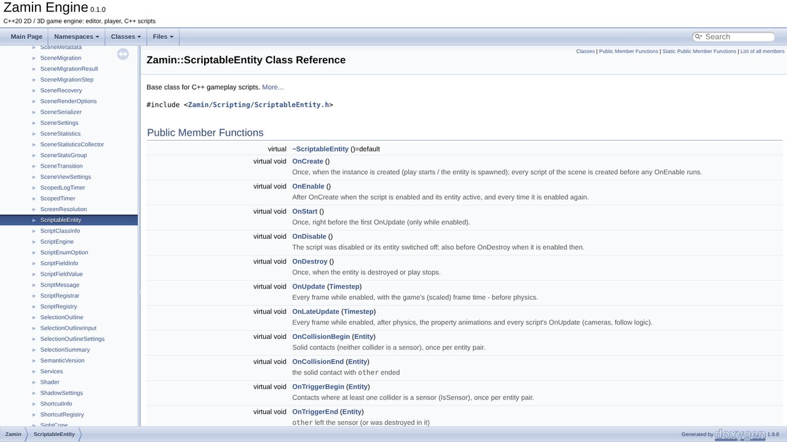
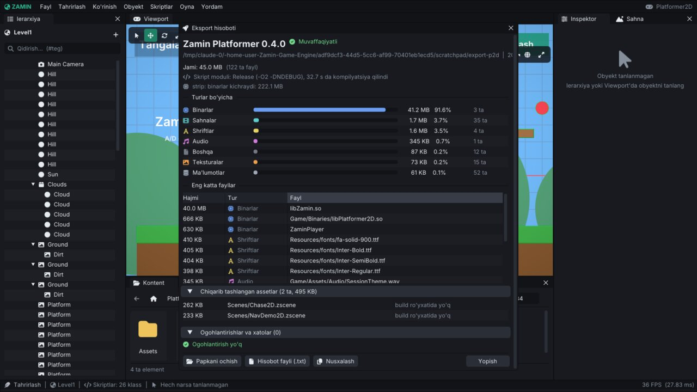

# Zamin Engine: building and exporting the game

This guide is about two things: **building the engine from source** (requirements, CMake options and presets,
build types, targets, the API reference) and **preparing and distributing the game** (building the script module,
exporting from the editor, the export folder, automatic export and packaging, running on the player's computer).
The player itself (the command line, the log, crash reports) - [Runtime.md](Runtime.md); the export settings -
[ProjectSettings.md, section 12](ProjectSettings.md#12-build-scenes); the internal structure - [Architecture.md](Architecture.md).

## Contents

1. [Requirements](#1-requirements)
2. [Building the engine](#2-building-the-engine)
3. [CMake options](#3-cmake-options)
4. [Presets and build types](#4-presets-and-build-types)
5. [Targets and helper commands](#5-targets-and-helper-commands)
6. [Building the game's script module](#6-building-the-games-script-module)
7. [The API reference (Doxygen)](#7-the-api-reference-doxygen)
8. [Exporting the game (editor)](#8-exporting-the-game-editor)
9. [The export folder](#9-the-export-folder)
10. [Automatic export, testing and packaging](#10-automatic-export-testing-and-packaging)
11. [Distributing the game and on the player's computer](#11-distributing-the-game-and-on-the-players-computer)
12. [Sanitizer and coverage builds](#12-sanitizer-and-coverage-builds)
13. [Problems and solutions](#13-problems-and-solutions)

---

## 1. Requirements

- Linux x86_64 (no Windows and macOS yet - [the roadmap](Features.md#roadmap)).
- A C++20 compiler: **GCC 13+** or **Clang 17+**; **CMake 3.20+** (3.25+ for the presets); Ninja is recommended
  (optional); `git` (the dependencies are downloaded on the first configure).
- An **OpenGL 4.1+** driver, the X11 or Wayland dev packages.
- `zenity` (or `kdialog`) for the file dialogs.
- Optional: `xvfb-run` (tests and screenshots without a display), `clang-format` 17+ (the formatting check),
  `doxygen` + `graphviz` (the API reference), `strip` (binutils: making the exported binaries smaller).

Ubuntu / Debian:
```bash
sudo apt install build-essential cmake ninja-build git \
    libgl-dev libx11-dev libxrandr-dev libxinerama-dev libxcursor-dev libxi-dev \
    libwayland-dev libxkbcommon-dev wayland-protocols zenity
```
Fedora:
```bash
sudo dnf install gcc-c++ cmake ninja-build mesa-libGL-devel libX11-devel libXrandr-devel \
    libXinerama-devel libXcursor-devel libXi-devel wayland-devel libxkbcommon-devel zenity
```
Arch:
```bash
sudo pacman -S base-devel cmake ninja mesa libx11 libxrandr libxinerama libxcursor libxi wayland libxkbcommon zenity
```

The third-party libraries are downloaded at fixed versions with CMake `FetchContent`
(`cmake/Dependencies.cmake`): GLFW 3.4, GLM 1.0.1, EnTT 3.13.2, nlohmann/json 3.11.3, Box2D 2.4.1, Jolt 5.2.0,
Dear ImGui 1.91.5 (docking), ImGuizmo, stb, miniaudio 0.11.21, cgltf 1.14, tinyobjloader 2.0.0rc13 (glad is in the
repository). They go into `libZamin.so` - the player does not install them separately.

## 2. Building the engine

```bash
git clone https://github.com/abbosjon-dev/zamin-game-engine.git
cd zamin-game-engine
cmake -S . -B build -G Ninja -DCMAKE_BUILD_TYPE=Release
cmake --build build
```

When no build type is given, **Release** is used. The result:

```
build/
├── bin/
│   ├── libZamin.so            the engine (shared library)
│   ├── ZaminEditor            the editor
│   ├── ZaminPlayer            the player
│   ├── ZaminTests, ZaminRenderTests, ZaminBench, ZaminScriptTemplateGen
│   └── Resources/             the engine resources (fonts; a copy of Resources/)
├── ZaminConfig.cmake          for external game projects (find_package(Zamin CONFIG))
├── generated/                 ZaminBuildInfo.inc (commit, date), ZaminEngineNames.inc
└── compile_commands.json      for an IDE / clangd
```

The script modules of the sample games are built in this build too: `Projects/<Game>/Binaries/lib<Game>.so`
(`ZAMIN_BUILD_EXAMPLES`). Running:

```bash
./build/bin/ZaminEditor                          # the launcher (choose / create a project)
./build/bin/ZaminEditor Projects/Platformer2D    # open the sample 2D game directly
./build/bin/ZaminEditor Projects/Showcase3D      # the sample 3D scenes
./build/bin/ZaminEditor Projects/Adventure3D     # a third-person 3D game
./build/bin/ZaminPlayer Projects/Platformer2D    # the game without the editor
./build/bin/ZaminPlayer Projects/Showcase3D --scene Scenes/DebugDraw.zscene --debug-raycasts --debug-contacts --debug-velocities
./build/bin/ZaminPlayer Projects/Adventure3D --borderless --monitor 1 --fps 60   # all the options: --help
ctest --test-dir build -LE gui                   # the quick tests (unit, benchmark smoke, docs)
./build/bin/ZaminTests --filter "Prefab*" --timing   # a filter by name (glob, '-' excludes), a timing report
./build/bin/ZaminTests --list                    # the test names; --help: --slowest N, --fail-fast, --report, --junit
ctest --test-dir build -L gui                    # editor smoke, script hot reload, export tests (a few minutes)
Tests/render_tests.sh                            # the rendering regression test (needs a display; xvfb-run otherwise)
Tests/editor_smoke.sh --shots                    # every window/menu/popup of the editor (under xvfb)
Tests/hot_reload_test.sh                         # recompiling the script module + hot reload
Tests/export_test.sh                             # export + the exported game headless (with a screenshot)
Tests/package_games.sh --out dist                # the three sample games: export + check + <Name>-<version>-linux-x86_64.tar.gz
Tests/render_bench.sh                            # 10 000 sprites, 1 000 meshes: ms / frame (Benchmarks.md)
Tests/bench.sh --compare                         # ECS, serialization, prefab benchmarks + comparing with the baseline
Tests/coverage.sh [--gui] [--html]               # code coverage (gcov, build-cov): a report by module (Coverage.md)
Tests/sanitize.sh address                        # the unit tests with AddressSanitizer + LeakSanitizer (build-asan)
Tests/sanitize.sh address --smoke --editor-smoke # + 3 games, the editor and the editor smoke test under ASan (the asan job in CI)
Tests/sanitize.sh undefined --compiler clang     # with UndefinedBehaviorSanitizer, Clang (build-ubsan; ubsan-clang in CI)
Tests/format_check.sh [--base main] [--fix]      # clang-format on the changed lines only (.clang-format - the existing style)
```

What each test guards and when it is run - [Testing.md](Testing.md); the measured results -
[Quality.md](Quality.md).

The source files are collected with a `CONFIGURE_DEPENDS` glob: after adding a new `.cpp` / `.h`, run CMake
again (`cmake -S . -B build`) - the build usually notices it by itself. The build must be free of warnings with
`-Wall -Wextra -Wpedantic` (`zamin_target_settings`, `cmake/ZaminGame.cmake`).

## 3. CMake options

Given at configure time with `-D<NAME>=<value>`.

| Option | Default | Meaning |
|---|---|---|
| `CMAKE_BUILD_TYPE` | `Release` | `Debug`, `Release`, `RelWithDebInfo` (section 4) |
| `ZAMIN_BUILD_EDITOR` | `ON` | The editor (`ZaminEditor`) |
| `ZAMIN_BUILD_RUNTIME` | `ON` | The player (`ZaminPlayer`) |
| `ZAMIN_BUILD_TESTS` | `ON` | The unit tests, the rendering test, the benchmarks, ctest |
| `ZAMIN_BUILD_EXAMPLES` | `ON` | The script modules of the sample games (`Projects/*`) |
| `ZAMIN_WITH_IMGUI` | depends on whether the editor is on | The ImGui overlay; required for the editor, `OFF` in a new runtime-only build |
| `ZAMIN_ENABLE_AVX2` | `OFF` | The Jolt and engine CPU profile: `OFF` — x86-64/SSE2, `ON` — requires AVX2/FMA/BMI1/LZCNT/POPCNT/F16C |
| `ZAMIN_SHIPPING` | `OFF` | The final game build: the development helpers (debug drawing - `DebugDraw`, the player's `--debug-*` options) are compiled out; `BuildInfo::Shipping` |
| `ZAMIN_DEBUG_DRAW` | `ON` | The debug drawing API (ignored with `ZAMIN_SHIPPING`) |
| `ZAMIN_ASSERTS` | `AUTO` | `ZM_ASSERT` / `ZM_CORE_ASSERT`: `AUTO` - only in Debug, `ON` - in Release too (a failed one writes a crash report), `OFF` - never |
| `ZAMIN_SANITIZE` | empty | `address`, `undefined`, `leak`, `thread` (a list works too) - section 12 |
| `ZAMIN_COVERAGE` | `OFF` | gcov counters (only on our targets) - section 12 |
| `ZAMIN_OPTIMIZE_SERIALIZER_IN_DEBUG` | `ON` | The scene serializer with `-O2` in Debug too (large scenes several times faster); `OFF` to step through it in a debugger |
| `ZAMIN_OPTIMIZE_PARTICLES_IN_DEBUG` | `ON` | The particle simulation with `-O2` in Debug too (~30x faster); `OFF` for the debugger |
| `ZAMIN_GAME_MODULE_OUTPUT_DIR` | empty (in a build folder other than `build/`: `<build>/GameModules`) | The game modules are written to this folder instead of `Projects/<Game>/Binaries`, and the build's own programs (`<build>/bin`) load them from there (when the project's module is newer - an editor compile - that one). The main `build/` folder writes the modules to `Binaries/`; a second build (Release, Clang, a benchmark) does not overwrite them |

For example - only the engine and the player, Shipping:

```bash
cmake -S . -B build-ship -G Ninja -DCMAKE_BUILD_TYPE=Release -DZAMIN_SHIPPING=ON \
      -DZAMIN_BUILD_EDITOR=OFF -DZAMIN_BUILD_TESTS=OFF -DZAMIN_BUILD_EXAMPLES=OFF -DZAMIN_WITH_IMGUI=OFF
cmake --build build-ship
```

## 4. Presets and build types

`CMakePresets.json` (CMake 3.25+):

| Preset | Folder | What |
|---|---|---|
| `debug` | `build/` | Debug, Ninja |
| `release` | `build-release/` | Release, Ninja |
| `clang` | `build-clang/` | Release with Clang |
| `asan`, `ubsan`, `lsan`, `tsan` | `build-asan/` ... | Debug + a sanitizer (the build preset only builds `ZaminTests`) |
| `coverage` | `build-cov/` | Debug + gcov (`Tests/coverage.sh`) |

```bash
cmake --preset release && cmake --build --preset release && ctest --preset release -LE gui
```

Build types:

- **Debug** - for development (asserts, the debugger); the serializer and the particles are optimized anyway
  (section 3). Fine for everyday use of the editor too.
- **Release** - CMake's Release flags (`-O3 -DNDEBUG`), without asserts (unless `ZAMIN_ASSERTS=ON`). CI builds
  with it.
- **RelWithDebInfo** - Release + debug info (profiling).
- **Shipping** - not a build type but an option: `-DZAMIN_SHIPPING=ON` (usually with Release).

The build info (commit, date, type, compiler) is updated on every build and shows up in `ZaminPlayer --version`, at the start
of the log, in crash reports and in the editor's "About Zamin" window ([Runtime.md, section 8](Runtime.md#8-version-information)).

## 5. Targets and helper commands

`cmake --build build --target <name>`:

| Target | What it does |
|---|---|
| `Zamin`, `ZaminEditor`, `ZaminPlayer`, `ZaminTests` ... | The programs themselves |
| `render_tests`, `update_render_references` | The rendering regression test / regenerating the reference pictures ([Testing.md](Testing.md)) |
| `editor_smoke`, `hot_reload_test`, `export_test` | Every editor window, script hot reload, the export test |
| `package_games` | The three sample games: export + check + `.tar.gz` (section 10) |
| `bench`, `render_bench`, `player_bench`, `particle_bench`, `nav_bench` | Benchmarks ([Benchmarks.md](Benchmarks.md)) |
| `format_check`, `format_stats` | The clang-format check ([Testing.md, section 9](Testing.md#9-formatting---clang-format)) |
| `docs` | The Doxygen API reference (section 7; only when Doxygen is found) |

Tests through ctest: `ctest --test-dir build -LE gui` (the quick ones), `-L gui` (the ones that need a display), `-L docs`
(the documentation check). All of them - [Testing.md](Testing.md).

## 6. Building the game's script module

The game's C++ scripts (`<project>/Source/*.cpp`) are compiled as a separate shared library:
`<project>/Binaries/lib<Game>.so`. The project's `CMakeLists.txt` (the editor writes it in a new project) looks like this:

```cmake
cmake_minimum_required(VERSION 3.20)
project(Platformer2D LANGUAGES C CXX)

set(CMAKE_CXX_STANDARD 20)
set(CMAKE_CXX_STANDARD_REQUIRED ON)
if(NOT CMAKE_BUILD_TYPE)
    set(CMAKE_BUILD_TYPE Release)
endif()

if(NOT TARGET Zamin)
    find_package(Zamin REQUIRED CONFIG)
endif()

file(GLOB_RECURSE GAME_SOURCES CONFIGURE_DEPENDS ${CMAKE_CURRENT_SOURCE_DIR}/Source/*.cpp ${CMAKE_CURRENT_SOURCE_DIR}/Source/*.h)
zamin_add_game_module(Platformer2D ${GAME_SOURCES})
```

(`Projects/Platformer2D/CMakeLists.txt`; the samples are built with the engine's warnings through an extra
`zamin_target_settings(Platformer2D)` - you can add it in your own game too.)

`zamin_add_game_module` (`cmake/ZaminGame.cmake`) makes a `SHARED` library, links it with `Zamin::Zamin`,
writes the result to `Binaries/` (or to `ZAMIN_GAME_MODULE_OUTPUT_DIR`) and gives `-fno-gnu-unique` on GCC
(without it the module is not unloaded and hot reload does not work).

It is built in one of three ways:

1. **From the editor** - **Scripts → Compile + reload** (`Ctrl+B`). The editor runs `cmake -S <project> -B <project>/Build
   -DCMAKE_BUILD_TYPE=Release -DZamin_DIR=<engine build folder>` (with Ninja when there is one), then `cmake --build`;
   the output is in the **Compilation** window, with a list of the errors. The finished module is reloaded
   automatically.
2. **Outside (a terminal / an IDE)** - the same commands; when the editor is open it notices that the module changed and reloads it
   by itself:

   ```bash
   cmake -S ~/games/Coins -B ~/games/Coins/Build -G Ninja -DCMAKE_BUILD_TYPE=Release \
         -DZamin_DIR=$HOME/zamin-game-engine/build
   cmake --build ~/games/Coins/Build --parallel
   ```
3. **Inside the engine build** - like the sample games, by an `add_subdirectory(...)` in the root `CMakeLists.txt`
   (the `Zamin` target exists - no `find_package` needed).

`-DZamin_DIR` is the engine's **build** folder (it has `ZaminConfig.cmake`): the game is built with exactly this engine
(the same headers, the same defines: `ZAMIN_SHIPPING`, `ZM_DEBUG_DRAW`, asserts). When the engine is rebuilt,
rebuild the game module too.

Loading the module from another folder: `ZAMIN_SCRIPT_MODULE_DIR=<folder>` - the editor and the player load the module with the
same name from that folder instead of the project's `ScriptModulePath` (tests, sanitizer builds).
Scripts made of several files and other details - [Scripting.md](Scripting.md).

## 7. The API reference (Doxygen)

An HTML reference built from the engine's public headers (`Zamin/src/Zamin`): every class, function, component field
- with the `///` comments of the headers. The `Doxyfile` in the repository root is used:

```bash
sudo apt install doxygen graphviz      # graphviz is optional (class diagrams)
doxygen                                # in the root: build/docs/html/index.html
cmake --build build --target docs      # or through CMake: <build>/docs/html/index.html
```

- The result is in `build/docs/` (not in git); the warnings are in `build/docs/doxygen-warnings.log` (errors in the
  comments; there are no warnings about undocumented members - `EXTRACT_ALL` lists them anyway).
- The `docs` target exists when Doxygen is found; without Graphviz (`dot`) it works without diagrams.
- The main page is the `@mainpage` in `Zamin/Zamin.h`; it shows where to start
  (`ScriptableEntity`, `Scene`, `Entity`, the components, `SceneManager` ...).
- `PROJECT_NUMBER` in the `Doxyfile` must equal the engine version in CMake - `ctest -L docs` checks it.



The guides are the Markdown files in [docs/](.); the reference complements them, it does not replace them.

## 8. Exporting the game (editor)

The **File → Build game...** window:

| Setting | Meaning |
|---|---|
| Output folder | The game is assembled in this folder (updated when it exists) |
| Also write scenes to the binary cache (.zsceneb) | A binary copy of each scene - the player reads it faster |
| Leave out unused assets | Only the assets the game uses go along (below) |
| Compile the script module in Release (-O2) | The module is rebuilt in `<project>/Build/ExportRelease` (the editor's module is not touched) |
| Strip the binaries (player, engine, scripts) | The debug info is removed - much smaller |
| Treat prefab warnings as errors | The prefab check's warnings stop the export |

The last four are project settings (Project settings > Build scenes > Export, the `"Export"` section in the `.zproject`;
[ProjectSettings.md](ProjectSettings.md#export-unused-assets)). After the **Build** button is pressed the export
runs in the background (the editor stays responsive):

1. The start scene and the build list are checked (what would break the game is an error, the rest are warnings).
2. Which assets go along is planned: the build scenes, the start scene, their sub-scenes and everything needed through them
   (prefabs, materials, models, clips ...), the files named in the project file (the icon, the splash) and in the `"..."` strings of the C++
   code, `Assets/Resources/`, the language files, the "Always include" list.
   The rest is written to `excluded-assets.txt`.
3. The prefabs are checked ([Prefabs.md](Prefabs.md)); the scenes are written without the editor's prefab links.
4. The player, `libZamin.so`, `Resources/`, the project file, the assets (with their `.zmeta` files), the asset registry
   (`AssetRegistry.zreg`), the binary cache of the scenes.
5. The script module is built in Release (or the editor's module is copied); when there is no module at all, the game is
   exported without scripts - this is a warning.
6. The binaries are `strip`ped, the icon (16 ... 256 px), the `.desktop` file and the install script are written.
7. The folder checks itself (`ExportFiles::CheckExportFolder`): is everything the game needs to start in
   place.
8. The **Export report** window: the total size, by type, the largest files, the excluded assets,
   the warnings and errors (`export-report.json`, `export-report.txt`; later too with **File → Export report**).



*The **Export report** window after the Platformer2D export (reopened with `ZAMIN_EDITOR_EXPORT_REPORT=<folder>`).*

In the log it looks like this (Platformer2D, from a Debug engine build):

```
Export: 16 scenes of the build list
Export: 44 asset files (1.7 MB); 2 excluded (495 KB) - list: .../excluded-assets.txt
Export: 16 scenes written to the binary cache (1195.7 KB -> 415.9 KB)
Export: compiling the script module in Release (-O2 -DNDEBUG): .../Projects/Platformer2D/Build/ExportRelease
Export: strip - 3 binaries 263.3 MB -> 41.2 MB
Export: icon in 6 sizes (16 ... 256 px, icons/hicolor)
Export report: 122 files, 45.0 MB (0 warnings, 0 errors) - .../export-report.txt
```

### Texture cook

After the assets are copied the export **cooks** the textures the game takes (`ExportCook`, `Project/ExportCook.h`;
the `.zproject` `"Export"` → `"Cook"` section, defaults shown):

```json
"Cook": { "Enabled": true, "Compress": true, "MaxTextureSize": 0, "MatchQuality": true, "Always": false }
```

1. **Sprite atlases** (`.zatlas`) whose sources changed since the page was built are packed again into the export's
   copy of the page (the project is not touched); `cook-manifest.json` gets every atlas page with its sprites'
   rectangles and UVs (the UV remap table).
2. Every 8-bit image (`.png .jpg .jpeg .tga .bmp`; HDR stays as it is) is decoded and written as **ZTEX**
   (`Asset/TextureCook.h`): rows already in OpenGL order, per-row prediction (none / left / up / average) and deflate.
   Textures sampled by UV alone (mip-mapped, linear, without sprite frames - frames and 9-slice borders are pixel
   rectangles) are halved down to `MaxTextureSize`, and with `MatchQuality` by the mip levels **every** quality level
   skips (Project settings > Quality, texture quality): those levels are never shown, so they are baked out and the
   cooked file says how many; the runtime then skips that many fewer, and the game looks the same.
3. The cooked file **replaces the source at its asset path** when it is smaller, when it was resized, or always with
   `"Always": true`; otherwise the source stays (`"kept"`). Every reference, the asset registry and every file check of
   the game stay valid; the texture loader, `Image::Load` and the streaming stager recognise the `ZTEX` header and read
   the cooked pixels. The editor never sees cooked files - it works from the sources.
4. **The cook cache** (`<project>/Build/CookCache/<key>.ztex`): the key is the source's content hash (FNV-1a 64 of its
   bytes) with the settings that change the output and the format version. An unchanged texture is not cooked again on
   the next export (`"CacheHit"`); a changed source, a changed setting or a damaged cache entry is cooked again.
5. The **Export report** lists every texture (cooked / kept / failed, the sizes before and after, the pixel size and
   where it came from, cache hits) and the time; `export-report.txt` has the same table, `Game/cook-manifest.json`
   the cook settings, the textures and the atlas table.

`Tests/cook_export_test.sh` exports `Projects/StreamingWorkshop` (which sets `MaxTextureSize` 256 and `Always`), runs
the exported Player through `Tests/export_test.sh` (benchmark frames, a screenshot, a move to another folder) and checks
the cook: the 512 px terrain textures halved, the atlas page cooked, ZTEX files at their paths, the atlas's source
sprites left out, the tiles exported, a second export served entirely from the cook cache, and the report window.
V1 limits: lossless only (no GPU block compression such as BC/ASTC yet), one page per atlas, the cooked format is read
by this engine version only (a format change cooks again).

### Graph cook (Visual Script bytecode)

The export also compiles every Visual Script graph (`.zgraph`) the game takes to validated bytecode
(`ExportCook::CookGraphs`, `Scripting/Visual/VisualGraphBytecode.h`; `"Export"` → `"CookGraphs": false` turns it off):
the parent chain resolved, macros expanded, the pin descriptions and wires precomputed, written over the exported
`.zgraph` (a `ZGBC` header with the format version and the engine's node catalogue hash). The Player runs it without
parsing JSON or validating again; the editor works from the sources. A graph that does not validate (the Player would
reject it) is not cooked: it stays JSON, its parents too, and the report lists it as `rejected` with the error, plus a
warning. A native C++ method that does not bind with the module the editor has loaded is a warning. The cook cache
(`<project>/Build/CookCache/<key>.zgbc`, keyed by the graph's, its parents' and the catalogue's hash) keeps unchanged
graphs from being compiled again. The **Export report** and `export-report.txt` list every graph (cooked / rejected /
kept, the bytes before and after, the program's nodes, cache hits). `Tests/cook_export_test.sh` also exports
VisualWorkshop and runs its cooked graphs in the exported Player. The format is described in
[the Visual Script guide](VisualScripting.md#cooked-graphs-bytecode).

## 9. The export folder

```
Platformer2D/
├── Platformer2D.sh              the start script (changes to its own folder: ZaminPlayer Game/Platformer2D.zproject)
├── ZaminPlayer, libZamin.so     the player and the engine (RPATH $ORIGIN: they find each other next to them)
├── Resources/                   the engine resources (fonts)
├── Game/
│   ├── Platformer2D.zproject    the project file
│   ├── Assets/                  the assets the game uses (+ .zmeta, the .zsceneb cache of the scenes)
│   ├── AssetRegistry.zreg       the asset registry (only the exported ones)
│   ├── cook-manifest.json       the texture cook: settings, every texture, the atlas UV table
│   └── Binaries/libPlatformer2D.so   the script module
├── Platformer2D.desktop         a relocatable menu entry
├── Platformer2D.png, icons/hicolor/<size>/apps/...   the icon
├── install-desktop-entry.sh     installs into the applications menu (--uninstall - removes it)
├── export-report.json, export-report.txt
└── excluded-assets.txt          the excluded assets (when there are any)
```

The folder can be moved anywhere or archived: `<Game>.sh` and the `.desktop` work from where they are (when the game first
starts from a new place it fixes the icon path in the `.desktop`). What each file is and the details of
starting - [Runtime.md, section 11](Runtime.md#11-export).

## 10. Automatic export, testing and packaging

The editor exports without a display too:

```bash
ZAMIN_EDITOR_EXPORT=/tmp/Platformer2D ZAMIN_MAX_FRAMES=8 xvfb-run -a ./build/bin/ZaminEditor Projects/Platformer2D
```

(`ZAMIN_EDITOR_EXPORT=<folder>` - the export starts in frame 5 and is waited for until it finishes; exit code 0 means success.)

- **`Tests/export_test.sh`** (`--project`, `--frames`, `--keep`, `--work`; target `export_test`) - the export, `--version`,
  running the exported game through its start script with `--benchmark`, with a screenshot, and running it after it was
  moved to another folder. The result and the options: [Runtime.md, section 13](Runtime.md#13-the-export-test-automatic).
- **`Tests/package_games.sh`** (target `package_games`) - exports the three sample games, checks them with `export_test.sh`
  and packs them as `<Name>-<version>-linux-x86_64.tar.gz` + `.sha256` (the archive is unpacked again and tried):

  ```bash
  Tests/package_games.sh --out dist                      # dist/*.tar.gz, dist/summary.md, dist/logs/<game>/
  Tests/package_games.sh --frames 60 Projects/Adventure3D
  ZAMIN_BUILD_DIR=build-release Tests/package_games.sh   # with the engine / player of another build
  ```
- **CI** (`.github/workflows/linux.yml`): on every push / pull request the `build` job builds with GCC and Clang,
  runs the tests and uploads the game builds as artifacts (`player-builds-gcc`,
  `player-builds-clang`: `.tar.gz` + `.sha256`, 14 days). The other jobs: `sanitizers`, `format`, `coverage`
  ([Testing.md](Testing.md#ci-githubworkflowslinuxyml)).

The performance test for checking an export (`--benchmark N`, `--benchmark-out`, the limits) - [Runtime.md, section 12](Runtime.md#12-the-performance-test-headless).

## 11. Distributing the game and on the player's computer

1. Archive the export folder (`tar czf Coins-1.0.0.tar.gz Coins/`) or pack it the way
   `Tests/package_games.sh` does.
2. The player unpacks and runs it:

   ```bash
   tar xzf Coins-1.0.0.tar.gz && cd Coins
   ./Coins.sh                          # or: ./Coins.sh --fullscreen --lang en
   ./install-desktop-entry.sh          # optional: into the applications menu (with the icon)
   ```

The player's computer needs: Linux x86_64, a driver that supports OpenGL 4.1, an X11 or Wayland desktop.
The engine and all the libraries are in the folder (or inside `libZamin.so`) - nothing to install separately. Useful options
for the player (`--windowed`, `--resolution 1280x720`, `--quality Low`, `--no-splash`, `--gl 4.1`,
`--log-level`, `--version`, `--help` ...) - [Runtime.md, section 4](Runtime.md#4-the-command-line); the log and crash
files are in `~/.local/share/<company>/<game>/logs/` ([Runtime.md, section 6](Runtime.md#6-log-files)).

The version, the company and product names, the icon, the splash, the window settings - Project settings > Player
([ProjectSettings.md, section 4](ProjectSettings.md#4-player-window-name-version-icon)).

## 12. Sanitizer and coverage builds

- **Sanitizers**: `-DZAMIN_SANITIZE=address` (or `undefined`, `leak`, `thread`; the presets `asan` ...). The flags go
  to every target (the vendor libraries too) and, through `ZaminConfig.cmake`, to external game modules.
  Such a build writes the game modules not to the project's `Binaries/` but to its own `GameModules/` folder, and its own
  programs load them from there. The convenient way - `Tests/sanitize.sh address [--smoke] [--editor-smoke]`.
A new native module configuration reads the `ZaminModuleCompiler.cmake` initial-cache file of the engine build
through `-C`: F7 and the export choose the C/C++ compiler the engine used.
This runs before `project()`; an existing CMake cache or an explicitly given compiler
value is not replaced. In a project that switches compilers, use a new build
folder. The SDK ABI check keeps rejecting a compiler that does not match.

In Clang sanitizer builds the runtime is linked by the final executable: `--no-undefined` is not applied to the
instrumented engine shared libraries. In normal builds this check is kept for the engine and the library without UI.
The `SanitizerSharedLink` CTest checks the production CMake rule with a small
ASan/UBSan DSO and a consumer, and confirms that a real overflow is detected and that a
wrong application symbol is rejected in a normal build. Without Clang or compiler-rt this
extra test is skipped.

- **Coverage**: `-DZAMIN_COVERAGE=ON` (the `coverage` preset) - only our targets with `--coverage -O0`;
  `Tests/coverage.sh [--gui] [--html]` ([Coverage.md](Coverage.md)).

The results and when to use them - [Testing.md, section 6](Testing.md#6-sanitizers), [Quality.md](Quality.md).

## 13. Problems and solutions

| Problem | Solution |
|---|---|
| The first configure takes long or ends with a network error | The dependencies are downloaded with `git`: is there internet and `git`? Run it again - what was downloaded stays in `build/_deps` |
| `Could not find a package configuration file provided by "Zamin"` (in a game project) | Give `-DZamin_DIR=<engine build folder>` (it has `ZaminConfig.cmake`); a compile from the editor gives it by itself |
| The script module compiled, but the editor runs the old code | The module may have been written to another folder (`ZAMIN_GAME_MODULE_OUTPUT_DIR`); is the project's `ScriptModulePath` `Binaries/lib<Game>.so`? |
| After rebuilding the engine the game crashes or does not load | The module was built with the old headers: recompile the scripts |
| Export: `script module not found - the game is exported without scripts` | The script module is not built yet - first **Scripts → Compile + reload** |
| An error in the export report: no scene / registry / module | The report says what is missing (`ExportFiles::CheckExportFolder`); check the start scene and the build list (Project settings > Build scenes) |
| The exported game is very large | Is **Strip the binaries** on? Is `strip` (binutils) installed? Export from a Release engine build |
| An asset is missing in the game (after the export) | When the file name is built in code (`"Level" + n`), the export cannot find it - add it to the "Always include" list; look at `excluded-assets.txt` |

More questions, with the message texts - [FAQ.md](FAQ.md).


## The CPU profile and a runtime without the editor services

The default x86-64 build is built on the SSE2 baseline. Jolt's AVX, AVX2, FMA, SSE4, F16C and bit-operation
acceleration flags are not turned on by themselves. `-DZAMIN_ENABLE_AVX2=ON` turns them on explicitly;
such a distribution needs a CPU with AVX2, FMA, BMI1, LZCNT, POPCNT and F16C. Extra toolchain flags like
`-march=native` can raise this minimum requirement.

A runtime-only build with `ZAMIN_BUILD_EDITOR=OFF` and `ZAMIN_WITH_IMGUI=OFF` does not compile/link the editor utilities,
Dear ImGui or ImGuizmo. When an earlier overlay value is left in the CMake cache,
give `-DZAMIN_WITH_IMGUI=OFF` explicitly. The SDK of the C++ game modules does not depend on the editor services.

The editor and the tests use the `ZaminEditorSupport` static library. The shared engine code is built once in the
`ZaminCoreObjects` OBJECT target. In a test build `cmake --build build-review --target ZaminStandalone`
produces a real `build-review/bin/runtime-check/libZamin.so` without ImGui. Running `ZaminPlayer` on this
library with `LD_LIBRARY_PATH` serves to test the runtime boundary.


### Native module SDK compatibility

SDK consumers are built through `zamin_add_game_module`. The helper creates a `.zamin_abi` record and checks the engine's SDK header fingerprint/toolchain at configure time. When the SDK files changed, rebuild the engine first, then reconfigure the project build. An old `.so` made directly by hand is not loaded. The loader keeps the running module before moving on to a wrong candidate; the export also checks the compatibility of the copied module. Details: [Scripting.md](Scripting.md#native-sdk--abi-compatibility).


### Streaming world export

`Project.StreamingWorld` names a `.zworld` file relative to the asset root. The player starts with the anchor scene
and attaches the world automatically. The editor export checks the manifest/policy and every cell scene path,
and adds the world scenes to the build list when there is one. The manifest → scene → asset reference chain
is kept with the unused-assets filter too. Set the world up through **Window → World Streaming**;
[how it works and its limits](Terrain.md) are recorded there. The asset budget (`AssetStreaming`) and the
residency limits are part of the `.zworld` policy and work unchanged in the export; an exported
game also accepts `ZAMIN_WORLD_TOUR` / `ZAMIN_WORLD_REPORT` (give the `.ztour` an absolute path — it is not part of the export
closure). `Tests/world_asset_streaming_test.py --stage demo` exports WorldGallery3D,
moves the folder and replays the same camera path in the export.
