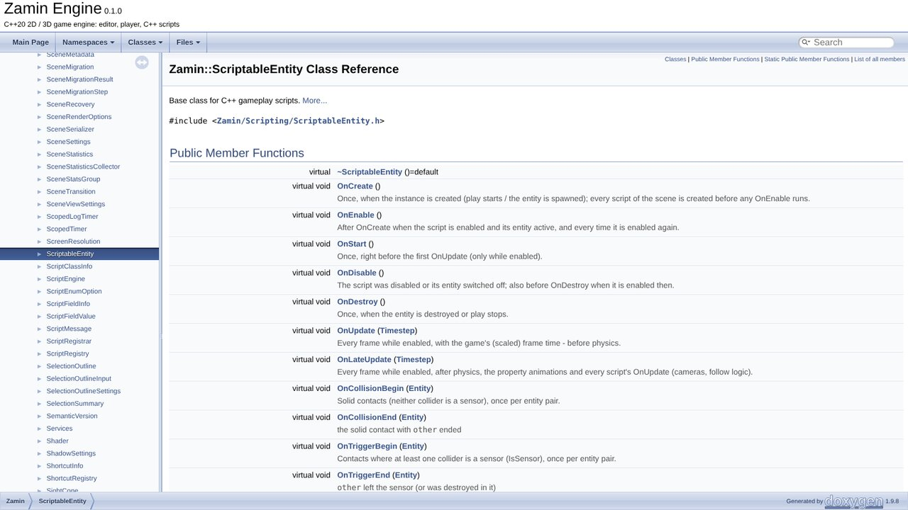
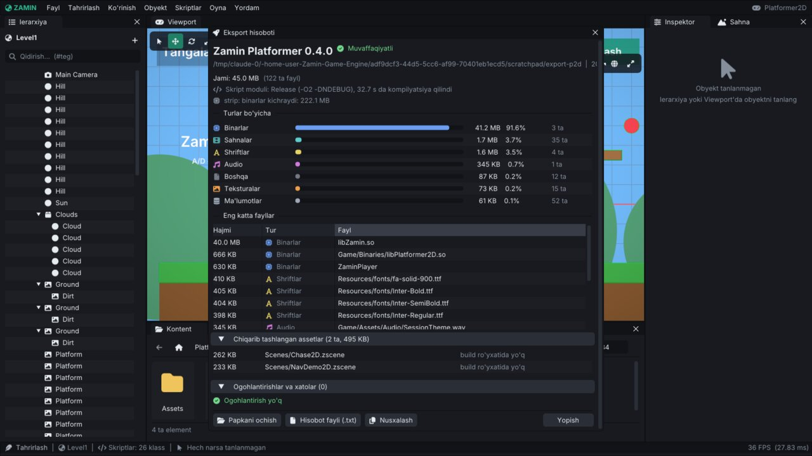

# Zamin Engine: build qilish va o'yinni eksport qilish

Bu qo'llanma ikki narsa haqida: **dvigatelni manbadan build qilish** (talablar, CMake variantlari va presetlar,
build turlari, target'lar, API ma'lumotnomasi) va **o'yinni tayyorlab tarqatish** (skript modulini build qilish,
editordan eksport, eksport papkasi, avtomatik eksport va paketlash, o'yinchi kompyuterida ishga tushirish).
Player'ning o'zi (buyruq qatori, log, crash hisobotlari) - [Runtime.md](Runtime.md); eksport sozlamalari -
[ProjectSettings.md, 12-bo'lim](ProjectSettings.md#12-build-sahnalar); ichki tuzilma - [Architecture.md](Architecture.md).

## Mundarija

1. [Talablar](#1-talablar)
2. [Dvigatelni build qilish](#2-dvigatelni-build-qilish)
3. [CMake variantlari](#3-cmake-variantlari)
4. [Presetlar va build turlari](#4-presetlar-va-build-turlari)
5. [Target'lar va yordamchi buyruqlar](#5-targetlar-va-yordamchi-buyruqlar)
6. [O'yinning skript modulini build qilish](#6-oyinning-skript-modulini-build-qilish)
7. [API ma'lumotnomasi (Doxygen)](#7-api-malumotnomasi-doxygen)
8. [O'yinni eksport qilish (editor)](#8-oyinni-eksport-qilish-editor)
9. [Eksport papkasi](#9-eksport-papkasi)
10. [Avtomatik eksport, test va paketlash](#10-avtomatik-eksport-test-va-paketlash)
11. [O'yinni tarqatish va o'yinchi kompyuterida](#11-oyinni-tarqatish-va-oyinchi-kompyuterida)
12. [Sanitizer va coverage build'lari](#12-sanitizer-va-coverage-buildlari)
13. [Muammolar va yechimlar](#13-muammolar-va-yechimlar)

---

## 1. Talablar

- Linux x86_64 (Windows va macOS hali yo'q - [yo'l xaritasi](Features.md#yol-xaritasi)).
- C++20 kompilyator: **GCC 13+** yoki **Clang 17+**; **CMake 3.20+** (presetlar uchun 3.25+); Ninja tavsiya
  qilinadi (ixtiyoriy); `git` (bog'liqliklar birinchi configure'da yuklab olinadi).
- **OpenGL 4.1+** drayveri, X11 yoki Wayland dev paketlari.
- Fayl dialoglari uchun `zenity` (yoki `kdialog`).
- Ixtiyoriy: `xvfb-run` (displeysiz testlar va skrinshotlar), `clang-format` 17+ (formatlash tekshiruvi),
  `doxygen` + `graphviz` (API ma'lumotnomasi), `strip` (binutils: eksport qilingan binarlarni kichraytirish).

Ubuntu / Debian:
```bash
sudo apt install build-essential cmake ninja-build git \
    libgl-dev libx11-dev libxrandr-dev libxinerama-dev libxcursor-dev libxi-dev \
    libwayland-dev libxkbcommon-dev wayland-protocols zenity
```
Fedora:
```bash
sudo dnf install gcc-c++ cmake ninja-build mesa-libGL-devel libX11-devel libXrandr-devel \
    libXinerama-devel libXcursor-devel libXi-devel wayland-devel libxkbcommon-devel zenity
```
Arch:
```bash
sudo pacman -S base-devel cmake ninja mesa libx11 libxrandr libxinerama libxcursor libxi wayland libxkbcommon zenity
```

Uchinchi tomon kutubxonalari CMake `FetchContent` bilan qat'iy versiyalarda yuklab olinadi
(`cmake/Dependencies.cmake`): GLFW 3.4, GLM 1.0.1, EnTT 3.13.2, nlohmann/json 3.11.3, Box2D 2.4.1, Jolt 5.2.0,
Dear ImGui 1.91.5 (docking), ImGuizmo, stb, miniaudio 0.11.21, cgltf 1.14, tinyobjloader 2.0.0rc13 (glad
repozitoriy ichida). Ular `libZamin.so` ichiga kiradi - o'yinchi alohida o'rnatmaydi.

## 2. Dvigatelni build qilish

```bash
git clone https://github.com/abbosjon-dev/zamin-game-engine.git
cd zamin-game-engine
cmake -S . -B build -G Ninja -DCMAKE_BUILD_TYPE=Release
cmake --build build
```

Build turi berilmasa **Release** olinadi. Natija:

```
build/
├── bin/
│   ├── libZamin.so            dvigatel (shared library)
│   ├── ZaminEditor            editor
│   ├── ZaminPlayer            player
│   ├── ZaminTests, ZaminRenderTests, ZaminBench, ZaminScriptTemplateGen
│   └── Resources/             dvigatel resurslari (shriftlar; Resources/ dan nusxa)
├── ZaminConfig.cmake          tashqi o'yin loyihalari uchun (find_package(Zamin CONFIG))
├── generated/                 ZaminBuildInfo.inc (kommit, sana), ZaminEngineNames.inc
└── compile_commands.json      IDE / clangd uchun
```

Namuna o'yinlarning skript modullari ham shu build'da yasaladi: `Projects/<O'yin>/Binaries/lib<O'yin>.so`
(`ZAMIN_BUILD_EXAMPLES`). Ishga tushirish:

```bash
./build/bin/ZaminEditor                          # launcher (loyiha tanlash / yaratish)
./build/bin/ZaminEditor Projects/Platformer2D    # namuna 2D o'yinni to'g'ridan-to'g'ri ochish
./build/bin/ZaminEditor Projects/Showcase3D      # namuna 3D sahnalar
./build/bin/ZaminEditor Projects/Adventure3D     # uchinchi shaxs 3D o'yin
./build/bin/ZaminPlayer Projects/Platformer2D    # o'yinni editorsiz
./build/bin/ZaminPlayer Projects/Showcase3D --scene Scenes/DebugDraw.zscene --debug-raycasts --debug-contacts --debug-velocities
./build/bin/ZaminPlayer Projects/Adventure3D --borderless --monitor 1 --fps 60   # hamma variantlar: --help
ctest --test-dir build -LE gui                   # tezkor testlar (unit, benchmark smoke, hujjatlar)
./build/bin/ZaminTests --filter "Prefab*" --timing   # nom bo'yicha filtr (glob, '-' chiqarib tashlaydi), vaqt hisoboti
./build/bin/ZaminTests --list                    # testlar nomlari; --help: --slowest N, --fail-fast, --report, --junit
ctest --test-dir build -L gui                    # editor smoke, skript hot reload, eksport testlari (bir necha daqiqa)
Tests/render_tests.sh                            # rendering regressiya testi (display kerak; yo'q bo'lsa xvfb-run)
Tests/editor_smoke.sh --shots                    # editorning barcha oyna/menyu/popup'lari (xvfb ostida)
Tests/hot_reload_test.sh                         # skript modulini qayta kompilyatsiya + hot reload
Tests/export_test.sh                             # eksport + eksport qilingan o'yin headless (skrinshot bilan)
Tests/package_games.sh --out dist                # uchala namuna o'yin: eksport + tekshiruv + <Nom>-<versiya>-linux-x86_64.tar.gz
Tests/render_bench.sh                            # 10 000 sprite, 1 000 mesh: ms / kadr (Benchmarks.md)
Tests/bench.sh --compare                         # ECS, serializatsiya, prefab benchmarklari + boshlang'ich natija bilan solishtirish
Tests/coverage.sh [--gui] [--html]               # kod qamrovi (gcov, build-cov): modullar bo'yicha hisobot (Coverage.md)
Tests/sanitize.sh address                        # unit testlar AddressSanitizer + LeakSanitizer bilan (build-asan)
Tests/sanitize.sh address --smoke --editor-smoke # + 3 o'yin, editor va editor smoke testi ASan ostida (CI'dagi asan job)
Tests/sanitize.sh undefined --compiler clang     # UndefinedBehaviorSanitizer bilan, Clang (build-ubsan; CI'dagi ubsan-clang)
Tests/format_check.sh [--base main] [--fix]      # clang-format faqat o'zgargan qatorlarda (.clang-format - mavjud uslub)
```

Har bir test nimani qo'riqlashi va qachon ishga tushirilishi - [Testing.md](Testing.md); o'lchangan natijalar -
[Quality.md](Quality.md).

Manba fayllar `CONFIGURE_DEPENDS` glob bilan yig'iladi: yangi `.cpp` / `.h` qo'shgandan keyin CMake'ni qayta
ishga tushiring (`cmake -S . -B build`) - build buni odatda o'zi sezadi. Build `-Wall -Wextra -Wpedantic` bilan
ogohlantirishsiz bo'lishi kerak (`zamin_target_settings`, `cmake/ZaminGame.cmake`).

## 3. CMake variantlari

`-D<NOM>=<qiymat>` bilan configure paytida beriladi.

| Variant | Standart | Ma'nosi |
|---|---|---|
| `CMAKE_BUILD_TYPE` | `Release` | `Debug`, `Release`, `RelWithDebInfo` (4-bo'lim) |
| `ZAMIN_BUILD_EDITOR` | `ON` | Editor (`ZaminEditor`) |
| `ZAMIN_BUILD_RUNTIME` | `ON` | Player (`ZaminPlayer`) |
| `ZAMIN_BUILD_TESTS` | `ON` | Unit testlar, rendering testi, benchmarklar, ctest |
| `ZAMIN_BUILD_EXAMPLES` | `ON` | Namuna o'yinlarning skript modullari (`Projects/*`) |
| `ZAMIN_WITH_IMGUI` | editor yoqilganiga bog'liq | ImGui overlay; editor uchun majburiy, runtime-only yangi build'da `OFF` |
| `ZAMIN_ENABLE_AVX2` | `OFF` | Jolt va engine CPU profili: `OFF` — x86-64/SSE2, `ON` — AVX2/FMA/BMI1/LZCNT/POPCNT/F16C talab qiladi |
| `ZAMIN_SHIPPING` | `OFF` | Yakuniy o'yin build'i: ishlab chiqish yordamchilari (debug chizish - `DebugDraw`, player'ning `--debug-*` variantlari) kompilyatsiyadan chiqariladi; `BuildInfo::Shipping` |
| `ZAMIN_DEBUG_DRAW` | `ON` | Debug chizish API'si (`ZAMIN_SHIPPING` bo'lsa e'tiborsiz) |
| `ZAMIN_ASSERTS` | `AUTO` | `ZM_ASSERT` / `ZM_CORE_ASSERT`: `AUTO` - faqat Debug'da, `ON` - Release'da ham (bajarilmagani crash hisobotini yozadi), `OFF` - hech qachon |
| `ZAMIN_SANITIZE` | bo'sh | `address`, `undefined`, `leak`, `thread` (ro'yxat ham bo'ladi) - 12-bo'lim |
| `ZAMIN_COVERAGE` | `OFF` | gcov hisoblagichlari (faqat bizning target'larda) - 12-bo'lim |
| `ZAMIN_OPTIMIZE_SERIALIZER_IN_DEBUG` | `ON` | Debug'da ham sahna serializatori `-O2` bilan (katta sahnalar bir necha marta tez); debugger'da qadamlash uchun `OFF` |
| `ZAMIN_OPTIMIZE_PARTICLES_IN_DEBUG` | `ON` | Debug'da ham particle simulyatsiyasi `-O2` bilan (~30x tez); debugger uchun `OFF` |
| `ZAMIN_GAME_MODULE_OUTPUT_DIR` | bo'sh (`build/` dan boshqa build papkasida: `<build>/GameModules`) | O'yin modullari `Projects/<O'yin>/Binaries` o'rniga shu papkaga yoziladi va build'ning o'z dasturlari (`<build>/bin`) ularni o'sha yerdan yuklaydi (loyihaning moduli yangiroq bo'lsa - editor kompilyatsiyasi - u). Asosiy `build/` papkasi modullarni `Binaries/` ga yozadi; ikkinchi build (Release, Clang, benchmark) ularning ustiga yozmaydi |

Masalan - faqat dvigatel va player, Shipping:

```bash
cmake -S . -B build-ship -G Ninja -DCMAKE_BUILD_TYPE=Release -DZAMIN_SHIPPING=ON \
      -DZAMIN_BUILD_EDITOR=OFF -DZAMIN_BUILD_TESTS=OFF -DZAMIN_BUILD_EXAMPLES=OFF -DZAMIN_WITH_IMGUI=OFF
cmake --build build-ship
```

## 4. Presetlar va build turlari

`CMakePresets.json` (CMake 3.25+):

| Preset | Papka | Nima |
|---|---|---|
| `debug` | `build/` | Debug, Ninja |
| `release` | `build-release/` | Release, Ninja |
| `clang` | `build-clang/` | Clang bilan Release |
| `asan`, `ubsan`, `lsan`, `tsan` | `build-asan/` ... | Debug + sanitizer (build preset faqat `ZaminTests`) |
| `coverage` | `build-cov/` | Debug + gcov (`Tests/coverage.sh`) |

```bash
cmake --preset release && cmake --build --preset release && ctest --preset release -LE gui
```

Build turlari:

- **Debug** - ishlab chiqish uchun (assertlar, debugger); serializator va particle'lar baribir optimallashtirilgan
  (3-bo'lim). Editorni kundalik ishlatish uchun ham yaroqli.
- **Release** - CMake'ning Release bayroqlari (`-O3 -DNDEBUG`), assertlarsiz (`ZAMIN_ASSERTS=ON` bo'lmasa). CI shu
  bilan build qiladi.
- **RelWithDebInfo** - Release + debug ma'lumoti (profiling).
- **Shipping** - build turi emas, variant: `-DZAMIN_SHIPPING=ON` (odatda Release bilan).

Build ma'lumoti (kommit, sana, tur, kompilyator) har build'da yangilanadi va `ZaminPlayer --version`, log boshi,
crash hisobotlari va editorning "Zamin haqida" oynasida ko'rinadi ([Runtime.md, 8-bo'lim](Runtime.md#8-versiya-malumoti)).

## 5. Target'lar va yordamchi buyruqlar

`cmake --build build --target <nom>`:

| Target | Nima qiladi |
|---|---|
| `Zamin`, `ZaminEditor`, `ZaminPlayer`, `ZaminTests` ... | Dasturlarning o'zi |
| `render_tests`, `update_render_references` | Rendering regressiya testi / etalon rasmlarni qayta yaratish ([Testing.md](Testing.md)) |
| `editor_smoke`, `hot_reload_test`, `export_test` | Editorning barcha oynalari, skript hot reload, eksport testi |
| `package_games` | Uchala namuna o'yin: eksport + tekshiruv + `.tar.gz` (10-bo'lim) |
| `bench`, `render_bench`, `player_bench`, `particle_bench`, `nav_bench` | Benchmarklar ([Benchmarks.md](Benchmarks.md)) |
| `format_check`, `format_stats` | clang-format tekshiruvi ([Testing.md, 9-bo'lim](Testing.md#9-formatlash---clang-format)) |
| `docs` | Doxygen API ma'lumotnomasi (7-bo'lim; faqat Doxygen topilganda) |

Testlar ctest orqali: `ctest --test-dir build -LE gui` (tezkorlar), `-L gui` (displey kerak bo'lganlar), `-L docs`
(hujjatlar tekshiruvi). Hammasi - [Testing.md](Testing.md).

## 6. O'yinning skript modulini build qilish

O'yinning C++ skriptlari (`<loyiha>/Source/*.cpp`) alohida shared library bo'lib kompilyatsiya qilinadi:
`<loyiha>/Binaries/lib<O'yin>.so`. Loyihaning `CMakeLists.txt` i (yangi loyihada editor yozadi) shunday:

```cmake
cmake_minimum_required(VERSION 3.20)
project(Platformer2D LANGUAGES C CXX)

set(CMAKE_CXX_STANDARD 20)
set(CMAKE_CXX_STANDARD_REQUIRED ON)
if(NOT CMAKE_BUILD_TYPE)
    set(CMAKE_BUILD_TYPE Release)
endif()

if(NOT TARGET Zamin)
    find_package(Zamin REQUIRED CONFIG)
endif()

file(GLOB_RECURSE GAME_SOURCES CONFIGURE_DEPENDS ${CMAKE_CURRENT_SOURCE_DIR}/Source/*.cpp ${CMAKE_CURRENT_SOURCE_DIR}/Source/*.h)
zamin_add_game_module(Platformer2D ${GAME_SOURCES})
```

(`Projects/Platformer2D/CMakeLists.txt`; namunalar qo'shimcha `zamin_target_settings(Platformer2D)` bilan dvigatel
ogohlantirishlarida build qilinadi - o'z o'yiningizda ham qo'shsa bo'ladi.)

`zamin_add_game_module` (`cmake/ZaminGame.cmake`) `SHARED` kutubxona yasaydi, uni `Zamin::Zamin` bilan bog'laydi,
natijani `Binaries/` ga (yoki `ZAMIN_GAME_MODULE_OUTPUT_DIR` ga) yozadi va GCC'da `-fno-gnu-unique` beradi
(busiz modul tushirilmaydi va hot reload ishlamaydi).

Uch yo'l bilan build qilinadi:

1. **Editordan** - **Skriptlar → Kompilyatsiya + qayta yuklash** (`Ctrl+B`). Editor `cmake -S <loyiha> -B <loyiha>/Build
   -DCMAKE_BUILD_TYPE=Release -DZamin_DIR=<dvigatel build papkasi>` (bor bo'lsa Ninja bilan), keyin `cmake --build`
   ni ishga tushiradi; chiqish **Kompilyatsiya** oynasida, xatolar ro'yxati bilan. Tayyor modul avtomatik qayta
   yuklanadi.
2. **Tashqarida (terminal / IDE)** - xuddi shu buyruqlar; editor ochiq bo'lsa modul o'zgarganini sezib, o'zi qayta
   yuklaydi:

   ```bash
   cmake -S ~/games/Tangalar -B ~/games/Tangalar/Build -G Ninja -DCMAKE_BUILD_TYPE=Release \
         -DZamin_DIR=$HOME/zamin-game-engine/build
   cmake --build ~/games/Tangalar/Build --parallel
   ```
3. **Dvigatel build'i ichida** - namuna o'yinlar kabi, ildiz `CMakeLists.txt` ga `add_subdirectory(...)` qilinsa
   (`Zamin` target'i bor - `find_package` kerak emas).

`-DZamin_DIR` - dvigatel **build** papkasi (unda `ZaminConfig.cmake`): o'yin aynan shu dvigatel bilan build
qilinadi (bir xil sarlavhalar, bir xil define'lar: `ZAMIN_SHIPPING`, `ZM_DEBUG_DRAW`, assertlar). Dvigatel qayta
build qilinsa o'yin modulini ham qayta build qiling.

Modulni boshqa papkadan yuklash: `ZAMIN_SCRIPT_MODULE_DIR=<papka>` - editor va player loyihaning
`ScriptModulePath` i o'rniga o'sha papkadagi bir xil nomli modulni yuklaydi (testlar, sanitizer build'lari).
Bir nechta fayldan iborat skriptlar va boshqa tafsilotlar - [Scripting.md](Scripting.md).

## 7. API ma'lumotnomasi (Doxygen)

Dvigatelning ochiq sarlavhalaridan (`Zamin/src/Zamin`) HTML ma'lumotnoma: har klass, funksiya, komponent maydoni
- sarlavhalardagi `///` izohlari bilan (inglizcha). Repozitoriy ildizidagi `Doxyfile` ishlatiladi:

```bash
sudo apt install doxygen graphviz      # graphviz ixtiyoriy (klass diagrammalari)
doxygen                                # ildizda: build/docs/html/index.html
cmake --build build --target docs      # yoki CMake orqali: <build>/docs/html/index.html
```

- Natija `build/docs/` da (git'ga kirmaydi); ogohlantirishlar `build/docs/doxygen-warnings.log` da (izohlardagi
  xatolar; hujjatlanmagan a'zolar haqida ogohlantirilmaydi - `EXTRACT_ALL` ularni baribir ro'yxatga oladi).
- `docs` target'i Doxygen topilganda bo'ladi; Graphviz (`dot`) bo'lmasa diagrammalarsiz ishlaydi.
- Bosh sahifa - `Zamin/Zamin.h` dagi `@mainpage`; qayerdan boshlash kerakligini ko'rsatadi
  (`ScriptableEntity`, `Scene`, `Entity`, komponentlar, `SceneManager` ...).
- `Doxyfile` dagi `PROJECT_NUMBER` CMake'dagi dvigatel versiyasiga teng bo'lishi kerak - `ctest -L docs` tekshiradi.



O'zbekcha qo'llanmalar - [docs/](.) dagi Markdown fayllar; ma'lumotnoma ularni to'ldiradi, almashtirmaydi.

## 8. O'yinni eksport qilish (editor)

**Fayl → O'yinni build qilish...** oynasi:

| Sozlama | Ma'nosi |
|---|---|
| Chiqish papkasi | O'yin shu papkaga yig'iladi (bor bo'lsa yangilanadi) |
| Sahnalarni binar keshga ham yozish (.zsceneb) | Har sahnaning binar nusxasi - player uni tezroq o'qiydi |
| Ishlatilmagan assetlarni chiqarib tashlash | Faqat o'yin ishlatadigan assetlar ketadi (quyida) |
| Skript modulini Release'da kompilyatsiya qilish (-O2) | Modul `<loyiha>/Build/ExportRelease` da qayta build qilinadi (editorning moduli tegilmaydi) |
| Binarlarni strip qilish (player, engine, skriptlar) | Debug ma'lumoti olib tashlanadi - ancha kichik |
| Prefab ogohlantirishlari xato hisoblansin | Prefab tekshiruvining ogohlantirishlari eksportni to'xtatadi |

Oxirgi to'rttasi loyihaning sozlamalari (Project settings > Build scenes > Export, `.zproject` dagi `"Export"`
bo'limi; [ProjectSettings.md](ProjectSettings.md#eksport-ishlatilmagan-assetlar)). **Build** tugmasi bosilgach eksport
fonda ishlaydi (editor javob berib turadi):

1. Boshlang'ich sahna va build ro'yxati tekshiriladi (o'yinni buzadigani - xato, qolgani - ogohlantirish).
2. Qaysi assetlar ketishi rejalashtiriladi: build sahnalari, boshlang'ich sahna, ularning sub-sahnalari va ular orqali
   kerak bo'lgan hamma narsa (prefab'lar, materiallar, modellar, kliplar ...), loyiha faylida (ikonka, splash) va C++
   kodidagi `"..."` satrlarida tilga olingan fayllar, `Assets/Resources/`, til fayllari, "Doim kiritish" ro'yxati.
   Qolgani `excluded-assets.txt` ga yoziladi.
3. Prefab'lar tekshiriladi ([Prefabs.md](Prefabs.md)); sahnalar editorning prefab bog'lanishlarisiz yoziladi.
4. Player, `libZamin.so`, `Resources/`, loyiha fayli, assetlar (`.zmeta` lari bilan), asset registri
   (`AssetRegistry.zreg`), sahnalarning binar keshi.
5. Skript moduli Release'da build qilinadi (yoki editorning moduli nusxalanadi); modul umuman bo'lmasa o'yin
   skriptlarsiz eksport qilinadi - bu ogohlantirish.
6. Binarlar `strip` qilinadi, ikonka (16 ... 256 px), `.desktop` fayli va o'rnatish skripti yoziladi.
7. Papka o'zini tekshiradi (`ExportFiles::CheckExportFolder`): o'yin ishga tushishi uchun kerak bo'lgan hamma narsa
   joyidami.
8. **Eksport hisoboti** oynasi: jami hajm, turlar bo'yicha, eng katta fayllar, chiqarib tashlangan assetlar,
   ogohlantirish va xatolar (`export-report.json`, `export-report.txt`; keyin ham **Fayl → Eksport hisoboti**).



*Platformer2D eksportidan keyingi **Eksport hisoboti** oynasi (`ZAMIN_EDITOR_EXPORT_REPORT=<papka>` bilan qayta ochilgan).*

Log'da shunday ko'rinadi (Platformer2D, Debug dvigatel build'idan):

```
Eksport: build ro'yxatidagi 16 ta sahna
Eksport: 44 ta asset fayli (1.7 MB); 2 tasi chiqarib tashlandi (495 KB) - ro'yxat: .../excluded-assets.txt
Eksport: 16 ta sahna binar keshga yozildi (1195.7 KB -> 415.9 KB)
Eksport: skript moduli Release'da kompilyatsiya qilinmoqda (-O2 -DNDEBUG): .../Projects/Platformer2D/Build/ExportRelease
Eksport: strip - 3 ta binar 263.3 MB -> 41.2 MB
Eksport: ikonka 6 o'lchamda (16 ... 256 px, icons/hicolor)
Eksport hisoboti: 122 ta fayl, 45.0 MB (0 ogohlantirish, 0 xato) - .../export-report.txt
```

## 9. Eksport papkasi

```
Platformer2D/
├── Platformer2D.sh              ishga tushirish skripti (o'z papkasiga o'tadi: ZaminPlayer Game/Platformer2D.zproject)
├── ZaminPlayer, libZamin.so     player va dvigatel (RPATH $ORIGIN: bir-birini yonidan topadi)
├── Resources/                   dvigatel resurslari (shriftlar)
├── Game/
│   ├── Platformer2D.zproject    loyiha fayli
│   ├── Assets/                  o'yin ishlatadigan assetlar (+ .zmeta, sahnalarning .zsceneb keshi)
│   ├── AssetRegistry.zreg       asset registri (faqat eksport qilinganlar)
│   └── Binaries/libPlatformer2D.so   skript moduli
├── Platformer2D.desktop         ko'chiriladigan menyu yozuvi
├── Platformer2D.png, icons/hicolor/<o'lcham>/apps/...   ikonka
├── install-desktop-entry.sh     ilovalar menyusiga o'rnatish (--uninstall - olib tashlash)
├── export-report.json, export-report.txt
└── excluded-assets.txt          chiqarib tashlangan assetlar (bo'lsa)
```

Papkani istalgan joyga ko'chirish yoki arxivlash mumkin: `<O'yin>.sh` va `.desktop` o'z joyidan ishlaydi (o'yin
yangi joydan birinchi ishga tushganda `.desktop` dagi ikonka yo'lini to'g'rilaydi). Har fayl nima ekani va ishga
tushish tafsilotlari - [Runtime.md, 11-bo'lim](Runtime.md#11-eksport).

## 10. Avtomatik eksport, test va paketlash

Editor eksportni displeysiz ham qiladi:

```bash
ZAMIN_EDITOR_EXPORT=/tmp/Platformer2D ZAMIN_MAX_FRAMES=8 xvfb-run -a ./build/bin/ZaminEditor Projects/Platformer2D
```

(`ZAMIN_EDITOR_EXPORT=<papka>` - 5-kadrda eksport boshlanadi va tugaguncha kutiladi; chiqish kodi 0 - muvaffaqiyat.)

- **`Tests/export_test.sh`** (`--project`, `--frames`, `--keep`, `--work`; target `export_test`) - eksport, `--version`,
  eksport qilingan o'yinni ishga tushirish skripti orqali `--benchmark` bilan, skrinshot bilan va boshqa papkaga
  ko'chirilgandan keyin ishga tushirish. Natija va variantlar: [Runtime.md, 13-bo'lim](Runtime.md#13-eksport-testi-avtomatik).
- **`Tests/package_games.sh`** (target `package_games`) - uchala namuna o'yinni eksport qiladi, `export_test.sh` bilan
  tekshiradi va `<Nom>-<versiya>-linux-x86_64.tar.gz` + `.sha256` qilib qadoqlaydi (arxiv qayta ochilib sinaladi):

  ```bash
  Tests/package_games.sh --out dist                      # dist/*.tar.gz, dist/summary.md, dist/logs/<o'yin>/
  Tests/package_games.sh --frames 60 Projects/Adventure3D
  ZAMIN_BUILD_DIR=build-release Tests/package_games.sh   # boshqa build'ning dvigateli / player'i bilan
  ```
- **CI** (`.github/workflows/linux.yml`): har push / pull request'da `build` job GCC va Clang bilan build qiladi,
  testlarni ishga tushiradi va o'yin build'larini artefakt sifatida yuklaydi (`player-builds-gcc`,
  `player-builds-clang`: `.tar.gz` + `.sha256`, 14 kun). Boshqa job'lar: `sanitizers`, `format`, `coverage`
  ([Testing.md](Testing.md#ci-githubworkflowslinuxyml)).

Eksport sinovi uchun ishlash testi (`--benchmark N`, `--benchmark-out`, chegaralar) - [Runtime.md, 12-bo'lim](Runtime.md#12-ishlash-testi-headless).

## 11. O'yinni tarqatish va o'yinchi kompyuterida

1. Eksport papkasini arxivlang (`tar czf Tangalar-1.0.0.tar.gz Tangalar/`) yoki `Tests/package_games.sh` kabi
   qadoqlang.
2. O'yinchi ochadi va ishga tushiradi:

   ```bash
   tar xzf Tangalar-1.0.0.tar.gz && cd Tangalar
   ./Tangalar.sh                       # yoki: ./Tangalar.sh --fullscreen --lang en
   ./install-desktop-entry.sh          # ixtiyoriy: ilovalar menyusiga (ikonka bilan)
   ```

O'yinchining kompyuterida kerak: Linux x86_64, OpenGL 4.1 ni qo'llaydigan drayver, X11 yoki Wayland ish stoli.
Dvigatel va hamma kutubxonalar papkada (yoki `libZamin.so` ichida) - alohida o'rnatiladigan narsa yo'q. O'yinchi
uchun foydali variantlar (`--windowed`, `--resolution 1280x720`, `--quality Low`, `--no-splash`, `--gl 4.1`,
`--log-level`, `--version`, `--help` ...) - [Runtime.md, 4-bo'lim](Runtime.md#4-buyruq-qatori); log va crash
fayllari `~/.local/share/<kompaniya>/<o'yin>/logs/` da ([Runtime.md, 6-bo'lim](Runtime.md#6-log-fayllari)).

Versiya, kompaniya va mahsulot nomi, ikonka, splash, oyna sozlamalari - Project settings > Player
([ProjectSettings.md, 4-bo'lim](ProjectSettings.md#4-player-oyna-nom-versiya-ikonka)).

## 12. Sanitizer va coverage build'lari

- **Sanitizerlar**: `-DZAMIN_SANITIZE=address` (yoki `undefined`, `leak`, `thread`; presetlar `asan` ...). Bayroqlar
  hamma target'larga (vendor kutubxonalarga ham) va `ZaminConfig.cmake` orqali tashqi o'yin modullariga beriladi.
  Bunday build o'yin modullarini loyihaning `Binaries/` iga emas, o'zining `GameModules/` papkasiga yozadi va o'z
  dasturlari o'sha yerdan yuklaydi. Qulay yo'l - `Tests/sanitize.sh address [--smoke] [--editor-smoke]`.
- **Coverage**: `-DZAMIN_COVERAGE=ON` (preset `coverage`) - faqat bizning target'lar `--coverage -O0` bilan;
  `Tests/coverage.sh [--gui] [--html]` ([Coverage.md](Coverage.md)).

Natijalar va ularni qachon ishlatish - [Testing.md, 6-bo'lim](Testing.md#6-sanitizerlar), [Quality.md](Quality.md).

## 13. Muammolar va yechimlar

| Muammo | Yechim |
|---|---|
| Birinchi configure uzoq yoki tarmoq xatosi bilan tugaydi | Bog'liqliklar `git` bilan yuklab olinadi: internet va `git` bormi? Qayta ishga tushiring - yuklanganlari `build/_deps` da qoladi |
| `Could not find a package configuration file provided by "Zamin"` (o'yin loyihasida) | `-DZamin_DIR=<dvigatel build papkasi>` bering (unda `ZaminConfig.cmake` bor); editordan kompilyatsiya buni o'zi beradi |
| Skript moduli kompilyatsiya bo'ldi, lekin editor eski kodni ishlatyapti | Modul boshqa papkaga yozilgan bo'lishi mumkin (`ZAMIN_GAME_MODULE_OUTPUT_DIR`); loyihaning `ScriptModulePath` i `Binaries/lib<O'yin>.so` mi? |
| Dvigatelni qayta build qilgandan keyin o'yin qulaydi yoki yuklanmaydi | Modul eski sarlavhalar bilan build qilingan: skriptlarni qayta kompilyatsiya qiling |
| Eksport: `skript moduli topilmadi - o'yin skriptlarsiz eksport qilinadi` | Skript moduli hali build qilinmagan - avval **Skriptlar → Kompilyatsiya + qayta yuklash** |
| Eksport hisobotida xato: sahna / registr / modul yo'q | Hisobot nima yetishmasligini aytadi (`ExportFiles::CheckExportFolder`); boshlang'ich sahna va build ro'yxatini tekshiring (Project settings > Build scenes) |
| Eksport qilingan o'yin juda katta | **Binarlarni strip qilish** yoqilganmi? `strip` (binutils) o'rnatilganmi? Release dvigatel build'idan eksport qiling |
| O'yinda biror asset yo'q (eksportdan keyin) | Fayl nomi kodda yasalgan bo'lsa (`"Level" + n`), eksport uni topa olmaydi - "Doim kiritish" ro'yxatiga qo'shing; `excluded-assets.txt` ga qarang |

Ko'proq savollar va xabarlar matni bilan - [FAQ.md](FAQ.md).


## CPU profili va editor xizmatlarisiz runtime

Standart x86-64 build SSE2 bazasida yig'iladi. Jolt'ning AVX, AVX2, FMA, SSE4, F16C va bit-operation
tezlashtirish bayroqlari o'z-o'zidan yoqilmaydi. `-DZAMIN_ENABLE_AVX2=ON` ularni aniq yoqadi;
bunday distributiv uchun AVX2, FMA, BMI1, LZCNT, POPCNT va F16C bor CPU kerak. `-march=native` kabi
qo'shimcha toolchain bayroqlari bu minimal talabni oshirishi mumkin.

`ZAMIN_BUILD_EDITOR=OFF` va `ZAMIN_WITH_IMGUI=OFF` bilan runtime-only build editor utilitalari,
Dear ImGui yoki ImGuizmo'ni kompilyatsiya/link qilmaydi. CMake cache'da oldingi overlay qiymati qolgan
bo'lsa `-DZAMIN_WITH_IMGUI=OFF` ni aniq bering. C++ o'yin modullarining SDK'si editor xizmatlariga bog'liq emas.

Editor va testlar `ZaminEditorSupport` statik kutubxonasini ishlatadi. Umumiy engine kodi `ZaminCoreObjects`
OBJECT targetida bir marta yig'iladi. Test build'ida `cmake --build build-review --target ZaminStandalone`
ImGui'siz haqiqiy `build-review/bin/runtime-check/libZamin.so` hosil qiladi. `LD_LIBRARY_PATH` bilan
shu kutubxonada `ZaminPlayer` ni ishga tushirish runtime chegarasini sinashga xizmat qiladi.


### Native modul SDK mosligi

SDK consumer'lari `zamin_add_game_module` orqali quriladi. Helper `.zamin_abi` yozuvini yaratadi va engine'ga tegishli SDK header fingerprint/toolchain'ini konfiguratsiyada tekshiradi. SDK fayllari o'zgargan bo'lsa avval engine'ni qayta build qiling, keyin loyiha build'ini qayta konfiguratsiya qiling. To'g'ridan-to'g'ri qo'lda yaratilgan eski `.so` yuklanmaydi. Loader xato nomzodga o'tishdan oldin ishlayotgan modulni saqlaydi; eksport ham nusxalangan modulning mosligini tekshiradi. Tafsilotlar: [Scripting.md](Scripting.md#native-sdk--abi-mosligi).
