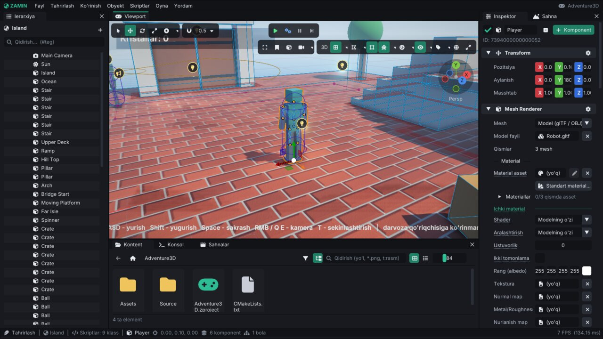

# Zamin Engine: component reference

Every entity of a scene is made of several components: placement (`TransformComponent`), picture
(`SpriteRendererComponent`, `MeshRendererComponent` ...), physics, audio, UI, script. This document lists **all** the
components of the engine: what each one does, where it is added in the editor, which key it is written with in the
scene file, which fields it has and how it is used from a script.

The part of each section between the `<!-- gen:... -->` markers (the inspector name, the menu path, the scene key, the
field table) is **generated from the source code** by `Tests/docs_components.py`: `Zamin/src/Zamin/Scene/Components.h`
(the `AllComponents` list and the structs), `Editor/src/Panels/SceneHierarchyPanel.cpp` (the inspector sections and
the **+ Component** menu) and `Zamin/src/Zamin/Scene/SceneSerializer.cpp` (the scene keys). When a component changes,
run `Tests/docs_components.py --update docs/Components.md`; `Tests/docs_check.py` (ctest: `DocsCheck`) detects stale
blocks and a new component that is not documented. The descriptions are written by hand.

In the tables: **Default** is the initial value in the code; _(runtime only)_ marks a field that is not saved to the
scene and that the engine or a script fills in while the game runs (for scripts to read). Angles are in radians in
`TransformComponent` and shown in degrees in the inspector.

Using components from a script: `GetComponent<T>()`, `TryGetComponent<T>()`, `HasComponent<T>()`, `AddComponent<T>()`
([Scripting.md](Scripting.md#7-obyektlar-komponentlar-ierarxiya)). In the editor: select the entity → **Inspector** →
**+ Component** (it has a search field); the gear menu in a component's header has **Copy component**, paste,
**Move up / Move down** and **Remove component**.



*The components of Adventure3D's `Player` entity in the inspector: Transform, Mesh Renderer (the `Models/Robot.gltf`
model) and others; at the top the active checkbox, the name and the **+ Component** button.*

Contents:

1. [Core](#1-core) — ID, name, Transform, hierarchy, tags
2. [Rendering](#2-rendering) — sprite, circle, text, mesh, animation, camera
3. [Lights](#3-lights)
4. [Physics 2D](#4-physics-2d)
5. [Physics 3D](#5-physics-3d)
6. [Navigation and AI](#6-navigation-and-ai)
7. [Effects and 2D helpers](#7-effects-and-2d-helpers)
8. [UI (screen interface)](#8-ui-screen-interface)
9. [Audio](#9-audio)
10. [Script, sub-scene and editor data](#10-script-sub-scene-and-editor-data)

---

## 1. Core

### IDComponent

The entity's permanent unique identifier (`UUID`, 64 bits). It is `"Entity"` in the scene file, and references
(`EntityRef`, the parent, a joint's connected body) are stored as this number. In a script: `GetEntity().GetUUID()`,
`GetScene().GetEntityByUUID(id)`. The inspector header shows it as `ID: ...`.

<!-- gen:IDComponent -->
_on every entity; in the scene file: `"Entity"`._

| Field | Type | Default |
|---|---|---|
| `ID` | `UUID` | — |
<!-- /gen:IDComponent -->

### TagComponent

The entity's **name** (`Tag`, what the hierarchy shows) and its own **active** flag (`Active`). An entity takes part
in the game only when it and all of its parents are active. Change the flag with `SetActive` (a script's
`SetActive(false)`, `entity.SetActive(...)`, `Scene::SetActive`) — then scripts get `OnDisable` / `OnEnable` at once;
a direct write is noticed on the next frame. In the inspector: the checkbox and the name field in the header. To
rename: `SetName("...")` (the `FindEntity` cache is updated). Do not confuse it with gameplay tags — those are
`TagsComponent`.

<!-- gen:TagComponent -->
_on every entity; in the scene file: `"Tag"` (name) and `"Active"`._

| Field | Type | Default |
|---|---|---|
| `Tag` | `std::string` | — |
| `Active` | `bool` | `true` |
<!-- /gen:TagComponent -->

### TransformComponent

The entity's position (`Translation`), rotation (`Rotation` — Euler angles, radians) and scale (`Scale`). A child's
transform is relative to its parent. In the inspector: **Position**, **Rotation** (degrees), **Scale**; in the
viewport with the gizmo (`W` / `E` / `R`). Helpers: `GetTransform()` (the matrix), `GetForward()` (-Z), `GetRight()`
(+X), `GetUp()` (+Y). World coordinates: `GetWorldPosition()` in a script, `GetScene().GetWorldPosition(entity)`.
Static and Kinematic 2D bodies follow the transform (a script may move them through the transform), while a Dynamic
body's position is written by physics — to move it use `SetPosition2D` / `SetPosition3D`.

```cpp
Transform().Rotation += Speed * (float)ts;   // Rotator (the new project template)
```

<!-- gen:TransformComponent -->
_In the inspector: **Transform**; on every entity; in the scene file: `"Transform"`._

| Field | Type | Default |
|---|---|---|
| `Translation` | `glm::vec3` | `{ 0.0f, 0.0f, 0.0f }` |
| `Rotation` | `glm::vec3` | `{ 0.0f, 0.0f, 0.0f }` |
| `Scale` | `glm::vec3` | `{ 1.0f, 1.0f, 1.0f }` |
<!-- /gen:TransformComponent -->

### RelationshipComponent

The parent / child hierarchy: `Parent` (0 — a root) and `Children`. In the Hierarchy panel an entity becomes a child
by dragging it onto another one; in a script `SetParent(parent, keepWorldTransform)`, `GetParent()`, `GetChildren()`
... ([Scripting.md](Scripting.md#7-obyektlar-komponentlar-ierarxiya)). Only `"Parent"` is written to the scene file;
the child lists are rebuilt on load.

<!-- gen:RelationshipComponent -->
_on every entity; in the scene file: `"Parent"`._

| Field | Type | Default |
|---|---|---|
| `Parent` | `UUID` | `0` |
| `Children` | `std::vector<UUID>` | — |
<!-- /gen:RelationshipComponent -->

### TagsComponent

Gameplay tags (`"Player"`, `"Enemy"`, `"Coin"` ...) — for grouping and finding entities. They are added in the
inspector's **Tags** section by typing (Enter) or by picking from the project's tag list (the list: **Project
settings → Tags**). Typing `#Enemy` in the hierarchy search lists the entities with that tag. In a script: `HasTag`,
`AddTag`, `RemoveTag`, `FindEntitiesWithTag`, `FindEntityWithTag`, `other.HasTag("Player")` (an indexed lookup).

<!-- gen:TagsComponent -->
_In the inspector: **Tags**; add with: **+ Component → Other → Tags**; in the scene file: `"Tags"`._

| Field | Type | Default |
|---|---|---|
| `Tags` | `std::vector<std::string>` | — |
<!-- /gen:TagsComponent -->

## 2. Rendering

Guide: [Rendering.md](Rendering.md) (camera, 2D, 3D, materials); animation — [Animation.md](Animation.md).

### SpriteRendererComponent

A 2D rectangular picture: a color (`Color`) and a texture (`TexturePath`, relative to `Assets`) or a named frame of
the texture (`SpriteName`, cut in the **Sprite editor**). `DrawMode`: `Simple` (a unit square, sized by the scale),
`Sliced` (9-slice: the corners keep their own size according to `SliceBorder`) and `Tiled` (fills `Size`).
`PixelArt` — crisp pixels (nearest), `FlipX` / `FlipY`, `Lit` — affected by 2D lights (`Light2DComponent`). 2D
renderers are drawn back to front by sorting layer (`SortingLayer`, **Project settings → Sorting layers**) and
`SortingOrder`. Effects: the hit flash (`FlashColor` / `FlashAmount`, `Flash()` in a script) and the outline
(`OutlineColor` / `OutlineThickness`, `SetOutline()`). With a UI Transform it is drawn on the screen. Create:
**Object → 2D → Sprite**.

<!-- gen:SpriteRendererComponent -->
_In the inspector: **Sprite Renderer**; add with: **+ Component → Rendering → Sprite Renderer**; in the scene file: `"SpriteRenderer"`._

| Field | Type | Default |
|---|---|---|
| `Color` | `glm::vec4` | `{ 1.0f, 1.0f, 1.0f, 1.0f }` |
| `Texture` | `Ref<Texture2D>` | — |
| `TexturePath` | `std::string` | — |
| `SpriteName` | `std::string` | — |
| `TilingFactor` | `float` | `1.0f` |
| `SortingLayer` | `uint32_t` | `0` |
| `SortingOrder` | `int` | `0` |
| `PixelArt` | `bool` | `false` |
| `FlipX` | `bool` | `false` |
| `FlipY` | `bool` | `false` |
| `Lit` | `bool` | `false` |
| `DrawMode` | `SpriteDrawMode` | `SpriteDrawMode::Simple` |
| `Size` | `glm::vec2` | `{ 1.0f }` |
| `SliceBorder` | `glm::vec4` | `{ 0.0f }` |
| `PixelsPerUnit` | `float` | `100.0f` |
| `FlashColor` | `glm::vec4` | `{ 1.0f }` |
| `FlashAmount` | `float` | `0.0f` |
| `OutlineColor` | `glm::vec4` | `{ 1.0f, 1.0f, 1.0f, 1.0f }` |
| `OutlineThickness` | `float` | `0.0f` |
| `FlashPlayingColor` _(runtime only)_ | `glm::vec4` | `{ 1.0f }` |
| `FlashTime` _(runtime only)_ | `float` | `0.0f` |
| `FlashDuration` _(runtime only)_ | `float` | `0.0f` |
<!-- /gen:SpriteRendererComponent -->

### SpriteAnimationComponent

Plays frames on the Sprite Renderer's texture: the cells of a texture grid (`Columns` x `Rows`, numbered left to
right, top to bottom; `StartFrame`, `FrameCount`, `FPS`, `Loop`) or the named frames of a sprite sheet (`Frames`).
`Clips` — `.zsanim` sprite clips: a script starts one by name with `PlaySpriteClip("HeroSide")`; a clip supplies the
frames, the speed, the looping and the events, and the first one starts with the game (`PlayOnStart`). Also from a
script: `GetComponent<SpriteAnimationComponent>().Play(start, count, fps, loop)` (the Platformer2D hero) and
`PlaySpriteSequence("run")`. Details: [Animation.md](Animation.md).

<!-- gen:SpriteAnimationComponent -->
_In the inspector: **Sprite Animation**; add with: **+ Component → Rendering → Sprite Animation**; in the scene file: `"SpriteAnimation"`._

| Field | Type | Default |
|---|---|---|
| `Columns` | `int` | `4` |
| `Rows` | `int` | `1` |
| `StartFrame` | `int` | `0` |
| `FrameCount` | `int` | `4` |
| `FPS` | `float` | `10.0f` |
| `Loop` | `bool` | `true` |
| `Playing` | `bool` | `true` |
| `Frames` | `std::vector<std::string>` | — |
| `Clips` | `std::vector<std::string>` | — |
| `PlayOnStart` | `bool` | `true` |
| `Time` _(runtime only)_ | `float` | `0.0f` |
| `CurrentClip` _(runtime only)_ | `int` | `-1` |
| `ClipAssets` _(runtime only)_ | `std::vector<Ref<SpriteClipAsset>>` | — |
| `LoadedClips` _(runtime only)_ | `std::vector<std::string>` | — |
| `AppliedRevision` _(runtime only)_ | `uint64_t` | `0` |
| `LastFrame` _(runtime only)_ | `int` | `-1` |
| `Started` _(runtime only)_ | `bool` | `false` |
| `DrivenUpdate` _(runtime only)_ | `uint64_t` | `0` |
| `DrivenState` _(runtime only)_ | `int` | `-1` |
<!-- /gen:SpriteAnimationComponent -->

### TintAnimationComponent

Animates the color of a 2D renderer (Sprite, Circle, Text, Tilemap) and of a Light 2D along a gradient: the drawn
color = the renderer's color x the gradient's color (`Keys`, at 0..1 of `Duration`). `Mode`: `Once`, `Loop`,
`PingPong`; `Cycles > 0` — that many times; `StartOffset` — so that copies do not blink in unison. The renderer's own
`Color` does not change. In a script: `PlayTint()`, `PlayTint(color, duration, mode, cycles)`, `StopTint()`,
`IsTintPlaying()`.

<!-- gen:TintAnimationComponent -->
_In the inspector: **Tint Animation**; add with: **+ Component → Rendering → Tint Animation (color)**; in the scene file: `"TintAnimation"`._

| Field | Type | Default |
|---|---|---|
| `Keys` | `std::vector<TintKey>` | `{ TintKey{ 0.0f, glm::vec4(1.0f) }, TintKey{ 1.0f, glm::vec4(1.0f, 0.35f, 0.3f, 1.0f) } }` |
| `Duration` | `float` | `1.0f` |
| `Mode` | `TintPlayMode` | `TintPlayMode::PingPong` |
| `Easing` | `Ease` | `Ease::InOutQuad` |
| `Cycles` | `int` | `0` |
| `StartOffset` | `float` | `0.0f` |
| `PlayOnStart` | `bool` | `true` |
| `Playing` _(runtime only)_ | `bool` | `false` |
| `EditorPreview` _(runtime only)_ | `bool` | `false` |
| `Elapsed` _(runtime only)_ | `float` | `0.0f` |
<!-- /gen:TintAnimationComponent -->

### CircleRendererComponent

A 2D circle or ring: `Color`, `Thickness` (1 — a filled circle, less — a ring), `Fade` (the softness of the edge),
the sorting layer and order. Create: **Object → 2D → Circle** or **Physics ball**. The coins of the
[2D tutorial](Tutorial-2D.md) are drawn with this component.

<!-- gen:CircleRendererComponent -->
_In the inspector: **Circle Renderer**; add with: **+ Component → Rendering → Circle Renderer**; in the scene file: `"CircleRenderer"`._

| Field | Type | Default |
|---|---|---|
| `Color` | `glm::vec4` | `{ 1.0f, 1.0f, 1.0f, 1.0f }` |
| `Thickness` | `float` | `1.0f` |
| `Fade` | `float` | `0.005f` |
| `SortingLayer` | `uint32_t` | `0` |
| `SortingOrder` | `int` | `0` |
<!-- /gen:CircleRendererComponent -->

### TextComponent

Text: `Text` (or `LocalizationKey` — automatically in the game's language), the color, letter / line spacing,
alignment (`AlignH`, `AlignV`), word wrapping (`WordWrap`), what happens when it does not fit (`Overflow`), the font
(`FontPath`, empty — the default Inter). With a UI Transform it is laid out in a screen rectangle (the font size is
the UI Transform's `FontSize`, otherwise the rectangle's height), without one in the world (1 unit = the font size).
Create: **Object → 2D → Text** or **Object → UI (screen) → Text**. In a script
`TryGetComponent<TextComponent>()->Text = ...` (ScoreHud, GameManager).

<!-- gen:TextComponent -->
_In the inspector: **Text**; add with: **+ Component → Rendering → Text**; in the scene file: `"Text"`._

| Field | Type | Default |
|---|---|---|
| `Text` | `std::string` | `"Text"` |
| `LocalizationKey` | `std::string` | — |
| `InputHints` | `bool` | `false` |
| `Color` | `glm::vec4` | `{ 1.0f }` |
| `Kerning` | `float` | `0.0f` |
| `LineSpacing` | `float` | `0.0f` |
| `AlignH` | `TextAlignH` | `TextAlignH::Left` |
| `AlignV` | `TextAlignV` | `TextAlignV::Middle` |
| `WordWrap` | `bool` | `false` |
| `Overflow` | `TextOverflow` | `TextOverflow::Overflow` |
| `MaxWidth` | `float` | `0.0f` |
| `FontPath` | `std::string` | — |
| `FontAsset` | `Ref<Font>` | — |
| `SortingLayer` | `uint32_t` | `0` |
| `SortingOrder` | `int` | `1000` |
| `LocalizedText` _(runtime only)_ | `std::string` | — |
| `LocalizedFor` _(runtime only)_ | `std::string` | — |
| `LocalizedVersion` _(runtime only)_ | `uint64_t` | `0` |
| `HasLocalizedText` _(runtime only)_ | `bool` | `false` |
| `HintsVersion` _(runtime only)_ | `uint64_t` | `0` |
| `HintsSource` _(runtime only)_ | `std::string` | — |
| `HintsFromText` _(runtime only)_ | `bool` | `false` |
<!-- /gen:TextComponent -->

### MeshRendererComponent

A 3D mesh: a primitive (`Type`: `Cube`, `Sphere`, `Plane`, `Cylinder`, `Cone`) or a model (`Model`, `ModelPath` —
`.gltf` / `.glb` / `.obj`). The material: an asset (`MaterialPath`, `.zmat`; `SubmeshMaterials` for each part of a
model) or the built-in material (`Mat`: albedo, metallic, roughness, emission, textures ...). `CastShadows` — casts a
shadow. `MorphWeights` — the weights of glTF blend shapes (`SetMorphWeight("Smile", 0.8f)`). In a script:
`GetMaterial()` — the entity's own copy of the material, `GetSharedMaterial()`, `SetSharedMaterial(path)`
([Scripting.md](Scripting.md#14-grafika-rang-va-effektlar)). Create: **Object → 3D → Cube / Sphere / Plane / Cylinder
/ Cone / Model (glTF / OBJ)**.

<!-- gen:MeshRendererComponent -->
_In the inspector: **Mesh Renderer**; add with: **+ Component → Rendering → Mesh Renderer**; in the scene file: `"MeshRenderer"`._

| Field | Type | Default |
|---|---|---|
| `Type` | `PrimitiveMesh` | `PrimitiveMesh::Cube` |
| `ModelPath` | `std::string` | — |
| `MeshAsset` _(runtime only)_ | `Ref<Mesh>` | — |
| `ModelAsset` _(runtime only)_ | `Ref<Model>` | — |
| `MaterialPath` | `std::string` | — |
| `SubmeshMaterials` | `std::vector<std::string>` | — |
| `MaterialRef` _(runtime only)_ | `Ref<MaterialAsset>` | — |
| `SubmeshMaterialRefs` _(runtime only)_ | `std::vector<Ref<MaterialAsset>>` | — |
| `MaterialInstance` _(runtime only)_ | `Ref<MaterialAsset>` | — |
| `SubmeshMaterialInstances` _(runtime only)_ | `std::vector<Ref<MaterialAsset>>` | — |
| `Mat` | `Material` | — |
| `AlbedoPath` | `std::string` | — |
| `NormalPath` | `std::string` | — |
| `MetalRoughPath` | `std::string` | — |
| `EmissivePath` | `std::string` | — |
| `CastShadows` | `bool` | `true` |
| `MorphWeights` | `std::vector<float>` | — |
| `MorphMeshes` _(runtime only)_ | `std::vector<Ref<Mesh>>` | — |
| `MorphMeshWeights` _(runtime only)_ | `std::vector<std::vector<float>>` | — |
| `MorphMeshSources` _(runtime only)_ | `std::vector<const Mesh*>` | — |
| `MorphMeshOwner` _(runtime only)_ | `uint64_t` | `0` |
<!-- /gen:MeshRendererComponent -->

### AnimatorComponent

Plays the skeletal animations of a skinned glTF model. Two ways: directly with `Play("Walk", loop, speed, fade)`, or
a state machine — `Parameters` (float, bool, trigger), `States` (a clip, a 1D/2D blend), `Transitions` (conditions,
exit time, Priority, fade interruption) — where the script only sets parameters (`SetFloat("Speed", v)`, `SetBool`,
`SetTrigger`). Layers (`Layers`, with an avatar mask), root motion (`ApplyRootMotion`), events (`Events`), no
evaluation while invisible (`Culling`) and the pose cache (`CachePoses`). The graph can be edited in **Window →
Animator graph**. For 2D states without a model there is State Duration; typed parameters / damping and the Blueprint
bridge are available as well. Details: [Animation.md](Animation.md); samples: `Projects/Adventure3D` (Robot),
`Projects/VisualWorkshop`.

<!-- gen:AnimatorComponent -->
_In the inspector: **Animator**; add with: **+ Component → Rendering → Animator (skeletal)**; in the scene file: `"Animator"`._

| Field | Type | Default |
|---|---|---|
| `Clip` | `std::string` | — |
| `Speed` | `float` | `1.0f` |
| `Loop` | `bool` | `true` |
| `Playing` | `bool` | `true` |
| `PlayInEditor` | `bool` | `true` |
| `DefaultFade` | `float` | `0.2f` |
| `Time` | `float` | `0.0f` |
| `BlendTree` _(runtime only)_ | `int` | `-1` |
| `JointMatrices` _(runtime only)_ | `std::vector<glm::mat4>` | — |
| `BlendWeights` _(runtime only)_ | `std::vector<float>` | — |
| `PreviousClip` _(runtime only)_ | `std::string` | — |
| `PreviousBlendTree` _(runtime only)_ | `int` | `-1` |
| `PreviousState` _(runtime only)_ | `int` | `-1` |
| `PreviousTime` _(runtime only)_ | `float` | `0.0f` |
| `PreviousSpeed` _(runtime only)_ | `float` | `1.0f` |
| `PreviousLoop` _(runtime only)_ | `bool` | `true` |
| `FadeDuration` _(runtime only)_ | `float` | `0.0f` |
| `FadeElapsed` _(runtime only)_ | `float` | `0.0f` |
| `MorphWeights` _(runtime only)_ | `std::vector<float>` | — |
| `EditorPreview` | `EditorPreviewState` | — |
| `Events` | `std::vector<AnimatorEvent>` | — |
| `EventsAtStart` _(runtime only)_ | `bool` | `true` |
| `ApplyRootMotion` | `bool` | `false` |
| `RootMotionBone` | `std::string` | — |
| `Culling` | `AnimatorCulling` | `AnimatorCulling::AlwaysAnimate` |
| `CachePoses` | `bool` | `false` |
| `PoseCacheRate` | `float` | `30.0f` |
| `DriveSpriteClips` | `bool` | `false` |
| `VisibleFrame` _(runtime only)_ | `uint64_t` | `0` |
| `Culled` _(runtime only)_ | `bool` | `false` |
| `PoseSignature` _(runtime only)_ | `std::vector<uint32_t>` | — |
| `RootMotionVelocity` _(runtime only)_ | `glm::vec3` | `{ 0.0f }` |
| `RootMotionTurnRate` _(runtime only)_ | `float` | `0.0f` |
| `Layers` | `std::vector<AnimatorLayer>` | — |
| `Parameters` | `std::vector<AnimatorParameter>` | — |
| `States` | `std::vector<AnimatorState>` | — |
| `Transitions` | `std::vector<AnimatorTransition>` | — |
| `DefaultState` | `int` | `0` |
| `CurrentState` _(runtime only)_ | `int` | `-1` |
| `StateMachinePaused` _(runtime only)_ | `bool` | `false` |
| `AnyStateGraphPosition` | `glm::vec2` | `{ 0.0f }` |
<!-- /gen:AnimatorComponent -->

### AnimationPlayerComponent

Plays property animation clips (`.zanim`, made on the timeline of **Window → Animation**) on the entity and its
children: the transform, colors, lights, UI and `float` script fields, with events. The first clip starts with the
game (`PlayOnStart`); `Wrap` — what happens at the end of a clip. In a script: `PlayAnimation("DoorOpen")`,
`PlayAnimation("DoorOpen", -1.0f)` (backwards), `StopAnimation()` or
`GetComponent<AnimationPlayerComponent>().Play(...)`. Sample: the Adventure3D gate
(`Animations/GateOpening.zanim`). Details: [Animation.md](Animation.md).

<!-- gen:AnimationPlayerComponent -->
_In the inspector: **Animation Player**; add with: **+ Component → Rendering → Animation Player (.zanim clips)**; in the scene file: `"AnimationPlayer"`._

| Field | Type | Default |
|---|---|---|
| `Clips` | `std::vector<std::string>` | — |
| `Speed` | `float` | `1.0f` |
| `PlayOnStart` | `bool` | `true` |
| `Wrap` | `AnimationPlayerWrap` | `AnimationPlayerWrap::Clip` |
| `ClipAssets` _(runtime only)_ | `std::vector<Ref<PropertyClipAsset>>` | — |
| `LoadedClips` _(runtime only)_ | `std::vector<std::string>` | — |
| `Current` _(runtime only)_ | `int` | `-1` |
| `Cursor` _(runtime only)_ | `ClipCursor` | — |
| `PlaySpeed` _(runtime only)_ | `float` | `1.0f` |
| `Playing` _(runtime only)_ | `bool` | `false` |
| `Started` _(runtime only)_ | `bool` | `false` |
| `PoseDirty` _(runtime only)_ | `bool` | `false` |
<!-- /gen:AnimationPlayerComponent -->

### CameraComponent

A camera: `Camera` (`SceneCamera` — the projection is **Perspective** or **Orthographic**, the field of view /
orthographic size, the near and far planes), `Primary` — the game is shown from this camera (there has to be one
primary camera; a scene without one is not drawn), `FixedAspectRatio`, `ClearColor` (the background color when no sky
is drawn), `Shake` (the shake settings: `ShakeCamera()` in a script), `PixelPerfect` (for 2D pixel art). Create:
**Object → Camera → Perspective (3D)** or **Orthographic (2D)**.

<!-- gen:CameraComponent -->
_In the inspector: **Camera**; add with: **+ Component → Rendering → Camera**; in the scene file: `"Camera"`._

| Field | Type | Default |
|---|---|---|
| `Camera` | `SceneCamera` | — |
| `Primary` | `bool` | `true` |
| `FixedAspectRatio` | `bool` | `false` |
| `ClearColor` | `glm::vec4` | `{ 0.08f, 0.09f, 0.11f, 1.0f }` |
| `Shake` | `CameraShake` | — |
| `PixelPerfect` | `PixelPerfectSettings` | — |
<!-- /gen:CameraComponent -->

## 3. Lights

Guide: [Rendering.md](Rendering.md#9-yorugliklar).

### DirectionalLightComponent

Parallel rays like the sun's: along the entity's forward (-Z) direction. `Color`, `Intensity`, `CastShadows`
(cascaded shadows; their quality is in **Scene settings**). There can be several suns. Create: **Object → Light → Sun
(directional)**.

<!-- gen:DirectionalLightComponent -->
_In the inspector: **Directional Light**; add with: **+ Component → Light → Directional Light**; in the scene file: `"DirectionalLight"`._

| Field | Type | Default |
|---|---|---|
| `Color` | `glm::vec3` | `{ 1.0f, 0.96f, 0.9f }` |
| `Intensity` | `float` | `3.0f` |
| `CastShadows` | `bool` | `true` |
<!-- /gen:DirectionalLightComponent -->

### PointLightComponent

Light that spreads from a point in every direction (a lamp, a fire, a crystal): `Color`, `Intensity`, `Radius` (the
reach). Create: **Object → Light → Point**.

<!-- gen:PointLightComponent -->
_In the inspector: **Point Light**; add with: **+ Component → Light → Point Light**; in the scene file: `"PointLight"`._

| Field | Type | Default |
|---|---|---|
| `Color` | `glm::vec3` | `{ 1.0f }` |
| `Intensity` | `float` | `5.0f` |
| `Radius` | `float` | `10.0f` |
<!-- /gen:PointLightComponent -->

### SpotLightComponent

A cone of light looking forward (-Z) from the entity's position (a flashlight, a stage lamp): fully lit inside
`InnerAngle`, fading smoothly out to `OuterAngle` (degrees, from the axis); `Range` — the distance. Create: **Object
→ Light → Spot (cone)** (4 m up, looking down).

<!-- gen:SpotLightComponent -->
_In the inspector: **Spot Light**; add with: **+ Component → Light → Spot Light**; in the scene file: `"SpotLight"`._

| Field | Type | Default |
|---|---|---|
| `Color` | `glm::vec3` | `{ 1.0f }` |
| `Intensity` | `float` | `20.0f` |
| `Range` | `float` | `15.0f` |
| `InnerAngle` | `float` | `20.0f` |
| `OuterAngle` | `float` | `30.0f` |
<!-- /gen:SpotLightComponent -->

### Light2DComponent

A 2D light (it affects only sprites / tilemaps with `Lit` on; the scene's 2D ambient light is in **Scene
settings**): `Type` — `Point` or `Spot` (`SpotAngle`, `SpotSoftness`), `Radius`, `InnerRadius`, `Falloff`, flicker
(`Flicker`, `FlickerSpeed` — for fire).

<!-- gen:Light2DComponent -->
_In the inspector: **Light 2D**; add with: **+ Component → Light → Light 2D**; in the scene file: `"Light2D"`._

| Field | Type | Default |
|---|---|---|
| `Type` | `Light2DType` | `Light2DType::Point` |
| `Color` | `glm::vec3` | `{ 1.0f, 0.85f, 0.6f }` |
| `Intensity` | `float` | `1.0f` |
| `Radius` | `float` | `4.0f` |
| `InnerRadius` | `float` | `0.0f` |
| `Falloff` | `float` | `2.0f` |
| `SpotAngle` | `float` | `60.0f` |
| `SpotSoftness` | `float` | `0.3f` |
| `Flicker` | `float` | `0.0f` |
| `FlickerSpeed` | `float` | `8.0f` |
<!-- /gen:Light2DComponent -->

## 4. Physics 2D

2D physics is Box2D. A body (`Rigidbody2DComponent`) and one or more colliders sit on the same entity; a collider
without a body is not added to the physics world. Gravity and step settings are in **Scene settings → Physics 2D**,
the project default in **Project settings** ([ProjectSettings.md](ProjectSettings.md)). The fields the colliders
share: `Density`, `Friction`, `Restitution` (bounciness), `RestitutionThreshold`, `IsSensor` (**Trigger (sensor)** in
the inspector — it does not collide and gives `OnTriggerBegin` / `OnTriggerEnd`), `MaterialPath` (a `.zphysmat`
physics material — when set, it replaces the values above), `Layer` (-1 — the body's layer).
Guide (settings, script API, queries, samples): [Physics.md](Physics.md).

### Rigidbody2DComponent

A 2D body. `Type` (**Type** in the inspector): `Static` (does not move: ground, walls), `Dynamic` (forces and gravity
act on it), `Kinematic` (moved only by velocity / a script, carries what stands on it). `FixedRotation` (**Freeze
rotation** — for characters), `GravityScale`, damping, `Bullet` (so that fast entities do not pass through walls),
`Layer` (the collision layer, **Project settings → Physics layers**), `Sleeping` (the sleep mode). In a script:
`GetVelocity`, `SetVelocity`, `ApplyImpulse`, `ApplyForce`, `SetPosition2D`, `IsSleeping`, `WakeUp`. Create: **Object
→ 2D → Physics box / Physics ball** (Sprite/Circle + Rigidbody 2D + a collider).

<!-- gen:Rigidbody2DComponent -->
_In the inspector: **Rigidbody 2D**; add with: **+ Component → Physics 2D → Rigidbody 2D**; in the scene file: `"Rigidbody2D"`._

| Field | Type | Default |
|---|---|---|
| `Type` | `BodyType` | `BodyType::Dynamic` |
| `FixedRotation` | `bool` | `false` |
| `GravityScale` | `float` | `1.0f` |
| `LinearDamping` | `float` | `0.0f` |
| `AngularDamping` | `float` | `0.01f` |
| `Bullet` | `bool` | `false` |
| `Layer` | `int` | `0` |
| `Sleeping` | `SleepMode` | `SleepMode::StartAwake` |
| `RuntimeBody` _(runtime only)_ | `void*` | `nullptr` |
<!-- /gen:Rigidbody2DComponent -->

### BoxCollider2DComponent

A rectangular collider. `Size` is the **half** size (**Half extents** in the inspector; multiplied by the transform's
scale: scale 1 and `Size` 0.5 make a 1x1 square), `Offset`. `OneWay` — a one-way platform (jumped through from below,
landed on from above; dropped through with `DropThroughPlatforms()`).

<!-- gen:BoxCollider2DComponent -->
_In the inspector: **Box Collider 2D**; add with: **+ Component → Physics 2D → Box Collider 2D**; in the scene file: `"BoxCollider2D"`._

| Field | Type | Default |
|---|---|---|
| `Offset` | `glm::vec2` | `{ 0.0f, 0.0f }` |
| `Size` | `glm::vec2` | `{ 0.5f, 0.5f }` |
| `Density` | `float` | `1.0f` |
| `Friction` | `float` | `0.5f` |
| `Restitution` | `float` | `0.0f` |
| `RestitutionThreshold` | `float` | `0.5f` |
| `IsSensor` | `bool` | `false` |
| `MaterialPath` | `std::string` | — |
| `Layer` | `int` | `-1` |
| `OneWay` | `bool` | `false` |
| `RuntimeFixture` _(runtime only)_ | `void*` | `nullptr` |
<!-- /gen:BoxCollider2DComponent -->

### CircleCollider2DComponent

A circle collider: `Radius` (multiplied by the scale), `Offset`. The coins of Platformer2D: a Static body + a sensor
circle.

<!-- gen:CircleCollider2DComponent -->
_In the inspector: **Circle Collider 2D**; add with: **+ Component → Physics 2D → Circle Collider 2D**; in the scene file: `"CircleCollider2D"`._

| Field | Type | Default |
|---|---|---|
| `Offset` | `glm::vec2` | `{ 0.0f, 0.0f }` |
| `Radius` | `float` | `0.5f` |
| `Density` | `float` | `1.0f` |
| `Friction` | `float` | `0.5f` |
| `Restitution` | `float` | `0.0f` |
| `RestitutionThreshold` | `float` | `0.5f` |
| `IsSensor` | `bool` | `false` |
| `MaterialPath` | `std::string` | — |
| `Layer` | `int` | `-1` |
| `RuntimeFixture` _(runtime only)_ | `void*` | `nullptr` |
<!-- /gen:CircleCollider2DComponent -->

### PolygonCollider2DComponent

Any polygon (`Points`, in the entity's coordinates). A concave or long shape is split automatically into convex
pieces of up to 8 vertices; an outline that crosses itself works as its convex hull. The points are edited in the
viewport; the outline can also be taken from a sprite.

<!-- gen:PolygonCollider2DComponent -->
_In the inspector: **Polygon Collider 2D**; add with: **+ Component → Physics 2D → Polygon Collider 2D (polygon)**; in the scene file: `"PolygonCollider2D"`._

| Field | Type | Default |
|---|---|---|
| `Offset` | `glm::vec2` | `{ 0.0f, 0.0f }` |
| `Points` | `std::vector<glm::vec2>` | `{ { -0.5f, -0.5f }, { 0.5f, -0.5f }, { 0.5f, 0.2f }, { 0.0f, 0.5f }, { -0.5f, 0.2f } }` |
| `Density` | `float` | `1.0f` |
| `Friction` | `float` | `0.5f` |
| `Restitution` | `float` | `0.0f` |
| `RestitutionThreshold` | `float` | `0.5f` |
| `IsSensor` | `bool` | `false` |
| `MaterialPath` | `std::string` | — |
| `Layer` | `int` | `-1` |
| `RuntimeFixture` _(runtime only)_ | `void*` | `nullptr` |
| `RuntimePieces` _(runtime only)_ | `int` | `0` |
<!-- /gen:PolygonCollider2DComponent -->

### EdgeCollider2DComponent

A line through points (an open chain) or a closed loop (`Loop`): ground, slopes, walls. It has no area (no mass).
`OneSided` — a smooth chain that stops bodies from one side only (nothing catches on its corners).

<!-- gen:EdgeCollider2DComponent -->
_In the inspector: **Edge Collider 2D**; add with: **+ Component → Physics 2D → Edge Collider 2D (line/chain)**; in the scene file: `"EdgeCollider2D"`._

| Field | Type | Default |
|---|---|---|
| `Offset` | `glm::vec2` | `{ 0.0f, 0.0f }` |
| `Points` | `std::vector<glm::vec2>` | `{ { -1.0f, 0.0f }, { 1.0f, 0.0f } }` |
| `Loop` | `bool` | `false` |
| `OneSided` | `bool` | `false` |
| `Density` | `float` | `1.0f` |
| `Friction` | `float` | `0.5f` |
| `Restitution` | `float` | `0.0f` |
| `RestitutionThreshold` | `float` | `0.5f` |
| `IsSensor` | `bool` | `false` |
| `MaterialPath` | `std::string` | — |
| `Layer` | `int` | `-1` |
| `RuntimeFixture` _(runtime only)_ | `void*` | `nullptr` |
<!-- /gen:EdgeCollider2DComponent -->

### PlatformEffector2DComponent

Turns the entity's colliders (or a tilemap's tiles) into a platform: `OneWay` — passed through from below / the
sides, landed on from above (it collides within `SurfaceArc` degrees; 180 is the classic one-way platform),
`RotationOffset`, friction / bounce on the sides (`UseSideFriction`, `UseSideBounce`, `SideArc`). Sample:
`Projects/Platformer2D/Assets/Scenes/Shapes2D.zscene`. Details: [Physics.md](Physics.md#4-2d-effektorlar-platforma-shamol-suv).

<!-- gen:PlatformEffector2DComponent -->
_In the inspector: **Platform Effector 2D**; add with: **+ Component → Physics 2D → Platform Effector 2D (one-way)**; in the scene file: `"PlatformEffector2D"`._

| Field | Type | Default |
|---|---|---|
| `OneWay` | `bool` | `true` |
| `SurfaceArc` | `float` | `180.0f` |
| `RotationOffset` | `float` | `0.0f` |
| `UseSideFriction` | `bool` | `false` |
| `UseSideBounce` | `bool` | `false` |
| `SideArc` | `float` | `1.0f` |
<!-- /gen:PlatformEffector2DComponent -->

### AreaEffector2DComponent

Pushes the dynamic bodies inside its colliders (wind, an air stream, a water current): every step the force
`ForceMagnitude` in the direction `ForceAngle` (`UseGlobalAngle` — a world angle), `ForceVariation` — a random
addition, `Drag` / `AngularDrag` — slowing down, `ColliderMask` — which layers it affects. Usually with a trigger
collider on a Static body.

<!-- gen:AreaEffector2DComponent -->
_In the inspector: **Area Effector 2D**; add with: **+ Component → Physics 2D → Area Effector 2D (wind)**; in the scene file: `"AreaEffector2D"`._

| Field | Type | Default |
|---|---|---|
| `ForceAngle` | `float` | `90.0f` |
| `UseGlobalAngle` | `bool` | `false` |
| `ForceMagnitude` | `float` | `10.0f` |
| `ForceVariation` | `float` | `0.0f` |
| `ScaleWithMass` | `bool` | `false` |
| `Drag` | `float` | `0.0f` |
| `AngularDrag` | `float` | `0.0f` |
| `ColliderMask` | `uint16_t` | `0xFFFF` |
| `AffectedBodies` _(runtime only)_ | `int` | `0` |
<!-- /gen:AreaEffector2DComponent -->

### BuoyancyEffector2DComponent

A fluid (water): inside the collider up to `SurfaceLevel`. It pushes a body up with the weight of the fluid the body
displaces (a collider lighter than `Density` floats), slows it with `LinearDrag` / `AngularDrag` and carries it along
with the `FlowAngle` / `FlowMagnitude` current. The collider has to be a trigger (the inspector warns).

<!-- gen:BuoyancyEffector2DComponent -->
_In the inspector: **Buoyancy Effector 2D**; add with: **+ Component → Physics 2D → Buoyancy Effector 2D (water)**; in the scene file: `"BuoyancyEffector2D"`._

| Field | Type | Default |
|---|---|---|
| `SurfaceLevel` | `float` | `0.5f` |
| `Density` | `float` | `2.0f` |
| `LinearDrag` | `float` | `1.5f` |
| `AngularDrag` | `float` | `1.0f` |
| `FlowAngle` | `float` | `0.0f` |
| `FlowMagnitude` | `float` | `0.0f` |
| `FlowVariation` | `float` | `0.0f` |
| `ColliderMask` | `uint16_t` | `0xFFFF` |
| `AffectedBodies` _(runtime only)_ | `int` | `0` |
| `SubmergedArea` _(runtime only)_ | `float` | `0.0f` |
<!-- /gen:BuoyancyEffector2DComponent -->

### DistanceJoint2DComponent

Keeps the distance between two anchors: a rigid rod, a rope (`MaxDistanceOnly`) or a spring (`Frequency`,
`DampingRatio`). The fields all 2D joints share: `ConnectedBody` (empty — to a point of the world), `Anchor` /
`ConnectedAnchor`, `AutoConfigureConnectedAnchor`, `CollideConnected`, `BreakForce` / `BreakTorque` (0 — never
breaks; when it breaks the script gets `OnJointBreak` and `Broken` is set), the runtime `ReactionForce` /
`ReactionTorque`. Sample: `Projects/Platformer2D/Assets/Scenes/Joints2D.zscene`.

<!-- gen:DistanceJoint2DComponent -->
_In the inspector: **Distance Joint 2D**; add with: **+ Component → Physics 2D → Distance Joint 2D (distance)**; in the scene file: `"DistanceJoint2D"`._

| Field | Type | Default |
|---|---|---|
| `ConnectedBody` | `EntityRef` | — |
| `Anchor` | `glm::vec2` | `{ 0.0f }` |
| `ConnectedAnchor` | `glm::vec2` | `{ 0.0f }` |
| `AutoConfigureConnectedAnchor` | `bool` | `true` |
| `CollideConnected` | `bool` | `false` |
| `BreakForce` | `float` | `0.0f` |
| `BreakTorque` | `float` | `0.0f` |
| `RuntimeJoint` _(runtime only)_ | `void*` | `nullptr` |
| `RuntimeConnected` _(runtime only)_ | `uint64_t` | `0` |
| `Broken` _(runtime only)_ | `bool` | `false` |
| `ReactionForce` _(runtime only)_ | `float` | `0.0f` |
| `ReactionTorque` _(runtime only)_ | `float` | `0.0f` |
| `AutoConfigureDistance` | `bool` | `true` |
| `Distance` | `float` | `1.0f` |
| `MaxDistanceOnly` | `bool` | `false` |
| `Frequency` | `float` | `0.0f` |
| `DampingRatio` | `float` | `0.0f` |
| `CurrentDistance` _(runtime only)_ | `float` | `0.0f` |

_The fields at the top of the table are inherited from `Joint2DComponentBase`._
<!-- /gen:DistanceJoint2DComponent -->

### RevoluteJoint2DComponent

A hinge: the bodies rotate around a common point; limits (`EnableLimit`, `LowerAngle`, `UpperAngle`) and a motor
(`EnableMotor`, `MotorSpeed`, `MaxMotorTorque`). At runtime `JointAngle`, `JointSpeed`.

<!-- gen:RevoluteJoint2DComponent -->
_In the inspector: **Revolute Joint 2D**; add with: **+ Component → Physics 2D → Revolute Joint 2D (hinge)**; in the scene file: `"RevoluteJoint2D"`._

| Field | Type | Default |
|---|---|---|
| `ConnectedBody` | `EntityRef` | — |
| `Anchor` | `glm::vec2` | `{ 0.0f }` |
| `ConnectedAnchor` | `glm::vec2` | `{ 0.0f }` |
| `AutoConfigureConnectedAnchor` | `bool` | `true` |
| `CollideConnected` | `bool` | `false` |
| `BreakForce` | `float` | `0.0f` |
| `BreakTorque` | `float` | `0.0f` |
| `RuntimeJoint` _(runtime only)_ | `void*` | `nullptr` |
| `RuntimeConnected` _(runtime only)_ | `uint64_t` | `0` |
| `Broken` _(runtime only)_ | `bool` | `false` |
| `ReactionForce` _(runtime only)_ | `float` | `0.0f` |
| `ReactionTorque` _(runtime only)_ | `float` | `0.0f` |
| `EnableLimit` | `bool` | `false` |
| `LowerAngle` | `float` | `-45.0f` |
| `UpperAngle` | `float` | `45.0f` |
| `EnableMotor` | `bool` | `false` |
| `MotorSpeed` | `float` | `0.0f` |
| `MaxMotorTorque` | `float` | `10.0f` |
| `JointAngle` _(runtime only)_ | `float` | `0.0f` |
| `JointSpeed` _(runtime only)_ | `float` | `0.0f` |

_The fields at the top of the table are inherited from `Joint2DComponentBase`._
<!-- /gen:RevoluteJoint2DComponent -->

### PrismaticJoint2DComponent

Sliding: the body moves relative to the connected body only along `Axis`, without rotating; with a limit and a motor
(a lift, a piston).

<!-- gen:PrismaticJoint2DComponent -->
_In the inspector: **Prismatic Joint 2D**; add with: **+ Component → Physics 2D → Prismatic Joint 2D (slide)**; in the scene file: `"PrismaticJoint2D"`._

| Field | Type | Default |
|---|---|---|
| `ConnectedBody` | `EntityRef` | — |
| `Anchor` | `glm::vec2` | `{ 0.0f }` |
| `ConnectedAnchor` | `glm::vec2` | `{ 0.0f }` |
| `AutoConfigureConnectedAnchor` | `bool` | `true` |
| `CollideConnected` | `bool` | `false` |
| `BreakForce` | `float` | `0.0f` |
| `BreakTorque` | `float` | `0.0f` |
| `RuntimeJoint` _(runtime only)_ | `void*` | `nullptr` |
| `RuntimeConnected` _(runtime only)_ | `uint64_t` | `0` |
| `Broken` _(runtime only)_ | `bool` | `false` |
| `ReactionForce` _(runtime only)_ | `float` | `0.0f` |
| `ReactionTorque` _(runtime only)_ | `float` | `0.0f` |
| `Axis` | `glm::vec2` | `{ 1.0f, 0.0f }` |
| `EnableLimit` | `bool` | `false` |
| `LowerTranslation` | `float` | `-1.0f` |
| `UpperTranslation` | `float` | `1.0f` |
| `EnableMotor` | `bool` | `false` |
| `MotorSpeed` | `float` | `0.0f` |
| `MaxMotorForce` | `float` | `10.0f` |
| `JointTranslation` _(runtime only)_ | `float` | `0.0f` |
| `JointSpeed` _(runtime only)_ | `float` | `0.0f` |

_The fields at the top of the table are inherited from `Joint2DComponentBase`._
<!-- /gen:PrismaticJoint2DComponent -->

### WeldJoint2DComponent

Welds the bodies together (rigidly, or springy around the angle with `Frequency`).

<!-- gen:WeldJoint2DComponent -->
_In the inspector: **Weld Joint 2D**; add with: **+ Component → Physics 2D → Weld Joint 2D (weld)**; in the scene file: `"WeldJoint2D"`._

| Field | Type | Default |
|---|---|---|
| `ConnectedBody` | `EntityRef` | — |
| `Anchor` | `glm::vec2` | `{ 0.0f }` |
| `ConnectedAnchor` | `glm::vec2` | `{ 0.0f }` |
| `AutoConfigureConnectedAnchor` | `bool` | `true` |
| `CollideConnected` | `bool` | `false` |
| `BreakForce` | `float` | `0.0f` |
| `BreakTorque` | `float` | `0.0f` |
| `RuntimeJoint` _(runtime only)_ | `void*` | `nullptr` |
| `RuntimeConnected` _(runtime only)_ | `uint64_t` | `0` |
| `Broken` _(runtime only)_ | `bool` | `false` |
| `ReactionForce` _(runtime only)_ | `float` | `0.0f` |
| `ReactionTorque` _(runtime only)_ | `float` | `0.0f` |
| `Frequency` | `float` | `0.0f` |
| `DampingRatio` | `float` | `0.0f` |

_The fields at the top of the table are inherited from `Joint2DComponentBase`._
<!-- /gen:WeldJoint2DComponent -->

### WheelJoint2DComponent

A wheel: this body (the wheel) turns freely around the anchor and rides on the connected body (the chassis) along
`Axis` on a suspension spring; the motor turns the wheel.

<!-- gen:WheelJoint2DComponent -->
_In the inspector: **Wheel Joint 2D**; add with: **+ Component → Physics 2D → Wheel Joint 2D (wheel)**; in the scene file: `"WheelJoint2D"`._

| Field | Type | Default |
|---|---|---|
| `ConnectedBody` | `EntityRef` | — |
| `Anchor` | `glm::vec2` | `{ 0.0f }` |
| `ConnectedAnchor` | `glm::vec2` | `{ 0.0f }` |
| `AutoConfigureConnectedAnchor` | `bool` | `true` |
| `CollideConnected` | `bool` | `false` |
| `BreakForce` | `float` | `0.0f` |
| `BreakTorque` | `float` | `0.0f` |
| `RuntimeJoint` _(runtime only)_ | `void*` | `nullptr` |
| `RuntimeConnected` _(runtime only)_ | `uint64_t` | `0` |
| `Broken` _(runtime only)_ | `bool` | `false` |
| `ReactionForce` _(runtime only)_ | `float` | `0.0f` |
| `ReactionTorque` _(runtime only)_ | `float` | `0.0f` |
| `Axis` | `glm::vec2` | `{ 0.0f, 1.0f }` |
| `Frequency` | `float` | `4.0f` |
| `DampingRatio` | `float` | `0.7f` |
| `EnableLimit` | `bool` | `false` |
| `LowerTranslation` | `float` | `-0.25f` |
| `UpperTranslation` | `float` | `0.25f` |
| `EnableMotor` | `bool` | `false` |
| `MotorSpeed` | `float` | `0.0f` |
| `MaxMotorTorque` | `float` | `10.0f` |
| `JointTranslation` _(runtime only)_ | `float` | `0.0f` |
| `JointSpeed` _(runtime only)_ | `float` | `0.0f` |

_The fields at the top of the table are inherited from `Joint2DComponentBase`._
<!-- /gen:WheelJoint2DComponent -->

## 5. Physics 3D

3D physics is Jolt. A collider is added to the physics world only on an entity that has a `Rigidbody3DComponent`
(triggers too: for example a Static body + a sensor collider). The fields the colliders share: `Offset`, `Friction`,
`Restitution`, `IsSensor` (**Trigger (sensor)**), `MaterialPath` (`.zphysmat`). Sizes are multiplied by the
transform's scale. For a character use `CharacterController3DComponent` instead of a body.
Guide: [Physics.md](Physics.md#6-3d-jismlar-va-colliderlar).

### Rigidbody3DComponent

A 3D body: `Type` — `Static`, `Dynamic`, `Kinematic`; `Mass`, damping, `GravityFactor`, `LockRotation` (stays
upright), `Layer`, `ContinuousCollision` (for small fast bodies), `Sleeping`. In a script: `GetVelocity3D`,
`SetVelocity3D`, `ApplyImpulse3D`, `ApplyForce3D`, `ApplyTorque3D`, `SetPosition3D` ... Create: **Object → 3D →
Physics cube / Physics ball / Physics ground (static)**.

<!-- gen:Rigidbody3DComponent -->
_In the inspector: **Rigidbody 3D**; add with: **+ Component → Physics 3D → Rigidbody 3D**; in the scene file: `"Rigidbody3D"`._

| Field | Type | Default |
|---|---|---|
| `Type` | `BodyType` | `BodyType::Dynamic` |
| `Mass` | `float` | `1.0f` |
| `LinearDamping` | `float` | `0.05f` |
| `AngularDamping` | `float` | `0.05f` |
| `GravityFactor` | `float` | `1.0f` |
| `LockRotation` | `bool` | `false` |
| `Layer` | `int` | `0` |
| `ContinuousCollision` | `bool` | `false` |
| `Sleeping` | `SleepMode` | `SleepMode::StartAwake` |
| `RuntimeBodyID` _(runtime only)_ | `uint32_t` | `0xffffffff` |
<!-- /gen:Rigidbody3DComponent -->

### BoxCollider3DComponent

A box collider: `HalfExtents` — the half sizes (**Half extents** in the inspector).

<!-- gen:BoxCollider3DComponent -->
_In the inspector: **Box Collider 3D**; add with: **+ Component → Physics 3D → Box Collider 3D**; in the scene file: `"BoxCollider3D"`._

| Field | Type | Default |
|---|---|---|
| `HalfExtents` | `glm::vec3` | `{ 0.5f, 0.5f, 0.5f }` |
| `Offset` | `glm::vec3` | `{ 0.0f, 0.0f, 0.0f }` |
| `Friction` | `float` | `0.5f` |
| `Restitution` | `float` | `0.0f` |
| `IsSensor` | `bool` | `false` |
| `MaterialPath` | `std::string` | — |
<!-- /gen:BoxCollider3DComponent -->

### SphereCollider3DComponent

A sphere collider: `Radius`. The crystals of the [3D tutorial](Tutorial-3D.md): a Static body + a sensor sphere.

<!-- gen:SphereCollider3DComponent -->
_In the inspector: **Sphere Collider 3D**; add with: **+ Component → Physics 3D → Sphere Collider 3D**; in the scene file: `"SphereCollider3D"`._

| Field | Type | Default |
|---|---|---|
| `Radius` | `float` | `0.5f` |
| `Offset` | `glm::vec3` | `{ 0.0f, 0.0f, 0.0f }` |
| `Friction` | `float` | `0.5f` |
| `Restitution` | `float` | `0.0f` |
| `IsSensor` | `bool` | `false` |
| `MaterialPath` | `std::string` | — |
<!-- /gen:SphereCollider3DComponent -->

### CapsuleCollider3DComponent

A capsule (along the Y axis): `Radius`, `HalfHeight` (half the height of the cylinder part).

<!-- gen:CapsuleCollider3DComponent -->
_In the inspector: **Capsule Collider 3D**; add with: **+ Component → Physics 3D → Capsule Collider 3D**; in the scene file: `"CapsuleCollider3D"`._

| Field | Type | Default |
|---|---|---|
| `Radius` | `float` | `0.5f` |
| `HalfHeight` | `float` | `0.5f` |
| `Offset` | `glm::vec3` | `{ 0.0f, 0.0f, 0.0f }` |
| `Friction` | `float` | `0.5f` |
| `Restitution` | `float` | `0.0f` |
| `IsSensor` | `bool` | `false` |
| `MaterialPath` | `std::string` | — |
<!-- /gen:CapsuleCollider3DComponent -->

### ConvexHullCollider3DComponent

A convex collider in the shape of a mesh: the convex hull of the entity's Mesh Renderer (or of the `ModelPath`
model), with at most `MaxVertices` vertices. Hollows and holes are filled (a bowl becomes a solid block). Suitable
for dynamic bodies.

<!-- gen:ConvexHullCollider3DComponent -->
_In the inspector: **Convex Hull Collider 3D**; add with: **+ Component → Physics 3D → Convex Hull Collider 3D (from a model)**; in the scene file: `"ConvexHullCollider3D"`._

| Field | Type | Default |
|---|---|---|
| `ModelPath` | `std::string` | — |
| `MaxVertices` | `int` | `32` |
| `Offset` | `glm::vec3` | `{ 0.0f, 0.0f, 0.0f }` |
| `Friction` | `float` | `0.5f` |
| `Restitution` | `float` | `0.0f` |
| `IsSensor` | `bool` | `false` |
| `MaterialPath` | `std::string` | — |
<!-- /gen:ConvexHullCollider3DComponent -->

### MeshCollider3DComponent

The mesh itself (all of its triangles) as the collider: stairs, an arch, a tunnel, uneven ground. Only for Static and
Kinematic bodies (a dynamic body ignores it). The triangles are solid from their front side.

<!-- gen:MeshCollider3DComponent -->
_In the inspector: **Mesh Collider 3D**; add with: **+ Component → Physics 3D → Mesh Collider 3D (static, from a model)**; in the scene file: `"MeshCollider3D"`._

| Field | Type | Default |
|---|---|---|
| `ModelPath` | `std::string` | — |
| `Offset` | `glm::vec3` | `{ 0.0f, 0.0f, 0.0f }` |
| `Friction` | `float` | `0.5f` |
| `Restitution` | `float` | `0.0f` |
| `IsSensor` | `bool` | `false` |
| `MaterialPath` | `std::string` | — |
<!-- /gen:MeshCollider3DComponent -->

### FixedJoint3DComponent

Fastens the bodies to each other: they move together (until it breaks). The fields all 3D joints share
(`Joint3DComponentBase`): `ConnectedBody`, `Anchor`, `ConnectedAnchor`, `AutoConfigureConnectedAnchor`,
`CollideConnected`, `BreakForce`, `BreakTorque`; at runtime `Broken`, `ReactionForce`, `ReactionTorque`. When it
breaks the script gets `OnJointBreak3D`.

<!-- gen:FixedJoint3DComponent -->
_In the inspector: **Fixed Joint 3D**; add with: **+ Component → Physics 3D → Fixed Joint 3D (rigid)**; in the scene file: `"FixedJoint3D"`._

| Field | Type | Default |
|---|---|---|
| `ConnectedBody` | `EntityRef` | — |
| `Anchor` | `glm::vec3` | `{ 0.0f }` |
| `ConnectedAnchor` | `glm::vec3` | `{ 0.0f }` |
| `AutoConfigureConnectedAnchor` | `bool` | `true` |
| `CollideConnected` | `bool` | `false` |
| `BreakForce` | `float` | `0.0f` |
| `BreakTorque` | `float` | `0.0f` |
| `RuntimeJoint` _(runtime only)_ | `uint32_t` | `0` |
| `RuntimeConnected` _(runtime only)_ | `uint64_t` | `0` |
| `Broken` _(runtime only)_ | `bool` | `false` |
| `ReactionForce` _(runtime only)_ | `float` | `0.0f` |
| `ReactionTorque` _(runtime only)_ | `float` | `0.0f` |

_All fields are inherited from `Joint3DComponentBase`._
<!-- /gen:FixedJoint3DComponent -->

### HingeJoint3DComponent

A hinge (a door, a wheel, an elbow): the body rotates only around `Axis`; limits, a motor (`MotorSpeed`,
`MaxMotorTorque`) or a spring that pulls towards an angle (`EnableSpring`, `SpringTargetAngle`, `SpringFrequency`,
`SpringDamping`). At runtime `JointAngle`, `JointSpeed`.

<!-- gen:HingeJoint3DComponent -->
_In the inspector: **Hinge Joint 3D**; add with: **+ Component → Physics 3D → Hinge Joint 3D (hinge)**; in the scene file: `"HingeJoint3D"`._

| Field | Type | Default |
|---|---|---|
| `ConnectedBody` | `EntityRef` | — |
| `Anchor` | `glm::vec3` | `{ 0.0f }` |
| `ConnectedAnchor` | `glm::vec3` | `{ 0.0f }` |
| `AutoConfigureConnectedAnchor` | `bool` | `true` |
| `CollideConnected` | `bool` | `false` |
| `BreakForce` | `float` | `0.0f` |
| `BreakTorque` | `float` | `0.0f` |
| `RuntimeJoint` _(runtime only)_ | `uint32_t` | `0` |
| `RuntimeConnected` _(runtime only)_ | `uint64_t` | `0` |
| `Broken` _(runtime only)_ | `bool` | `false` |
| `ReactionForce` _(runtime only)_ | `float` | `0.0f` |
| `ReactionTorque` _(runtime only)_ | `float` | `0.0f` |
| `Axis` | `glm::vec3` | `{ 0.0f, 1.0f, 0.0f }` |
| `EnableLimit` | `bool` | `false` |
| `LowerAngle` | `float` | `-45.0f` |
| `UpperAngle` | `float` | `45.0f` |
| `EnableMotor` | `bool` | `false` |
| `MotorSpeed` | `float` | `0.0f` |
| `MaxMotorTorque` | `float` | `10.0f` |
| `EnableSpring` | `bool` | `false` |
| `SpringTargetAngle` | `float` | `0.0f` |
| `SpringFrequency` | `float` | `2.0f` |
| `SpringDamping` | `float` | `0.5f` |
| `JointAngle` _(runtime only)_ | `float` | `0.0f` |
| `JointSpeed` _(runtime only)_ | `float` | `0.0f` |

_The fields at the top of the table are inherited from `Joint3DComponentBase`._
<!-- /gen:HingeJoint3DComponent -->

### DistanceJoint3DComponent

Keeps the anchors between `MinDistance` and `MaxDistance` apart: a rod (equal), a rope (`MaxDistanceOnly`) or a
range; `Frequency` — springy ends.

<!-- gen:DistanceJoint3DComponent -->
_In the inspector: **Distance Joint 3D**; add with: **+ Component → Physics 3D → Distance Joint 3D (distance)**; in the scene file: `"DistanceJoint3D"`._

| Field | Type | Default |
|---|---|---|
| `ConnectedBody` | `EntityRef` | — |
| `Anchor` | `glm::vec3` | `{ 0.0f }` |
| `ConnectedAnchor` | `glm::vec3` | `{ 0.0f }` |
| `AutoConfigureConnectedAnchor` | `bool` | `true` |
| `CollideConnected` | `bool` | `false` |
| `BreakForce` | `float` | `0.0f` |
| `BreakTorque` | `float` | `0.0f` |
| `RuntimeJoint` _(runtime only)_ | `uint32_t` | `0` |
| `RuntimeConnected` _(runtime only)_ | `uint64_t` | `0` |
| `Broken` _(runtime only)_ | `bool` | `false` |
| `ReactionForce` _(runtime only)_ | `float` | `0.0f` |
| `ReactionTorque` _(runtime only)_ | `float` | `0.0f` |
| `AutoConfigureDistance` | `bool` | `true` |
| `MinDistance` | `float` | `1.0f` |
| `MaxDistance` | `float` | `1.0f` |
| `MaxDistanceOnly` | `bool` | `false` |
| `Frequency` | `float` | `0.0f` |
| `DampingRatio` | `float` | `0.0f` |
| `CurrentDistance` _(runtime only)_ | `float` | `0.0f` |

_The fields at the top of the table are inherited from `Joint3DComponentBase`._
<!-- /gen:DistanceJoint3DComponent -->

### SliderJoint3DComponent

Sliding: the body moves only along `Axis`, without rotating; with a limit and a motor. At runtime `JointTranslation`.

<!-- gen:SliderJoint3DComponent -->
_In the inspector: **Slider Joint 3D**; add with: **+ Component → Physics 3D → Slider Joint 3D (slide)**; in the scene file: `"SliderJoint3D"`._

| Field | Type | Default |
|---|---|---|
| `ConnectedBody` | `EntityRef` | — |
| `Anchor` | `glm::vec3` | `{ 0.0f }` |
| `ConnectedAnchor` | `glm::vec3` | `{ 0.0f }` |
| `AutoConfigureConnectedAnchor` | `bool` | `true` |
| `CollideConnected` | `bool` | `false` |
| `BreakForce` | `float` | `0.0f` |
| `BreakTorque` | `float` | `0.0f` |
| `RuntimeJoint` _(runtime only)_ | `uint32_t` | `0` |
| `RuntimeConnected` _(runtime only)_ | `uint64_t` | `0` |
| `Broken` _(runtime only)_ | `bool` | `false` |
| `ReactionForce` _(runtime only)_ | `float` | `0.0f` |
| `ReactionTorque` _(runtime only)_ | `float` | `0.0f` |
| `Axis` | `glm::vec3` | `{ 1.0f, 0.0f, 0.0f }` |
| `EnableLimit` | `bool` | `false` |
| `LowerTranslation` | `float` | `-1.0f` |
| `UpperTranslation` | `float` | `1.0f` |
| `EnableMotor` | `bool` | `false` |
| `MotorSpeed` | `float` | `0.0f` |
| `MaxMotorForce` | `float` | `10.0f` |
| `JointTranslation` _(runtime only)_ | `float` | `0.0f` |
| `JointSpeed` _(runtime only)_ | `float` | `0.0f` |

_The fields at the top of the table are inherited from `Joint3DComponentBase`._
<!-- /gen:SliderJoint3DComponent -->

### ConeJoint3DComponent

A ball joint (a shoulder, a hip, a lamp on a chain): the body can swing its axis inside a cone of `SwingLimit`
degrees and twists within `TwistLower`..`TwistUpper`; `FrictionTorque` — so that ragdoll limbs do not flail.

<!-- gen:ConeJoint3DComponent -->
_In the inspector: **Cone Joint 3D**; add with: **+ Component → Physics 3D → Cone Joint 3D (shoulder, hip: cone)**; in the scene file: `"ConeJoint3D"`._

| Field | Type | Default |
|---|---|---|
| `ConnectedBody` | `EntityRef` | — |
| `Anchor` | `glm::vec3` | `{ 0.0f }` |
| `ConnectedAnchor` | `glm::vec3` | `{ 0.0f }` |
| `AutoConfigureConnectedAnchor` | `bool` | `true` |
| `CollideConnected` | `bool` | `false` |
| `BreakForce` | `float` | `0.0f` |
| `BreakTorque` | `float` | `0.0f` |
| `RuntimeJoint` _(runtime only)_ | `uint32_t` | `0` |
| `RuntimeConnected` _(runtime only)_ | `uint64_t` | `0` |
| `Broken` _(runtime only)_ | `bool` | `false` |
| `ReactionForce` _(runtime only)_ | `float` | `0.0f` |
| `ReactionTorque` _(runtime only)_ | `float` | `0.0f` |
| `Axis` | `glm::vec3` | `{ 0.0f, 1.0f, 0.0f }` |
| `SwingLimit` | `float` | `45.0f` |
| `TwistLower` | `float` | `-30.0f` |
| `TwistUpper` | `float` | `30.0f` |
| `FrictionTorque` | `float` | `0.0f` |
| `SwingAngle` _(runtime only)_ | `float` | `0.0f` |
| `TwistAngle` _(runtime only)_ | `float` | `0.0f` |

_The fields at the top of the table are inherited from `Joint3DComponentBase`._
<!-- /gen:ConeJoint3DComponent -->

### CharacterController3DComponent

A capsule character (Jolt CharacterVirtual): walks on slopes (`MaxSlope`) and stairs (`StepHeight`), collides with
the world and applies gravity itself. The entity's position is the **feet** point. The script gives the horizontal
velocity with `Move()` and calls `Jump(speed)`; `Grounded` and `Velocity` are read. It pushes dynamic bodies
(`PushBodies`, `PushForce`), and entering a sensor collider delivers `OnTriggerBegin`. Create: **Object → 3D → Hero
(Character Controller)**. Samples: [Tutorial-3D.md](Tutorial-3D.md), `Projects/Adventure3D/Source/Player.cpp`.

<!-- gen:CharacterController3DComponent -->
_In the inspector: **Character Controller 3D**; add with: **+ Component → Physics 3D → Character Controller 3D**; in the scene file: `"CharacterController3D"`._

| Field | Type | Default |
|---|---|---|
| `Radius` | `float` | `0.35f` |
| `Height` | `float` | `1.8f` |
| `MaxSlope` | `float` | `50.0f` |
| `StepHeight` | `float` | `0.35f` |
| `Mass` | `float` | `70.0f` |
| `GravityScale` | `float` | `1.0f` |
| `StickToFloor` | `bool` | `true` |
| `Layer` | `int` | `0` |
| `PushBodies` | `bool` | `true` |
| `PushForce` | `float` | `100.0f` |
| `MoveVelocity` | `glm::vec3` | `{ 0.0f }` |
| `VerticalVelocity` | `float` | `0.0f` |
| `Grounded` _(runtime only)_ | `bool` | `false` |
| `Velocity` _(runtime only)_ | `glm::vec3` | `{ 0.0f }` |
| `RuntimeID` _(runtime only)_ | `uint32_t` | `0xffffffff` |
<!-- /gen:CharacterController3DComponent -->

## 6. Navigation and AI

Details and examples: [AI.md](AI.md).

### NavGrid2DComponent

The pathfinding grid over a 2D level: the cells under colliding tiles (`UseTilemaps`, `OneWayBlocks`) and static 2D
colliders (`UseColliders`, `LayerMask`) are closed, and so is their surrounding up to `AgentRadius`. The area is the
bounds of the sources (`AutoBounds`) or `Size` + `Offset`; `CellSize`. It is baked when the game starts and again
when the sources change (`AutoRebuild`).

<!-- gen:NavGrid2DComponent -->
_In the inspector: **NavGrid 2D**; add with: **+ Component → Navigation and AI → NavGrid 2D (path grid from tilemaps / colliders)**; in the scene file: `"NavGrid2D"`._

| Field | Type | Default |
|---|---|---|
| `AutoBounds` | `bool` | `true` |
| `Offset` | `glm::vec2` | `{ 0.0f }` |
| `Size` | `glm::vec2` | `{ 20.0f, 20.0f }` |
| `CellSize` | `float` | `0.5f` |
| `UseTilemaps` | `bool` | `true` |
| `OneWayBlocks` | `bool` | `false` |
| `Tilemap` | `EntityRef` | — |
| `UseColliders` | `bool` | `true` |
| `LayerMask` | `uint16_t` | `0xFFFF` |
| `AgentRadius` | `float` | `0.25f` |
| `Paths` | `NavGridPathSettings` | — |
| `AutoRebuild` | `bool` | `false` |
| `Grid` _(runtime only)_ | `NavGrid` | — |
| `Baked` _(runtime only)_ | `bool` | `false` |
| `SourceHash` _(runtime only)_ | `uint64_t` | `0` |
| `RebuildTimer` _(runtime only)_ | `float` | `0.0f` |
| `BakeCount` _(runtime only)_ | `uint32_t` | `0` |
| `BakeMilliseconds` _(runtime only)_ | `float` | `0.0f` |
| `FromBakeFile` _(runtime only)_ | `bool` | `false` |
| `StartBakePending` _(runtime only)_ | `bool` | `false` |
<!-- /gen:NavGrid2DComponent -->

### NavGrid3DComponent

The grid of a 3D level (cells in the XZ plane, one floor height in each): built by casting a ray down from the centre
of every cell onto the static 3D colliders. `MaxSlope`, `StepHeight`, `AgentRadius`, `AgentHeight`, `LayerMask`. A
single storey (not a navmesh).

<!-- gen:NavGrid3DComponent -->
_In the inspector: **NavGrid 3D**; add with: **+ Component → Navigation and AI → NavGrid 3D (path grid over the floor)**; in the scene file: `"NavGrid3D"`._

| Field | Type | Default |
|---|---|---|
| `Offset` | `glm::vec3` | `{ 0.0f }` |
| `Size` | `glm::vec3` | `{ 20.0f, 10.0f, 20.0f }` |
| `CellSize` | `float` | `0.5f` |
| `AgentRadius` | `float` | `0.4f` |
| `AgentHeight` | `float` | `1.8f` |
| `MaxSlope` | `float` | `45.0f` |
| `StepHeight` | `float` | `0.4f` |
| `LayerMask` | `uint16_t` | `0xFFFF` |
| `Paths` | `NavGridPathSettings` | — |
| `Grid` _(runtime only)_ | `NavGrid` | — |
| `Baked` _(runtime only)_ | `bool` | `false` |
| `BakeCount` _(runtime only)_ | `uint32_t` | `0` |
| `BakeMilliseconds` _(runtime only)_ | `float` | `0.0f` |
| `BakeBodies` _(runtime only)_ | `int` | `0` |
| `FromBakeFile` _(runtime only)_ | `bool` | `false` |
| `StartBakePending` _(runtime only)_ | `bool` | `false` |
<!-- /gen:NavGrid3DComponent -->

### NavAgentComponent

Walks the entity along a path of a NavGrid 2D / 3D: `SetDestination(point)` or `Target` (an entity to follow),
`Speed`, `Acceleration`, `AngularSpeed`, `StoppingDistance`, path smoothing (`SmoothPath`, `SplinePath`), obstacle
avoidance (`Avoidance`, feeler rays). It moves a Character Controller 3D, a Rigidbody 2D / 3D or the transform.

<!-- gen:NavAgentComponent -->
_In the inspector: **Nav Agent**; add with: **+ Component → Navigation and AI → Nav Agent (finds a path and walks)**; in the scene file: `"NavAgent"`._

| Field | Type | Default |
|---|---|---|
| `WorldNavigation` | `bool` | `false` |
| `RecoverySettings` | `NavRecovery::Settings` | — |
| `Recovery` _(runtime only)_ | `NavRecovery` | — |
| `CrowdAvoidance` | `bool` | `false` |
| `CrowdNeighborDistance` | `float` | `4` |
| `CrowdTimeHorizon` | `float` | `1.5f` |
| `CrowdPriority` | `float` | `1` |
| `CrowdHeight` | `float` | `1.8f` |
| `PreferredVelocity` _(runtime only)_ | `glm::vec3` | `{ 0 }` |
| `CrowdNeighbors` _(runtime only)_ | `uint32_t` | `0` |
| `CrowdLimited` _(runtime only)_ | `bool` | `false` |
| `CrowdBlocked` _(runtime only)_ | `bool` | `false` |
| `WorldMaxExpanded` | `uint32_t` | `16384` |
| `Grid` | `EntityRef` | — |
| `Target` | `EntityRef` | — |
| `Speed` | `float` | `3.5f` |
| `Acceleration` | `float` | `12.0f` |
| `AngularSpeed` | `float` | `540.0f` |
| `StoppingDistance` | `float` | `0.1f` |
| `Radius` | `float` | `0.3f` |
| `LookAhead` | `float` | `0.5f` |
| `RepathInterval` | `float` | `0.5f` |
| `BaseOffset` | `float` | `0.0f` |
| `AutoBraking` | `bool` | `true` |
| `SmoothPath` | `bool` | `true` |
| `SplinePath` | `bool` | `false` |
| `UpdateRotation` | `bool` | `true` |
| `Avoidance` | `bool` | `false` |
| `FeelerLength` | `float` | `1.5f` |
| `FeelerAngle` | `float` | `35.0f` |
| `FeelerHeight` | `float` | `0.5f` |
| `AvoidanceWeight` | `float` | `1.0f` |
| `AvoidanceMask` | `uint16_t` | `0xFFFF` |
| `AvoidStatic` | `bool` | `false` |
| `Destination` _(runtime only)_ | `glm::vec3` | `{ 0.0f }` |
| `HasDestination` _(runtime only)_ | `bool` | `false` |
| `Arrived` _(runtime only)_ | `bool` | `false` |
| `RepathRequested` _(runtime only)_ | `bool` | `false` |
| `Path` | `std::vector<glm::vec3>` | — |
| `PathIndex` _(runtime only)_ | `int` | `0` |
| `PathStatus` _(runtime only)_ | `NavPathStatus` | `NavPathStatus::None` |
| `Velocity` _(runtime only)_ | `glm::vec3` | `{ 0.0f }` |
| `Remaining` _(runtime only)_ | `float` | `0.0f` |
| `RepathTimer` _(runtime only)_ | `float` | `0.0f` |
| `GridRevision` _(runtime only)_ | `uint32_t` | `0` |
| `CarveRevision` _(runtime only)_ | `uint32_t` | `0` |
| `PathLinks` _(runtime only)_ | `std::vector<uint64_t>` | — |
| `AtlasRevision` _(runtime only)_ | `uint64_t` | `0` |
| `PendingTraversalLink` _(runtime only)_ | `uint64_t` | `0` |
| `TraversalTicket` _(runtime only)_ | `uint64_t` | `0` |
| `TraversalEntry` _(runtime only)_ | `glm::vec3` | `{ 0 }` |
| `TraversalExit` _(runtime only)_ | `glm::vec3` | `{ 0 }` |
| `TraversalCompletions` _(runtime only)_ | `uint32_t` | `0` |
| `PathRequests` _(runtime only)_ | `uint32_t` | `0` |
| `BlockedRepaths` _(runtime only)_ | `uint32_t` | `0` |
| `FeelerOrigin` _(runtime only)_ | `glm::vec3` | `{ 0.0f }` |
| `FeelerEnds` _(runtime only)_ | `std::array<glm::vec3, 3>` | `{}` |
| `FeelerHits` _(runtime only)_ | `uint8_t` | `0` |
| `FeelersActive` _(runtime only)_ | `bool` | `false` |
| `AvoidancePush` _(runtime only)_ | `glm::vec3` | `{ 0.0f }` |
| `LastDeltaTime` _(runtime only)_ | `float` | `0.0f` |
| `AvoidSide` _(runtime only)_ | `int` | `0` |
| `AvoidClearTime` _(runtime only)_ | `float` | `0.0f` |
| `PausedTarget` _(runtime only)_ | `uint64_t` | `0` |
<!-- /gen:NavAgentComponent -->

### NavObstacleComponent

A moving or temporary obstacle (a door, a pushable crate): at runtime it carves the cells under its shape (`Shape`:
a box or a circle, `Center`, `Size`, `Radius`) out of the grid; it carves again after moving more than
`MoveThreshold`; `CarveOnlyStationary` — only while it stands still.

<!-- gen:NavObstacleComponent -->
_In the inspector: **Nav Obstacle**; add with: **+ Component → Navigation and AI → Nav Obstacle (moving obstacle)**; in the scene file: `"NavObstacle"`._

| Field | Type | Default |
|---|---|---|
| `Shape` | `ShapeType` | `ShapeType::Box` |
| `Center` | `glm::vec3` | `{ 0.0f }` |
| `Size` | `glm::vec3` | `{ 1.0f, 1.0f, 1.0f }` |
| `Radius` | `float` | `0.5f` |
| `Grid` | `EntityRef` | — |
| `MoveThreshold` | `float` | `0.1f` |
| `CarveOnlyStationary` | `bool` | `false` |
| `StationaryTime` | `float` | `0.5f` |
| `Carvings` _(runtime only)_ | `std::vector<Carving>` | — |
| `CarvedPoints` _(runtime only)_ | `std::vector<glm::vec3>` | — |
| `LastPoints` _(runtime only)_ | `std::vector<glm::vec3>` | — |
| `StillTime` _(runtime only)_ | `float` | `0.0f` |
| `GridSignature` _(runtime only)_ | `uint64_t` | `0` |
| `CarveCount` _(runtime only)_ | `uint32_t` | `0` |
<!-- /gen:NavObstacleComponent -->

### SightSensorComponent

The eyes of an AI: it sees the target within `ViewDistance`, inside the forward `FieldOfView` cone (or closer than
`NearDistance`) — unless the ray hits an obstacle on the `BlockingMask` layers. The target is `Target` or the
entities tagged `TargetTag`. It checks every `CheckInterval` and remembers for `MemoryTime`. In a script:
`CanSeeTarget()`, `GetSeenTarget()`, `OnTargetSpotted` / `OnTargetLost`.

<!-- gen:SightSensorComponent -->
_In the inspector: **Sight Sensor**; add with: **+ Component → Navigation and AI → Sight Sensor (field of view)**; in the scene file: `"SightSensor"`._

| Field | Type | Default |
|---|---|---|
| `ViewDistance` | `float` | `10.0f` |
| `FieldOfView` | `float` | `110.0f` |
| `NearDistance` | `float` | `1.0f` |
| `EyeHeight` | `float` | `1.6f` |
| `Target` | `EntityRef` | — |
| `TargetTag` | `std::string` | `"Player"` |
| `BlockingMask` | `uint16_t` | `0xFFFF` |
| `CheckInterval` | `float` | `0.1f` |
| `MemoryTime` | `float` | `3.0f` |
| `CanSee` _(runtime only)_ | `bool` | `false` |
| `SeenTarget` _(runtime only)_ | `UUID` | `0` |
| `LastSeenPosition` _(runtime only)_ | `glm::vec3` | `{ 0.0f }` |
| `HasSeen` _(runtime only)_ | `bool` | `false` |
| `TimeSinceSeen` _(runtime only)_ | `float` | `0.0f` |
| `CheckTimer` _(runtime only)_ | `float` | `0.0f` |
| `Checks` _(runtime only)_ | `uint32_t` | `0` |
| `VisibleCount` _(runtime only)_ | `int` | `0` |
<!-- /gen:SightSensorComponent -->

### PatrolPathComponent

An AI patrol route: its own points (`Points`), the children of the `Route` entity or the points of a Spline. `Mode`:
`Loop`, `PingPong`, `Random`, `Once`; it waits `WaitTime` at each point. With a Nav Agent it walks along the grid,
otherwise straight at `Speed`. In a script: `PausePatrol()`, `ResumePatrol()`, `OnPatrolPointReached(i)`.

<!-- gen:PatrolPathComponent -->
_In the inspector: **Patrol Path**; add with: **+ Component → Navigation and AI → Patrol Path (patrol along points)**; in the scene file: `"PatrolPath"`._

| Field | Type | Default |
|---|---|---|
| `Source` | `PointSource` | `PointSource::Points` |
| `Points` | `std::vector<Waypoint>` | — |
| `RelativeToStart` | `bool` | `false` |
| `Route` | `EntityRef` | — |
| `SplineSpacing` | `float` | `0.0f` |
| `Mode` | `PatrolMode` | `PatrolMode::Loop` |
| `WaitTime` | `float` | `1.0f` |
| `WaitVariance` | `float` | `0.0f` |
| `ArriveDistance` | `float` | `0.25f` |
| `Speed` | `float` | `2.0f` |
| `FaceMovement` | `bool` | `true` |
| `StartAtNearest` | `bool` | `true` |
| `PlayOnStart` | `bool` | `true` |
| `Current` _(runtime only)_ | `int` | `-1` |
| `Direction` _(runtime only)_ | `int` | `1` |
| `Started` _(runtime only)_ | `bool` | `false` |
| `Patrolling` _(runtime only)_ | `bool` | `false` |
| `Waiting` _(runtime only)_ | `bool` | `false` |
| `Finished` _(runtime only)_ | `bool` | `false` |
| `DestinationIssued` _(runtime only)_ | `bool` | `false` |
| `ResumeNearest` _(runtime only)_ | `bool` | `false` |
| `PatrolStateSet` _(runtime only)_ | `bool` | `false` |
| `WaitTimer` _(runtime only)_ | `float` | `0.0f` |
| `StuckTimer` _(runtime only)_ | `float` | `0.0f` |
| `BestDistance` _(runtime only)_ | `float` | `0.0f` |
| `StartPosition` _(runtime only)_ | `glm::vec3` | `{ 0.0f }` |
| `Target` _(runtime only)_ | `glm::vec3` | `{ 0.0f }` |
| `IssuedTarget` _(runtime only)_ | `glm::vec3` | `{ 0.0f }` |
| `Arrivals` _(runtime only)_ | `uint32_t` | `0` |
| `Laps` _(runtime only)_ | `uint32_t` | `0` |
| `Skipped` _(runtime only)_ | `uint32_t` | `0` |
| `RandomState` _(runtime only)_ | `uint32_t` | `0x9E3779B9u` |
<!-- /gen:PatrolPathComponent -->

### FormationComponent

A group that moves together (on the leader): `Members` (and the entities tagged `MemberTag`) take slots around the
leader — `Shape`: `Line`, `Column`, `Wedge`, `Circle`; `Spacing`, `WedgeAngle`. In a script `SetFormationShape(...)`.

<!-- gen:FormationComponent -->
_In the inspector: **Formation**; add with: **+ Component → Navigation and AI → Formation (group shape: line, wedge, circle)**; in the scene file: `"Formation"`._

| Field | Type | Default |
|---|---|---|
| `Shape` | `FormationShape` | `FormationShape::Wedge` |
| `Spacing` | `float` | `1.5f` |
| `WedgeAngle` | `float` | `90.0f` |
| `Members` | `std::vector<EntityRef>` | — |
| `MemberTag` | `std::string` | — |
| `AssignNearest` | `bool` | `true` |
| `FaceHeading` | `bool` | `true` |
| `KeepOnGrid` | `bool` | `true` |
| `UpdateInterval` | `float` | `0.25f` |
| `SlotTolerance` | `float` | `0.35f` |
| `Speed` | `float` | `3.0f` |
| `SlotMembers` _(runtime only)_ | `std::vector<UUID>` | — |
| `Slots` _(runtime only)_ | `std::vector<glm::vec3>` | — |
| `Issued` _(runtime only)_ | `std::vector<glm::vec3>` | — |
| `Heading` _(runtime only)_ | `glm::vec2` | `{ 0.0f }` |
| `AssignedHeading` _(runtime only)_ | `glm::vec2` | `{ 0.0f }` |
| `LastLeaderPosition` _(runtime only)_ | `glm::vec3` | `{ 0.0f }` |
| `AssignedShape` _(runtime only)_ | `FormationShape` | `FormationShape::Wedge` |
| `MemberSignature` _(runtime only)_ | `uint64_t` | `0` |
| `Started` _(runtime only)_ | `bool` | `false` |
| `LeaderMoving` _(runtime only)_ | `bool` | `false` |
| `Timer` _(runtime only)_ | `float` | `0.0f` |
| `InPlace` _(runtime only)_ | `int` | `0` |
| `Assignments` _(runtime only)_ | `uint32_t` | `0` |
<!-- /gen:FormationComponent -->

## 7. Effects and 2D helpers

### TilemapComponent

A grid of tiles from a tileset texture (the entity's position is the bottom left corner): `TilesetPath`,
`TilesetColumns` x `TilesetRows`, `Width` x `Height`, `TileSize`, layers (`Layers`), color, sorting, `Lit`.
`Collision` — colliding tiles become 2D colliders (the tile properties: Solid / OneWay). It is painted in the editor
with the **Tile palette**. Create: **Object → 2D → Tilemap**. Sample:
`Projects/Platformer2D/Assets/Scenes/Tilemap2D.zscene`.

<!-- gen:TilemapComponent -->
_In the inspector: **Tilemap**; add with: **+ Component → Effects and UI → Tilemap**; in the scene file: `"Tilemap"`._

| Field | Type | Default |
|---|---|---|
| `TilesetPath` | `std::string` | — |
| `Tileset` | `Ref<Texture2D>` | — |
| `PixelArt` | `bool` | `true` |
| `TilesetColumns` | `int` | `8` |
| `TilesetRows` | `int` | `4` |
| `Width` | `int` | `32` |
| `Height` | `int` | `12` |
| `TileSize` | `float` | `1.0f` |
| `Layers` | `std::vector<TilemapLayer>` | `std::vector<TilemapLayer>(1)` |
| `Color` | `glm::vec4` | `{ 1.0f }` |
| `SortingLayer` | `uint32_t` | `0` |
| `SortingOrder` | `int` | `-1` |
| `Lit` | `bool` | `false` |
| `Collision` | `bool` | `true` |
| `Friction` | `float` | `0.6f` |
| `Restitution` | `float` | `0.0f` |
| `MaterialPath` | `std::string` | — |
| `CollisionLayer` | `int` | `0` |
| `RuntimeBody` _(runtime only)_ | `void*` | `nullptr` |
<!-- /gen:TilemapComponent -->

### ParallaxComponent

Shifts the entity (with its children) along with the game camera: `Factor` 0 — an ordinary entity, 1 — fixed to the
screen (infinitely far), 0.5 — half as fast as the camera (a distant background), negative — the foreground.
`RepeatX` / `RepeatY` — repeats the sprite every `Spacing` to fill the screen. The transform does not change; in the
editor **View → Parallax (with the editor camera)** previews it.

<!-- gen:ParallaxComponent -->
_In the inspector: **Parallax**; add with: **+ Component → Effects and UI → Parallax**; in the scene file: `"Parallax"`._

| Field | Type | Default |
|---|---|---|
| `Factor` | `glm::vec2` | `{ 0.5f, 0.5f }` |
| `RepeatX` | `bool` | `false` |
| `RepeatY` | `bool` | `false` |
| `Spacing` | `glm::vec2` | `{ 0.0f }` |
<!-- /gen:ParallaxComponent -->

### Camera2DFollowComponent

Makes the entity (usually the camera) follow `Target` (every frame after physics and `OnLateUpdate`, x/y only):
`Offset`, `Damping` (the catch-up time per axis; 0 — rigid), `DeadZone` (a box inside which the camera does not
move), `LookAhead` (looking ahead in the direction of movement), `UseBounds` + `BoundsMin` / `BoundsMax` (the level's
limits), `SnapOnStart`. Drag the entity onto the **Target** field of the inspector; in a script
`SetCameraTarget(entity)`. Used in the [2D tutorial](Tutorial-2D.md).

<!-- gen:Camera2DFollowComponent -->
_In the inspector: **Camera 2D Follow**; add with: **+ Component → Effects and UI → Camera 2D Follow**; in the scene file: `"Camera2DFollow"`._

| Field | Type | Default |
|---|---|---|
| `Target` | `EntityRef` | — |
| `Offset` | `glm::vec2` | `{ 0.0f, 1.0f }` |
| `Damping` | `glm::vec2` | `{ 0.2f, 0.3f }` |
| `DeadZone` | `glm::vec2` | `{ 1.0f, 1.5f }` |
| `LookAhead` | `glm::vec2` | `{ 1.5f, 0.0f }` |
| `LookAheadDamping` | `float` | `0.6f` |
| `LookAheadMinSpeed` | `float` | `0.5f` |
| `UseBounds` | `bool` | `false` |
| `BoundsMin` | `glm::vec2` | `{ -20.0f, -10.0f }` |
| `BoundsMax` | `glm::vec2` | `{ 20.0f, 10.0f }` |
| `SnapOnStart` | `bool` | `true` |
| `Initialized` _(runtime only)_ | `bool` | `false` |
| `SnapRequested` _(runtime only)_ | `bool` | `false` |
| `LastTarget` _(runtime only)_ | `glm::vec2` | `{ 0.0f }` |
| `LookAheadDirection` _(runtime only)_ | `glm::vec2` | `{ 0.0f }` |
| `LookAheadOffset` _(runtime only)_ | `glm::vec2` | `{ 0.0f }` |
<!-- /gen:Camera2DFollowComponent -->

### SplineComponent

A path through points in the entity's coordinates: `Path` — Catmull-Rom (smooth through every point), Bezier (two
handles at every point) or straight segments; open or closed. It is edited in the viewport (**Edit points** in the
inspector). Scripts read it with `Scene::GetSplinePosition` / `GetSplineTangent`. Details:
[Animation.md](Animation.md).

<!-- gen:SplineComponent -->
_In the inspector: **Spline**; add with: **+ Component → Effects and UI → Spline (path: Catmull-Rom, Bezier)**; in the scene file: `"Spline"`._

| Field | Type | Default |
|---|---|---|
| `Path` | `Zamin::Spline` | `DefaultPath()` |
| `Color` | `glm::vec4` | `{ 0.35f, 0.85f, 1.0f, 1.0f }` |
<!-- /gen:SplineComponent -->

### SplineFollowerComponent

Moves the entity along a Spline path (`Path`) at `Speed`: `Mode` — once to the end, around (`Loop`) or there and back
(`PingPong`); `Rotation` — turning along the path; `Offset`. A kinematic body is moved by velocity (it carries what
stands on it).

<!-- gen:SplineFollowerComponent -->
_In the inspector: **Spline Follower**; add with: **+ Component → Effects and UI → Spline Follower (movement along a path)**; in the scene file: `"SplineFollower"`._

| Field | Type | Default |
|---|---|---|
| `Path` | `EntityRef` | — |
| `Speed` | `float` | `2.0f` |
| `Mode` | `FollowMode` | `FollowMode::Loop` |
| `StartPosition` | `float` | `0.0f` |
| `Rotation` | `RotationMode` | `RotationMode::None` |
| `Offset` | `glm::vec3` | `{ 0.0f }` |
| `PlayOnStart` | `bool` | `true` |
| `Distance` _(runtime only)_ | `float` | `0.0f` |
| `Direction` _(runtime only)_ | `float` | `1.0f` |
| `Playing` _(runtime only)_ | `bool` | `false` |
| `Finished` _(runtime only)_ | `bool` | `false` |
| `Initialized` _(runtime only)_ | `bool` | `false` |
| `PlayStateSet` _(runtime only)_ | `bool` | `false` |
<!-- /gen:SplineFollowerComponent -->

### ParticleSystemComponent

A particle emitter: emission (`EmissionRate`, `Burst`, `Bursts`), the shape (`Shape`: point, circle, sphere, box,
cone, line, mesh surface), lifetime, speed, direction, gravity, start / end color and size, rendering (a circle or a
texture, additive, stretched, billboard, sorting), `Duration`, `Looping`, `StartDelay`, `Prewarm`, `SimulationSpeed`,
`StopActionType` (disable / destroy when finished). The extra modules (color / size / speed curves, noise, collision,
sub-emitters, texture sheet, trails) do nothing until they are enabled. Ready-made effects: **Object → Effects**
(`.zparticle` presets). In a script: `EmitParticles(n)`, `OnParticlesFinished()`.

<!-- gen:ParticleSystemComponent -->
_In the inspector: **Particle System**; add with: **+ Component → Effects and UI → Particle System**; in the scene file: `"ParticleSystem"`._

| Field | Type | Default |
|---|---|---|
| `PlayOnStart` | `bool` | `true` |
| `Playing` | `bool` | `true` |
| `Looping` | `bool` | `true` |
| `PlayInEditor` | `bool` | `true` |
| `Duration` | `float` | `5.0f` |
| `StartDelay` | `float` | `0.0f` |
| `Prewarm` | `bool` | `false` |
| `SimulationSpeed` | `float` | `1.0f` |
| `StopActionType` | `StopAction` | `StopAction::None` |
| `EmissionRate` | `float` | `30.0f` |
| `Burst` | `int` | `0` |
| `Bursts` | `std::vector<EmissionBurst>` | — |
| `EmissionEnabled` | `bool` | `true` |
| `MaxParticles` | `int` | `1000` |
| `Shape` | `EmitterShape` | `EmitterShape::Point` |
| `ShapeEnabled` | `bool` | `true` |
| `ShapeRadius` | `float` | `0.5f` |
| `ShapeExtents` | `glm::vec3` | `{ 0.5f }` |
| `ShapeThickness` | `float` | `1.0f` |
| `ConeAngle` | `float` | `25.0f` |
| `ConeLength` | `float` | `1.0f` |
| `ConeFrom` | `ConeEmitFrom` | `ConeEmitFrom::Base` |
| `ConeFlat` | `bool` | `false` |
| `EdgeLength` | `float` | `1.0f` |
| `AlignToShape` | `bool` | `false` |
| `MeshSource` | `MeshShapeSource` | `MeshShapeSource::Primitive` |
| `MeshPrimitive` | `PrimitiveMesh` | `PrimitiveMesh::Sphere` |
| `MeshModelPath` | `std::string` | — |
| `MeshMode` | `MeshEmitMode` | `MeshEmitMode::Triangle` |
| `MeshAlongNormal` | `bool` | `true` |
| `MeshNormalOffset` | `float` | `0.0f` |
| `LifetimeMin` | `float` | `0.8f` |
| `LifetimeMax` | `float` | `1.6f` |
| `SpeedMin` | `float` | `1.0f` |
| `SpeedMax` | `float` | `3.0f` |
| `Direction` | `glm::vec3` | `{ 0.0f, 1.0f, 0.0f }` |
| `Spread` | `float` | `25.0f` |
| `Gravity` | `glm::vec3` | `{ 0.0f, 0.0f, 0.0f }` |
| `Drag` | `float` | `0.0f` |
| `AngularVelocityMax` | `float` | `0.0f` |
| `StartColor` | `glm::vec4` | `{ 1.0f, 0.85f, 0.35f, 1.0f }` |
| `EndColor` | `glm::vec4` | `{ 1.0f, 0.25f, 0.05f, 0.0f }` |
| `StartSize` | `float` | `0.35f` |
| `EndSize` | `float` | `0.05f` |
| `RendererEnabled` | `bool` | `true` |
| `RenderAsCircle` | `bool` | `true` |
| `Additive` | `bool` | `true` |
| `Stretched` | `bool` | `false` |
| `StretchLength` | `float` | `1.0f` |
| `StretchSpeed` | `float` | `0.05f` |
| `Space` | `SimulationSpace` | `SimulationSpace::World` |
| `CustomSpace` | `EntityRef` | — |
| `Billboard` | `bool` | `true` |
| `Sorting` | `SortMode` | `SortMode::Auto` |
| `TexturePath` | `std::string` | — |
| `Texture` | `Ref<Texture2D>` | — |
| `SortingLayer` | `uint32_t` | `0` |
| `SortingOrder` | `int` | `0` |
| `Particles` _(runtime only)_ | `std::vector<Particle>` | — |
| `EmitAccumulator` _(runtime only)_ | `float` | `0.0f` |
| `BurstDone` _(runtime only)_ | `bool` | `false` |
| `RandomState` _(runtime only)_ | `uint32_t` | `0x9E3779B9u` |
| `Time` | `float` | `0.0f` |
| `PlayTime` _(runtime only)_ | `float` | `0.0f` |
| `Prewarmed` _(runtime only)_ | `bool` | `false` |
| `Finished` _(runtime only)_ | `bool` | `false` |
| `FinishPending` _(runtime only)_ | `bool` | `false` |
| `Paused` _(runtime only)_ | `bool` | `false` |
| `FollowActive` _(runtime only)_ | `bool` | `false` |
| `FollowPosition` _(runtime only)_ | `glm::vec3` | `{ 0.0f }` |
| `Events` | `std::vector<ParticleEvent>` | — |
| `TrailPool` _(runtime only)_ | `ParticleTrailPool` | — |
| `MeshRuntime` _(runtime only)_ | `Ref<const ParticleEmitterMesh>` | — |
| `MeshRuntimeKey` _(runtime only)_ | `std::string` | — |
<!-- /gen:ParticleSystemComponent -->

## 8. UI (screen interface)

Entities with a UI Transform are drawn not in the world but on the screen, over the scene (Sprite, Circle, Text and
the UI widgets). Ready-made elements: **Object → UI (screen)** (Text, Image, Button, Slider, Toggle, Progress bar,
Input field, Canvas, Menu, Scroll view). Guide: [UI.md](UI.md); script events and animations:
[Scripting.md](Scripting.md#15-ui).

### UITransformComponent

A screen rectangle (the RectTransform model), placed in its parent's UI rectangle (or the whole screen when there is
none): `AnchorMin` / `AnchorMax` (0..1; equal — pinned to a point; different — stretches with the parent; the
**Anchor** presets of the inspector), `Pivot`, `Position` (from the anchor to the pivot, in UI units, + is up),
`Size` (**X | Width**, **Y | Height** in the inspector), `FontSize` (**Font size**), `Order` (the drawing order among
its siblings), and for the look `Scale`, `VisualOffset`, `Alpha` (they do not affect the layout — the UI tweens change
these).

<!-- gen:UITransformComponent -->
_In the inspector: **UI Transform**; add with: **+ Component → Effects and UI → UI Transform**; in the scene file: `"UITransform"`._

| Field | Type | Default |
|---|---|---|
| `AnchorMin` | `glm::vec2` | `{ 0.0f, 1.0f }` |
| `AnchorMax` | `glm::vec2` | `{ 0.0f, 1.0f }` |
| `Pivot` | `glm::vec2` | `{ 0.5f, 0.5f }` |
| `Position` | `glm::vec2` | `{ 100.0f, -60.0f }` |
| `Size` | `glm::vec2` | `{ 200.0f, 60.0f }` |
| `FontSize` | `float` | `0.0f` |
| `Order` | `int` | `0` |
| `Scale` | `glm::vec2` | `{ 1.0f }` |
| `VisualOffset` | `glm::vec2` | `{ 0.0f }` |
| `Alpha` | `float` | `1.0f` |
<!-- /gen:UITransformComponent -->

### UICanvasComponent

Scales the UI under it to fit the screen: `ScaleMode` — `ScaleWithScreenSize` (made for `ReferenceResolution`, grows
/ shrinks with the screen; `MatchMode`, `MatchWidthOrHeight`) or `ConstantPixelSize` (`ScaleFactor`). Only the
outermost canvas counts.

<!-- gen:UICanvasComponent -->
_In the inspector: **UI Canvas**; add with: **+ Component → Effects and UI → UI Canvas (scale that adapts to the screen)**; in the scene file: `"UICanvas"`._

| Field | Type | Default |
|---|---|---|
| `ScaleMode` | `UIScaleMode` | `UIScaleMode::ScaleWithScreenSize` |
| `ScaleFactor` | `float` | `1.0f` |
| `ReferenceResolution` | `glm::vec2` | `{ 1920.0f, 1080.0f }` |
| `MatchMode` | `UIScreenMatchMode` | `UIScreenMatchMode::MatchWidthOrHeight` |
| `MatchWidthOrHeight` | `float` | `0.5f` |
| `CurrentScale` _(runtime only)_ | `float` | `1.0f` |
<!-- /gen:UICanvasComponent -->

### UILayoutGroupComponent

Arranges its UI children in a row (`Horizontal`), a column (`Vertical`) or a grid (`Grid`), in hierarchy order:
`Padding`, `Spacing`, `ChildAlignment`, control of the children's size (`ControlChildWidth/Height`,
`ChildForceExpandWidth/Height`), for a grid `CellSize`, `GridSpacing`, `Constraint`. `FitWidth` / `FitHeight` — the
group sizes itself to its content (a list that grows with its items).

<!-- gen:UILayoutGroupComponent -->
_In the inspector: **UI Layout Group**; add with: **+ Component → Effects and UI → UI Layout Group (row, column, grid)**; in the scene file: `"UILayoutGroup"`._

| Field | Type | Default |
|---|---|---|
| `Type` | `UILayoutType` | `UILayoutType::Vertical` |
| `Padding` | `glm::vec4` | `{ 0.0f }` |
| `Spacing` | `float` | `8.0f` |
| `ChildAlignment` | `int` | `0` |
| `ReverseArrangement` | `bool` | `false` |
| `ControlChildWidth` | `bool` | `false` |
| `ControlChildHeight` | `bool` | `false` |
| `ChildForceExpandWidth` | `bool` | `false` |
| `ChildForceExpandHeight` | `bool` | `false` |
| `CellSize` | `glm::vec2` | `{ 100.0f, 100.0f }` |
| `GridSpacing` | `glm::vec2` | `{ 8.0f, 8.0f }` |
| `StartCorner` | `int` | `0` |
| `StartAxisVertical` | `bool` | `false` |
| `Constraint` | `UIGridConstraint` | `UIGridConstraint::Flexible` |
| `ConstraintCount` | `int` | `2` |
| `FitWidth` | `bool` | `false` |
| `FitHeight` | `bool` | `false` |

_All fields are inherited from `UILayoutGroupSettings`._
<!-- /gen:UILayoutGroupComponent -->

### UILayoutElementComponent

What a child of a layout group asks for (-1 — not given): `MinSize`, `PreferredSize`, `FlexibleSize` (its share of
the remaining space); `IgnoreLayout` — the group leaves it where its own UI Transform puts it.

<!-- gen:UILayoutElementComponent -->
_In the inspector: **UI Layout Element**; add with: **+ Component → Effects and UI → UI Layout Element (min / preferred size)**; in the scene file: `"UILayoutElement"`._

| Field | Type | Default |
|---|---|---|
| `IgnoreLayout` | `bool` | `false` |
| `MinSize` | `glm::vec2` | `{ -1.0f }` |
| `PreferredSize` | `glm::vec2` | `{ -1.0f }` |
| `FlexibleSize` | `glm::vec2` | `{ -1.0f }` |
<!-- /gen:UILayoutElementComponent -->

### UINavigationComponent

Where the keyboard / gamepad moves to from this widget: `NavigationMode` — `Automatic` (the nearest one in the
pressed direction), `Horizontal`, `Vertical`, `Explicit` (the `Up`, `Down`, `Left`, `Right` references), `None`.
`SelectOnEnable` — selected when it becomes active (the first button of a menu); `ShowHighlight`, `HighlightColor`.

<!-- gen:UINavigationComponent -->
_In the inspector: **UI Navigation**; add with: **+ Component → Effects and UI → UI Navigation (keyboard / gamepad)**; in the scene file: `"UINavigation"`._

| Field | Type | Default |
|---|---|---|
| `NavigationMode` | `Mode` | `Mode::Automatic` |
| `Up` | `EntityRef` | — |
| `Down` | `EntityRef` | — |
| `Left` | `EntityRef` | — |
| `Right` | `EntityRef` | — |
| `SelectOnEnable` | `bool` | `false` |
| `ShowHighlight` | `bool` | `true` |
| `HighlightColor` | `glm::vec4` | `{ 1.0f, 0.80f, 0.28f, 1.0f }` |
| `WasActive` _(runtime only)_ | `bool` | `false` |
<!-- /gen:UINavigationComponent -->

### UIAnimationComponent

The animations of a UI element: `Show` (the entrance preset when it becomes active: fade, grow, slide in from a
side), `Hide` (when `HideUI` is called; it is deactivated afterwards), `ShowAtStart`, `Duration`, `ShowDelay`,
easing, `SlideDistance`; `HoverScale` while the mouse is over a button / slider, `PressScale` when it is pressed. In
a script `ShowUI(panel)` / `HideUI(panel)`.

<!-- gen:UIAnimationComponent -->
_In the inspector: **UI Animation**; add with: **+ Component → Effects and UI → UI Animation (show, hide, press)**; in the scene file: `"UIAnimation"`._

| Field | Type | Default |
|---|---|---|
| `Show` | `UIAnimPreset` | `UIAnimPreset::Pop` |
| `Hide` | `UIAnimPreset` | `UIAnimPreset::Fade` |
| `ShowAtStart` | `bool` | `true` |
| `Duration` | `float` | `0.25f` |
| `ShowDelay` | `float` | `0.0f` |
| `ShowEase` | `Ease` | `Ease::OutBack` |
| `HideEase` | `Ease` | `Ease::InQuad` |
| `SlideDistance` | `float` | `160.0f` |
| `HoverScale` | `float` | `1.0f` |
| `PressScale` | `float` | `1.0f` |
| `FeedbackDuration` | `float` | `0.08f` |
| `WasActive` _(runtime only)_ | `bool` | `false` |
| `Hiding` _(runtime only)_ | `bool` | `false` |
| `RestSaved` _(runtime only)_ | `bool` | `false` |
| `RestLook` _(runtime only)_ | `UIAnimMath::Look` | — |
| `FeedbackScale` _(runtime only)_ | `float` | `1.0f` |
| `FeedbackFrom` _(runtime only)_ | `float` | `1.0f` |
| `FeedbackTo` _(runtime only)_ | `float` | `1.0f` |
| `FeedbackTime` _(runtime only)_ | `float` | `1.0f` |
<!-- /gen:UIAnimationComponent -->

### UIButtonComponent

A clickable rectangle: the state colors (`NormalColor`, `HoverColor`, `PressedColor`), `Interactable`. When it is
clicked the entity's script gets `OnClick()`, `"UIClick"` goes out on the event bus and, if `ClickMessage` is given,
that message is sent to `ClickTarget` (empty — to everyone). The selected button is pressed with Enter / gamepad A.

<!-- gen:UIButtonComponent -->
_In the inspector: **UI Button**; add with: **+ Component → Effects and UI → UI Button**; in the scene file: `"UIButton"`._

| Field | Type | Default |
|---|---|---|
| `NormalColor` | `glm::vec4` | `{ 0.16f, 0.62f, 0.50f, 1.0f }` |
| `HoverColor` | `glm::vec4` | `{ 0.22f, 0.74f, 0.60f, 1.0f }` |
| `PressedColor` | `glm::vec4` | `{ 0.10f, 0.45f, 0.36f, 1.0f }` |
| `Interactable` | `bool` | `true` |
| `ClickMessage` | `std::string` | — |
| `ClickTarget` | `EntityRef` | — |
| `Hovered` _(runtime only)_ | `bool` | `false` |
| `Pressed` _(runtime only)_ | `bool` | `false` |
| `Clicked` _(runtime only)_ | `bool` | `false` |
<!-- /gen:UIButtonComponent -->

### UIImageComponent

A UI image: a texture or a frame of one (empty — a plain color), `Color`. `Type`: `Simple` (`PreserveAspect`),
`Sliced` (9-slice), `Tiled`, `Filled` (`FillAmount` 0..1, `FillMethod`: horizontal, vertical, radial — an HP bar, a
cooldown timer). `RaycastTarget` — the mouse stops here (the widgets underneath are not clicked).

<!-- gen:UIImageComponent -->
_In the inspector: **UI Image**; add with: **+ Component → Effects and UI → UI Image (image, 9-slice, fill)**; in the scene file: `"UIImage"`._

| Field | Type | Default |
|---|---|---|
| `Color` | `glm::vec4` | `{ 1.0f }` |
| `Texture` | `Ref<Texture2D>` | — |
| `TexturePath` | `std::string` | — |
| `SpriteName` | `std::string` | — |
| `Type` | `UIImageType` | `UIImageType::Simple` |
| `PreserveAspect` | `bool` | `false` |
| `SliceBorder` | `glm::vec4` | `{ 0.0f }` |
| `BorderScale` | `float` | `1.0f` |
| `FillMethod` | `UIFillMethod` | `UIFillMethod::Horizontal` |
| `FillOrigin` | `int` | `0` |
| `FillAmount` | `float` | `1.0f` |
| `FillClockwise` | `bool` | `true` |
| `PixelArt` | `bool` | `false` |
| `RaycastTarget` | `bool` | `true` |
<!-- /gen:UIImageComponent -->

### UISliderComponent

A value chosen by dragging: `MinValue`..`MaxValue`, `Value`, `WholeNumbers`, `Direction`, the look (the colors and
sizes of the track, the fill and the handle). When the player changes it the script gets `OnValueChanged(value)` and
`"UISliderChanged"` goes out; from code: `Scene::SetSliderValue`.

<!-- gen:UISliderComponent -->
_In the inspector: **UI Slider**; add with: **+ Component → Effects and UI → UI Slider**; in the scene file: `"UISlider"`._

| Field | Type | Default |
|---|---|---|
| `MinValue` | `float` | `0.0f` |
| `MaxValue` | `float` | `1.0f` |
| `Value` | `float` | `0.5f` |
| `WholeNumbers` | `bool` | `false` |
| `Direction` | `UIDirection` | `UIDirection::LeftToRight` |
| `Interactable` | `bool` | `true` |
| `TrackThickness` | `float` | `8.0f` |
| `HandleSize` | `float` | `0.0f` |
| `Rounded` | `bool` | `true` |
| `TrackColor` | `glm::vec4` | `{ 0.12f, 0.13f, 0.16f, 1.0f }` |
| `FillColor` | `glm::vec4` | `{ 0.16f, 0.62f, 0.50f, 1.0f }` |
| `HandleColor` | `glm::vec4` | `{ 0.92f, 0.94f, 0.96f, 1.0f }` |
| `Hovered` _(runtime only)_ | `bool` | `false` |
| `Dragging` _(runtime only)_ | `bool` | `false` |
| `ValueChanged` _(runtime only)_ | `bool` | `false` |
<!-- /gen:UISliderComponent -->

### UIToggleComponent

On / off: a checkbox or a sliding switch (`Style`); its label is the entity's Text component. Those of one `Group`
are radio buttons (one is on; `AllowSwitchOff`). On a change `OnToggleChanged(isOn)`, `"UIToggleChanged"`; from code
`Scene::SetToggle`.

<!-- gen:UIToggleComponent -->
_In the inspector: **UI Toggle**; add with: **+ Component → Effects and UI → UI Toggle (checkbox)**; in the scene file: `"UIToggle"`._

| Field | Type | Default |
|---|---|---|
| `IsOn` | `bool` | `false` |
| `Interactable` | `bool` | `true` |
| `Style` | `UIToggleStyle` | `UIToggleStyle::Checkbox` |
| `Mark` | `UIToggleMark` | `UIToggleMark::Check` |
| `BoxSize` | `float` | `0.0f` |
| `LabelSpacing` | `float` | `10.0f` |
| `Group` | `std::string` | — |
| `AllowSwitchOff` | `bool` | `false` |
| `BoxColor` | `glm::vec4` | `{ 0.12f, 0.13f, 0.16f, 1.0f }` |
| `OnColor` | `glm::vec4` | `{ 0.16f, 0.62f, 0.50f, 1.0f }` |
| `MarkColor` | `glm::vec4` | `{ 1.0f }` |
| `Hovered` _(runtime only)_ | `bool` | `false` |
| `Pressed` _(runtime only)_ | `bool` | `false` |
| `ValueChanged` _(runtime only)_ | `bool` | `false` |
| `Transition` | `float` | `0.0f` |
<!-- /gen:UIToggleComponent -->

### UIProgressBarComponent

A bar filled up to `Value` (0..1), along `Direction`: the background and fill colors, `UseLowColor` + `LowColor` (an
HP bar that reddens as it empties), `SmoothSpeed` (a smooth approach), `ShowPercentage`.

<!-- gen:UIProgressBarComponent -->
_In the inspector: **UI Progress Bar**; add with: **+ Component → Effects and UI → UI Progress Bar**; in the scene file: `"UIProgressBar"`._

| Field | Type | Default |
|---|---|---|
| `Value` | `float` | `0.5f` |
| `Direction` | `UIDirection` | `UIDirection::LeftToRight` |
| `BackgroundColor` | `glm::vec4` | `{ 0.12f, 0.13f, 0.16f, 1.0f }` |
| `FillColor` | `glm::vec4` | `{ 0.16f, 0.62f, 0.50f, 1.0f }` |
| `UseLowColor` | `bool` | `false` |
| `LowColor` | `glm::vec4` | `{ 0.86f, 0.24f, 0.20f, 1.0f }` |
| `Padding` | `float` | `3.0f` |
| `SmoothSpeed` | `float` | `0.0f` |
| `ShowPercentage` | `bool` | `false` |
| `TextColor` | `glm::vec4` | `{ 1.0f }` |
| `DisplayValue` | `float` | `0.5f` |
<!-- /gen:UIProgressBarComponent -->

### UIInputFieldComponent

A single-line text field: a caret, selection, `Ctrl+A/C/X/V`, Enter — submit, Escape — cancel; UTF-8 (oʻ, gʻ,
Cyrillic). `Placeholder`, `ContentType` (`Integer`, `Decimal`, `Alphanumeric`, `Password`), `CharacterLimit`,
`ReadOnly`, colors. In a script `OnTextChanged`, `OnTextSubmit`, `OnTextEndEdit`.

<!-- gen:UIInputFieldComponent -->
_In the inspector: **UI Input Field**; add with: **+ Component → Effects and UI → UI Input Field (text field)**; in the scene file: `"UIInputField"`._

| Field | Type | Default |
|---|---|---|
| `Text` | `std::string` | — |
| `Placeholder` | `std::string` | `"Enter text..."` |
| `ContentType` | `UIContentType` | `UIContentType::Standard` |
| `CharacterLimit` | `int` | `0` |
| `Interactable` | `bool` | `true` |
| `ReadOnly` | `bool` | `false` |
| `SelectAllOnFocus` | `bool` | `false` |
| `FontPath` | `std::string` | — |
| `FontAsset` | `Ref<Font>` | — |
| `Padding` | `float` | `10.0f` |
| `BackgroundColor` | `glm::vec4` | `{ 0.09f, 0.10f, 0.12f, 1.0f }` |
| `OutlineColor` | `glm::vec4` | `{ 0.28f, 0.30f, 0.35f, 1.0f }` |
| `FocusColor` | `glm::vec4` | `{ 0.16f, 0.62f, 0.50f, 1.0f }` |
| `TextColor` | `glm::vec4` | `{ 0.95f, 0.96f, 0.98f, 1.0f }` |
| `PlaceholderColor` | `glm::vec4` | `{ 0.50f, 0.53f, 0.58f, 1.0f }` |
| `CaretColor` | `glm::vec4` | `{ 1.0f }` |
| `SelectionColor` | `glm::vec4` | `{ 0.22f, 0.46f, 0.86f, 0.55f }` |
| `CaretBlinkRate` | `float` | `0.53f` |
| `Focused` _(runtime only)_ | `bool` | `false` |
| `Hovered` _(runtime only)_ | `bool` | `false` |
| `TextChanged` _(runtime only)_ | `bool` | `false` |
| `Submitted` _(runtime only)_ | `bool` | `false` |
| `Caret` _(runtime only)_ | `size_t` | `0` |
| `Anchor` _(runtime only)_ | `size_t` | `0` |
| `BlinkTime` _(runtime only)_ | `float` | `0.0f` |
| `Scroll` _(runtime only)_ | `float` | `0.0f` |
| `TextBeforeEdit` _(runtime only)_ | `std::string` | — |
| `Selecting` _(runtime only)_ | `bool` | `false` |
<!-- /gen:UIInputFieldComponent -->

### UIMaskComponent

Clips its UI children to its own rectangle (they are drawn and answer the mouse only inside it), with `Padding`;
nested masks intersect. With `ShowGraphic` off the mask's own picture is not drawn, it only clips.

<!-- gen:UIMaskComponent -->
_In the inspector: **UI Mask**; add with: **+ Component → Effects and UI → UI Mask (clips its children to the rectangle)**; in the scene file: `"UIMask"`._

| Field | Type | Default |
|---|---|---|
| `ShowGraphic` | `bool` | `true` |
| `Padding` | `glm::vec4` | `{ 0.0f }` |
<!-- /gen:UIMaskComponent -->

### UIScrollViewComponent

A scrollable view: `Content` (the list or map inside) is moved with the wheel, by dragging, with the scrollbars and
by navigation. `Horizontal` / `Vertical`, `Movement` (elastic, clamped, unrestricted), `Elasticity`, `Inertia`,
`DecelerationRate`, `ScrollSensitivity`, `Scrollbars`. In a script `OnScrollChanged(pos)`.

<!-- gen:UIScrollViewComponent -->
_In the inspector: **UI Scroll View**; add with: **+ Component → Effects and UI → UI Scroll View (scrollable list)**; in the scene file: `"UIScrollView"`._

| Field | Type | Default |
|---|---|---|
| `Content` | `EntityRef` | — |
| `Viewport` | `EntityRef` | — |
| `Horizontal` | `bool` | `false` |
| `Vertical` | `bool` | `true` |
| `Movement` | `UIScrollMovement` | `UIScrollMovement::Elastic` |
| `Elasticity` | `float` | `0.1f` |
| `Inertia` | `bool` | `true` |
| `DecelerationRate` | `float` | `0.135f` |
| `ScrollSensitivity` | `float` | `40.0f` |
| `Draggable` | `bool` | `true` |
| `Scrollbars` | `UIScrollbarVisibility` | `UIScrollbarVisibility::AutoHide` |
| `ScrollbarWidth` | `float` | `10.0f` |
| `ScrollbarInset` | `float` | `3.0f` |
| `TrackColor` | `glm::vec4` | `{ 0.0f, 0.0f, 0.0f, 0.28f }` |
| `HandleColor` | `glm::vec4` | `{ 0.78f, 0.80f, 0.86f, 0.85f }` |
| `NormalizedPosition` _(runtime only)_ | `glm::vec2` | `{ 0.0f, 1.0f }` |
| `Velocity` _(runtime only)_ | `glm::vec2` | `{ 0.0f }` |
| `Dragging` _(runtime only)_ | `bool` | `false` |
| `ScrollChanged` _(runtime only)_ | `bool` | `false` |
| `ShowHorizontalBar` _(runtime only)_ | `bool` | `false` |
| `ShowVerticalBar` _(runtime only)_ | `bool` | `false` |
| `HoveredBar` _(runtime only)_ | `int` | `-1` |
| `DraggedBar` _(runtime only)_ | `int` | `-1` |
| `Revealing` _(runtime only)_ | `bool` | `false` |
| `RevealTarget` _(runtime only)_ | `glm::vec2` | `{ 0.0f }` |
| `PositionKnown` _(runtime only)_ | `bool` | `false` |
<!-- /gen:UIScrollViewComponent -->

## 9. Audio

Guide: [Audio.md](Audio.md).

### AudioSourceComponent

The entity's sound: `Path` (`.wav`, `.mp3`, `.flac`, relative to `Assets`; there is no OGG Vorbis decoder), `Volume`,
`Pitch`, `Loop`, `PlayOnStart`, `Spatial` (3D: volume and panning relative to the listener; `MinDistance`,
`MaxDistance`), `Output` (the mixer group: SFX, Music, UI ... — **Window → Audio Mixer**), `Stream`, random ranges
(`VolumeRandom`, `PitchRandom`), the voice limit (`Priority`, `MaxInstances`, `Steal`), Doppler, `FadeIn` /
`FadeOut`, a filter, the directional cone (`Cone`). The inspector shows the waveform and plays a preview. In a script
`PlayAudio()`, `StopAudio()`, `FadeAudio()` ... Create: **Object → Audio source**.

<!-- gen:AudioSourceComponent -->
_In the inspector: **Audio Source**; add with: **+ Component → Other → Audio Source**; in the scene file: `"AudioSource"`._

| Field | Type | Default |
|---|---|---|
| `Path` | `std::string` | — |
| `Volume` | `float` | `1.0f` |
| `Pitch` | `float` | `1.0f` |
| `Loop` | `bool` | `false` |
| `PlayOnStart` | `bool` | `true` |
| `Spatial` | `bool` | `false` |
| `MinDistance` | `float` | `1.0f` |
| `MaxDistance` | `float` | `30.0f` |
| `Output` | `std::string` | `"SFX"` |
| `Stream` | `bool` | `false` |
| `VolumeRandom` | `glm::vec2` | `{ 1.0f, 1.0f }` |
| `PitchRandom` | `glm::vec2` | `{ 1.0f, 1.0f }` |
| `Priority` | `int` | `128` |
| `MaxInstances` | `int` | `0` |
| `Steal` | `AudioStealPolicy` | `AudioStealPolicy::Oldest` |
| `DopplerFactor` | `float` | `1.0f` |
| `FadeIn` | `float` | `0.0f` |
| `FadeOut` | `float` | `0.0f` |
| `Filter` | `AudioFilterSettings` | — |
| `Cone` | `AudioConeSettings` | — |
| `RuntimeHandle` _(runtime only)_ | `uint32_t` | `0` |
| `Velocity` _(runtime only)_ | `glm::vec3` | `{ 0.0f }` |
| `LastPosition` _(runtime only)_ | `glm::vec3` | `{ 0.0f }` |
| `HasLastPosition` _(runtime only)_ | `bool` | `false` |
<!-- /gen:AudioSourceComponent -->

### AudioListenerComponent

Where 3D sounds are heard from (instead of the primary camera; for example the hero's head in a third-person game).
With several, the active listener with the highest `Priority`; with none — the primary camera.

<!-- gen:AudioListenerComponent -->
_In the inspector: **Audio Listener**; add with: **+ Component → Other → Audio Listener**; in the scene file: `"AudioListener"`._

| Field | Type | Default |
|---|---|---|
| `Enabled` | `bool` | `true` |
| `Priority` | `int` | `0` |
| `TrackVelocity` | `bool` | `false` |
| `Velocity` _(runtime only)_ | `glm::vec3` | `{ 0.0f }` |
| `LastPosition` _(runtime only)_ | `glm::vec3` | `{ 0.0f }` |
| `HasLastPosition` _(runtime only)_ | `bool` | `false` |
<!-- /gen:AudioListenerComponent -->

### AmbientZoneComponent

A looping background sound heard everywhere inside a volume (a forest, a cave, rain, a riverside): `Shape` — a box
(`Size`) or a sphere (`Radius`); it swells gradually over `BlendDistance` as the listener approaches, and `FadeTime`
smooths the changes. It starts when it becomes audible and stops when it has faded out.

<!-- gen:AmbientZoneComponent -->
_In the inspector: **Ambient Zone**; add with: **+ Component → Other → Ambient Zone (ambience in a volume)**; in the scene file: `"AmbientZone"`._

| Field | Type | Default |
|---|---|---|
| `Path` | `std::string` | — |
| `Volume` | `float` | `1.0f` |
| `Pitch` | `float` | `1.0f` |
| `Output` | `std::string` | `"SFX"` |
| `Stream` | `bool` | `false` |
| `Priority` | `int` | `128` |
| `Shape` | `ZoneShape` | `ZoneShape::Box` |
| `Size` | `glm::vec3` | `{ 10.0f, 4.0f, 10.0f }` |
| `Radius` | `float` | `5.0f` |
| `BlendDistance` | `float` | `4.0f` |
| `FadeTime` | `float` | `0.5f` |
| `RuntimeHandle` _(runtime only)_ | `uint32_t` | `0` |
| `Target` _(runtime only)_ | `float` | `0.0f` |
| `Level` _(runtime only)_ | `float` | `0.0f` |
| `Distance` _(runtime only)_ | `float` | `0.0f` |
| `RetryIn` _(runtime only)_ | `float` | `0.0f` |
<!-- /gen:AmbientZoneComponent -->

### FootstepsComponent

A footstep sound from an animation event: on every `EventName` event (of an `Animator`, an Animation Player or a
sprite clip) a random one of `Sounds` is played (never the same one twice in a row), louder / higher with the
character's speed (`SpeedParameter` — an Animator float parameter, `ReferenceSpeed`, `SpeedPitch`, `SpeedVolume`);
steps closer together than `MinInterval` count as one. Sample: the Adventure3D hero (`Audio/Step1..4.wav`).

<!-- gen:FootstepsComponent -->
_In the inspector: **Footsteps**; add with: **+ Component → Other → Footsteps (step sound from an animation event)**; in the scene file: `"Footsteps"`._

| Field | Type | Default |
|---|---|---|
| `Sounds` | `std::vector<std::string>` | — |
| `EventName` | `std::string` | `"Footstep"` |
| `Volume` | `float` | `0.8f` |
| `VolumeRandom` | `glm::vec2` | `{ 0.85f, 1.0f }` |
| `PitchRandom` | `glm::vec2` | `{ 0.92f, 1.08f }` |
| `SpeedParameter` | `std::string` | `"Speed"` |
| `ReferenceSpeed` | `float` | `3.0f` |
| `SpeedPitch` | `float` | `0.12f` |
| `SpeedVolume` | `float` | `0.35f` |
| `MinSpeed` | `float` | `0.3f` |
| `MinInterval` | `float` | `0.12f` |
| `Spatial` | `bool` | `true` |
| `MinDistance` | `float` | `1.0f` |
| `MaxDistance` | `float` | `25.0f` |
| `Output` | `std::string` | `"SFX"` |
| `LastSound` _(runtime only)_ | `int` | `-1` |
| `LastStepTime` _(runtime only)_ | `double` | `-1.0e9` |
| `RandomState` _(runtime only)_ | `uint32_t` | `0x9E3779B9u` |
| `StepCount` _(runtime only)_ | `uint32_t` | `0` |
<!-- /gen:FootstepsComponent -->

## 10. Script, sub-scene and editor data

### NativeScriptComponent

A C++ script: `ClassName` (the name in `ZM_REGISTER_SCRIPT`; **Class** in the inspector), `Fields` (the field values
given in the inspector, saved in the scene), `Enabled` (**Enabled**). At runtime `Instance` is the running script
instance (`GetScript<T>(entity)` goes through it). Add with: **+ Component → Other → C++ Script**. Full guide:
[Scripting.md](Scripting.md).

<!-- gen:NativeScriptComponent -->
_In the inspector: **Script (C++ / Visual)**; add with: **+ Component → Other → Script / Visual graph**; in the scene file: `"NativeScript"`._

| Field | Type | Default |
|---|---|---|
| `ClassName` | `std::string` | — |
| `Fields` | `std::unordered_map<std::string, ScriptFieldValue>` | — |
| `Enabled` | `bool` | `true` |
| `Instance` _(runtime only)_ | `ScriptableEntity*` | `nullptr` |
<!-- /gen:NativeScriptComponent -->

### BoneAttachmentComponent

Attaches the entity to a bone of a skinned model (a sword in the hand, a hat on the head): `Target` — the entity
with the model (empty — the nearest ancestor), `Bone` — the bone's name, `InheritBoneScale`. The bone takes the place
of the entity's parent: the Transform is an offset in the bone's space. Details: [Animation.md](Animation.md).

<!-- gen:BoneAttachmentComponent -->
_In the inspector: **Bone Attachment**; add with: **+ Component → Rendering → Bone Attachment (attach to a bone)**; in the scene file: `"BoneAttachment"`._

| Field | Type | Default |
|---|---|---|
| `Target` | `EntityRef` | — |
| `Bone` | `std::string` | — |
| `InheritBoneScale` | `bool` | `false` |
| `CachedJoint` _(runtime only)_ | `int` | `-1` |
<!-- /gen:BoneAttachmentComponent -->

### SubSceneComponent

A part of a scene kept in a separate file (a room of a level, shared lighting): at runtime the `ScenePath` scene is
loaded additively with this entity's transform; with `LoadOnStart` off it waits until a script calls
`LoadSubScene()`. `ApplyTransform`, `ShowInEditor` (drawn in the editor for viewing only). **Sub-scene** in the
inspector. Details: [Scenes.md](Scenes.md).

<!-- gen:SubSceneComponent -->
_In the inspector: **Sub-scene**; add with: **+ Component → Other → Sub-scene (another scene file placed here)**; in the scene file: `"SubScene"`._

| Field | Type | Default |
|---|---|---|
| `ScenePath` | `std::string` | — |
| `LoadOnStart` | `bool` | `true` |
| `ApplyTransform` | `bool` | `true` |
| `ShowInEditor` | `bool` | `true` |
<!-- /gen:SubSceneComponent -->

### EditorMetadataComponent

For the editor only: the eye of the hierarchy (`Hidden` — not drawn in the editor) and the lock (`Locked` — cannot be
selected in the viewport), the order of the components in the inspector (`ComponentOrder`), the root of a prefab
instance (`Prefab` — the path of the prefab file). The game ignores it. In the scene file it is under the `"Editor"`
key (only when something is set).

<!-- gen:EditorMetadataComponent -->
_not in the inspector menu (the editor / a system adds it); in the scene file: `"Editor"`._

| Field | Type | Default |
|---|---|---|
| `Hidden` | `bool` | `false` |
| `Locked` | `bool` | `false` |
| `ComponentOrder` | `std::vector<std::string>` | — |
| `Prefab` | `std::string` | — |
<!-- /gen:EditorMetadataComponent -->

### PrefabLinkComponent

For the editor only: which entity of the prefab file an entity of a prefab instance is (`PrefabEntity`), the changes
in the instance (`Overrides`), the removed components / entities. Apply / Revert and the synchronisation when a
prefab changes work from this data; the player does not read it and export strips it. Details:
[Prefabs.md](Prefabs.md).

<!-- gen:PrefabLinkComponent -->
_not in the inspector menu (the editor / a system adds it); in the scene file: `"Editor"`._

| Field | Type | Default |
|---|---|---|
| `PrefabEntity` | `uint64_t` | `0` |
| `Overrides` | `std::vector<std::string>` | — |
| `RemovedComponents` | `std::vector<std::string>` | — |
| `PrefabUUID` | `UUID` | `0` |
| `PrefabHash` | `uint64_t` | `0` |
| `RemovedEntities` | `std::vector<uint64_t>` | — |
<!-- /gen:PrefabLinkComponent -->


### TerrainComponent

A 3D heightfield: `Resolution` (2..257), `Size` (X/Z, metres), `HeightLimit`, `Heights`, four `Layers` and `Weights`, `Collision`. The scene key is `Terrain`. The runtime GPU and collider caches are not serialized and are not shared between copies. Editor: **Object → 3D → Terrain / map**, **Window → Map authoring (Terrain)**. [Full guide](Terrain.md).

<!-- gen:TerrainComponent -->
_In the inspector: **Terrain**; add with: **+ Component → Rendering → Terrain / map**; in the scene file: `"Terrain"`._

| Field | Type | Default |
|---|---|---|
| `Resolution` | `uint32_t` | `65` |
| `Size` | `glm::vec2` | `{ 64.0f }` |
| `HeightLimit` | `float` | `128.0f` |
| `Collision` | `bool` | `true` |
| `LODEnabled` | `bool` | `true` |
| `LockBorderLOD` | `bool` | `false` |
| `LODDistanceScale` | `float` | `2.0f` |
| `Heights` | `std::vector<float>` | — |
| `Weights` | `std::vector<glm::vec4>` | — |
| `Layers` | `std::array<TerrainLayer, 4>` | `{ { { { 0.25f, 0.46f, 0.17f }, "", 0.25f }, { { 0.40f, 0.27f, 0.15f }, "", 0.25f }, { { 0.46f, 0.47f, 0.49f }, "", 0.25f }, { { 0.78f, 0.68f, 0.43f }, "", 0.25f } } }` |
| `GeometryRevision` | `uint64_t` | `1` |
| `PaintRevision` | `uint64_t` | `1` |
<!-- /gen:TerrainComponent -->


### FoliageComponent

Packed static foliage: up to 65536 transforms inside one entity, a near / far mesh or model, tint, LOD / cull distance, hysteresis and a GPU / CPU backend. Opaque / cutout static submeshes are supported. One component is one picking ID; no per-instance collision or gameplay entities are created. The model asset references, the instance transforms and the settings are saved in the scene; the runtime cache is not shared between copies.

<!-- gen:FoliageComponent -->
_In the inspector: **Packed foliage**; add with: **+ Component → Rendering → Packed foliage**; in the scene file: `"Foliage"`._

| Field | Type | Default |
|---|---|---|
| `NearType` | `PrimitiveMesh` | `PrimitiveMesh::Cone` |
| `FarType` | `PrimitiveMesh` | `PrimitiveMesh::Cube` |
| `NearModel` | `std::string` | — |
| `FarModel` | `std::string` | — |
| `Tint` | `glm::vec4` | `{ .3f, .6f, .18f, 1 }` |
| `Settings` | `FoliageSettings` | — |
| `CastShadows` | `bool` | `true` |
| `Instances` | `std::vector<FoliageInstance>` | — |
<!-- /gen:FoliageComponent -->
