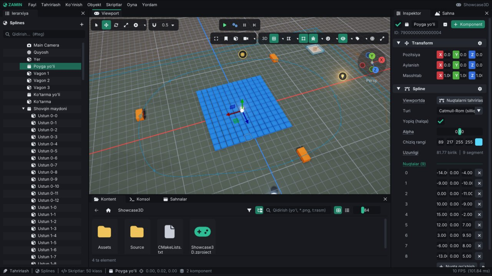

# Zamin Engine: matematika va core yordamchilari

Bu qo'llanma dvigatelning "ichki asboblar qutisi" haqida: o'yin skriptlari, editor va dvigatelning o'zi ishlatadigan
matematika (son utilitalari, kvaternionlar, geometriya, shovqin, egri chiziqlar, spline'lar, ranglar, tasodifiy
sonlar), vazifalar tizimi (thread pool), xotira statistikasi, log, assert'lar, vaqt o'lchash, matn (string)
yordamchilari, UUID va fayl tizimi yordamchilari. Har bo'limda API qisqacha va misol bilan.

Hamma narsa `#include <Zamin/Zamin.h>` bilan keladi. O'yin skriptlarida (`ScriptableEntity`) matematika, geometriya,
`StringUtils`, `Stopwatch` / `Timer` va `Random` alohida include'siz ishlaydi (`Scripting/ScriptableEntity.h` ularni
o'zi ulaydi).

## Mundarija

1. [Umumiy qoidalar](#1-umumiy-qoidalar)
2. [Son utilitalari (MathUtils)](#2-son-utilitalari-mathutils)
3. [Kvaternionlar](#3-kvaternionlar)
4. [Geometriya: AABB, sfera, nur, tekislik](#4-geometriya-aabb-sfera-nur-tekislik)
5. [Shovqin (Noise)](#5-shovqin-noise)
6. [AnimationCurve, Easing va Spline](#6-animationcurve-easing-va-spline)
7. [Ranglar (Color)](#7-ranglar-color)
8. [Tasodifiy sonlar (Random)](#8-tasodifiy-sonlar-random)
9. [Vazifalar tizimi (JobSystem)](#9-vazifalar-tizimi-jobsystem)
10. [Xotira statistikasi (MemoryStats)](#10-xotira-statistikasi-memorystats)
11. [Log](#11-log)
12. [Assert va Verify](#12-assert-va-verify)
13. [Vaqt o'lchash: Stopwatch, ScopedLogTimer, Timer](#13-vaqt-olchash-stopwatch-scopedlogtimer-timer)
14. [Matn yordamchilari (StringUtils)](#14-matn-yordamchilari-stringutils)
15. [UUID](#15-uuid)
16. [Fayl tizimi (FileSystem)](#16-fayl-tizimi-filesystem)
17. [Namuna sahna: Geometry](#17-namuna-sahna-geometry)
18. [Testlar](#18-testlar)
19. [Qisqa API ma'lumotnomasi](#19-qisqa-api-malumotnomasi)

---

## 1. Umumiy qoidalar

- **Burchaklar radianda** (`glm::radians(45.0f)` yoki `Math::Deg2Rad`). `TransformComponent::Rotation` ham radianda,
  Euler tartibi: avval X, keyin Y, keyin Z.
- **Yo'nalishlar**: obyekt `-Z` tomonga qaraydi, `+Y` - yuqori, `+X` - o'ng (`Math::Forward / Up / Right`).
- **Qutilar inklyuziv**: chegarasiga tegish ham kesishish hisoblanadi.
- **Nur masofalari** `Ray::Direction` bo'yicha o'lchanadi; `Ray` konstruktori yo'nalishni birlik uzunlikka
  keltiradi, shuning uchun masofa dunyo birligida bo'ladi.
- **Funksiyalar istisno (exception) tashlamaydi**: noto'g'ri kirishda (nol yo'nalish, bo'sh ro'yxat, yaroqsiz quti)
  hujjatlashtirilgan "bo'sh" natija qaytadi (`std::nullopt`, bo'sh yo'l, nol vektor).
- **Determinizm**: shovqin, `RandomGenerator` (urug' bilan), geometriya va matn funksiyalari bir xil kirishda har
  doim bir xil natija beradi - testlar va tarmoq o'yinlari uchun muhim.

## 2. Son utilitalari (MathUtils)

`Zamin/Math/MathUtils.h`, nomlar fazosi `Zamin::Math`.

| Funksiya | Nima qiladi |
|---|---|
| `Pi`, `TwoPi`, `HalfPi`, `Deg2Rad`, `Rad2Deg` | konstantalar |
| `Clamp01(x)` | 0..1 ga qisish |
| `Lerp(a, b, t)` / `LerpUnclamped` | chiziqli aralash (t 0..1 ga qisiladi / qisilmaydi); float va glm vektorlar |
| `InverseLerp(a, b, v)` | `v` `a..b` ning qayerida (0..1); vec2/vec3 kesma bo'yicha ham |
| `Remap(v, inMin, inMax, outMin, outMax)` / `RemapClamped` | bir oraliqdan boshqasiga o'tkazish |
| `SmoothStep(e0, e1, x)` / `SmootherStep` | silliq 0..1 qadam (GLSL'dagidek) |
| `Sign(x)`, `SignNonZero(x)` | ishora (0 uchun 0 / +1) |
| `Repeat(t, len)`, `PingPong(t, len)`, `Wrap(v, min, max)` | takrorlash, borib-qaytish, oraliqqa o'rash |
| `WrapAngle(a)`, `DeltaAngle(a, b)`, `LerpAngle`, `MoveTowardsAngle` | burchaklar: -Pi..Pi, eng qisqa burilish |
| `Approximately(a, b, eps)` | nisbiy + mutlaq aniqlik bilan tenglik (float, vec2/3/4) |
| `MoveTowards(cur, target, maxDelta)` | nishonga ko'pi bilan `maxDelta` qadam (o'tib ketmaydi) |
| `SmoothDamp(cur, target, velocity, smoothTime, dt, maxSpeed)` | prujina kabi silliq yetib borish (float/vec2/vec3, `SmoothDampAngle`) |
| `Damp(cur, target, sharpness, dt)` | kadr tezligiga bog'liq bo'lmagan eksponensial yumshatish |

```cpp
// Kamera o'yinchiga silliq ergashadi (kadr tezligi qanday bo'lmasin, bir xil his)
m_CameraPos = Math::SmoothDamp(m_CameraPos, target, m_CameraVelocity, 0.25f, ts);

// Sog'liq 0..100 -> rang aralashmasi 0..1
float t = Math::InverseLerp(0.0f, MaxHealth, Health);

// Minora nishon tomon sekundiga 90 gradusdan tez burilmaydi
m_Yaw = Math::MoveTowardsAngle(m_Yaw, targetYaw, Math::Deg2Rad * 90.0f * ts);
```

`Transform`ni yoyish: `Math::DecomposeTransform(matrix, translation, rotation, scale)` (`Math/Math.h`).

## 3. Kvaternionlar

`Zamin/Math/Quaternion.h`, `Zamin::Math`. `glm::quat` ustida, dvigatel konventsiyalari bilan.

| Funksiya | Nima qiladi |
|---|---|
| `AngleAxis(angle, axis)` / `ToAngleAxis(q, angle, axis)` | o'q atrofida burish va aksincha |
| `FromEuler(euler)` / `ToEuler(q)` | `TransformComponent::Rotation` bilan bir xil konventsiya (gimbal lock'da barqaror) |
| `LookRotation(forward, up)` | obyektning `-Z`'i `forward` tomonga qaraydi |
| `FromToRotation(from, to)` | bir yo'nalishni boshqasiga buradigan eng qisqa burilish |
| `Slerp`, `SlerpUnclamped`, `Nlerp` | burilishlar orasida aralash |
| `RotateTowards(from, to, maxAngle)` | ko'pi bilan `maxAngle` radian burish |
| `Angle(a, b)`, `Angle(v1, v2)`, `SignedAngle(v1, v2, axis)` | burchaklar |
| `Forward(q)`, `Up(q)`, `Right(q)`, `LookEuler(dir)` | yo'nalishlar |

```cpp
// Nishonga qarash, sekundiga 2 radiangacha burilib
glm::quat goal = Math::LookRotation(target - GetWorldPosition());
glm::quat now = Math::RotateTowards(Math::FromEuler(Transform().Rotation), goal, 2.0f * ts);
Transform().Rotation = Math::ToEuler(now);
```

## 4. Geometriya: AABB, sfera, nur, tekislik

`Zamin/Math/Geometry.h`. Turlar `Zamin` nomlar fazosida, testlar `Zamin::Geometry`da. Bu **sof matematika** -
fizika dunyosisiz ishlaydi (fizika nurlari uchun `Raycast3D` / `Raycast2D`, ular kolayderlarga uradi). Renderer
(frustum culling, chegaralar), editor (sichqoncha nuri, gizmolar) va skriptlar shu modulni ishlatadi.

### Turlar

| Tur | Maydonlar | Asosiy metodlar |
|---|---|---|
| `AABB` | `Min`, `Max` | `Empty()`, `FromPoints`, `FromCenterExtents`, `IsValid`, `GetCenter/Size/Extents`, `GetVolume`, `GetSurfaceArea`, `GetCorner(i)`, `Encapsulate`, `Merged`, `Expanded`, `Transformed(mat4)`, `Contains`, `Intersects`, `ClosestPoint`, `Distance` |
| `Sphere` | `Center`, `Radius` | `FromAABB`, `FromPoints`, `Contains`, `Intersects`, `Encapsulate`, `ClosestPoint`, `SignedDistance`, `GetBounds`, `Transformed` |
| `Ray` | `Origin`, `Direction` | `Ray(origin, dir)` (yo'nalish normallanadi), `FromPoints`, `FromNDC(ndc, invViewProj)`, `GetPoint(d)`, `Transformed` |
| `Plane` | `Normal`, `Distance` (`dot(N, p) + D = 0`) | `FromPointNormal`, `FromPoints(a, b, c)`, `FromVector`, `SignedDistance`, `IsInFront`, `ClosestPoint`, `Flipped`, `Transformed` |
| `Frustum` | `Planes[6]` | `FromViewProjection`, `GetPlane`, `Intersects(AABB / Sphere)`, `Contains(point)` |
| `RayHit` | `Distance`, `Point`, `Normal`, `Barycentric`, `Triangle` | nur tekkan joy |

Muhim nuqtalar:

- Standart `AABB` - koordinata boshidagi nuqta. Nuqtalar atrofida quti yig'ish uchun `AABB::Empty()` dan boshlang:
  `Encapsulate` uni aynan o'sha nuqta / qutiga aylantiradi. Bo'sh (yaroqsiz) quti hech narsaga tegmaydi.
- `AABB::Transformed` aylantirilgan qutini o'rab turgan eng tor o'qqa parallel qutini beradi (Arvo usuli).
- `Sphere::FromPoints` - Ritter usuli (yoki quti markazidan hisoblangani, qaysi kichik bo'lsa): har doim hamma
  nuqtani o'z ichiga oladi, lekin eng kichik sfera bo'lishi shart emas (odatda ~10% ichida).
- `Plane`ning old tomoni normal ko'rsatgan tomon (`SignedDistance > 0`).

### Nur testlari

```cpp
std::optional<RayHit> Geometry::Raycast(const Ray&, const AABB&, float maxDistance = Infinity);
std::optional<RayHit> Geometry::Raycast(const Ray&, const AABB& localBox, const glm::mat4& transform, float maxDistance = Infinity); // yo'naltirilgan quti
std::optional<RayHit> Geometry::Raycast(const Ray&, const Sphere&, float maxDistance = Infinity);
std::optional<RayHit> Geometry::Raycast(const Ray&, const Plane&, float maxDistance = Infinity);
std::optional<RayHit> Geometry::Raycast(const Ray&, a, b, c, bool twoSided = true, float maxDistance = Infinity);      // uchburchak
std::optional<RayHit> Geometry::Raycast(const Ray&, std::span<const glm::vec3> positions, std::span<const uint32_t> indices, ...); // uchburchaklar ro'yxati
bool Geometry::IntersectRayAABB(const Ray&, const AABB&, float& tEnter, float& tExit);                                // slab: kirish..chiqish
```

- **ray-AABB** - "slab" usuli; o'qqa parallel nurlar (yo'nalishning nol komponentlari) to'g'ri ishlaydi.
- **ray-sfera** - kvadrat tenglama; **ray-tekislik** - ikki tomonlama, tekislik bo'ylab ketgan nur tegmaydi.
- **ray-uchburchak** - Möller–Trumbore; `twoSided = false` bo'lsa faqat old tomon (soat strelkasiga qarshi
  `a, b, c`); `RayHit::Barycentric` = `(u, v)`, nuqta `= a(1-u-v) + b u + c v`.
- Nur boshidan **orqadagi** narsaga tegmaydi. Nur quti yoki sfera **ichidan** boshlansa, `Distance = 0`, `Normal`
  nol (nur boshida tegdi). `RayHit::Normal` har doim nur kelgan tomonga qaragan birlik vektor.
- Yo'naltirilgan quti varianti obyektning lokal chegaralari (`Scene::GetEntityLocalBounds`) va dunyo matritsasi bilan
  ishlaydi: masofa, nuqta va normal dunyo fazosida.

```cpp
// Sichqoncha ostidagi obyektni tanlash (fizikasiz): skriptda GetMouseRay()
Ray ray = GetMouseRay();                   // asosiy kamera orqali (Scene::ScreenPointToRay)
AABB local;
if (GetScene().GetEntityLocalBounds(chest, local))
    if (auto hit = Geometry::Raycast(ray, local, GetScene().GetWorldTransform(chest)))
        ZM_INFO("Sandiq {:.1f} m uzoqlikda bosildi", hit->Distance);
```

Editor kamerasi yoki o'z matritsangiz bilan: `Ray::FromNDC(ndc, glm::inverse(projection * view))` (ndc -1..1,
x o'ngga, y yuqoriga; nur yaqin tekislikdan boshlanadi; perspektiv va ortografik).

### Kesishuvlar (overlap) va tasniflash

| Funksiya | Tekshiradi |
|---|---|
| `Geometry::Intersects(AABB, AABB)` | ikki quti |
| `Geometry::Intersects(Sphere, Sphere)` | ikki sfera |
| `Geometry::Intersects(Sphere, AABB)` / `(AABB, Sphere)` | sfera va quti (eng yaqin nuqta orqali) |
| `Geometry::Intersects(AABB, Plane)`, `(Sphere, Plane)` | tekislikni kesib o'tadimi |
| `Geometry::Intersects(AABB, a, b, c)` | uchburchak va quti (ajratuvchi o'qlar, Akenine-Möller) |
| `Geometry::Classify(AABB / Sphere, Plane)` | `PlaneSide::Front` / `Back` / `Both` |
| `Frustum::Intersects(AABB / Sphere)` | kamera ko'radimi (konservativ) |

### Eng yaqin nuqtalar

```cpp
glm::vec3 Geometry::ClosestPointOnSegment(p, a, b, float* t = nullptr);
glm::vec3 Geometry::ClosestPointOnLine(p, origin, direction, float* t = nullptr);
glm::vec3 Geometry::ClosestPointOnRay(p, ray, float* distance = nullptr);
glm::vec3 Geometry::ClosestPointOnAABB(p, box);     // = box.ClosestPoint(p)
glm::vec3 Geometry::ClosestPointOnSphere(p, sphere);
glm::vec3 Geometry::ClosestPointOnPlane(p, plane);
glm::vec3 Geometry::ClosestPointOnTriangle(p, a, b, c, glm::vec3* barycentric = nullptr);
float Geometry::ClosestPointsOnSegments(p1, q1, p2, q2, c1, c2, float* s = nullptr, float* t = nullptr); // masofa kvadrati
bool Geometry::ClosestPointsOnLines(o1, d1, o2, d2, float& t1, float& t2);                              // parallel: false
```

Uchburchak yordamchilari: `TriangleNormal`, `TriangleArea`, `Barycentric(p, a, b, c)`.

```cpp
// Zanjirli tok: o'yinchi simga 0.5 m dan yaqin kelsa zarar oladi
glm::vec3 nearest = Geometry::ClosestPointOnSegment(player, wireStart, wireEnd);
if (glm::length(player - nearest) < 0.5f)
    Hurt();
```

## 5. Shovqin (Noise)

`Zamin/Math/Noise.h`, `Zamin::Noise`. Hammasi urug' (`seed`) bilan deterministik, natija -1..1 (aks holda
aytilgan).

- `Perlin(x / vec2 / vec3, seed)`, `Simplex(vec2 / vec3, seed)`, `Value(x / vec2 / vec3, seed)` - bitta oktava.
- `PerlinPeriodic(p, period, seed)` - takrorlanadigan (tile) shovqin; `PerlinVector` - uch mustaqil o'q.
- `FractalSettings { Type, Octaves, Frequency, Lacunarity, Gain, Seed }` va `Fractal(p, settings)` (fBm),
  `Ridged` (0..1, tog' tizmalari), `Turbulence` (0..1, bulut/tutun), `FractalVector`.
- `Noise::To01(n)` -1..1 ni 0..1 ga o'tkazadi.

```cpp
float height = Noise::Fractal(glm::vec2(x, z) * 0.05f, { .Octaves = 5, .Seed = 42 }) * 8.0f;
float ridge = Noise::Ridged(glm::vec2(x, z) * 0.02f, { .Octaves = 6 });
```

Particle turbulentligi, kamera silkinishi va 2D chiroq miltillashi ham shu modulni ishlatadi.

## 6. AnimationCurve, Easing va Spline

- **`AnimationCurve`** (`Math/AnimationCurve.h`) - vaqt bo'yicha bitta son: kalitlar, Bezier tangentlar,
  `PreWrap` / `PostWrap` (`Once`, `Loop`, `PingPong`), `Evaluate(t)`, `AddKey`, `SmoothTangents`,
  `AnimationCurve::Linear / EaseInOut / Constant`. Skript maydoni (`ZM_FIELD`) sifatida inspektorda tahrirlanadi.
  Batafsil: [Animation.md, 18-bo'lim](Animation.md#18-animationcurve-skriptdagi-egri-chiziq).
- **Easing** (`Math/Easing.h`) - `ApplyEase(Ease::OutBack, t)`: `Linear`, `InQuad`, `OutQuad`, `InOutQuad`,
  `OutCubic`, `InOutCubic`, `OutBack`, `OutElastic`, `OutBounce` (0 -> 0, 1 -> 1).
- **Spline** (`Math/Spline.h`) - Catmull-Rom (centripetal), Bezier va to'g'ri chiziq; `Evaluate(u)`,
  `EvaluateTangent`, `FindClosest(point)`, `InsertPoint`, `AutoTangents`; masofa <-> parametr jadvali
  `SplineLengthTable`. `SplineComponent` va `SplineFollowerComponent` bilan sahnada. Batafsil:
  [Animation.md, 19-bo'lim](Animation.md#19-spline-yollar-va-spline-follower).



*Showcase3D `Scenes/Splines.zscene`: `Poyga yo'li` obyekti tanlangan — Catmull-Rom halqa (viewport'dagi ingichka chiziq),
uning bo'ylab vagonlar (`SplineFollowerComponent`); inspektorda Spline bo'limi: turi, uzunligi va 9 ta nuqta.*

## 7. Ranglar (Color)

`Zamin/Math/Color.h`, `Zamin::Color`. Ranglar `glm::vec4` (0..1, sRGB, alfa bilan).

| Funksiya | Nima qiladi |
|---|---|
| `RGBToHSV` / `HSVToRGB`, `RGBToHSL` / `HSLToRGB`, `FromHSV(h, s, v, a)`, `FromHSL` | rang modellari (h 0..1) |
| `FromHex("#ff8800")`, `ToHex(color)` | `#RGB`, `#RGBA`, `#RRGGBB`, `#RRGGBBAA` |
| `FromName("qizil")`, `Parse(text)` | ingliz va o'zbek nomlari, hex yoki nom |
| `SRGBToLinear` / `LinearToSRGB`, `GammaToLinear` / `LinearToGamma` | aniq sRGB va shaderlardagi 2.2 gamma |
| `Lerp`, `LerpLinear`, `LerpHSV` | sRGB'da, chiziqli yorug'likda yoki rang g'ildiragi bo'ylab aralash |
| `Luminance`, `PerceivedBrightness`, `ContrastingTextColor` | yorqinlik, fon ustidagi matn rangi |
| `FromRGBA8(r, g, b, a)`, `WithAlpha` | 8-bitli rang, alfani almashtirish |

```cpp
glm::vec4 hp = Color::LerpHSV(Color::FromHex("#e53935").value(), Color::FromHex("#43a047").value(), health01);
```

## 8. Tasodifiy sonlar (Random)

`Zamin/Math/Random.h`. `Random::Range(1, 6)`, `Random::Float()`, `Random::Bool(0.25f)`, `Random::OnUnitSphere()`,
`Random::Rotation()`, `Random::Gaussian()`, `Random::Pick(items)` - global generator. Takrorlanadigan ketma-ketlik
uchun o'z generatoringiz: `RandomGenerator rng(seed); rng.Range(0.0f, 1.0f); rng.InsideBox(min, max);
rng.WeightedIndex(weights); rng.Shuffle(list);`.

Boshqa global funksiyalar: `Random::Int(1, 6)` (ikkala chegara ham kiradi), `Random::InsideCircle(r)`,
`Random::InsideSphere(r)`, `Random::OnSphere(r)`, `Random::Shuffle(v)`, `Random::SetSeed(42)`. Generator - PCG32: bir xil
`seed` har qanday kompyuterda bir xil ketma-ketlik beradi (darajalarni qayta yaratish, replay uchun qulay).

## 9. Vazifalar tizimi (JobSystem)

`Zamin/Core/JobSystem.h`. Mustaqil bo'laklarga bo'linadigan ishlar uchun thread pool: ishchi oqimlar soni - apparat
oqimlaridan bitta kam (asosiy oqim ham ishlaydi). Navbat mutex va condition variable bilan.

```cpp
// Katta massivni parallel hisoblash: har bo'lak faqat o'z elementlariga yozadi
JobSystem::ParallelFor((uint32_t)items.size(), 0, [&](uint32_t begin, uint32_t end) {
    for (uint32_t i = begin; i < end; i++)
        results[i] = Compute(items[i]);
});

// Bog'liqliklar bilan
JobHandle load = JobSystem::Schedule([&] { LoadData(); });
JobHandle build = JobSystem::Schedule([&] { BuildIndex(); }, load);   // load tugagach
JobSystem::Wait(build);                                                // kutayotgan oqim ham navbatdagi ishlarni bajaradi
```

- `Schedule(job[, dependencies])`, `Combine(handles)`, `Wait(handle)`, `ParallelFor(count, grain, fn)`,
  `ScheduleParallelFor(...)`, `GetThreadIndex()` (oqim uchun alohida xotira), `GetStats()` / `GetLastFrameStats()`.
- **Qoida**: ishchi oqimdagi ish boshqa bir vaqtda ishlayotgan ishlar yozadigan narsaga tegmasin (sahna registri,
  renderer, fizika, skriptlar). Dvigatel faqat ajratilgan ma'lumotdagi ishlarni parallel qiladi: mustaqil particle
  tizimlari va animator pozalari; natija bir oqimdagi bilan bit-bitgacha bir xil.
- **O'chirish** (hamma ish chaqirgan oqimda, tartib bilan): `JobSystem::SetEnabled(false)`, `ZAMIN_JOBS=0`,
  playerda `--jobs 0`, `ApplicationSpecification::JobWorkers`. Profilerda ishlar "Ishchi N" tugunlari ostida.

## 10. Xotira statistikasi (MemoryStats)

`Zamin/Core/MemoryStats.h`. Kategoriyalar: teksturalar, render buferlari, mesh buferlari, audio, sahnalar,
particle'lar, animatsiya poza keshi - har biri bayt, obyekt soni va eng yuqori qiymat (thread-safe).
`MemoryStats::Get(MemoryCategory::Textures).Bytes`, `GetTrackedTotal()`, `GetProcessMemory()` (RSS, virtual, eng
yuqori RSS: `/proc/self/statm`, `VmHWM`). O'z modulingiz uchun: `TrackedMemory m_Memory{ MemoryCategory::Scenes };
m_Memory.Set(bytes);` (obyekt o'chganda hisobdan chiqadi). Editorda: Statistika paneli > "Xotira", viewport
overlay'da "Xotira".

## 11. Log

`Zamin/Core/Log.h`. Format - `std::format` sintaksisi; matnlar o'zbekcha.

```cpp
ZM_INFO("O'yinchi {} ochko to'pladi", score);       // o'yin / editor ("APP" logger)
ZM_WARN("Saqlash fayli eski: v{}", version);
ZM_CORE_ERROR("Tekstura yuklanmadi: '{}'", path);  // dvigatelning o'zi ("ZAMIN")
```

Darajalar: `Trace`, `Info`, `Warn`, `Error`, `Critical`, `Off`. Har logger o'z minimal darajasiga ega
(`Log::SetLevel(LogSource::Engine, LogLevel::Warn)`), log faylining darajasi alohida (`Log::SetFileLevel`).
Darajadan pastdagi xabar umuman formatlanmaydi (arzon). Sozlash tartibi (keyingisi ustun):
Loyiha sozlamalari > Player > Log, `ZAMIN_LOG_LEVEL`, `--log-level` (`warn` yoki `engine=warn,app=info,file=error`).
Editorda: Sozlamalar > Log va konsolning tishli g'ildirak menyusi. Log fayllari: [Runtime.md](Runtime.md#6-log-fayllari).

## 12. Assert va Verify

`Zamin/Core/Assert.h`.

```cpp
ZM_ASSERT(index < count, "indeks {} chegaradan tashqarida (jami {})", index, count);
ZM_CORE_ASSERT(window, "oyna yaratilmadi");                 // dvigatel kodi uchun
if (!ZM_VERIFY(texture, "'{}' rasmi yo'q", path))          // har doim tekshiriladi, kod davom etadi
    return;
```

- `ZM_ASSERT` / `ZM_CORE_ASSERT` - debug build'da (va CMake `-DZAMIN_ASSERTS=ON` bilan release'da). Muvaffaqiyatsiz
  bo'lsa: ifoda, xabar, `fayl:qator` va funksiya log'ga yoziladi; debugger ulangan bo'lsa shu joyda to'xtaydi, aks
  holda dastur to'xtatiladi va playerning crash hisobotida sabab sifatida assert ko'rsatiladi.
- `ZM_VERIFY` / `ZM_CORE_VERIFY` - har build'da, natijani qaytaradi, hech qachon to'xtatmaydi; log'ga 1-, 10-,
  100-... marta yoziladi (har kadr qaytarilsa log to'lib ketmaydi).
- Rejim: `Assert::SetMode` yoki `ZAMIN_ASSERT=auto|break|abort|continue`. Editorda o'yin skriptidagi assert faqat
  log'ga yoziladi - editor yopilmaydi.

## 13. Vaqt o'lchash: Stopwatch, ScopedLogTimer, Timer

```cpp
Stopwatch watch;                        // Core/Stopwatch.h - yuqori aniqlikdagi soat
LoadLevel();
double loadMs = watch.Lap();            // davra (ms)
BuildNavMesh();
ZM_INFO("Jami: {}", watch.Format());   // "12.4 s", "850 ms" ...

{
    ZM_LOG_SCOPE_TIME("Sahna generatsiyasi");          // blok tugaganda: "Sahna generatsiyasi: 3.21 ms"
    ZM_LOG_SCOPE_TIME_OVER("AI yangilash", 2.0);      // faqat 2 ms dan oshsa
}

Timer reload{ 1.5f };                   // Core/Timer.h - o'yin vaqti bilan teskari sanoq
if (reload.Tick(ts)) Reload();          // tugagan kadrda true; Timer(0.5f, true) - takrorlanadi
```

`Stopwatch`: `Start`, `Stop`, `Reset`, `Restart`, `ElapsedMilliseconds / Microseconds / Nanoseconds`, `Lap`,
`GetLaps`. Profiler uchun alohida: `ZM_PROFILE_SCOPE("Nom")` (Profiler oynasida ierarxik ko'rinadi).

## 14. Matn yordamchilari (StringUtils)

`Zamin/Utils/StringUtils.h`, `Zamin::StringUtils`. Locale'ga bog'liq emas, istisno tashlamaydi.

| Guruh | Funksiyalar |
|---|---|
| Kesish | `Trim`, `TrimStart`, `TrimEnd` (`string_view` qaytaradi) |
| Harf registri (ASCII) | `ToLower`, `ToUpper`, `EqualsIgnoreCase`, `StartsWithIgnoreCase`, `EndsWithIgnoreCase`, `FindIgnoreCase`, `ContainsIgnoreCase` |
| Bo'lish / birlashtirish | `Split(text, ',', SplitFlags::Trim \| SplitFlags::SkipEmpty)`, `SplitView`, `SplitLines`, `SplitWhitespace`, `SplitOnce`, `Join(parts, ", ")` |
| Almashtirish | `Replace`, `ReplaceAll`, `RemoveAll`, `Repeat`, `PadLeft`, `PadRight` |
| Formatlash | `Format(...)` (std::format), `FormatRuntime`, `FormatBytes` ("1.5 MB"), `FormatDuration`, `FormatThousands` ("12 345"), `ToHex` |
| Sonlar | `ParseInt<int>("42")`, `ParseFloat<float>`, `ParseBool` - `std::optional`, chegaradan chiqsa ham xato |
| UTF-8 | `Utf8Length`, `Utf8Decode`, `Utf8Encode`, `Utf8IsValid`, `Utf8Sanitize`, `Utf8Truncate`, `Utf8ForEach`, `Utf8ToUtf32` |

Registr funksiyalari faqat A-Z / a-z harflarini o'zgartiradi: UTF-8 baytlari buzilmaydi (o'zbek lotin yozuvi
ASCII harflar va apostrof bilan to'liq ishlaydi; kirill harflari registri o'zgarmaydi).

```cpp
for (std::string_view part : StringUtils::SplitView("  qilich, qalqon ,, kamon ", ',', StringUtils::SplitFlags::Trim | StringUtils::SplitFlags::SkipEmpty))
    AddItem(std::string(part));                                   // "qilich", "qalqon", "kamon"
if (auto level = StringUtils::ParseInt<int>(args[1])) LoadLevel(*level);
```

## 15. UUID

`Zamin/Core/UUID.h`. 64-bitli tasodifiy identifikator (har oqimda alohida generator - parallel ishlarda ham xavfsiz).
`UUID id;` (yangi), `id.IsValid()`, `id.ToString()` ("00000000000000ff", 16 ta hex), `UUID::FromString(text)`,
`std::hash<UUID>`. Sahnadagi har obyekt va har asset (`AssetHandle`) shunday id'ga ega.

## 16. Fayl tizimi (FileSystem)

`Zamin/Utils/FileSystem.h`.

### Fayllar

`ReadTextFile`, `WriteTextFile` (papkalarni o'zi yaratadi), `ReadBinaryFile`, `WriteBinaryFile`,
`GetExecutablePath`, `GetExecutableDirectory`.

### Yo'llar (leksik - diskka qaramaydi)

Bu funksiyalar faqat matnni ko'radi: symlink'lar ochilmaydi, joriy papka o'qilmaydi. `/` ham, `\` ham ajratuvchi
(Windows'da yozilgan yo'llar ham ishlaydi), natija har doim `/` bilan. `/` yoki disk (`C:/`) bilan boshlansa -
absolyut.

| Funksiya | Misol |
|---|---|
| `NormalizePath(p)` | `"Assets\\Textures/./../Sprites//hero.png"` -> `"Assets/Sprites/hero.png"`; `"a/.."` -> `"."`; `"/../a"` -> `"/a"` |
| `IsAbsolutePath(p)` | `"/a"`, `"C:/a"` - ha; `"a/b"`, `"a:b"` - yo'q |
| `RelativePath(path, base)` | `("Assets/Scenes/A.zscene", "Assets/Textures")` -> `"../Scenes/A.zscene"`; imkonsiz bo'lsa `""` |
| `IsSubPath(path, root, allowSame = true)` | butun qismlar bo'yicha: `"Assets2/x"` `"Assets"` ichida emas, `"Assets/../x"` ham emas |
| `GetRelativeInside(path, root)` | `("/game/Assets/a/b.png", "/game/Assets")` -> `"a/b.png"`; tashqarida yoki root'ning o'zi - `""` |
| `IsSafeRelativePath(p)` | nisbiy, disksiz, `..` bilan tashqariga chiqmaydi, NUL baytsiz (`"."` - xavfsiz, `""` - yo'q) |
| `SafeJoin(root, relative)` | `root / relative` faqat xavfsiz bo'lsa, aks holda **bo'sh yo'l** |
| `SanitizeRelativePath(p)` | tashqariga chiqaradigan qismlarni tashlaydi: `"/etc/x"` -> `"etc/x"`, `"../../a"` -> `"a"` |

```cpp
// O'yinchi kiritgan saqlash nomi hech qachon saqlash papkasidan tashqariga chiqmaydi
std::filesystem::path file = FileSystem::SafeJoin(SaveData::GetFilePath().parent_path() / "slots", slotName + ".json");
if (file.empty())
{
    ZM_WARN("Noto'g'ri saqlash nomi: '{}'", slotName);
    return;
}
```

`SafeJoin` leksik: `root` ichidagi symlink baribir boshqa joyga olib borishi mumkin - shuning uchun diskdagi
tekshiruv ham bor (pastda).

### Yo'llar (diskda)

- `AbsolutePath(p)` - joriy papkaga nisbatan absolyut va normallangan (symlink'lar qoladi).
- `CanonicalPath(p)` - symlink'lar ochilgan (`weakly_canonical`: mavjud bo'lmagan qismi ham normallanadi).
- `IsSubPathOnDisk(path, root)` - kanonik yo'llar bo'yicha `IsSubPath` (symlink orqali ichkariga olib borsa ham
  true). `AssetFiles::IsInside` shuni ishlatadi.

### Kengaytmalar

- `GetExtension(p)` - kichik harflarda, nuqta bilan: `"Hero.PNG"` -> `".png"`; `".gitignore"` - kengaytmasiz.
- `HasExtension(p, ".glb")` / `HasExtension(p, "glb")` / `HasExtension(p, { ".gltf", ".glb" })` - registrga
  qaramaydi, ko'p qismli ham bo'ladi (`"a.tar.gz"` -> `".tar.gz"`).
- `ReplaceExtension(p, ".zmeta")` (`""` - olib tashlash), `GetStem(p)`.

### Standart papkalar

| Funksiya | Linux'da |
|---|---|
| `GetTempDirectory()` | `$TMPDIR`, aks holda `/tmp` |
| `CreateTempDirectory("prefiks")` | `<temp>/prefiks-XXXXXX` - yangi, faqat shu foydalanuvchiga ochiq (`mkdtemp`) |
| `GetHomeDirectory()` | `$HOME` (yo'q bo'lsa foydalanuvchilar bazasidan) |
| `GetUserDataDirectory()` | `$XDG_DATA_HOME` yoki `~/.local/share` (SaveData, log fayllari) |
| `GetUserConfigDirectory()` | `$XDG_CONFIG_HOME` yoki `~/.config` (editor sozlamalari) |
| `GetUserCacheDirectory()` | `$XDG_CACHE_HOME` yoki `~/.cache` |
| `ShortenHomePath(p)` | `"/home/ali/.config/zamin"` -> `"~/.config/zamin"` (ko'rsatish uchun) |

XDG o'zgaruvchilari faqat absolyut yo'l bo'lsa hisobga olinadi (spetsifikatsiya bo'yicha).

```cpp
{
    TempDirectory temp("zamin-eksport");             // blokdan chiqqanda ichidagisi bilan o'chiriladi
    FileSystem::WriteTextFile(temp.GetPath() / "manifest.json", manifest);
    Pack(temp.GetPath(), output);
}                                                    // temp.Release() - o'chirmasdan qoldirish
```

## 17. Namuna sahna: Geometry

`Projects/Showcase3D/Assets/Scenes/Geometry.zscene` (skriptlar `Source/Geometry.cpp`) geometriya modulini fizikasiz
ko'rsatadi; hamma narsa `DebugDraw` bilan chiziladi:

- **Nur yelpig'ichi** (`GeometryRayFan`) - 25 ta nur `Geometry::Raycast` bilan "Nishon" tegli obyektlarga
  tekshiriladi: aylanayotgan qutilar yo'naltirilgan quti (lokal chegara + dunyo matritsasi) sifatida, sharlar
  `Sphere` sifatida. Eng yaqin tegish nuqtasi (sariq), normal (moviy o'q), tegmagan nurlar qizil.
- **Zond** (`GeometryProbe`) - aylanib yuruvchi nuqta har nishonning eng yaqin nuqtasiga chiziq tortadi
  (`ClosestPoint`); zond sferasi tekkan nishonlarning dunyo AABB'si to'q sariq (`Intersects(Sphere, AABB)`).
- **Chegaralar** (`GeometryBoundsView`) - hamma nishonlar atrofidagi sfera (`Sphere::FromPoints`) va aylanuvchi
  qiya tekislik: har nishonning AABB'si tekislikka nisbatan rangda (`Classify`: oldida yashil, orqasida ko'k,
  kesib o'tsa pushti).

```bash
./build/bin/ZaminPlayer Projects/Showcase3D --scene Scenes/Geometry.zscene
```

## 18. Testlar

`Tests/ZaminTests.cpp` (headless):

- `FileSystemLexicalPaths`, `FileSystemDiskPathsAndFolders` - normallash, nisbiy yo'llar, `SafeJoin` (tasodifiy
  yo'llar bilan ham: natija hech qachon root'dan chiqmaydi), symlink'lar, vaqtinchalik papkalar, XDG.
- `GeometryBoundingVolumes`, `GeometryRayAABBAndSphere`, `GeometryRayPlaneAndTriangle`,
  `GeometryOverlapsAndClosestPoints` - aniq qiymatlar va minglab tasodifiy holatlar: ray-AABB natijasi qutining
  12 ta uchburchagiga otilgan nur bilan solishtiriladi (yo'naltirilgan qutilar ham), ray-sfera sirtda va undan oldin
  ichkarida nuqta yo'q, uchburchak-quti va eng yaqin nuqtalar to'liq qidiruv bilan tekshiriladi.
- `MathPropertiesRandomized` - hamma math modullarining qoidalari tasodifiy kirishlarda: `Remap`/`InverseLerp`
  teskari, burchaklar oralig'i, `MoveTowards` o'tib ketmaydi, `SmoothDamp` yetib boradi, kvaternion va Euler
  aylanishlari, `DecomposeTransform`, rang konvertatsiyalari va hex, easing chetlari, shovqin oralig'i va
  uzluksizligi, `AnimationCurve` kalitlari, spline uzunlik jadvali.
- Avvalgi modul testlari: `MathUtils*`, `Quaternion*`, `Noise*`, `AnimationCurve*`, `Spline*`, `ColorConversions`,
  `JobSystem*`, `MemoryStats*`, `StringUtils*`, `StopwatchAndTimers`, `LogLevelsPerLogger`, `AssertsWithMessages`,
  `UUIDsAreUnique`.

```bash
./build/bin/ZaminTests        # oxirida "0 xato"
```

## 19. Qisqa API ma'lumotnomasi

| Sarlavha fayli | Nimalar |
|---|---|
| `Math/MathUtils.h` | `Math::Clamp01`, `Lerp`, `InverseLerp`, `Remap`, `SmoothStep`, `Repeat`, `PingPong`, `DeltaAngle`, `MoveTowards`, `SmoothDamp`, `Damp`, `Approximately` |
| `Math/Quaternion.h` | `Math::AngleAxis`, `FromEuler`, `ToEuler`, `LookRotation`, `FromToRotation`, `Slerp`, `RotateTowards`, `Angle` |
| `Math/Math.h` | `Math::DecomposeTransform` |
| `Math/Geometry.h` | `AABB`, `Sphere`, `Ray`, `Plane`, `Frustum`, `RayHit`, `Geometry::Raycast`, `Intersects`, `Classify`, `ClosestPointOn*` |
| `Math/Noise.h` | `Noise::Perlin`, `Simplex`, `Value`, `Fractal`, `Ridged`, `Turbulence` |
| `Math/AnimationCurve.h`, `Math/CurveKey.h` | `AnimationCurve`, `AnimationWrap`, `CurveKeys` |
| `Math/Spline.h` | `Spline`, `SplineLengthTable` |
| `Math/Color.h` | `Color::FromHex`, `ToHex`, `FromHSV`, `LerpHSV`, `SRGBToLinear` ... |
| `Math/Random.h`, `Math/Easing.h` | `Random`, `RandomGenerator`, `ApplyEase` |
| `Core/JobSystem.h` | `JobSystem::Schedule`, `Wait`, `ParallelFor`, `JobHandle` |
| `Core/MemoryStats.h` | `MemoryStats`, `TrackedMemory`, `MemoryCategory` |
| `Core/Log.h`, `Core/LogSettings.h` | `ZM_INFO` ..., `Log::SetLevel`, `LogLevelSettings`, `LogLevelOverride` |
| `Core/Assert.h` | `ZM_ASSERT`, `ZM_CORE_ASSERT`, `ZM_VERIFY`, `Assert::SetMode` |
| `Core/Stopwatch.h`, `Core/Timer.h` | `Stopwatch`, `ScopedLogTimer`, `ZM_LOG_SCOPE_TIME`, `Timer` |
| `Utils/StringUtils.h` | `StringUtils::Split`, `Join`, `Trim`, `ParseInt`, `FormatBytes`, `Utf8*` ... |
| `Core/UUID.h` | `UUID`, `ToString`, `FromString` |
| `Utils/FileSystem.h` | `FileSystem::NormalizePath`, `RelativePath`, `IsSubPath`, `SafeJoin`, `GetExtension`, `CreateTempDirectory`, `TempDirectory` ... |
| `Scene/Scene.h`, skriptlar | `Scene::ScreenPointToRay`, `ScriptableEntity::ScreenPointToRay` / `GetMouseRay`, `Scene::GetEntityLocalBounds` |
