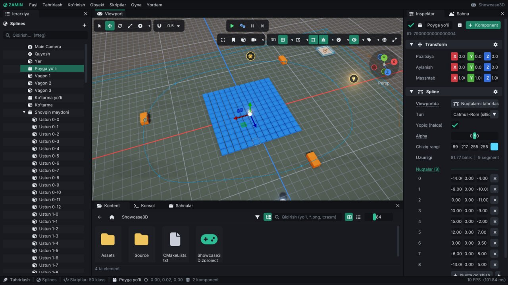

# Zamin Engine: math and core helpers

This guide is about the engine's "internal toolbox": the math that game scripts, the editor and the engine itself use
(number utilities, quaternions, geometry, noise, curves, splines, colors, random
numbers), the job system (thread pool), memory statistics, the log, asserts, timing, string
helpers, UUIDs and file system helpers. Each section gives the API briefly with an example.

Everything comes with `#include <Zamin/Zamin.h>`. In game scripts (`ScriptableEntity`) math, geometry,
`StringUtils`, `Stopwatch` / `Timer` and `Random` work without a separate include (`Scripting/ScriptableEntity.h` pulls
them in itself).

## Contents

1. [General rules](#1-general-rules)
2. [Number utilities (MathUtils)](#2-number-utilities-mathutils)
3. [Quaternions](#3-quaternions)
4. [Geometry: AABB, sphere, ray, plane](#4-geometry-aabb-sphere-ray-plane)
5. [Noise](#5-noise)
6. [AnimationCurve, Easing and Spline](#6-animationcurve-easing-and-spline)
7. [Colors (Color)](#7-colors-color)
8. [Random numbers (Random)](#8-random-numbers-random)
9. [The job system (JobSystem)](#9-the-job-system-jobsystem)
10. [Memory statistics (MemoryStats)](#10-memory-statistics-memorystats)
11. [Log](#11-log)
12. [Assert and Verify](#12-assert-and-verify)
13. [Timing: Stopwatch, ScopedLogTimer, Timer](#13-timing-stopwatch-scopedlogtimer-timer)
14. [String helpers (StringUtils)](#14-string-helpers-stringutils)
15. [UUID](#15-uuid)
16. [The file system (FileSystem)](#16-the-file-system-filesystem)
17. [Sample scene: Geometry](#17-sample-scene-geometry)
18. [Tests](#18-tests)
19. [A short API reference](#19-a-short-api-reference)

---

## 1. General rules

- **Angles are in radians** (`glm::radians(45.0f)` or `Math::Deg2Rad`). `TransformComponent::Rotation` is in radians too,
  with the Euler order: X first, then Y, then Z.
- **Directions**: an entity faces `-Z`, `+Y` is up, `+X` is right (`Math::Forward / Up / Right`).
- **Boxes are inclusive**: touching the boundary counts as an intersection too.
- **Ray distances** are measured along `Ray::Direction`; the `Ray` constructor normalizes the direction to unit length,
  so distances are in world units.
- **The functions do not throw exceptions**: on invalid input (a zero direction, an empty list, an invalid box) a
  documented "empty" result is returned (`std::nullopt`, an empty path, a zero vector).
- **Determinism**: noise, `RandomGenerator` (with a seed), geometry and string functions always give the same result
  for the same input - important for tests and network games.

## 2. Number utilities (MathUtils)

`Zamin/Math/MathUtils.h`, namespace `Zamin::Math`.

| Function | What it does |
|---|---|
| `Pi`, `TwoPi`, `HalfPi`, `Deg2Rad`, `Rad2Deg` | constants |
| `Clamp01(x)` | clamp to 0..1 |
| `Lerp(a, b, t)` / `LerpUnclamped` | linear blend (t clamped / not clamped to 0..1); floats and glm vectors |
| `InverseLerp(a, b, v)` | where `v` is in `a..b` (0..1); along a vec2/vec3 segment too |
| `Remap(v, inMin, inMax, outMin, outMax)` / `RemapClamped` | mapping from one range to another |
| `SmoothStep(e0, e1, x)` / `SmootherStep` | a smooth 0..1 step (as in GLSL) |
| `Sign(x)`, `SignNonZero(x)` | the sign (0 / +1 for 0) |
| `Repeat(t, len)`, `PingPong(t, len)`, `Wrap(v, min, max)` | repeating, going back and forth, wrapping into a range |
| `WrapAngle(a)`, `DeltaAngle(a, b)`, `LerpAngle`, `MoveTowardsAngle` | angles: -Pi..Pi, the shortest turn |
| `Approximately(a, b, eps)` | equality with a relative + absolute tolerance (float, vec2/3/4) |
| `MoveTowards(cur, target, maxDelta)` | a step of at most `maxDelta` toward the target (does not overshoot) |
| `SmoothDamp(cur, target, velocity, smoothTime, dt, maxSpeed)` | a smooth, spring-like approach (float/vec2/vec3, `SmoothDampAngle`) |
| `Damp(cur, target, sharpness, dt)` | exponential smoothing independent of the frame rate |

```cpp
// The camera follows the player smoothly (the same feel whatever the frame rate)
m_CameraPos = Math::SmoothDamp(m_CameraPos, target, m_CameraVelocity, 0.25f, ts);

// Health 0..100 -> a color blend 0..1
float t = Math::InverseLerp(0.0f, MaxHealth, Health);

// The turret turns toward the target no faster than 90 degrees per second
m_Yaw = Math::MoveTowardsAngle(m_Yaw, targetYaw, Math::Deg2Rad * 90.0f * ts);
```

Decomposing a `Transform`: `Math::DecomposeTransform(matrix, translation, rotation, scale)` (`Math/Math.h`).

## 3. Quaternions

`Zamin/Math/Quaternion.h`, `Zamin::Math`. On top of `glm::quat`, with the engine's conventions.

| Function | What it does |
|---|---|
| `AngleAxis(angle, axis)` / `ToAngleAxis(q, angle, axis)` | a rotation around an axis and back |
| `FromEuler(euler)` / `ToEuler(q)` | the same convention as `TransformComponent::Rotation` (stable at gimbal lock) |
| `LookRotation(forward, up)` | the entity's `-Z` faces `forward` |
| `FromToRotation(from, to)` | the shortest rotation that turns one direction into another |
| `Slerp`, `SlerpUnclamped`, `Nlerp` | blending between rotations |
| `RotateTowards(from, to, maxAngle)` | a rotation of at most `maxAngle` radians |
| `Angle(a, b)`, `Angle(v1, v2)`, `SignedAngle(v1, v2, axis)` | angles |
| `Forward(q)`, `Up(q)`, `Right(q)`, `LookEuler(dir)` | directions |

```cpp
// Look at the target, turning up to 2 radians per second
glm::quat goal = Math::LookRotation(target - GetWorldPosition());
glm::quat now = Math::RotateTowards(Math::FromEuler(Transform().Rotation), goal, 2.0f * ts);
Transform().Rotation = Math::ToEuler(now);
```

## 4. Geometry: AABB, sphere, ray, plane

`Zamin/Math/Geometry.h`. The types are in the `Zamin` namespace, the tests in `Zamin::Geometry`. This is **pure math** -
it works without a physics world (for physics rays use `Raycast3D` / `Raycast2D`, which hit colliders). The renderer
(frustum culling, bounds), the editor (the mouse ray, gizmos) and scripts use this module.

### Types

| Type | Fields | Main methods |
|---|---|---|
| `AABB` | `Min`, `Max` | `Empty()`, `FromPoints`, `FromCenterExtents`, `IsValid`, `GetCenter/Size/Extents`, `GetVolume`, `GetSurfaceArea`, `GetCorner(i)`, `Encapsulate`, `Merged`, `Expanded`, `Transformed(mat4)`, `Contains`, `Intersects`, `ClosestPoint`, `Distance` |
| `Sphere` | `Center`, `Radius` | `FromAABB`, `FromPoints`, `Contains`, `Intersects`, `Encapsulate`, `ClosestPoint`, `SignedDistance`, `GetBounds`, `Transformed` |
| `Ray` | `Origin`, `Direction` | `Ray(origin, dir)` (the direction is normalized), `FromPoints`, `FromNDC(ndc, invViewProj)`, `GetPoint(d)`, `Transformed` |
| `Plane` | `Normal`, `Distance` (`dot(N, p) + D = 0`) | `FromPointNormal`, `FromPoints(a, b, c)`, `FromVector`, `SignedDistance`, `IsInFront`, `ClosestPoint`, `Flipped`, `Transformed` |
| `Frustum` | `Planes[6]` | `FromViewProjection`, `GetPlane`, `Intersects(AABB / Sphere)`, `Contains(point)` |
| `RayHit` | `Distance`, `Point`, `Normal`, `Barycentric`, `Triangle` | where a ray hit |

Important points:

- The default `AABB` is the point at the origin. To build a box around points, start from `AABB::Empty()`:
  `Encapsulate` turns it into exactly that point / box. An empty (invalid) box touches nothing.
- `AABB::Transformed` gives the tightest axis-aligned box around the rotated box (Arvo's method).
- `Sphere::FromPoints` - Ritter's method (or the one computed from the box center, whichever is smaller): it always
  contains every point, but it is not necessarily the smallest sphere (usually within ~10%).
- The front side of a `Plane` is the side its normal points to (`SignedDistance > 0`).

### Ray tests

```cpp
std::optional<RayHit> Geometry::Raycast(const Ray&, const AABB&, float maxDistance = Infinity);
std::optional<RayHit> Geometry::Raycast(const Ray&, const AABB& localBox, const glm::mat4& transform, float maxDistance = Infinity); // an oriented box
std::optional<RayHit> Geometry::Raycast(const Ray&, const Sphere&, float maxDistance = Infinity);
std::optional<RayHit> Geometry::Raycast(const Ray&, const Plane&, float maxDistance = Infinity);
std::optional<RayHit> Geometry::Raycast(const Ray&, a, b, c, bool twoSided = true, float maxDistance = Infinity);      // a triangle
std::optional<RayHit> Geometry::Raycast(const Ray&, std::span<const glm::vec3> positions, std::span<const uint32_t> indices, ...); // a list of triangles
bool Geometry::IntersectRayAABB(const Ray&, const AABB&, float& tEnter, float& tExit);                                // slab: entry..exit
```

- **ray-AABB** - the "slab" method; rays parallel to an axis (zero components of the direction) work correctly.
- **ray-sphere** - a quadratic equation; **ray-plane** - two-sided, a ray running along the plane does not hit.
- **ray-triangle** - Möller–Trumbore; with `twoSided = false` only the front side (counter-clockwise
  `a, b, c`); `RayHit::Barycentric` = `(u, v)`, the point `= a(1-u-v) + b u + c v`.
- A ray does not hit anything **behind** its origin. When a ray starts **inside** a box or sphere, `Distance = 0` and
  `Normal` is zero (it hit at the origin). `RayHit::Normal` is always a unit vector facing where the ray came from.
- The oriented box variant works with the entity's local bounds (`Scene::GetEntityLocalBounds`) and its world matrix:
  the distance, point and normal are in world space.

```cpp
// Picking the entity under the mouse (without physics): GetMouseRay() in a script
Ray ray = GetMouseRay();                   // through the main camera (Scene::ScreenPointToRay)
AABB local;
if (GetScene().GetEntityLocalBounds(chest, local))
    if (auto hit = Geometry::Raycast(ray, local, GetScene().GetWorldTransform(chest)))
        ZM_INFO("The chest was clicked {:.1f} m away", hit->Distance);
```

With the editor camera or your own matrix: `Ray::FromNDC(ndc, glm::inverse(projection * view))` (ndc -1..1,
x to the right, y up; the ray starts at the near plane; perspective and orthographic).

### Intersections (overlap) and classification

| Function | Checks |
|---|---|
| `Geometry::Intersects(AABB, AABB)` | two boxes |
| `Geometry::Intersects(Sphere, Sphere)` | two spheres |
| `Geometry::Intersects(Sphere, AABB)` / `(AABB, Sphere)` | a sphere and a box (through the closest point) |
| `Geometry::Intersects(AABB, Plane)`, `(Sphere, Plane)` | whether it crosses the plane |
| `Geometry::Intersects(AABB, a, b, c)` | a triangle and a box (separating axes, Akenine-Möller) |
| `Geometry::Classify(AABB / Sphere, Plane)` | `PlaneSide::Front` / `Back` / `Both` |
| `Frustum::Intersects(AABB / Sphere)` | whether the camera sees it (conservative) |

### Closest points

```cpp
glm::vec3 Geometry::ClosestPointOnSegment(p, a, b, float* t = nullptr);
glm::vec3 Geometry::ClosestPointOnLine(p, origin, direction, float* t = nullptr);
glm::vec3 Geometry::ClosestPointOnRay(p, ray, float* distance = nullptr);
glm::vec3 Geometry::ClosestPointOnAABB(p, box);     // = box.ClosestPoint(p)
glm::vec3 Geometry::ClosestPointOnSphere(p, sphere);
glm::vec3 Geometry::ClosestPointOnPlane(p, plane);
glm::vec3 Geometry::ClosestPointOnTriangle(p, a, b, c, glm::vec3* barycentric = nullptr);
float Geometry::ClosestPointsOnSegments(p1, q1, p2, q2, c1, c2, float* s = nullptr, float* t = nullptr); // the squared distance
bool Geometry::ClosestPointsOnLines(o1, d1, o2, d2, float& t1, float& t2);                              // parallel: false
```

Triangle helpers: `TriangleNormal`, `TriangleArea`, `Barycentric(p, a, b, c)`.

```cpp
// An electric wire: the player takes damage when closer than 0.5 m to it
glm::vec3 nearest = Geometry::ClosestPointOnSegment(player, wireStart, wireEnd);
if (glm::length(player - nearest) < 0.5f)
    Hurt();
```

## 5. Noise

`Zamin/Math/Noise.h`, `Zamin::Noise`. Everything is deterministic with a `seed`, the result is -1..1 (unless stated
otherwise).

- `Perlin(x / vec2 / vec3, seed)`, `Simplex(vec2 / vec3, seed)`, `Value(x / vec2 / vec3, seed)` - one octave.
- `PerlinPeriodic(p, period, seed)` - repeating (tiling) noise; `PerlinVector` - three independent axes.
- `FractalSettings { Type, Octaves, Frequency, Lacunarity, Gain, Seed }` and `Fractal(p, settings)` (fBm),
  `Ridged` (0..1, mountain ridges), `Turbulence` (0..1, clouds/smoke), `FractalVector`.
- `Noise::To01(n)` maps -1..1 to 0..1.

```cpp
float height = Noise::Fractal(glm::vec2(x, z) * 0.05f, { .Octaves = 5, .Seed = 42 }) * 8.0f;
float ridge = Noise::Ridged(glm::vec2(x, z) * 0.02f, { .Octaves = 6 });
```

Particle turbulence, camera shake and 2D light flicker use this module too.

## 6. AnimationCurve, Easing and Spline

- **`AnimationCurve`** (`Math/AnimationCurve.h`) - one number over time: keys, Bezier tangents,
  `PreWrap` / `PostWrap` (`Once`, `Loop`, `PingPong`), `Evaluate(t)`, `AddKey`, `SmoothTangents`,
  `AnimationCurve::Linear / EaseInOut / Constant`. Edited in the inspector as a script field (`ZM_FIELD`).
  More: [Animation.md, section 18](Animation.md#18-animationcurve-skriptdagi-egri-chiziq).
- **Easing** (`Math/Easing.h`) - `ApplyEase(Ease::OutBack, t)`: `Linear`, `InQuad`, `OutQuad`, `InOutQuad`,
  `OutCubic`, `InOutCubic`, `OutBack`, `OutElastic`, `OutBounce` (0 -> 0, 1 -> 1).
- **Spline** (`Math/Spline.h`) - Catmull-Rom (centripetal), Bezier and straight lines; `Evaluate(u)`,
  `EvaluateTangent`, `FindClosest(point)`, `InsertPoint`, `AutoTangents`; the distance <-> parameter table
  `SplineLengthTable`. In a scene with `SplineComponent` and `SplineFollowerComponent`. More:
  [Animation.md, section 19](Animation.md#19-spline-yollar-va-spline-follower).



*Showcase3D `Scenes/Splines.zscene`: the `Poyga yo'li` (race track) entity selected — a Catmull-Rom loop (the thin line in the viewport),
the carts along it (`SplineFollowerComponent`); the Spline section in the inspector: the type, the length and 9 points.*

## 7. Colors (Color)

`Zamin/Math/Color.h`, `Zamin::Color`. Colors are `glm::vec4` (0..1, sRGB, with alpha).

| Function | What it does |
|---|---|
| `RGBToHSV` / `HSVToRGB`, `RGBToHSL` / `HSLToRGB`, `FromHSV(h, s, v, a)`, `FromHSL` | color models (h 0..1) |
| `FromHex("#ff8800")`, `ToHex(color)` | `#RGB`, `#RGBA`, `#RRGGBB`, `#RRGGBBAA` |
| `FromName("red")`, `Parse(text)` | English and Uzbek names, hex or a name |
| `SRGBToLinear` / `LinearToSRGB`, `GammaToLinear` / `LinearToGamma` | exact sRGB and the 2.2 gamma of the shaders |
| `Lerp`, `LerpLinear`, `LerpHSV` | a blend in sRGB, in linear light or around the color wheel |
| `Luminance`, `PerceivedBrightness`, `ContrastingTextColor` | brightness, the text color over a background |
| `FromRGBA8(r, g, b, a)`, `WithAlpha` | an 8-bit color, replacing the alpha |

```cpp
glm::vec4 hp = Color::LerpHSV(Color::FromHex("#e53935").value(), Color::FromHex("#43a047").value(), health01);
```

## 8. Random numbers (Random)

`Zamin/Math/Random.h`. `Random::Range(1, 6)`, `Random::Float()`, `Random::Bool(0.25f)`, `Random::OnUnitSphere()`,
`Random::Rotation()`, `Random::Gaussian()`, `Random::Pick(items)` - the global generator. For a repeatable sequence
use your own generator: `RandomGenerator rng(seed); rng.Range(0.0f, 1.0f); rng.InsideBox(min, max);
rng.WeightedIndex(weights); rng.Shuffle(list);`.

Other global functions: `Random::Int(1, 6)` (both bounds included), `Random::InsideCircle(r)`,
`Random::InsideSphere(r)`, `Random::OnSphere(r)`, `Random::Shuffle(v)`, `Random::SetSeed(42)`. The generator is PCG32: the same
`seed` gives the same sequence on any computer (handy for regenerating levels and for replays).

## 9. The job system (JobSystem)

`Zamin/Core/JobSystem.h`. A thread pool for work that splits into independent pieces: the number of worker threads is one less
than the hardware threads (the main thread works too). The queue uses a mutex and a condition variable.

```cpp
// Computing a large array in parallel: each piece writes only to its own elements
JobSystem::ParallelFor((uint32_t)items.size(), 0, [&](uint32_t begin, uint32_t end) {
    for (uint32_t i = begin; i < end; i++)
        results[i] = Compute(items[i]);
});

// With dependencies
JobHandle load = JobSystem::Schedule([&] { LoadData(); });
JobHandle build = JobSystem::Schedule([&] { BuildIndex(); }, load);   // after load finishes
JobSystem::Wait(build);                                                // the waiting thread runs queued jobs too
```

- `Schedule(job[, dependencies])`, `Combine(handles)`, `Wait(handle)`, `ParallelFor(count, grain, fn)`,
  `ScheduleParallelFor(...)`, `GetThreadIndex()` (per-thread memory), `GetStats()` / `GetLastFrameStats()`.
- **The rule**: a job on a worker thread must not touch anything that other jobs running at the same time write (the scene
  registry, the renderer, physics, scripts). The engine only parallelizes work on separated data: independent particle
  systems, **the particles of one large system** (from `ParticleSimulation::ParallelThreshold` = 4 096 on, in pieces of
  2 048; on one thread when there is world collision, collision events or trails), animator poses and marking the
  animators' visibility (`Scene::MarkVisibleAnimators`, from 32 on); the result is bit for bit the same as on one
  thread.
- **Turning it off** (all work on the calling thread, in order): `JobSystem::SetEnabled(false)`, `ZAMIN_JOBS=0`,
  `--jobs 0` in the player, `ApplicationSpecification::JobWorkers`. In the profiler the jobs are under "Worker N" nodes.

**Background loading** (`Zamin/Asset/AsyncLoader.h`) is built on this system: `AsyncLoader::Enqueue(name, work, finish)` — `work`
runs on a worker thread (it does not touch the GPU or the scene), `finish` on the main thread inside `AsyncLoader::Update(budget_ms)` (the
application calls it every frame). Textures and meshes built on a worker thread stay without GPU objects (`AsyncLoader::DeferGPU`) and `Update`
uploads them within the budget. `Wait(id)`, `WaitAll()` — waiting; when it is off (`SetEnabled(false)`, tests and
`ZAMIN_SCREENSHOT` / `ZAMIN_MAX_FRAMES`) the `LoadAsync` calls load at once.

## 10. Memory statistics (MemoryStats)

`Zamin/Core/MemoryStats.h`. Categories: textures, render buffers, mesh buffers, audio, scenes,
particles, the animation pose cache - each with bytes, an object count and a peak value (thread-safe).
`MemoryStats::Get(MemoryCategory::Textures).Bytes`, `GetTrackedTotal()`, `GetProcessMemory()` (RSS, virtual, peak
RSS: `/proc/self/statm`, `VmHWM`). For your own module: `TrackedMemory m_Memory{ MemoryCategory::Scenes };
m_Memory.Set(bytes);` (it leaves the count when the object is destroyed). In the editor: the Statistics panel > "Memory", and
"Memory" in the viewport overlay.

## 11. Log

`Zamin/Core/Log.h`. The format is the `std::format` syntax.

```cpp
ZM_INFO("The player scored {} points", score);       // the game / editor ("APP" logger)
ZM_WARN("The save file is old: v{}", version);
ZM_CORE_ERROR("Texture failed to load: '{}'", path);  // the engine itself ("ZAMIN")
```

Levels: `Trace`, `Info`, `Warn`, `Error`, `Critical`, `Off`. Every logger has its own minimum level
(`Log::SetLevel(LogSource::Engine, LogLevel::Warn)`), the log file's level is separate (`Log::SetFileLevel`).
A message below the level is not formatted at all (cheap). The configuration order (the later one wins):
Project settings > Player > Log, `ZAMIN_LOG_LEVEL`, `--log-level` (`warn` or `engine=warn,app=info,file=error`).
In the editor: Preferences > Log and the console's cog menu. Log files: [Runtime.md](Runtime.md#6-log-files).

## 12. Assert and Verify

`Zamin/Core/Assert.h`.

```cpp
ZM_ASSERT(index < count, "index {} out of bounds (total {})", index, count);
ZM_CORE_ASSERT(window, "the window was not created");       // for engine code
if (!ZM_VERIFY(texture, "no picture '{}'", path))           // always checked, the code goes on
    return;
```

- `ZM_ASSERT` / `ZM_CORE_ASSERT` - in debug builds (and in release with CMake `-DZAMIN_ASSERTS=ON`). On a failure
  the expression, the message, `file:line` and the function are written to the log; with a debugger attached it stops at
  that place, otherwise the program aborts and the player's crash report shows the assert as the reason.
- `ZM_VERIFY` / `ZM_CORE_VERIFY` - in every build, they return the result and never stop; they are logged the 1st, 10th,
  100th... time (so the log does not fill up when it repeats every frame).
- The mode: `Assert::SetMode` or `ZAMIN_ASSERT=auto|break|abort|continue`. In the editor an assert in a game script is only
  written to the log - the editor does not close.

## 13. Timing: Stopwatch, ScopedLogTimer, Timer

```cpp
Stopwatch watch;                        // Core/Stopwatch.h - a high-resolution clock
LoadLevel();
double loadMs = watch.Lap();            // a lap (ms)
BuildNavMesh();
ZM_INFO("Total: {}", watch.Format());  // "12.4 s", "850 ms" ...

{
    ZM_LOG_SCOPE_TIME("Scene generation");          // when the block ends: "Scene generation: 3.21 ms"
    ZM_LOG_SCOPE_TIME_OVER("AI update", 2.0);       // only when over 2 ms
}

Timer reload{ 1.5f };                   // Core/Timer.h - a countdown in game time
if (reload.Tick(ts)) Reload();          // true in the frame it finishes; Timer(0.5f, true) - repeats
```

`Stopwatch`: `Start`, `Stop`, `Reset`, `Restart`, `ElapsedMilliseconds / Microseconds / Nanoseconds`, `Lap`,
`GetLaps`. Separately for the profiler: `ZM_PROFILE_SCOPE("Name")` (shown hierarchically in the Profiler window).

**Startup time** (`Core/StartupTimer.h`): `Application` measures the time from loading the engine library until the first frame
reaches the screen and logs it once - `Startup: first frame 670 ms (engine 182, layers 88, first frame 422 ms;
~680 ms since the process started), RAM 325 MB (peak 341 MB)`. The parts: the engine
(the window and GL context, `Renderer::Init`, audio, ImGui), the layers (`OnAttach`: the project, the scene, the editor panels),
the first frame itself; the process start comes from `/proc/self/stat` (10 ms resolution). `StartupTimer::Get()` gives the result
(the editor's Statistics panel shows it in the "Memory" section). `ZAMIN_STARTUP_PROFILE=1` prints the profiler tree of the
startup (it is collected with `ZM_PROFILE_SCOPE`s too) and the first frame's tree;
`Tests/startup_bench.py` measures it several times and compares two builds ([Benchmarks.md](Benchmarks.md#startup-time-495)).

## 14. String helpers (StringUtils)

`Zamin/Utils/StringUtils.h`, `Zamin::StringUtils`. Locale independent, no exceptions.

| Group | Functions |
|---|---|
| Trimming | `Trim`, `TrimStart`, `TrimEnd` (return a `string_view`) |
| Letter case (ASCII) | `ToLower`, `ToUpper`, `EqualsIgnoreCase`, `StartsWithIgnoreCase`, `EndsWithIgnoreCase`, `FindIgnoreCase`, `ContainsIgnoreCase` |
| Splitting / joining | `Split(text, ',', SplitFlags::Trim \| SplitFlags::SkipEmpty)`, `SplitView`, `SplitLines`, `SplitWhitespace`, `SplitOnce`, `Join(parts, ", ")` |
| Replacing | `Replace`, `ReplaceAll`, `RemoveAll`, `Repeat`, `PadLeft`, `PadRight` |
| Formatting | `Format(...)` (std::format), `FormatRuntime`, `FormatBytes` ("1.5 MB"), `FormatDuration`, `FormatThousands` ("12 345"), `ToHex` |
| Numbers | `ParseInt<int>("42")`, `ParseFloat<float>`, `ParseBool` - `std::optional`, out of range is an error too |
| UTF-8 | `Utf8Length`, `Utf8Decode`, `Utf8Encode`, `Utf8IsValid`, `Utf8Sanitize`, `Utf8Truncate`, `Utf8ForEach`, `Utf8ToUtf32` |

The case functions change only the A-Z / a-z letters: UTF-8 bytes are not broken (the Uzbek Latin alphabet works fully
with the ASCII letters and the apostrophe; the case of Cyrillic letters does not change).

```cpp
for (std::string_view part : StringUtils::SplitView("  sword, shield ,, bow ", ',', StringUtils::SplitFlags::Trim | StringUtils::SplitFlags::SkipEmpty))
    AddItem(std::string(part));                                   // "sword", "shield", "bow"
if (auto level = StringUtils::ParseInt<int>(args[1])) LoadLevel(*level);
```

## 15. UUID

`Zamin/Core/UUID.h`. A 64-bit random identifier (a separate generator per thread - safe in parallel work too).
`UUID id;` (a new one), `id.IsValid()`, `id.ToString()` ("00000000000000ff", 16 hex digits), `UUID::FromString(text)`,
`std::hash<UUID>`. Every entity in a scene and every asset (`AssetHandle`) has such an id.

## 16. The file system (FileSystem)

`Zamin/Utils/FileSystem.h`.

### Files

`ReadTextFile`, `WriteTextFile` (creates the folders itself), `ReadBinaryFile`, `WriteBinaryFile`,
`GetExecutablePath`, `GetExecutableDirectory`.

### Paths (lexical - the disk is not looked at)

These functions only look at the text: symlinks are not resolved, the current folder is not read. Both `/` and `\` are
separators (paths written on Windows work too), and the result always uses `/`. A path starting with `/` or a drive (`C:/`) is
absolute.

| Function | Example |
|---|---|
| `NormalizePath(p)` | `"Assets\\Textures/./../Sprites//hero.png"` -> `"Assets/Sprites/hero.png"`; `"a/.."` -> `"."`; `"/../a"` -> `"/a"` |
| `IsAbsolutePath(p)` | `"/a"`, `"C:/a"` - yes; `"a/b"`, `"a:b"` - no |
| `RelativePath(path, base)` | `("Assets/Scenes/A.zscene", "Assets/Textures")` -> `"../Scenes/A.zscene"`; `""` when impossible |
| `IsSubPath(path, root, allowSame = true)` | by whole components: `"Assets2/x"` is not inside `"Assets"`, nor is `"Assets/../x"` |
| `GetRelativeInside(path, root)` | `("/game/Assets/a/b.png", "/game/Assets")` -> `"a/b.png"`; outside, or root itself - `""` |
| `IsSafeRelativePath(p)` | relative, without a drive, does not leave with `..`, without NUL bytes (`"."` - safe, `""` - not) |
| `SafeJoin(root, relative)` | `root / relative` only when it is safe, otherwise **an empty path** |
| `SanitizeRelativePath(p)` | drops the parts that lead outside: `"/etc/x"` -> `"etc/x"`, `"../../a"` -> `"a"` |

```cpp
// A save name the player typed never leaves the save folder
std::filesystem::path file = FileSystem::SafeJoin(SaveData::GetFilePath().parent_path() / "slots", slotName + ".json");
if (file.empty())
{
    ZM_WARN("Invalid save name: '{}'", slotName);
    return;
}
```

`SafeJoin` is lexical: a symlink inside `root` can still lead elsewhere - that is why there is also a check on disk
(below).

### Paths (on disk)

- `AbsolutePath(p)` - absolute relative to the current folder and normalized (the symlinks stay).
- `CanonicalPath(p)` - with the symlinks resolved (`weakly_canonical`: the part that does not exist is normalized too).
- `IsSubPathOnDisk(path, root)` - `IsSubPath` on the canonical paths (true even when a symlink leads inside).
  `AssetFiles::IsInside` uses it.

### Extensions

- `GetExtension(p)` - lower case, with the dot: `"Hero.PNG"` -> `".png"`; `".gitignore"` has no extension.
- `HasExtension(p, ".glb")` / `HasExtension(p, "glb")` / `HasExtension(p, { ".gltf", ".glb" })` - case
  insensitive, multi-part ones work too (`"a.tar.gz"` -> `".tar.gz"`).
- `ReplaceExtension(p, ".zmeta")` (`""` - removes it), `GetStem(p)`.

### Standard folders

| Function | On Linux |
|---|---|
| `GetTempDirectory()` | `$TMPDIR`, otherwise `/tmp` |
| `CreateTempDirectory("prefix")` | `<temp>/prefix-XXXXXX` - new, open only to this user (`mkdtemp`) |
| `GetHomeDirectory()` | `$HOME` (from the user database when it is not set) |
| `GetUserDataDirectory()` | `$XDG_DATA_HOME` or `~/.local/share` (SaveData, log files) |
| `GetUserConfigDirectory()` | `$XDG_CONFIG_HOME` or `~/.config` (editor settings) |
| `GetUserCacheDirectory()` | `$XDG_CACHE_HOME` or `~/.cache` |
| `ShortenHomePath(p)` | `"/home/ali/.config/zamin"` -> `"~/.config/zamin"` (for display) |

The XDG variables are only taken into account when they are absolute paths (per the specification).

```cpp
{
    TempDirectory temp("zamin-export");              // deleted with its contents when the block ends
    FileSystem::WriteTextFile(temp.GetPath() / "manifest.json", manifest);
    Pack(temp.GetPath(), output);
}                                                    // temp.Release() - keep it without deleting
```

## 17. Sample scene: Geometry

`Projects/Showcase3D/Assets/Scenes/Geometry.zscene` (the scripts in `Source/Geometry.cpp`) shows the geometry module without
physics; everything is drawn with `DebugDraw`:

- **A fan of rays** (`GeometryRayFan`) - 25 rays are tested with `Geometry::Raycast` against the entities tagged "Nishon"
  (target): the spinning boxes as oriented boxes (local bounds + world matrix), the spheres as
  `Sphere`s. The nearest hit point (yellow), the normal (a light blue arrow), the rays that miss in red.
- **A probe** (`GeometryProbe`) - a point moving in a circle draws a line to the closest point of each target
  (`ClosestPoint`); the world AABB of the targets the probe sphere touches is orange (`Intersects(Sphere, AABB)`).
- **Bounds** (`GeometryBoundsView`) - a sphere around all the targets (`Sphere::FromPoints`) and a rotating
  tilted plane: each target's AABB is colored relative to the plane (`Classify`: green in front, blue behind,
  pink when it crosses).

```bash
./build/bin/ZaminPlayer Projects/Showcase3D --scene Scenes/Geometry.zscene
```

## 18. Tests

`Tests/ZaminTests.cpp` (headless):

- `FileSystemLexicalPaths`, `FileSystemDiskPathsAndFolders` - normalization, relative paths, `SafeJoin` (with random
  paths too: the result never leaves the root), symlinks, temporary folders, XDG.
- `GeometryBoundingVolumes`, `GeometryRayAABBAndSphere`, `GeometryRayPlaneAndTriangle`,
  `GeometryOverlapsAndClosestPoints` - exact values and thousands of random cases: the ray-AABB result is compared with a
  ray shot at the box's 12 triangles (oriented boxes too), ray-sphere has no point inside on the surface and before
  it, triangle-box and the closest points are checked against a full search.
- `MathPropertiesRandomized` - the rules of all the math modules on random inputs: `Remap`/`InverseLerp`
  are inverses, the angle ranges, `MoveTowards` does not overshoot, `SmoothDamp` gets there, quaternion and Euler
  rotations, `DecomposeTransform`, color conversions and hex, easing ends, the noise range and
  continuity, `AnimationCurve` keys, the spline length table.
- The earlier module tests: `MathUtils*`, `Quaternion*`, `Noise*`, `AnimationCurve*`, `Spline*`, `ColorConversions`,
  `JobSystem*`, `MemoryStats*`, `StringUtils*`, `StopwatchAndTimers`, `LogLevelsPerLogger`, `AssertsWithMessages`,
  `UUIDsAreUnique`.

```bash
./build/bin/ZaminTests        # ends with "0 failures"
```

## 19. A short API reference

| Header | What it has |
|---|---|
| `Math/MathUtils.h` | `Math::Clamp01`, `Lerp`, `InverseLerp`, `Remap`, `SmoothStep`, `Repeat`, `PingPong`, `DeltaAngle`, `MoveTowards`, `SmoothDamp`, `Damp`, `Approximately` |
| `Math/Quaternion.h` | `Math::AngleAxis`, `FromEuler`, `ToEuler`, `LookRotation`, `FromToRotation`, `Slerp`, `RotateTowards`, `Angle` |
| `Math/Math.h` | `Math::DecomposeTransform` |
| `Math/Geometry.h` | `AABB`, `Sphere`, `Ray`, `Plane`, `Frustum`, `RayHit`, `Geometry::Raycast`, `Intersects`, `Classify`, `ClosestPointOn*` |
| `Math/Noise.h` | `Noise::Perlin`, `Simplex`, `Value`, `Fractal`, `Ridged`, `Turbulence` |
| `Math/AnimationCurve.h`, `Math/CurveKey.h` | `AnimationCurve`, `AnimationWrap`, `CurveKeys` |
| `Math/Spline.h` | `Spline`, `SplineLengthTable` |
| `Math/Color.h` | `Color::FromHex`, `ToHex`, `FromHSV`, `LerpHSV`, `SRGBToLinear` ... |
| `Math/Random.h`, `Math/Easing.h` | `Random`, `RandomGenerator`, `ApplyEase` |
| `Core/JobSystem.h` | `JobSystem::Schedule`, `Wait`, `ParallelFor`, `JobHandle` |
| `Core/MemoryStats.h` | `MemoryStats`, `TrackedMemory`, `MemoryCategory` |
| `Core/Log.h`, `Core/LogSettings.h` | `ZM_INFO` ..., `Log::SetLevel`, `LogLevelSettings`, `LogLevelOverride` |
| `Core/Assert.h` | `ZM_ASSERT`, `ZM_CORE_ASSERT`, `ZM_VERIFY`, `Assert::SetMode` |
| `Core/Stopwatch.h`, `Core/Timer.h` | `Stopwatch`, `ScopedLogTimer`, `ZM_LOG_SCOPE_TIME`, `Timer` |
| `Utils/StringUtils.h` | `StringUtils::Split`, `Join`, `Trim`, `ParseInt`, `FormatBytes`, `Utf8*` ... |
| `Core/UUID.h` | `UUID`, `ToString`, `FromString` |
| `Utils/FileSystem.h` | `FileSystem::NormalizePath`, `RelativePath`, `IsSubPath`, `SafeJoin`, `GetExtension`, `CreateTempDirectory`, `TempDirectory` ... |
| `Scene/Scene.h`, scripts | `Scene::ScreenPointToRay`, `ScriptableEntity::ScreenPointToRay` / `GetMouseRay`, `Scene::GetEntityLocalBounds` |
