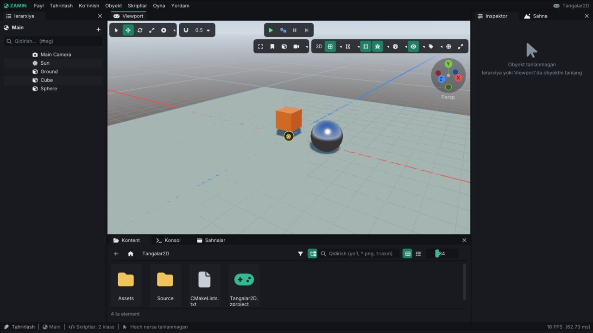
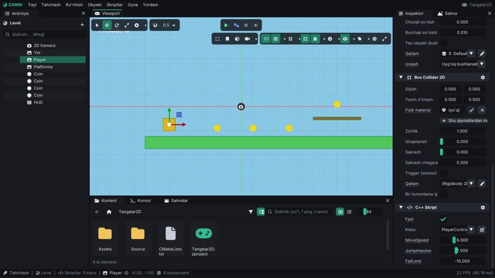
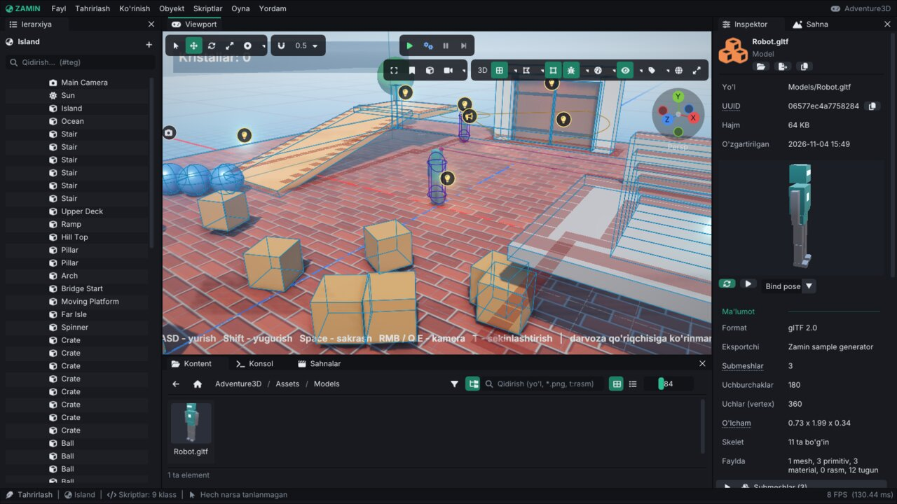

# Zamin Engine: editor qo'llanmasi

Zamin Editor (`ZaminEditor`) — loyihalarni ochish, sahnalarni yig'ish, komponentlarni sozlash, C++ skriptlarni
kompilyatsiya qilish, o'yinni editor ichida sinash va tayyor o'yinni eksport qilish uchun dastur. Bu qo'llanma
editorning oynalari, menyulari, viewport boshqaruvi, o'yin rejimi, sozlamalari va klaviatura yorliqlarini tushuntiradi.
Noldan o'yin yasash: [Tutorial-2D.md](Tutorial-2D.md) va [Tutorial-3D.md](Tutorial-3D.md).

Editor interfeysi o'zbekcha (inglizchaga **Tahrirlash → Sozlamalar → Ko'rinish** da o'tkaziladi).

Mundarija:

1. [Ishga tushirish va launcher](#1-ishga-tushirish-va-launcher)
2. [Oyna tuzilishi](#2-oyna-tuzilishi)
3. [Menyular](#3-menyular)
4. [Ierarxiya](#4-ierarxiya)
5. [Viewport](#5-viewport)
6. [Inspektor](#6-inspektor)
7. [Kontent brauzer](#7-kontent-brauzer)
8. [O'yin rejimi: Play, Simulate, Pauza](#8-oyin-rejimi-play-simulate-pauza)
9. [Konsol va kompilyatsiya](#9-konsol-va-kompilyatsiya)
10. [Boshqa oynalar](#10-boshqa-oynalar)
11. [Undo, avtosaqlash va tiklash](#11-undo-avtosaqlash-va-tiklash)
12. [Sozlamalar, joylashuvlar, til](#12-sozlamalar-joylashuvlar-til)
13. [Klaviatura yorliqlari](#13-klaviatura-yorliqlari)
14. [O'yinni build qilish](#14-oyinni-build-qilish)
15. [Avtomatlashtirish (skrinshotlar, CI)](#15-avtomatlashtirish-skrinshotlar-ci)

---

## 1. Ishga tushirish va launcher

```bash
./build/bin/ZaminEditor                          # launcher ochiladi
./build/bin/ZaminEditor Projects/Platformer2D    # loyiha papkasi yoki .zproject fayli
```

Loyihasiz ochilganda (yoki **Fayl → Yangi loyiha...**) **launcher** chiqadi:

- **Yangi loyiha** — **Loyiha nomi** va **Joylashuv** (papka tanlash tugmasi bilan) → **Yaratish**. Nomdan faqat lotin
  harflari, raqamlar va `_` olinadi. Loyiha shablondan yaratiladi: 3D sahna (`Scenes/Main.zscene`: `Main Camera`,
  `Sun`, `Ground`, `Rotator` skriptli `Cube`, `Sphere`), `Source/Scripts.cpp` (`Rotator` va `PlayerController`),
  `CMakeLists.txt`, `.gitignore`, til fayllari (`uz`, `en`) va standart input harakatlari. Editor ochilishi bilan C++
  skriptlarni kompilyatsiya qiladi.
- **Loyihani ochish** — `.zproject` fayl yoki papka yo'li.
- **So'nggi sahnalar** va **So'nggi loyihalar** — avval o'zingizning ishingiz.
- **Namuna o'yinlar** — `Projects/` dagi namunalar rasmli kartalarda: loyihaning rasmi (`.zproject`dagi
  `Thumbnail`), nomi (Player'dagi mahsulot nomi) va tavsifi (`Description`); bir bosishda ochiladi. Namunalarning
  rasmlari o'yinlarning headless skrinshotlaridan `Tools/samples/make_thumbnails.py` bilan olinadi. So'nggi
  sahna yoki loyiha bo'lsa, kartalar ro'yxatlardan keyin bir qatorda ko'rinadi (**Hammasini ko'rsatish** — hammasi);
  hali hech narsa ochilmagan bo'lsa, kartalar birinchi turadi.



Loyiha tuzilmasi:

```
MeningOyinim/
├── MeningOyinim.zproject     # loyiha sozlamalari (JSON)
├── CMakeLists.txt            # skript modulini build qilish (editor yaratadi)
├── Source/                   # C++ skriptlar (Scripts.cpp ...)
├── Assets/                   # sahnalar, teksturalar, ovozlar, modellar, prefab'lar, til fayllari
│   ├── Scenes/Main.zscene
│   └── Scenes/Main.zscene.zmeta  # asset UUID'si va import sozlamalari (versiya nazoratiga qo'shing)
├── Build/                    # CMake build papkasi (.gitignore'da)
├── Binaries/lib<Nom>.so      # kompilyatsiya qilingan skriptlar (.gitignore'da)
└── .zamin/                   # editor keshi: asset reyestri, rasmlar, avtosaqlash (.gitignore'da)
```

`.zproject` formati va har bir sozlama: [ProjectSettings.md](ProjectSettings.md).

## 2. Oyna tuzilishi



| Panel | Vazifasi |
|---|---|
| **Ierarxiya** (chapda) | Sahnadagi obyektlar daraxti (4-bo'lim) |
| **Viewport** (markazda) | Sahna ko'rinishi: kamera, gizmo, asboblar paneli, o'yin (5-bo'lim) |
| **Inspektor** (o'ngda) | Tanlangan obyektning komponentlari yoki kontent brauzerda tanlangan asset (6-bo'lim) |
| **Sahna** (o'ngda, Inspektor yonida) | Sahna sozlamalari: nom va metama'lumot, osmon / HDRI, atrof yorug'ligi, ekspozitsiya, tuman, post-processing, soyalar, fizika (Box2D / Jolt) |
| **Kontent** (pastda) | Loyiha fayllari (7-bo'lim) |
| **Konsol** (pastda) | Log xabarlari (9-bo'lim) |
| **Sahnalar** (pastda) | Loyihaning hamma sahnalari, build ro'yxati, boshlang'ich sahna ([Scenes.md](Scenes.md)) |
| Holat qatori (eng pastda) | Rejim (**Tahrirlash** / **O'yin**), ochiq sahna, skript klasslari soni, tanlangan obyekt (joyi, komponentlari, bolalari), oxirgi kompilyatsiya natijasi, FPS |

Panellarni sudrab boshqa joyga ko'chirish, yorliq qilib birlashtirish yoki alohida oyna qilish mumkin (ImGui docking).
Joylashuvni saqlash va tayyor joylashuvlar — 12-bo'lim.

## 3. Menyular

**Fayl**: Yangi loyiha..., Loyihani ochish... (`Ctrl+Shift+O`), So'nggi loyihalar, Loyiha sozlamalari..., Loyihani
yopish, Yangi sahna (`Ctrl+N`), Sahnani ochish... (`Ctrl+O`), Saqlash (`Ctrl+S`), Boshqacha saqlash...
(`Ctrl+Shift+S`), O'yinni build qilish..., Eksport hisoboti, Prefab'larni tekshirish, Chiqish (`Alt+F4`).

**Tahrirlash**: Undo / Redo (`Ctrl+Z` / `Ctrl+Y`), Undo tarixi... (`Ctrl+H`), Nusxalash (`Ctrl+C`), Joylash
(`Ctrl+V`), Prefab sifatida saqlash, Nusxa olish (`Ctrl+D`), O'chirish (`Delete`), Fokus (`F`), Yashirish (editorda)
(`H`), Qulflash (viewport'da), Nofaol qilish / Faollashtirish (`Alt+Shift+A`), Hammasini ko'rsatish (`Alt+H`), Hamma
qulflarni ochish, Hammasini tanlash (`Ctrl+A`), Tanlovni bekor qilish, Sozlamalar... (`Ctrl+,`), Klaviatura
yorliqlari... (`F1`).

**Ko'rinish**: Grid va Grid sozlamalari, Snapping va Snapping qadamlari, Fizik colliderlar, Debug chizish va uning
sozlamalari, Ikonkalar, UI elementlarini tanlash (to'rtburchagi bo'yicha), Parallax (editor kamerasi bilan), O'yin
oynasi o'lchami.

**Obyekt** — yangi obyekt (tahrirlash rejimida):

| Bo'lim | Elementlar |
|---|---|
| — | Bo'sh obyekt |
| 2D | Sprite, Doira, Matn, Tilemap, Fizik quti, Fizik shar |
| 3D | Kub, Shar, Tekislik, Silindr, Konus, Model (glTF / OBJ), Fizik kub, Fizik shar, Fizik yer (statik), Qahramon (Character Controller) |
| Yorug'lik | Quyosh (yo'naltirilgan), Nuqtali, Spot (konus) |
| Kamera | Perspektiv (3D), Ortografik (2D) |
| Effektlar | Particle effektlari kutubxonasi (olov, uchqun, tutun ...) |
| UI (ekran) | Matn, Rasm, Tugma, Slayder, Belgilash (toggle), Progress bar, Matn maydoni (input), Canvas, Menyu (vertikal layout), Scroll view (ro'yxat) |
| — | Ovoz manbai |

Har biri qaysi komponentlarni qo'shishi: [Components.md](Components.md).

**Skriptlar**: Kompilyatsiya + qayta yuklash (`Ctrl+B`), Modulni qayta yuklash, Avtomatik hot-reload, Kompilyatsiya
natijalari, Yangi C++ skript..., Source papkasini ochish, ro'yxatdan o'tgan klasslar (bosilganda kodi ochiladi).
Batafsil: [Scripting.md](Scripting.md).

**Oyna**: Ierarxiya, Inspektor, Kontent, Konsol, Sahna sozlamalari, Sahnalar, Loyiha sozlamalari, Statistika, Sahna
statistikasi, Kompilyatsiya, Profiler, Audio Mixer, Lokalizatsiya, Animatsiya, Animator grafi, Ishlatilmagan
assetlar, Sprite muharriri, Plitka palitrasi, Undo tarixi, Ko'rinishlar (qo'shimcha sahna ko'rinishlari, 4 ko'rinish
(2x2 joylashuv)), Joylashuv, ImGui demo.

**Yordam**: Klaviatura yorliqlari (`F1`), Zamin haqida.

## 4. Ierarxiya

- Yuqoridagi `+` tugmasi yoki bo'sh joyga o'ng tugma — yangi obyekt (Obyekt menyusi bilan bir xil).
- Obyektga o'ng tugma: **Bola obyekt yaratish**, **Nomini o'zgartirish** (`F2`), **Nusxa olish** (`Ctrl+D`),
  **Fokus** (`F`), **Ota-onadan ajratish**, **Prefab sifatida saqlash**, **O'chirish** va boshqalar.
- Obyektni boshqasining ustiga sudrab qo'yish — bola qilish; qatorlar orasiga — tartibni o'zgartirish.
- Bir nechtasini tanlash: `Ctrl` + bosish (qo'shish), `Shift` + bosish (oraliq), `Ctrl+A` (hammasi). Nusxa, o'chirish
  va faollik amallari hamma tanlanganlarga qo'llanadi.
- Qatordagi ko'z — editorda yashirish (`H`; o'yinga ta'sir qilmaydi), qulf — viewport'da tanlanmasin (inspektorda
  tahrirlash mumkin). Nofaol obyektlar xira ko'rinadi.
- **Qidirish**: nom bo'yicha; `#Enemy` — shu tegli obyektlar.
- Prefab nusxalari alohida belgi va rang bilan ko'rinadi ([Prefabs.md](Prefabs.md)).
- Katta sahnalar: ierarxiya ko'rinadigan qatorlarni tekis ro'yxat qiladi va faqat ekrandagilarini chizadi
  (`ImGuiListClipper`) — 10 000 obyektli sahnada ham ro'yxat ekrandagi ~30 qator narxida.

## 5. Viewport

**Asboblar paneli** (chapdan o'ngga): **Tanlash** (`Q`), **Ko'chirish** (`W`; `Alt` + sudrash — nusxasini sudrash),
**Aylantirish** (`E`), **Masshtab** (`R`), gizmo markazi (tanlov markazida / asosiy obyektda), snapping (magnit;
`Ctrl` bosib turish — vaqtincha teskari) va snapping qadami; markazda **O'ynash** (`Ctrl+P`), **Fizikani simulyatsiya
qilish**, **Pauza**, **Bir kadr oldinga**; o'ngda **Hammasini ko'rsatish** (`Shift+F`), kamera xatcho'plari, o'q
bo'yicha ko'rinish (yuqoridan, old, yon ...), kamera sozlamalari (uchish tezligi, tezlanish, FOV, near / far ...),
**2D / 3D** rejim, grid, ko'rinish rejimi (oddiy, faqat yorug'lik, normallar, albedo ...) va wireframe, fizik
colliderlar, debug chizish, statistika overlay, ikonkalar va komponent gizmolari, obyekt nomlari, **Lokal / Global
koordinatalar**, **O'yinda to'liq oyna** (Maximize on Play). O'yin rejimida chapda **O'yin oynasi o'lchami**
(Erkin yoki aniq o'lcham / nisbat).

**Kamera boshqaruvi** (3D):

| Harakat | Natija |
|---|---|
| O'ng tugma + `W A S D` (`Q` / `E` — pastga / yuqoriga, `Shift` — tezroq) | Kamerada uchish |
| O'ng tugma + g'ildirak | Uchish tezligi |
| `Alt` + chap tugma | Aylanib qarash (orbit) |
| O'rta tugma | Surish (pan) |
| G'ildirak, `Alt` + o'ng tugma | Yaqinlashish / uzoqlashish |
| `F` / `Shift+F` | Tanlovga fokus / butun sahna |
| `1`..`5` / `Ctrl+1`..`5` | Kamera xatcho'piga qaytish / saqlash |
| Numpad `7` `1` `3` (`Ctrl` bilan teskari), `5`, `0` | Yuqoridan / old / o'ng ortografik ko'rinish, perspektiv ↔ ortografik, erkin perspektiv |

**2D rejim** (asboblar panelidagi **2D**): kamera XY tekisligiga qaraydi, surish va zoom. 2D sahna ochilganda editor
o'zi 2D rejimga o'tadi.

**Tanlash**: chap tugma bilan bosish (`Ctrl` / `Shift` bilan — tanlovga qo'shish); UI elementlari to'rtburchagi
bo'yicha (**Ko'rinish → UI elementlarini tanlash**). Bir nechta tanlangan obyekt gizmo bilan birga suriladi (gizmo
markazi — asosiy obyekt yoki tanlov markazi). Gizmo bilan sudrashda `Ctrl+D` — shu joyda nusxa qoldirib davom etish.
Collider, spline, joint anchor va polygon nuqtalari inspektordagi tahrirlash tugmasi bilan viewport'da suriladi.

**Sudrab tashlash**: kontent brauzerdan sahna, prefab (bir nechtasini birga; `Shift` — ketma-ket qo'yishda davom
etish), rasm, model va ovoz fayllarini viewport'ga tashlash mumkin; material (`.zmat`) sichqoncha ostidagi mesh'ga
qo'yiladi. Tizim fayl menejeridan editor oynasiga tashlangan fayllar `Assets` ga nusxalanadi (import).

**Qo'shimcha ko'rinishlar**: **Oyna → Ko'rinishlar** — har biri o'z kamerasi bilan (masalan yuqoridan ortografik);
**4 ko'rinish (2x2 joylashuv)**.

## 6. Inspektor

Sarlavha: faollik belgisi (obyektni o'yinda o'chirish), obyekt ikonkasi va nomi, **Hamma komponentlarni yig'ish /
ochish**, **+ Komponent** (qidiruv bilan, bo'limlarga ajratilgan menyu; nusxalangan komponent bo'lsa — **Buferdan
joylash**). Ostida `ID`, nofaollik sababi, yashirin / qulflangan belgilar va prefab nusxasi bo'lsa — prefab paneli
(Apply / Revert).

Har komponent bo'limi yig'iladi; sarlavhadagi tishli g'ildirak menyusi: **Komponentni nusxalash**, joylash,
**Yuqoriga / Pastga ko'chirish**, **Eng yuqoriga / Eng pastga**, **Komponentni olib tashlash**. Transform menyusida
alohida tiklash va joylash (faqat pozitsiya / aylanish / masshtab).

Maydonlar: sonlarni sichqoncha bilan sudrab yoki ikki marta bosib yozib o'zgartirish mumkin; asset maydonlariga
(tekstura, model, ovoz, material) kontent brauzerdan sudrab tashlanadi; obyekt havolalariga — ierarxiyadan. Barcha
o'zgarishlar undo qilinadi. Bir nechta obyekt tanlanganda asosiy (oxirgi tanlangan) obyekt ko'rsatiladi, ko'p amallar
hammasiga qo'llanadi.

Kontent brauzerda asset (rasm, model, ovoz, material, sprite kliplari ...) tanlansa, inspektor uning import
sozlamalari va ko'rinishini ko'rsatadi.

## 7. Kontent brauzer

- Loyiha papkasi bo'ylab navigatsiya (`Enter` — ochish, `Backspace` — yuqori papka, yo'l satri), katakcha / ro'yxat
  ko'rinishi, katakcha o'lchami (`Ctrl` + g'ildirak), rasm, model, material, prefab va sahnalar uchun kichik rasmlar.
- **Qidirish** (`Ctrl+F`): nom, `*.png`, `t:rasm` kabi tur filtrlari; filtr tugmasi.
- Katta papkalar: katakcha ko'rinishida faqat ekrandagi qatorlar chiziladi (ro'yxat ko'rinishi kabi `ImGuiListClipper`) —
  5 000 faylli papka ham sekinlashtirmaydi. Avtomatlashtirish: `ZAMIN_EDITOR_PANEL_TIMES=1` chiqishda ierarxiya ro'yxati
  va katakchalar vaqtini logga yozadi, `ZAMIN_EDITOR_NO_CLIPPER=1` solishtirish uchun hammasini chizadi.
- Bo'sh joyga o'ng tugma: **Yangi papka**, **Yangi sahna**, **Yangi C++ skript...**, **Yangi animatsiya klipi**,
  **Yangi sprite animatsiya klipi** va boshqalar. Faylga o'ng tugma: nomini o'zgartirish (`F2`), o'chirish (`Delete`),
  sahna uchun **Boshlang'ich sahna qilish** va hokazo.
- Fayllarni tizim fayl menejeridan editor oynasiga sudrab tashlash — `Assets` ga import.
- Har bir asset yonida `.zmeta` fayli (UUID va import sozlamalari) — uni versiya nazoratiga qo'shing; nomni editorda
  o'zgartirsangiz havolalar buzilmaydi.



*Kontent brauzerda `Assets/Models/Robot.gltf` tanlangan: inspektor modelni aylanadigan 3D ko'rinishda (animatsiyalarni
o'ynatish bilan), yo'li, UUID'si va ma'lumotlari (submeshlar, uchburchaklar, skelet) bilan ko'rsatadi.*

## 8. O'yin rejimi: Play, Simulate, Pauza

- **O'ynash** (`Ctrl+P`, yoki `Shift+Escape` — to'xtatish): sahna nusxasi yaratiladi va o'yin shu nusxada ishlaydi —
  skriptlar, fizika, audio, animatsiya, UI. Editor ramkasi rangi o'zgaradi (**Sozlamalar → O'yin rejimi**). **Stop**
  bosilganda o'yin paytidagi hamma o'zgarishlar yo'qoladi va tahrirlangan sahna qaytadi — sahnani o'zgartirish uchun
  avval to'xtating. O'yin paytida inspektordagi qiymatlarni o'zgartirib tajriba qilish mumkin (saqlanmaydi).
- **Fizikani simulyatsiya qilish**: skriptlarsiz faqat fizika ishlaydi, editor kamerasi bilan kuzatiladi.
- **Pauza** va **Bir kadr oldinga** — kadrma-kadr ko'rish.
- O'yin rejimida klaviatura va sichqoncha viewport fokusda bo'lganda o'yinga boradi.
- O'yin sahnalar almashtirsa (`LoadScene`), **Stop** dan keyin editor boshlang'ich sahnaga va avvalgi holatiga qaytadi.
- Prefab rejimida o'yin ishga tushmaydi.

## 9. Konsol va kompilyatsiya

**Konsol**: dvigatel (`ZAMIN`) va o'yin / editor (`APP`) xabarlari, daraja bo'yicha ranglar. Matn bo'yicha filtr
(regex va katta-kichik harf variantlari), darajalar, bir xil xabarlarni guruhlash, vaqt ko'rsatish, Play'da tozalash,
xabarni nusxalash (`Ctrl+C`). Log darajalari va log fayli — **Sozlamalar → Log** ([Core.md](Core.md)).

**Kompilyatsiya** oynasi (**Oyna → Kompilyatsiya**): **Muammolar** — xato va ogohlantirishlar ro'yxati (bosilganda
fayl shu qatorda tashqi muharrirda ochiladi), **To'liq chiqish** — CMake va kompilyator chiqishi. Batafsil:
[Scripting.md](Scripting.md#20-kompilyatsiya-va-hot-reload).

## 10. Boshqa oynalar

| Oyna | Vazifasi | Batafsil |
|---|---|---|
| Loyiha sozlamalari | Player, grafika, sifat darajalari, input, teglar, fizika qatlamlari, saralash qatlamlari, build sahnalar, audio, lokalizatsiya, saqlangan ma'lumotlar ... | [ProjectSettings.md](ProjectSettings.md) |
| Statistika | FPS, kadr vaqti, render (draw call, uchburchak), fizika, xotira, vazifalar tizimi | — |
| Sahna statistikasi | Sahnadagi obyektlar, komponentlar, assetlar va ularning hajmi | — |
| Profiler | Kadr ichidagi bosqichlar vaqti (CPU) | — |
| Audio Mixer | Mixer guruhlari, ovoz balandligi, mute / solo, filtrlar, daraja o'lchagichlari | — |
| Lokalizatsiya | Til fayllari jadvali (kalitlar x tillar) | [ProjectSettings.md](ProjectSettings.md) |
| Animatsiya | `.zanim` kliplar timeline'i: kalitlar, egri chiziqlar, event'lar | [Animation.md](Animation.md) |
| Animator grafi | Animator holat mashinasining grafi | [Animation.md](Animation.md) |
| Sprite muharriri | Teksturani nomlangan kadrlarga kesish (sprite varag'i) | — |
| Plitka palitrasi | Tilemap chizish: mo'yqalam (`B`), to'rtburchak (`R`), to'ldirish (`G`), o'chirg'ich (`E`), pipetka (`I`) | — |
| Ishlatilmagan assetlar | Hech qayerda ishlatilmayotgan fayllar | [Runtime.md](Runtime.md) |
| Undo tarixi | Bajarilgan amallar ro'yxati, istalganiga qaytish | 11-bo'lim |
| Sahnalar | Loyiha sahnalari, build ro'yxati | [Scenes.md](Scenes.md) |

Prefab rejimi (prefabni alohida tahrirlash), Apply / Revert va variantlar: [Prefabs.md](Prefabs.md).

## 11. Undo, avtosaqlash va tiklash

- Sahnadagi deyarli har bir amal (yaratish, o'chirish, ko'chirish, komponent maydonlari, ierarxiya, tanlov) undo
  qilinadi: `Ctrl+Z`, `Ctrl+Y` (yoki `Ctrl+Shift+Z`), **Undo tarixi** (`Ctrl+H`). Prefab fayllariga yozish ham.
- **Avtosaqlash**: saqlanmagan o'zgarishlar bo'lsa, editor ochiq sahnaning xavfsizlik nusxasini muntazam yozadi
  (`<loyiha>/.zamin/autosave/`, asl fayl o'zgarmaydi); oraliq — **Sozlamalar → Saqlash va undo**. Editor kutilmaganda
  yopilsa, sahna ochilganda nusxani tiklash taklif qilinadi.
- Buzilgan sahna fayli ochilmasa, editor uni qisman tiklashni taklif qiladi ([Scenes.md](Scenes.md)).

## 12. Sozlamalar, joylashuvlar, til

**Tahrirlash → Sozlamalar...** (`Ctrl+,`) sahifalari: **Ko'rinish** (asosiy rang, shrift o'lchami, til), **O'yin
rejimi** (UI rang tusi), **Konsol**, **Editor kamerasi** (tezlik, FOV, Y o'qi), **Saqlash va undo** (avtosaqlash),
**Tashqi muharrir** (kodni ochadigan dastur), **Ishlash** (bo'sh turganda FPS ni kamaytirish), **Log**. Sozlamalar
`~/.config/zamin/preferences.json` da saqlanadi (barcha loyihalar uchun umumiy).

**Joylashuvlar** (**Oyna → Joylashuv**): tayyorlari — **Standart**, **2D**, **Animatsiya**, **4 ko'rinish**;
joriysini nom bilan saqlash va boshqarish.

**Til**: editor interfeysi o'zbekcha yoki inglizcha (**Sozlamalar → Ko'rinish**). O'yin matnlarining tili alohida —
[ProjectSettings.md](ProjectSettings.md). Matnlar `Tr("...")` orqali o'tadi (o'zbekchasi kalit, inglizchasi
`EditorLanguage.cpp` jadvalida; `UI::PropertyLabel` / `PropertyHeader` / `Property*` yorliqlarini o'zi tarjima
qiladi). `ZaminTests` dagi `EditorTranslationKeysComplete` testi editor kodidagi har bunday yorliqning inglizchasi
borligini tekshiradi va yo'qlarini fayl nomi bilan chiqaradi; yangi yorliq qo'shganda jadvalga juftini ham qo'shing.
Uzun izohlar (tooltiplar, `TextDisabled` maslahatlari) hozircha faqat o'zbekcha.

## 13. Klaviatura yorliqlari

**Yordam → Klaviatura yorliqlari** (`F1`) — hamma yorliqlar ro'yxati; ko'pchiligini shu oynada qayta bog'lash mumkin
(o'zgarishlar sozlamalarda saqlanadi). Standartlari:

| Bo'lim | Yorliq | Amal |
|---|---|---|
| Fayl | `Ctrl+N` / `Ctrl+O` / `Ctrl+S` / `Ctrl+Shift+S` | Yangi sahna / Sahnani ochish / Saqlash / Boshqacha saqlash |
| Fayl | `Ctrl+Shift+O` | Loyihani ochish |
| Tahrirlash | `Ctrl+Z` / `Ctrl+Y` (`Ctrl+Shift+Z`) | Bekor qilish / Qaytarish |
| Tahrirlash | `Ctrl+H` | Undo tarixi oynasi |
| Tahrirlash | `Ctrl+C` / `Ctrl+V` / `Ctrl+D` | Nusxalash / Joylash / Nusxa olish (dublikat) |
| Tahrirlash | `Ctrl+,` | Sozlamalar oynasi |
| Tanlov | `Delete` / `Ctrl+A` | O'chirish / Hammasini tanlash |
| Tanlov | `Alt+Shift+A` | Faol / nofaol qilish |
| Tanlov | `H` / `Alt+H` | Editorda yashirish / ko'rsatish, Hammasini ko'rsatish |
| O'yin | `Ctrl+P` / `Shift+Escape` | O'ynash / to'xtatish, O'yinni to'xtatish |
| O'yin | `Ctrl+B` | Skriptlarni kompilyatsiya qilish |
| Asboblar (viewport) | `Q` / `W` / `E` / `R` | Tanlash / Siljitish / Aylantirish / Masshtab |
| Kamera (viewport) | `F` / `Shift+F` | Tanlovga fokus / Butun sahnani ko'rsatish |
| Kamera (viewport) | `1`..`5` / `Ctrl+1`..`5` | Xatcho'pga qaytish / saqlash |
| Kamera (viewport) | Numpad `7` `1` `3` `5` `0` (`Ctrl` bilan teskari) | Ortografik ko'rinishlar, perspektiv / ortografik, erkin perspektiv |
| Plitka chizish | `B` / `R` / `G` / `E` / `I` | Mo'yqalam / To'rtburchak / To'ldirish / O'chirg'ich / Pipetka |
| Plitka chizish | `Escape`, `Q`, `W` / `Shift` + chap tugma | Chizishdan chiqish / Vaqtincha o'chirish |
| Nuqtalar va langarlar | `Escape`, `Q`, `W` / `Delete` / `Ctrl` + chap tugma | Tahrirlashdan chiqish / Nuqtani o'chirish / Nuqtani olib tashlash |
| Oynalar | `F1` | Klaviatura yorliqlari |
| Ierarxiya, Kontent | `F2` | Nomini o'zgartirish |
| Kontent | `Delete` / `Ctrl+A` / `Ctrl+F` / `Enter` / `Backspace` / `Escape` | O'chirish / Hammasini tanlash / Qidiruv / Ochish / Yuqori papka / Tanlovni bekor qilish |
| Konsol | `Ctrl+C` | Xabarni nusxalash |
| Animatsiya | `Space` / `K` / `Delete` / `F` / `Home` / `End` / `←` `→` | Ijro-pauza / Kalit qo'shish / Kalitlarni o'chirish / Hammasini ko'rsatish / Boshiga / Oxiriga / Oldingi-keyingi kadr |
| Animator grafi | `Delete` / `F` / `Escape` | O'chirish / Hammasini ko'rsatish / Bog'lashni bekor qilish |
| Sprite muharriri | `Delete` / `F` | Kadrni o'chirish / Hammasini ko'rsatish |

Jadval `Zamin/src/Zamin/Editor/ShortcutRegistry.cpp` (`RegisterEditorShortcuts`) dagi ro'yxatdan olingan.

## 14. O'yinni build qilish

**Fayl → O'yinni build qilish...** — chiqish papkasini tanlang (ixtiyoriy: sahnalarni binar keshga ham yozish
`.zsceneb`). Editor skript modulini Release'da qayta kompilyatsiya qiladi, ishlatilgan assetlarni, `ZaminPlayer`,
`libZamin.so`, `Resources`, `.sh` launcher va `.desktop` faylini papkaga yig'adi, prefab'larni tekshiradi va
**Eksport hisoboti** oynasini ochadi (`export-report.json` / `.txt`). Tayyor o'yin `<O'yin>.sh` bilan ishga tushadi.
Batafsil: [Runtime.md](Runtime.md#11-eksport).

## 15. Avtomatlashtirish (skrinshotlar, CI)

Editor muhit o'zgaruvchilari bilan boshqariladi — headless skrinshotlar, testlar va CI uchun (`Tests/editor_smoke.sh`,
`Tests/export_test.sh`, `Tests/hot_reload_test.sh`). Eng ko'p ishlatiladiganlari:

| O'zgaruvchi | Natija |
|---|---|
| `ZAMIN_MAX_FRAMES=N` | N kadrdan keyin yopiladi (bo'sh turganda sekinlashmaydi) |
| `ZAMIN_SCREENSHOT=<fayl.png>` | Oxirgi kadr rasmi |
| `ZAMIN_EDITOR_NEW_PROJECT="<papka>\|<Nom>"` | Shu nomli yangi loyiha yaratib ochadi (launcher'dagi kabi) |
| `ZAMIN_EDITOR_SCENE=<Scenes/X.zscene>` | Shu sahnani ochadi |
| `ZAMIN_EDITOR_SELECT=<obyekt nomi>` | Obyektni tanlaydi (inspektorda ko'rinadi) |
| `ZAMIN_EDITOR_INSPECTOR_BOTTOM=1` | Inspektor oxirigacha suriladi (kattaroq son — shuncha piksel) |
| `ZAMIN_EDITOR_PLAY=1` | O'yin rejimini boshlaydi (`ZAMIN_EDITOR_TIME_SCALE` — vaqt masshtabi) |
| `ZAMIN_EDITOR_CAMERA="x,y,z,masofa,pitch,yaw"` | Editor kamerasi shu nuqtaga qaraydi |
| `ZAMIN_EDITOR_MENU=<Fayl\|Tahrirlash\|...>` | Shu menyu ochiq turadi |
| `ZAMIN_EDITOR_LAYOUT=<Default\|2D\|Animation\|FourViews\|nom>` | Joylashuvni qo'llaydi |
| `ZAMIN_EDITOR_OPEN_PREFAB=<Prefabs/X.zprefab>` | Prefabni prefab rejimida ochadi |
| `ZAMIN_EDITOR_NEW_SCRIPT=<Klass>[\|minimal]` | Yangi skript yaratib kompilyatsiya qiladi (`dialog` — oynani ochadi) |
| `ZAMIN_EDITOR_BUILD=1` | Skriptlarni kompilyatsiya qiladi |
| `ZAMIN_EDITOR_EXPORT=<papka>` | O'yinni shu papkaga eksport qiladi |
| `ZAMIN_EDITOR_OPEN_ALL_PANELS=1` | Smoke test: hamma oyna, menyu va inspektorlarni ochib chiqadi, xato bo'lsa 1 kodi bilan yopiladi |
| `ZAMIN_EDITOR_STATS=1` | Oxirgi kadr statistikasini logga ham yozadi |

Masalan, [2D qo'llanmadagi](Tutorial-2D.md) rasm shunday olingan:

```bash
ZAMIN_EDITOR_SELECT=Player ZAMIN_EDITOR_INSPECTOR_BOTTOM=1 ZAMIN_MAX_FRAMES=60 ZAMIN_SCREENSHOT=editor.png \
    xvfb-run -a -s "-screen 0 1600x900x24" ./build/bin/ZaminEditor <loyiha>
```

Player uchun o'zgaruvchilar: [Runtime.md](Runtime.md#14-avtomatlashtirish-uchun-muhit-ozgaruvchilari); testlar:
[Testing.md](Testing.md).
