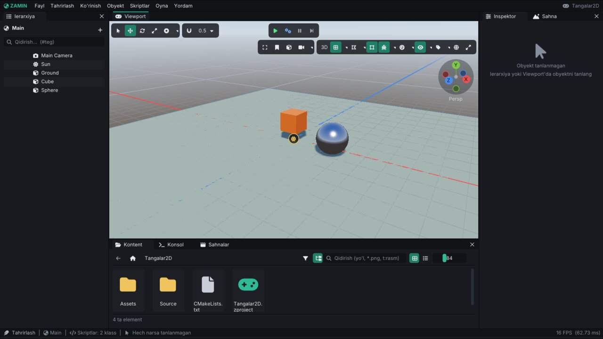
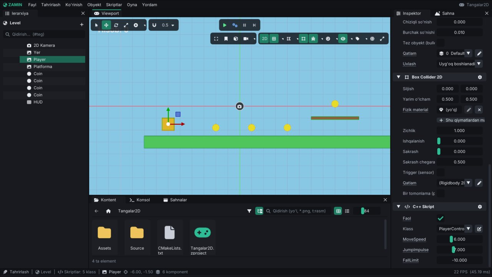
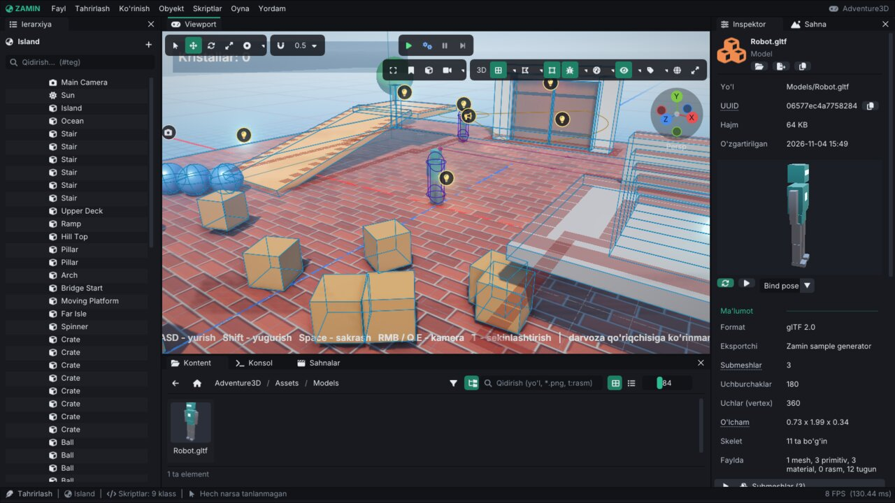

# Zamin Engine: the editor guide

Zamin Editor (`ZaminEditor`) is the program for opening projects, assembling scenes, setting up components, compiling C++
scripts, testing the game inside the editor and exporting the finished game. This guide explains the
editor's windows, menus, viewport controls, play mode, preferences and keyboard shortcuts.
Making a game from scratch: [Tutorial-2D.md](Tutorial-2D.md) and [Tutorial-3D.md](Tutorial-3D.md).

The editor interface is in English (it can be switched to Uzbek in **Edit → Preferences → View**).

Contents:

1. [Starting and the launcher](#1-starting-and-the-launcher)
2. [The window layout](#2-the-window-layout)
3. [Menus](#3-menus)
4. [Hierarchy](#4-hierarchy)
5. [Viewport](#5-viewport)
6. [Inspector](#6-inspector)
7. [The content browser](#7-the-content-browser)
8. [Play mode: Play, Simulate, Pause](#8-play-mode-play-simulate-pause)
9. [The console and compiling](#9-the-console-and-compiling)
10. [Other windows](#10-other-windows)
11. [Undo, autosave and recovery](#11-undo-autosave-and-recovery)
12. [Preferences, layouts, language](#12-preferences-layouts-language)
13. [Keyboard shortcuts](#13-keyboard-shortcuts)
14. [Building the game](#14-building-the-game)
15. [Automation (screenshots, CI)](#15-automation-screenshots-ci)

---

## 1. Starting and the launcher

```bash
./build/bin/ZaminEditor                          # the launcher opens
./build/bin/ZaminEditor Projects/Platformer2D    # a project folder or a .zproject file
```

When it opens without a project (or with **File → New project...**) the **launcher** appears:

- **New project** — the **Project name** and the location (with a folder picker button) → **Create**. Only Latin
  letters, digits and `_` are taken from the name. The project is created from a template: a 3D scene (`Scenes/Main.zscene`: `Main Camera`,
  `Sun`, `Ground`, a `Cube` with the `Rotator` script, `Sphere`), `Source/Scripts.cpp` (`Rotator` and `PlayerController`),
  `CMakeLists.txt`, `.gitignore`, language files (`uz`, `en`) and the default input actions. The editor compiles the C++
  scripts as soon as it opens.
- **Open project** — a `.zproject` file or a folder path.
- **Recent scenes** and **Recent projects** — your own work first.
- **Sample games** — the samples in `Projects/` on cards with pictures: the project's picture (`Thumbnail` in the
  `.zproject`), its name (the product name in Player) and its description (`Description`); one click opens it. The samples'
  pictures are taken from the games' headless screenshots with `Tools/samples/make_thumbnails.py`. When there are recent
  scenes or projects, the cards show in one row after the lists (**Show all** — all of them);
  when nothing has been opened yet, the cards come first.



The project structure:

```
MyGame/
├── MyGame.zproject           # the project settings (JSON)
├── CMakeLists.txt            # builds the script module (the editor creates it)
├── Source/                   # C++ scripts (Scripts.cpp ...)
├── Assets/                   # scenes, textures, sounds, models, prefabs, language files
│   ├── Scenes/Main.zscene
│   └── Scenes/Main.zscene.zmeta  # the asset's UUID and import settings (add it to version control)
├── Build/                    # the CMake build folder (in .gitignore)
├── Binaries/lib<Name>.so     # the compiled scripts (in .gitignore)
└── .zamin/                   # the editor cache: the asset registry, pictures, autosave (in .gitignore)
```

The `.zproject` format and every setting: [ProjectSettings.md](ProjectSettings.md).

## 2. The window layout



| Panel | Purpose |
|---|---|
| **Hierarchy** (left) | The tree of entities in the scene (section 4) |
| **Viewport** (center) | The scene view: the camera, gizmos, the toolbar, the game (section 5) |
| **Inspector** (right) | The components of the selected entity, or the asset selected in the content browser (section 6) |
| **Scene** (right, next to the Inspector) | The scene settings: name and metadata, sky / HDRI, ambient light, exposure, fog, post-processing, shadows, physics (Box2D / Jolt) |
| **Content** (bottom) | The project files (section 7) |
| **Console** (bottom) | Log messages (section 9) |
| **Scenes** (bottom) | All the project's scenes, the build list, the start scene ([Scenes.md](Scenes.md)) |
| The status bar (very bottom) | The mode (**Edit** / **Playing**), the open scene, the number of script classes, the selected entity (its position, components, children), the last compile result, FPS |

Panels can be dragged elsewhere, merged into tabs or turned into separate windows (ImGui docking).
Saving a layout and the ready-made layouts — section 12.

## 3. Menus

**File**: New project..., Open project... (`Ctrl+Shift+O`), Recent projects, Project settings..., Close
project, New scene (`Ctrl+N`), Open scene... (`Ctrl+O`), Save (`Ctrl+S`), Save as...
(`Ctrl+Shift+S`), Build game..., Export report, Check prefabs, Exit (`Alt+F4`).

**Edit**: Undo / Redo (`Ctrl+Z` / `Ctrl+Y`), Undo history... (`Ctrl+H`), Copy (`Ctrl+C`), Paste
(`Ctrl+V`), Save as prefab, Duplicate (`Ctrl+D`), Delete (`Delete`), Focus (`F`), Hide (in the editor)
(`H`), Lock (in viewport), Deactivate / Activate (`Alt+Shift+A`), Show all (`Alt+H`), Unlock
all, Select all (`Ctrl+A`), Clear selection, Preferences... (`Ctrl+,`), Keyboard
shortcuts... (`F1`).

**View**: Grid and Grid settings, Snapping and Snapping steps, Physics colliders, Debug drawing and its
settings, Icons, Select UI elements (by their rectangle), Parallax (with the editor camera), Game
view size.

**Object** — a new entity (in edit mode):

| Section | Items |
|---|---|
| — | Empty object |
| 2D | Sprite, Circle, Text, Tilemap, Physics box, Physics ball |
| 3D | Cube, Sphere, Plane, Cylinder, Cone, Model (glTF / OBJ), Physics cube, Physics ball, Physics ground (static), Hero (Character Controller) |
| Light | Sun (directional), Point, Spot (cone) |
| Camera | Perspective (3D), Orthographic (2D) |
| Effects | The library of particle effects (fire, sparks, smoke ...) |
| UI (screen) | Text, Image, Button, Slider, Toggle, Progress bar, Input field, Canvas, Menu (vertical layout), Scroll view (list) |
| — | Audio source |

Which components each one adds: [Components.md](Components.md).

**Scripts**: Compile + reload (`Ctrl+B`), Reload module, Automatic hot reload, Compiler
output, New C++ script..., Open Source folder, the registered classes (clicking one opens its code).
More: [Scripting.md](Scripting.md).

**Window**: Hierarchy, Inspector, Content, Console, Scene settings, Scenes, Project settings, Statistics, Scene
statistics, Compilation, Profiler, Audio Mixer, Localization, Animation, Animator graph, Unused
assets, Sprite editor, Tile palette, Undo history, Views (extra scene views, 4 views
(a 2x2 layout)), Layout, ImGui demo.

**Help**: Keyboard shortcuts (`F1`), About Zamin.

## 4. Hierarchy

- The `+` button at the top, or a right click on an empty spot — a new entity (the same as the Object menu).
- Right-clicking an entity: **Create child object**, **Rename** (`F2`), **Duplicate** (`Ctrl+D`),
  **Focus** (`F`), **Unparent**, **Save as prefab**, **Delete** and more.
- Dragging an entity onto another one makes it a child; dropping it between rows reorders it.
- Selecting several: `Ctrl` + click (add), `Shift` + click (a range), `Ctrl+A` (all). Duplicate, delete
  and the activity operations apply to every selected entity.
- The eye on a row — hide in the editor (`H`; it does not affect the game), the lock — not selectable in the viewport (it can
  still be edited in the inspector). Inactive entities look dimmed.
- **Search**: by name; `#Enemy` — the entities with that tag.
- Prefab instances show up with their own marker and color ([Prefabs.md](Prefabs.md)).
- Large scenes: the hierarchy turns the visible rows into a flat list and draws only the ones on screen
  (`ImGuiListClipper`) — even in a 10 000-entity scene the list costs about as much as ~30 rows on screen.

## 5. Viewport

**The toolbar** (left to right): **Select** (`Q`), **Move** (`W`; `Alt` + drag — drag a copy),
**Rotate** (`E`), **Scale** (`R`), the gizmo pivot (at the selection center / on the primary entity), snapping (the magnet;
holding `Ctrl` — temporarily the opposite) and the snapping step; in the middle **Play** (`Ctrl+P`), **Simulate
physics**, **Pause**, **One frame forward**; on the right **Show all** (`Shift+F`), the camera bookmarks, the axis
views (from the top, front, side ...), the camera settings (fly speed, acceleration, FOV, near / far ...),
the **2D / 3D** mode, the grid, the view mode (normal, lighting only, normals, albedo ...) and wireframe, physics
colliders, debug drawing, the statistics overlay, icons and component gizmos, entity names, **Local / Global
coordinates**, **Maximize on Play**. In play mode, on the left, the **Game view size**
(Free, or an exact size / aspect ratio).

**Camera controls** (3D):

| Action | Result |
|---|---|
| Right button + `W A S D` (`Q` / `E` — down / up, `Shift` — faster) | Fly the camera |
| Right button + wheel | The fly speed |
| `Alt` + left button | Orbit |
| Middle button | Pan |
| Wheel, `Alt` + right button | Zoom in / out |
| `F` / `Shift+F` | Focus on the selection / the whole scene |
| `1`..`5` / `Ctrl+1`..`5` | Return to / save a camera bookmark |
| Numpad `7` `1` `3` (opposite with `Ctrl`), `5`, `0` | Top / front / right orthographic view, perspective ↔ orthographic, free perspective |

**2D mode** (**2D** in the toolbar): the camera looks at the XY plane, with pan and zoom. When a 2D scene opens, the editor
switches to 2D mode by itself.

**Selecting**: click with the left button (with `Ctrl` / `Shift` — add to the selection); UI elements by their rectangle
(**View → Select UI elements**). Several selected entities move together with the gizmo (the gizmo
pivot is the primary entity or the selection center). While dragging with the gizmo, `Ctrl+D` leaves a copy in place and goes on.
Collider, spline, joint anchor and polygon points are moved in the viewport with the edit button in the inspector.

**Drag and drop**: scenes, prefabs (several together; `Shift` — keep placing one after another), pictures, models and
sound files can be dropped from the content browser onto the viewport; a material (`.zmat`) goes onto the mesh under the
mouse. Files dropped onto the editor window from the system's file manager are copied into `Assets` (import).

**Extra views**: **Window → Views** — each with its own camera (for example an orthographic view from the top);
**4 views (2x2 layout)**.

## 6. Inspector

The header: the activity checkbox (turns the entity off in the game), the entity's icon and name, **Collapse all / expand all
components**, **+ Component** (a menu with a search, split into sections; when a component was copied — **Paste
from clipboard**). Below it the `ID`, the reason for inactivity, the hidden / locked markers and, for a prefab instance, the prefab panel
(Apply / Revert).

Every component section collapses; the cog menu in its header: **Copy component**, paste,
**Move up / Move down**, **To the top / To the bottom**, **Remove component**. The Transform menu has
its own reset and paste (position / rotation / scale only).

Fields: numbers can be changed by dragging with the mouse or by double-clicking and typing; assets
(textures, models, sounds, materials) are dragged onto asset fields from the content browser; entities onto entity references — from the hierarchy. Every
change can be undone. With several entities selected the primary (last selected) entity is shown, and most operations
apply to all of them.

When an asset (a picture, model, sound, material, sprite clips ...) is selected in the content browser, the inspector shows its import
settings and a preview.

## 7. The content browser

- Navigating the project folder (`Enter` — open, `Backspace` — the parent folder, the path bar), a grid / list
  view, the tile size (`Ctrl` + wheel), small pictures for images, models, materials, prefabs and scenes.
- **Search** (`Ctrl+F`): a name, `*.png`, type filters like `t:rasm`; a filter button.
- Large folders: in the grid view only the rows on screen are drawn (`ImGuiListClipper`, like the list view) —
  even a 5 000-file folder does not slow it down. Automation: `ZAMIN_EDITOR_PANEL_TIMES=1` writes the times of the hierarchy list
  and the tiles to the log on exit, `ZAMIN_EDITOR_NO_CLIPPER=1` draws everything for a comparison.
- Right-clicking an empty spot: **New folder**, **New scene**, **New C++ script...**, **New animation clip**,
  **New sprite animation clip** and more. Right-clicking a file: rename (`F2`), delete (`Delete`),
  **Make start scene** for a scene, and so on.
- Dragging files from the system's file manager onto the editor window imports them into `Assets`.
- Next to every asset is a `.zmeta` file (the UUID and import settings) — add it to version control; when you rename a file in the
  editor the references do not break.



*`Assets/Models/Robot.gltf` selected in the content browser: the inspector shows the model in a rotating 3D view (playing its
animations), with its path, UUID and details (submeshes, triangles, skeleton).*

## 8. Play mode: Play, Simulate, Pause

- **Play** (`Ctrl+P`, or `Shift+Escape` — stop): a copy of the scene is made and the game runs in that copy —
  scripts, physics, audio, animation, UI. The color of the editor frame changes (**Preferences → Play mode**). When **Stop**
  is pressed every change made during play is lost and the edited scene comes back — stop first to change the
  scene. During play you can experiment by changing values in the inspector (they are not saved).
- **Simulate physics**: only physics runs, without scripts, watched with the editor camera.
- **Pause** and **One frame forward** — frame-by-frame viewing.
- In play mode the keyboard and the mouse go to the game while the viewport has the focus.
- When the game switches scenes (`LoadScene`), after **Stop** the editor returns to the start scene and its previous state.
- The game does not start in prefab mode.

## 9. The console and compiling

**Console**: the messages of the engine (`ZAMIN`) and of the game / editor (`APP`), colored by level. A text filter
(regex and case-sensitivity options), the levels, grouping identical messages, showing the time, clearing on Play,
copying a message (`Ctrl+C`). The log levels and the log file — **Preferences → Log** ([Core.md](Core.md)).

The **Compilation** window (**Window → Compilation**): **Problems** — the list of errors and warnings (clicking one opens the
file at that line in the [built-in code editor](CodeEditor.md)), **Full output** — the CMake and compiler output. More:
[Scripting.md](Scripting.md#20-kompilyatsiya-va-hot-reload).

## 10. Other windows

| Window | Purpose | More |
|---|---|---|
| Project settings | Player, graphics, quality levels, input, tags, physics layers, sorting layers, build scenes, audio, localization, saved data ... | [ProjectSettings.md](ProjectSettings.md) |
| Statistics | FPS, frame time, render (draw calls, triangles), physics, memory, the job system | — |
| Scene statistics | The entities, components and assets in the scene and their size | — |
| Profiler | The time of the stages inside a frame (CPU) | — |
| Audio Mixer | Mixer groups, volume, mute / solo, filters, level meters | — |
| Localization | The table of the language files (keys x languages) | [ProjectSettings.md](ProjectSettings.md) |
| Animation | The timeline of `.zanim` clips: keys, curves, events | [Animation.md](Animation.md) |
| Animator graph | The graph of an Animator's state machine | [Animation.md](Animation.md) |
| Sprite editor | Cutting a texture into named frames (a sprite sheet) | — |
| Tile palette | Drawing a tilemap: brush (`B`), rectangle (`R`), fill (`G`), eraser (`E`), picker (`I`) | — |
| Unused assets | Files that are not used anywhere | [Runtime.md](Runtime.md) |
| Undo history | The list of performed operations, going back to any of them | section 11 |
| Scenes | The project's scenes, the build list | [Scenes.md](Scenes.md) |

Prefab mode (editing a prefab on its own), Apply / Revert and variants: [Prefabs.md](Prefabs.md).

## 11. Undo, autosave and recovery

- Almost every operation in the scene (create, delete, move, component fields, the hierarchy, the selection) can be
  undone: `Ctrl+Z`, `Ctrl+Y` (or `Ctrl+Shift+Z`), **Undo history** (`Ctrl+H`). Writes to prefab files too.
- **Autosave**: while there are unsaved changes, the editor regularly writes a safety copy of the open scene
  (`<project>/.zamin/autosave/`, the original file does not change); the interval — **Preferences → Saving and undo**. When the editor
  closes unexpectedly, recovering the copy is offered when the scene is opened.
- When a broken scene file does not open, the editor offers to recover it partly ([Scenes.md](Scenes.md)).

## 12. Preferences, layouts, language

The pages of **Edit → Preferences...** (`Ctrl+,`): **View** (the accent color, the font size, the language), **Play
mode** (the UI tint), **Console**, **Editor camera** (speed, FOV, the Y axis), **Saving and undo** (autosave),
**External editor** (the program that opens code), **Performance** (lowering the FPS while idle), **Log**. The preferences
are kept in `~/.config/zamin/preferences.json` (shared by all projects).

**Layouts** (**Window → Layout**): the ready-made ones — **Default**, **2D**, **Animation**, **4 views**;
saving the current one under a name and managing them.

**Language**: the editor interface is in English or Uzbek (**Preferences → View**). The language of the game's texts is separate —
[ProjectSettings.md](ProjectSettings.md). The texts go through `Tr("...")` (the Uzbek text is the key, the English one is in the
`EditorLanguage.cpp` table; `UI::PropertyLabel` / `PropertyHeader` / `Property*` translate their labels
themselves). The `EditorTranslationKeysComplete` test in `ZaminTests` checks that every such label in the editor code has an
English text and lists the missing ones with their file names; when you add a new label, add its pair to the table too.
Long hints (tooltips, `TextDisabled` hints) go through the same table.

## 13. Keyboard shortcuts

**Help → Keyboard shortcuts** (`F1`) — the list of all the shortcuts; most of them can be rebound in this window
(the changes are kept in the preferences). The defaults:

| Section | Shortcut | Action |
|---|---|---|
| File | `Ctrl+N` / `Ctrl+O` / `Ctrl+S` / `Ctrl+Shift+S` | New scene / Open scene / Save / Save as |
| File | `Ctrl+Shift+O` | Open project |
| Edit | `Ctrl+Z` / `Ctrl+Y` (`Ctrl+Shift+Z`) | Undo / Redo |
| Edit | `Ctrl+H` | The Undo history window |
| Edit | `Ctrl+C` / `Ctrl+V` / `Ctrl+D` | Copy / Paste / Duplicate |
| Edit | `Ctrl+,` | The Preferences window |
| Selection | `Delete` / `Ctrl+A` | Delete / Select all |
| Selection | `Alt+Shift+A` | Activate / deactivate |
| Selection | `H` / `Alt+H` | Hide / show in the editor, Show all |
| Play | `Ctrl+P` / `Shift+Escape` | Play / stop, Stop the game |
| Play | `Ctrl+B` | Compile the scripts |
| Tools (viewport) | `Q` / `W` / `E` / `R` | Select / Move / Rotate / Scale |
| Camera (viewport) | `F` / `Shift+F` | Focus on the selection / Show the whole scene |
| Camera (viewport) | `1`..`5` / `Ctrl+1`..`5` | Return to / save a bookmark |
| Camera (viewport) | Numpad `7` `1` `3` `5` `0` (opposite with `Ctrl`) | Orthographic views, perspective / orthographic, free perspective |
| Tile painting | `B` / `R` / `G` / `E` / `I` | Brush / Rectangle / Fill / Eraser / Picker |
| Tile painting | `Escape`, `Q`, `W` / `Shift` + left button | Leave painting / Erase temporarily |
| Points and anchors | `Escape`, `Q`, `W` / `Delete` / `Ctrl` + left button | Leave editing / Delete the point / Remove the point |
| Windows | `F1` | Keyboard shortcuts |
| Hierarchy, Content | `F2` | Rename |
| Content | `Delete` / `Ctrl+A` / `Ctrl+F` / `Enter` / `Backspace` / `Escape` | Delete / Select all / Search / Open / Parent folder / Clear selection |
| Console | `Ctrl+C` | Copy the message |
| Animation | `Space` / `K` / `Delete` / `F` / `Home` / `End` / `←` `→` | Play-pause / Add a key / Delete keys / Show all / To the start / To the end / Previous-next frame |
| Animator graph | `Delete` / `F` / `Escape` | Delete / Show all / Cancel linking |
| Sprite editor | `Delete` / `F` | Delete the frame / Show all |

The table is taken from the list in `Zamin/src/Zamin/Editor/ShortcutRegistry.cpp` (`RegisterEditorShortcuts`).

## 14. Building the game

**File → Build game...** — choose the output folder (optionally: also write the scenes to a binary cache,
`.zsceneb`). The editor recompiles the script module in Release, collects the assets in use, `ZaminPlayer`,
`libZamin.so`, `Resources`, the `.sh` launcher and the `.desktop` file into the folder, checks the prefabs and opens the
**Export report** window (`export-report.json` / `.txt`). The finished game starts with `<Game>.sh`.
More: [Runtime.md](Runtime.md#11-export).

## 15. Automation (screenshots, CI)

The editor is driven by environment variables — for headless screenshots, tests and CI (`Tests/editor_smoke.sh`,
`Tests/export_test.sh`, `Tests/hot_reload_test.sh`). The most used ones:

| Variable | Result |
|---|---|
| `ZAMIN_MAX_FRAMES=N` | Closes after N frames (it does not slow down while idle) |
| `ZAMIN_SCREENSHOT=<file.png>` | A picture of the last frame |
| `ZAMIN_EDITOR_NEW_PROJECT="<folder>\|<Name>"` | Creates a new project with that name and opens it (like the launcher) |
| `ZAMIN_EDITOR_SCENE=<Scenes/X.zscene>` | Opens that scene |
| `ZAMIN_EDITOR_SELECT=<entity name>` | Selects the entity (it shows in the inspector) |
| `ZAMIN_EDITOR_INSPECTOR_BOTTOM=1` | Scrolls the inspector to the end (a larger number — that many pixels) |
| `ZAMIN_EDITOR_PLAY=1` | Starts play mode (`ZAMIN_EDITOR_TIME_SCALE` — the time scale) |
| `ZAMIN_EDITOR_CAMERA="x,y,z,distance,pitch,yaw"` | The editor camera looks at that point |
| `ZAMIN_EDITOR_MENU=<Fayl\|Tahrirlash\|...>` | That menu stays open (named by the menu's translation key: Fayl = File, Tahrirlash = Edit, ...) |
| `ZAMIN_EDITOR_LAYOUT=<Default\|2D\|Animation\|FourViews\|name>` | Applies the layout |
| `ZAMIN_EDITOR_OPEN_PREFAB=<Prefabs/X.zprefab>` | Opens the prefab in prefab mode |
| `ZAMIN_EDITOR_VISUAL_GRAPH=<Scripts/X.zgraph>` | Opens a Blueprint graph; `ZAMIN_EDITOR_VISUAL_NODE=<id>` selects one of its nodes in the inspector |
| `ZAMIN_EDITOR_GRAPH_QA=<Scripts/A.zgraph,Scripts/B.zgraph>` | The Blueprint window opens the graphs in turn (every 20 frames from frame 10, the last one stays open) and writes a `Blueprint graph QA: … nodes, … links, … variables, … diagnostics` line for each (`Tests/slice_editor_test.py`) |
| `ZAMIN_EDITOR_NEW_SCRIPT=<Class>[\|minimal]` | Creates a new script and compiles it (`dialog` — opens the window) |
| `ZAMIN_EDITOR_BUILD=1` | Compiles the scripts |
| `ZAMIN_EDITOR_EXPORT=<folder>` | Exports the game to that folder |
| `ZAMIN_EDITOR_OPEN_ALL_PANELS=1` | Smoke test: opens every window, menu and inspector and exits with code 1 on an error |
| `ZAMIN_EDITOR_STATS=1` | Also writes the last frame's statistics to the log |

For example, the picture in the [2D tutorial](Tutorial-2D.md) was taken like this:

```bash
ZAMIN_EDITOR_SELECT=Player ZAMIN_EDITOR_INSPECTOR_BOTTOM=1 ZAMIN_MAX_FRAMES=60 ZAMIN_SCREENSHOT=editor.png \
    xvfb-run -a -s "-screen 0 1600x900x24" ./build/bin/ZaminEditor <project>
```

The variables for the player: [Runtime.md](Runtime.md#14-environment-variables-for-automation); the tests:
[Testing.md](Testing.md).

### World navigation route and portal authoring

**Sparse navigation / route** in the World Streaming panel shows the number of loaded atlas cells/memory/links and
the start and goal plane coordinates. **Find sparse route** prints the status, cost, expansions and a
route diagram: green walk, purple explicit traversal. When the atlas revision changes the
preview turns `STALE` and gray; query again.

In the **Traversal links (saved in .zworld)** list inside the policy, links are added/removed and their endpoints,
cost, two-way and enabled are set. **Save and link to project** saves the authored file;
**Apply authored links to running world** applies them to the current runtime. Gameplay has to complete a link
explicitly; the panel does not create a collision/animation controller. The atlas and legacy mosaic
statistics are separate: the mosaic budget running out on far tiles does not mean a sparse atlas error.

### NavAgent world traversal

When **World navigation** is on in a Nav Agent, the query expansion limit and the runtime atlas/request/traversal
counts show. Switching the mode resets the runtime path. With a pending link and ticket there are
**Complete traversal** and **Cancel traversal**; completion checks the live CharacterController exit
occupancy. In world mode the old grid smoothing/avoidance settings do not apply.
The Visual Script palette has the Navigation nodes and the NavTraversalRequested event. WorldWorkshop
`Scripts/WorldTraversal.zgraph` gives a Message → destination and event → delay → completion → success branch
sample. B — a new physics/graph actor, N — a kinematic preview.

### Async world navigation diagnostics

The World Streaming / Sparse navigation section shows queued/running/ready, submitted/delivered/cancelled/rejected/stale,
the retained snapshot/result MiB and the worker's total time. Async navigation, workers, capacity,
starts/results per tick are set in the policy; Save + runtime reload updates the current service configuration.
NavQueryPending → Searching in WorldTraversal.zgraph shows the state of the backend request. This is separate from the portal pending
event; during a pending query the agent makes no planar movement.

The world NavAgent inspector has **Predictive crowd steering**: neighbor distance, prediction horizon,
priority, vertical height and the neighbors/limited/blocked diagnostics. The preferred and steered velocities
are shown; in world mode Spline is off, and `SmoothPath` runs in the atlas worker.
The World Streaming panel shows the crowd agent/check/limited/blocked counts and the CPU time.
In WorldWorkshop2D/3D **C** turns the four-agent crowd demo on/off. `CrowdMonitor.zgraph`
updates three runtime variables through `NavSteeringState`; the graph can be attached to a separate actor.

The world NavAgent has **Recover from blocked movement**: the stall timeout, retry cooldown, progress threshold,
maximum retries and the current phase/timer/counter are shown. **Retry navigation** keeps the destination and
resets the watchdog and the stale traversal token. The World Streaming panel sums up the recovery states.
WorldWorkshop2D/3D: **R** the barrier/recovery demo, **T** an explicit graph retry; a red navigation region
brings the agent to the Partial/Exhausted state, then opens and restores walking to the same destination.

The **Asset streaming and residency limits** section of the World Streaming panel
shows, during Play, the files prepared / not read / cancelled / over budget, the upload queue and the
reserved staging bytes, the size sent to the GPU and the peak of a single frame against the budget,
the number of decodes/parses on the main thread (green when 0) and the limit counters (evicted, held,
rejected cells, memory returned to the OS). In the grid the `Staging` stage is drawn in the build color, and a
cell held by a limit with an orange border. Inside the **Streaming policy**,
*Evict far cells when over a limit*, the cooldown and the **Asset budget (texture / model)** fields
(background preparation, the uploads/bytes per frame, the GPU bytes to free, the file / cell / total staging
bytes) are edited; the changes are applied with Save + runtime reload.
[Details](Terrain.md#asset-byudjeti-rezidentlik-limitlari-va-kamera-yoli).

In play mode the Visual Script panel shows the **Live variables** values of the matching scene instance at the top
(up to 16, long strings are shortened in the preview). This is separate from the authoring default/override
values; the full variables/trace section of the runtime debugger is kept too.
