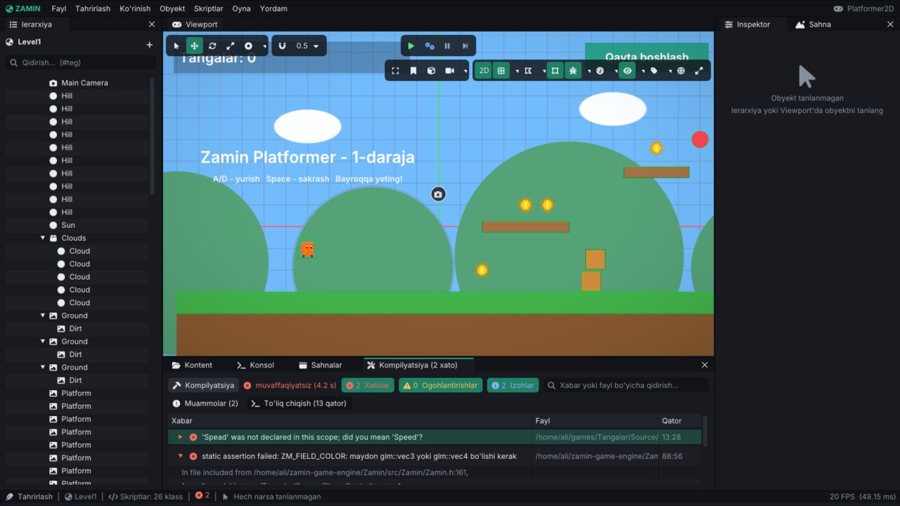

# Zamin Engine: questions and troubleshooting (FAQ)

Frequently asked questions and common problems - with the **real messages** the engine writes. Where a message
shows up: in the editor - the **Console** window (and the terminal that started the editor), in a game - the terminal and the log
file (`~/.local/share/<company>/<game>/logs/`, [Runtime.md, section 6](Runtime.md#6-log-fayllari)). Below, the
messages are exactly as the program writes them; `<...>` marks a place where a concrete value (a file, a name, a number) goes. Type a part
of a message into the Console's search field, or find it on this page.

Every system also has its own detailed "problems" section: [Scripting.md, 23](Scripting.md#23-kop-uchraydigan-xatolar),
[Physics.md, 18](Physics.md#18-kop-uchraydigan-muammolar), [Rendering.md, 18](Rendering.md#18-kop-uchraydigan-muammolar),
[Audio.md, 18](Audio.md#18-kop-uchraydigan-muammolar), [Runtime.md, 15](Runtime.md#15-muammolar-va-yechimlar),
[BuildAndExport.md, 13](BuildAndExport.md#13-muammolar-va-yechimlar).

## Contents

1. [General questions](#1-general-questions)
2. [Installing and building](#2-installing-and-building)
3. [Editor](#3-editor)
4. [C++ scripts](#4-c-scripts)
5. [Scenes and the project](#5-scenes-and-the-project)
6. [Physics](#6-physics)
7. [Graphics](#7-graphics)
8. [Audio](#8-audio)
9. [Input](#9-input)
10. [Export and the player](#10-export-and-the-player)
11. [Crashes and finding bugs](#11-crashes-and-finding-bugs)
12. [When nothing helps](#12-when-nothing-helps)

---

## 1. General questions

### What is Zamin Engine and which platforms does it run on?

A 2D and 3D game engine written in C++20: an editor (`ZaminEditor`), a player that runs a game without the editor
(`ZaminPlayer`) and games with C++ scripts. For now **Linux** (x86_64, OpenGL 4.1+). Windows, macOS and mobile
platforms are on the [roadmap](Features.md#yol-xaritasi), not there yet.

### What language is the game logic written in?

C++: classes derived from `ScriptableEntity`, registered with `ZM_REGISTER_SCRIPT` and compiled into the project's
script module (`lib<Game>.so`). There is no separate scripting language (Lua, C#).
Getting started: [Scripting.md](Scripting.md), first games: [Tutorial-2D.md](Tutorial-2D.md),
[Tutorial-3D.md](Tutorial-3D.md).

### Can 2D and 3D be mixed in one game?

Yes: sprites and meshes are drawn together in one scene (3D first, then 2D and UI on top). But the physics worlds are
separate: 2D bodies (Box2D) do not collide with 3D bodies (Jolt) ([Physics.md](Physics.md#1-asosiy-tushunchalar)).

### Can the editor language be changed?

Yes - English or Uzbek: **Edit → Preferences... → View** ([Editor.md, 12](Editor.md#12-preferences-layouts-language)).
The game's own languages are separate - Project settings > Localization ([ProjectSettings.md, 13](ProjectSettings.md#13-lokalizatsiya)).

### What is the license? Can I sell my game?

The engine is MIT ([LICENSE](../LICENSE)). The licenses of the third-party libraries and fonts are at the end of the [README](../README.md#-third-party-libraries)
(MIT, zlib, Public Domain, SIL OFL); the licenses of the fonts distributed with your game are
in `Resources/fonts/`.

### Which files of a project belong in git?

`<Game>.zproject`, `CMakeLists.txt`, `Source/`, `Assets/` (with the **`.zmeta`** file next to each asset - it holds the
asset's UUID, and without it the references break). A new project is created with a `.gitignore`: `Build/`, `Binaries/`
(the compile output) and `.zamin/` (the editor cache) are left out.

### Where are the data a game saves (SaveData) and the editor settings?

The game's: `~/.local/share/<company>/<game>/savedata.json` ([Runtime.md, 3](Runtime.md#3-sozlamalar-va-ustunlik-tartibi)).
The editor's: `~/.config/zamin/preferences.json` (shared by all projects). When the file is broken the game moves it
aside and starts from an empty one:

> `The SaveData file is broken (<reason>): <file> -> <copy>`

## 2. Installing and building

### How is it built and what is needed?

GCC 13+ or Clang 17+, CMake 3.20+, an OpenGL 4.1 driver and the X11/Wayland dev packages; the dependencies are downloaded
by themselves on the first configure. The commands and options - [BuildAndExport.md](BuildAndExport.md).

### The editor does not start: a display or OpenGL error

> `GLFW failed to start! Check that a display (X11/Wayland) is available.`

There is no graphical session (SSH, a server, a container). To run without a display use `xvfb-run -a ./build/bin/ZaminEditor ...`
(software drawing - slow, but it works; the tests run like this).

> `Could not create the window (is OpenGL <version> core supported?)`

The driver did not give the requested OpenGL version. The engine needs 4.1 core: check with `glxinfo | grep "OpenGL core"`
and update the driver. When the project asks for a higher version, it first retries with a lower one by itself:

> `Could not create an OpenGL <v> core context (MSAA <n>, sRGB <yes/no>) - retrying with OpenGL <v> (MSAA <n>, sRGB <yes/no>)`

In the player the context can also be given on the command line: `--gl 4.1`, `--msaa 0`, `--no-srgb`
([Runtime.md, 4](Runtime.md#4-buyruq-qatori)).

### The open / save file dialog does not appear

> `Install 'zenity' or 'kdialog' for the file dialog`

The editor uses the system's dialogs: `sudo apt install zenity` (or `kdialog` on KDE).

### I added a new `.cpp` file and the build does not see it

The sources are collected with a glob: run `cmake -S . -B build` again (in a game project, recompiling from the editor
is enough).

## 3. Editor

### The window layout is broken or a window is gone

**Window → Reset layout (default)**, or a ready-made layout from **Window → Layout** (**Default**, **2D**,
**Animation**, **4 views**). Closed windows are reopened from the **Window** menu
([Editor.md, 3](Editor.md#3-menus)).

### The viewport says there is no camera

> `The scene has no main (Primary) camera!`

The game is seen through the main camera: the **Primary** checkbox of the **Camera** component must be on on the camera
entity. If there is a camera but its entity is turned off:

> `The main camera is inactive: '<entity>' (there is no other active main camera)`

### The editor runs slowly / fast while idle

When nothing is happening the editor lowers its frame rate (to save the processor). This is changed on the
**Edit → Preferences... → Performance** page.

### My changes are gone / the editor crashed

The editor regularly writes a safety copy of an unsaved scene (`<project>/.zamin/autosave/`); when the scene is opened
again, recovering it is offered. The undo history - `Ctrl+H` ([Editor.md, 11](Editor.md#11-undo-autosave-and-recovery)).

## 4. C++ scripts

### I wrote a script, but it is not in the "+ Component → Script / Visual graph" list

The script module is not compiled or the class is not registered:

1. **Scripts → Compile + reload** (`Ctrl+B`) and look at the result in the Console.
2. Is there a `ZM_REGISTER_SCRIPT(ClassName, ...)` at the end of the file?

> `Script module not found: '<file>' (compile the scripts first)`

The module file (`Binaries/lib<Game>.so`) does not exist yet - compile.

### The compile ended with errors

> `Script compile failed: <N> errors, <M> warnings (Window > Compilation)`

The **Window → Compilation** window lists every error with its file and line; clicking one opens the external editor at that line.

*The real GCC output: a typo in a field name (`Spead`) and `ZM_FIELD_COLOR` on a `float` field.*
 The compiler's
messages are in English (GCC / Clang). When pressed again while a compile is running:

> `A compile is already running...`

When no project is open:

> `Open a project first`

### The module did not load

> `Script module failed to load: <dlerror message>`

Usually `undefined symbol: ...` - a function that is declared but not written (for example a forgotten body of a class
method), or the engine was rebuilt and the module is left from the old one: recompile the scripts.

### "Script class not found" when I open a scene

> `Script class not found: '<class>' (entity '<entity>')`

The C++ Script component on the entity points to a class the module does not have: the class was renamed or deleted,
or the module is not compiled yet. Pick the new class in the inspector, or compile.

### A new script cannot be created: the name was rejected

**Scripts → New C++ script...** checks the name: only Latin letters, digits and `_`, not starting with a digit,
not a C++ keyword and not clashing with a name in the engine:

> `'<Name>' clashes with a name in the Zamin engine (using namespace Zamin). Name it '<Name>Controller' or '<Name>Script', for example`

> `The class '<Name>' already exists (registered in the script module)`

### I changed the code, but the game runs the old code

**Scripts → Compile + reload** (`Ctrl+B`) - compile + reload. If you build outside (an IDE, a terminal), the editor
reloads the module by itself when **Scripts → Automatic hot reload** is on. A reload stops Play.
More: [Scripting.md, 20](Scripting.md#20-kompilyatsiya-va-hot-reload).

### My field does not show up in the inspector

The field has to be listed inside `ZM_REGISTER_SCRIPT(Class, ZM_FIELD(Class, Field), ...)`; the supported
types - [Scripting.md, 4](Scripting.md#4-inspektor-maydonlari-zm_field). A wrong type is reported when compiling,
for example:

> `ZM_FIELD_RANGE: the field must be float, int, glm::vec2, glm::vec3, glm::vec4 or AnimationCurve`

> `ZM_FIELD_COLOR: the field must be glm::vec3 or glm::vec4`

### The game hung or messages were dropped

When scripts send each other messages / events endlessly, the engine breaks the chain:

> `The message '<name>' was sent nested too deep (<N> levels) and was dropped (an endless loop?)`

> `The event '<name>' was raised nested too deep (<N> levels) and was dropped (an endless loop?)`

When `OnEnable` / `OnDisable` keep turning the script itself on and off:

> `'<entity>': OnEnable/OnDisable keeps turning the script on and off - stopped`

## 5. Scenes and the project

### A scene does not open

> `Scene failed to load: <file> - <reason>`

The reason may be a missing file, a JSON error or something else. When the file is partly broken the editor offers to
recover it, and a game loads its valid part:

> `Scene '<name>' loaded partly (<what>): the valid objects were kept`

When the scene was saved by a newer version of the engine:

> `The scene file is in a newer format (v<N>, this engine knows up to v<M>): <file> - the known part was read`

More: [Scenes.md, 10](Scenes.md#10-yuklash-xatolari).

### `LoadScene` / additive loading does not work in the editor

Switching scenes only works while the game is running (the editor's Play or the player) - the `SceneManager` handles it:

> `'<file>': loading an additive scene needs the SceneManager (play mode / player)`

When an index that is not in the build list is asked for:

> `The build list has no scene with index <N>`

The last loaded scene cannot be closed:

> `The last scene cannot be closed: '<name>' (load another one in Single mode)`

### A project does not open

> `The project file could not be read '<file>': <reason>`

A `.zproject` is JSON; if it was edited by hand, check the commas / brackets (compare it with the previous copy in version
control). The format and migration: [ProjectSettings.md, 17](ProjectSettings.md#17-zproject-fayli-format-versiya-migratsiya).

### A material or picture did not load

> `Material failed to load: <file> (<reason>)`

The asset was moved or deleted. Move files in the editor's content browser - the references are updated through the UUID
in the `.zmeta`; when moving outside the editor, move the `.zmeta` along with it.

## 6. Physics

### A body falls through / does not hit anything

A 3D body needs a collider:

> `'<entity>': the Rigidbody3D has no collider (add a Box/Sphere/Capsule/Convex Hull/Mesh Collider 3D)`

Other causes: the body and the floor are in different physics worlds (one 2D, one 3D), the collision layers do not see
each other (Project settings > Physics), the collider is a sensor (`IsSensor`) - it only gives triggers.

### A fast object passes through a wall

2D: **Fast object (bullet)** (`Bullet`) on the Rigidbody 2D; 3D: **Continuous (CCD)** on the Rigidbody 3D
(`ContinuousCollision`). Or raise the
step rate (the physics part of the scene settings: **Step rate**, `StepRate`) ([Physics.md, 2](Physics.md#2-qadam-gravitatsiya-va-simulyatsiya-sozlamalari)).

### A Mesh Collider does not work on a dynamic body

> `'<entity>': a Mesh Collider 3D only works on a static or kinematic body - a dynamic body ignores it (use a Convex Hull Collider 3D)`

For a moving body use a Convex Hull Collider 3D or simple shapes.

### A joint was not created

> `The connected body (<UUID>) of the <joint> on the object '<entity>' is not in the scene - no joint is created`

The second entity the joint points to was deleted or is in another scene: pick the **Connected body** again in the inspector.

## 7. Graphics

### The game screen is black

1. Is there a main camera, and is it active (the messages in section 3)?
2. Is the camera looking at the entities, and are they within its view range (near / far, the size of an orthographic
   camera)?
3. Is there a light in a 3D scene (a Directional / Point / Spot Light or the sky)?

More: [Rendering.md, 18](Rendering.md#18-kop-uchraydigan-muammolar).

### A shader error

> `Shader '<name>' (<type>) compile error:`

The driver could not compile an engine shader (the driver's own message follows on the next lines): usually an old or
software driver that does not fully support OpenGL 4.1. Update the driver; send the message with the GL renderer name
(at the start of the log).

### Text is blurry or pixelated

Text is drawn from the atlas closest to its size on the screen; in pixel-art games use a pixel-perfect camera and an integer
scale ([Rendering.md, 5](Rendering.md#5-2d-yoruglik-va-pixel-perfect-kamera), [UI.md](UI.md)).

### The game is slow

In the player **F10** writes the FPS to the log; `ZAMIN_PLAYER_STATS=1` gives the draw statistics on exit;
`--benchmark 300` measures it precisely. The quality level (`--quality Low`), the render scale, shadows and post effects
take the most time ([Rendering.md, 15](Rendering.md#15-samaradorlik-va-sifat-darajalari)). Under `xvfb-run` there is
no GPU - the FPS there is not real.

## 8. Audio

### No sound is heard

> `No audio device found - sound is off`

The system has no sound device (or it is busy): the game runs, just silently. If there is a device: is the group muted
in the Audio Mixer (mute / solo), the Audio Source's **Volume**, and for 3D sound the distance to the listener
([Audio.md, 18](Audio.md#18-kop-uchraydigan-muammolar)).

### An `.ogg` file does not play

This build has no OGG decoder: use WAV, MP3 or FLAC ([Audio.md, 14](Audio.md#14-audio-fayllar-va-import-sozlamalari)).

### Some sounds stopped playing

> `The voice limit (<N>) is full: new sounds are not played (Audio Mixer > Settings)`

Too many sounds at the same time: raise the limit or give the sounds priorities
([Audio.md, 10](Audio.md#10-ovozlar-limiti-va-tasodifiy-variatsiya)).

> `Unknown audio group '<name>' - the sound plays in the SFX group`

An Audio Source or the code points to a group the mixer does not have - create the group in the Audio Mixer or fix the name.

## 9. Input

### `IsActionPressed("Jump")` does not work

> `Input: '<name>' is not a known <action / axis> (Project settings > Input)`

The action name is not in the project's input map (case matters). Add it in Project settings > Input
or fix the name ([ProjectSettings.md, 10](ProjectSettings.md#10-input), [Scripting.md, 8](Scripting.md#8-input)).

### The gamepad does not work

Check `Input::IsGamepadConnected(0)`. Gamepad bindings listen to every connected gamepad;
GLFW recognizes a gamepad from its own database - an unknown device stays a plain joystick.

## 10. Export and the player

### The scripts do not work in the exported game

> `script module not found - the game is exported without scripts`

Compile the scripts before exporting. Look at the script module line in the export report (**File → Export report**)
([BuildAndExport.md, 8](BuildAndExport.md#8-oyinni-eksport-qilish-editor)).

### The export report cannot be opened again

> `No export report: build the game first (File > Build game)`

### The player does not find the project

> `Project not found. Usage: ZaminPlayer <Game.zproject> (all options: --help)`

Give the player a `.zproject` file or the project folder; run an exported game with `<Game>.sh`
(it opens the `Game/*.zproject` in its own folder).

### A command-line option did not work

A value that is not understood is written to the log and the game goes on with the default value, for example:

> `--quality <name>: there is no such quality level (available: <list>) - the default level stays`

> `--scene <value>: the build list has no such index (it has <N> scenes)`

> `No monitor <N> (<M> monitors found) - the primary monitor is used`

All the options: `ZaminPlayer --help` and [Runtime.md, 4](Runtime.md#4-buyruq-qatori).

### The log file is not written

> `The log file could not be opened (<reason>) - the log is in the terminal only`

There is no permission to write to the log folder (or the disk is full): give another place with `--log-file <file>`.

## 11. Crashes and finding bugs

### The game crashed

The player writes `crash-<date_time>.txt` to the log folder: the reason (a signal or an exception), the backtrace, the last log
lines, the engine commit. Ask the player for this file. To work with a debugger use `--no-crash-handler`
([Runtime.md, 7](Runtime.md#7-crash-hisobotlari)).

### An assert failed

In a Debug build (or with `-DZAMIN_ASSERTS=ON`), when a `ZM_ASSERT` condition is false a `CRITICAL` line (the expression, the message,
`file:line`) is written to the log and the program stops; in the editor a game script's assert is only written to the log
([Core.md, 12](Core.md#12-assert-and-verify)).

### How do I find a bug myself?

- Raise the log level: `--log-level trace` or `ZAMIN_LOG_LEVEL=trace` ([Runtime.md, 6](Runtime.md#6-log-fayllari)).
- OpenGL errors: `--gl-debug` (player) or `ZAMIN_GL_DEBUG=1`.
- Memory errors: an AddressSanitizer build - `Tests/sanitize.sh address --smoke` ([Testing.md, 6](Testing.md#6-sanitizers)).
- Physics: `--debug-contacts`, `--debug-raycasts`; navigation: `--debug-nav`.

## 12. When nothing helps

1. Copy the whole message (Console: right-click → copy) and keep the log file.
2. Write down the version: `ZaminPlayer --version` or **Help → About Zamin** in the editor (with the commit).
3. Try to reproduce the problem in a sample project (`Projects/Platformer2D`, `Showcase3D`, `Adventure3D`) - that shows
   whether it is an engine bug or a project bug.
4. How the engine works inside: [Architecture.md](Architecture.md); the tests: [Testing.md](Testing.md).
