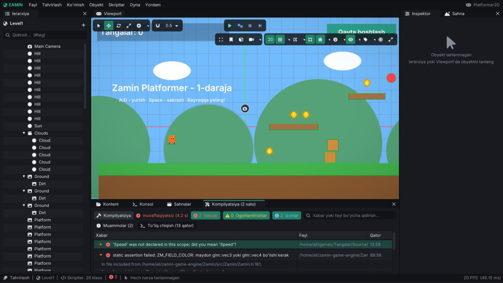

# Zamin Engine: savollar va muammolarni hal qilish (FAQ)

Ko'p beriladigan savollar va tez-tez uchraydigan muammolar - dvigatel yozadigan **haqiqiy xabarlar** bilan. Xabar
qayerda ko'rinadi: editorda - **Konsol** oynasi (va editorni ishga tushirgan terminal), o'yinda - terminal va log
fayli (`~/.local/share/<kompaniya>/<o'yin>/logs/`, [Runtime.md, 6-bo'lim](Runtime.md#6-log-fayllari)). Quyida
xabarlar aynan dastur yozganidek; `<...>` - o'rniga aniq qiymat (fayl, nom, son) qo'yiladigan joy. Konsolda
xabarning bir qismini qidiruv maydoniga yozib, shu sahifadan topishingiz mumkin.

Har bir tizimning batafsil "muammolar" bo'limi ham bor: [Scripting.md, 23](Scripting.md#23-kop-uchraydigan-xatolar),
[Physics.md, 18](Physics.md#18-kop-uchraydigan-muammolar), [Rendering.md, 18](Rendering.md#18-kop-uchraydigan-muammolar),
[Audio.md, 18](Audio.md#18-kop-uchraydigan-muammolar), [Runtime.md, 15](Runtime.md#15-muammolar-va-yechimlar),
[BuildAndExport.md, 13](BuildAndExport.md#13-muammolar-va-yechimlar).

## Mundarija

1. [Umumiy savollar](#1-umumiy-savollar)
2. [O'rnatish va build](#2-ornatish-va-build)
3. [Editor](#3-editor)
4. [C++ skriptlar](#4-c-skriptlar)
5. [Sahnalar va loyiha](#5-sahnalar-va-loyiha)
6. [Fizika](#6-fizika)
7. [Grafika](#7-grafika)
8. [Audio](#8-audio)
9. [Input](#9-input)
10. [Eksport va player](#10-eksport-va-player)
11. [Qulash va xatoni topish](#11-qulash-va-xatoni-topish)
12. [Hech narsa yordam bermasa](#12-hech-narsa-yordam-bermasa)

---

## 1. Umumiy savollar

### Zamin Engine nima va qaysi platformalarda ishlaydi?

C++20 da yozilgan 2D va 3D o'yin dvigateli: editor (`ZaminEditor`), o'yinni editorsiz ishga tushiruvchi player
(`ZaminPlayer`) va C++ skriptli o'yinlar. Hozir **Linux** (x86_64, OpenGL 4.1+). Windows, macOS va mobil
platformalar [yo'l xaritasida](Features.md#yol-xaritasi), hali yo'q.

### O'yin mantig'i qanday tilda yoziladi?

C++ da: `ScriptableEntity` dan meros olgan klasslar, `ZM_REGISTER_SCRIPT` bilan ro'yxatga olinadi va loyihaning
skript moduli (`lib<O'yin>.so`) bo'lib kompilyatsiya qilinadi. Alohida skript tili (Lua, C#) yo'q.
Boshlash: [Scripting.md](Scripting.md), birinchi o'yinlar: [Tutorial-2D.md](Tutorial-2D.md),
[Tutorial-3D.md](Tutorial-3D.md).

### Bitta o'yinda 2D va 3D ni aralashtirsa bo'ladimi?

Ha: bitta sahnada sprite'lar va mesh'lar birga chiziladi (avval 3D, ustidan 2D va UI). Lekin fizika dunyolari
alohida: 2D jismlar (Box2D) 3D jismlar (Jolt) bilan to'qnashmaydi ([Physics.md](Physics.md#1-asosiy-tushunchalar)).

### Editor tilini o'zgartirsa bo'ladimi?

Ha - o'zbekcha yoki inglizcha: **Tahrirlash → Sozlamalar... → Ko'rinish** ([Editor.md, 12](Editor.md#12-sozlamalar-joylashuvlar-til)).
O'yinning o'z tillari alohida - Project settings > Localization ([ProjectSettings.md, 13](ProjectSettings.md#13-lokalizatsiya)).

### Litsenziya qanday? O'yinimni sotsam bo'ladimi?

Dvigatel - MIT ([LICENSE](../LICENSE)). Uchinchi tomon kutubxonalari va shriftlarning litsenziyalari [README](../README.md#-uchinchi-tomon-kutubxonalari)'ning
oxirida (MIT, zlib, Public Domain, SIL OFL); o'yiningiz bilan birga tarqatiladigan shriftlar litsenziyalari
`Resources/fonts/` da.

### Loyihaning qaysi fayllarini git'ga qo'shish kerak?

`<O'yin>.zproject`, `CMakeLists.txt`, `Source/`, `Assets/` (har asset yonidagi **`.zmeta`** fayllari bilan - ular
assetning UUID'si, ularsiz havolalar uziladi). Yangi loyiha `.gitignore` bilan yaratiladi: `Build/`, `Binaries/`
(kompilyatsiya natijasi) va `.zamin/` (editor keshi) kirmaydi.

### O'yin saqlagan ma'lumotlar (SaveData) va editor sozlamalari qayerda?

O'yinniki: `~/.local/share/<kompaniya>/<o'yin>/savedata.json` ([Runtime.md, 3](Runtime.md#3-sozlamalar-va-ustunlik-tartibi)).
Editorniki: `~/.config/zamin/preferences.json` (barcha loyihalar uchun umumiy). Fayl buzilgan bo'lsa o'yin uni
chetga olib qo'yadi va bo'shidan boshlaydi:

> `SaveData fayli buzilgan (<sabab>): <fayl> -> <nusxa>`

## 2. O'rnatish va build

### Qanday build qilinadi va nima kerak?

GCC 13+ yoki Clang 17+, CMake 3.20+, OpenGL 4.1 drayveri va X11/Wayland dev paketlari; bog'liqliklar birinchi
configure'da o'zi yuklab olinadi. Buyruqlar va variantlar - [BuildAndExport.md](BuildAndExport.md).

### Editor ishga tushmaydi: displey yoki OpenGL xatosi

> `GLFW ishga tushmadi! Displey (X11/Wayland) mavjudligini tekshiring.`

Grafik sessiya yo'q (SSH, server, konteyner). Displeysiz ishlatish uchun `xvfb-run -a ./build/bin/ZaminEditor ...`
(dasturiy chizish - sekin, lekin ishlaydi; testlar shunday).

> `Oyna yaratilmadi (OpenGL <versiya> core qo'llab-quvvatlanadimi?)`

Drayver so'ralgan OpenGL versiyasini bermadi. Dvigatelga 4.1 core kerak: `glxinfo | grep "OpenGL core"` bilan
tekshiring, drayverni yangilang. Loyihada yuqoriroq versiya tanlangan bo'lsa, avval o'zi pastroq bilan qayta urinadi:

> `OpenGL <v> core konteksti (MSAA <n>, sRGB <ha/yo'q>) yaratilmadi - OpenGL <v> (MSAA <n>, sRGB <ha/yo'q>) bilan qayta urinish`

Player'da kontekstni buyruq qatoridan ham berish mumkin: `--gl 4.1`, `--msaa 0`, `--no-srgb`
([Runtime.md, 4](Runtime.md#4-buyruq-qatori)).

### Fayl ochish / saqlash oynasi chiqmaydi

> `Fayl dialogi uchun 'zenity' yoki 'kdialog' o'rnating`

Editor tizimning dialoglarini ishlatadi: `sudo apt install zenity` (yoki KDE'da `kdialog`).

### Yangi `.cpp` fayl qo'shdim, build uni ko'rmayapti

Manbalar glob bilan yig'iladi: `cmake -S . -B build` ni qayta ishga tushiring (o'yin loyihasida - editordan qayta
kompilyatsiya yetarli).

## 3. Editor

### Oynalar joylashuvi buzildi yoki biror oyna yo'qoldi

**Oyna → Joylashuvni tiklash (standart)**, yoki **Oyna → Joylashuv** dan tayyor joylashuv (**Standart**, **2D**,
**Animatsiya**, **4 ko'rinish**). Yopilgan oynalar **Oyna** menyusidan qayta ochiladi
([Editor.md, 3](Editor.md#3-menyular)).

### Viewport'da "kamera yo'q" yozuvi chiqyapti

> `Sahnada asosiy (Primary) kamera yo'q!`

O'yin asosiy kamera orqali ko'rinadi: kamera obyektida **Camera** komponentining **Primary** belgisi yoqilgan
bo'lsin. Kamera bor, lekin obyekt o'chirilgan bo'lsa:

> `Asosiy kamera nofaol: '<obyekt>' (boshqa faol asosiy kamera yo'q)`

### Editor bo'sh turganda sekin / tez ishlaydi

Editor hech narsa bo'lmayotganda kadrlar sonini kamaytiradi (protsessorni tejash). **Tahrirlash → Sozlamalar... →
Ishlash** sahifasida o'zgartiriladi.

### O'zgarishlarim yo'qoldi / editor qulab tushdi

Editor saqlanmagan sahnaning xavfsizlik nusxasini muntazam yozadi (`<loyiha>/.zamin/autosave/`); sahna qayta
ochilganda tiklash taklif qilinadi. Undo tarixi - `Ctrl+H` ([Editor.md, 11](Editor.md#11-undo-avtosaqlash-va-tiklash)).

## 4. C++ skriptlar

### Skript yozdim, lekin "+ Komponent → C++ Script" ro'yxatida yo'q

Skript moduli kompilyatsiya qilinmagan yoki klass ro'yxatga olinmagan:

1. **Skriptlar → Kompilyatsiya + qayta yuklash** (`Ctrl+B`) va Konsolda natijani ko'ring.
2. Fayl oxirida `ZM_REGISTER_SCRIPT(KlassNomi, ...)` bormi?

> `Skript moduli topilmadi: '<fayl>' (avval skriptlarni kompilyatsiya qiling)`

Modul fayli (`Binaries/lib<O'yin>.so`) hali yo'q - kompilyatsiya qiling.

### Kompilyatsiya xato bilan tugadi

> `Skriptlarni kompilyatsiya qilishda xato: <N> xato, <M> ogohlantirish (Oyna > Kompilyatsiya)`

**Oyna → Kompilyatsiya** oynasida har xato fayl va qatori bilan; bosilsa tashqi muharrirda o'sha qatorda ochiladi.

*GCC'ning haqiqiy chiqishi: maydon nomidagi xato (`Spead`) va `float` maydonga `ZM_FIELD_COLOR`.*
 Kompilyator
xabarlari inglizcha (GCC / Clang). Kompilyatsiya ketayotganda qayta bosilsa:

> `Kompilyatsiya allaqachon ketmoqda...`

Loyiha ochilmagan bo'lsa:

> `Avval loyiha oching`

### Modul yuklanmadi

> `Skript moduli yuklanmadi: <dlerror xabari>`

Odatda `undefined symbol: ...` - e'lon qilingan, lekin yozilmagan funksiya (masalan klass metodining tanasi
unutilgan) yoki dvigatel qayta build qilinib, modul eskisi bilan qolgan: skriptlarni qayta kompilyatsiya qiling.

### Sahnani ochganimda "Skript klassi topilmadi"

> `Skript klassi topilmadi: '<klass>' (entity '<obyekt>')`

Obyektdagi C++ Script komponenti modulda yo'q klassni ko'rsatyapti: klass nomi o'zgartirilgan yoki o'chirilgan,
yoki modul hali kompilyatsiya qilinmagan. Inspektorda yangi klassni tanlang yoki kompilyatsiya qiling.

### Yangi skript yaratib bo'lmayapti: nom rad etildi

**Skriptlar → Yangi C++ skript...** nomni tekshiradi: faqat lotin harflari, raqamlar va `_`, raqam bilan boshlanmaydi,
C++ kalit so'zi bo'lmaydi va dvigateldagi nom bilan to'qnashmaydi:

> `'<Nom>' - Zamin engine'idagi nom bilan to'qnashadi (using namespace Zamin). Masalan '<Nom>Controller' yoki '<Nom>Script' deb nomlang`

> `'<Nom>' klassi allaqachon mavjud (skript modulida ro'yxatdan o'tgan)`

### Kodni o'zgartirdim, lekin o'yin eski kod bilan ishlayapti

**Skriptlar → Kompilyatsiya + qayta yuklash** (`Ctrl+B`) - kompilyatsiya + qayta yuklash. Tashqarida (IDE, terminal) build qilsangiz
editor modulni o'zi qayta yuklaydi, agar **Skriptlar → Avtomatik hot-reload** yoqilgan bo'lsa. Qayta yuklashda Play
to'xtaydi. Batafsil: [Scripting.md, 20](Scripting.md#20-kompilyatsiya-va-hot-reload).

### Maydonim inspektorda ko'rinmayapti

Maydon `ZM_REGISTER_SCRIPT(Klass, ZM_FIELD(Klass, Maydon), ...)` ichida sanab o'tilishi kerak; qo'llanadigan
turlar - [Scripting.md, 4](Scripting.md#4-inspektor-maydonlari-zm_field). Noto'g'ri tur kompilyatsiyada aytiladi,
masalan:

> `ZM_FIELD_RANGE: maydon float, int, glm::vec2, glm::vec3, glm::vec4 yoki AnimationCurve bo'lishi kerak`

> `ZM_FIELD_COLOR: maydon glm::vec3 yoki glm::vec4 bo'lishi kerak`

### O'yin osilib qoldi yoki xabarlar tashlab yuborildi

Skriptlar bir-biriga cheksiz xabar / hodisa yuborsa, dvigatel zanjirni uzadi:

> `Xabar '<nom>' juda chuqur ichma-ich yuborildi (<N> daraja) va tashlab yuborildi (cheksiz tsikl?)`

> `Hodisa '<nom>' juda chuqur ichma-ich chaqirildi (<N> daraja) va tashlab yuborildi (cheksiz tsikl?)`

`OnEnable` / `OnDisable` skriptni o'zi yoqib-o'chirib tursa:

> `'<obyekt>': OnEnable/OnDisable skriptni to'xtovsiz yoqib-o'chirmoqda - to'xtatildi`

## 5. Sahnalar va loyiha

### Sahna ochilmayapti

> `Sahna yuklanmadi: <fayl> - <sabab>`

Sabab fayl yo'qligi, JSON xatosi yoki boshqa narsa bo'lishi mumkin. Fayl qisman buzilgan bo'lsa editor tiklashni
taklif qiladi, o'yin esa yaroqli qismini yuklaydi:

> `Sahna '<nom>' qisman yuklandi (<nima>): yaroqli obyektlar qoldi`

Sahna dvigatelning yangiroq versiyasida saqlangan bo'lsa:

> `Sahna fayli yangiroq formatda (v<N>, bu dvigatel v<M> gacha biladi): <fayl> - tanilgan qismi o'qildi`

Batafsil: [Scenes.md, 10](Scenes.md#10-yuklash-xatolari).

### `LoadScene` / additive yuklash editorda ishlamayapti

Sahna almashtirish faqat o'yin ishlab turganda (editorning Play'i yoki player) - uni `SceneManager` boshqaradi:

> `'<fayl>': qo'shimcha sahna yuklash uchun SceneManager kerak (o'yin rejimi / player)`

Build ro'yxatida yo'q indeks so'ralsa:

> `Build ro'yxatida <N> indeksli sahna yo'q (<M> ta sahna bor)`

Oxirgi yuklangan sahnani yopib bo'lmaydi:

> `Oxirgi sahnani yopib bo'lmaydi: '<nom>' (boshqasini Single rejimida yuklang)`

### Loyiha ochilmayapti

> `Loyiha fayli o'qilmadi '<fayl>': <sabab>`

`.zproject` - JSON; qo'lda tahrirlangan bo'lsa vergul / qavslarni tekshiring (versiya nazoratidagi oldingi nusxa
bilan solishtiring). Format va migratsiya: [ProjectSettings.md, 17](ProjectSettings.md#17-zproject-fayli-format-versiya-migratsiya).

### Material yoki rasm yuklanmadi

> `Material yuklanmadi: <fayl> (<sabab>)`

Asset ko'chirilgan yoki o'chirilgan. Fayllarni editorning kontent brauzerida ko'chiring - havolalar `.zmeta` dagi
UUID orqali yangilanadi; editor tashqarisida ko'chirilsa, `.zmeta` ni ham birga ko'chiring.

## 6. Fizika

### Jism tushib ketyapti / hech narsaga urilmayapti

3D jismga collider kerak:

> `'<obyekt>': Rigidbody3D uchun collider yo'q (Box/Sphere/Capsule/Convex Hull/Mesh Collider 3D qo'shing)`

Boshqa sabablar: jism va pol turli fizika dunyosida (biri 2D, biri 3D), to'qnashuv qatlamlari bir-birini
ko'rmaydi (Project settings > Physics), collider sensor (`IsSensor`) - u faqat trigger beradi.

### Tez obyekt devordan o'tib ketyapti

2D: Rigidbody 2D'da **Tez obyekt (bullet)** (`Bullet`); 3D: Rigidbody 3D'da **Uzluksiz (CCD)**
(`ContinuousCollision`). Yoki qadamni
oshiring (sahna sozlamalaridagi fizika bo'limi: **Qadam chastotasi**, `StepRate`) ([Physics.md, 2](Physics.md#2-qadam-gravitatsiya-va-simulyatsiya-sozlamalari)).

### Mesh Collider dinamik jismda ishlamayapti

> `'<obyekt>': Mesh Collider 3D faqat statik yoki kinematik jismda ishlaydi - dinamik jism uni hisobga olmaydi`

Harakatlanadigan jism uchun Convex Hull Collider 3D yoki oddiy shakllardan foydalaning.

### Joint yaratilmadi

> `'<obyekt>' obyektidagi <joint> ulangan jismi (<UUID>) sahnada yo'q - joint yaratilmaydi`

Joint ko'rsatgan ikkinchi obyekt o'chirilgan yoki boshqa sahnada: inspektorda **Ulangan jism** ni qayta tanlang.

## 7. Grafika

### O'yin ekrani qora

1. Asosiy kamera bormi va faolmi (3-bo'limdagi xabarlar)?
2. Kamera obyektlarga qarab turibdimi va ular uning ko'rinish oralig'idami (near / far, ortografik kameraning
   o'lchami)?
3. 3D sahnada yorug'lik bormi (Directional / Point / Spot Light yoki osmon)?

Ko'proq: [Rendering.md, 18](Rendering.md#18-kop-uchraydigan-muammolar).

### Shader xatosi

> `Shader '<nom>' (<tur>) kompilyatsiya xatosi:`

Drayver dvigatel shaderini kompilyatsiya qila olmadi (keyingi qatorlarda drayverning o'z xabari): odatda OpenGL 4.1
ni to'liq qo'llamaydigan eski yoki dasturiy drayver. Drayverni yangilang; xabarni GL renderer nomi bilan
(log boshida) yuboring.

### Matn xira yoki piksellangan

Matnlar ekrandagi o'lchamiga yaqin atlasdan chiziladi; pixel-art o'yinlarda pixel-perfect kamera va butun sonli
masshtab ishlating ([Rendering.md, 5](Rendering.md#5-2d-yoruglik-va-pixel-perfect-kamera), [UI.md](UI.md)).

### O'yin sekin

Player'da **F10** FPS'ni log'ga yozadi; `ZAMIN_PLAYER_STATS=1` chiqishda chizish statistikasini beradi;
`--benchmark 300` aniq o'lchaydi. Sifat darajasi (`--quality Low`), render masshtabi, soyalar va post-effektlar
eng ko'p vaqt oladi ([Rendering.md, 15](Rendering.md#15-samaradorlik-va-sifat-darajalari)). `xvfb-run` ostida
GPU yo'q - u yerdagi FPS haqiqiy emas.

## 8. Audio

### Ovoz eshitilmayapti

> `Audio qurilmasi topilmadi - ovoz o'chirilgan`

Tizimda ovoz qurilmasi yo'q (yoki band): o'yin ishlaydi, faqat jim. Qurilma bo'lsa: Audio Mixer'da guruh
o'chirilmaganmi (mute / solo), Audio Source'ning **Volume** i va 3D ovozda tinglovchigacha masofa
([Audio.md, 18](Audio.md#18-kop-uchraydigan-muammolar)).

### `.ogg` fayl ijro etilmayapti

Bu build'da OGG dekoderi yo'q: WAV, MP3 yoki FLAC ishlating ([Audio.md, 14](Audio.md#14-audio-fayllar-va-import-sozlamalari)).

### Ba'zi ovozlar chiqmay qoldi

> `Ovozlar limiti (<N>) to'ldi: yangi ovozlar ijro etilmayapti (Audio Mixer > Sozlamalar)`

Bir vaqtda juda ko'p ovoz: limitni oshiring yoki ovozlarga ustuvorlik bering
([Audio.md, 10](Audio.md#10-ovozlar-limiti-va-tasodifiy-variatsiya)).

> `Noma'lum audio guruhi '<nom>' - ovoz SFX guruhida ijro etiladi`

Audio Source yoki kod mixerda yo'q guruhni ko'rsatyapti - guruhni Audio Mixer'da yarating yoki nomini tuzating.

## 9. Input

### `IsActionPressed("Jump")` ishlamayapti

> `Input: '<nom>' nomli <harakat / o'q> topilmadi (Loyiha sozlamalari > Input)`

Harakat nomi loyihaning input xaritasida yo'q (katta-kichik harf muhim). Project settings > Input'da qo'shing
yoki nomni tuzating ([ProjectSettings.md, 10](ProjectSettings.md#10-input), [Scripting.md, 8](Scripting.md#8-input)).

### Gamepad ishlamayapti

`Input::IsGamepadConnected(0)` ni tekshiring. Gamepad bog'lanishlari hamma ulangan gamepad'larni tinglaydi;
GLFW gamepad'ni o'z ma'lumotlar bazasidan taniydi - noma'lum qurilma oddiy joystick bo'lib qoladi.

## 10. Eksport va player

### Eksport qilingan o'yinda skriptlar ishlamayapti

> `skript moduli topilmadi - o'yin skriptlarsiz eksport qilinadi`

Eksportdan oldin skriptlarni kompilyatsiya qiling. Eksport hisobotida (**Fayl → Eksport hisoboti**) skript moduli
qatoriga qarang ([BuildAndExport.md, 8](BuildAndExport.md#8-oyinni-eksport-qilish-editor)).

### Eksport hisobotini qayta ochib bo'lmayapti

> `Eksport hisoboti yo'q: avval o'yinni build qiling (Fayl > O'yinni build qilish)`

### Player loyihani topmayapti

> `Loyiha topilmadi. Foydalanish: ZaminPlayer <Game.zproject> (hamma variantlar: --help)`

Player'ga `.zproject` faylini yoki loyiha papkasini bering; eksport qilingan o'yinni `<O'yin>.sh` bilan ishga
tushiring (u o'z papkasidagi `Game/*.zproject` ni ochadi).

### Buyruq qatori varianti ishlamadi

Tushunilmagan qiymat log'ga yoziladi va o'yin standart qiymat bilan davom etadi, masalan:

> `--quality <nom>: bunday sifat darajasi yo'q (bor: <ro'yxat>) - standart daraja qoldi`

> `--scene <qiymat>: build ro'yxatida bunday indeks yo'q (<N> ta sahna bor)`

> `Monitor <N> yo'q (<M> ta monitor bor) - asosiy monitor ishlatiladi`

Hamma variantlar: `ZaminPlayer --help` va [Runtime.md, 4](Runtime.md#4-buyruq-qatori).

### Log fayli yozilmayapti

> `Log fayli ochilmadi (<sabab>) - log faqat terminalda`

Log papkasiga yozish huquqi yo'q (yoki disk to'lgan): `--log-file <fayl>` bilan boshqa joy bering.

## 11. Qulash va xatoni topish

### O'yin qulab tushdi

Player log papkasiga `crash-<sana_vaqt>.txt` yozadi: sabab (signal yoki istisno), backtrace, oxirgi log qatorlari,
dvigatel kommiti. O'yinchidan shu faylni so'rang. Debugger bilan ishlash uchun `--no-crash-handler`
([Runtime.md, 7](Runtime.md#7-crash-hisobotlari)).

### Assert bajarilmadi

Debug build'da (yoki `-DZAMIN_ASSERTS=ON`) `ZM_ASSERT` sharti yolg'on bo'lsa log'ga `CRITICAL` (ifoda, xabar,
`fayl:qator`) yoziladi va dastur to'xtaydi; editorda o'yin skriptining assert'i faqat log'ga yoziladi
([Core.md, 12](Core.md#12-assert-va-verify)).

### Xatoni o'zim qanday topaman?

- Log darajasini oshiring: `--log-level trace` yoki `ZAMIN_LOG_LEVEL=trace` ([Runtime.md, 6](Runtime.md#6-log-fayllari)).
- OpenGL xatolari: `--gl-debug` (player) yoki `ZAMIN_GL_DEBUG=1`.
- Xotira xatolari: AddressSanitizer build'i - `Tests/sanitize.sh address --smoke` ([Testing.md, 6](Testing.md#6-sanitizerlar)).
- Fizika: `--debug-contacts`, `--debug-raycasts`; navigatsiya: `--debug-nav`.

## 12. Hech narsa yordam bermasa

1. Xabarni to'liq nusxa oling (Konsol: o'ng tugma → nusxalash) va log faylini saqlang.
2. Versiyani yozing: `ZaminPlayer --version` yoki editorda **Yordam → Zamin haqida** (kommit bilan).
3. Muammoni namuna loyihada (`Projects/Platformer2D`, `Showcase3D`, `Adventure3D`) takrorlab ko'ring - dvigatel
   xatosimi yoki loyiha xatosimi, shunda ma'lum bo'ladi.
4. Dvigatel ichi qanday ishlashi: [Architecture.md](Architecture.md); testlar: [Testing.md](Testing.md).
