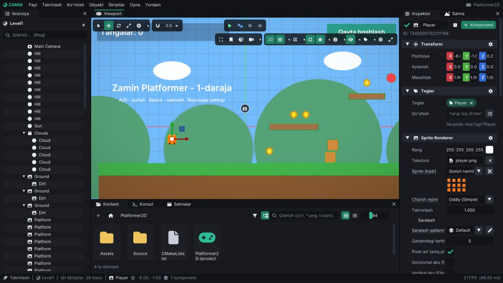

# Zamin Engine: features (the full list)

The detailed list of the engine's and the editor's features — it used to be in the main [README](../README.md), now it
is here. The step-by-step guide and reference for every system is in the [documentation index](README.md); the history
of changes by milestone — [CHANGELOG.md](../CHANGELOG.md).

Contents: [Editor](#editor) · [Engine](#engine) · [Editor controls](#editor-controls) ·
[Roadmap](#roadmap)

## Editor

Details: [Editor.md](Editor.md).

*The Platformer2D `Level1` scene in the editor: 2D mode, `Player` selected — Transform, Tags, Sprite Renderer ... in the inspector*

- A docking interface: Viewport, Hierarchy, Inspector, Content browser, Console, Scene settings, Statistics
- **Undo/Redo** (`Ctrl+Z` / `Ctrl+Y`), **Copy/Paste** (`Ctrl+C` / `Ctrl+V`), duplicate (`Ctrl+D`)
- **Parent/child hierarchy**: a tree view, setting the parent and changing the order with drag & drop (on a row's edge — before/after, on its middle — inside), creating a child object
- **Multiple selection**: `Ctrl`+click (add/remove), `Shift`+click (range), `Ctrl+A`; deleting, duplicating and dragging the selection together and moving/rotating/scaling it with the gizmo (pivot: the active object or the centre of the selection)
- The Transform menu in the inspector (⚙ or right-click): reset, copy, paste (everything or only position/rotation/scale) — on every selected object
- **Component order**: up / down / to the top / to the bottom in the component menu (⚙ / right-click), or by dragging the header; the order is saved in the scene for every object (Transform always on top)
- **Copying and pasting components**: ⚙ → *Copy component*, on another object ⚙ → *Paste values* or **+ Component → Paste from clipboard** (added when missing) — on every selected object, through the system clipboard to another editor window too
- The collapsed/expanded state of the inspector's component headers is remembered (by component type, scripts by class; on the next start too), the ⊟/⊞ button collapses/expands all of them
- **Eye** and **lock** buttons in the hierarchy: a hidden object (and its children) is not drawn in the editor scene — in the game (Play, Player) it shows as usual; a locked object cannot be selected in the viewport or moved with the gizmo (it can still be edited in the hierarchy/inspector). `H` — hide/show the selection, `Alt+H` — show everything; the states are saved in the scene file (not written to a prefab)
- **Active/inactive objects** (`TagComponent::Active`, a game state — unlike the eye in the editor): an inactive object and its whole hierarchy are not drawn (mesh, sprite, text, tilemap, particles, UI, lights), take no part in physics (2D/3D bodies, tilemap collision and the character are removed and created at the current transform when enabled again; the side inside gets `OnTriggerEnd`/`OnCollisionEnd`), the script gets `OnDisable` and `OnUpdate`/`OnLateUpdate`/timers stop (`OnEnable` when it is enabled). Also: the particle system stops (the particles are cleared, `EmitParticles` does nothing either; when enabled again it starts from the beginning, with its burst), the audio source stops (when enabled again, one marked "Play on start" plays from the start), the Animator and Sprite Animation are not updated (time, pose and state machine stand still, then continue), UI buttons are not shown and cannot be pressed (a button being held is cancelled, the button under the mouse takes over), a camera does not count as the main camera (cameras can be switched by enabling/disabling their objects; the listener and `ScreenToWorld` also come from the active camera), a light is not counted (it lights nothing, casts no shadow and does not take the sun's place or one of the 32 point/spot light slots — the next active light takes it; the sun is the first active Directional Light in scene order, the others are not used (the inspector says so); with more than 32, the ones that affect the camera most are used; `GetScene().CollectLights(...)`, also shown in the statistics window), tilemap collision turns off (rebuilt from the current tiles and transform when enabled again), a Character Controller 3D leaves the world (no gravity, `Grounded` false, `Jump` does nothing; when enabled again it is created in its current place, at rest). Bodies sleeping on a removed body wake up and fall, and the ones inside a body that reappears wake up too. The inspector shows a ⏻ note under such components. The state is saved in the scene file (`"Active": false`, only when off), in copies and in prefabs: every object of a prefab instance starts active/inactive as it was saved; an instance `Instantiate`d from an inactive template is inactive too (enabled with `SetActive(instance, true)`), while an instance of an active template inside an inactive group is created active as a root object (where the template stands). Toggled with the **checkbox** next to the name in the inspector (on every selected object; works while playing too) or `Alt+Shift+A`; in the hierarchy inactive objects (and children of inactive parents) look dim, the ones switched off themselves carry a ⏻ mark
- **Prefabs** (`.zprefab`): saving an object as a prefab, dragging it into the scene/hierarchy (several at once, under the mouse,
  Shift — placement mode); instances are **linked** to the prefab (changes are marked in the inspector, Apply / Revert at every
  level, unlinking), nested prefabs and **variants**, **prefab mode** (editing on its own), instances update when the prefab
  file changes outside (hot reload), undo with prefab files, the copy buffer keeps the link, prefab pictures in the content
  browser, checks on export (R1-R10) — details: [docs/Prefabs.md](Prefabs.md)
- An automatic orthographic camera for 2D scenes, 3D colliders drawn as wireframes
- A modern dark theme, the Inter font, Font Awesome icons, an Uzbek interface
- Gizmos (move / rotate / scale), selecting objects with the mouse (picking)
- **Snapping** on the toolbar (magnet): move / rotate / scale steps and ready-made values; holding `Ctrl` inverts it for the moment
- **Grid settings**: cell size, major line spacing, colours, axes, view distance (▾ on the toolbar or right-click)
- **Camera bookmarks**: `Ctrl+1..5` saves the view, `1..5` returns to it smoothly (separately for every scene)
- **Frame all** (`Shift+F`) and frame the selection (`F`): the camera fits the objects' bounds
- **Duplicate by dragging** in the viewport: `Alt` + dragging the gizmo drags a copy, `Ctrl+D` while dragging leaves a copy at that spot
- The viewport settings (snapping, grid, bookmarks, inspector headers, the content browser's view and filter) are saved per user in `~/.config/zamin/editor-view.json`
- **Play / Simulate / Pause / Step** — running the game inside the editor (on a copy of the scene, the edits are not damaged)
- **The Preferences window** (`Edit > Preferences`, `Ctrl+,`): the theme's accent colour (8 ready-made colours or any), the font size (12–22 px, the whole UI changes in proportion, the font atlas is rebuilt), the play mode tint, the console and editor camera defaults (FOV, near/far, fly speed) — saved in `~/.config/zamin/preferences.json`
- **The play mode tint**: during Play the window backgrounds, headers, tabs, the menu and the status bar are multiplied by the chosen colour (reddish, bluish, green ... or any; its strength, in simulation too) — so that you do not forget that changes made in play mode are lost
- **Game window size** (during Play on the viewport toolbar or in the `View` menu): Free, 16:9, 16:10, 4:3, 21:9, 1920x1080, 1280x720 or another (pixels or a ratio) — placed with black bars around the picture, a large size that does not fit is shown scaled down (the game is still drawn at the full size), the mouse maps correctly to the game's pixels
- **Console**: search by text (case-insensitive or case-sensitive, regex `.*` — over the first 16 KB of a very long message), level buttons (with the number found), **grouping** identical messages (the count in a badge), showing/hiding the time, clearing on Play, selecting a message by clicking (the full text below), copying with `Ctrl+C` / right-click, "filter by this text"
- **Keyboard shortcuts** (`Help > Keyboard shortcuts`, `F1`): every shortcut of the editor in one table (file, editing, selection, game, viewport tools, camera, tile painting, the panels' own keys) — shown in groups, searched by name / key / place or found by pressing the key; **rebinding** by pressing a key (or leaving it unbound), conflicts are shown with a red mark, the shortcuts in the menus come from the same table — the changes are saved in `preferences.json`
- **Autosave**: every N minutes (configurable, 1–60) unsaved changes are written as a copy to `<project>/.zamin/autosave/` — the scene file itself does not change; when the editor closes unexpectedly (the project lock file remains), the next time the scene is opened a **restore** is offered if the copy is newer than the file (after restoring, undo goes back to the state in the file); *Later* puts the copy aside (`<copy>.kept`) — the autosave and saving the scene in this session do not touch it, and you are asked again the next time the scene opens
- **Recent scenes**: `File > Recent scenes` (this project's scenes, the open one marked) and in the start window the recent scenes of every project (one click opens the project too); recent projects as well — saved in `~/.config/zamin/recent-*.json`, moved scenes are updated in the list too
- **Undo history** (`Ctrl+H`): every step with its name ("Transform.Translation changed (Player)", "Component added: Rigidbody2D (Player)", "Renamed: A → B", "Duplicated: ...") — the name is worked out automatically from the difference between scene snapshots; clicking a step goes to that state, the saved state is marked, the steps that can be redone are dim; **the selection is undone too** (every selection is its own step, `Ctrl+Z` brings back the previous selection; even after a delete, the undo of a change restores the selection of that moment); when undo returns to the state equal to the file the scene counts as "saved"
- **Window layouts** (`Window > Layout`): the editor's own layouts — *Default*, *2D* (the tile palette under the hierarchy, the viewport in 2D mode), *Animation* (a large Animation window and Animator graph at the bottom), *4 views* (the viewport + top / front / right orthographic views, 2x2, the viewport larger; the hierarchy above the inspector) — and layouts you saved yourself (where the windows are and which are open, `~/.config/zamin/layouts/*.zlayout`): save, apply, rename, update, delete (the `Layouts` window); `Reset layout` returns to the default
- **Several scene views** (`Window > Views`): 3 more view windows besides the viewport, each with its own camera (by default: top, front, right — orthographic): grid, selection outline, transform gizmo, icons, click selection; in play mode too they show the scene from their own camera; when opened they dock next to the viewport, and the cameras are kept for the next session
- **Orthographic axis views**: an axis navigator in the corner of every view (clicking the X / Y / Z circles — the view from that side, the centre — perspective / orthographic), a toolbar menu and the numpad keys (`Num 7` top, `Num 1` front, `Num 3` right, with `Ctrl` the opposite side, `Num 5` projection, `Num 0` free perspective) — the camera turns smoothly; orbiting an axis view (Alt + left button) returns to perspective, and the grid's plane is chosen by the view (XZ / XY / YZ)
- **Camera settings** (the camera button on the viewport toolbar, `View > Editor camera`): fly speed (also with the wheel while the right button is held — saved for every view and the next session), acceleration (the speed grows on long flights, up to 4x), mouse sensitivity, invert Y, FOV, near / far
- **Object names in the viewport** (the tag button on the toolbar, `View > Object names`): the names of the selected or all objects above them — they fade with distance from the camera (the distance is configurable), when they overlap the selected / hovered / nearest one stays, clicking a name selects the object; size, background and count are configurable, in play mode too if you like
- **Scene statistics** (`Window > Scene statistics`): objects (active / inactive, roots, hierarchy depth), components by type, C++ scripts by class, prefab instances (objects placed from a prefab in the editor remember it), the assets the scene names (images, models, audio, materials and their images) — size, vertex / index count, duration and **estimated memory** (textures with their mips, mesh buffers, decoded sound); the tables sort by any column, clicking a row selects those objects (`Ctrl` — adds, double-click — the camera goes there)
- **Opening code in an external editor**: the `✎` button in the script inspector (the class is found in the `Source/` folder by `ZM_REGISTER_SCRIPT(Class)` and opened at the line where it is declared), double-clicking a `.cpp` / `.h` in the content browser or "Open in external editor", the classes in the `Scripts` menu, the scripts in the scene statistics; the command is in `Preferences > External editor` (`{file}`, `{line}`, `{col}`, `{dir}` placeholders; default: `$VISUAL` / `$EDITOR` — vim / nano in a terminal window —, otherwise `code -g {file}:{line}:{col}`, otherwise `xdg-open`), the program starts separately without making the editor wait
- **Compile errors** (`Window > Compilation`, `Scripts > Compiler output`): the output of the scripts' build is split line by line — GCC / Clang errors and warnings with file, line, column, their notes (`note:`, "required from here"), the code line and the error position marker, the context ("In member function", the include chain), linker errors (`undefined reference`, lld's `>>> referenced by`), CMake errors; repeated ones once; error / warning / note filters, search, a full output tab; double-clicking opens the file at the right line in the external editor; when the build fails the window opens by itself, and the status bar shows the number of errors / warnings
- **Saving power while idle** (`Preferences > Performance`): when the editor window is in the background (10 FPS by default) or nothing is happening — no input, no game / simulation running, no animation or particle preview playing, the camera is not flying, no compilation / loading / pictures (30 FPS after 1 s by default) — the frame waits for the window's events (`glfwWaitEventsTimeout`): the mouse or keyboard returns it to full speed at once; the status bar shows `idle: 30 FPS` with a leaf mark; it can be switched off; automated runs with `ZAMIN_MAX_FRAMES` never slow down (`ZAMIN_ALLOW_THROTTLE=1` — for testing). An editor idle for 20 s headless (set to 2 FPS): 54 s → 10.5 s of CPU time
- The editor camera: Unity-style flying (RMB + WASD) and Maya-style orbit (Alt + mouse)
- 2D/3D mode, an infinite grid, showing physics colliders, camera/light icons
- Drag & drop from the content browser (texture → sprite, model → model object, sound → Audio Source, prefab, `.zscene` → open the scene)
- **Content browser**: a tile or **list** view (sorting by name / type / size / modification date), a **file type filter** (scene, prefab, image, model, audio, font, HDRI, C++ ...; searches every subfolder), **search by the full path** — by default in the whole project (or only in the open folder; `Ctrl+F`): folder names count too (`textures` — everything in the `Textures` folder, `Textures/` — only what is inside; the top `Assets/` and `Source/` folders count only when written with `/` — `a` or `set` does not match the whole project, while `assets/tex` finds the right place), `tex/coin` — folders and name in that order, `*.png` — `*` any text, `t:texture`, `t:model`, `t:audio` — the file type; several words — all must match; the results are shown with their folder. **Thumbnails**: previews of images, HDRIs (tonemapped), fonts ("Aa") and **models** (drawn in 3D) — prepared on a background thread, uploaded to the GPU a few per frame (a large folder does not freeze the editor), cached in the `.zamin/Thumbnails` folder (they appear at once when the project is reopened) and refreshed when the file changes. Selecting several files with `Ctrl`/`Shift`; **moving files by dragging them onto a folder** (a folder tile/row or the path segments at the top) and renaming — the paths in scenes/prefabs, the relative file names in glTF models, the open scene, the undo history and the start scene are updated automatically (it warns about old paths in C++ code)
- **Importing from outside**: drop a file or folder onto the editor window — it is copied into `Assets` (over the content browser — into the open folder, otherwise by its type into `Textures/`, `Models/`, `Audio/` ...; C++ files into `Source/`); a glTF moves into its own folder with its dependent files; dropped over the viewport, an object is also added to the scene
- **The asset system**: next to every asset (scene, prefab, image, model, audio, font, HDRI, material) a `<file>.zmeta` file — a permanent **UUID**, the type and the import settings; the editor creates the missing ones when the project opens (the player only reads them), they are not shown in the content browser and move / are renamed / are deleted together with the asset; a copied `.zmeta` gets a new UUID. The content browser shows the UUID on hover
- **UUID references**: in scene / prefab files every asset path is written together with its UUID (`"Texture"` + `"TextureUUID"`, `StartSceneUUID` in the project file); when a file is renamed or moved outside while the editor is closed (with its `.zmeta`), loading finds the new path through the UUID (written to the console, the scene is marked "changed"). Assets moved outside while the editor is open are detected and the references in scene / prefab / glTF files are updated at once
- **The asset inspector and import settings**: when a file is selected in the content browser the Inspector shows that asset (path, UUID, size, date; a folder — the number of files, their size and types; several selected — a summary). **Image**: a preview (the R / G / B / A channels in grey, RGB — without transparency, 1:1 ... 8:1 zoom, the value of the pixel under the mouse), the size, the channels and bit depth in the file, the GPU format, the mipmap levels, the estimated video memory. **Model**: a rotating 3D preview (drag — rotate, wheel — zoom), the list of animations (duration, channels; play the one you choose and a time slider), the submeshes (vertices, triangles, material colour and maps), the skeleton joints, the materials in the file and the dependent files (the missing ones in red). **Audio**: the waveform — zoom with the wheel (around the mouse), pan with Shift + wheel / the middle button, the whole sound strip below (with the view window), a time ruler, click / drag to **scrub** (play from that spot), a playback cursor (followed when zoomed in), a **loop region** (marked with Shift + drag, its edges can be dragged, a right-click menu); play / stop, loop, volume; format, duration, channels, sample rate, bitrate. **Scene / prefab**: the number of objects, root objects, components; **font**: the atlas; **C++ file**: the lines and the registered script classes. For every asset **Used by** (which scene, prefab, model, project file or C++ code — through a path, UUID, a model file or code; clicking opens it in the content browser) and for scenes / prefabs / models **Uses assets** (with broken references). When something else is selected while import settings are unapplied, you are asked to apply or discard them. **Image**: filter (smooth / pixel), wrap (repeat / clamp / mirror), mipmaps, sRGB (when off — linear data, a mask for example); **model**: scale (cm -> m), up axis (Y / Z — rotated together with the skeleton and animations), flip UV; **audio**: load mode (automatic / into memory / stream), preloading, the file's volume, a loop region (`LoopStart` / `LoopEnd`: a looping sound first plays from the start to the end of the region, then the region over and over — intro + loop; music too; `AudioEngine::SetLoopRegion`). **Apply** — written to the `.zmeta` and the asset is reimported at once (the objects in the scene update immediately), **Cancel** — discards the edit. The player loads with the same settings
- **A warning before deleting**: when an asset in use (or a folder with such assets) is about to be deleted, the confirmation window lists which scene, prefab, model or C++ file uses it (with the number of references; files deleted together are not counted; clicking shows that file) and the button becomes **Delete anyway**
- **Import errors**: an asset that failed to load (a missing, damaged or unsupported image, model, font, HDRI, audio, scene, prefab) is written to the console **once** — with its path and the reason (`Image failed to load: 'Textures/x.png' - unknown image format (stb: ...)`), not repeated every frame or every load (again when the reason changes, the file changes or it loads successfully); an unchanged damaged file is not decoded over and over. The content browser shows a red mark on such a file and a list of **N import errors** at the bottom (clicking opens the file), the Inspector shows the reason and a **Retry** button
- **The asset registry cache**: the registry (UUID, type, path, file size and time, import settings) is saved as one JSON document in `.zamin/AssetRegistry.json`. Files moved or renamed outside while the editor was closed are recognized the next time it opens — even when moved without their `.zmeta` (by type, size and time, only on a unique match) their UUID and settings are restored, the old `.zmeta` is removed and the references in scene / prefab / glTF files are updated. A file renamed in a shell without its `.zmeta` while the editor is running is recognized the same way. **Build game** writes an `AssetRegistry.zreg` file — the exported game takes the registry from it without reading every `.zmeta` (when files have changed it reads the folder). The `.zamin/` folder is not added to version control
- **Unused assets** (the Window menu or right-click in the content browser): the assets no scene, prefab, material, project file, `.gltf` model or string in C++ code (`"Prefabs/Ball.zprefab"`) refers to — with their size; the unsaved state of the open scene counts too. **Deep analysis**: only the assets reachable from the start scene and from code (through scenes, prefabs, models) count as used. A type filter, search, deleting the marked ones after confirmation (with their `.zmeta`) and a list of **broken references** (references to files that do not exist)
- **The file watcher and reloading**: the `Assets` folder is watched (inotify on Linux, otherwise a check every second); **image, model (glTF / OBJ, and the `.bin` buffer), material (`.zmat`), font and HDRI** files changed in an external program update in the editor at once (on the object itself — sprite, tilemap, model and its textures, skeleton and animations, sky/lighting, thumbnails); a damaged file's error goes to the console and the previous picture stays; new / deleted files appear in the list automatically. Right-click → **Reload** — by hand
- **Status bar**: the selected object's name, position, the number of components and children, the hidden/locked mark (click — aim the camera, hover — details, right-click — copy the name/UUID/path); with several selected, their number and centre
- C++ script fields (`ZM_FIELD`) are edited in the inspector and changed live while playing
- The project launcher: a new project (from a template), recent projects, sample games
- **Profiler** (hierarchical): the CPU time of every system (scripts, physics, animation, rendering, post-processing, UI).
  Nested `ZM_PROFILE_SCOPE` sections are gathered into a tree: in the Statistics panel or the Window > Profiler window
  every section's total time, its own time (without inner sections), the number of calls and its share of the frame;
  averaged (smoothed) or the last frame, **Freeze** to hold one frame. A section with the same name is one node under one
  parent and a separate one under another parent. `Profiler::Find("Frame/Layers (update)/Scene")`, `GetHotspots`,
  `FormatTree`; `ZAMIN_EDITOR_STATS=1` / `ZAMIN_PLAYER_STATS=1` also write the tree to the log
- **Statistics overlay** (over the viewport, editor only; the speedometer button on the toolbar or View > Statistics
  overlay): FPS and frame time, a graph of the last 240 frames (target FPS lines, colours: green - fits, yellow - up to
  twice as long, red - slower), the slowest 1% of frames, draw calls (scene and editor separately), triangles,
  meshes / instanced, shadows, 2D objects, what culling removed (with its share) and the slowest profiler sections.
  The corner, background, sections and target FPS are configurable (right-click or the menu), saved in the editor settings
- **Maximize on Play**: in play mode the viewport fills the whole window
- **Build game**: export to a standalone folder with one button (`./MyGame.sh`): the C++ scripts are recompiled in
  Release (`-O2`) in a separate build folder, the binaries are `strip`ped (with a Debug engine ~218 MB -> 37 MB), unused
  assets are left out; a `.desktop` file that works wherever the folder is moved and 16 ... 256 px icons
  (`install-desktop-entry.sh` installs them in the menu and the icon theme); when it finishes, the **export report**
  window (total size, share by kind, the largest files, what was left out, warnings; `export-report.json` / `.txt`)

## Engine

- ECS architecture (EnTT), UUIDs, a JSON scene format (`.zscene`)
- **Renderer** (OpenGL 4.1 core, behind an RHI abstraction layer) — the detailed guide: [docs/Rendering.md](Rendering.md):
  - A 2D batch renderer: sprites, textures, circles, lines, **text** (UTF-8, Latin/Cyrillic, `oʻ gʻ`)
  - **Sprite atlas and the Sprite editor** (Window > Sprite editor, or the ✂ button in the image inspector / on the
    Sprite Renderer): slicing a texture by a grid (cell size or column/row count, offset, spacing, dropping empty cells,
    a name prefix), drawing a new frame on the image with the mouse, every frame's name, rectangle, pivot and 9-slice
    borders; zoom (wheel) and pan. The frames are saved in the image's `.zmeta` file (`"Sprites"`) — the image itself
    becomes the atlas: the Sprite Renderer shows a frame by name (`SpriteName`, empty — the whole image), Sprite
    Animation plays a list of named frames (`Frames`, in the inspector `run_0, run_1, ...` sequences with one choice;
    from a script `PlaySpriteSequence("run")`, `SetSprite("idle")`), and they go into the exported game with the registry
  - **Sprite animation clips** (the `.zsanim` asset): an image, sprite sheet frames or a grid, FPS, looping and **frame
    events** (`OnAnimationEvent`, a "Step" footstep for example). The Sprite Animation's **Clips** list — the first one
    plays when the game starts and is shown in the editor, a script `PlaySpriteClip("HeroSide")`; a live preview in the
    asset inspector (a strip of frames, forwards / backwards), edits reach every user at once and are saved. Content:
    right-click → New sprite animation clip (from the selected image); "Clip from these frames" in the inspector.
    Sample: the TopDown2D hero and campfire
  - **9-slice and tiled sprites**: the Sprite Renderer's draw mode Simple / 9-slice (Sliced) / Tiled — fills the `Size`
    (units) rectangle without stretching the corners (border px / `PixelsPerUnit`), in Tiled the edges and the middle
    repeat; the borders on the component or on the frame. On screen UI too (panels, buttons — the border in screen
    pixels). When leaving Simple mode the scale moves into `Size` automatically (so the corners do not stretch)
  - **Sorting layers** (Project settings > Sorting layers): a list of named layers (their order is the drawing order),
    a layer + order in layer on sprites, circles, text, tilemaps and particles; the drawing order: layer, order, then
    distance from the camera. Objects remember the layer by ID (renaming/reordering does not break it, a scene from
    another project finds it by name). **Sorting by Y** (the layer's "Y" checkbox, top-down games): inside the layer Y
    first — the higher one is behind; the sorting point is the pivot (the feet), and the parts under a parent object
    on the same layer (a shadow, a hat) are drawn with the parent's Y, by their own order among themselves
  - The **Parallax** component: the object (with its children) moves with the game camera by `Factor` (0 — normal, 1 —
    fixed on the screen, negative — foreground), and with `RepeatX`/`RepeatY` a sprite fills the visible area endlessly.
    The Transform does not change (it does not affect physics and scripts); in the editor with View > Parallax in the
    editor camera too. Sample: Platformer2D `Scenes/Showcase2D.zscene`
  - The **Camera 2D Follow** component: an object (usually the camera) follows its target smoothly after physics and
    scripts — `Offset`, separate smoothing on x/y (in seconds, independent of the frame rate), a dead zone (the camera
    does not move while the target walks inside it), looking ahead in the direction of movement (`LookAhead`), world
    bounds (the camera's whole view never leaves the rectangle), jumping to the target at the start and `Snap()`. When
    selected in the editor the dead zone and the bounds are drawn; from a script `SetCameraTarget(entity)`
  - **Camera shake**: `ShakeCamera(strength, duration, frequency)` (from a script or `Scene::ShakeCamera`) — the trauma
    model: the strength adds up (at most 1) and fades over the duration, the offset = strength^power × `MaxOffset` /
    `MaxAngle` (set on the camera component), following smooth noise; only the picture shakes — the transform,
    following and physics do not change; it repeats exactly with the same seed. A "Test" button in the inspector while
    playing
  - **Hit flash and outline** (Sprite Renderer > Effects): `FlashAmount` blends the image towards the `FlashColor`
    colour, from a script `Flash(colour, seconds)` — full at once, then fading (it waits during the pause);
    `OutlineThickness` (texture pixels) — an `OutlineColor` border around the visible pixels of the image (the shader
    checks the neighbouring alphas, the quad grows by the outline width, it never goes outside the atlas frame; on sprites
    drawn as one piece: Simple, and Sliced/Tiled without borders), `SetOutline(colour, thickness)`.
    It works on screen UI sprites too; sprites without these settings are drawn as before
  - **Tint animation** (the Tint Animation component): the renderer's colour (Sprite, Circle, Text, Tilemap and Light 2D)
    x the gradient colour — keys (time 0..1 + colour), duration, Once / Loop / Ping-pong, easing, the number of cycles, a
    start offset; the renderer's own colour does not change. A gradient bar and "Preview in scene" in the inspector. From
    a script: `PlayTint(colour, seconds, mode, cycles)` (blinking, for example), `StopTint()`, `TweenColor(colour, seconds)`,
    `FadeTo(alpha, seconds)`
  - **2D lights** (the Light 2D component): a point or a cone (along the object's +X axis), colour, intensity, radius,
    inner radius, falloff, flicker (a torch); the scene's 2D ambient light (Scene settings > 2D lighting). Only sprites and
    tilemaps marked "Lit" are lit (in the shader, the nearest 32 lights are added) — old scenes do not change. When
    selected in the editor the radius/cone is drawn
  - **Pixel-perfect camera** (orthographic camera > Pixel-perfect): pixels per unit and a reference size (320x180, for
    example) — the zoom is the largest whole number at which that size fits; "render at low resolution" — the scene is
    drawn at the art's size and scaled up with exact pixels (the UI at screen size, crisp); the camera (and optionally the
    sprites) on the pixel grid. Sample: Platformer2D `Scenes/TopDown2D.zscene` — a village at night: sorting by Y,
    lanterns, the light of a campfire and crystals, tint animations, an auto-tile path, a 9-slice HUD, a pixel-perfect
    camera (WASD)
  - 3D PBR (metallic/roughness), a directional sun, a gradient sky, environment reflections
  - **Several suns**: every active Directional Light (up to 4 at once) lights the scene, but only one casts the shadow
    — the first one in scene order with "Shadows" on (the main sun; the sun disc in the sky follows it too). The
    inspector states every sun's role ("Casts no shadow: '...' casts the shadow"), the Statistics panel shows the main sun
    and the number of shadowless suns
  - **Sky gradient and sun disc** (without an HDRI; the "Sky gradient and sun" section of the Scene panel, saved in the
    scene): zenith / horizon / ground colours, the zenith curve (how far down the top colour reaches), the ground blend
    (the width of the horizon band), the sun disc (its size in degrees, brightness, glow halo) — in the main sun's
    direction and colour. The gradient is used for the ambient light and reflections too. Sample:
    `Scenes/Sunset.zscene` in `Showcase3D` (3 suns, a sunset sky, bloom tint, lens dirt, chromatic aberration, film grain)
  - **Point and spot lights** — up to 32 together: the **Spot Light** (a cone along the object's -Z axis, a soft falloff
    between the inner / outer angle, falling off with distance like a point light). With more, the ones that affect the
    camera most are chosen (intensity x colour, x (radius / distance)^2 when the camera is outside the light's radius;
    on equal effect the nearest) — so unlike plain "nearest ones", a strong light far away can win over a weak one
    nearby, and a light that encloses the camera within its radius counts with its full intensity.
    In the editor the radius of a selected point light (3 circles) and the spot cone (the inner cone dimmer) are shown,
    and the viewport has a spot icon. Sample: `Scenes/Lights.zscene` in `Projects/Showcase3D` (29 lights)
  - **HDRI sky + IBL**: an `.hdr` panorama — diffuse light through SH9, reflections (specular) by mip level
  - **Cascaded Shadow Maps** (texel snapping), **fog** (distance + height). Shadow quality in the scene settings (the
    "Shadows" section of the Scene panel, saved in the scene file): atlas size (1024 / 2048 / 4096), filter (off, PCF 3x3,
    PCF 5x5, Poisson 16 taps), the number of cascades (1-4, a single cascade takes the whole atlas) and their split
    (even .. logarithmic), shadow distance, depth bias and normal bias. The defaults (4096, PCF 3x3, 3 cascades) keep the
    earlier look
  - Primitives (cube, sphere, plane, cylinder, cone), `.obj` and `.gltf/.glb` models
  - **HDR pipeline**: the scene is drawn into a float buffer, tonemapping (ACES / Reinhard / none), real HDR bloom
  - Material maps: **normal map**, metallic/roughness map, emissive map; texture **tiling and offset** (vec2)
  - **Material assets (`.zmat`)**: a JSON file — shader (Lit / Unlit), blend mode (Opaque / Cutout / Transparent),
    alpha cutoff, double-sided, colour, metallic, roughness, emission (colour + strength), normal / metal-roughness /
    emission textures (project path + UUID), tiling and offset. One file — one shared object (`MaterialLibrary`):
    the **Material asset** field on the Mesh Renderer (for a primitive and every part of a model, or separately for every
    submesh) replaces the built-in material; old scenes load as before. When the file or its textures change it reloads
    in place. A **material editor** in the inspector: a rotating preview (sphere / cube / plane / cylinder, with the sky
    gradient or the scene's HDRI), changes show in the scene at once, **Save** / **Cancel**, an unsaved mark.
    A built-in material can be turned into a `.zmat` with one button
  - **Surface types** (on a material asset and a built-in material): **Opaque** — alpha is ignored; **Cutout** — pixels
    whose alpha (colour x texture) is below the cutoff are not drawn, and the shadow has the same holes (leaves,
    fences); **Transparent** — transparent surfaces after the opaque scene and the sky, sorted back to front first by the
    material's **priority** (Sort Priority, -100..100: a larger one is drawn over the others), then by the distance of
    their bounds' centre from the camera (with an orthographic camera — along the view direction), drawn with
    premultiplied alpha without writing depth, casting no shadows. **Transparent order** in the View menu writes every
    transparent surface's draw number, distance and priority over it in the viewport (in play mode too), the Statistics
    panel shows the number of transparent meshes; with **Keep reflections** on, reflections and highlights do not fade
    with alpha (glass), with it off the whole surface fades. **Double-sided**: both sides are drawn, the back side is lit
    with the inverted normal (a double-sided transparent surface — the inner side first, then the outer); with the flag
    off back faces are culled (correct for mirrored objects with a negative scale too). **Unlit**: only colour x texture
    + emission, light and shadow have no effect. glTF `alphaMode` (MASK / BLEND), `alphaCutoff`, `doubleSided` and
    `KHR_materials_unlit` are read; in old scenes a colour with alpha below 1 becomes Transparent automatically. Sample:
    `Scenes/MaterialGallery.zscene` in `Projects/Showcase3D`
  - **Working with materials**: right-click in the content browser — **New material** (a default `.zmat` is created with
    a unique name, selected and opened in the inspector). Dragging a `.zmat` onto a mesh in the viewport — before it is
    dropped the material shows on that mesh (a blue frame and a label), dropped it is written to the Mesh Renderer (one
    undo step); dropped on a multi-part model with **Shift** it asks which part (submesh) gets it. It can also be dropped
    on a hierarchy row or the Material asset field (only a matching file is accepted). **Export to .zmat** in the model
    inspector: the glTF materials are written as `.zmat` files to a `<model>_Materials` folder, the images inside the file
    (.glb / data URI) are extracted as PNG/JPG; **Create .zmat from the model and assign** on the Mesh Renderer assigns
    them to every part
  - **Material instances (script)**: `GetMaterial()->SetColor(...)` — the object's own copy of the material (created on
    the first call), the change shows only on this object, the shared `.zmat` and other objects do not change; it is gone
    when the game stops. `GetMaterial(part)`, `GetSharedMaterial()` (the shared asset — changing it changes everyone, in
    the editor it returns to its original state when the game stops), `SetSharedMaterial("Materials/Red.zmat")`,
    `ResetMaterial()`. Quick edits: `SetColor`, `SetOpacity`, `SetEmission`, `SetMetallic`, `SetRoughness`, `SetTiling`,
    `SetOffset`, `SetAlbedoMap`. `SetEmissionColor`, `SetEmissionStrength`, `SetSortPriority`.
    Sample: every brick of the Showcase3D tower paints its own copy of `Clay.zmat` by its storey
  - **Emission (emissive)**: material colour x strength (x the emission texture) — HDR: a result above 1 glows in a scene
    with bloom on. In the inspector colour, strength and an **HDR / LDR** mark in one row; when an emission texture is
    given to a material with emission off, the emission becomes white x 1 (otherwise the texture would not show). The
    material preview and thumbnails have bloom too; glTF `emissiveFactor` and `KHR_materials_emissive_strength` are read
  - **A library of standard materials** (`MaterialPresets`): metal, brushed metal, gold, copper, plastic, rubber, wood,
    glass, ceramic, concrete, neon, water. The wood, concrete and brushed metal textures are procedural (on the CPU,
    seamlessly tiling) and are written once per project as PNGs to `Assets/Materials/Standard/Textures/` - copies in every
    folder use that one texture. In the content browser the **New material** menu creates a copy of the chosen one in
    that folder; **Standard material...** on the Mesh Renderer assigns the project's shared copy
    (`Assets/Materials/Standard/`). Sample: the row of spheres in the `MaterialGallery` scene
  - **Material thumbnails**: in the content browser and in Material asset fields a `.zmat` shows on a sphere (lit, the
    transparent / cut-out ones over a checkerboard, the glowing ones with bloom); they update when a texture changes too,
    an open material is followed live while it is edited, and only the state matching the file is written to the disk
    cache
  - **glTF 2.0** models (`.gltf` / `.glb`): several meshes, PBR materials, embedded textures
  - **Skeletal animation**: glTF skins, bones, animation clips (GPU skinning, with shadows), the `Animator` component,
    **smooth transitions** between clips (crossfade): `anim.Play("Run", true, 1.0f, 0.2f)`; **events** (a 0..1 point of
    the clip, a name and a parameter — `OnAnimationEvent` in the script), **root motion** (the root bone's XZ walk and Y
    turn move the object or the Character Controller 3D, the pose stays in place; the bone is automatic or chosen)
  - **Blend tree 1D**: the "Blend tree 1D" state type — clips blend by the thresholds of a float parameter (`Speed`, for
    example) (Idle 0 / Walk 3 / Run 6.5), all of them play at one normalized time (the feet stay in phase), the cycle
    length by the weights; with crossfades to other states, exit time, root motion and events (from the heaviest clip).
    **Layers** (Animator > Layers): their own clip, weight (with a parameter too), an **avatar mask** (a bone and
    everything below it, `Spine` — the upper body, for example), Override or Additive; script: `PlayLayer("UpperBody", "Wave")`,
    `SetLayerWeight("UpperBody", 0.0f, 0.3f)`, `SetState("Jump")`
  - **The Animator graph** (Window > Animator graph, or the button in the inspector): states are nodes (clip / blend
    tree, the initial one orange), transitions are arrows, plus an "Any state" node; dragging nodes (their positions are
    saved in the scene), drawing a transition with Shift + drag or the menu, clicking an arrow / node edits it in the right
    panel (conditions, fade, exit time, blend motions), Delete, the wheel — zoom, the middle / right button — pan, undo.
    Live while playing: the current state and its time, the transition arrow, the blend weights; the inspector also has
    the **live state** (normalized time, transition progress, weights, layers) and changing the parameters (a trigger
    button). Samples: Showcase3D `Scenes/Animator.zscene` (a blend tree + an Any State trigger, a layer masked at Bone2),
    the Adventure3D robot (an Idle/Walk/Run blend tree)
  - **Previewing skeletal clips in the editor** (the Animation window, skeletal mode — when an object with an Animator
    is selected): the model's glTF clips, click / drag the time ruler to **scrub** (shown in the scene without play mode),
    play / stop, loop, speed, snapping to frames, zoom / pan; rows with keys for the bones and blend shapes the clip moves
    (clicking a row shows the T/R/S or the weights at that time); **Animator events** for this clip are added on the
    timeline (double-click, the bell button), dragged, named and deleted (with undo)
  - **Attaching to a bone** (the `Bone Attachment` component): the object follows a bone of a skinned model (a sword in
    the hand, a hat on the head) — the bone with the Animator pose (in the editor too) takes the place of the object's
    parent, and the Transform becomes an offset relative to the bone (the gizmo in bone space too); when no model object
    is chosen, the nearest skinned parent, the bone scale optional
  - **Footstep sounds** (the `Footsteps` component): when an animation event (usually `Footstep`) comes, a random one of
    its sounds (never the same twice in a row) — louder and higher-pitched by the speed (an Animator float parameter),
    random volume / pitch ranges, silent when slow, events close together count as one step, a 3D sound, a mixer group
  - **Trimming and splitting clips** (the model's `.zmeta` import settings, in the asset inspector): the start / end of a
    clip in the file (seconds and frames, a range bar with draggable edges) — with the same name the clip is trimmed,
    with another name it becomes a separate clip (Walk / Run / Jump from one long recording); a preview before applying,
    a choice to keep the original clips
  - **glTF morph targets** (blend shapes): the targets' position / normal offsets and default weights are read and
    applied on the CPU (every object with its own weights gets its own mesh copy, with skinning too), the glTF `weights`
    animation channels play in Animator clips (with crossfades, blend trees); sliders in the Mesh Renderer inspector,
    script: `GetComponent<MeshRendererComponent>().SetMorphWeight("Smile", 0.8f)`. Samples: Showcase3D
    `Scenes/Animator.zscene` (`Blob.gltf` with morphs: an Animator clip and a script, a crystal at the tip of a tentacle —
    attached to `Bone3`), the Adventure3D robot (a lantern in its hand, Walk/Run step events and `Footsteps`),
    `Tentacle.gltf` (the trimmed `WaveHalf` clip)
  - **Property animation** (`.zanim` clips, the **Animation Player** component): the transform of the object and its
    children (by name path, `"Door/Hinge"`), the Sprite / Circle / Text / Mesh colour, the light colour and intensity, the
    UI position / size / scale / opacity, the UI image colour and the script's float fields; **Step / Linear / Bezier**
    keys (automatically smooth tangents — no overshoot at a peak, flat or by hand), the clip **once / loop / ping-pong**,
    speed (negative — backwards), **events** (each fires exactly once when passed, with a long frame too). Script:
    `PlayAnimation("DoorOpening")`, `PlayAnimation("DoorOpening", -1.0f)` (closing), `StopAnimation()`,
    `IsAnimationPlaying()`, `SetTime`, `GetNormalizedTime` on the component; `OnAnimationEvent(e)` or
    `AddAnimationEventHandler("Pulse", fn)`, `"AnimationEvent"` on the event bus
  - **The Animation window** (Window > Animation, timeline): the track list (+ Add track: an object and a property), a
    **dope sheet** (keys are diamonds, drag to move, double-click — a key, Delete, right-click — interpolation / tangent)
    and **curves** (the components of the selected track, key points and Bezier handles can be dragged), an event row, a
    time ruler (scrub), zoom and pan with the wheel, snapping to frames, the clip's length / fps / end mode.
    **Preview without play mode**: when the time is moved or ▶ is pressed the clip is applied in the scene view, and when
    the window closes (or on save / undo / Play) the scene's own values come back. **Record** (●): changes made with the
    inspector or the gizmo become keys at the current time (a new property — a new track). Its own undo/redo (with the
    window focused: Ctrl+Z / Ctrl+Y), Ctrl+S — save the clip. Content: right-click → New animation clip, double-clicking
    a `.zanim` opens it in the window. Samples: Showcase3D `Scenes/Animation.zscene` (a beacon, a door, glTF Animator
    events); the **gate** under the Adventure3D arch — it opens when the hero approaches and closes when they walk away
    (`AnimationPlayerComponent::PlayFrom` — backwards from where it is), the clip's events play the creak and thud sounds
    (the `ProximityDoor` script)
  - **Several skins** (glTF): every skinned mesh with its own skin (the body and the clothes, two characters in one file,
    a rope bound to two armatures) — the bones of all the skins in one skeleton (one Animator), every skin with its own
    bones / inverse binds (its own palette when they differ, up to 80 bones per skin). Sample: Showcase3D
    `Models/TentaclePair.gltf` (three skins)
  - **Animation performance** (Animator > Performance): a pose whose inputs did not change is not computed again (a
    pause, speed 0, a finished clip); **when not visible** — a model no camera sees is not posed (time, events and root
    motion go on) or stops completely; **pose caching** (the clip is sampled in advance at the set frames/s, shared by
    the model's animators, step keys exact). An **Animation** section in the Statistics window, `Animation/Poses` in the
    profiler, `Scene::GetAnimationStats()`. Sample: Showcase3D `Scenes/Crowd.zscene` (168 tentacles, a turning camera)
  - The detailed guide: [docs/Animation.md](Animation.md) — clips, the timeline, the Animator, blend trees, layers,
    events, root motion, attaching, morph targets, performance, with code examples
  - **Post-processing**: SSAO (ambient occlusion), bloom (its **tint** — the glow is multiplied by that colour; **lens
    dirt** — the wide glow of bright lights lights up a procedural dust/smudge texture), vignette,
    contrast/saturation/colour grading, **chromatic aberration** (red and blue shift towards the edges), **film grain**
    (noise that changes every frame, strongest in the midtones, with a grain size; added after FXAA when it is on) — the
    new effects are off by default,
    **FXAA** anti-aliasing (after tonemapping and the colour settings; turned on in the Scene panel, with a subpixel
    strength), **auto exposure** (eye adaptation: the average log luminance is measured on the GPU with a downsampling
    chain, an adaptation speed over time, min/max EV, compensation; off by default - manual exposure)
  - **Render scale** (0.5 - 2.0): the scene picture is drawn at that multiple of the view size and scaled up / down with
    a linear filter (the editor viewport and the player; the "Render" section of the Scene panel)
  - **Frustum culling**: meshes the camera cannot see are not drawn, by their world AABBs (model parts separately,
    guaranteed bounds over all the bones for skinned meshes), in the shadows every cascade by its own volume; in 2D
    sprites, circles, text (by glyph bounds), particle systems and the 16x16-tile chunks of tilemaps
  - **GPU instancing**: the same mesh + material (every value the shader takes equal, not skinned, opaque / cutout) in
    one `glDrawElementsInstanced` call - the transform, the normal matrix and the entity ID are per-instance attributes;
    identical meshes are batched in the shadow cascades too. The picture and the picking buffer do not change
  - **Render statistics** (the Statistics panel): drawn / culled / instanced meshes and calls, shadow draws, 2D objects
    and tile chunks. `ZAMIN_EDITOR_STATS=1` (editor) / `ZAMIN_PLAYER_STATS=1` (player) write the last frame's statistics
    to the log on exit; `ZAMIN_EDITOR_NO_CULLING`, `ZAMIN_EDITOR_NO_INSTANCING` (in the player `ZAMIN_PLAYER_NO_...`)
    turn them off for comparison
  - **Editor view modes** (the viewport toolbar): wireframe (edges only or surface + edges) and debug views - lighting
    only, normals, albedo, roughness, metallic (the value views without tonemapping)
  - **Particle system**: fire, sparks, smoke (additive blending, billboards, a live preview in the editor). The
    simulation is separate from the scene (`ParticleSimulation`, `Scene/ParticleSystem.h`). **Main settings**: cycle
    length, looping, **prewarm** (a looping system is full from the very start, as if it had run one cycle), start delay,
    **simulation (time) speed**, space - world / local / **another object** (a ship, for example: the sparks move with the
    ship, not with the rotating turret), **on finish** (after a non-looping system has played its cycle and the particles
    of the sub-emitter templates on child objects have finished too - the last burst of a firework is not cut off: the
    object is deactivated / destroyed; the script gets `OnParticlesFinished()` and the "ParticlesFinished" event),
    **play on start** (off: silent until a script calls `Play()`; Play / Stop in the inspector / viewport are only for
    previewing and are not saved to the scene). Emission: N per second, a one-off burst at the start (after the delay)
    and a **burst schedule** (every cycle: time, count,
    cycles - endless too, interval, probability). Drawing: 3D billboards with **GPU instancing** - every system in one
    draw call (`ParticleRenderer`; flat 2D particles in the 2D batch with the sprites), transparent (not additive)
    systems are **sorted back to front** by distance from the camera (or by age / unsorted); the statistics show the
    particle count and the instanced calls. Emitter shapes: point, circle, sphere, box, **cone** (base radius, angle, from
    the base / the volume, a flat 2D fan), **line** (2D, along local X), **mesh surface** (a primitive, a model file or the
    object's Mesh Renderer; by triangle area / edges / vertices, along the normal or along the Direction); thickness (only
    the edge / the surface) and an "outward from the centre" direction. Optional modules (sections switched on in the
    inspector):
    **Colour over lifetime** - a multi-point gradient (random between two gradients), **Size over lifetime** - a curve
    (animation keys: stepped / linear / Bezier; between two curves), **Velocity over lifetime** - linear (with a curve,
    in the emitter or world axes), orbital, radial, a speed multiplier, **Limit velocity** (with damping), **Noise** - a
    smooth 3D gradient noise field (strength per axis, a curve, frequency, scroll speed, octaves, seed - deterministic),
    **Collision** - a ground plane (normal + distance or through an object) or 3D / 2D physics colliders (raycasts,
    layers, in play / simulation): bounce, dampen, lifetime loss, kill speed, radius; resting still on a surface,
    **Sub-emitters** - when a particle is born / dies / hits / over its life, another object's Particle System emits
    particles at that spot (count, probability, inherited velocity / colour / size; the "New template" button creates a
    child object) - fireworks, rain splashes, **Texture sheet (flipbook)** - a column x row grid or sprite frames
    (.zmeta, prefix), over the lifetime (cycles) or by FPS, start / random frame, random row, **Trail** - a camera-facing
    ribbon (ratio, lifetime, point spacing, a width curve, a colour gradient, in the particle's colour). In the viewport
    the emitter shape (mesh edges too) and the collision plane with a gizmo (Gizmos > Particle shape). Samples:
    Showcase3D `Scenes/Particles.zscene`, `Scenes/ParticlesII.zscene` (mesh, noise, collision + splashes, spiral trails,
    fireworks), `Scenes/ParticlesIII.zscene` (smoke with / without prewarm, a burst schedule fountain, a wave of rings with
    a delay, an instanced galaxy of 9000 particles in slow motion, sparks in a ship's space, a one-off firework that
    destroys itself)
  - **A library of particle presets**: 9 ready-made effects (fire, smoke, sparks, rain, snow, magic, explosion, dust,
    fireworks) - from the **Preset** menu in the inspector, the **Object > Effects** menu (or the **+** button in the
    hierarchy) or the `ParticlePresets` API; a system (with its sub-emitter templates) is saved as a **`.zparticle`**
    file (Assets/Particles, "Save as preset") and applied from the menu or by dropping it from the Content window onto
    the viewport / hierarchy / Preset button; the templates are created as child objects, references to the scene
    (another object's space, the plane object) are not saved. **Weather (the Around camera module)**: the emitter walks
    with the main camera (in the editor - with the scene view camera), the particles the camera leaves behind wrap
    forward through the box - raindrops splash when they hit the ground (a collision sub-emitter), snow tumbles down with
    noise; particles very close to the camera fade ("Near fade", 4 units by default - a drop next to the lens does not
    become a streak across the screen). A rendering module: **billboards stretched along the velocity** (rain streaks,
    sparks). The inspector is split into modules as in Unity (Main, Emission, Shape, Around camera, Velocity, Limit
    velocity, Colour, Size, Noise, Collision, Sub-emitters, Texture sheet, Trail, Rendering) - each with an enable
    checkbox, a "only enabled" filter and "Add module"; Play / Pause (freezes) / Restart / Stop buttons in the inspector
    and, for the selected system, in a panel in the viewport corner (particle count, with sub-emitters, cycle time).
    Sample: Showcase3D `Scenes/ParticlesIV.zscene` (a row of presets, the project's `Particles/Campfire.zparticle` preset,
    rain around the camera, snow switched off). **Performance**: `build/bin/ZaminBench` (or the `particle_bench` target)
    simulates ~50 000 particles headless and prints the ms / frame for every case (`--profile` - profiler sections);
    the particle simulation is compiled with `-O2` even in a Debug build (`ZAMIN_OPTIMIZE_PARTICLES_IN_DEBUG`)
  - **Sprite animation** (sprite sheets), a pixel-art filter, FlipX/FlipY
- **2D physics** (Box2D, `PhysicsWorld2D`): dynamic/static/kinematic bodies, box/circle colliders, triggers, collision callbacks
  (the 2D and 3D physics guide: [docs/Physics.md](Physics.md))
  - **Polygon Collider 2D**: any polygon (with the object's scale); a concave shape or one with more than 8 corners is
    split into triangles by ear clipping and merged back into convex pieces of at most 8 corners (Hertel-Mehlhorn,
    `Polygon2D::Decompose`), a self-intersecting one with its convex hull. In the inspector the list of points and the
    state (how many pieces), **editing in the viewport** ("Edit points": drag, click the line - a new point,
    Ctrl + click / Delete - remove, Shift - a 0.1 step, Esc - finish; every move is one Ctrl+Z) and **"Fit to sprite"**
    (an outline of at most 12 points around the opaque part of the sprite frame)
  - **Edge Collider 2D**: a line or a closed loop through points (ground, slopes); two-sided or a **one-sided smooth
    chain** (a Box2D chain: nothing catches on the joints; the solid side is to the left of the points' direction, shown
    with ticks in the viewport). The points are edited in the viewport the same way
  - **Physics material** (a `.zphysmat` asset, Content > "New physics material": ice, rubber, metal...): friction,
    bounciness, bounce threshold, density and **combine modes** (Average / Minimum / Multiply / Maximum / the Box2D
    default). Box / Circle / Polygon / Edge colliders and the Tilemap choose one (empty - their own values); it is
    edited in the inspector, and when the file changes it applies at once even while playing (hot reload)
  - **Collision layers**: 16 named layers in the project and which pairs collide (Project settings > Physics layers: a
    matrix with angled headers). The Rigidbody 2D, every collider (its own layer or the body's) and the Tilemap choose a
    layer (Box2D category/mask); `Raycast2D(..., LayerMask({ "Ground" }))`. 3D physics uses the same layers too
  - **Platform Effector 2D**: all the colliders of the object (or the tilemap's tiles) are a platform - one-way, a surface
    arc (180 - normal, a smaller one lets things through at the corners too, a larger one holds from the side too), a
    rotation, switching off friction / bounce on the sides (so nothing sticks to a wall). The Box Collider 2D's "One way"
    checkbox works as before (converted to an effector in one click). Sample: Platformer2D `Scenes/Shapes2D.zscene` (Edge
    ground with hills, a concave stone bridge, falling polygon stones and crystals, an icy slope, a rubber mattress,
    one-way platforms, balls on a "Ghost" layer that only touch the ground)
  - **Joints**: Distance (a rigid rod, a rope - "max only", a spring - frequency/damping), Revolute (a hinge: angle
    limits, a motor), Prismatic (sliding along an axis: limits, a motor), Weld (rigid or soft), Wheel (a suspension spring,
    limits, a motor). Common to all: the connected body (another object's Rigidbody 2D or Tilemap; empty - a point in the
    world), the anchor / connected anchor (auto), colliding with each other, a break force / torque
    (`OnJointBreak(joint)`, `Broken` on the component; `Broken = false` recreates it). When a body is inactive or deleted
    the joint goes away and is recreated when both bodies are back; while playing, motor/limit/spring changes apply at
    once, and the joint is rebuilt when `ConnectedBody` changes. The state in the inspector (force, torque, angle,
    translation), in the viewport the anchors, angle arcs and axes (Gizmos > 2D joints: when selected / all). On
    duplicates and prefabs the connected body is rebound to the copy; a joint connected to a body outside the prefab
    warns when saved, one connected to a body missing from the scene warns when the game starts / it appears (shown in
    the inspector too). **Editing in the viewport** ("Edit anchors"): the anchor (a circle), the connected
    anchor (a diamond), the slide / suspension axis (a square) and the limits (a hinge's angles on its arc, the slide range
    next to the axis) can be dragged, Shift - a 0.1 unit / 5° step, Esc - finish; every move is one Ctrl+Z. Placing the
    connected anchor "at the anchor's position" in one click. Sample: Platformer2D `Scenes/Joints2D.zscene` (a bridge, a
    lift, a pendulum, a rope, a spring, a lamp that breaks off, a soft tower, a motor car - A / D)
  - **Area Effector 2D** (wind, currents): pushes the dynamic bodies inside its colliders (usually triggers) every
    physics step - a direction (turning with the object or in the world), a force (N, or N/kg with "multiply by mass" -
    every body accelerates the same), random gusts, linear / angular drag, a layer mask. A collider that is not a
    trigger pushes the bodies touching it
  - **Buoyancy Effector 2D** (water): the inside of the collider up to the surface is liquid; the weight of the liquid a
    body displaces (density x the area below the surface x gravity) acts upwards at the centre of its submerged part - a
    collider with a low density floats and rights itself, a dense one sinks. Drag and flow (a river) by the submerged
    part, a layer mask. In the viewport the wind arrows, the water level and the flow direction; in the inspector how
    many bodies it affects
  - **Queries**: `Raycast2DAll` (every object along the ray, the nearest first), `OverlapCircle2D` /
    `OverlapBox2D` (with an angle) / `OverlapPoint2D` - an exact shape test, every object once, the one nearest the
    centre first; all with a layer mask and `includeTriggers`. With View > Debug drawing > Raycasts on, the ray (with
    order numbers) and the query shape are shown. Sample: Platformer2D `Scenes/Effectors2D.zscene` (a pool with floating
    crates, wood, a ball and sunken stones; a wind column and a side wind; a Raycast2DAll scanner ray; an explosion with
    the mouse - OverlapCircle2D)
  - **Simulation settings** (Scene > Physics): the step rate (2D and 3D, 60 Hz by default), the most steps per frame,
    Box2D **sub-steps** (every step is split into that many small steps: a chain with a heavy load and ragdolls do not
    stretch; effectors, joint breaking and the script's `ApplyForce` force act on every sub-step - a force given every
    frame has the same effect at any FPS, step rate and number of sub-steps), velocity / position iterations. While
    playing, the bodies, awake / sleeping ones, joints, contacts and the number of Box2D steps in the frame are shown
  - **Sleeping**: a body that stopped moving (together with the ones touching / connected to it, like Box2D islands) is
    not simulated - turned on / off in the scene and after how long (Box2D's own 0.5 s, any other value the engine counts
    itself); every Rigidbody 2D: "Starts awake", "Starts asleep" (a tower that waits until it is hit) or "Never sleeps".
    The state and a "Wake up" button in the inspector, sleeping ones are bluish-grey in the collider view; in a script
    `IsSleeping()`, `WakeUp()` (the body stays awake for the full time again), `PutToSleep()`; `SetPosition2D` and a force
    wake it up too. Sample: Platformer2D `Scenes/Ragdoll2D.zscene` - with the mouse
    (or R, and by itself every 2 seconds) a `Prefabs/Ragdoll.zprefab` is dropped: 11 pieces, 10 hinges with limits and
    friction, the torso parts on the "Ragdoll" layer and the limbs on "RagdollLimb" (they do not collide with each other);
    stairs, a bridge with limits, a motor rotor, a swing, a sleeping tower of crates and a pendulum on a chain; 2 sub-steps
  - **Determinism** (2D and 3D): the same scene gives a bit-for-bit identical simulation every time - twice in a row,
    after saving to a file and reading back, and even when its objects were created in another order
    (the `PhysicsDeterminism2D/3D` tests). Bodies, joints and characters are created in scene order, and the editor's
    Play copy (`Scene::Copy`) in hierarchy order - like a scene read from a file: the game played in the editor and the
    exported game move the same way
- **3D physics** (Jolt Physics): Rigidbody3D, Box/Sphere/Capsule colliders, triggers, collisions
  - **Convex Hull Collider 3D**: a convex hull from the vertices of the model / primitive on the object's Mesh Renderer
    (or a chosen `.gltf/.glb/.obj`), with at most "Max. vertices" (4..256) - with more, the outermost points are taken (a
    simplified hull). The hull is built once per model and limit (`CollisionShapes3D`, read without the GPU) and rebuilt
    when the file or its `.zmeta` import settings change; it is multiplied by the transform scale. The vertex / face
    count in the inspector, the hull edges in the viewport (Physics colliders)
  - **3D joints** (Jolt constraints): Fixed, Hinge (an axis, limits -180..0 / 0..180, a motor - speed and max. torque, a
    spring - pulls towards a target angle), Distance (minimum / maximum distance, a rope - "max only", soft ends -
    frequency / damping), Slider (sliding along an axis, limits, a motor), Cone (a ball joint - a shoulder / hip: cone
    angle, twist limits, friction torque; Jolt SwingTwist). As with 2D joints: the connected body (empty - a point in the
    world), the anchor / auto connected anchor (in the object's own coordinates, with scale), "Collide with each other"
    (off - the connected bodies pass through each other), a break force / torque (`OnJointBreak3D(joint)`, `Broken`),
    disappearing and coming back when a body is inactive / deleted, settings applied at once while playing, rebinding on
    duplicate / copy / prefab (the `.zprefab` file too) - a copy connects to its own bodies, a reference to a body outside
    is kept; serialization by UUID, one warning for a connected body missing from the scene. When a 3D prefab is dropped
    into an empty or 2D-only scene, Jolt starts at that moment. The state in the inspector (force, torque, angle,
    translation, distance, swing / twist), in the viewport the anchors, the hinge axis and angle arc, the slide limits,
    the distance rod, the cone (Gizmos > Joints); "Edit anchors" - dragging the anchor, the connected anchor, the axis and
    the limits in the viewport (a move gizmo on the selected point). Sample: Showcase3D `Scenes/Joints3D.zscene` (a door
    on a spring, a chain of balls, a lift - the `SliderShuttle` script, a motorized windmill blade, a welded L, cone /
    cylinder / crystal shrine hulls rolling down a slope)
  - **A 3D ragdoll** sample: Showcase3D `Scenes/Ragdoll3D.zscene` - `Prefabs/Ragdoll3D.zprefab` (11 pieces: Cone Joint 3D
    at the shoulders, hips, waist and neck, Hinge Joint 3D with limits at the elbows and knees, the joints do not collide
    with each other) tumbles down the stairs; the `RagdollSpawner3D` script - R (3 more), mouse / F (shoot from the
    camera), and by itself every 3 seconds; crates, barrels, a swing and a sandbag
  - **Mesh Collider 3D** (Jolt MeshShape): the model's (or the Mesh Renderer model's / primitive's) own triangles -
    concave shapes (stairs, an arch, a tunnel, a half-pipe, uneven ground) collide where they are drawn. Only for static
    and kinematic bodies (a dynamic body ignores it - a warning, in the inspector too); the triangles are solid from the
    front. The triangles are read once per model, and the Jolt tree is shared by all worlds and not rebuilt after
    Play / Stop; vertices are welded by position (nothing bumps at the seams). The triangle / vertex count in the
    inspector, the edges in the viewport (without the inner edges of one plane)
  - **3D collision layers**: the same 16 named layers and matrix as 2D (Project settings > Physics layers). The
    Rigidbody 3D and Character Controller 3D choose a layer (a Jolt ObjectLayer); while playing both the layer and the
    matrix apply at once
  - **3D queries** (with a layer mask and a "triggers too" flag; a ray / shape starting inside a collider does not hit
    it - its own body is skipped): `Raycast3D`, `Raycast3DAll` (every object once, nearest first),
    `OverlapSphere3D` / `OverlapBox3D` / `OverlapCapsule3D` (objects, the one nearest the centre first), `SphereCast3D` /
    `BoxCast3D` / `CapsuleCast3D` and their `...All` kinds (a "thick ray": how far the shape travelled, the contact point,
    the normal). The "Raycasts" debug drawing shows the shape, the path and the hits (there is `DebugDraw::WireCapsule`
    too). Sample: Showcase3D `Scenes/Queries3D.zscene` (balls in a half-pipe, a grate the Ghost balls pass through, the
    `SphereSweep3D`, `OverlapGlow3D`, `LaserAll3D` scripts)
  - **Continuous collision (CCD)**: Rigidbody 3D > "Continuous (CCD)" (dynamic bodies, Jolt LinearCast) - a fast body (a
    bullet, a thrown ball) is checked along its path every step and does not pass through a thin wall; it can be turned
    on while playing too
  - **3D sleeping**: Scene settings > Physics > Jolt (3D) - on / off and after how long (Jolt's own 0.5 s; when turned off
    every body wakes up), every Rigidbody 3D: "Starts awake", "Starts asleep" (a pile that waits until it is hit) or
    "Never sleeps". The state and a "Wake up" / "Put to sleep" button in the inspector, the number of awake / sleeping
    bodies in the scene settings, sleeping ones bluish-grey in the collider view; in a script `IsSleeping3D()`,
    `WakeUp3D()`, `PutToSleep3D()` (and their `(other)` kinds). The contacts of sleeping bodies are kept (as in Box2D): a
    sleeping crate does not "leave" a trigger plate or the ground
  - **3D physics material**: 3D colliders take the same `.zphysmat` asset as 2D - friction, bounciness, bounce threshold
    and combine modes (Minimum, Multiply...; every collider its own, the colliders on one body separately too), updated
    while playing when the file changes. Density is not used in 3D (the mass is on the Rigidbody 3D)
  - **3D triggers**: `IsSensor` colliders give `OnTriggerBegin` / `OnTriggerEnd` (the same API as 2D, once per pair of
    objects). A trigger and solid colliders can be on one body together (a crate + a "radar" sphere around it): the
    trigger part is not hit, does not stop the character, and queries see it only with "triggers too"; a kinematic
    trigger senses a sleeping body too
- **Character Controller 3D** (Jolt CharacterVirtual): slopes, stairs, ground detection, jumping, walking on moving platforms;
  it **pushes** the dynamic bodies it walks into ("Pushes bodies", "Push force" - at most that many N; 100 N by
  default, more for heavy bodies). Sample: Showcase3D `Scenes/Physics3D.zscene` - ice / plain / rubber crates on a slope
  and a trigger plate, a sleeping pyramid and the sweeper that knocks it over, fast balls with CCD on / off against a thin
  pane (`Launcher3D`), a character that pushes crates as it walks and a "radar" crate with a trigger sphere
  (the `SleepTint3D`, `Sweeper3D`, `Respawn3D`, `TriggerGlow3D` scripts)
- **Raycast** 2D and 3D (`Raycast2DAll` / `Raycast3DAll`, overlap and shape cast queries)
- **Debug drawing** (`DebugDraw`, `Zamin/Debug/DebugDraw.h`): from scripts and from the engine, in world space, lines, rays,
  arrows, boxes (AABB and rotated), spheres, circles, crosses, points, axes, paths and screen-facing text - with a colour,
  a duration (0 = one frame, > 0 = seconds of game time; it stops during the pause - the shapes of the last game frame stay
  on the screen, while one-frame shapes other code draws during the pause do not pile up) and a depth test. Drawn after the scene
  over the post-processed picture (exact colours, smooth thick lines) against the scene's depth.
  Physics views: **raycast queries** (the ray, the hit point, the normal; red when it misses), **contact points**
  (2D, 3D, characters - green; a yellow normal, how far the shapes overlap as a red line at its real size, a ring for an
  instant when a 3D body hits hard, dim when both bodies sleep), **value labels** (above every touching pair: the depth
  in mm, the 3D impact speed and estimated impulse - the speed x the pair's effective mass along the normal, in 2D the
  Box2D impulse; on joints the force, the torque and the percentage of the break limit), **joints** (2D and 3D: both
  anchors and the line between them - red when a hinge comes loose, lines to the body centres, the hinge / slide / cone
  axis; the colour shows how close it is to breaking - green, yellow, red, an unbreakable one blue; a broken one a red X)
  and **velocity vectors** (the real velocity of 3D characters as an arrow and m/s, the velocity the script asked for dim
  when a wall blocks it; dynamic 2D/3D bodies). `PhysicsWorld3D::GetDebugContacts` gives the contact data (normal,
  depth, impact, impulse, age, sleeping, both objects) to tests and tools too. Sample: Showcase3D
  `Scenes/PhysicsDebug3D.zscene` (two lamps - one swinging, one close to its limit; a shelf a ball breaks off; a resting
  crate, a sleeping tower, a bouncing ball; the `PhysicsDebugView3D` script - the C / J / V keys). For navigation paths
  `DebugDraw::NavigationPath(points)`: segments, direction heads, points, a green start and a ring at the end.
  In the editor the bug button on the viewport toolbar and its menu, in the player the project settings
  (General > Debug drawing) and the `--no-debug-draw` / `--debug-raycasts` / `--debug-contacts` / `--debug-contact-details` /
  `--debug-joints` / `--debug-velocities` flags.
  A script can change them while playing (`DebugDraw::SetEnabled(false)`, `DebugDraw::GetSettings().ShowRaycasts = true`):
  in the editor the game starts with the viewport settings, and a script's change lasts until the game stops (or until
  something is changed in the menu).
  In a Shipping build (`-DZAMIN_SHIPPING=ON`; or `-DZAMIN_DEBUG_DRAW=OFF`) every call is an empty inline function - they
  can stay in scripts. Sample: `Projects/Showcase3D` > `Scenes/DebugDraw.zscene`
- **Editor gizmos** (only in the editor viewport, the eye button's menu or View > Gizmos; each off / when selected / on
  all, the settings are saved): **camera frustum** (perspective - an exact pyramid up to 10 units, dim up to the far
  plane; orthographic - a box; a triangle on the top side), **light direction** (directional: a ring, rays and an arrow;
  spot: an arrow along its axis; in the light's colour), **audio radius** (3D sources: the Min and Max distance spheres),
  **bounds (bounding box)** - local (a box that rotates with the object), the world AABB (the bounds frustum culling checks
  for meshes, a skinned model's with its pose) or both, **skeleton** (skinned models: bones from parent joint to joint and
  the joints in the current animation pose, over the mesh; optional joint names), **normals** (the normals of mesh and
  model vertices - a line from every vertex, in the current pose on skinned models; length, only those facing the camera,
  colour by direction are configurable; at most 60000 per frame, a sample of the vertices when there are more.
  In the engine: `Mesh::GetGeometry()` (the vertices are read from the GPU once) and `AppendNormalLines`)
- **Selection outline** (shader-based, editor only): a smooth (anti-aliased) outline a few pixels thick around the pixels
  the selected objects drew - meshes, models (skinned too), sprites, circles, text, tilemaps. The viewport's entity ID
  image gives the visible pixels, and redrawn silhouettes of the selected meshes give the whole shape: edges hidden
  behind another object are drawn dim. The active selected object is orange, the rest of a multiple selection lighter,
  their children dimmer; the object under the mouse (which a click would select) is marked with a thin light blue
  outline. Thickness, colours, hidden parts, children and hover are configurable (eye menu > Selection display); the old
  style - "Box" (the mesh bounds as a wire box) - can be chosen too
- **Gizmo size**: the on-screen size of the move / rotate / scale gizmo, its line thickness and the size of the viewport
  icons (the menu next to the selection tools or View > Gizmo size; saved in the editor settings)
- **Tilemap**: tiled levels from a tileset, painting in the editor (palette), automatically merged colliders
  - **Layers**: every layer's name, visibility, collision flag (only these layers are solid), order (added to the
    tilemap's order — a foreground in front of the player, for example) and opacity; a list of layers in the inspector
    (add, duplicate, move, delete), painting goes to the active layer. Old scene files open as layer 0
  - **Auto-tile rules**: 4 neighbours (16 tiles) and an 8-neighbour blob (47 tiles) — the right tile is taken from the
    cell's neighbours, and the neighbours update too. The rules are saved in the tileset's `.zmeta` file
    (`"AutoTiles"`) and built in the inspector: a grid of variants (a neighbour pattern + a tile), assigning by clicking
    in the palette, filling one after another
  - **Tools**: brush (B), rectangle (R), fill (G, a 4-neighbour flood fill), eraser (E), eyedropper (I);
    Shift — erase, works with an auto-tile rule too; the result is previewed in the viewport (with the auto-tile
    variants), every stroke/rectangle is one Ctrl+Z step. Sample: Platformer2D `Scenes/Tilemap2D.zscene`
  - **Tile properties** (in the tileset's `.zmeta` file, `"TileProperties"`; in the inspector for the selected tile):
    the collision type — solid (the default), none (grass, flowers, water: passed through even on a collision layer) or
    **one-way** (you jump through from below and land on top); the merged colliders are built accordingly. **Animated
    tiles**: a tile → a list of frames + FPS (by clicking in the palette or from the selected tiles), they play in the
    editor too
  - **One-way platforms**: tiles and the "One way" checkbox on a Box Collider 2D (Box2D PreSolve: a body moving up or
    below the surface passes through, one falling fast still lands); scripts get the collision only while the platform
    holds them; `DropThroughPlatforms(seconds)` — dropping through (down + jump)
  - **Palette**: zooming with the mouse wheel (around the cursor), panning (scroll, the middle/right button), clicking
    a tile or **dragging out a multi-tile brush** (the brush, rectangle and fill repeat it seamlessly); marks (no
    collision, one-way, animation). At the inspector's width or in a separate **Window > Tile palette** window. Tilemap
    boxes in the physics collider view (one-way ones pink, with an arrow)
- The **Audio** guide (sources, mixer, music, 3D, filters, zones, profiler): [docs/Audio.md](Audio.md)
- **3D (spatial) sound**: falloff with distance; the listener — the **Audio Listener** component (of several, the active
  one with the highest priority; optional velocity tracking — for Doppler), otherwise the main camera
- **Audio mixer**: groups (buses) — Master > Music, SFX, UI and the project's own groups (with a parent group, for
  example Ambience → SFX); each with a fader (dB), mute, solo and a post-fader **level meter** (stereo, peak hold).
  **Window > Audio Mixer**: channel strips, adding / deleting groups / changing the parent group (right-click), the music
  playing now (pause, stop), the streaming threshold. In edit mode — the project default (`.zproject` "Audio"), while
  playing — only for this game (saved to the project with "Save as default"). The Audio Source's **Output group**
  (choosing a group in the inspector + dB after the mixer) and the **Streaming** checkbox; files larger than the project
  threshold (4 MB) are streamed from disk automatically
- **Music API** (`Audio::PlayMusic(path, fade)`, `Audio::CrossfadeTo(path, seconds)`, `Audio::StopMusic(fade)`, pause,
  music volume): in the Music group, always streamed, an equal-power crossfade; music belongs to the game — it carries on
  after `LoadScene` (the editor stops it when the game stops and returns the mixer to the project default). Sample:
  Showcase3D `Scenes/Audio.zscene` — a listener sphere walks between calm (green) and dangerous (red) zones, the
  `MusicDirector` script crossfades the music by zone (1 / 2 — track, M — mute Music, P — pause, S — stop), the shrine's
  sound in the Ambience group, an alarm in the UI group
- **Sound variation, the voice limit, Doppler**: an Audio Source (and `SoundParams`) takes a **random volume / pitch
  range** on every play (pitch 0.9–1.1, for example, repeatable with `AudioEngine::SetRandomSeed`). A project-wide
  **voice limit** for sounds playing at once (64 by default, music does not count): when the limit is full, a new sound
  takes the place of one with a lower priority (0–255), on equal priority the source's rule decides (the oldest / the
  quietest stops, or the new one does not play); the number of simultaneous copies of one file is limited too (even when
  20 enemies roar, 3 of them, for example). **Doppler**: a 3D source's velocity is measured from its movement (teleports do
  not count), the listener's comes from the Audio Listener; the source's and the project's factor (Audio Mixer >
  Settings), the pitch changes smoothly and stays within 0.5–2.
  The inspector shows the **live state** while playing: playing / paused / stopped (by the limit too), a time bar (click —
  to that spot), the audible dB (volume x random x group x distance), the current pitch (with random and Doppler), the
  velocity; Restart / Pause / Stop buttons; changes in the inspector are heard at once. Sample: `Scenes/Audio.zscene` — a
  flying drone (Doppler x2) and wind chimes (random pitch, 3 at once; H — pause / resume the shrine's hum)
- **The audio clip asset**: a sound file's import settings are in its `.zmeta` (edited in the asset inspector, saved
  with Apply): the **load mode** (automatic — by size / decompress into memory / stream from disk), **preloading**
  (decoded when the scene starts or on the first play and kept in memory — the first play does not wait, a sound played
  over and over is not decoded every time; `Audio::Preload` / `Unload`) and the file's own **volume** (dB). The inspector
  shows how the file is read (streamed or in memory, with the threshold) and how much memory the decoded sound takes;
  the duration, format, channels and sample rate are read once (`Audio::GetClipLength("Audio/x.wav")`,
  `Audio::GetClipInfo`). When the file changes a preloaded one is decoded again
- **Fades**: the Audio Source's **FadeIn / FadeOut** (seconds) — playback starts quietly from silence, and when it is
  stopped (StopAudio, the object deactivated or destroyed) it fades instead of cutting off (the source is free at once,
  the sound fades out by itself; when the limit is full that slot gives way first). In a script `PlayAudio(1.5f)`,
  `StopAudio(2.0f)`, `FadeAudio(0.3f, 0.5f)` (ducking during dialogue, for example), `GetAudioFade()`;
  `SoundParams::FadeIn`, `AudioEngine::Stop(handle, seconds)`, `Audio::StopSound(handle, seconds)`. The live fade level in
  the inspector
- **Low-pass / high-pass filter**: on every Audio Source and every mixer group (12 dB/octave, the cutoff glides smoothly
  over ~30 ms when it changes): a muffled sound behind a wall or under water, a radio / phone voice. The filter button on
  the Audio Mixer strip (`LP 450`), in a script `SetAudioLowPass(600.0f)` / `SetAudioHighPass(...)` (0 — off),
  `Audio::SetGroupLowPass("SFX", 500.0f)`; a group filter is saved to the `.zproject` with the project mixer
- **Player sound settings**: `Audio::SaveSettings()` saves the group volumes / mutes and the music volume to **SaveData**
  (separately from the project default); they are loaded automatically when the game starts (the player and Play in the
  editor) (`Audio::LoadSettings`, `HasSavedSettings`, `ClearSavedSettings`). Sample: `Scenes/Audio.zscene` — a **radio**
  (FadeIn / FadeOut, high-pass 700 Hz + low-pass 3.5 kHz; R — on / off, T — filter, G — duck), a **pool** (when the
  listener enters, the SFX and Music groups are muffled with a low-pass), **settings** (- / = Music volume, N — mute
  SFX, 9 — save, 0 — clear)
- **Directional cone (3D)**: the **Directional cone** on an Audio Source — an inner angle (full volume), an outer angle and
  the volume behind (`AudioConeSettings`, miniaudio `ma_sound_set_cone`): the sound is loud in front of the object (-Z)
  and quiet behind it — a loudspeaker, a television, a person talking; when the object turns the sound turns too. The
  cone of the selected source (inner — strong, outer — dim) and the direction arrow are drawn in the scene, and the cone
  multiplier shows in the inspector while playing. API: `SoundParams::Cone` / `Direction`, `AudioEngine::SetSoundCone`,
  `SetSoundDirection`, `ComputeConeGain`. Sample: `Scenes/Audio.zscene` — a **loudspeaker** on a pole (facing -X): loud
  when the listener passes in front of it, quiet behind it
- **Ambient zone** (`AmbientZoneComponent`, "Ambient Zone"): a looping background sound heard inside a volume — a forest,
  a cave, rain, a crowd. A box (with the object's scale and rotation) or a sphere; with the listener inside the sound is
  full and unpositioned, outside the edge it fades smoothly over the **blend distance**, and the **fade time** smooths
  jumps (a teleport, the zone being switched on / off); the sound starts when it becomes audible and stops when it has
  faded (it takes no slot in the voice limit). An output group, priority, streaming; several zones are heard together.
  The volume and the blend boundary are drawn in the scene, the live level in the inspector. API:
  `Scene::GetAmbientZoneLevel(entity)`, `Scene::GetAmbientZoneWeight(...)`. Sample: `Scenes/Audio.zscene` — the **forest
  ambience** over the green zone (wind and birds, in the Ambience group)
- **Audio events**: `OnSoundFinished(const SoundFinished& sound)` — when an object's sound finishes by itself (an Audio
  Source or a script's `PlaySound` sound, non-looping; `Stolen` when the voice limit stopped it), delivered on the main
  thread; other scripts hear it with `Subscribe("SoundFinished", ...)`. `PlaySound` / `PlaySoundAt` now return a handle.
  In the engine: `AudioEngine::TakeFinishedSounds()` (`Finished` / `Stolen`). Sample: `Scenes/Audio.zscene` — when the
  **loudspeaker**'s announcement ends, the `PaAnnouncer` script plays the next one after a pause
- **Audio profiler**: in the Statistics window the number of active voices / the limit (coloured by how full it is), a
  graph of the last 240 frames (with the limit line), the peak, the kinds of voices (playing / paused / fading, 3D,
  streamed, filtered, music, previews, preloaded files) and a **per mixer group** table (on its own / with child groups,
  stopped / not played because of the limit, the level); an **Audio** section in the viewport statistics overlay
  (right-click > Audio). The counters reset when Play starts. API: `AudioEngine::GetProfile()`, `ResetProfileCounters()`,
  `GetVoiceHistory()`; the player writes the audio profile to the log on exit with `ZAMIN_PLAYER_STATS=1` and with F10
- **Screen UI** (HUD): text/images/buttons attached to the screen, `OnClick()` — the guide: [docs/UI.md](UI.md)
  - **The UI hierarchy** (the RectTransform model): a child of a UI object is placed relative to its parent's rectangle
    (one under an ordinary object — relative to the screen). **Anchor min/max** (0..1): attach to one point (9 ready-made
    points) or **stretch** — left to right, bottom to top, the whole parent (a top/bottom bar, a background); on a stretched
    axis the inspector shows the Left | Right (Bottom | Top) margins; a **pivot** (a point of its own rectangle). When the
    anchor or pivot changes the object stays in place (with Shift — it moves to the anchor). Children are drawn after (over)
    their parent, among siblings — by Order. The 9-point anchor of old scenes is converted by itself. API:
    `GetScene().GetUIRect(e)`, `GetUIScreenRect`, `GetUIParentRect`, `SetUIRect`, `SetUIAnchors(e, min, max, keepInPlace)`,
    `SetUIPivot`
  - **UI Canvas** — a scale that adapts to the screen: the UI is made for a reference size (1920 x 1080, for example)
    and grows / shrinks with the screen (match width or height, anything in between — logarithmic; "expand" — always
    fits, "shrink" — always fills) or a constant pixel factor. It affects the whole subtree (an inner canvas takes the
    outer one's); `GetScene().GetUIScale(e)`. Object > UI (screen) > Canvas
  - **Layout groups** (UI Layout Group): place the children in hierarchy order as a **row** (horizontal), a **column**
    (vertical) or a **grid**: padding, spacing, alignment (9 points), reverse order, controlling the children's
    width/height and sharing the remaining space; a grid — cell size, spacing, start corner, rows/columns first, the
    number of columns or rows. "Fit to content" — the group's size follows its children (a growing list). Nested groups (a
    row inside a list) take their preferred size from their children. **UI Layout Element** — a minimum / preferred /
    flexible size or leaving the group. Inactive children are skipped
  - **UI events**: `OnPointerEnter` / `OnPointerExit` (the mouse came over / left — also to the parent UI object when it
    is over a child), `OnPointerDown` / `OnPointerUp` (`event.Inside`) / `OnPointerClick`; the event bus: `"UIPointerEnter"` ...
    `"UIPointerClick"` (payload `UIPointerEvent`: `Target`, `Position`, `ScreenPosition`), `"UIClick"`. The UI Button's
    **"Message name"** — when pressed, a script message with that name is sent to the receiver (empty — `Broadcast`):
    `AddMessageHandler("Resume", ...)`
  - **Keyboard / gamepad navigation**: from the selected widget the arrows / D-pad / left stick (repeating while held)
    move to the nearest widget, a horizontal slider changes its value with left/right; Tab / Shift+Tab — next/previous
    (entering a text field starts typing), Enter / A — press (a button, a checkbox, editing a field), Esc / B —
    `OnCancel()`. The selected widget is shown with a frame. The **UI Navigation** component: automatic / horizontal only /
    vertical only / explicit (a widget for every direction) / none, "select when activated" (a menu's first button), the
    frame colour. `OnSelect()` / `OnDeselect()`, `GetScene().SetSelectedUI(e)`, `NavigateUI`, `SubmitUI`, `CancelUI`. With
    nothing selected the arrows belong to the game (a widget clicked with the mouse becomes selected). Sample:
    Platformer2D `Scenes/UILayout.zscene` (`UILayoutDemo`); automatic input in the player with
    `ZAMIN_PLAYER_INPUT="10:Down;18:Enter;24:mouse=x,y"`
  - **UI animations** (tweens): the UI Transform's **appearance** — scale (around the pivot), offset, opacity — does not
    change the layout, the UI children grow / move / fade along with it, the mouse hits where it is drawn (opacity 0 —
    cannot be clicked). `GetScene().TweenUI(e, UITweenProperty::Alpha, glm::vec4(0.0f), 0.3f, { .Easing = ...,
    .Delay = ..., .Loop = UITweenLoop::PingPong, .Loops = 4, .From = ..., .OnComplete = ... })` — scale / alpha / offset /
    position / size / image colour; one tween per property; in UI time (it works during the game pause too).
    In a script: `UIScaleTo`, `UIFadeTo`, `UIMoveTo`, `UIPunchScale` (a counter "bounces"), `CancelUITweens`,
    `ShowUI(panel)` / `HideUI(panel)`. The **UI Animation** component: a **show** animation when activated (at the start
    too) — fade in, pop, sliding in from the left / right / top / bottom, a delay (a menu that comes in one item after
    another), a curve; **hide** (`HideUI` deactivates it once it has played); a button / checkbox / slider / text field
    grows on hover and shrinks when pressed (press feedback; the pressed spot does not slip away from under the mouse)
  - **Text**: **alignment** inside a rectangle — left / centre / right and top / middle / bottom (world text around the
    object's point, "baseline" — the first line's baseline at the point); **word wrap** (UTF-8: oʻ, gʻ, sh, Cyrillic — one
    character, an apostrophe stays inside a word; a long word is broken where it does not fit, after a hyphen too; world
    text — by "Width"); when it does not fit: **overflow**, **clip** (whole characters and lines) or an **ellipsis** (…);
    line spacing. Fonts in a separate atlas for every size (close to the size on screen — small text and large headings
    are both crisp; UI text is placed on whole pixels). `TextLayout::Layout(...)` — the pure computation (for tests too).
    The "Centered" flag of old scenes is converted by itself
  - **In the editor**: UI objects are selected by their rectangle in the viewport (even at a transparent spot; in 2D and
    3D scenes — the UI over the screen; can be turned off in the View menu), the hovered one shows with a thin frame. The
    selected UI object's **rectangle gizmo**: dragging inside — move (snaps to the parent's edges / centre), 8 handles —
    resize (Shift — keep the ratio, Alt — around the centre, magnet / Ctrl — a 10-unit step), a pivot ring, the
    **anchors** on the parent's rectangle (triangles, changed by dragging, snapping to 0 / 0.5 / 1) and lines from them to
    the corners, a size label; Esc — cancel, Ctrl+Z — undo. An object placed by a layout group has no handles (its label
    says so). `ZAMIN_EDITOR_UI_DRAG="bottom-right:60,-30"` — an automatic drag
- **UI widgets** (the Object > UI (screen) menu, Add component > Effects and UI):
  - **UI Image** — a texture or a sprite frame of it (atlas), a colour; the type: simple (with preserve aspect),
    **9-slice** (corners in screen pixels, a border scale), tiled, **filled** (horizontal / vertical / radial 360°, the
    origin side, clockwise, `FillAmount` — bars, timers, cooldown icons); "Blocks the mouse" — buttons/sliders under it
    cannot be pressed (a dialog background). With a UI Button its colour follows the button's state
  - **UI Slider** — min/max/value, whole numbers, 4 directions, a track + fill + handle (round or square), jumps to the
    clicked spot, follows the mouse while held; `OnValueChanged(value)`, `GetScene().SetSliderValue(e, v)`
  - **UI Toggle** — a checkbox (a check mark / a square / a dot) or a **switch** (the knob slides smoothly), its label —
    the object's Text component; **groups** (radio buttons: one is on, "allow switching off"); `OnToggleChanged(on)`,
    `GetScene().SetToggle(e, true)`
  - **UI Progress Bar** — a value 0..1, 4 directions, background/fill colours, a colour by value (health: red -> green),
    smooth following (speed), a percentage label
  - **UI Input Field** — a single-line text field: edited when clicked (the cursor at the mouse position), selecting by
    dragging / Shift + arrows / double-clicking, Ctrl+A/C/X/V (the system clipboard), Home/End, Ctrl + arrow/Backspace — by
    word, Enter — submit, Escape — cancel (the previous text), clicking elsewhere ends the edit; **UTF-8** (oʻ, gʻ, sh,
    Cyrillic letters are one character), a character limit, a content type (standard / integer / decimal /
    alphanumeric / password — with dots, never copied to the clipboard), a placeholder text, read-only, a blinking
    cursor, long text scrolls so the cursor stays visible (clipped at the field's edge). `OnTextChanged`, `OnTextSubmit`,
    `OnTextEndEdit`, `GetScene().SetInputText` / `FocusInputField`. In the editor you type while the game view has the
    focus (the editor shortcuts do not work then)
  - All of them also go out on the event bus: `"UISliderChanged"` (float), `"UIToggleChanged"` (bool), `"UITextChanged"`,
    `"UITextSubmitted"`, `"UITextEndEdit"` (std::string), the sender — the widget object. An inactive widget, or one with
    its "Enabled" flag off, cannot be pressed. For text input `Input::GetTextInput()` (the typed characters and the
    auto-repeating keys) and `Input::GetClipboardText()` / `SetClipboardText()`. Sample: Platformer2D
    `Scenes/UIWidgets.zscene` (`UIWidgetsDemo`)
  - **UI Mask** — the object's whole UI hierarchy is drawn only inside its rectangle, and the mouse finds it only there
    (the edge moves in / out); a mask inside a mask shows where both overlap; with "Show own image" off it only clips.
    Navigation does not go to a fully hidden widget. `GetScene().GetUIClipRect(e, rect)` (in screen pixels, with scissor)
  - **UI Scroll View** — content (a list whose height follows its rows, for example) scrolls inside the view: the mouse
    **wheel**, **dragging** (even when it starts over a button — the button is then not pressed), **scrollbars** (it draws
    them itself: drag the handle, click the track; always / when needed / never), **inertia** (after a drag is released
    it carries on, slowing down), an **elastic** edge (resists when pulled and springs back) or stopping at the edge;
    horizontal / vertical; a viewport (empty — itself, without the scrollbars' space; its children are placed there).
    A widget selected with the keyboard / gamepad **scrolls into view by itself**. `OnScrollChanged(pos)` (x 0 left ..
    1 right, y 1 top .. 0 bottom), `"UIScrollChanged"`; `GetScene().SetScrollPosition` / `ScrollBy` / `ScrollIntoView` /
    `GetScrollPosition`. Object > UI (screen) > Scroll view (with a list)
  - The **pause menu** sample (Platformer2D levels 1-3, the `PauseMenu` script): Esc / gamepad Start — the game stops and
    the menu opens (Resume / Settings / Quit), the music is muffled; Settings — inside a scroll view, sliders for the sound
    groups (Master, Music, SFX, UI) wired to the mixer, **fullscreen** and **VSync** switches, "Default"; everything is
    saved in SaveData and comes back the next time. The arrows / D-pad select, Enter / A presses, Esc / B goes back
- **Game time**: `SetTimeScale(0.5f)` — slow motion (the OnUpdate time, timers, physics, animations follow it),
  `PauseGame()` / `ResumeGame()` / `IsGamePaused()` — time 0: nothing in the game moves, only scripts that called
  `SetUpdateWhenPaused(true)` (a pause menu) get `OnUpdate`; the UI (widgets, UI tweens, navigation) always runs in real
  time. `GetUnscaledDeltaTime()`, `QuitGame()` (the player closes, in the editor Play stops). **Display**:
  `Display::SetFullscreen` / `SetVSync` (applied to the player window, in the editor only remembered),
  `Display::SaveSettings()` / `LoadSettings()` (SaveData; the player creates its window with the saved choice, the
  command line wins; F11 / Alt+Enter toggles fullscreen). Player automation: `down` / `up` (dragging) and `scroll=dy` in
  `ZAMIN_PLAYER_INPUT`
- **Gamepad** (Xbox/PlayStation) support
- **Scene switching** from scripts (`LoadScene`), `Instantiate` of prefabs
- **Scene management** (`SceneManager`, the editor's play mode and the player): several scenes at once — **additive**
  loading (`LoadScene(path, LoadSceneMode::Additive)`, `UnloadScene`, `SetActiveScene`; each with its own objects,
  scripts and physics world, all of them run in one frame and are drawn together through the active scene's camera, the
  event bus and the game clock are shared; `FindEntity` / `Resolve(EntityRef)` search the other loaded scenes too);
  **`DontDestroyOnLoad(entity)`** — the object (with its children) moves to the persistent scene: the script instance,
  its values, subscriptions and the sound it is playing are kept (a separate section in the editor hierarchy); **loading
  in the background** (`LoadSceneAsync` → `AsyncOperation`: reading the file, parsing the JSON and decoding the images on a
  worker thread, the objects and the GPU uploads on the main thread one chunk per frame, `GetProgress()`,
  `SetAllowSceneActivation`); **transitions** (`SceneTransition::Fade(0.5f)` — fades to a colour, switches, fades back
  in); **the build scene list** (Project settings → Build scenes: order, enabling/disabling, dragging, adding the open
  scene, the start scene; `LoadScene(1)` or `LoadScene("Level2")`, `LoadNextScene()`, `ReloadScene()`,
  `LoadSceneAsync(2)`, `GetSceneBuildIndex()`; the player: `--scene 2` or `--scene Level2`; only the scenes in the list go
  into an export); **scene events** — the `OnSceneLoaded` / `OnSceneUnloaded` / `OnActiveSceneChanged` script callbacks
  and `"SceneLoaded"`, `"SceneUnloaded"`, `"ActiveSceneChanged"` on the bus (`SceneEventInfo`: name, path, build index,
  mode); **fast lookups** — name and tag indices (built on the first lookup, then updated one by one when objects are
  created/deleted/renamed: with 10 000 objects `FindEntityByName` is ~2000x faster than a scan, `CountEntitiesWithTag`
  O(1)), by component type `FindEntitiesWith<T>()`, `FindObjectsOfType<T>()` (components or script classes, in every
  loaded scene; `ZaminBench --queries`); **load errors** (`SceneLoadReport`) — a JSON error with its line/column and the
  file's line, an unknown component, a component that could not be read (the object loads with its other components), a
  missing asset, a duplicate ID, a missing parent / a cycle: in the console, in the editor a banner over the viewport and a
  "Scene load problems" window, in the player an error screen instead of the game closing; **a stable file order** —
  the objects of a `.zscene` are sorted by UUID, the hierarchy order is in `RootOrder` / `ChildOrder`: the same scene is
  always the same text (diffs show only what changed), and on load the objects are created in hierarchy order; **scene
  metadata** — a description, author, tags (`Scene::GetMetadata()`, `"Metadata"` in the file; edited in the "Info"
  section of the Scene window) and a **scene picture** (on every save it is drawn from the start camera at 720p and
  scaled down to 320x180, a hidden `.Level1.zscene.png` file next to the scene: not a separate asset, it moves / is copied
  / is deleted with the scene; shown in the content browser, the inspector and the Scenes window;
  `SceneSerializer::ReadSceneInfo` — the name, version, metadata and object count without loading the scene); **the
  "Scenes" window** (Window → Scenes) — every scene of the project as picture cards or a list: the build index, the start
  scene, an old format mark, search (name, description, `#tag`), opening, adding to / removing from the build list,
  making it the start scene, drawing the pictures, additional (additive) loading "with Play"; in play mode — the loaded
  scenes (active ★, DontDestroyOnLoad, the ones loading in the background), making one active, closing, showing it in the
  hierarchy, loading a scene into the game additively or as a replacement, and the global state (the GameState values
  edited live, the list of services); **restoring when leaving play mode** — when the game moved to another scene, Stop
  returns the editor to the original scene, selection and camera view; **global game state** —
  `Services::Register<T>()` / `Get<T>()` / `GetOrCreate<T>()` (C++ services by type, outside the scenes) and a
  `GameState::SetInt / GetInt / Increment / SetString ...` key-value store, `WatchGameState(key, fn)` (ends with the
  script), persistent keys `GameState::SetPersistent` + `Save()` / `Load()` (SaveData); the editor clears it at the start
  and end of every Play; **the scene format version and migration** — `"Version"` (now 2), old files are upgraded on load
  by a chain of `vN → vN+1` steps (`SceneMigration`, written once to the console, saved in the new format), a file from a
  newer engine is read with a warning; **the load time** by stage (reading, JSON, migration, objects, background images,
  assets, audio, physics, scripts) — in the console, in the profiler (the `Scene load` section) and in the "Scene load
  time" section of the Statistics / Profiler windows (a coloured bar, the last 32 loads; `SceneLoadProfiler`,
  `AsyncOperation::GetTiming()`); **fast serialization for large scenes** — 10 000 objects in Debug: saving 1346 →
  163 ms, loading 2076 → 222 ms (`ZaminBench --serialize`), an optional **binary cache** `.zsceneb` (MessagePack, ~3 times
  smaller, loads in 140 ms; written next to every scene in an export, the player reads it automatically);
  **sub-scenes** — `SubSceneComponent` loads another `.zscene` file as an additional scene at the object's place (with
  the transform, nested, protected against cycles, `LoadSubScene()` / `UnloadSubScene()`), in the editor it is drawn in
  place for viewing only and shows under the object in the hierarchy, and an export includes them too. Sample:
  Platformer2D `Scenes/Menu.zscene` → `Scenes/Loading.zscene`
  (a progress bar) → level 1, `GameSession` (DontDestroyOnLoad: the music; coins, levels and the record in `GameState`,
  the level statistics in the `SessionStats` service; the HUD updates with `WatchGameState`); `Scenes/SubScenes.zscene`
  (one `Parts/Camp.zscene` piece in three places, the third one later from a script)
  - Prefabs: [docs/Prefabs.md](Prefabs.md) — instances and links, overrides, Apply / Revert, nested prefabs, variants,
    prefab mode, references, hot reload, undo, the clipboard, the file format and version, recovery, the export rules R1-R10
  - The detailed guide: [docs/Scenes.md](Scenes.md) — load modes, DontDestroyOnLoad, background loading, transitions,
    the build list, events, lookups, errors, the file format, global state, sub-scenes, the profiler, the binary cache,
    with code examples
- **Project settings** (Window → Project settings, sections and search): the player window, the icon, company / product /
  version, quality levels (Low..Ultra), the OpenGL context, time (`Time::SetTimeScale`), default gravity, audio defaults
  (the 3D distance model), localization (`Assets/Localization/<language>.json`, `Localize("key")`, the Text component's
  key), the editor language (Uzbek / English)
  - The detailed guide: [docs/ProjectSettings.md](ProjectSettings.md) — every setting, the `.zproject` format, the player command line, code examples
- **Player** (`ZaminPlayer`): window settings with an order of precedence (command line > what the player saved > the
  project), fullscreen with F11 / Alt+Enter (the window returns to its previous place, on the monitor it is on), an FPS
  limit (`--fps`, coordinated with VSync: 30 FPS at 60 Hz with a VSync interval of 2, others with a sleep + spin
  schedule), a splash screen with the Zamin logo (the first scene loads in the background, skipped with a key, its own
  image / background colour), `--windowed` / `--borderless` / `--resolution` / `--monitor` / `--no-splash` / `--help`;
  with running in the background off, a pause when the window loses focus (time, physics, audio stop; the last frame
  dimmed with "Paused"), the player's gamma and brightness setting (the last pass, `Display::SetGamma` / `SetBrightness`,
  saved, `--gamma` / `--brightness`; sliders in the Platformer2D pause menu); `--version` (the game version and the
  engine build: git commit, date - `BuildInfo`, in the log and crash reports too), `--benchmark N` (a headless
  performance test: average, p95, p99 ms, JSON, limits - `Tests/player_bench.sh`), an automatic export test
  (`Tests/export_test.sh`: the editor's export, the exported game under xvfb), a reusable game menu
  (`Prefabs/GameMenu.zprefab`: Play / Settings - screen size, fullscreen, VSync, quality, gamma, sound, language / Quit)
  - The detailed guide: [docs/Runtime.md](Runtime.md) — the player, the command line, settings precedence, export, logs,
    crash reports, versions, the display and cursor API, the game menu, performance and export tests
- **Math and core**: number utilities (`Remap`, `SmoothDamp`, `MoveTowards`, angles), quaternions
  (`LookRotation`, `Slerp`, `RotateTowards`), geometry (`AABB`, `Sphere`, `Ray`, `Plane`, `Frustum`; ray-AABB /
  sphere / plane / triangle, intersections, closest points; `GetMouseRay()` in a script), Perlin / Simplex noise
  (fBm, ridged), `AnimationCurve`, splines, colours (HSV/HSL, hex, sRGB), the job system (`JobSystem::ParallelFor`),
  memory statistics, log levels, asserts with messages, `Stopwatch` / `Timer`, `StringUtils`, file paths
  (`NormalizePath`, `SafeJoin`, temporary folders)
  - The detailed guide: [docs/Core.md](Core.md) — every module's API with examples, the `Geometry` scene in Showcase3D
- **Navigation and AI**: NavGrid 2D (from tilemaps / colliders) and 3D (the floor found with rays), A* (a binary heap,
  partial paths), string pulling and spline smoothing, Nav Agent (`SetDestination`, following a target, obstacle
  avoidance with rays), Nav Obstacle (carving the grid dynamically, re-pathing), steering (seek / flee / arrive / wander /
  pursue / evade / flocking), Sight Sensor (the sight cone and line of sight, `OnTargetSpotted`), Patrol Path, Formation
  (line / column / wedge / circle), `StateMachine` and the behavior tree (`BehaviorTreeBuilder`, a live tree in the
  inspector), the navigation gizmo and `--debug-nav`, batched path searches on the job system (`ZaminBench --nav`),
  storing the bake in a `.znav` file
  - The detailed guide: [docs/AI.md](AI.md) — every system with examples, the sample scenes (Chase2D, AI3D, Squad3D, Island)
- **Audio** (miniaudio): WAV, MP3, FLAC (no OGG Vorbis decoder)
- **C++ scripts**: `ScriptableEntity` + `ZM_REGISTER_SCRIPT`, the game module is loaded as a `.so`, hot reload
- Zamin Player — the runtime that starts exported games

## Editor controls

Every window, menu and shortcut (the full table, rebinding): [Editor.md](Editor.md#13-keyboard-shortcuts).

| Key | Action |
|---|---|
| RMB + WASD / Q E | Fly the camera (Shift — fast, wheel — speed) |
| Alt + LMB / MMB / RMB | Orbit / pan / zoom |
| Wheel | Zoom in |
| Q / W / E / R | Select / Move / Rotate / Scale |
| F / Shift+F | Focus the selection / Show the whole scene |
| Ctrl+1..5 / 1..5 | Save a camera bookmark / return to it |
| Ctrl (with the gizmo) | Toggle snapping for the moment (the opposite of the magnet on the toolbar) |
| Alt + dragging the gizmo | Drag a copy (the original object stays in place) |
| Ctrl+D (while dragging) | Leave a copy at this spot and keep dragging |
| Ctrl+P | Play / Stop |
| Ctrl+S / Ctrl+Shift+S | Save / Save as |
| Ctrl+O / Ctrl+Shift+O | Open a scene / a project |
| Ctrl+N | New scene |
| Ctrl+D / Delete / F2 | Duplicate / Delete / Rename (Ctrl+D and Delete — on every selected object) |
| Ctrl / Shift + click, Ctrl+A | Add to the selection / select a range, select everything |
| H / Alt+H | Hide/show the selection in the editor / Show everything |
| Alt+Shift+A | Deactivate / activate the selection (a game state; in the hierarchy during Play too) |
| Ctrl+Z / Ctrl+Y | Undo / Redo |
| Ctrl+C / Ctrl+V | Copy / Paste |
| Ctrl+B | Compile the C++ scripts |
| In the content browser: Delete / F2 / Enter / Backspace | Delete / Rename / Open / Parent folder (`Ctrl+A` — select everything, `Ctrl` + wheel — tile size) |

## Roadmap

The detailed plan — [TASKS.md](TASKS.md) (500 tasks, 25 milestones), what is done — [CHANGELOG.md](../CHANGELOG.md).

- [x] Linux: editor, 2D/3D renderer, 2D physics, audio, C++ scripts + hot reload, export
- [x] Undo/Redo, the object hierarchy (parent/child), prefabs, copy/paste
- [x] 3D physics (Jolt), raycasts
- [x] Sprite animation, the particle system, screen UI, gamepad
- [x] Post-processing (bloom, vignette, colour settings)
- [x] Tilemap (painting in the editor), 3D sound
- [x] glTF import, the HDR pipeline, normal/metal-roughness/emissive maps
- [x] Skeletal animation (glTF skins), Animator, CPU profiler
- [x] Smooth transitions between animations (crossfade), Character Controller 3D
- [x] The animation state machine (parameters, states, conditional transitions, exit time, triggers)
- [x] Root motion, animation events, property animation and the timeline, blend trees, layers
- [x] Cascaded shadow maps, fog
- [x] SSAO
- [x] HDRI sky and IBL (SH9 + prefiltered mips)
- [ ] **Windows** (MSVC, a `.dll` script module)
- [ ] **macOS** (Metal backend)
- [ ] **Android** (OpenGL ES / Vulkan)
- [ ] **iOS** (Metal)
