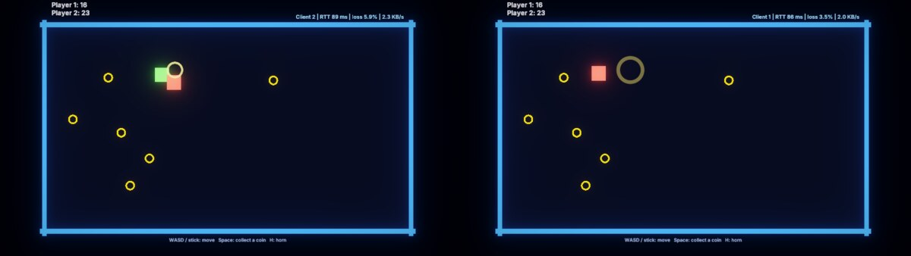
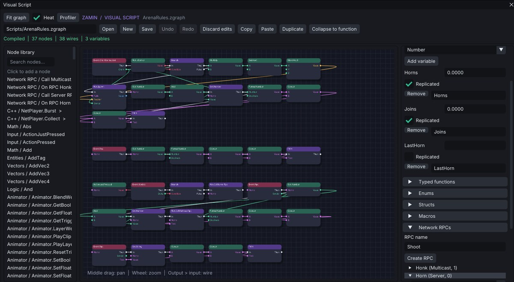
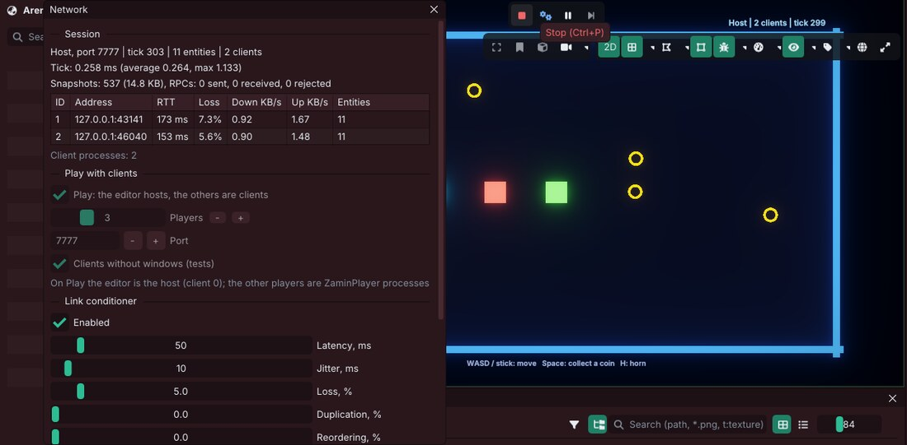

# Networking

Multiplayer for Zamin games, v1: a UDP transport of its own, a server-authoritative replication session with
client-side prediction and snapshot interpolation, RPCs from C++ and from Visual Script graphs, a dedicated server
(`ZaminPlayer --server`), Play with clients in the editor with a Network panel and a link conditioner, and the
**Net Arena** sample. Linux only, like the rest of the engine. What is not done is listed plainly in
[section 9](#9-what-is-not-done).



## Contents

1. [Quick start](#1-quick-start)
2. [How it works](#2-how-it-works)
3. [Components](#3-components)
4. [C++ scripts](#4-c-scripts)
5. [Visual Script](#5-visual-script)
6. [The Player and the editor](#6-the-player-and-the-editor)
7. [Security model](#7-security-model)
8. [Monitoring](#8-monitoring)
9. [What is not done](#9-what-is-not-done)
10. [Measured numbers](#10-measured-numbers)
11. [Tests](#tests)

## 1. Quick start

```bash
# a dedicated server (no window) and two players
build/bin/ZaminPlayer Projects/NetArena --server --port 7777
build/bin/ZaminPlayer Projects/NetArena --connect 127.0.0.1:7777
build/bin/ZaminPlayer Projects/NetArena --connect 127.0.0.1:7777 --net-conditioner latency=50,jitter=10,loss=5
```

In the editor: **Window > Network**, tick **Play: the editor hosts, the others are clients**, choose the number of
players and press **Play** — the editor is the host (a server that plays as client 0) and the other players start as
ZaminPlayer windows connected to it. **Stop** ends the session and closes them.

A game without a session (Play alone, an exported single-player game) is its own server: `IsServer` is true, every
RPC runs at once, `Net::Spawn` is a plain `Instantiate`. The same scripts work in both.

## 2. How it works

The layers, bottom up (`Zamin/src/Zamin/Network`):

| Layer | File | What it does |
|---|---|---|
| Codec | `NetCodec.h` | A bounds-checked reader / writer: integers, LEB128 varints, floats (NaN / infinity refused), strings with a maximum length, and a tagged encoding of script values with limits on depth (8), items (256 per array / object, 4096 in all) and string size (1 KiB). A read past the end fails the reader, never the process. |
| Sockets | `NetSocket.h` | Non-blocking UDP over POSIX sockets (IPv4, 1 MiB buffers, datagrams of at most 1200 bytes); an in-process `LoopbackNetwork` for tests and benchmarks; the `LinkConditioner` that wraps any socket and delays (latency ± jitter), drops, duplicates and reorders what it sends. |
| Connection | `NetConnection.h` | Packet sequence numbers with an ack and a 32-bit ack field in every packet, RTT (smoothed) and loss (over the last 256 packets whose fate is known), a **reliable-ordered channel** (message ids, resends after 1.5 RTT, delivery in order and exactly once), an **unreliable channel**, **fragmentation** of both up to 256 KiB a message (1000-byte fragments; an unreliable message with a lost fragment is dropped after 1 s), keep-alives, traffic statistics. |
| Transport | `NetTransport.h` | The handshake: a 256-byte padded connect request (the reply is smaller: no amplification) with the transport version, the game's protocol version and the project id; a **stateless challenge token** (keyed hash of the address, a nonce and the time) the client must echo before the server keeps any state; accept with a client id, a 64-bit session key every data packet carries, and a resume token. Then timeouts (10 s), graceful goodbyes, **per-client rate limits** (token buckets: 300 packets / 256 KiB a second, a client over its limit for 3 s is kicked), a malformed-packet kick (64 in a row), **max clients**, and **session resume**: a client that lost its connection (or a new process with its saved token) gets its client id back within 30 s. |
| Session | `NetSession.h` | One per scene: replication, prediction, interpolation, RPCs, connection events. `Scene::UpdateRuntime` drives the session attached to the scene. |

**The server** runs the game at a fixed tick (30 Hz by default, `--tick-rate`). Every tick it applies one input per
client to the entities that client owns with a predicted Network Transform, and builds each client's **snapshot**:
the entities relevant to it, each **delta-compressed against the last snapshot that client acknowledged** — only the
position, rotation, scale, owner and replicated values that changed since; an entity the client does not have yet
comes with its spawn data (its prefab, or the UUID of the scene's own entity, and the names of its replicated
values); an entity that left its interest or was destroyed is listed as removed. Unchanged entities cost nothing.
A snapshot holds at most `SnapshotBudget` bytes of entity data (900: one packet); the rest is sent round-robin in the
next snapshots. Snapshots are unreliable; the client acknowledges the newest it decoded with every message, and the
server keeps the last 32 a client was sent as baselines.

**Interest**: an entity is relevant to a client when it is within the relevance radius (the entity's own, or the
session's 40 m) of the client's first owned entity, when it is `AlwaysRelevant`, when the client owns it, or always
while the client owns nothing. 10% of hysteresis keeps an entity at the edge from flickering. A client hides a scene
object that is out of its interest and shows it again later; a spawned entity is despawned and spawned again.

**Clients** show the other entities **interpolated** between snapshots, `InterpolationDelay` (0.1 s) behind the
server clock they estimate from the snapshots' ticks. The entities a client owns whose Network Transform says
`Predict` are moved at once from the client's input at the server's tick rate (**client-side prediction**); every
input carries a sequence number and is sent (as two 16-bit fractions) until the server acknowledges it, and when the
server's state arrives the client takes the server's position and replays the inputs the server has not processed
yet (**reconciliation**). Both sides run exactly the same movement (`Session::Move`), so the correction is zero unless
the server dropped or clamped something.

**Replicated values** are written into the client's script after they arrive (a C++ field through its reflection,
a graph variable through `Machine::SetVariable`), and only when they differ: then `ZM_REPLICATED_NOTIFY`'s callback /
the graph's `Event.Rep` run.

**Reconnect**: a client whose connection times out tries to resume for 20 s on its own; the server keeps the
client's entities while the client may come back (`Disconnected` with `Resumable`), and the game hears of a departure
(`Net.ClientDisconnected`) only when it is final (a goodbye, a kick, or the resume time ran out). With
`--net-session-file` a client that was killed resumes its session after a restart.

## 3. Components

**Network Identity** (`NetworkIdentityComponent`) makes an entity part of the networked game: the server gives it a
network id and an owner (a client id, 0: the server), `AlwaysRelevant`, `RelevanceRadius`. The scene's own entities
with one are matched by UUID on both sides; entities spawned at runtime come from their prefab (`Net::Spawn`, the
`Net.Spawn` node). **Network Transform** (`NetworkTransformComponent`): `Interpolate`, or `Predict` with `MoveAction`
(an input vector of the project's input map), `MoveSpeed`, `Plane` (XY for 2D, XZ for 3D), an optional rectangle
(`ClampToBounds`, `BoundsMin`, `BoundsMax`) and `InterpolationDelay`. Both in [Components.md](Components.md#networkidentitycomponent).

## 4. C++ scripts

`#include <Zamin/Zamin.h>` brings `Zamin/Network/Net.h`. Replicated fields and RPCs are registered with the class:

| Macro / function | Meaning |
|---|---|
| `ZM_REPLICATED(Class, Field)` | A field the server sends to the clients (float, int, bool, vec2/3/4, string, EntityRef, enum; not curves) |
| `ZM_REPLICATED_NOTIFY(Class, Field, Callback)` | The same, and `Callback()` runs on a client when a new value arrived |
| `ZM_SERVER_RPC(Class, Method, "Param" ...)` | A client calls it, the server runs it — for an entity the client owns, or any entity with `.AnyClient()` |
| `ZM_CLIENT_RPC(Class, Method, ...)` | The server calls it, the entity owner's client runs it |
| `ZM_MULTICAST_RPC(Class, Method, ...)` | The server calls it, the server and every client the entity is relevant to run it |
| `.Unreliable()` | An RPC that may be lost (frequent cosmetic calls); the default is reliable and ordered |
| `Net::CallRpc(*this, "Method", args...)` | Calls an RPC of this script with typed arguments (false and a warning when this side may not) |
| `Net::IsServer(*this)`, `Net::IsClient(*this)`, `Net::IsOwner(*this)` | The role of this process; whether this side owns the entity (a client: its own; the server and the host: the server's) |
| `Net::LocalClient(*this)`, `Net::OwnerOf(*this)`, `Net::RpcSender()` | The local client id, the entity's owner, the client that called the RPC running now |
| `Net::Spawn(*this, "Prefabs/X.zprefab", position, owner)`, `Net::Despawn(*this, entity)` | Server: networked prefab spawn / despawn |
| `Net::SessionOf(*this)` | The `Net::Session` (statistics, `GetClients`, `SetInputSource` ...) or nullptr |

RPC parameters use the types of `ZM_METHOD`; their arguments are checked against the parameter types on receipt
(a fraction for an `int`, a string for a vector, the wrong count — refused and counted). Connections reach scripts as
messages: `OnMessage` gets `"Net.ClientConnected"` / `"Net.ClientDisconnected"` with the client id as the payload
(on the server; the host counts as client 0).

```cpp
#include <Zamin/Zamin.h>
using namespace Zamin;

class Collector : public ScriptableEntity
{
public:
    int Score = 0;

    void OnUpdate(Timestep) override
    {
        // The owner asks; the server decides.
        if (Net::IsOwner(*this) && Input::IsActionJustPressed("Collect"))
            Net::CallRpc(*this, "Collect", GetWorldPosition());
    }
    void Collect(glm::vec3 at)
    {
        if (!Net::IsServer(*this) || glm::length(at - GetWorldPosition()) > 2.0f) return; // validate what a client says
        ++Score;                                // replicated to everyone
        Net::CallRpc(*this, "Sparkle", at);     // an effect on every side
    }
    void Sparkle(glm::vec3 at) { ZM_INFO("collected at {:.1f}, {:.1f} by client {}", at.x, at.y, Net::OwnerOf(*this)); }
    void OnScore() { ZM_INFO("score is now {}", Score); }
};

ZM_REGISTER_SCRIPT(Collector,
    ZM_REPLICATED_NOTIFY(Collector, Score, OnScore),
    ZM_SERVER_RPC(Collector, Collect, "At"),
    ZM_MULTICAST_RPC(Collector, Sparkle, "At").Unreliable())
```

## 5. Visual Script



A graph defines its own RPCs in the **Network RPCs** section of the properties column: a name, the kind (Server,
Client, Multicast), Reliable, Any client (server RPCs) and typed parameters (any data type; renames keep the wires).
**Event.Rpc** handles one (its outputs: `Sender` and the parameters), **Net.CallServerRpc / Net.CallClientRpc /
Net.CallMulticastRpc** call one (their inputs: the parameters); the node library lists them under **Network RPC**
for every RPC of the graph. A variable's **Replicated** toggle sends it to the clients; **Event.Rep** (Name: the
variable) runs on a client when a new value arrived.

| Node | Pins | Meaning |
|---|---|---|
| `Net.IsServer`, `Net.IsClient` | → Value | The role of this process (no session: server) |
| `Net.IsOwner` | Target → Value | This side owns the entity |
| `Net.LocalClient`, `Net.OwnerOf`, `Net.OwnedEntity` | (Target / Client) → Value | Client ids and the client's first entity |
| `Event.ClientConnected`, `Event.ClientDisconnected` | → Client | On the server (the host is client 0) |
| `Event.Rpc` | Name → Sender, parameters | Handles a graph RPC |
| `Event.Rep` | Name | A replicated variable got a new value (client) |
| `Net.CallServerRpc`, `Net.CallClientRpc`, `Net.CallMulticastRpc` | Name, parameters | Calls a graph RPC of the graph's own entity |
| `Net.Spawn` | Path, Position, Owner → Value | Server: spawns a networked prefab (nothing on a client) |
| `Net.Despawn` | Target | Server: despawns a networked entity |

These need **`.zgraph` format 7** (`"Rpcs"`, the `"Replicated"` key of a variable); files of format 1–6 load
unchanged and are saved as format 7; a format 6 file with networking nodes is refused. The bytecode cook (format 2)
keeps the RPCs and the replicated flags. Validation: an unknown RPC, the call node of another kind, two handlers of
one RPC, `Event.Rep` of a variable that is not replicated, reserved or duplicate parameter names, more than 32 RPCs
/ 16 parameters / 64 replicated variables. Details: [VisualScripting.md](VisualScripting.md#networking).

## 6. The Player and the editor

| Option | Meaning |
|---|---|
| `--server [--port N]` | A dedicated server: no window, no rendering, no sound device; the scene runs at the tick rate in real time; a status line every 5 s (tick, clients, entities, tick cost, bandwidth, RTT); Ctrl+C / SIGTERM stop it |
| `--connect host:port` | Join (`127.0.0.1:7777`, a host name works too); `--headless` without a window |
| `--max-clients N`, `--tick-rate N` | The server's limits (16, 30 Hz) |
| `--net-conditioner latency=..,jitter=..,loss=..,dup=..,reorder=..,seed=..` | This side's outgoing packets through the link conditioner |
| `--net-session-file <file>` | `<client id> <resume token>`: a restarted client resumes its session |
| `--net-bot` | A bot plays (NetArena steers to the nearest coin; other games: a circle and a Collect key now and then) |
| `--net-report <file.json>` | Role, statistics, connections and every networked entity with its replicated values at exit |
| `--quit-after S` | Stop after S seconds |

The game's project id (a hash of its name) and protocol version (a hash of its version) are part of the handshake:
another game or another version is refused with a reason.



**The Network panel** (Window > Network): the session (role, port, tick, entities, tick cost — last, average, max —,
snapshots and RPCs sent / received / rejected), every client (address, RTT, loss, download and upload KB/s, entities
in its snapshot), the client processes, **Play with clients** (players 1–8, port, clients without windows for tests),
the **link conditioner** (latency, jitter, loss, duplication, reordering, a 100 ms / 5% loss preset; the host's packets
at once, client processes when they start) and the session log. The inspector has the Network Identity and Network
Transform sections.

## 7. Security model

What is done:

- **Bounds-checked decoding everywhere**: every packet and message is read through `Net::Reader`, which fails on a
  short buffer, an over-long varint or string, a count above its limit, NaN / infinity; a whole data packet is checked
  before any of it is used; a fuzz test feeds 20 000 random and mutated buffers to the decoders and 3 000 to a server.
- **No state before the challenge**: a connect request gets a stateless token (a keyed hash of the address, the nonce
  and a 5-second bucket); only an echoed token creates a client. Requests are padded so a reply is never larger.
- **Rate limits** per connection (packets and bytes, then a kick), at most `MaxClients`, a kick after 64 malformed
  packets in a row (32 malformed session messages), at most 60 RPCs a second per client (one second of burst).
- **Server authority**: clients send only their input and server RPCs. Input vectors longer than 1 are refused; the
  server applies at most one input a tick per client (no speed-up by sending more) and drops a backlog. A server RPC
  runs only for an entity the caller owns (unless `AnyClient`), only if it is a server RPC, and only with arguments of
  the declared types. A client cannot write any replicated value, spawn, despawn or change ownership.
- **Game code still has to validate** what an RPC asks for (NetArena checks the coin is within reach of where the
  server has the player).

What is **not** done: **no encryption** and **no authentication** — the session key and the resume token travel in
clear text, so anyone on the path can read the traffic, and could inject packets for a session it observed; there is
no login, no account, no ban list; the challenge protects against blind spoofing only; no protection against a
volumetric DDoS beyond what the kernel and the rate limits give; no anti-cheat beyond server authority (no hidden
information: an entity in a client's interest is sent with all its replicated values). Use it on trusted networks or
behind a VPN until a secure transport exists.

## 8. Monitoring

- `Session::GetStats()`: tick, networked / replicated entities, snapshots sent / received / dropped and their bytes,
  RPCs sent / received / rejected, inputs received / rejected / missed, malformed messages, corrections, tick cost;
  `GetClients()`: per client the connection statistics (RTT, loss, bytes per second, packets, resends), entities in
  its snapshot, acked tick, rejections; `GetLog()`: the session's own log.
- The **Network** profiler scope (`ZM_PROFILE_SCOPE("Network")`) around the session's work each frame.
- The dedicated server's status line, `--net-report`, the Network panel, and `ZAMIN_NET_STATE_LOG=N` (tests): a
  `NETSTATE tick=...` line every N ticks with the server's state of every entity, logged identically by the server
  (what it sends) and the clients (what they decoded).

## 9. What is not done

- Encryption, authentication, NAT traversal / relays, IPv6, host migration, matchmaking, voice.
- Lag compensation (rewinding the world for hit checks), prediction of anything but a Network Transform's movement
  (no physics rollback; networked rigid bodies are not synchronised on clients), extrapolation.
- Entity arguments and `EntityRef` values carry UUIDs: they mean the same entity on both sides for the scene's own
  entities only, not for spawned ones. Curve fields are not replicated.
- Scene changes are not networked (both sides run the same scene; a scene switch ends the session); the editor's
  host is the play scene only.
- No per-client bandwidth adaptation beyond the snapshot budget; a client that stops acknowledging gets full
  snapshots until its timeout; snapshots are not quantized (positions as 32-bit floats).
- Graph RPCs run on the graph's own entity; graphs cannot call C++ RPCs by node (C++ can).

## 10. Measured numbers

On a 4 vCPU Intel Xeon @ 2.10 GHz VM (Linux, no GPU), localhost:

| What | Result |
|---|---|
| `Tests/network_integration_test.py` (Debug): a dedicated server + 2 headless bot clients of NetArena for 30 s, every side through 50 ± 10 ms and 5% loss | RTT 151 / 153 ms, loss 2.7–6.2%; per client 1.9 KB/s down, 1.6 KB/s up; server tick 0.37 ms on average (max 4.6 ms); 82 coins collected, the bursts on both clients; 28 ticks compared on all sides, 0 different; a killed client resumed with its id |
| Dedicated server (Debug) with 2 windowed clients through 50 ± 10 ms one way | RTT 83–102 ms; server out 4–5 KB/s in all, tick 0.2–0.3 ms |
| `ZaminBench --net` (Release, 64 clients, 1000 moving entities, 30 m interest, 900-byte budget) | session tick 5.7 ms (p95 7.0), server frame 6.0 ms, client frame 1.1 ms, 27.1 KB/s per client (the budget), 105 entities per client (`Tests/Baselines/net-release.json`); Debug: 31 ms a tick |

The measured RTT is above the conditioner's 100 ms because acknowledgements ride on the next packet each way (the
server sends at its 30 Hz tick) and a conditioner releases a held packet when its socket is next polled (a 30 Hz
server polls every 33 ms).

## Tests

| Test | What |
|---|---|
| `ZaminTests --filter Net` (14 tests in `Tests/NetworkTests.cpp`) | codec round trips and bounds; a fuzz of every decoder and of a server; 600 reliable messages each way (4 B – 3.5 KB, fragmented ones too) arrive exactly once and in order under 20% loss, 10% duplication, 10% reordering and jitter; fragmentation up to the cap and expiry; handshake rejections (wrong version, wrong project, full server, a forged token, a short request, no server); rate-limit kick; resume after a timeout, from a new process, a wrong token, expiry; snapshot replication with delta compression (an idle snapshot under 12 bytes); interest with hysteresis and hidden scene objects; prediction and reconciliation converging under 80 ± 20 ms and 10% loss, the clamp, a cheating input refused; RPC kinds, ownership, argument types, forged messages, AnyClient, rate limit, no session; a client reconnecting and a killed one resuming its player; graph RPCs, replicated variables with Event.Rep, connection events; format 7 validation, migration and the bytecode |
| `ctest -R NetworkIntegration` | `Tests/network_integration_test.py` (above): real processes, the conditioner, a SIGKILL and a resume, state agreement, RPC effects, RTT and bandwidth in `build/NetworkIntegration/summary.json` |
| `ctest -R BenchNetSmoke` | `ZaminBench --net` small: every client connected, a snapshot every tick, interest, positions equal to the server's |
| `ctest -R SampleNetArena` | NetArena alone in the Player: the bot collects coins through its server RPC and multicast |
| `Tests/network_editor_test.py` | the real editor under xvfb: a graph RPC call node from the node library, a new RPC with a parameter, then Play with 3 players through the 100 ms / 5% loss preset — the Network panel lists both clients with their RTT, the graph spawned a player for each, Stop ends everything |
