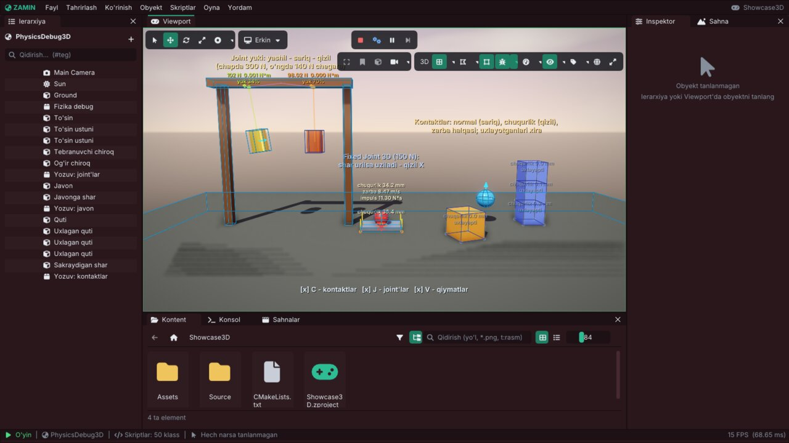

# Zamin Engine: physics (2D and 3D)

This guide explains Zamin's two physics worlds: **2D** (Box2D) and **3D** (Jolt Physics). Bodies and colliders,
joints, effectors, Character Controller 3D, physics materials, collision layers, control from scripts, collision and
trigger callbacks, raycast / overlap / shape cast queries, sleeping, debug views and determinism — how to set them up
in the editor and how to use them in C++ scripts.

The components' full fields (type, default value) are in [Components.md](Components.md): [Physics 2D](Components.md#4-physics-2d)
and [Physics 3D](Components.md#5-physics-3d). The general guide to the script API — [Scripting.md](Scripting.md). The
examples here assume `#include <Zamin/Zamin.h>` and `using namespace Zamin;`.



*Showcase3D `Scenes/PhysicsDebug3D.zscene` in the editor (Play): Debug drawing — the contacts and their values, the
joints' loads, sleeping bodies dimmed.*

Contents:

1. [Core concepts](#1-core-concepts)
2. [Step, gravity and simulation settings](#2-step-gravity-and-simulation-settings)
3. [2D bodies and colliders](#3-2d-bodies-and-colliders)
4. [2D effectors: platforms, wind, water](#4-2d-effectors-platforms-wind-water)
5. [2D joints](#5-2d-joints)
6. [3D bodies and colliders](#6-3d-bodies-and-colliders)
7. [3D joints and ragdolls](#7-3d-joints-and-ragdolls)
8. [Character Controller 3D](#8-character-controller-3d)
9. [Physics materials (.zphysmat)](#9-physics-materials-zphysmat)
10. [Collision layers](#10-collision-layers)
11. [Control from scripts: velocity, force, teleport](#11-control-from-scripts-velocity-force-teleport)
12. [Collision, trigger and joint break callbacks](#12-collision-trigger-and-joint-break-callbacks)
13. [Queries: raycast, overlap, shape cast](#13-queries-raycast-overlap-shape-cast)
14. [Sleeping](#14-sleeping)
15. [Debug views](#15-debug-views)
16. [Determinism](#16-determinism)
17. [Sample scenes](#17-sample-scenes)
18. [Common problems](#18-common-problems)
19. [Tests](#19-tests)
20. [Short API reference](#20-short-api-reference)

---

## 1. Core concepts

**Two worlds.** During play (Play) or simulation every scene can have two independent worlds: 2D (Box2D,
`PhysicsWorld2D`) and 3D (Jolt, `PhysicsWorld3D`). A 2D body collides only with 2D colliders, a 3D body only with 3D
colliders. A world is created when needed: with no 3D body in the scene Jolt does not start (when a 3D prefab appears
during the game — it starts then).

**Body + collider.** A physics object is a body (`Rigidbody2DComponent` or `Rigidbody3DComponent`) and one or more
colliders on one object. A collider without a body is not added to the world; a 3D body without a collider gives a
warning. Several colliders on one object (for example a box + a trigger sphere above it) are the shapes of one body.

**Body types** (**Type** in the inspector):

| Type | What it does | Example |
|---|---|---|
| `Static` | Does not move, infinite mass | ground, walls, tilemaps |
| `Dynamic` | Gravity, forces and collisions act on it; physics writes its transform | a crate, a ball, the hero (2D) |
| `Kinematic` | Moves only by script / animation, nothing pushes it; carries what stands on it | a lift, a moving platform |

**Who controls the transform.** Static and Kinematic bodies follow the object's Transform — a script or an Animation
Player can move them with `Transform().Translation` (a kinematic 3D body also gets its velocity computed, so what stands
on it moves along). Physics rewrites a **Dynamic** body's transform after every step: to move it elsewhere use
`SetPosition2D` / `SetPosition3D` (the body moves too and wakes up), and for movement — velocity, force or an impulse
([section 11](#11-control-from-scripts-velocity-force-teleport)).

**Units.** Distance — meters (the scene unit), mass — kg, time — seconds, force — N, angular velocity — radians/s.
`TransformComponent::Rotation` is in radians; joint angles and the angles in the inspector — in degrees. 2D collider
sizes are multiplied by the transform scale (the Box Collider 2D `Size` is the **half** size), while joint anchors are in
the body's own coordinates, unscaled.

**Frame order** (`Scene::OnUpdateRuntime`): UI → the scripts' `OnUpdate` → timers and tweens → Nav Agents and Spline
Followers → **the physics steps** → collision / trigger / joint break callbacks → Animation Player → `OnLateUpdate` →
camera follow → sprite / tint animations, Animator, audio. So a velocity given in `OnUpdate` applies in the same frame,
and `OnLateUpdate` sees the bodies' new positions.

**When it runs.** Physics runs only in **Play** (`Ctrl+P`) and **Simulate physics** (a button on the viewport toolbar:
without scripts, with the editor camera). In edit mode there are no bodies — colliders are only drawn
(**View > Physics colliders**). An inactive object (`SetActive(false)`) is removed from physics and created at its current
transform when enabled again ([Scripting.md](Scripting.md#5-the-life-cycle)).

---

## 2. Step, gravity and simulation settings

**Fixed step.** Both worlds advance in equal steps of `1 / StepRate` seconds: as many steps as the frame time fits (at
most `MaxStepsPerFrame`, the rest is dropped — the game slows down but does not fall behind). The result does not depend
on the frame rate.

| Setting | Where | Default |
|---|---|---|
| Step rate (`PhysicsStep.StepRate`, 20 ... 240 Hz) | Project settings > **Time** (`FixedStepRate`); a scene can set its own in *Scene settings > Physics* | 60 |
| At most steps per frame (`MaxStepsPerFrame`, 1 ... 20) | the same place | 5 |
| Gravity 2D / 3D | Project settings > **Physics** (presets: Earth, Moon, Mars, Jupiter, Platformer, Zero gravity); in a scene — by turning off **From the project** | (0, -9.8) / (0, -9.81, 0) |

The scene settings (**Window > Scene settings**, the *Physics* section) — the `Gravity`, `Gravity3D`, `PhysicsStep`,
`Physics2D` and `Physics3D` values of `SceneSettings`, written to the scene file:

| Section | Setting | Meaning |
|---|---|---|
| Box2D (2D) | **Sub-steps** (`SubSteps`, 1 ... 16) | Every fixed step is split into this many smaller Box2D steps: long chains, joints carrying heavy loads and ragdolls do not stretch. Effectors and the script's `ApplyForce` are applied on every sub-step, and joint breaking is checked after every sub-step |
| | **Velocity / position iterations** (6 / 2) | Solver passes: more — stiffer towers and joints, more time |
| | **Sleeping**, **Until sleep** | [section 14](#14-sleeping) |
| Jolt (3D) | **Sleeping**, **Until sleep** | [section 14](#14-sleeping) |

During the game the same section shows live statistics: bodies, awake / sleeping ones, joint and contact counts, the
Box2D steps in the frame. From a script: `GetScene().GetPhysics2DStats()` / `GetPhysics3DStats()` (`PhysicsStats2D` /
`PhysicsStats3D`: `Bodies`, `Moving`, `Awake`, `Sleeping`, `Joints`, `Contacts`, `Steps`; `Characters` too in 3D).

More about the project settings: [ProjectSettings.md](ProjectSettings.md#8-physics-gravity-and-collision-layers),
time: [ProjectSettings.md](ProjectSettings.md#7-time-and-the-time-api) (`Time::GetFixedDeltaTime()` — the step length).

---

## 3. 2D bodies and colliders

**Quick start.** *Object > 2D > Physics box* (or *Physics ball*; the same menu opens from the **+** button in the
hierarchy and with a right-click on empty space): a ready object with a Sprite / Circle Renderer + Rigidbody 2D
(Dynamic) + Box / Circle Collider 2D. For the ground make that object's **Type** `Static` and stretch its scale. Press ▶
— the box falls and stops on the ground.

**Rigidbody 2D** (`Rigidbody2DComponent`): `Type`, `FixedRotation` (**Freeze rotation** — so a platformer hero does not
tip over), `GravityScale` (0 — floats, 2 — falls heavier), `LinearDamping` / `AngularDamping` (air resistance),
`Bullet` (so a small fast body does not pass through walls), `Layer` (the collision layer), `Sleeping` (the sleep mode).

**Colliders** — the shared fields: `Offset`, `Density` (mass = density x area), `Friction`, `Restitution`
(bounciness 0..1), `RestitutionThreshold` (a hit slower than this does not bounce), `IsSensor` (**Trigger (sensor)** —
does not collide, only gives `OnTriggerBegin` / `OnTriggerEnd`), `MaterialPath` (a `.zphysmat` — when set, it is used
instead of the values above, [section 9](#9-physics-materials-zphysmat)), `Layer` (-1 — the body's layer).

| Collider | Shape | Note |
|---|---|---|
| **Box Collider 2D** | a rectangle, `Size` — the half size | `OneWay` — a one-way platform (passable from below) |
| **Circle Collider 2D** | a circle, `Radius` | multiplied by the larger scale |
| **Polygon Collider 2D** | any polygon (`Points`) | a concave shape or one with more than 8 corners is split by ear clipping and merged into convex pieces of at most 8 corners (`Polygon2D::Decompose`); a self-intersecting outline becomes its convex hull; the inspector shows the piece count |
| **Edge Collider 2D** | a line through points, `Loop` — a closed ring | has no area (mass) — for ground, slopes, walls; `OneSided` — a Box2D chain: a smooth one-sided chain that does not snag on its joints (the solid side is to the left of the points' direction) |
| **Tilemap** | rectangles merged from the solid tiles | `TilemapComponent::Collision`, `CollisionLayer`, `Friction` / `MaterialPath`; the layer's `Collision` flag and the tile properties (solid / none / one-way) |

**Editing points in the viewport** (Polygon and Edge): **Edit points** in the inspector — drag a point, click a line —
a new point, `Ctrl` + click or `Delete` — remove, `Shift` — 0.1 steps, `Esc` — finish; every action is one `Ctrl+Z`. On
a Polygon, **Fit to the sprite** — an outline (at most 12 points) along the edge of the sprite frame's non-transparent
part.

**One-way platforms.** The Box Collider 2D's **One-way** checkbox or a tilemap tile: a body moving up or below the
surface passes through and lands on top (even a fast-falling one). The collision reaches the script only while the
platform holds the body. Dropping down through it — `DropThroughPlatforms(seconds)` (0.35 s by default):

```cpp
// Platformer2D PlayerController: down (S) + jump - drops through a one-way platform.
if (Input::IsActionJustPressed("Jump") && m_GroundContacts > 0)
{
    if (DropThrough && Input::GetAxis("Vertical") < -0.5f)
        DropThroughPlatforms(0.3f);
    else
        ApplyImpulse({ 0.0f, JumpImpulse });
}
```

---

## 4. 2D effectors: platforms, wind, water

An effector is added to the object's own colliders (usually a Static body).

**Platform Effector 2D** — turns every collider of the object (or the tilemap tiles) into a platform: `OneWay`,
`SurfaceArc` (180 — the classic one-way; smaller lets bodies through at the corners too, larger also holds from the
sides), `RotationOffset`, turning off friction / bounce on the sides (`UseSideFriction`, `UseSideBounce`, `SideArc`) —
the hero does not stick to walls. The Box Collider 2D's old "One-way" flag is converted to an effector with one click in
the inspector. Sample: Platformer2D `Scenes/Shapes2D.zscene`.

**Area Effector 2D** (wind, current) — pushes the dynamic bodies inside its colliders (usually triggers) every step:

| Field | Meaning |
|---|---|
| `ForceAngle`, `UseGlobalAngle` | the direction in degrees (0 — +X, 90 — up); turns with the object or stays in world space |
| `ForceMagnitude`, `ScaleWithMass` | the force, N; **Scale with mass** — N/kg: light and heavy bodies accelerate the same |
| `ForceVariation` | a random addition every step (gusts) |
| `Drag`, `AngularDrag` | slowing down inside (1/s) |
| `ColliderMask` | which collision layers it affects |

An effector with a non-trigger collider pushes what touches it (a conveyor). `AffectedBodies` — how many bodies were
pushed during the game (shown in the inspector too).

**Buoyancy Effector 2D** (water) — liquid inside the collider up to `SurfaceLevel`. The weight of the liquid a body
displaces (`Density` x the area below the surface x gravity) is applied upward at the center of its submerged part: a
collider less dense than the liquid floats and rights itself, a denser one sinks. `LinearDrag` / `AngularDrag` by the
submerged part, `FlowAngle` / `FlowMagnitude` / `FlowVariation` — a current (a river), `ColliderMask`. The collider must
be a **trigger** (the inspector warns). The viewport draws the wind arrows, the water level and the flow direction.

Sample: Platformer2D `Scenes/Effectors2D.zscene` — crates floating in a pool and sunken stones, a wind column, a side
wind, the `LaserScanner` (Raycast2DAll) and `BlastOnClick` (OverlapCircle2D) scripts
(`Projects/Platformer2D/Source/Effectors.cpp`).

---

## 5. 2D joints

A joint connects the object's Rigidbody 2D to a **connected body** (another object's Rigidbody 2D or a Tilemap) or —
when that is empty — to a fixed point in the world. In the *+ Component > Physics 2D* menu:

| Joint | What | Main fields |
|---|---|---|
| **Distance Joint 2D** | a rigid rod, a rope or a spring | `Distance` / `AutoConfigureDistance`, `MaxDistanceOnly` (a rope), `Frequency` + `DampingRatio` (a spring) |
| **Revolute Joint 2D** | a hinge (a wheel, a door, a pendulum) | `EnableLimit`, `LowerAngle` / `UpperAngle`, `EnableMotor`, `MotorSpeed`, `MaxMotorTorque`; in play `JointAngle`, `JointSpeed` |
| **Prismatic Joint 2D** | sliding along an axis (a lift, a piston) | `Axis`, limits, motor |
| **Weld Joint 2D** | a weld — rigid or soft | springy with `Frequency` |
| **Wheel Joint 2D** | a wheel: rotation + a suspension spring | `Axis`, spring, limits, motor |

**Shared fields** (`Joint2DComponentBase`): `ConnectedBody` (`EntityRef`), `Anchor` / `ConnectedAnchor` (in the
bodies' own coordinates), `AutoConfigureConnectedAnchor` (the connected anchor is placed where the anchor stands when
the joint is created), `CollideConnected` (**Collide connected**), `BreakForce` / `BreakTorque` (the **Break** section:
0 — never breaks). Read during play: `ReactionForce`, `ReactionTorque`, `Broken`.

**Lifetime.** A joint is created when both bodies are in the world, disappears when one of them is inactive or
deleted, and is created again when it comes back. Changes to the motor, limits and spring during the game apply at once,
and a changed `ConnectedBody` rebuilds the joint. A broken joint (`OnJointBreak`, [section 12](#12-collision-trigger-and-joint-break-callbacks))
is gone completely; `Broken = false` creates it again. In duplicates and prefab instances the connected body is relinked
to the copy's own body; a joint connected to a body that is not in the scene gives a warning once.

**Editing in the viewport.** **Edit anchors** in the inspector: the anchor (a circle), the connected anchor (a
diamond), the slide / suspension axis (a square) and the limits can be dragged, `Shift` — 0.1-unit / 5° steps, `Esc` —
finish; **To the anchor** puts the connected anchor onto the anchor with one click. Joints are drawn in the viewport with
*Gizmos > Joints (2D / 3D)* (when selected or all of them).

Controlling the motor from a script (Platformer2D `CarController`, `Projects/Platformer2D/Source/Joints.cpp`):

```cpp
class CarController : public ScriptableEntity
{
public:
    EntityRef RearWheel, FrontWheel;
    float MaxSpeed = 720.0f; // degrees / s
    float Torque = 60.0f;

    void OnUpdate(Timestep) override
    {
        const float input = Input::GetAxis("Horizontal");
        for (EntityRef ref : { RearWheel, FrontWheel })
        {
            Entity wheel = Resolve(ref);
            if (!wheel || !wheel.HasComponent<WheelJoint2DComponent>())
                continue;
            auto& joint = wheel.GetComponent<WheelJoint2DComponent>();
            joint.EnableMotor = true;
            joint.MotorSpeed = -input * MaxSpeed;   // clockwise - to the right
            joint.MaxMotorTorque = Torque;
        }
    }
};
ZM_REGISTER_SCRIPT(CarController, ZM_FIELD(CarController, RearWheel), ZM_FIELD(CarController, FrontWheel),
                   ZM_FIELD(CarController, MaxSpeed), ZM_FIELD(CarController, Torque))
```

Samples: Platformer2D `Scenes/Joints2D.zscene` (a bridge, a lift, a pendulum, a rope, a spring, a breakable lamp, a
motorized car — A / D) and `Scenes/Ragdoll2D.zscene` (`Prefabs/Ragdoll.zprefab`: 11 pieces, limited hinges, 2 sub-steps;
the mouse or R — a new ragdoll).

---

## 6. 3D bodies and colliders

**Quick start.** *Object > 3D > Physics cube* (or *Physics ball*, *Physics ground (static)*): a mesh + Rigidbody 3D +
the matching collider.

**Rigidbody 3D** (`Rigidbody3DComponent`): `Type`, `Mass` (kg), `LinearDamping` / `AngularDamping`, `GravityFactor`,
`LockRotation` (stays upright), `Layer`, `ContinuousCollision` (**Continuous (CCD)**), `Sleeping`.

**Colliders** — shared: `Offset`, `Friction`, `Restitution`, `IsSensor`, `MaterialPath`. Sizes are multiplied by the
transform scale.

| Collider | Shape | For which bodies |
|---|---|---|
| **Box Collider 3D** | a box, `HalfExtents` — the half sizes | all |
| **Sphere Collider 3D** | a sphere, `Radius` | all |
| **Capsule Collider 3D** | a capsule along the Y axis: `Radius`, `HalfHeight` | all |
| **Convex Hull Collider 3D** | the convex hull of the vertices of the model / primitive on the Mesh Renderer (or the `ModelPath` model), at most `MaxVertices` (**Max corners**, 4 ... 256) — with more, the outermost points | dynamic bodies (concave parts get filled: a bowl becomes a solid block) |
| **Mesh Collider 3D** | the model's own triangles (a Jolt MeshShape): stairs, arches, tunnels, half-pipes, uneven ground | **Static and Kinematic only** — a dynamic body ignores it (a warning); the triangles are solid from their front side |

The hull and the triangles are built once per model (`CollisionShapes3D`, without a GPU) and rebuilt when the file or
its `.zmeta` import settings change; the inspector shows the corner / triangle count, and the viewport (*Physics
colliders*) shows the edges.

**A trigger and a solid collider on one body** can go together (a box + a "radar" sphere around it): the trigger part is
not hit, does not stop the hero, and queries see it only with `includeTriggers`.

**Continuous collision (CCD).** A fast body (a bullet, a thrown ball) can pass through a thin wall between steps. With
`ContinuousCollision` on, the body is checked along its path every step (Jolt LinearCast) — more expensive, only for fast
and small bodies. It can be turned on during the game too. Sample: Showcase3D `Scenes/Physics3D.zscene` — two balls, CCD
on / off, are shot at a thin pane (the `Launcher3D` script counts: "Passed through" / "Stopped").

Shooting a ball (Showcase3D `BallShooter`): a copy from a prefab and a starting velocity:

```cpp
glm::vec3 forward = Transform().GetForward();
Entity ball = Instantiate("Prefabs/Ball.zprefab", GetWorldPosition() + forward * 1.5f);
SetVelocity3D(ball, forward * Speed);
```

---

## 7. 3D joints and ragdolls

Jolt constraints, with the same logic as the 2D joints (a connected body or a world point, anchors, an automatic anchor,
**Collide connected**, breaking, disappearing and coming back when inactive, relinking in duplicates / prefabs):

| Joint | What | Main fields |
|---|---|---|
| **Fixed Joint 3D** | rigid (moves together) | — |
| **Hinge Joint 3D** | a hinge: a door, a wheel, an elbow | `Axis`, limits (-180..0 / 0..180), motor (`MotorSpeed`, `MaxMotorTorque`), spring (`EnableSpring`, `SpringTargetAngle`, `SpringFrequency`, `SpringDamping`); in play `JointAngle`, `JointSpeed` |
| **Distance Joint 3D** | a rod / a rope / a range | `MinDistance` .. `MaxDistance`, `MaxDistanceOnly`, `Frequency` |
| **Slider Joint 3D** | sliding along an axis | `Axis`, limits, motor; in play `JointTranslation` |
| **Cone Joint 3D** | a ball joint (a shoulder, a hip): Jolt SwingTwist | `SwingLimit` (the cone angle), `TwistLower` / `TwistUpper`, `FrictionTorque` |

When one breaks the script gets `OnJointBreak3D(const JointBreak3D&)`. The inspector shows the state (force, torque,
angle, offset, distance, swing / twist), the viewport the anchors, the axis and the angle arc, the slide limits and the
cone (*Gizmos > Joints (2D / 3D)*); **Edit anchors** — the anchors, the axis and the limits with a move gizmo at the
chosen point.

**Ragdolls.** Showcase3D `Scenes/Ragdoll3D.zscene` — `Prefabs/Ragdoll3D.zprefab`: 11 pieces, Cone Joint 3Ds at the
shoulders / hips / waist / neck, limited Hinge Joint 3Ds at the elbows and knees, the limbs do not collide with each
other. The `RagdollSpawner3D` script: R — 3 more, the mouse / F — throw from the camera. To build a ragdoll: every piece
a Dynamic Rigidbody 3D + a Capsule / Box collider, the parent piece as `ConnectedBody`, **Collide connected** off, and a
`FrictionTorque` on the joints — the limbs do not flail.

Another sample: Showcase3D `Scenes/Joints3D.zscene` (a spring door, a chain of balls, a lift — `SliderShuttle`, a
motorized mill, a welded L, convex hulls rolling down a slope).

---

## 8. Character Controller 3D

For a hero, a **Character Controller 3D** (`CharacterController3DComponent`, Jolt CharacterVirtual) instead of a
Rigidbody 3D: a capsule that walks up slopes (`MaxSlope`, degrees) and stairs (`StepHeight`), slides along walls, stands
on moving platforms and applies gravity itself (`GravityScale`). The object's position is the **feet** point. To create
one: *Object > 3D > Hero (Character Controller)*.

| Field | Meaning |
|---|---|
| `Radius`, `Height`, `Mass` | the capsule and the mass (for pushing) |
| `MaxSlope`, `StepHeight`, `StickToFloor` | the slope limit, the step height, sticking to the ground when going down |
| `Layer` | the collision layer (the same matrix as bodies) |
| `PushBodies`, `PushForce` | **Pushes bodies**: dynamic bodies it walks into are pushed with at most `PushForce` N (100 N by default; more for heavy ones) |
| `MoveVelocity`, `VerticalVelocity` | given by the script: the horizontal velocity (`Move()`), the vertical one (`Jump()` or directly) |
| `Grounded`, `Velocity` | read: whether it stands on the ground, the real velocity of the last step (after collisions) |

The script gives the horizontal velocity every frame; `Jump(speed)` works only on the ground (returns `true`). The
Adventure3D hero (`Projects/Adventure3D/Source/Player.cpp`, shortened):

```cpp
void OnUpdate(Timestep ts) override
{
    auto* cc = TryGetComponent<CharacterController3DComponent>();
    if (!cc) return;

    glm::vec2 input = Input::GetVector("Move");          // WASD / arrows / left stick
    bool run = Input::IsActionPressed("Sprint");

    // The direction relative to the camera
    glm::vec3 forward(0, 0, -1), right(1, 0, 0);
    if (Entity cam = FindEntity(Camera))
    {
        glm::vec3 f = cam.GetComponent<TransformComponent>().GetForward();
        f.y = 0.0f;
        if (glm::length(f) > 0.01f) forward = glm::normalize(f);
        right = glm::normalize(glm::cross(forward, glm::vec3(0, 1, 0)));
    }
    glm::vec3 wish = forward * input.y + right * input.x;
    float targetSpeed = glm::length(input) * (run ? RunSpeed : WalkSpeed);
    glm::vec3 target = glm::length(wish) > 0.001f ? glm::normalize(wish) * targetSpeed : glm::vec3(0.0f);
    m_Velocity = Math::Damp(m_Velocity, target, Acceleration, ts);   // independent of the frame rate
    cc->Move(m_Velocity);

    if (Input::IsActionJustPressed("Jump"))
        cc->Jump(JumpSpeed);

    if (Transform().Translation.y < -25.0f)     // fell out of the world
    {
        SetPosition3D(m_Spawn);
        cc->VerticalVelocity = 0.0f;
    }
}
```

- Teleport — `SetPosition3D` (the character moves too). When the character enters a sensor collider both sides get
  `OnTriggerBegin` (crystals, coins, zones) — [Tutorial-3D.md](Tutorial-3D.md).
- A deactivated character is removed from the world (no gravity, `Grounded` false, `Jump` does nothing) and is created at
  rest at its current place when enabled again.
- With Animator root motion on, the clip itself moves the character ([Animation.md](Animation.md#10-root-motion)).
- Nav Agents work with a Character Controller 3D too ([AI.md](AI.md)).

---

## 9. Physics materials (.zphysmat)

To use the same surface on many colliders — a **physics material** asset. Ready-made ones in *Content browser >
right-click > New physics material (2D)*: Default, Ice, Rubber ball, Sticky, Metal, Wood. The file is JSON
(`PhysicsMaterial::ToJson`):

```json
{
    "Friction": 0.8,
    "Restitution": 0.85,
    "RestitutionThreshold": 0.2,
    "Density": 1.0,
    "FrictionCombine": "Default",
    "RestitutionCombine": "Maximum"
}
```

(`Projects/Platformer2D/Assets/Physics/Bouncy.zphysmat`). Drag it onto a collider's **Physics material** field — the
material's values are used instead of the collider's own; with the field empty — the collider's.

**Combine modes** (`PhysicsCombine`): how friction / bounce mix when two colliders touch — `Default` (the Box2D rule:
friction √(a·b), bounce max(a, b)), `Average`, `Minimum`, `Multiply`, `Maximum`. When two colliders ask for different
modes, the one lower in the list wins (Maximum > Multiply > Minimum > Average > Default). `Minimum` for ice — everything
slides on it; `Maximum` for rubber — it bounces off whatever it touches.

- 3D colliders take the same files (friction, bounce, its threshold, the modes); **density is not used in 3D** — the 3D
  mass is the Rigidbody 3D's `Mass` field.
- The material is edited in the inspector; when the file changes (in an outside editor too) it applies at once during
  the game (hot reload).
- A Tilemap takes a material too (`TilemapComponent::MaterialPath`).

Samples: Platformer2D `Physics/Ice.zphysmat`, `Physics/Bouncy.zphysmat` (`Scenes/Shapes2D.zscene`: an ice slope, a
rubber mattress); Showcase3D `Physics/Ice.zphysmat`, `Physics/Rubber.zphysmat`, `Physics/Bouncy.zphysmat`
(`Scenes/Physics3D.zscene`).

---

## 10. Collision layers

The project has **16 named layers** and a **matrix** of which pairs collide — the same for 2D and 3D
(`CollisionLayers2D`, alias `CollisionLayers`; the `"CollisionLayers2D"` section in the `.zproject`). *Project settings >
Physics*: the layer names, the matrix with angled headers, ready-made presets (everything collides, every layer only
with itself, "Platformer 2D", "3D action" ...), copying / pasting a row.

Who chooses the layer:

- Rigidbody 2D and Rigidbody 3D — `Layer` (all of the body's colliders);
- a 2D collider — its own `Layer` (-1 — the body's);
- a Tilemap — `CollisionLayer`; a Character Controller 3D — `Layer`.

Two colliders touch only when the matrix allows their layers (the Box2D filter: category — the layer bit, mask — the
layers it collides with; a Jolt ObjectLayer). Both the layer and the matrix apply at once during the game.

Queries take a layer mask (`uint16_t`, by default `0xFFFF` — all):

```cpp
uint16_t ground = LayerMask({ "Ground" });                    // bits by name (an unknown name is skipped)
RaycastHit hit = Raycast2D(GetWorldPosition(), { 0, -1 }, 1.2f, ground);
uint16_t notGhosts = (uint16_t)~LayerMask({ "Arvoh" });       // everything except the "Arvoh" layer
int index = LayerIndex("Ragdoll");                             // -1 - no such layer
```

Samples: Platformer2D (`Ground`, `Ghost` — balls that touch only the ground, `Ragdoll` / `RagdollLimb` — the ragdoll's
limbs do not collide with each other); Showcase3D (`Arvoh` — "ghost" balls that pass through the grille, `Panjara` — the
grille).

---

## 11. Control from scripts: velocity, force, teleport

The `ScriptableEntity` functions act on this object's body; the ones taking an `Entity other` — on another object's.

| What | 2D | 3D |
|---|---|---|
| Read the velocity | `GetVelocity()` | `GetVelocity3D()`, `GetAngularVelocity3D()` |
| Set the velocity | `SetVelocity(v)`, `SetVelocity(other, v)` | `SetVelocity3D(v)`, `SetVelocity3D(other, v)`, `SetAngularVelocity3D(w)` |
| Impulse (one hit) | `ApplyImpulse(i)`, `ApplyImpulse(other, i)` | `ApplyImpulse3D(i)`, `ApplyImpulse3D(other, i)` |
| Continuous force (every frame) | `ApplyForce(f)` | `ApplyForce3D(f)`, `ApplyTorque3D(t)` |
| Teleport (with the body) | `SetPosition2D(p)` | `SetPosition3D(p)` |
| Sleeping | `IsSleeping()`, `WakeUp()`, `PutToSleep()` | `IsSleeping3D()`, `WakeUp3D()`, `PutToSleep3D()` |

- An **impulse** changes the velocity instantly (a jump, an explosion, a bullet). A **force** given every frame acts
  continuously (an engine, wind). In 2D the script's `ApplyForce` is applied averaged over every step and sub-step: the
  same force gives the same result at any FPS, step rate and sub-step count.
- A **teleport** wakes the body; in 3D `SetPosition3D` also stops its velocity (Showcase3D `Respawn3D`: reposition +
  `SetAngularVelocity3D(glm::vec3(0.0f))`).
- Moving a kinematic body through its transform (Showcase3D `Sweeper3D`): `Transform().Translation = ...` — the body gets
  there with a velocity and pushes / carries what is on it.
- Through the component itself too: `GetComponent<Rigidbody2DComponent>().GravityScale = 0.0f;` — applies during the
  game (the layer, CCD and the sleep mode too).

A 2D platformer hero (Platformer2D `PlayerController`, shortened) — smooth velocity changes and a jump with an impulse;
knowing it stands on the ground by counting collisions:

```cpp
class PlayerController : public ScriptableEntity
{
public:
    float MoveSpeed = 7.0f;
    float JumpImpulse = 9.0f;

    void OnUpdate(Timestep ts) override
    {
        glm::vec2 velocity = GetVelocity();
        float target = Input::GetAxis("Horizontal") * MoveSpeed;
        velocity.x += (target - velocity.x) * std::min(1.0f, 12.0f * (float)ts);
        SetVelocity(velocity);

        if (Input::IsActionJustPressed("Jump") && m_GroundContacts > 0)
        {
            SetVelocity({ velocity.x, 0.0f });
            ApplyImpulse({ 0.0f, JumpImpulse });
        }
    }
    // The ground and platforms - solid collisions; the coins are sensors, so they do not come here.
    void OnCollisionBegin(Entity) override { m_GroundContacts++; }
    void OnCollisionEnd(Entity) override { m_GroundContacts = std::max(0, m_GroundContacts - 1); }

private:
    int m_GroundContacts = 0;
};
ZM_REGISTER_SCRIPT(PlayerController, ZM_FIELD(PlayerController, MoveSpeed), ZM_FIELD(PlayerController, JumpImpulse))
```

Keep **Freeze rotation** (`FixedRotation`) on on the Rigidbody 2D — otherwise the hero tips over. To know more precisely
that it stands on the ground, a short `Raycast2D` or `OverlapBox2D` under the feet
([section 13](#13-queries-raycast-overlap-shape-cast)).

---

## 12. Collision, trigger and joint break callbacks

| Callback | When |
|---|---|
| `OnCollisionBegin(Entity other)` / `OnCollisionEnd(other)` | neither collider is a sensor: solid contact began / ended |
| `OnTriggerBegin(Entity other)` / `OnTriggerEnd(other)` | at least one is a sensor (`IsSensor`): entered / left; 2D, 3D and Character Controller 3D |
| `OnJointBreak(const JointBreak2D&)` | a 2D joint of this object broke: `Type` (`Joint2DType`), `ConnectedBody`, `Force`, `Torque` |
| `OnJointBreak3D(const JointBreak3D&)` | a 3D joint of this object broke: `Type` (`Joint3DType`), ... |

Rules:

- A callback reaches the scripts of **both** objects and comes **once per pair of objects** (even with several colliders
  on a body). You learn which object touched, not which collider — check its tag if needed (`other.HasTag("Player")`).
- The callbacks are called after the physics steps, once the world is unlocked — `Destroy`, `Instantiate`, `SetActive`
  and `SetPosition2D` work freely inside them.
- `OnTriggerEnd` / `OnCollisionEnd` come even when the object inside is deleted or deactivated.
- A sleeping body's contacts are kept: a crate that fell asleep does not "leave" a trigger plate; a kinematic trigger
  senses a sleeping body too (3D).
- The callbacks reach a disabled script too (it can enable itself).

A coin (Platformer2D `Coin`, `Projects/Platformer2D/Source/Gameplay.cpp`) — its collider is a sensor, so
`OnTriggerBegin`:

```cpp
void OnTriggerBegin(Entity other) override
{
    if (m_Collected || !other.HasTag("Player"))
        return;
    m_Collected = true;
    Emit("CoinCollected");                       // the GameManager is subscribed
    Instantiate(Effect, GetWorldPosition());
    Destroy();
}
```

Counting what is inside (Showcase3D `TriggerGlow3D`): `m_Inside[(uint64_t)other.GetUUID()] = ...` in `OnTriggerBegin`,
`m_Inside.erase(...)` in `OnTriggerEnd` — the plate lights up when pressed.

A joint break (Platformer2D `BreakableJoint`):

```cpp
void OnJointBreak(const JointBreak2D& joint) override
{
    ZM_INFO("The {} joint broke: {:.0f} N", GetEntity().GetName(), joint.Force);
    Flash({ 1.0f, 0.3f, 0.2f, 1.0f }, 0.4f);
}
```

---

## 13. Queries: raycast, overlap, shape cast

Every query works during play / simulation (in edit mode the result is empty) and takes a layer mask (`layerMask`) and
`includeTriggers` (by default triggers are ignored).

**The result** — `RaycastHit`: `Hit` (`if (hit)` works too), `EntityID` (the UUID — the object:
`GetScene().GetEntityByUUID(hit.EntityID)`), `Point`, `Normal`, `Distance`.

**2D:**

| Function | What it returns |
|---|---|
| `Raycast2D(origin, direction, maxDistance = 100, layerMask)` | the nearest hit |
| `Raycast2DAll(origin, direction, maxDistance, layerMask, includeTriggers)` | every object on the ray's path (once each), nearest first |
| `OverlapCircle2D(center, radius, layerMask, includeTriggers)` | the objects inside a circle, nearest to the center first |
| `OverlapBox2D(center, halfExtents, angleDegrees, layerMask, includeTriggers)` | the objects inside a rotated rectangle |
| `OverlapPoint2D(point, layerMask, includeTriggers)` | the colliders containing the point |

**3D:**

| Function | What it returns |
|---|---|
| `Raycast3D(origin, direction, maxDistance = 100, layerMask)` | the nearest hit |
| `Raycast3DAll(...)` | every object on the path, nearest first |
| `OverlapSphere3D(center, radius, ...)`, `OverlapBox3D(center, halfExtents, rotation, ...)`, `OverlapCapsule3D(point0, point1, radius, ...)` | the objects inside the shape (character capsules too), nearest to the center first |
| `SphereCast3D(origin, radius, direction, maxDistance, ...)`, `BoxCast3D(center, halfExtents, direction, rotation, maxDistance, ...)`, `CapsuleCast3D(point0, point1, radius, direction, maxDistance, ...)` | a "thick ray": the shape is swept along the direction — `Distance` is how far the shape went, `Point` the hit point, `Normal` the surface |
| `SphereCast3DAll`, `BoxCast3DAll`, `CapsuleCast3DAll` | everything on the path |

Important details:

- Overlap queries find the object **itself** too (when it is inside) — skip it if you do not need it.
- A 3D ray or shape starting inside a collider does not hit it: a ray shot from inside its own body passes through it.
  A Mesh Collider 3D is hit only from its front side.
- The same functions exist on `Scene` too (`GetScene().Raycast2D(...)`, `GetScene().OverlapSphere3D(...)`) — for code
  outside scripts.

An explosion (Platformer2D `BlastOnClick`): finds the bodies where the mouse was clicked and pushes them away from the
center:

```cpp
void Blast(const glm::vec2& center)
{
    for (Entity e : OverlapCircle2D(center, Radius))
    {
        glm::vec2 d = glm::vec2(e.GetComponent<TransformComponent>().Translation) - center;
        const float distance = glm::length(d);
        d = distance > 1e-3f ? d / distance : glm::vec2(0.0f, 1.0f);
        const float falloff = std::clamp(1.0f - distance / Radius, 0.2f, 1.0f);   // closer - stronger
        ApplyImpulse(e, (d + glm::vec2(0.0f, 0.35f)) * Strength * falloff);
    }
    DebugDraw::Circle({ center, 0.5f }, Radius, glm::vec4(1.0f, 0.6f, 0.25f, 0.9f), 0.9f, false);
}
// The call: if (Input::IsActionJustPressed("Fire")) Blast(GetMouseWorldPosition());
```

Checking the 3D ground (the example in `ScriptableEntity.h`) and aiming at an enemy:

```cpp
RaycastHit ground = SphereCast3D(GetWorldPosition() + glm::vec3(0, 0.5f, 0), 0.3f, { 0, -1, 0 }, 1.0f);
if (RaycastHit hit = Raycast3D(GetWorldPosition(), Transform().GetForward(), 20.0f, LayerMask({ "Enemy" })))
    SendMessage(GetScene().GetEntityByUUID(hit.EntityID), "Damage", 25.0f);
```

Samples: Showcase3D `Scenes/Queries3D.zscene` — `SphereSweep3D` (SphereCast3DAll, the "Arvoh" layer left out of the
mask), `OverlapGlow3D` (what is inside OverlapSphere3D lights up), `LaserAll3D` (Raycast3DAll); Platformer2D
`Scenes/Effectors2D.zscene` — `LaserScanner` (Raycast2DAll), `BlastOnClick`. For the point under the mouse:
`GetMouseRay()` + `Raycast3D` in 3D, `GetMouseWorldPosition()` + `OverlapPoint2D` in 2D.

---

## 14. Sleeping

A body that has not moved for a while — together with those touching or joined to it (Box2D / Jolt islands) — is not
simulated until something wakes it: a hit, a joint pulling, a script (`WakeUp`, `SetPosition2D`, a force, an impulse).
In large scenes this saves a lot of time.

- Scene: *Scene settings > Physics > Box2D / Jolt* — **Sleeping** (when off, every body is always simulated) and
  **Until sleep** (seconds, 0.5 by default).
- Every body (`Sleeping`, `SleepMode`): **Starts awake** (`StartAwake`), **Starts asleep** (`StartAsleep` — a tower that
  waits until it is hit), **Never sleeps** (`NeverSleep`).
- During play the inspector shows the state and the **Wake up** / **Put to sleep** buttons; in the *Physics colliders*
  view sleeping bodies are bluish grey.
- Scripts: 2D `IsSleeping()`, `WakeUp()`, `PutToSleep()`, `IsSleeping(other)`, `WakeUp(other)`; 3D `IsSleeping3D()`,
  `WakeUp3D()`, `PutToSleep3D()` and the `(other)` variants. On `Scene`: `IsSleeping2D(entity)`, `IsSleeping3D(entity)`.

```cpp
// Showcase3D SleepTint3D: a sleeping body turns blue.
void OnUpdate(Timestep) override
{
    if (auto* mr = TryGetComponent<MeshRendererComponent>())
        mr->Mat.Albedo = IsSleeping3D() ? SleepColor : m_Awake;
}
```

Bodies sleeping on a removed body wake up and fall; bodies inside a body that appears again wake up too.

---

## 15. Debug views

**In the editor:**

- **Physics colliders** (the viewport toolbar or the *View* menu): every 2D / 3D collider, the Convex Hull and Mesh
  collider edges, the tilemap boxes (one-way ones in pink, with an arrow), sleeping bodies in bluish grey.
- The **Debug drawing** menu (the bug button on the toolbar): *Raycasts* (every query: the ray, the hit point, the
  normal, its order number; red on a miss; how long it shows), *Contact points* (a green point, a yellow normal, the
  penetration depth as a red line; **Values** — the depth in mm, the 3D impact speed and impulse, the joint force and its
  percentage of the break limit), *Joints* (both anchors, the axis; the color shows how close it is to breaking: green →
  yellow → red, blue when it never breaks, a red X when broken), *Character velocity* and *Body velocities* (an arrow and
  m/s).
- *Gizmos* (the eye button's menu or *View > Gizmos*): *Joints (2D / 3D)* — off, when selected or all of them.

**In the Player:** the project settings' *Debug* section or the command line: `--debug-raycasts`, `--debug-contacts`,
`--debug-contact-details`, `--debug-joints`, `--debug-velocities`, `--no-debug-draw` ([Runtime.md](Runtime.md#4-the-command-line)).

**From a script** (`Zamin/Debug/DebugDraw.h`) — your own shapes and the settings:

```cpp
DebugDraw::Line(from, to, DebugColor::Red);                       // one frame
DebugDraw::WireSphere(GetWorldPosition(), 2.0f, DebugColor::Cyan, 0.5f);   // shown for 0.5 s
DebugDraw::WireCapsule(p0, p1, 0.4f, DebugColor::Yellow);
DebugDraw::Text(GetWorldPosition() + glm::vec3(0, 2, 0), "Hello", DebugColor::White);
DebugDraw::GetSettings().ShowRaycasts = true;                     // until the game stops
if (!DebugDraw::IsShowingRaycasts()) { /* we draw it ourselves */ }
```

In a shipping build (`-DZAMIN_SHIPPING=ON` or `-DZAMIN_DEBUG_DRAW=OFF`) every `DebugDraw` call is an empty inline
function — they can stay in scripts. Contact information for tools and tests:
`PhysicsWorld3D::GetDebugContacts` (`PhysicsContactPoint`: normal, depth, impact speed, impulse, age, sleeping).
Samples: Showcase3D `Scenes/PhysicsDebug3D.zscene` (`PhysicsDebugView3D` — the C / J / V keys), `Scenes/DebugDraw.zscene`.

---

## 16. Determinism

The same scene gives a **bit-for-bit identical** simulation every time (2D and 3D): when run twice, after saving to a
file and reading it back, and even when the objects were created in another order. Bodies, joints and characters are
created in scene order; the editor's Play copy (`Scene::Copy`) in hierarchy order — like a scene read from its file, so
a game played in the editor and the exported game behave the same. The check: the `PhysicsDeterminism2D` and
`PhysicsDeterminism3D` tests.

To avoid breaking determinism yourself: use `Random` with a seed for random numbers ([Core.md](Core.md#8-random-numbers-random)),
give physics values in step with the fixed step rather than with the varying `ts` of `OnUpdate` (force / velocity), and
do not take several random numbers in the arguments of one function call (the evaluation order depends on the compiler —
see the comment in `BlastOnClick`).

---

## 17. Sample scenes

| Project / scene | What it shows | Scripts |
|---|---|---|
| Platformer2D `Scenes/Level1.zscene` ... `Level3` | a platformer: the hero, coins (sensors), moving platforms | `PlayerController`, `Coin`, `MovingPlatform` |
| Platformer2D `Scenes/Shapes2D.zscene` | Edge ground, a concave Polygon bridge, polygon stones, ice and rubber materials, a Platform Effector, the "Ghost" layer | `ShapeSpawner`, `ShapeLauncher` |
| Platformer2D `Scenes/Effectors2D.zscene` | water (Buoyancy), wind (Area), Raycast2DAll, OverlapCircle2D | `LaserScanner`, `BlastOnClick` |
| Platformer2D `Scenes/Joints2D.zscene` | 5 kinds of 2D joints, a breakable lamp, a motorized car | `CarController`, `JointMotorPingPong`, `BreakableJoint` |
| Platformer2D `Scenes/Ragdoll2D.zscene` | a 2D ragdoll prefab, a sleeping tower, sub-steps | `RagdollSpawner` |
| Platformer2D `Scenes/Tilemap2D.zscene` | tilemap collision, one-way tiles | — |
| Showcase3D `Scenes/Physics3D.zscene` | 3D materials, a trigger plate, a sleeping pyramid, CCD, a hero that pushes bodies | `Launcher3D`, `SleepTint3D`, `Sweeper3D`, `Respawn3D`, `TriggerGlow3D`, `PatrolWalker` |
| Showcase3D `Scenes/Joints3D.zscene` | 5 kinds of 3D joints, convex hulls | `SliderShuttle` |
| Showcase3D `Scenes/Ragdoll3D.zscene` | a 3D ragdoll prefab | `RagdollSpawner3D` |
| Showcase3D `Scenes/Queries3D.zscene` | 3D queries, a Mesh Collider (a half-pipe), the "Arvoh" layer | `SphereSweep3D`, `OverlapGlow3D`, `LaserAll3D` |
| Showcase3D `Scenes/PhysicsDebug3D.zscene` | the contact / joint / velocity views | `PhysicsDebugView3D` |
| Adventure3D `Scenes/Island.zscene` | Character Controller, a kinematic platform, kinematic gate leaves, sensor crystals | `ThirdPersonController`, `MovingPlatform3D`, `Crystal` |

---

## 18. Common problems

| Symptom | Cause and fix |
|---|---|
| The object does not fall or collide | Only a collider — no body (2D: add a Rigidbody 2D), the body is `Static`, or `GravityScale` / `GravityFactor` is 0. Physics runs only in Play / Simulate |
| `'X': the Rigidbody3D has no collider (add a Box/Sphere/Capsule/Convex Hull/Mesh Collider 3D)` in the console | A 3D body needs a shape |
| `'X': a Mesh Collider 3D only works on a static or kinematic body - a dynamic body ignores it (use a Convex Hull Collider 3D)` | Give the dynamic body a Convex Hull Collider 3D or simple shapes |
| `The connected body (...) of the ... on the object 'X' is not in the scene - no joint is created` | The joint's `ConnectedBody` was deleted or is in another scene; choose it again in the inspector |
| `the Convex Hull Collider 3D was not built` / `the Mesh Collider 3D was not built` | The Mesh Renderer has no model / primitive or the model file could not be read (the reason is in the message) |
| The hero tips over | Rigidbody 2D **Freeze rotation** or Rigidbody 3D `LockRotation`; in 3D a Character Controller 3D is better |
| A fast body passes through a wall | 2D `Bullet`, 3D **Continuous (CCD)**; make the thin wall thicker or raise the step rate |
| A long chain / ragdoll stretches | *Scene settings > Physics > Sub-steps* 2 ... 4, more iterations; the connected bodies' masses should not differ too much |
| `OnCollisionBegin` does not arrive | The collider is a sensor — `OnTriggerBegin` arrives; or the collision layer matrix turned this pair off; or the bodies are Static + Static |
| A raycast finds nothing | `maxDistance` is small, the mask lacks the needed layer, the ray starts inside a collider (3D), the target is a trigger (give `includeTriggers`), or edit mode |
| Moving a dynamic body with `Transform` does not work | Physics rewrites the transform — use `SetPosition2D` / `SetPosition3D`, a velocity or a kinematic type |
| The hero sticks to walls (2D) | Turn off side friction on a Platform Effector 2D or use a material with 0 friction |

---

## 19. Tests

The physics unit tests are in `Tests/ZaminTests.cpp` (headless, without a GPU). Running only them:

```bash
./build/bin/ZaminTests "*Physics*:*Joint*:*Collider*:*Trigger*:*Overlap*:*Raycast*:*Character*"
```

The main ones: `PhysicsGravityAndCollision`, `Physics3D`, `TriggerCallbacks2D`, `TriggerCallbacks3D`,
`TriggerEndWhenDestroyed`, `Overlap2DQueries`, `Raycast2DAllOrdering`, `Overlap3DQueries`, `Raycast3DAllOrdering`,
`Physics2DStepSettingsAndSubSteps`, `Physics2DSleeping`, `Physics3DSleepingAndWakeUp`,
`Physics2DScriptForcesAcrossSteps`, `PhysicsMaterialCombineAndJson`, `CollisionLayers2DMatrixAndFiltering`,
`CollisionLayers3DMatrixAndFiltering`, `Polygon2DDecomposition`, `AreaEffector2DPushesBodies`,
`BuoyancyEffector2DFloats`, `Joint2DBreakForceAndScriptCallback`, `Joint3DBreakForceAndScriptCallback`,
`ConeJoint3DSwingTwistAndFriction`, `MeshCollider3DStaticAndCached`, `CharacterController3D`,
`CharacterController3DPushesBodies`, `PhysicsDeterminism2D`, `PhysicsDeterminism3D`. The catalog of all tests:
[Testing.md](Testing.md).

---

## 20. Short API reference

| What | API |
|---|---|
| Bodies | `Rigidbody2DComponent` (`Type`, `FixedRotation`, `GravityScale`, `Bullet`, `Layer`, `Sleeping`), `Rigidbody3DComponent` (`Type`, `Mass`, `GravityFactor`, `LockRotation`, `ContinuousCollision`, `Layer`, `Sleeping`) |
| 2D colliders | `BoxCollider2DComponent`, `CircleCollider2DComponent`, `PolygonCollider2DComponent`, `EdgeCollider2DComponent`; `Polygon2D::Decompose` |
| 3D colliders | `BoxCollider3DComponent`, `SphereCollider3DComponent`, `CapsuleCollider3DComponent`, `ConvexHullCollider3DComponent`, `MeshCollider3DComponent` |
| Effectors | `PlatformEffector2DComponent`, `AreaEffector2DComponent`, `BuoyancyEffector2DComponent` |
| Joints | `DistanceJoint2DComponent`, `RevoluteJoint2DComponent`, `PrismaticJoint2DComponent`, `WeldJoint2DComponent`, `WheelJoint2DComponent`; `FixedJoint3DComponent`, `HingeJoint3DComponent`, `DistanceJoint3DComponent`, `SliderJoint3DComponent`, `ConeJoint3DComponent` |
| Character | `CharacterController3DComponent::Move`, `Jump`, `Grounded`, `Velocity`, `VerticalVelocity`, `PushBodies`, `PushForce` |
| Movement (scripts) | `GetVelocity`, `SetVelocity`, `ApplyImpulse`, `ApplyForce`, `SetPosition2D`, `DropThroughPlatforms`; `GetVelocity3D`, `SetVelocity3D`, `GetAngularVelocity3D`, `SetAngularVelocity3D`, `ApplyImpulse3D`, `ApplyForce3D`, `ApplyTorque3D`, `SetPosition3D` |
| Sleeping | `IsSleeping`, `WakeUp`, `PutToSleep`, `IsSleeping3D`, `WakeUp3D`, `PutToSleep3D`; `Scene::IsSleeping2D`, `Scene::IsSleeping3D` |
| Callbacks | `OnCollisionBegin`, `OnCollisionEnd`, `OnTriggerBegin`, `OnTriggerEnd`, `OnJointBreak` (`JointBreak2D`), `OnJointBreak3D` (`JointBreak3D`) |
| 2D queries | `Raycast2D`, `Raycast2DAll`, `OverlapCircle2D`, `OverlapBox2D`, `OverlapPoint2D` |
| 3D queries | `Raycast3D`, `Raycast3DAll`, `OverlapSphere3D`, `OverlapBox3D`, `OverlapCapsule3D`, `SphereCast3D`, `BoxCast3D`, `CapsuleCast3D` (+ `...All`); `RaycastHit` (`Hit`, `EntityID`, `Point`, `Normal`, `Distance`) |
| Layers | `LayerMask({ ... })`, `LayerIndex(name)`; `CollisionLayers2D` (`Names`, `Masks`, `CanCollide`, `SetCollision`, `MakeMask`, `ApplyPreset`) |
| Materials | `PhysicsMaterialData`, `PhysicsCombine`, `PhysicsMaterial::ToJson` / `FromJson` / `Save` / `Load`, `PhysicsMaterialLibrary::Load` / `Resolve` |
| Settings | `SceneSettings::Gravity`, `Gravity3D`, `PhysicsStep` (`StepRate`, `MaxStepsPerFrame`), `Physics2D` (`SubSteps`, `VelocityIterations`, `PositionIterations`, `AllowSleep`, `TimeToSleep`), `Physics3D`; `PhysicsDefaults` (the project's gravity) |
| Statistics | `Scene::GetPhysics2DStats()`, `GetPhysics3DStats()`, `GetPhysics2DStepsLastFrame()` |
| Debug | `DebugDraw::Line`, `WireSphere`, `WireCapsule`, `Circle`, `Text`, `GetSettings()`, `SetEnabled`, `IsShowingRaycasts`, `IsShowingContacts`; `PhysicsWorld3D::GetDebugContacts` |
