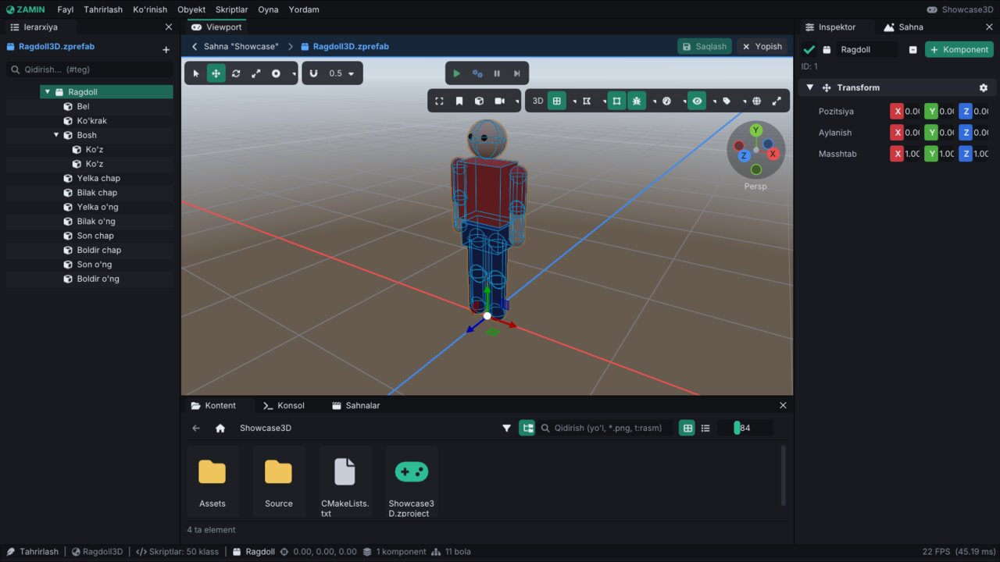

# Zamin Engine: prefabs

This document explains prefabs: the prefab file and its instances, how an instance is linked to its prefab, the changes in
an instance (overrides), Apply / Revert / unpacking, nested prefabs and variants, prefab mode,
references between entities, a prefab file changing outside the editor (hot reload), undo, the clipboard, the file
format and versions, recovering broken files, the check in the export, `Instantiate` from scripts, performance
and limits. The code examples use `#include <Zamin/Zamin.h>`, `using namespace Zamin;`.

Contents:

1. [Basic concepts](#1-basic-concepts)
2. [Creating a prefab and placing it in a scene](#2-creating-a-prefab-and-placing-it-in-a-scene)
3. [Changes in an instance (overrides)](#3-changes-in-an-instance-overrides)
4. [Apply, Revert, unpacking](#4-apply-revert-unpacking)
5. [Nested prefabs](#5-nested-prefabs)
6. [Variants](#6-variants)
7. [Prefab mode](#7-prefab-mode)
8. [References between entities (EntityRef)](#8-references-between-entities-entityref)
9. [When a prefab file changes (hot reload)](#9-when-a-prefab-file-changes-hot-reload)
10. [Undo and prefab files](#10-undo-and-prefab-files)
11. [The clipboard](#11-the-clipboard)
12. [The file format](#12-the-file-format)
13. [Version and migration](#13-version-and-migration)
14. [Recovering broken files](#14-recovering-broken-files)
15. [Checking prefabs in the export](#15-checking-prefabs-in-the-export)
16. [From scripts: Instantiate and the cache](#16-from-scripts-instantiate-and-the-cache)
17. [Performance](#17-performance)
18. [Tests](#18-tests)
19. [Limits](#19-limits)
20. [A short API reference](#20-a-short-api-reference)

---

## 1. Basic concepts

A **prefab** (`.zprefab`) is a file of an entity tree: one root entity and its children, with all their
components. It is written like a piece of a scene file (§12) and used in several places: in the editor it is dragged into
a scene, in the game a script creates it with `Instantiate("Prefabs/Enemy.zprefab")`.

An **instance** is the entities in a scene created from a prefab. In the editor an instance is **linked** to its prefab:

- the instance's **root** knows the prefab path (`EditorMetadataComponent::Prefab`, `Scene::GetPrefabSource`);
- every entity of the instance knows which entity of the prefab it is (`PrefabLinkComponent::PrefabEntity` — the
  `"Entity"` ID in the prefab file);
- every entity keeps what it differs from the prefab in (the override paths, §3).

The link belongs to the editor only: the game (`ZaminPlayer`) does not read it (`SceneSerializer::SetReadPrefabLinks(false)`),
and the export removes it from the instance files (§15). All of an instance's data is still written in full in the scene —
the game does not look for the prefab file.

When a prefab changes, its instances follow it: everything an instance did not change takes the new value, while the values
the instance changed stay. This **synchronization** (`PrefabUtility::SyncInstance`) runs when a scene opens,
after undo/redo, when prefab mode closes and when a prefab file changes outside the editor.

**Values that belong to the instance** are never overrides, do not come from the prefab, and Apply does not write them —
where the instance stands in the scene:

| Value | Why |
|---|---|
| the root's `Transform/Translation`, `Transform/Rotation` | every instance in its own place |
| the root's `UITransform/Position` | the place of a UI instance |
| the root's name (`Tag`) | names like "Enemy (2)" |
| the root's parent entity and its place in it | its place in the hierarchy |

The root's `Scale` and `Active` values, however, are ordinary overrides.

---

## 2. Creating a prefab and placing it in a scene

**Saving.** Right-click an entity in the hierarchy → *Save as prefab* (or the Object menu). The file is
written to `Assets/Prefabs/<Name>.zprefab` and gets a `.zmeta` right away. When another prefab with that name exists, you are asked:
*Replace* / *New name ("Enemy (1)")* / *Cancel*. The saved entity becomes **the first instance** of this prefab
(its own UUIDs become the prefab IDs, it has no overrides). When the entity being saved is already an instance of another prefab,
you are asked: *Variant* (§6) or *Original prefab* (an independent prefab). Saving an instance of the same prefab —
that is an Apply (§4).

**Placing.** Drag a prefab from the content browser onto the viewport or the hierarchy:

- 3D: onto the mesh / collider under the mouse or onto the y=0 plane (onto the grid when grid snapping is on);
  2D: z=0; a UI prefab: into the scene's first Canvas;
- several selected prefabs are placed in a row, evenly spaced along the camera's right side;
- dropping with **Ctrl** held — at the place saved in the prefab;
- **Shift** — *prefab placing mode*: one more instance on every click, leave it with Esc or the right button;
- the root names do not repeat ("Enemy (2)"), and every drop is one undo step.

An instance shows up in the hierarchy with a **blue** name and a box icon, the root of a prefab instance inside it with a small box
icon, a variant instance with a two-sheet icon. A changed entity has a dot at the end of its row, an entity added to the instance
a green "+" in front, and an instance whose prefab is missing / broken a red warning.

---

## 3. Changes in an instance (overrides)

How an instance entity differs from the prefab is kept as a list of **paths** (`PrefabLinkComponent::Overrides`):

| Path | Meaning |
|---|---|
| `Tag`, `Active` | the entity's name / activity (on an entity other than the root) |
| `Parent` | moved to another parent inside the instance |
| `ChildOrder` | the prefab's children are in another order |
| `Rigidbody2D` | the whole component was added to the instance |
| `SpriteRenderer/Color` | one value (objects are entered; arrays and numbers are one value) |
| `NativeScript/Fields/Speed` | one field of the script |

`/` and `~` in a name are written as in a JSON Pointer (`~1`, `~0`). The removed prefab components are in a separate
list (`RemovedComponents`), the prefab entities deleted in the instance are on the root (`RemovedEntities`, only the topmost
one). A value brought back to the prefab value leaves the list.

The lists are updated only when an undo step is written (when an edit ends, `CommitUndo`): the instances that step touched
are compared with the prefab. The saved list is needed because a value that is **equal** to the prefab value but that the
instance changed on purpose must stay in the instance when the prefab changes.

**In the inspector:**

- the prefab panel under the name: *Prefab: Enemy.zprefab* (its base too for a variant), [Open], [Select root],
  the *Overrides (N)* list (by entity and component, with Apply / Revert on every row), [Apply],
  [Revert];
- a changed component has a line on the left of its header (hovering shows the paths), an added component a "+",
  a removed component a dimmed header with: *Revert* / *Apply the removal*;
- the component's ⚙ menu has *Apply the component to the prefab* and *Revert the component*;
- a changed value has a marker on its row; right-click: *Apply to the prefab*, *Revert*, and for a value of a nested prefab
  *Apply: Weapon.zprefab*. Script fields are marked too.

---

## 4. Apply, Revert, unpacking

**Apply** writes the instance's change to the prefab file, then the other prefabs made from the prefab and the
other instances in the scene follow it. Its levels (`PrefabScope`):

| Level | What is written |
|---|---|
| `Field` | one value (`SpriteRenderer/Color`) |
| `Component` | one component (an added one too, and a removed one) |
| `Entity` | every change of the entity; an entity added to the instance — as a new entity in the prefab |
| `Instance` | the whole instance |

Only the values touched are written to the file (the rest of the text in the file does not change), and the prefab IDs are kept. A value
that refers to an entity outside the instance is not written — it stays a change of the instance (§8). An Apply that would
make a prefab cycle is rejected. A prefab file in a newer format, or one that gave an error when it was read, is not written.

**Revert** makes the values the same as in the prefab — at the same levels. *Revert all* deletes the entities added to the
instance (after asking first) and recreates the deleted prefab entities.
*Restore deleted entities* brings back only the deleted entities and touches nothing else.

**Unpacking** turns the instance into plain entities (they do not change when the prefab changes). *Unpack completely*
also unpacks the other prefab instances inside it.

```cpp
// Editor code or a test (not at game time):
PrefabDatabase db;                                       // the active project's Assets folder
Entity enemy = PrefabUtility::InstantiateLinked(*scene, db, "Prefabs/Enemy.zprefab");
enemy.GetComponent<SpriteRendererComponent>().Color = { 0, 1, 0, 1 };
PrefabUtility::RecordOverrides(enemy, db);               // the editor does this on every undo step
PrefabApplyResult r = PrefabUtility::Apply(enemy, PrefabScope::Field, "SpriteRenderer/Color", db);
// r.Written: the files written, r.Skipped: what was not written and why, r.Files: for undo
PrefabUtility::Revert(enemy, PrefabScope::Instance, {}, db);
```

---

## 5. Nested prefabs

A prefab can contain an instance of another prefab (a Weapon inside an Enemy). The rules:

- **One layer per file.** Every entity of an Enemy instance in a scene, the ones from the Weapon too, belongs to the Enemy
  instance and gets Enemy IDs. The Weapon layer is kept in the Enemy file itself.
- **The files are flat.** The Enemy file keeps the Weapon entities in full inside itself — the game and `Instantiate` do not
  resolve any chain.
- **Updated in memory.** Even when the Weapon changed and the Enemy file on disk is out of date, the editor updates the Weapon
  inside it while reading the Enemy (the `PrefabDatabase` templates). The Enemy file on disk is updated by the changes the editor makes
  (Apply, saving in prefab mode, hot reload) and in the export copy.
- **Which prefab to apply to.** A value that came from the Weapon, via right-click *Apply: Weapon.zprefab* — the value is
  written to the Weapon file, the change of that value in the Enemy file is removed (the Enemy inherits it) and the Enemy
  is written again.
- **Cycles and depth.** A prefab does not contain itself (or a prefab that uses it) — such an Apply is rejected,
  and a message is given when it is in a file. The depth limit is 16 levels (`PrefabDatabase::MaxDepth`).

---

## 6. Variants

A **variant** is a prefab that inherits from another prefab (its base). Its root is an instance of the base (the root link
is written in its own file), so when the base changes, the variant changes too — everything the variant did not change.
A variant of a variant works too (a chain, up to 16 levels). A variant file is flat too: the game reads it like a plain
prefab.

- *Create variant* (the content browser, the asset inspector, the hierarchy's Prefab menu): `Enemy Variant.zprefab`
  is created and opened in prefab mode.
- *Save as variant* (on an instance): the instance's changes are written to a new variant, and the instance becomes the variant's
  first instance (it has no overrides left).
- In the content browser a variant has a two-sheet icon, and the inspector shows the *Variant chain*.

```cpp
std::string variant = PrefabUtility::CreateVariant(db, "Prefabs/Enemy.zprefab");      // "Prefabs/Enemy Variant.zprefab"
std::vector<std::string> chain = PrefabUtility::GetVariantChain(db, variant);         // { variant, "Prefabs/Enemy.zprefab" }
```

---

## 7. Prefab mode

Editing a prefab on its own, like its own scene: a double click in the content browser, *Open in prefab mode* in the
hierarchy / inspector, the asset inspector. The open scene (its history, selection, camera, unsaved state) waits.



*Showcase3D `Prefabs/Ragdoll3D.zprefab` in prefab mode: the path above the viewport (`Scene "Showcase"` → the prefab), **Save** and
**Close**; only the prefab's entities in the hierarchy.*

- A path above the viewport: `◀ Scene "Level1" › Enemy.zprefab › Weapon.zprefab` — [Save] (Ctrl+S) and [Close].
  A double click on the root of a prefab instance inside it opens one level deeper.
- The entities get the IDs in the file as their UUIDs — saving without changes writes exactly the same bytes.
- Saving requires one root (with several, *Wrap in a new root* is offered); cycles and a newer format
  are rejected. After saving, the prefabs made from this prefab are updated too.
- When it closes, the instances in the scene below are updated — one undo step ("Prefab edited: Enemy"), which also carries the
  file writes.
- Leaving with an unsaved edit asks: *Save* / *Don't save* / *Cancel*.
- When the file changes outside: without edits it is read again, with edits a banner appears.
- The game does not start in prefab mode, and autosave is off.

---

## 8. References between entities (EntityRef)

The `EntityRef` fields in components (the Camera2DFollow target, NavAgent, the joints' `ConnectedBody`, UI
navigation, a script's Entity fields ...) find an entity by its UUID. One place knows all of them:
`Scene::ForEachEntityRef(entity, visit)` (the list: `Scene::GetEntityRefSites()`; a test checks that every
`EntityRef` member in the components file is in this list).

| Operation | A reference inside the set | A reference outside |
|---|---|---|
| Placing, pasting, a script's `Instantiate` | moves to the new UUID | stays as written |
| Sync, Revert | prefab ID → instance UUID | a value the instance changed keeps the scene UUID |
| Apply | instance UUID → prefab ID (in nested parts too) | not written, a message is given, it stays a change of the instance |
| Prefab mode | the IDs are already the prefab's | a broken chain icon in the inspector: "Not written by Apply (outside the prefab)" |
| Duplicate (Ctrl+D) | remapped inside the copy (in a single instance too) | stays |

`Scene::SavePrefab` warns in the console about every reference that points outside the prefab.

---

## 9. When a prefab file changes (hot reload)

When a prefab file changes outside the editor (a text editor, git), the editor sees it through the file watcher:

1. The text of every changed `.zprefab` is read and hashed (`PrefabDatabase::CheckFile`): a change that kept the same time and
   size is found too; a "touch" that did not change the text and the editor's own writes are not changes.
2. The prefab files that use this prefab inside them (or are its variants) are updated on disk in order — each one
   after the prefabs it is built from (only when their text changes; the list goes to the console).
3. The instances of these prefabs in the open scene are updated (their changes are kept). This is not a separate undo step:
   the current state gets the new text, the scene is marked unsaved and a message appears
   ("Prefab updated: Enemy (3 instance)").
4. Nothing changes during play (Play / Simulate) — the instances are updated after the game stops. The running
   game's scripts, however, create from the new file (`PrefabCache` checks the file time).
5. A prefab open in prefab mode: without edits it is read again, with edits a banner.
6. A deleted prefab: the instances keep their data and show as "not found". A half-written file is not read
   — the instances are not touched, and it tries again on the next change.
7. A prefab moved outside the editor: the references are updated through the `.zmeta` UUID.

```cpp
// The prefabs the file watcher reported (the editor does this by itself):
PrefabUtility::ReloadResult r = PrefabUtility::ReloadFiles(db, { "Prefabs/Weapon.zprefab" });
// r.Changed, r.Removed, r.Ignored (its own writes), r.Rewritten (Enemy, Squad ...), r.Affected
PrefabUtility::SyncScene(*scene, db, &r.Affected);
```

---

## 10. Undo and prefab files

The operations in the scene (placing, Revert, unpacking) are ordinary undo steps. The operations that write files — Apply,
saving as a prefab, creating a variant, closing prefab mode — are **one step** that also carries the file writes
(`UndoHistory` `FileEdit`: the text before and after). Undo gives the files back their old text (and deletes a newly
created file), redo writes the new one. When a file changed outside in between, a warning appears in the console
and it is overwritten. After every undo/redo the instances are quietly compared with the prefabs
(fast, through the hash).

---

## 11. The clipboard

The clipboard text is **the same document** as a prefab file (one writer, one reader), with `"Kind": "Clipboard"`,
plus the things only the clipboard has:

- the hierarchy's hide / lock markers;
- the links of whole copied prefab instances — a pasted instance stays linked to its prefab (with new
  UUIDs); a part of an instance (for example one of its children) is pasted as plain entities;
- `"World"`: the world position of a copied root that has a parent — it stays in place even when pasted under another
  parent (when it goes back under the same parent, its values are exactly the same);
- `"Origin"`: when a prefab is copied in the content browser (*Copy (to paste into the scene)* or Ctrl+C) — pasting
  creates a linked instance of that prefab (when the file was moved it is found through the UUID; when it is not found the entities
  in the text are pasted).

Paste (Ctrl+V) puts the entities **next to the selected entity** (under its parent, after it);
without a selection — at the top level of the scene. An old (M20, versionless) clipboard text and the text of a prefab file
paste as before.

```cpp
std::string text = EntityClipboard::Copy(*scene, { enemy });
EntityClipboard::PasteResult pasted = EntityClipboard::Paste(*scene, &db, text, /*next to:*/ selected);
std::string asset = EntityClipboard::CopyPrefab(db, "Prefabs/Enemy.zprefab");   // with "Origin"
```

---

## 12. The file format

**A prefab file.** The entities in tree order (a parent before its children), the IDs are the prefab's:

```json
{ "ZaminEntities": 1, "Kind": "Prefab", "Version": 5, "Entities": [
  { "Entity": 1, "Tag": "Enemy", "Transform": { ... }, "Rigidbody2D": { ... } },
  { "Entity": 7, "Parent": 1, "Tag": "Weapon", "SpriteRenderer": { ... },
    "Editor": { "Prefab": "Prefabs/Weapon.zprefab", "PrefabUUID": "a41f...", "PrefabEntity": 1,
                "PrefabHash": "5f0c...", "Overrides": [ "SpriteRenderer/Color" ] } },
  { "Entity": 8, "Parent": 7, "Tag": "Muzzle", "Editor": { "PrefabEntity": 2 } } ] }
```

The nested instance (7, 8) is written in full and has its own link layer. In a variant the link is on the root.

**An instance in a scene.** The data is complete, the link is under the `"Editor"` key:

```json
{ "Entity": 7815000000000101, "Tag": "Main menu", "Transform": { ... },
  "Editor": { "Prefab": "Prefabs/GameMenu.zprefab", "PrefabUUID": "e23d68ebead3b2a7", "PrefabEntity": 1,
              "PrefabHash": "77b20c41aa03b7d4", "Overrides": [ "NativeScript/Fields/Speed" ], "RemovedEntities": [ 17 ] } },
{ "Entity": 7815000000000102, "Parent": 7815000000000101, "Tag": "Overlay",
  "Editor": { "PrefabEntity": 2, "Overrides": [ "UIImage/Color" ], "RemovedComponents": [ "UIAnimation" ] } },
{ "Entity": 991, "Parent": 7815000000000102, "Tag": "Added" }
```

| Key (inside `"Editor"`) | Where | Meaning |
|---|---|---|
| `Prefab`, `PrefabUUID` | the instance root | the prefab path and its `.zmeta` UUID (found when the file is moved) |
| `PrefabEntity` | every linked entity | the ID in the prefab; absent — an entity added to the instance |
| `PrefabHash` | the root | the prefab hash at the last sync (the prefab + the prefabs inside it); when equal, no sync is needed |
| `Overrides`, `RemovedComponents` | an entity | §3 |
| `RemovedEntities` | the root | the prefab entities deleted in the instance |

A root with only `Prefab` written is an old (pre-M21) instance: when the scene opens it is linked to the prefab (root to
root, children by name in order; the data does not change, the differences become overrides). For example Platformer2D
`Menu.zscene`: "Old prefab instance linked: Main menu (44/44, 0 overrides)", and the scene is not marked unsaved.

---

## 13. Version and migration

Scenes, prefabs and the clipboard share one version chain (`SceneMigration::CurrentVersion = 5`). **v4 → v5**:
`\` → `/` in the `Editor.Prefab` path (the instance links were added in this version). A prefab or clipboard without a version
counts as v0 and goes through the whole chain (in the sample files this changes nothing; a migration that changed
nothing is not logged). A file with a newer version is read as far as it is understood, but it is never
overwritten (not by Apply, prefab mode or hot reload either).

---

## 14. Recovering broken files

- When a prefab or the clipboard is read, every entity is read separately: a broken record is skipped, a component that could not
  be read is dropped, unknown keys and duplicate IDs are reported, and a parent outside the set or a parent
  loop turns the entity into a root.
- When a scene with broken JSON is opened, the editor asks: *Recover in part?* On yes, the file is copied to
  `<name>.zscene.corrupt-<time>.bak` and its readable part is loaded. The entities of instances that were left in the broken
  part are recreated from the prefab right away (the sync of every opened scene); the entities deliberately deleted in the instance
  (`RemovedEntities`) stay deleted — if needed, *Restore deleted entities* in the Prefab menu
  brings them back.
- A prefab file that gave an error when it was read (an unread component or entity, broken JSON) is not overwritten:
  Apply, the update when a prefab inside it changes, and rewriting the dependent prefabs are rejected (the unread
  parts would be lost). Saving in prefab mode asks: *Save with a backup* — the original file is first copied to a
  `.bak`. Undo/redo, however, give back exactly the text that was written (`PrefabDatabase::CountLoadErrors`,
  `Write(..., overwriteDamaged)`).
- In code: `SceneSerializer::RecoverFromString`, `EntitySetReadOptions::Recover`.

---

## 15. Checking prefabs in the export

The export (File → Build game) runs `PrefabExport::Prepare` on the main thread before the thread that writes the files
starts. The same check: **File → Check prefabs** (or the button in the build window) — the result is in a
window, and every row leads to its file.

| Rule | What | Level |
|---|---|---|
| R1 | a prefab the game names is missing (a scene / prefab script field, a C++ string: `Instantiate` returns empty) | error |
| R2 | a prefab cannot be read or has no entities (read in part — a warning) | error |
| R3 | a prefab in a newer format | error |
| R4 | a missing / duplicate ID, several roots, a parent loop / a parent outside | warning |
| R5 | unknown component keys | warning |
| R6 | references to entities outside the prefab (joints by name) | warning |
| R7 | an asset the prefab uses was not found | warning |
| R8 | a nested / variant / scene instance's prefab is missing (its baked data is exported anyway) | warning |
| R9 | a cycle of prefabs | error |
| R10 | a stale change of a part the prefab does not have; an old unlinked instance | warning |

When Project settings → Build scenes → Export → *Prefab warnings are errors* is on, the warnings make the export fail
too (`.zproject` → `"Export": { "PrefabWarningsAsErrors": true }`).

**The export copy.** The prefab links belong to the editor, so the exported `.zscene` / `.zprefab`
files do not have them: a cleaned text is written in place of every file that has links. Instances that are out of date with their
prefab (`PrefabHash` differs) are brought to the prefab's current state in this copy (with their changes);
a prefab with nested prefabs is written flat. The original files in the project do not change. The binary cache (`.zsceneb`)
is written from the cleaned text. The sample projects give 0 errors and 0 warnings; Platformer2D's exported
`Menu.zscene` has no link keys.

```cpp
AssetReferenceIndex index;
ExportAssetPlan plan = ExportAssets::PlanForActiveProject(nullptr, nullptr, &index);
PrefabExportResult check = PrefabExport::Prepare(plan, db, &index);
// check.Issues (Rule, File, Message, Level), check.Baked (file -> export text), check.Summary()
```

---

## 16. From scripts: Instantiate and the cache

In the game a prefab is created from a script:

```cpp
class Spawner : public ScriptableEntity
{
public:
    std::string Prefab = "Prefabs/Ball.zprefab";
    void OnUpdate(Timestep) override
    {
        if (Input::IsKeyPressed(Key::Space))
            if (Entity ball = Instantiate(Prefab, GetWorldPosition() + glm::vec3(0, 2, 0)))
                ball.GetComponent<TransformComponent>().Scale = glm::vec3(0.5f);
    }
};
ZM_REGISTER_SCRIPT(Spawner, ZM_FIELD(Spawner, Prefab))
```

`Instantiate(path)` and `Scene::InstantiatePrefab` create a plain instance (without a link), and the references inside it move to the new
entities. The file is read and parsed once (`PrefabCache`): every later call creates from the ready
JSON. In the editor the cache checks the file time and size (a changed file is read again), while the player checks the file
only the first time. An error for a file that could not be read is reported once and does not go into the cache.

---

## 17. Performance

`ZaminBench --serialize --prefabs [--instances N] [--json file]` (Release, the median; more:
[Scenes.md](Scenes.md#18-tests-and-benchmarks)):

| Measurement | Result | Budget |
|---|---|---|
| Checking 1000 instances are up to date (the hash fast path) | 4.8 ms | ≤ 5 ms |
| Recording the changes of one entity | 0.014 ms | ≤ 0.2 ms |
| The link bytes (their share of the file) | 8.7 % | ≤ 10 % |
| A forced resync, 20 000 entities | 397 ms | ≤ 300 ms (over) |
| The extra cost of loading (JSON) | 10.8 % / 7.3 % (GameMenu) | ≤ 5 % (over) |
| `Instantiate(path)` ×1000: without a cache / `PrefabCache` | 283 / 111 ms | — |
| `PrefabExport::Prepare` (the export check + the copy without links), a 20 000-entity scene | 676 ms | — |

The forced sync and the extra loading cost only apply when a prefab changes / a scene opens; the game
(the player) does not read the links and the export removes them, so they do not affect the game.

---

## 18. Tests

`./build/bin/ZaminTests` (filter: `ZAMIN_TESTS=Prefab`):

| Test | What it checks |
|---|---|
| `PrefabLinkSerialization` | the link keys in the scene and the clipboard; an old file is read; the player does not read the link |
| `PrefabInstantiateLinked` | a linked instance, the IDs, the hash; a prefab that cannot be linked |
| `PrefabLegacyLinkMenuScene` | Platformer2D `Menu.zscene`: 44/44, 0 overrides, the files do not change byte for byte |
| `PrefabOverrideDetection`, `PrefabApplyPropagate`, `PrefabRevertLevels`, `PrefabSyncStructural` | overrides, Apply, Revert (a prefab entity moved under an added entity keeps its UUID), the structural sync |
| `PrefabNested`, `PrefabVariants` | nested prefabs, cycles, the variant chain |
| `PrefabUndoFileEdits` | Apply undo / redo with the files; the paths of the step's files when an asset is moved too |
| `PrefabDamagedFileNotWritten` | a prefab file that gave an error when read is not overwritten by Apply / sync / prefab mode (with consent — it is written) |
| `PrefabEntityRefRemap`, `EntityRefVisitorCoverage` | the references table (§8) |
| `EntitySetVersionMigration`, `EntitySetPartialLoad`, `SceneSalvage`, `SerializationFuzz` | the version, partial reading, recovery, fuzz |
| `PrefabStageRoundTrip` | prefab mode: saving without changes is the same byte for byte |
| `PrefabCacheReads`, `LargeSceneLinkedInstances`, `PrefabPlacementAndThumbs` | the cache, a large scene, placing |
| `PrefabHotReloadSync` | hot reload: a time/size/hash change, the order, its own writes, repeating it is safe, a deleted file |
| `ClipboardPrefabFormat` | the clipboard: Kind/Version, a linked paste, a part, World, Origin, the old text |
| `PrefabExportValidation` | a fixture for each of R1-R10, the export copy = the original scene minus the links, the sample projects 0 errors |
| `PrefabFieldLabelsExist` | every path in the table of the inspector's row markers is in the component's JSON |

Export: `Tests/export_test.sh` (Platformer2D is exported and run).

---

## 19. Limits

- Arrays are one value: when an instance changes one element of an array, the whole array becomes an override.
- Scenes that are not open are not rewritten automatically: they are updated when they are opened (or in the export copy).
- A prefab must have one root (an instance of an old multi-root prefab is placed unlinked).
- A *whole instance* or a *whole entity* cannot be applied to a nested prefab or a base (only one value or a
  component); apply a whole instance in the variant's / inner prefab's own prefab mode.
- When a prefab file changed outside between undo/redo, a warning is given and the file is overwritten.
- A UI prefab without its own Canvas goes into the scene's first Canvas (not the one under the mouse).
- One prefab at a time is copied to the clipboard from the content browser (`Origin` is one path).

---

## 20. A short API reference

| API | Purpose |
|---|---|
| `Scene::InstantiatePrefab(path)`, `ScriptableEntity::Instantiate(path[, pos])` | a plain instance in the game (`PrefabCache`) |
| `Scene::SavePrefab(root, path)` | a tree to a prefab file (atomic), external references are warned about |
| `PrefabDatabase` | the editor templates: `Get`, `ResolvedHash`, `GetDependents`, `DependsOn`, `Write`, `CheckFile`, `Invalidate` |
| `PrefabUtility::InstantiateLinked / LinkSource / LinkLegacyInstances / NormalizeLinks` | links |
| `PrefabUtility::RecordOverrides / GetOverrides / FindOrphanOverrides` | overrides |
| `PrefabUtility::SyncInstance / SyncScene / SyncPrefabFile / ReloadFiles` | following the prefab, hot reload |
| `PrefabUtility::Apply / Revert / RestoreRemoved / Unpack / GetApplyTargets` | §4 |
| `PrefabUtility::CreateVariant / SaveAsVariant / GetVariantBase / GetVariantChain` | §6 |
| `PrefabUtility::LoadStage / SerializeStage / SaveStage` | §7 |
| `EntityClipboard::Copy / CopyPrefab / Paste / GetOrigin` | §11 |
| `SceneSerializer::SerializeEntities / DeserializeEntities` (`EntitySetWriteOptions` / `EntitySetReadOptions`) | the prefab / clipboard document |
| `PrefabExport::Prepare / StripLinks`, `ExportSettings::PrefabWarningsAsErrors` | §15 |
| `PrefabCache::Instantiate / Invalidate / SetCheckForChanges` | §16 |
