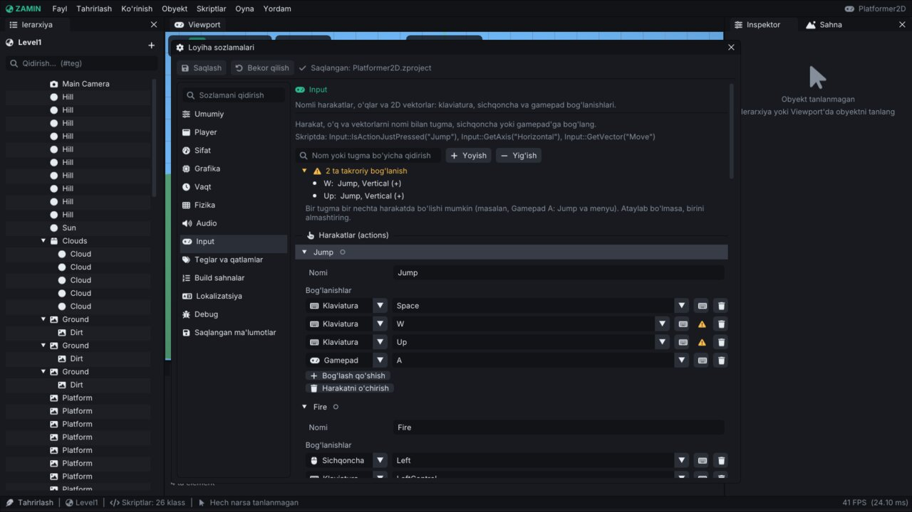

# Zamin Engine: project settings

This document explains the settings of a game project: the `.zproject` file and the editor's **Project settings**
window, the player window and icon, the company / product name and version, quality levels, the graphics context,
time (the fixed step, the time scale and the `Time::` script API), default gravity, audio defaults, input, tags and
layers, build scenes, localization (language files and `Localize("key")`), debug drawing and saved data. At the end
come the editor's own language (Uzbek / English), the file format and the player command line. The script examples
are C++ (`#include <Zamin/Zamin.h>`, `using namespace Zamin;`).

Contents:

1. [Core concepts](#1-core-concepts)
2. [The Project settings window](#2-the-project-settings-window)
3. [General](#3-general)
4. [Player: window, name, version, icon](#4-player-window-name-version-icon)
5. [Quality levels](#5-quality-levels)
6. [Graphics: the OpenGL context](#6-graphics-the-opengl-context)
7. [Time and the Time API](#7-time-and-the-time-api)
8. [Physics: gravity and collision layers](#8-physics-gravity-and-collision-layers)
9. [Audio defaults](#9-audio-defaults)
10. [Input](#10-input)
11. [Tags and layers](#11-tags-and-layers)
12. [Build scenes](#12-build-scenes)
13. [Localization](#13-localization)
14. [Debug drawing](#14-debug-drawing)
15. [Saved data (SaveData)](#15-saved-data-savedata)
16. [Editor language (Uzbek / English)](#16-editor-language-uzbek--english)
17. [The .zproject file: format, version, migration](#17-the-zproject-file-format-version-migration)
18. [The player command line](#18-the-player-command-line)
19. [Tests](#19-tests)
20. [Short API reference](#20-short-api-reference)

---

## 1. Core concepts

Every game is a **project**: a `<Name>.zproject` file, `Assets/` (scenes, textures, sounds, language files),
`Source/` (C++ scripts) and a script module (`Binaries/lib<Name>.so`). The project settings are stored in the
`.zproject` file and are **shared by all scenes**: the window, quality, time, gravity, sound, languages ...

| Level | Where | Example |
|---|---|---|
| **Project** | `.zproject`, *Window > Project settings* | A 1280x720 game window, 60 Hz physics, default language `uz` |
| **Scene** | `.zscene`, *Scene settings* | This scene's sky, shadows, its own gravity |
| **Player's choice** | `SaveData` (kept between games) | The quality, language, fullscreen the player chose in the menu |
| **Command line** | `ZaminPlayer --...` | `--quality Low`, `--lang ru`, `--windowed` |

Order of precedence (the lower one wins): the project setting -> the player's saved choice -> the command line. Where
a scene gives no value of its own (gravity or the physics step set to "From the project", for example) the project's
is used.

When a project is opened (`Project::Load`) the settings are applied at once: the audio mixer
(`AudioEngine::SetMixerSettings`), the quality levels (`Quality::SetSettings`), the language files
(`Project::ApplyLocalization`). The player window and the graphics context are applied when `ZaminPlayer` creates
the window. (Old) projects without a setting get the engine's default values - they behave as before.

---

## 2. The Project settings window

*Window > Project settings* (or *File > Project settings...*). The window is divided into sections:



*The Platformer2D project settings, the **Input** section: the list of sections on the left, the actions on the right
(`Jump` — Space, W, Up, Gamepad A ...) and a warning about duplicate bindings.*

| Section | What it holds |
|---|---|
| **General** | The project name, folders, script module, start scene |
| **Player** | Company, product name, version, window, FPS limit, icon |
| **Quality** | The quality levels (Low ... Ultra) and the default level |
| **Graphics** | OpenGL version, debug context, MSAA, sRGB; information about the running context |
| **Time** | Fixed step, steps per frame, starting time scale, longest frame |
| **Physics** | Default gravity (2D / 3D), collision layers and matrix, presets |
| **Audio** | Master volume, mixer groups, the sound engine, 3D sound defaults |
| **Input** | Actions, axes, 2D vectors |
| **Tags and layers** | Gameplay tags, 2D sorting layers |
| **Build scenes** | The list of scenes the game is built from and their build indices |
| **Localization** | Default language, offered languages, the language files folder, the system language |
| **Debug** | Debug drawing in the game |
| **Saved data** | Viewing and editing `SaveData` values (not in the project file) |

- **Search** (top left): "shadow", "VSync", "gravity" ... - the matching sections remain and the labels found are
  highlighted.
- A changed section has a `*` next to its name. **Save** writes the `.zproject`, **Cancel** reverts every unsaved
  change; a single section can also be reset to its defaults.
- Many changes show at once (quality level, audio, language); the window and the graphics context are applied the
  next time the player starts.

---

## 3. General

| Field | `.zproject` key | Meaning |
|---|---|---|
| Name | `Project.Name` | The project name (also the game's name when the product name is empty) |
| Description | `Project.Description` | A sentence or two about the game - on the project card in the editor launcher |
| Picture (launcher) | `Project.Thumbnail` | The picture on the card: a path relative to the project folder (PNG / JPG, ~16:9); not exported |
| Assets folder | `Project.AssetDirectory` | The assets folder (`Assets` by default) |
| Scripts folder | `Project.SourceDirectory` | The C++ scripts (`Source` by default) |
| Script module | `Project.ScriptModulePath` | The compiled module (`Binaries/lib<Name>.so`) |
| Start scene | `Project.StartScene`, `StartSceneUUID` | The game starts from this scene |

The start scene is stored with its UUID too: it is found even when the file was moved or renamed while the editor was
closed. When there is no such scene the game starts from the first enabled build scene (section 12).

---

## 4. Player: window, name, version, icon

The `"Player"` section of the `.zproject`. `ZaminPlayer` and the exported game create their window with these
settings.

### Name and version

| Field | Key | Meaning |
|---|---|---|
| Company | `Company` | The studio / author. The SaveData folder: `~/.local/share/<company>/<product>` |
| Product name | `Product` | The name players see (window title, SaveData folder). Empty: the project name |
| Version | `Version` | A semantic version: `1.4.2`, `2.0.0-beta.1` (`1.0.0` by default) |

Without a company, SaveData lives in `~/.local/share/zamin/<product>`. From scripts:

```cpp
ZM_INFO("{} {} ({})", Application::GetProductName(), Application::GetVersion(), Application::GetCompanyName());
```

### Window

| Field | Key | Meaning |
|---|---|---|
| Window size | `Width`, `Height` | The size in windowed mode (160 ... 7680). Fullscreen takes the monitor's |
| Window mode | `WindowMode` | `Windowed`, `Fullscreen`, `Borderless` (no border, the size of the screen) |
| Resizable | `Resizable` | Whether the player can resize the window |
| VSync | `VSync` | Frames are synced to the monitor's refresh rate |
| Window title | `Title` | Empty: the product name |
| Version in title | `VersionInTitle` | `"My game 1.4.2"` |
| FPS limit | `TargetFrameRate` | The most frames per second (10 ... 1000); `0` - no limit (VSync decides) |
| Run in background | `RunInBackground` | `false`: the game pauses when the window loses focus (below) |
| F11 / Alt+Enter | `FullscreenToggle` | Fullscreen <-> window inside the game (default: on) |

Default: 1280x720, windowed, resizable, VSync on, no limit, runs in the background - the player behaved like this
before too.

An in-game settings menu can change these and save the choice (on the next start it wins over the project setting):

```cpp
Display::SetFullscreen(!Display::IsFullscreen());
Display::SetVSync(false);
Display::SetResolution(1920, 1080);   // Display::GetResolutions(): the monitor's modes
Display::SaveSettings();     // SaveData: "Zamin.Display.*"
```

**Order of precedence** (each value separately, `PlayerLaunchSettings::Resolve`):

1. the command line (`--fullscreen`, `--borderless`, `--windowed`, `--resolution`, `--monitor`, `--vsync` /
   `--no-vsync`, `--fps`, `--no-splash` - section 18);
2. the player's saved choice (`Display::SaveSettings`: screen size, fullscreen, VSync; quality and language save their
   own as well);
3. the project settings (this section).

The player reads the saved choice **before** the window is created: when the game was closed in fullscreen, it opens
in fullscreen right away the next time (no windowed -> fullscreen jump). `--no-vsync`, for example, only changes VSync:
the saved fullscreen choice stays in force. The log records where every value came from:

```
Window settings: 1600x900 (command line), fullscreen (saved), VSync: yes (project), FPS: 60 (project), monitor: primary (project), splash: yes (project)
```

**F11 / Alt+Enter**: switches between fullscreen (the project's kind: exclusive or borderless) and a window inside the
game. The window returns to its previous size and position; fullscreen opens on the monitor the window is on (a window
moved to the second monitor becomes fullscreen there). The choice is saved like `Display::SaveSettings`. When the input
map has an action named `ToggleFullscreen`, it switches too (a gamepad button, for example). To turn it off:
`FullscreenToggle: false`.

**FPS limit and VSync**: the limit (`TargetFrameRate` or `--fps N`) works together with VSync like this
(`FramePacingPlan`):

| Situation | What holds the rate |
|---|---|
| No limit | VSync (when on) or nothing |
| VSync + a limit that divides the refresh rate (30 / 20 / 15 at 60 Hz, 72 at 144 Hz) | VSync waits 2 / 3 / 4 refreshes per frame - perfectly even frames |
| VSync + a limit at or above the refresh rate | VSync itself |
| VSync + another limit (50 at 60 Hz), VSync off, unknown refresh rate | Waiting (sleep + a short spin) |

The waiting follows a schedule: frame starts are exactly one period apart (`FramePacer`), so even when one sleep wakes
a little late the average rate is exact; a stop longer than a period (loading) restarts the schedule.
`ZAMIN_PLAYER_STATS=1` writes the real frame times on exit (average, min, max, the slowest 1%).

**Pausing in the background** (`RunInBackground: false`): when the window loses focus (another window came to the
front, Alt+Tab) the game stops completely - scripts, physics, animations and the game time (`Time`) are not updated,
the audio output is paused (every sound and the music stand still, nothing is heard). The screen shows the game's last
frame dimmed with "Paused" in the middle (below it "The game window is not focused - select the window to continue");
when the game's language files have `player.paused` / `player.paused_hint` keys, those are used (Platformer2D: uz, ru,
en). While paused the CPU is idle: the player waits for events and redraws the picture at the start, when the window
size changes and every 0.5 s. When the window gets focus again the game continues from where it stopped (with no long
frame jump). The log:
`Game paused: the window is not focused (running in the background is off)` / `Game resumed: the window is focused again`. For automation (screenshots, CI) `ZAMIN_FOCUS_LOSS_TEST=<frame>[:<frame count>]`
simulates losing the focus from that frame.

**Gamma and brightness** (a player setting): the player outputs the finished frame (scene, UI, transitions) to the
screen in the last pass (`DisplayPass`) with gamma and brightness: `screen = (colour x Brightness) ^ (1 / Gamma)`.
Gamma 0.5 ... 2.0 (1 - unchanged, larger - brighter midtones, black and white unchanged), brightness 0.5 ... 1.5 (the
whole picture is multiplied). The game menu changes and saves it:

```cpp
Display::SetGamma(1.2f);        // from the next frame
Display::SetBrightness(0.9f);
Display::SaveSettings();        // SaveData: "Zamin.Display.Gamma", "Zamin.Display.Brightness"
```

The player takes the saved values at the start; `--gamma G` / `--brightness B` win over them. When both are 1 (and
the game runs in the background) the frame is drawn straight to the screen - as before, with no extra pass. The
editor's Play mode also shows the game picture with this setting (the editor gizmos do not change); the saved values
are taken when Play starts and restored on Stop. The Platformer2D pause menu has "Gamma" and "Brightness" sliders in
its Settings > Display section.

### Splash screen

Before the first scene the player shows the Zamin logo (the logo is drawn by the engine itself, no file needed) or the
game's own image: it fades in (0.5 s), stays and fades out (0.5 s). Meanwhile the first scene **loads in the
background** (`SceneManager::LoadSceneAsync`, then `SceneManager::Start(op)`); when loading takes longer than the
splash, the logo waits with a progress bar. After the splash, the game's first frame fades in from the background
colour.

| Field | Key (`"Splash": { ... }`) | Meaning |
|---|---|---|
| Show splash | `Enabled` | Default: on. Command line: `--no-splash` |
| Duration | `Duration` | Seconds (0.5 ... 10), with the fade in and out; 2 by default |
| Skip with any key | `Skippable` | Any key / mouse / gamepad button ends it (once the scene has loaded) |
| Own image | `Image` | PNG / JPG (relative to the assets); empty: the Zamin logo |
| Background color | `Background` | `[r, g, b]` (0 ... 1) |

In automated runs (`ZAMIN_MAX_FRAMES`: screenshots, CI) the splash is not shown; `ZAMIN_PLAYER_SPLASH=1` forces it.

### Aspect ratio (letterbox)

A game made for one screen shape (`"Aspect": { ... }`). When on, the game picture keeps the `Width : Height` ratio:
when the window is wider there are bars of the `BarColor` colour at the sides, when it is taller at the top and
bottom. The scene cameras, the UI (canvas scale), the mouse (`GetMousePosition`, UI clicks) and the render targets
work at the picture's size; when the window size changes (dragging, F11) everything adapts every frame and the new
size is logged once. Off (the default): the picture fills the whole window. In the editor Play is shown at this ratio
too (when the game view is "Free"). The settings window draws how it looks in various windows (the game window,
2560x1080, 1024x768).

| Field | Key | Meaning |
|---|---|---|
| Fixed aspect ratio | `Fixed` | Default: off |
| Ratio | `Width`, `Height` | Sides 1 ... 64 (16:9, 4:3, 21:9 ...) |
| Bar color | `BarColor` | `[r, g, b]` (0 ... 1), black by default |

When the window is minimized the player and the editor stop updating and drawing: the loop only waits for events (the
CPU is not busy) and game time does not pass; it continues when the window comes back.

### Log

The player log (`"Log": { ... }`, not written to the file unless changed). Messages below the level are not written;
`ZAMIN_LOG_LEVEL` and `--log-level` win over these ([Runtime.md, section 6](Runtime.md#6-log-files)).

| Field | Key | Meaning |
|---|---|---|
| Engine | `Engine` | Engine messages (`ZM_CORE_*`): `trace` ... `critical`, `off`; `trace` by default |
| Game scripts | `App` | Game messages (`ZM_*`); `trace` by default |
| Log file | `WriteFile` | Whether `player-<date>.log` and `latest.log` are written (default: yes; `--log-file` writes anyway) |
| Written to the file | `File` | Only from this level up goes to the file (everything in the terminal); `trace` by default |
| Files kept | `Keep` | How many old logs remain (1 ... 100, 5 by default) |

### Icon

`Icon` - a PNG inside the assets (for example `Textures/GameIcon.png`). The player gives the window the 16, 32, 48,
64, 128, 256 px sizes (those not larger than the image); a non-square image is centred in a transparent square. The
settings window shows the icon and warns (not square, smaller than 64 px ...). In an export the icon is written in
three ways:

- `<game>.png` - the original image, next to the launcher;
- `icons/hicolor/<size>x<size>/apps/zamin-<game>.png` - 16, 32, 48, 64, 128, 256 px in the icon theme layout (those
  not larger than the image, `ExportFiles::WriteIconSet`);
- `<game>.desktop` - a desktop file that works wherever the folder is moved: its `Exec` starts the launcher in the
  folder it is in (`sh -c "..." sh %k`, `%k` - the desktop file's own path), there is no `Path`. Only `Icon` has to be
  a full path (desktop files do not take a relative icon path) - it points to where the game was exported.

Adding it to the applications menu: run `install-desktop-entry.sh` in the folder (in a moved folder, one unpacked
from an archive or one on another computer too). The script:

- writes `~/.local/share/applications/zamin-<game>.desktop` (`$XDG_DATA_HOME/applications`) with the folder's current
  full paths;
- installs the icons in every size to `~/.local/share/icons/hicolor/<size>/apps/` and the menu entry takes the icon by
  name (`Icon=zamin-<game>`: the menu, the panel and Alt+Tab find the size they need); without an icon set - the PNG
  next to the launcher;
- rewrites the `<game>.desktop` next to the launcher for the new location (the icon path is updated).

`install-desktop-entry.sh --uninstall` removes the menu entry and the installed icons.

---

## 5. Quality levels

A quality level limits what a scene **asks for**: every scene keeps its own shadows, effects and render scale, and the
active level says how much of them is used "at most". A level that allows everything (the default "Ultra") does not
change the scene.

| Field | JSON key | Meaning |
|---|---|---|
| Shadows | `Shadows` | Off: the sun casts no shadows at all |
| Shadow atlas (largest) | `ShadowAtlas` | 1024 / 2048 / 4096 |
| Shadow filter (most costly) | `ShadowFilter` | `Hard` < `PCF3x3` < `Poisson` < `PCF5x5` |
| Cascades (at most) | `ShadowCascades` | 1 ... 4 |
| Shadow distance | `ShadowDistance` | Multiplied by the scene's shadow distance |
| SSAO, Bloom, FXAA, Auto exposure | `SSAO`, `Bloom`, `FXAA`, `AutoExposure` | Off: they do not run even when the scene turned them on |
| Render scale | `RenderScale` | Multiplied by the scene's render scale (0.25 ... 2) |
| Anisotropic filter | `Anisotropy` | 1 (off), 2, 4, 8, 16 - the level's own |
| Texture quality | `TextureQuality` | 0 full, 1 half, 2 quarter, 3 one-eighth size |

The default levels:

| Level | Shadow atlas | Filter | Cascades | Shadow distance | SSAO | Bloom / FXAA / Auto exp. | Render scale | Textures |
|---|---|---|---|---|---|---|---|---|
| Low | 1024 | Hard | 1 | x0.5 | no | no | x0.75 | half |
| Medium | 2048 | PCF3x3 | 2 | x0.75 | no | yes | x1 | full |
| High | 4096 | PCF3x3 | 3 | x1 | yes | yes | x1 | full |
| Ultra | unlimited | unlimited | unlimited | x1 | yes | yes | x1 | full |

Levels can be added, duplicated, renamed and deleted (up to 16); the **Default level** is the level the game starts
with. A level can be chosen for the editor view too ("Preview in editor" in the *Quality* section), and *Scene
settings* spell out what the current level limits in the scene.

An in-game settings menu:

```cpp
// The "Graphics: Low / Medium / High / Ultra" button
int next = (Quality::GetLevel() + 1) % Quality::GetLevelCount();
Quality::SetLevel(next);
Quality::SaveSettings();          // SaveData: "Zamin.Quality.Level" = the level's name
ZM_INFO("Quality: {}", Quality::GetLevelName());
```

When the player starts the order is: `--quality <name | index>` -> the level the player saved -> the project's
default level.

---

## 6. Graphics: the OpenGL context

The `"Graphics"` section - the OpenGL context and window buffer of the player window:

| Field | Key | Meaning |
|---|---|---|
| OpenGL version | `OpenGL` | `4.1` (the default; the engine requires it, the highest on macOS), `4.3`, `4.5`, `4.6` core |
| Debug context | `DebugContext` | `Auto` (only in a Debug build), `On` (in Release too, slower), `Off` |
| MSAA (window) | `MSAA` | The window buffer's samples: 0, 2, 4, 8, 16 |
| sRGB framebuffer | `SRGBFramebuffer` | The final image with hardware sRGB encoding (instead of the shader's gamma 2.2) |

- A newer version only asks more of the driver; the engine's own drawing is the same.
- MSAA smooths what is drawn straight to the screen (UI over a pixel-perfect game, debug lines); the 3D picture is
  smoothed by FXAA (the quality level).
- When the driver cannot give the requested context the player falls back to the default (4.1 core) and logs it.
- The editor's own context is always 4.1 core; the *Graphics* section shows the running context: vendor, renderer,
  version, MSAA, sRGB, the largest texture and anisotropy.
- Command line: `--gl 4.6`, `--msaa 4`, `--gl-debug` / `--no-gl-debug`, `--srgb` / `--no-srgb`.

---

## 7. Time and the Time API

The `"Time"` section:

| Field | Key | Default | Meaning |
|---|---|---|---|
| Fixed step | `FixedStepRate` | 60 | How many physics (2D and 3D) steps per second (20 ... 240 Hz; presets 50, 60, 100, 120, 144, 240) |
| Steps per frame | `MaxStepsPerFrame` | 5 | The most steps one frame takes; on a slow frame the rest is dropped (the game does not fall behind, it slows down) |
| Starting time scale | `DefaultTimeScale` | 1 | The clock speed the game starts with (0 ... 10) |
| Longest frame | `MaxDeltaTime` | 0.1 s | A longer frame (a hitch, dragging the window) counts as this long - the game does not jump |

The fixed step and the steps per frame apply to scenes that give no values of their own ("From the project"); a scene
can set its own in *Scene settings > Physics*.

### The Time:: script API

One static API - the game clock wherever it is called from:

| Function | Meaning |
|---|---|
| `Time::GetDeltaTime()` | This frame's game time (scaled; 0 while paused) |
| `Time::GetUnscaledDeltaTime()` | This frame's real time (at most `MaxDeltaTime`) |
| `Time::GetFixedDeltaTime()` | The physics step (1 / the step rate) |
| `Time::GetTime()` / `GetUnscaledTime()` | Game / real time since the game started |
| `Time::GetTimeSinceStartup()` | Real seconds since the program started |
| `Time::GetFrameCount()` | Frames since the program started |
| `Time::SetTimeScale(s)` / `GetTimeScale()` | Clock speed: 1 normal, 0.5 half, 0 stopped |
| `Time::SetPaused(b)` / `IsPaused()` | Scale 0 and back to the previous one (a pause menu) |
| `Time::GetSettings()` | The project's time settings |

Every loaded scene follows the time scale: physics, animations, particles, timers and tweens. The UI runs in real time
(a pause menu stays alive while paused).

```cpp
// Slow motion (Adventure3D: the T key)
void OnUpdate(Timestep) override
{
    if (Input::IsKeyJustPressed(Key::T))
        Time::SetTimeScale(Time::GetTimeScale() < 1.0f ? 1.0f : 0.25f);
}
```

When a script's timers and tweens should run in real time (the slow-motion effect's own fade, a menu animation) -
`SetTimersUnscaled(true)`.

---

## 8. Physics: gravity and collision layers

### Default gravity

The `"Physics"` section: `Gravity2D` (`[0, -9.8]` by default) and `Gravity3D` (`[0, -9.81, 0]` by default). This value
is taken by every scene that gives no gravity of its own: new scenes and old scenes that kept the engine default (in
scene format v4 they were moved to "From the project"). A scene can set its own in *Scene settings > Physics*.
Presets: Earth (9.81), Moon (1.62), Mars (3.71), Jupiter (24.79), Platformer (20), Zero gravity (0).
Every component at most +-1000 m/s².

### Collision layers

16 named layers and a matrix of which pairs collide (the same for 2D and 3D, `"CollisionLayers2D"`). Ready-made
presets ("Platformer 2D", "3D action", for example) fill the matrix in one click; a row can be copied / pasted.
Collider components choose their layer by name, `Raycast` and queries take a `LayerMask`.

---

## 9. Audio defaults

The *Audio* section and the *Audio Mixer* window edit one setting (`"Audio"`).

| Field | Key | Meaning |
|---|---|---|
| Master volume | `Groups[Master].Volume` | The game's overall volume: every sound goes through Master |
| Mixer groups | `Groups` | Music, SFX, UI ... - each with its starting volume, parent group, filters |
| Streaming threshold (MB) | `StreamThresholdMB` | Larger files are not loaded fully into memory, they are streamed |
| Simultaneous voices | `MaxVoices` | The most voices that play at once (beyond that the least important one gives way) |
| Doppler | `DopplerFactor` | The Doppler effect of moving 3D sounds: 1 natural, 0 off |

### 3D sound defaults

`"Spatial"` inside `"Audio"` (written only when it differs from the default):

| Field | Key | Default | Meaning |
|---|---|---|---|
| Min distance | `MinDistance` | 1 m | Closer than this the sound is at full volume |
| Max distance | `MaxDistance` | 30 m | Farther than this the sound gets no quieter (in the linear model - silent) |
| Distance model | `Rolloff` | `Inverse` | How the sound falls off with distance (below) |
| Rolloff | `RolloffFactor` | 1 | How fast it falls off: 1 the model itself, 0 not at all (0 ... 10) |

The distance models (`d` - the distance, clamped to `min`/`max`, `k` - the rolloff factor):

| Model | Gain | When |
|---|---|---|
| `Inverse` | `min / (min + k (d - min))` | As in nature: fast when close, then slower |
| `Linear` | `1 - k (d - min) / (max - min)` | When it has to be silent at the max distance |
| `Exponential` | `(d / min) ^ -k` | Falls off faster than inverse |
| `None` (no distance) | `1` | The same everywhere (only left / right) |

The settings window draws the curve (hovering shows the percentage and dB at that distance). The distance model also
affects 3D sounds that are playing right now. New **Audio Source** and **Footsteps** components are created with the
project's min / max distance; the inspector shows the project values under them and resets to them with the "Default"
button. In scripts:

```cpp
// Without distances: the project default
PlaySoundAt("Audio/explosion.wav", GetWorldPosition());

// Reading it in code
const AudioSpatialSettings& spatial = Audio::GetSpatialDefaults();
float gain = spatial.ComputeGain(12.0f);   // the gain at 12 m (0..1)
```

The `MinDistance` / `MaxDistance` fields of `SoundParams` default to `-1`, meaning "the project's".

---

## 10. Input

`"InputActions"`: named **actions** (`Jump`: `Key:Space`, `Gamepad:A` ...), **axes** (`Horizontal`: positive /
negative keys, a gamepad axis, deadzone, invert) and **2D vectors** (`Move` = `Horizontal` + `Vertical`, `Clamp` or
`Normalize` mode, a radial deadzone). The editor has a "Press a key..." mode for adding a binding (keyboard, mouse or
gamepad), warns about duplicate bindings and can search with a filter.

```cpp
if (Input::IsActionJustPressed("Jump")) Jump();
glm::vec2 move = Input::GetVector("Move");
```

---

## 11. Tags and layers

- **Tags** (`"Tags"`): gameplay tags offered in the inspector. The section shows where each tag is used in the
  project; renaming changes it in every scene file. A rename that changed objects or files is also written to the
  `.zproject`'s tag list at once (other unsaved settings stay unsaved): "Cancel" does not bring the old name back,
  otherwise the tag in the scenes would no longer be in the list.
- **Sorting layers** (`"SortingLayers"`): the 2D drawing order (back to front), sorting by Y.

---

## 12. Build scenes

`"BuildScenes"`: the scenes the game is built from, in order. The enabled ones get a build index (0, 1, 2 ...;
`LoadScene(int)`), and the export takes only them (and the start scene). The window shows problems: no start scene /
not in the list / disabled, file not found, a duplicate scene. Details:
[docs/Scenes.md, section 7](Scenes.md#7-the-build-scene-list-and-indices).

### Export: unused assets

An export (`File > Build game`) takes only what the game uses from the Assets folder
(`ExportAssets::Plan`, `AssetReferenceIndex`):

- the build scenes (when the list is empty - all scenes), the start scene and their sub-scenes;
- what they need: prefabs, materials, models (and their `.bin` / image files), sprite and property animation clips
  (`.zsanim`, `.zanim`), particle presets, fonts, sounds ...;
- what the project file names (the icon, the splash image) and strings in the C++ scripts (`"Audio/jump.wav"`);
- always: the `Resources/` folder, the language files folder (`Localization/`) and the "Always include" list.

A scene not in the build list is always left out. Files that fit no kind and that nothing names (for example
`Data/levels.json`) are included - a script may read them itself. What is left out is written to the log and to
`excluded-assets.txt` in the export folder (path, size, reason); the export window and
Project settings > Build scenes > Export show what the next export will take (an asset in the list can be added to
"Always include" with a right click). Only the included files are written to the game's registry (`AssetRegistry.zreg`) too.

```json
"Export": {
    "ExcludeUnusedAssets": true,
    "AlwaysInclude": [ "Data", "Levels/*.zscene" ]
}
```

When a script builds an asset name itself (`"Levels/Level" + n + ".zscene"`), add it to "Always include" (`*` matches
any part). Neon Arena and Zamin Breakout, for example, call their sounds by a short name (`Sfx("hit")` → `"Audio/hit.wav"`
is built at runtime), so their projects have `"AlwaysInclude": [ "Audio/*.wav" ]` — without it the sounds are not found
in the exported game (`Tests/samples_export.py` found this, `Tests/samples_assets.py` now checks it).
`ExcludeUnusedAssets: false` - every file goes in (except scenes outside the build list). The section is written when
it differs from the default.

### Export: the Release script module and strip

An export recompiles the C++ scripts itself (`"ReleaseScriptModule": true`, the default): in Release mode, with
`-O2 -DNDEBUG`, in a separate build folder (`<project>/Build/ExportRelease`, `ExportModuleBuild`). The module is
written to that folder's `bin/` (`cmake/ZaminGame.cmake`: `ZAMIN_GAME_MODULE_OUTPUT_DIR`), so the editor's hot reload
module (`Binaries/lib<game>.so`) does not change. When the project has no `CMakeLists.txt`, one is written. When
compilation fails (no cmake / compiler, an error in the code) the editor's module is copied and the report shows a
warning.

Then the exported binaries - `ZaminPlayer`, `libZamin.so` and the script module - go through `strip --strip-unneeded`
(`"StripBinaries": true`, the default; `BinaryStrip`): debug information and local symbols are removed, the dynamic
symbols stay (the module loads, a crash report shows the names of exported functions). With an engine built in Debug
this makes the export several times smaller. When `strip` (binutils) is not found, the binaries stay unchanged and the
report shows a warning. Both options are in the export window too.

```json
"Export": {
    "ReleaseScriptModule": true,
    "StripBinaries": true
}
```

### The export report

When an export finishes the editor opens the "Export report" window (`File > Export report` - to open it again) and
writes the report to the game folder: `export-report.json` (for tools) and `export-report.txt` (for reading),
`ExportReport`:

- the game, version, folder, date, how long the export took, the result (successful / warnings / errors);
- the total size and number of files;
- size and share by kind: binaries, textures, models (`.gltf`, `.glb`, `.bin`), audio, scenes (`.zscene`, `.zsceneb`,
  prefabs), fonts, data (materials, clips, `.zmeta`, the project file, JSON), other (launcher, desktop file, icons);
- the 15 largest files;
- the excluded assets (path, size, reason);
- how the script module was obtained (the Release compilation with its time / the editor's module), how much strip
  saved;
- warnings and errors (build scene problems, an unreadable icon, copy errors ...).

The window has buttons to open the folder, open the `.txt` file and copy the report text. Automation:
`ZAMIN_EDITOR_EXPORT=<folder>` waits for the export to finish (the report window opens),
`ZAMIN_EDITOR_EXPORT_REPORT=<folder>` opens the report of an earlier export.

---

## 13. Localization

### Language files

Every language is an `Assets/Localization/<code>.json` file (the folder can be changed in the settings). Nested
objects become dotted keys, `"$name"` - the language's own name, an object made only of plural forms - one plural
entry:

```json
{
    "$name": "Русский",
    "menu": {
        "start": "Начать",
        "options": { "audio": "Звук" }
    },
    "hud": {
        "score": "Очки: {0}",
        "coins": { "one": "{0} монета", "few": "{0} монеты", "many": "{0} монет", "other": "{0} монеты" }
    }
}
```

The keys here: `menu.start`, `menu.options.audio`, `hud.score`, `hud.coins`. A new project is created with `uz.json`
and `en.json`.

### Settings (`"Localization"`)

| Field | Key | Meaning |
|---|---|---|
| Default language | `DefaultLanguage` | The game starts in this language; keys missing or empty in another language are taken from it (`uz` by default) |
| Language list | `Languages` | The offered languages, in the order of the language menu. Empty: every file in the folder (the default language first) |
| Language files folder | `Directory` | A folder inside Assets (`Localization` by default) |
| Start in the system language | `UseSystemLanguage` | The game starts in the computer's language (`$LC_ALL` / `$LC_MESSAGES` / `$LANG`), if it is offered |

A language code: 2-8 characters, letters, digits, `-` or `_` (`uz`, `ru`, `en`, `pt-BR`). The section shows each
language's file and the number of missing translations, creates a missing file and adds languages; clicking a language
in the list makes it the editor's preview language (keyed texts in the scene show in that language).

### Script API

```cpp
Localize("menu.start");                    // "Boshlash" / "Начать" / "Start"
Localize("hud.score", score);              // "Score: {0}" -> "Score: 120"
Localize("hud.time", minutes, seconds);    // "{0}:{1:02}" - std::format specifiers work
LocalizePlural("hud.coins", coins);        // the plural form by the number, {0} = the number

Localization::SetLanguage("ru");           // a language not offered: false, nothing changes
Localization::NextLanguage();              // the next language (a language button)
Localization::SaveSettings();              // the player's choice: SaveData "Zamin.Language"
Localization::GetLanguage();               // "ru"
Localization::GetLanguageName("ru");       // "Русский"
Localization::GetLanguages();              // { "uz", "ru", "en" }
```

- **Fallback**: when the key is missing or empty in the current language, the default language's is taken; when it is
  nowhere, the key itself is returned and a warning is given once (the `Localization::GetMissingKeys()` list; the
  localization table shows them with an "add" button).
- **Formatting**: `{0}`, `{1}` ... with the std::format rules (`{0:.1f}`, `{1:>4}`). `Localize` without arguments does
  not change the text (braces need no escaping); a broken pattern returns the text unchanged.
- **Plurals**: the CLDR rules (Uzbek / English: one, other; Russian: one, few, many, other; Japanese, Chinese: only
  other).

### The Text component and language changes

The Text component's **Localization key** field (chosen from the list of keys in the inspector): the text shows the
string in the current language and updates itself when the language changes. When the key is in no language the
component's own `Text` is shown (the inspector warns).

For texts a script builds itself `OnLanguageChanged` is called (on the next frame, before `OnUpdate`):

```cpp
class Hud : public ScriptableEntity
{
public:
    void OnCreate() override { Refresh(); }
    void OnLanguageChanged(const std::string& /*language*/) override { Refresh(); }

private:
    void Refresh()
    {
        if (auto* text = TryGetComponent<TextComponent>())
            text->Text = Localize("hud.coins_title") + ": " + LocalizePlural("hud.coins", m_Coins);
    }
    int m_Coins = 0;
};
```

The player chooses the language like this: `--lang <code>` -> the language the player saved -> the system language
(when enabled) -> the default language. When the language changes inside the game in the editor's Play mode, Stop
returns to the editor's preview language.

### The localization table

*Window > Localization*: every language file in one table - one row per key, one column per language.
Missing translations are marked and counted (the "Only missing" filter), a warning is given when the `{0}` markers
differ from the default language's, plural forms are edited separately. Keys can be added, renamed and deleted (from
every language), and `Localize("...")` can be copied. **Save** writes every `<code>.json` and reloads the languages;
when the files change outside the editor, the editor rereads them by itself.

Sample: the **Platformer2D** menu, HUD, loading screen and pause menu in three languages (uz, ru, en); the `L` key in
the menu and the language button in the pause menu switch the language and save the choice.

---

## 14. Debug drawing

`"DebugDraw"`: in the game (player) the scripts' `DebugDraw` shapes and the physics views: raycasts (visible for
`RaycastDuration` seconds), contact points and their details, joints, character and body velocities
(`VelocityScale`), line thickness, text size. Command line: `--no-debug-draw`, `--debug-raycasts`,
`--debug-contacts`, `--debug-contact-details`, `--debug-joints`, `--debug-velocities`, `--debug-nav` (navigation: grid
cells, agent paths, sight cones, patrol routes; `--debug-nav-cells` - the walkable cells too). Shipping builds have
no debug drawing at all; the editor viewport has its own buttons.

---

## 15. Saved data (SaveData)

The *Saved data* section shows, edits, adds and clears the values the game stored with `SaveData` (kept between
games). They are not in the project file but in the user's folder (`~/.local/share/<company>/<product>`). The
engine's own keys: `Zamin.Display.*` (fullscreen, VSync), `Zamin.Quality.Level`, `Zamin.Language`.

---

## 16. Editor language (Uzbek / English)

The editor's own interface comes in two languages: **English** (the default) and **Uzbek**. *Edit > Preferences >
Appearance > Editor language* (in Uzbek: *Tahrirlash > Sozlamalar > Ko'rinish > Editor tili*) - it switches at once and
is written to `~/.config/zamin/preferences.json` (`"Language": "uz" | "en"`). The default language: English (`"en"`);
Uzbek is chosen in the Preferences window.

What is translated: every text the editor shows - menus, window titles and dialogs, buttons, checkboxes, tabs and
section headers, search fields, the status bar, inspector and project settings labels, long explanations (tooltips),
instructions, viewport messages, undo history entries, the keyboard shortcut list and the default names of objects the
editor creates. No Uzbek text may remain in the English editor. The game's language (section 13) is independent of the
editor's.

For automation / screenshots: `ZAMIN_EDITOR_LANGUAGE=uz ZaminEditor ...` (not written to the file).

For developers: the texts are written in Uzbek and wrapped in `Tr()`; the English comes from the table in
`Zamin/src/Zamin/Editor/EditorLanguage.cpp` (the key is the Uzbek text):

```cpp
if (ImGui::BeginMenu(Tr("Fayl")))                                   // "File"
ImGui::Begin(Tr(ICON_FA_GEAR "  Loyiha sozlamalari###ProjectSettings"));  // the icon and "###id" are kept
ImGui::MenuItem(Tr(ICON_FA_FOLDER_OPEN "  Sahnani ochish..."));     // "..." and ":" are kept too
std::format("{}: {}", EditorText::Choose("Bekor qilish", "Undo"), name); // one word - two meanings
```

`UI::PropertyLabel` / `UI::PropertyHeader` (both the label and its tooltip), `UI::Tooltip`, `UI::ToolbarButton` and
`UI::TrCombo` translate the text themselves. Formatted texts: `ImGui::Text(Tr("%zu ta kalit"), n)` or
`TrFormat("{} ta obyekt", n)` (instead of `std::format`) - the English text must take exactly the same `%d` / `{}`
placeholders. Texts in static tables (`static const char* items[]`) stay keys and are translated where they are shown
with `Tr(items[i])`. Window titles use `###id` - so the window's position and layout are kept when the language
changes. A text missing from the table shows unchanged, so tests check this: `EditorTranslationKeysComplete` (every
`Tr` key has an English text), `EditorNoRawUzbekLiterals` (the test fails when a literal in `Editor/src` that looks
Uzbek is passed to an ImGui / format call without `Tr`) and `EditorLanguageStrings` (the `%d` / `{}` placeholders of
every pair are the same).

---

## 17. The .zproject file: format, version, migration

The file is JSON, with the sections in a fixed order: `Version`, `Project`, `Player`, `BuildScenes`, `InputActions`,
`Tags`, `SortingLayers`, `CollisionLayers2D`, `Physics`, `Time`, `Audio`, `Quality`, `Graphics`, `Localization`,
`Export`, `DebugDraw`. Sections with default values (`Physics`, `Time`, `Quality`, `Graphics`, `Localization`,
`Export`, the audio `Spatial`) are not written - old files do not change.

- **Version** (`"Version": 2`): when an old file (v0 - flat, v1 - without `"Version"`) is read, a chain of migrations
  brings it to the current version; the file on disk does not change until the project is saved. The log says what
  changed.
- **Unknown keys** (tool sections, keys of a newer engine) are kept and written back in place when the project is
  saved; the *General* section shows them.

A shortened example (based on Platformer2D; the `Physics`, `Time`, `Quality`, `Graphics` values are for illustration):

```json
{
    "Version": 2,
    "Project": {
        "Name": "Platformer2D",
        "StartScene": "Scenes/Level1.zscene",
        "AssetDirectory": "Assets",
        "SourceDirectory": "Source",
        "ScriptModulePath": "Binaries/libPlatformer2D.so"
    },
    "Player": {
        "Company": "Zamin Studio",
        "Product": "Zamin Platformer",
        "Version": "0.4.0",
        "Width": 1280, "Height": 720,
        "WindowMode": "Windowed",
        "Resizable": true, "VSync": true,
        "Title": "", "VersionInTitle": false,
        "TargetFrameRate": 0, "RunInBackground": true,
        "Icon": "Textures/GameIcon.png"
    },
    "BuildScenes": [ { "Path": "Scenes/Menu.zscene", "Enabled": true, "UUID": "3c8e51a07d24f9b6" } ],
    "Physics": { "Gravity2D": [0.0, -20.0], "Gravity3D": [0.0, -9.81, 0.0] },
    "Time": { "FixedStepRate": 60, "MaxStepsPerFrame": 5, "DefaultTimeScale": 1.0, "MaxDeltaTime": 0.1 },
    "Audio": {
        "StreamThresholdMB": 4.0, "MaxVoices": 64, "DopplerFactor": 1.0,
        "Groups": [ { "Name": "Master", "Volume": 1.0 }, { "Name": "Music", "Volume": 0.7, "Parent": "Master" } ],
        "Spatial": { "MinDistance": 2.0, "MaxDistance": 50.0, "Rolloff": "Linear", "RolloffFactor": 1.0 }
    },
    "Quality": { "Default": "High", "Levels": [ { "Name": "Low", "Shadows": true, "ShadowAtlas": 1024 } ] },
    "Graphics": { "OpenGL": "4.6", "DebugContext": "Auto", "MSAA": 4, "SRGBFramebuffer": false },
    "Localization": { "DefaultLanguage": "uz", "Languages": ["uz", "ru", "en"], "Directory": "Localization" }
}
```

---

## 18. The player command line

The full guide to the player, export, logs, crashes, versions, performance and export tests: [Runtime.md](Runtime.md).

```
ZaminPlayer [Game.zproject | project folder] [options]     # all of them: ZaminPlayer --help
```

Options with values are written in two ways: `--fps 60` or `--fps=60`. An unknown option or a wrong value is logged
with a warning, the rest are used.

| Option | Meaning | What it wins over |
|---|---|---|
| `--windowed`, `--fullscreen`, `--borderless` | Window mode (the last one wins) | The saved `Display` choice, the project |
| `--resolution WxH` (`--width W`, `--height H`) | Window size; with `--fullscreen` the video mode too | The saved size, the project |
| `--monitor N` | Which monitor it opens on (0 - the primary; the log lists the monitors) | The primary monitor |
| `--vsync`, `--no-vsync` | Vertical sync | The saved choice, the project |
| `--fps N` | Frame rate limit (0 - none, 10 ... 1000) | The project |
| `--scene <path / index / name>` | The start scene | The project's start scene |
| `--quality <name / index>` | The quality level | The level the player saved, the project default |
| `--lang <code>` (`--language`) | The language; a missing language - a warning, the current language stays | The saved language, the system language, the default language |
| `--no-splash` | No splash screen | The project |
| `--gamma G`, `--brightness B` | Picture gamma (0.5 ... 2.0) and brightness (0.5 ... 1.5); 1 - unchanged | The saved choice |
| `--gl`, `--msaa`, `--gl-debug` / `--no-gl-debug`, `--srgb` / `--no-srgb` | The OpenGL context | The graphics settings |
| `--no-debug-draw`, `--debug-raycasts`, `--debug-contacts`, `--debug-contact-details`, `--debug-joints`, `--debug-velocities`, `--debug-nav`, `--debug-nav-cells` | Debug drawing | The project's debug settings |
| `--log-file <file>`, `--no-log-file` | The log only to this file / no log file | The default log folder |
| `--no-crash-handler`, `--no-crash-dialog` | No crash report (debugger, core dump) / a report, but no window | - |
| `--benchmark N` (`--benchmark-warmup`, `--benchmark-out`, `--benchmark-max-avg`, `--benchmark-max-p95`) | Performance test: N frames are measured (average, median, p95, p99), JSON, exit code ([Runtime.md](Runtime.md#12-the-performance-test-headless)) | Splash, FPS limit, VSync |
| `-v`, `--version` | The game and engine version (commit, build date) - without a window | - |
| `-h`, `--help` | All the options and the order of precedence | - |

In the game: **F11** / **Alt+Enter** - fullscreen <-> window, **F10** - the FPS and audio profile to the log.

### Log files

Every time the player starts it writes its log to `~/.local/share/<company>/<game>/logs/player-<date_time>.log`
(`~/.local/share/zamin/<game>/logs` when the company is empty; `$XDG_DATA_HOME` is respected). The last 5 (Player >
Log > Files kept) are kept, older ones are deleted; `latest.log` is always the last run. The start of the file holds
the game's name, version, the engine version, the start time and the command line; messages from before the file was
opened (the startup) are written too. Every line goes to disk at once - the log stays complete even after a crash.
How many files are kept, whether a log file is written, and the levels: Player > Log (above).
API: `LogFile::OpenRotating`, `LogFile::Open`, `LogFile::GetPath`, `LogFile::GetDefaultDirectory`.

### Crash reports

`CrashHandler` catches the SIGSEGV, SIGABRT, SIGFPE, SIGILL and SIGBUS signals and uncaught C++ exceptions and writes
`crash-<date_time>.txt` to the log folder: the game and its version, the cause (the signal, its code and address, or
the exception type and text), a backtrace, the last 48 log lines and the loaded modules. A short message goes to the
log file and the terminal. Then a message window opens (a separate process, the game closes at once): `zenity`,
`kdialog`, otherwise the player's own window (`ZaminPlayer --crash-dialog <report>`: the cause, the report path,
"Open folder", "Copy path", "Close"), and finally `xmessage`. The window makes the C++ names in the backtrace readable.
The signal handler uses only async-signal-safe calls (everything is prepared in advance; a second crash ends it at
once). The signal then ends the program as usual (the exit code and core dump do not change). In automated runs
(`ZAMIN_MAX_FRAMES`) the window is not shown (`ZAMIN_CRASH_DIALOG=1` forces it);
`ZAMIN_PLAYER_CRASH_TEST=<frame>:<segv|abort|fpe|exception>` crashes on purpose (for testing).

### The cursor (script API)

```cpp
Cursor::SetLockMode(CursorLockMode::Locked);   // hidden, in place: mouse look with Input::GetMouseDelta()
Cursor::SetLockMode(CursorLockMode::Confined); // stays inside the window
Cursor::SetVisible(false);
Cursor::SetImage("Textures/crosshair.png", { 16, 16 });   // its own image (hotspot), Cursor::ClearImage()
Cursor::SetShape(CursorShape::Hand);                      // system shapes
Cursor::SetReleaseWhenPaused(true);                       // free and visible during Time::SetPaused (the default)
```

The requests are kept and applied to the window every frame: the system cursor comes back when the window loses
focus, when the game is paused and when Play stops. In the editor it works while the game view has the focus; **Esc**
returns the cursor to the editor (clicking the game view - back to the game). The Adventure3D camera locks the cursor
while it is turned with the right button.

---

## 19. Tests

`Tests/ZaminTests.cpp` (`./build/bin/ZaminTests`) checks the project settings, including:

| Test | What |
|---|---|
| `ProjectSettingsFullRoundTrip` | Every section written and read back is the same |
| `PlayerSettingsSerialization`, `PlayerCompanySaveDataAndVersion`, `GameIconImagesAndDesktopEntry` | The window, name / version, the SaveData folder, the icon and .desktop |
| `PlayerCommandLineParser`, `PlayerLaunchSettingsPrecedence` | The command line, `--help`, the order of precedence (command line > saved > project) |
| `PlayerSettingsFullscreenToggleAndSplash`, `SplashTimelineAndLogo`, `SceneManagerStartFromBackgroundLoad` | F11, the splash settings, its timeline, the logo, the first scene loaded in the background |
| `FramePacingPlanAndPacer`, `InputAnyKeyAndMonitorPlacement` | FPS limit and VSync, the frame schedule, "any key", choosing a monitor |
| `QualityLevelLimits`, `QualitySettingsJson`, `QualityRuntimeLevel` | Levels, limits, JSON, the saved choice |
| `ProjectFileMigrationAndUnknownKeys` | v0 / v1 -> v2 migration, unknown keys kept |
| `GraphicsContextSettings` | Versions, MSAA, the debug context, JSON |
| `TimeSettingsAndClock`, `TimeApiTimeScaleAndUnscaledTimers` | The step, the scale, the `Time::` API |
| `ProjectDefaultGravityAndStep` | Default gravity, "From the project" scenes |
| `AudioSpatialDefaults` | The distance models, the `Spatial` JSON, defaults for new sources |
| `LocalizationStringFiles` | A language file: nested keys, plurals, `$name`, writing / reading |
| `LocalizationLookupFormatPlural` | The fallback language, `{0}` formatting, plurals, the list of missing keys, switching languages, the system language, the saved choice |
| `LocalizationTableEditingAndFiles` | The table: adding a key / language, renaming, missing ones, `{0}` consistency, files |
| `LocalizedTextComponentAndScripts` | The Text component's key updates with the language, `OnLanguageChanged` |
| `ProjectLocalizationSettings` | The `"Localization"` section and loading it with the project |
| `EditorLanguageStrings` | The editor language table: translation, the icon / `###id` kept, `Choose`, preferences, matching `%d` / `{}` placeholders |
| `EditorNoRawUzbekLiterals` | No shown Uzbek literal without `Tr` in `Editor/src`; every text inside `Tr` has an English one |
| `PlayerLogFileRotation` | The log file name, the last 5, `latest.log`, `--log-file`, messages from before opening |
| `CrashHandlerReports` | The report text, demangling, reading, the window commands; a real SIGSEGV, exception and abort in a child process |
| `CursorApiForScripts` | Cursor states (focus, pause), the image, `Reset`, mouse movement while locked |
| `PlayerViewportFixedAspect` | Aspect ratio: bars, the mouse, the `"Aspect"` JSON, the UI scale with the window |
| `ExportExcludesUnusedAssets` | Assets that do / do not go into an export, the reasons, the `"Export"` section, the sample projects |
| `ExportReleaseModuleAndStrip` | The Release module commands (`-O2`, separate build and output folders), a real build of a small module, `strip` |
| `ExportDesktopEntryRelocatableAndIcons` | A relocatable `.desktop` (`%k`), starting from a moved folder, the icon sizes, the install script |
| `ExportReportSizesAndFiles` | The report: kinds, the largest files, the excluded ones, JSON / text, writing / reading |
| `PauseInBackgroundAudioOutput` | Pausing the audio output: the sound stands still, then continues |
| `DisplayGammaAndBrightness` | The gamma / brightness formula, ranges, saving, `--gamma` / `--brightness` |
| `DisplayResolutionSettings` | The list of screen sizes, saving, precedence (command line > saved > project) |
| `PlayerBenchmarkStatsAndLimits`, `ExportFolderSelfCheck`, `BuildInfoAndVersionText`, `GameMenuSampleScene` | The performance test, the export check, the version, the game menu ([Runtime.md](Runtime.md#16-tests)) |

---

## 20. Short API reference

```cpp
// Project
Ref<Project> project = Project::GetActive();
ProjectConfig& config = project->GetConfig();
Project::GetPlayerSettings(); Project::GetGraphicsSettings(); Project::GetTimeSettings(); Project::GetPhysicsDefaults();
Project::GetProductName(); Project::GetIconPath(); Project::GetLocalizationDirectory();
Application::GetVersion(); Application::GetProductName(); Application::GetCompanyName();

// Window
Display::SetFullscreen(bool); Display::IsFullscreen(); Display::SetVSync(bool); Display::SaveSettings(); Display::LoadSettings();
Display::SetGamma(float); Display::SetBrightness(float); Display::GetAdjustment();   // the player picture (0.5 ... 2.0 / 0.5 ... 1.5)
Display::GetResolutions(); Display::SetResolution(w, h); Display::GetResolution();    // the screen size

// Version
BuildInfo::Get().Describe(); VersionInfo::ForActiveProject().Format(); VersionInfo::ForActiveProject().FormatShort();

// Export (editor)
ExportModuleBuild; BinaryStrip::Strip(file); ExportReport::Read(folder, report); ExportFiles::WriteIconSet(image, folder, id);

// Quality
Quality::GetLevel(); Quality::GetLevelName(); Quality::GetLevelNames(); Quality::SetLevel(int | "High");
Quality::SaveSettings(); Quality::LoadSettings();

// Time
Time::GetDeltaTime(); Time::GetUnscaledDeltaTime(); Time::GetFixedDeltaTime(); Time::GetTime(); Time::GetUnscaledTime();
Time::GetTimeSinceStartup(); Time::GetFrameCount(); Time::SetTimeScale(float); Time::GetTimeScale(); Time::SetPaused(bool);
SetTimersUnscaled(bool);   // ScriptableEntity: timers / tweens in real time

// Audio
Audio::GetSpatialDefaults();          // AudioSpatialSettings: MinDistance, MaxDistance, Rolloff, RolloffFactor, ComputeGain(d)
AudioEngine::GetMixerSettings();

// Localization
Localize("key", args...); LocalizePlural("key", count, args...);
Localization::SetLanguage("ru"); Localization::NextLanguage(); Localization::GetLanguage(); Localization::GetLanguages();
Localization::GetLanguageName("ru"); Localization::Has("key"); Localization::GetMissingKeys();
Localization::SaveSettings(); Localization::LoadSettings();
virtual void OnLanguageChanged(const std::string& language);   // ScriptableEntity

// Editor language (editor code)
Tr("Fayl"); EditorText::SetLanguage(EditorLanguage::English); EditorText::Choose("Bekor qilish", "Undo");
```
