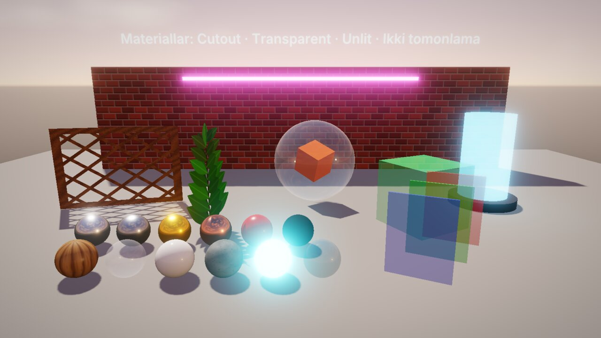

# Zamin Engine: rendering (grafika)

Bu qo'llanma Zamin'da tasvir qanday chizilishini va uni qanday boshqarishni tushuntiradi: kameralar, 2D (sprite'lar,
atlas va 9-slice, saralash qatlamlari, tilemap, 2D yorug'lik, pixel-perfect, parallax), 3D (mesh va modellar, PBR
materiallar va `.zmat` assetlari, shaffoflik, yorug'liklar, soyalar, osmon va HDRI, tuman), post-processing, particle
tizimi, samaradorlik (culling, instancing, render masshtabi, sifat darajalari), editor ko'rinish rejimlari, statistika
va testlar — editorda va C++ skriptda.

Komponentlarning to'liq maydonlari: [Components.md](Components.md#2-render) (render), [yorug'lik](Components.md#3-yoruglik),
[effektlar va 2D yordamchilar](Components.md#7-effektlar-va-2d-yordamchilar). Animatsiya (sprite kliplar, tint, property
kliplar, skelet) — [Animation.md](Animation.md), ekran UI — [UI.md](UI.md). Misollar `#include <Zamin/Zamin.h>` va
`using namespace Zamin;` bilan.



*Showcase3D `Scenes/MaterialGallery.zscene` (player): PBR va standart materiallar, Cutout panjara va barglar, shaffof shar va
oynalar, nurlanish + bloom, ikki tomonlama sirtlar.*

Mundarija:

1. [Umumiy ko'rinish](#1-umumiy-korinish)
2. [Kameralar](#2-kameralar)
3. [2D: sprite, doira, matn](#3-2d-sprite-doira-matn)
4. [2D: saralash qatlamlari, tilemap, parallax](#4-2d-saralash-qatlamlari-tilemap-parallax)
5. [2D yorug'lik va pixel-perfect kamera](#5-2d-yoruglik-va-pixel-perfect-kamera)
6. [3D: mesh, model, import](#6-3d-mesh-model-import)
7. [Materiallar](#7-materiallar)
8. [Shaffoflik va sirt turlari](#8-shaffoflik-va-sirt-turlari)
9. [Yorug'liklar](#9-yorugliklar)
10. [Soyalar](#10-soyalar)
11. [Osmon, HDRI, atrof yorug'ligi va tuman](#11-osmon-hdri-atrof-yorugligi-va-tuman)
12. [Post-processing](#12-post-processing)
13. [Particle tizimi](#13-particle-tizimi)
14. [Skriptdan: rang, effektlar, kamera](#14-skriptdan-rang-effektlar-kamera)
15. [Samaradorlik va sifat darajalari](#15-samaradorlik-va-sifat-darajalari)
16. [Editorda: ko'rinish rejimlari, gizmolar, statistika](#16-editorda-korinish-rejimlari-gizmolar-statistika)
17. [Namuna sahnalar](#17-namuna-sahnalar)
18. [Ko'p uchraydigan muammolar](#18-kop-uchraydigan-muammolar)
19. [Testlar va benchmarklar](#19-testlar-va-benchmarklar)
20. [Qisqa API ma'lumotnomasi](#20-qisqa-api-malumotnomasi)

---

## 1. Umumiy ko'rinish

- **Grafik API** — OpenGL 4.1 core, RHI abstraksiya qatlami orqasida (`Renderer`, `RenderCommand`, `RendererAPI`).
  Konteksti (versiya, MSAA, sRGB, debug kontekst): *Loyiha sozlamalari > Grafika*
  ([ProjectSettings.md](ProjectSettings.md#6-grafika-opengl-konteksti)).
- **Kim chizadi** — sahnaning **asosiy kamerasi** (`CameraComponent::Primary`). O'yinda asosiy kamera bo'lmasa sahna
  chizilmaydi (testlar va headless ishlar shundan foydalanadi). Editor viewport'i sahnani editor kamerasidan ko'rsatadi.
- **Kadr tartibi** (player): sahna — 3D (quyosh soyalari, opaque meshlar, osmon, shaffof sirtlar, 3D particle'lar), 2D
  (sprite, doira, matn, tilemap, 2D particle'lar — saralash tartibida) va ekran UI — HDR buferga chiziladi; keyin
  **post-processing** (bloom, SSAO, ekspozitsiya, tonemapping, rang, FXAA ...), uning ustidan **debug chizish**
  (sahna chuqurligi bilan), sahna o'tishi (so'nish) va player'ning gamma / yorqinligi. Pixel-perfect kamerada UI
  post-processing'dan keyin, ekran o'lchamida chiziladi.
- **Rendererlar**: `Renderer2D` (partiyalab chizish: to'rtburchak, doira, chiziq, matn — `DrawQuad`, `DrawCircle`,
  `DrawLine`, `DrawString`), `Renderer3D` (PBR meshlar, soyalar, osmon — `SubmitMesh`), `ParticleRenderer` (instanced
  billboardlar), `PostProcessor`. O'yin kodi odatda ularni chaqirmaydi — komponentlar va sahna sozlamalari yetarli.
- **Sahna sozlamalari** (*Oyna > Sahna sozlamalari*, `SceneSettings`, sahna faylida): *Muhit* (osmon, HDRI, atrof,
  ekspozitsiya, tuman), *Osmon gradienti va quyosh*, *Render* (render masshtabi), *Soyalar*, *Post-processing*,
  *2D yorug'lik*. Skriptdan: `GetScene().GetSettings()`.

---

## 2. Kameralar

**Camera** komponenti (`CameraComponent`): `Camera` (`SceneCamera` — **Perspektiv** yoki **Ortografik**: ko'rish burchagi
/ ortografik o'lcham, near / far), `Primary`, `FixedAspectRatio`, `ClearColor` (osmon chizilmaganda fon), `Shake`
(silkinish), `PixelPerfect`. Yaratish: *Obyekt > Kamera > Perspektiv (3D)* / *Ortografik (2D)*. Bir nechta kamera bo'lsa
`Primary` va faol (`SetActive`) birinchisi chizadi — kameralarni obyektlarini yoqib / o'chirib almashtirish mumkin.

```cpp
auto& cam = GetComponent<CameraComponent>();
cam.Camera.SetProjectionType(SceneCamera::ProjectionType::Orthographic);
cam.Camera.SetOrthographicSize(12.0f);      // ko'rinish balandligi, dunyo birligida
cam.Camera.SetPerspectiveVerticalFOV(glm::radians(50.0f));
```

**Camera 2D Follow** (`Camera2DFollowComponent`) — kamera nishon ortidan fizika va skriptlardan keyin silliq yuradi:
`Offset`, x / y bo'yicha alohida silliqlik (`Damping`, soniyada — kadr tezligiga bog'liq emas), o'lik zona (`DeadZone`),
harakat yo'nalishi bo'yicha oldinga qarash, dunyo chegaralari (kamera ko'rinishi to'rtburchakdan chiqmaydi), boshida
nishonga sakrash. Editorda o'lik zona va chegaralar chiziladi. Skriptdan: `SetCameraTarget(entity)` (asosiy kameraga
komponentni qo'shadi), `SetCameraTarget(entity, true)` — darhol sakrash.

**Silkinish** — `ShakeCamera(intensity, duration, frequency)`: trauma modeli — kuch qo'shiladi (eng ko'pi 1), davomiylik
ichida so'nadi, siljish kamera komponentidagi `Shake` sozlamalari (eng katta siljish / burilish) bo'yicha silliq
shovqin; faqat tasvir silkinadi — transform, kuzatish va fizika o'zgarmaydi; bir xil seed bilan aynan takrorlanadi.
`StopCameraShake()`. Inspektorda o'yin paytida "Sinash" tugmasi.

```cpp
ShakeCamera(0.3f);               // kichik zarba
ShakeCamera(1.0f, 1.2f, 25.0f);  // portlash
```

Ekran va dunyo: `GetMousePosition()`, `GetViewportSize()`, `GetMouseWorldPosition()` (2D: z = 0 tekisligi),
`ScreenToWorld(screen, depthZ)`, `ScreenPointToRay(screen)` / `GetMouseRay()` (3D picking, [Core.md](Core.md#4-geometriya-aabb-sfera-nur-tekislik)).

---

## 3. 2D: sprite, doira, matn

**Sprite Renderer** (`SpriteRendererComponent`): `Color`, `TexturePath` (yoki atlas kadri `SpriteName`), `DrawMode`:

| Rejim | Nima |
|---|---|
| `Simple` | tekstura transform masshtabi bilan cho'ziladi |
| `Sliced` (9-slice) | `Size` (birlik) to'rtburchagi burchaklari cho'zilmay to'ldiriladi (chegara px / `PixelsPerUnit`) — panel, ramka |
| `Tiled` | chetlar va o'rta takrorlanadi |

`PixelArt` (aniq piksellar), `FlipX` / `FlipY`, `Lit` (2D yorug'lik ta'sir qiladi), saralash qatlami va tartibi. Oddiy
rejimdan o'tilganda masshtab avtomatik `Size` ga ko'chadi. Effektlar (*Sprite Renderer > Effektlar*): urilish chaqnashi
(`FlashColor`, `FlashAmount`; skriptda `Flash`) va kontur (`OutlineColor`, `OutlineThickness` — rasmning ko'rinadigan
piksellari atrofida; `SetOutline`). Yaratish: *Obyekt > 2D > Sprite*, yoki rasmni viewport'ga sudrash.

**Sprite atlas** — *Oyna > Sprite muharriri* (yoki rasm inspektoridagi / Sprite Renderer'dagi qaychi tugmasi): teksturani
grid bo'yicha kesish (katak o'lchami yoki ustun / qator soni, siljish, oraliq, bo'sh kataklarni tashlash, nom prefiksi),
sichqoncha bilan yangi kadr chizish, har kadrning nomi, to'rtburchagi, pivot'i va 9-slice chegaralari. Kadrlar rasmning
`.zmeta` faylida (`"Sprites"`) saqlanadi — rasmning o'zi atlas bo'ladi. Skriptdan: `SetSprite("idle")`,
`PlaySpriteSequence("run")` (`run_0`, `run_1` ...), `GetSpriteSheet()`.

**Circle Renderer** — doira yoki halqa (`Thickness`, `Fade`). **Text** — dunyodagi matn (UI Transform'siz; UTF-8,
tekislash, o'rash — [UI.md](UI.md#6-matn)). Ikkalasi ham saralash qatlami va tartibini oladi.

**Rasm import sozlamalari** (kontent brauzerda rasm tanlang → inspektor): filtr (silliq / piksel), wrap (takrorlash /
chetda / ko'zgu), mipmap, sRGB (o'chirilsa — chiziqli ma'lumot, masalan maska yoki normal map); **Qo'llash** `.zmeta` ga
yozadi va rasm darhol qayta yuklanadi. Inspektor rasmni R / G / B / A kanallarida, piksel qiymati, GPU formati va video
xotirasi bilan ko'rsatadi.

---

## 4. 2D: saralash qatlamlari, tilemap, parallax

**Saralash qatlamlari** (*Loyiha sozlamalari > Teglar va qatlamlar*): nomlangan qatlamlar ro'yxati — tartibi chizish
tartibi. Sprite, doira, matn, tilemap va particle'lar qatlam (`SortingLayer`) va qatlamdagi tartib (`SortingOrder`)
tanlaydi; chizish tartibi: qatlam, tartib, keyin kameradan uzoqlik. Obyektlar qatlamni ID bilan eslaydi (qayta nomlash
buzmaydi). **Y bo'yicha saralash** (qatlamning "Y" belgisi, top-down o'yinlar): qatlam ichida avval Y — yuqoridagi orqada;
saralash nuqtasi pivot (oyoqlar), shu qatlamdagi ota ostidagi qismlar otaning Y'i bilan birga chiziladi.

**Tilemap** (`TilemapComponent`) — tileset'dan plitkali daraja: qatlamlar (ko'rinish, collision, tartib, shaffoflik),
auto-tile qoidalari (4 / 8 qo'shni), animatsiyali plitkalar, editorda chizish (*Oyna > Plitka palitrasi*; mo'yqalam `B`,
to'rtburchak `R`, to'ldirish `G`, o'chirg'ich `E`, tomizg'ich `I`). Chizish 16x16 plitkali bo'laklar bilan va ko'rinmaydigan
bo'laklar kesiladi (`TilemapChunkSize`). Batafsil: [Components.md](Components.md#tilemapcomponent).

**Parallax** (`ParallaxComponent`) — obyekt (bolalari bilan) o'yin kamerasi bilan `Factor` bo'yicha siljiydi (0 — oddiy,
1 — ekranda qotgan, manfiy — old plan), `RepeatX` / `RepeatY` — sprite ko'rinadigan joyni cheksiz to'ldiradi. Transform
o'zgarmaydi (fizika va skriptlarga ta'sir qilmaydi); editorda *Ko'rinish > Parallax* bilan editor kamerasida ham.

---

## 5. 2D yorug'lik va pixel-perfect kamera

**Light 2D** (`Light2DComponent`): `Type` — `Point` yoki `Spot` (obyektning +X o'qi bo'ylab: `SpotAngle`, `SpotSoftness`),
`Color`, `Intensity`, `Radius`, `InnerRadius`, `Falloff`, miltillash (`Flicker`, `FlickerSpeed` — mash'al, gulxan).
Faqat **Lit** belgilangan sprite va tilemap'lar yoritiladi (eng yaqin 32 ta yorug'lik; `Light2DMath::MaxLights`). Sahnaning
2D atrof yorug'ligi — *Sahna sozlamalari > 2D yorug'lik* (`Lighting2D.AmbientColor`, `AmbientIntensity`; oq x 1 — Lit
renderer yorug'liksiz ham odatdagidek). Editorda tanlangan yorug'likning radiusi / konusi chiziladi.

**Pixel-perfect kamera** (ortografik kamera > **Pixel-perfect**, `PixelPerfectSettings`): `PixelsPerUnit` va asosiy o'lcham
(`ReferenceResolution`, masalan 320 x 180) — kattalashtirish shu o'lcham sig'adigan eng katta butun son; `UpscaleRenderTarget`
— sahna art o'lchamida chiziladi va aniq piksellar bilan kattalashtiriladi (UI esa ekran o'lchamida, tiniq); `SnapCamera`,
`SnapSprites` — piksel to'rida. Namuna: Platformer2D `Scenes/TopDown2D.zscene` (tungi qishloq: Y bo'yicha saralash, fonarlar,
gulxan va kristallar yorug'ligi, tint animatsiyalar, auto-tile yo'lak, 9-slice HUD).

---

## 6. 3D: mesh, model, import

**Mesh Renderer** (`MeshRendererComponent`): primitiv (`Type`: `Cube`, `Sphere`, `Plane`, `Cylinder`, `Cone`) yoki model
(`ModelPath`: `.gltf`, `.glb`, `.obj`), material, `CastShadows`, `MorphWeights`. Yaratish: *Obyekt > 3D > Kub / Shar /
Tekislik / Silindr / Konus / Model (glTF / OBJ)* yoki model faylini viewport'ga sudrash.

**glTF 2.0** — bir nechta mesh, PBR materiallar, ichki (embedded) teksturalar, skin'lar va animatsiyalar
([Animation.md](Animation.md#5-skelet-animatsiyasi-va-animator)), morph target'lar; `alphaMode` (MASK / BLEND),
`alphaCutoff`, `doubleSided`, `KHR_materials_unlit`, `emissiveFactor`, `KHR_materials_emissive_strength` o'qiladi.

**Model import sozlamalari** (model `.zmeta`, asset inspektori): masshtab (sm → m), yuqori o'q (Y / Z — skelet va
animatsiyalar bilan aylantiriladi), UV aylantirish, kliplarni kesish. Inspektorda aylanadigan 3D ko'rinish, submeshlar,
materiallar, bog'liq fayllar (topilmaganlari qizil). Fayl tashqarida o'zgarsa (`.bin` buferi ham) sahnada darhol
yangilanadi.

---

## 7. Materiallar

**Ichki material** (`MeshRendererComponent::Mat`) yoki **material asset** (`.zmat`, `MaterialPath`; model qismlari uchun
`SubmeshMaterials`). Asset — bitta fayl, bitta umumiy obyekt (`MaterialLibrary`): uni ishlatgan hamma obyektlar bir xil.

| Xususiyat | Ma'nosi |
|---|---|
| `Shader`: `Lit` / `Unlit` | PBR yoritish yoki faqat rang x tekstura + nurlanish (yorug'lik va soya ta'sir qilmaydi) |
| `BlendMode`: `Opaque` / `Cutout` / `Transparent`, `AlphaCutoff`, `DoubleSided` | [8-bo'lim](#8-shaffoflik-va-sirt-turlari) |
| `Albedo` (RGBA), `AlbedoMap` | asosiy rang va tekstura |
| `Metallic`, `Roughness`, `MetalRoughMap` | metallik (0 — dielektrik, 1 — metall), g'adir-budurlik (0 — oyna, 1 — mat) |
| `NormalMap`, `NormalStrength` | sirt relyefi |
| `Emission`, `EmissionStrength`, `EmissiveMap` | nurlanish — HDR: 1 dan katta natija bloom yoqilgan sahnada porlaydi |
| `Tiling`, `Offset` | tekstura takrorlash va siljish |

`.zmat` fayli (`Projects/Showcase3D/Assets/Materials/Bricks.zmat`, qisqartirilgan):

```json
{
  "Version": 1, "Shader": "Lit", "BlendMode": "Opaque", "AlphaCutoff": 0.5, "DoubleSided": false,
  "Albedo": [0.9, 0.9, 0.9, 1], "AlbedoMap": "Textures/bricks.png", "AlbedoMapUUID": "a606cee7830b630a",
  "NormalMap": "Textures/bricks_normal.png", "NormalStrength": 1.2,
  "Metallic": 0.0, "Roughness": 0.95, "Emission": [0, 0, 0], "EmissionStrength": 0.0,
  "Tiling": [10, 10], "Offset": [0, 0]
}
```

**Editorda**: kontent brauzerda o'ng tugma → **Yangi material** (standart yoki kutubxonadan: metall, cho'tkalangan metall,
oltin, mis, plastik, rezina, yog'och, shisha, keramika, beton, neon, suv — `MaterialPresets`; protsedural teksturalar
`Assets/Materials/Standart/Textures/` ga bir marta yoziladi). Inspektordagi **material muharriri**: aylanadigan preview (shar
/ kub / tekislik / silindr, sahna HDRI'si bilan), o'zgarishlar sahnada darhol, **Saqlash** / **Bekor qilish**. `.zmat` ni
viewport'dagi mesh ustiga sudrang — qo'yishdan oldin o'sha meshda ko'rinadi; ko'p qismli modelga `Shift` bilan qo'yilsa
qaysi qism olishini so'raydi. Model inspektorida glTF materiallarini `.zmat` ga eksport qilish; ichki materialni bir
tugma bilan `.zmat` ga aylantirish. Kontent brauzer va maydonlarda `.zmat` eskizlari (shar ustida).

**Skriptdan** — material **nusxasi** (instance) faqat shu obyektni o'zgartiradi, umumiy asset va boshqa obyektlar o'zgarmaydi
(o'yin to'xtaganda yo'qoladi):

```cpp
// Showcase3D TowerBuilder: har g'isht umumiy Clay.zmat ning o'z nusxasini qavatiga qarab bo'yaydi.
if (Ref<MaterialAsset> material = GetMaterial(clone))
    material->SetColor(glm::mix(BottomColor, TopColor, t));

GetMaterial()->SetEmission({ 1.0f, 0.5f, 0.1f }, 4.0f);   // shu obyekt porlaydi
GetMaterial()->SetOpacity(0.5f);
GetMaterial(2)->SetRoughness(0.2f);                       // modelning 2-qismi
SetSharedMaterial("Materials/Red.zmat");                  // boshqa asset (nusxalar tashlanadi)
ResetMaterial();                                          // yana umumiy material
Ref<MaterialAsset> shared = GetSharedMaterial();          // umumiy: o'zgartirilsa HAMMASI o'zgaradi
```

`MaterialAsset` ning tezkor tahrirlari: `SetColor`, `SetOpacity`, `SetEmission`, `SetEmissionColor`, `SetEmissionStrength`,
`SetMetallic`, `SetRoughness`, `SetTiling`, `SetOffset`, `SetAlbedoMap`, `SetEmissiveMap`, `SetSortPriority`. Ichki materialni
to'g'ridan-to'g'ri ham o'zgartirish mumkin: `GetComponent<MeshRendererComponent>().Mat.Albedo = ...` (Showcase3D
`SleepTint3D`, `TriggerGlow3D`). Fayl yoki uning teksturalari tashqarida o'zgarsa joyida qayta yuklanadi.

---

## 8. Shaffoflik va sirt turlari

| `BlendMode` | Qanday chiziladi |
|---|---|
| `Opaque` | alfa e'tiborga olinmaydi |
| `Cutout` | alfasi (rang x tekstura) `AlphaCutoff` dan past piksellar chizilmaydi; soyada ham shu teshiklar (barg, panjara) |
| `Transparent` | opaque sahna va osmondan keyin: avval materialning **ustuvorligi** (`SetSortPriority`, -100 ... 100 — kattasi ustida), keyin chegaralari markazining kameradan uzoqligi bo'yicha orqadan oldinga; chuqurlik yozilmaydi, premultiplied alfa, soya tashlamaydi |

**Aksni saqlash** yoqilsa aks va yaltirashlar alfa bilan susaymaydi (shisha). **Ikki tomonlama** (`DoubleSided`): orqa tomon
teskari normal bilan yoritiladi (ikki tomonlama shaffof sirt — avval ichki, keyin tashqi tomoni); o'chiq bo'lsa orqa
tomonlar kesiladi (manfiy masshtabli ko'zgu obyektlarda ham to'g'ri). Eski sahnalarda alfasi 1 dan kichik rang
avtomatik `Transparent` bo'ladi. *Ko'rinish > Shaffoflar tartibi* — viewport'da har shaffof sirt ustiga chizilish raqami,
uzoqligi va ustuvorligini yozadi. Namuna: Showcase3D `Scenes/MaterialGallery.zscene`.

---

## 9. Yorug'liklar

| Komponent | Nima | Chegaralar |
|---|---|---|
| **Directional Light** (`DirectionalLightComponent`) | quyosh: parallel nurlar obyektning -Z yo'nalishida; `Color`, `Intensity`, `CastShadows` | bir vaqtda 4 tagacha (`Renderer3D::MaxDirectionalLights`); soyani faqat bittasi — sahna tartibida "Soyalar" yoqilgan birinchisi (asosiy quyosh; osmondagi quyosh diski ham unga ergashadi) |
| **Point Light** (`PointLightComponent`) | nuqtadan har tomonga: `Color`, `Intensity`, `Radius` | nuqtali va spot birgalikda 32 tagacha (`Renderer3D::MaxLocalLights`) |
| **Spot Light** (`SpotLightComponent`) | -Z bo'ylab konus: `InnerAngle` .. `OuterAngle` orasida yumshoq so'nish, `Range` | shu 32 ta ichida |

32 tadan ko'p bo'lsa kameraga eng ko'p ta'sir qiladiganlari tanlanadi (kuchi x rangi; kamera yorug'lik radiusidan
tashqarida bo'lsa x (radius / masofa)²) — uzoqdagi kuchli yorug'lik yaqindagi kuchsizidan ustun bo'lishi mumkin. Nofaol
yorug'lik o'rin egallamaydi. Inspektor har quyoshning rolini yozadi ("Soya bermaydi: soyani '...' beradi"), Statistika
oynasi — asosiy quyosh va ishlatilgan yorug'liklar. Skriptdan: `GetScene().CollectLights(viewPosition)` (`LightSet`).
Editorda tanlangan nuqtali yorug'likning radiusi va spot konusi chiziladi. Yaratish: *Obyekt > Yorug'lik > Quyosh
(yo'naltirilgan) / Nuqtali / Spot (konus)*. Namunalar: Showcase3D `Scenes/Lights.zscene` (29 ta yorug'lik),
`Scenes/Sunset.zscene` (3 ta quyosh).

---

## 10. Soyalar

Asosiy quyosh **Cascaded Shadow Maps** bilan soya tashlaydi (texel snapping — kamera yurganda soya chetlari
"qaltiramaydi"). *Sahna sozlamalari > Soyalar* (`SceneSettings::Shadows`, `ShadowSettings`):

| Sozlama | Qiymatlar | Standart |
|---|---|---|
| Atlas o'lchami (`AtlasSize`) | 1024 / 2048 / 4096 | 4096 |
| Filtr (`Filter`, `ShadowFilter`) | `Hard`, `PCF3x3`, `PCF5x5`, `Poisson` (16 nuqta) | `PCF3x3` |
| Kaskadlar (`CascadeCount`) | 1 ... 4 (bitta kaskad butun atlasni oladi; ortografik kamera — bitta) | 3 |
| Taqsimot (`CascadeSplit`) | 0 teng ... 1 logarifmik (kameraga yaqinda aniqroq) | 0.75 |
| `DepthBias`, `NormalBias` | "akne" va soya uzilishi orasidagi muvozanat | 0.0005, 1.0 |

Shu bo'limdagi **Soya masofasi** (kameradan shu masofagacha soya chiziladi; metr, standart 40) `ShadowSettings` ning
maydoni emas, sahna sozlamalarining o'zida: `SceneSettings::ShadowDistance` (skriptda
`GetScene().GetSettings().ShadowDistance`). Faol sifat darajasi uni `ShadowDistanceScale` ga ko'paytiradi.

Mesh Renderer'ning `CastShadows` i o'chiq mesh soya tashlamaydi; `Cutout` materiallar teshikli soya beradi, `Transparent`
— soyasiz. Soyalar har kaskad hajmi bo'yicha alohida kesiladi va instancing bilan chiziladi. Faol sifat darajasi bu
qiymatlarni cheklashi mumkin ([15-bo'lim](#15-samaradorlik-va-sifat-darajalari)).

---

## 11. Osmon, HDRI, atrof yorug'ligi va tuman

*Sahna sozlamalari > Muhit* va *Osmon gradienti va quyosh*:

- **Gradient osmon** (HDRI bo'lmaganda): zenit / ufq / yer ranglari (`SkyTopColor`, `SkyHorizonColor`, `GroundColor`),
  zenit egriligi (`Sky.Curve`), yerga o'tish (`Sky.GroundFade`), **quyosh diski** (`Sky.SunDisc`, `SunSize` gradusda,
  `SunIntensity`, `SunGlow` — nur gardishi) asosiy quyosh yo'nalishida va rangida. Gradient atrof yorug'lik va akslarda ham
  ishlatiladi. `DrawSky` o'chiq — kamera `ClearColor` i.
- **HDRI** (`EnvironmentMap`: `.hdr` / `.png` / `.jpg` ekvirektangulyar panorama): diffuz yorug'lik SH9 orqali, aks
  (specular) mip darajalari bo'yicha; `EnvironmentIntensity`, `EnvironmentRotation`. Kontent brauzerda HDRI eskizlari
  tonemap qilingan holda.
- **Atrof yorug'ligi** (`AmbientIntensity`) va **ekspozitsiya** (`Exposure`; avto ekspozitsiya — post-processing'da).
- **Tuman** (`FogEnabled`, `FogColor`, `FogDensity`, `FogHeightFalloff`) — masofa va balandlik bo'yicha.

Namuna: Showcase3D `Scenes/Sunset.zscene` (quyosh botishi osmoni, bloom rangi, linza changi, xromatik aberratsiya, plyonka
donasi).

---

## 12. Post-processing

*Sahna sozlamalari > Post-processing* (`SceneSettings::Post`, `PostProcessSettings`); yangi effektlar standart holatda
o'chiq:

| Effekt | Maydonlar |
|---|---|
| Tonemapping | `Tonemap` (`TonemapMode`): `ACES` (standart), `Reinhard`, `None` |
| Bloom | `Bloom`, `BloomThreshold`, `BloomKnee`, `BloomIntensity`, `BloomRadius`, `BloomTint` (porlash rangi), `BloomDirt` (linza changi) |
| SSAO (3D) | `SSAO`, `SSAORadius`, `SSAOIntensity`, `SSAOBias` |
| Avto ekspozitsiya (ko'z moslashishi) | `AutoExposure`, `AutoExposureCompensation` (EV), `AutoExposureMinEV` / `MaxEV`, `AutoExposureSpeed` |
| Rang | `Saturation`, `Contrast`, `Brightness`, `Tint` |
| Vinyetka, xromatik aberratsiya | `Vignette`, `ChromaticAberration` |
| Plyonka donasi | `FilmGrain`, `FilmGrainSize` (o'rta tonlarda kuchli, FXAA'dan keyin) |
| FXAA | `FXAA`, `FXAASubpixel` (tonemapping va rangdan keyin) |

Skriptdan o'yin davomida:

```cpp
auto& post = GetScene().GetSettings().Post;
post.Bloom = true;
post.BloomIntensity = 1.2f;
post.Vignette = 0.35f;            // masalan qahramon yaralanganda
post.Saturation = 0.2f;           // deyarli oq-qora
```

**Render masshtabi** (*Render* bo'limi, `RenderScale`, 0.5 ... 2.0 — `Renderer::MinRenderScale` / `MaxRenderScale`): sahna
ko'rinish o'lchamining shu barobarida chiziladi va chiziqli filtr bilan masshtablanadi — 1 dan kichigi tezroq va
yumshoqroq, kattasi supersampling. Editor viewport'i va player ikkalasi ham.

---

## 13. Particle tizimi

**Particle System** (`ParticleSystemComponent`, simulyatsiya — `Scene/ParticleSystem.h`): olov, uchqun, tutun, yomg'ir, qor,
sehr, portlash, mushak. Inspektor Unity'dagidek **modullarga** bo'lingan — har birida yoqish katagi, "faqat yoqilganlar"
filtri, **Modul qo'shish**:

| Modul | Nima |
|---|---|
| Asosiy | sikl davomiyligi, takrorlash, **oldindan to'ldirish** (prewarm), boshlanish kechikishi, simulyatsiya tezligi, fazo (dunyo / lokal / boshqa obyekt), **tugaganda** (o'chirish / yo'q qilish; skript `OnParticlesFinished()`), **Boshida ijro** (`PlayOnStart`) |
| Emissiya | soniyasiga N, boshida bir martalik portlash, **portlashlar jadvali** (vaqt, soni, sikllar, oraliq, ehtimollik) |
| Shakl | nuqta, doira, sfera, quti, konus, chiziq (2D), **mesh sirti** (primitiv, model yoki obyektning Mesh Renderer'i) |
| Kamera atrofida | ob-havo: emitter asosiy kamera bilan yuradi, ortda qolgan particle'lar oldinga o'raladi |
| Tezlik (umr bo'yi), Tezlik chegarasi | egri chiziq bilan chiziqli tezlik, orbita, radial; so'ndirish |
| Rang, O'lcham (umr bo'yi) | ko'p nuqtali gradient; egri chiziq (ikki egri chiziq / gradient orasida tasodifiy) |
| Shovqin | silliq 3D shovqin maydoni (kuch, chastota, oktavalar, seed — deterministik) |
| To'qnashuv | yer tekisligi yoki 2D / 3D fizika collider'lari (raycast, qatlamlar): sakrash, so'ndirish, umr yo'qotish |
| Sub-emitterlar | tug'ilganda / o'lganda / urilganda / umr bo'yi bola obyektning Particle System'i chiqaradi (mushak, sachrash) |
| Tekstura sheet | flipbook: ustun x qator yoki sprite kadrlari |
| Iz (trail) | kameraga qaragan lenta |
| Chizish | billboard yoki tezlik bo'ylab cho'zilgan; saralash (uzoqlik / yosh / yo'q); additive yoki shaffof |

3D billboardlar **GPU instancing** bilan — har tizim bitta chizish buyrug'ida (`ParticleRenderer`); 2D tekis particle'lar
sprite'lar bilan 2D partiyada. Viewport burchagida tanlangan tizim uchun Ijro / Pauza / Qayta / To'xtatish va particle soni;
emitter shakli *Gizmolar > Particle shakli* bilan.

**Preset'lar**: 9 ta tayyor effekt (inspektordagi **Preset** menyusi, *Obyekt > Effektlar*, yoki `ParticlePresets`), o'zingiznikini
**Preset sifatida saqlash** — `.zparticle` fayl (`Assets/Particles`), kontent brauzerdan viewport / ierarxiya / Preset
tugmasiga tashlab qo'llanadi.

Skriptdan:

```cpp
EmitParticles(30);                                       // shu obyektning tizimidan 30 ta (nofaol bo'lsa - hech narsa)
auto& ps = GetComponent<ParticleSystemComponent>();
ps.Play();  ps.Pause();  ps.Stop();  ps.Restart();       // Stop(false) - mavjud particle'lar qoladi
bool emitting = ps.IsEmitting();
GetScene().EmitParticles(other, 10);                     // boshqa obyektniki
void OnParticlesFinished() override { Destroy(); }       // takrorlanmaydigan tizim tugadi
```

Namunalar: Showcase3D `Scenes/Particles.zscene`, `ParticlesII` (mesh, shovqin, to'qnashuv, izlar, mushaklar),
`ParticlesIII` (prewarm, portlashlar jadvali, 9000 particle'li galaktika), `ParticlesIV` (preset'lar, yomg'ir va qor).
Samaradorlik: `build/bin/ZaminBench` standart rejimda (`particle_bench` target) ~50 000 particle'ni headless
simulyatsiya qiladi ([Benchmarks.md](Benchmarks.md#boshqa-benchmarklar)); particle
simulyatsiyasi Debug build'da ham `-O2` bilan kompilyatsiya qilinadi (`ZAMIN_OPTIMIZE_PARTICLES_IN_DEBUG`).

---

## 14. Skriptdan: rang, effektlar, kamera

| Nima | API |
|---|---|
| 2D renderer rangi (Sprite, aks holda Circle, Text, Tilemap) | `GetColor()`, `SetColor(c)`, `TweenColor(c, seconds, ease, onComplete)`, `FadeTo(alpha, seconds)` |
| Urilish chaqnashi, kontur | `Flash(color, seconds)`, `SetOutline(color, thickness)` |
| Tint animatsiyasi | `PlayTint(color, duration, mode, cycles)`, `PlayTint()`, `StopTint()`, `IsTintPlaying()` ([Animation.md](Animation.md)) |
| Sprite kadrlari | `SetSprite(name)`, `PlaySpriteSequence(prefix, fps, loop)`, `PlaySpriteClip(name)`, `GetSpriteSheet()` |
| Materiallar (3D) | `GetMaterial()`, `GetMaterial(submesh)`, `GetSharedMaterial()`, `SetSharedMaterial(path)`, `ResetMaterial()` |
| Particle'lar | `EmitParticles(count)`, `ParticleSystemComponent::Play` / `Stop` |
| Kamera | `ShakeCamera`, `StopCameraShake`, `SetCameraTarget` |

```cpp
// Dushman urilganda: qizil chaqnash, kamera silkinishi, keyin asta yo'qolish.
void OnMessage(const ScriptMessage& m) override
{
    if (m.Name != "Damage")
        return;
    Flash({ 1.0f, 0.3f, 0.25f, 1.0f }, 0.2f);
    ShakeCamera(0.25f);
    if ((m_Health -= m.Get<float>()) <= 0.0f)
        FadeTo(0.0f, 0.5f, Ease::OutQuad, [this] { Destroy(); });
}
```

---

## 15. Samaradorlik va sifat darajalari

- **Frustum culling** — kamera ko'rmaydigan meshlar dunyo AABB'lari bo'yicha chizilmaydi (model qismlari alohida, skinned
  meshlar barcha suyaklari bo'yicha); soyalarda har kaskad o'z hajmi bo'yicha; 2D'da sprite, doira, matn, particle tizimi
  va tilemap bo'laklari.
- **GPU instancing** — bir xil mesh + bir xil material (shader oladigan hamma qiymatlar teng, skinned emas, opaque /
  cutout) bitta `glDrawElementsInstanced` chaqiruvida; soya kaskadlarida ham. Ko'p bir xil obyekt uchun material
  **nusxasi** emas, umumiy asset ishlating — nusxalar instancing'ni buzadi.
- **Animatsiya kesish** — ko'rinmaydigan modellar pozalanmaydi ([Animation.md](Animation.md#16-samaradorlik-keshlash-va-kesish)).
- **Render masshtabi** — sekin GPU'da 0.75 ham sezilarli tezlashtiradi.
- **Sifat darajalari** (*Loyiha sozlamalari > Sifat*, `Quality`): sahna so'ragan soya, SSAO, bloom, FXAA, avto ekspozitsiya,
  render masshtabi va tekstura o'lchamini cheklaydi (Low / Medium / High / Ultra yoki o'zingizniki). O'yindagi menyudan:
  `Quality::SetLevel(n)`, `Quality::SaveSettings()`; player: `--quality <nom>`
  ([ProjectSettings.md](ProjectSettings.md#5-sifat-darajalari)).

Solishtirish uchun o'chirish: `ZAMIN_EDITOR_NO_CULLING=1`, `ZAMIN_EDITOR_NO_INSTANCING=1` (player'da `ZAMIN_PLAYER_NO_CULLING`,
`ZAMIN_PLAYER_NO_INSTANCING`); kodda `Renderer3D::SetFrustumCulling(false)`, `Renderer3D::SetInstancing(false)`.

---

## 16. Editorda: ko'rinish rejimlari, gizmolar, statistika

- **Ko'rinish rejimlari** (viewport toolbar'i, `RenderDebugView`): oddiy, faqat yorug'lik, normallar, albedo, roughness,
  metallic (qiymat ko'rinishlari tonemapping'siz); **wireframe** — faqat qirralar yoki sirt + qirralar (`WireframeMode`).
  Avtomatlashtirish: `ZAMIN_EDITOR_VIEW_MODE=lighting|normals|albedo|roughness|metallic`, `ZAMIN_EDITOR_WIREFRAME=1|shaded`,
  `ZAMIN_EDITOR_RENDER_SCALE=<0.5..2>`.
- **Gizmolar** (*Ko'rinish > Gizmolar*): kamera frustumi, yorug'lik yo'nalishi, chegaralar (bounding box — lokal / dunyo
  AABB), skelet, normallar, particle shakli; **tanlash konturi** (shader asosida, mesh / sprite / matn / tilemap atrofida).
- **Statistika** (*Oyna > Statistika* va viewport'dagi statistika overlay): FPS, kadr vaqti, draw call'lar, uchburchaklar,
  chizilgan / kesilgan / instanced meshlar, soya chizishlari, 2D obyektlar, tile bo'laklari, particle'lar
  (`Renderer::GetStats()` — `RenderStatistics`). `ZAMIN_EDITOR_STATS=1` / `ZAMIN_PLAYER_STATS=1` chiqishda oxirgi kadr
  statistikasini logga yozadi.
- **Profiler** (*Oyna > Profiler*): `Render`, `3D`, `2D va UI`, post-processing bo'limlari vaqti.

Editor haqida batafsil: [Editor.md](Editor.md#5-viewport).

---

## 17. Namuna sahnalar

| Loyiha / sahna | Nima ko'rsatadi |
|---|---|
| Showcase3D `Scenes/Showcase.zscene` | PBR, soyalar, bloom, fizika minorasi (material nusxalari) |
| Showcase3D `Scenes/MaterialGallery.zscene` | sirt turlari, shaffoflik tartibi, standart materiallar qatori |
| Showcase3D `Scenes/Lights.zscene` | 29 ta nuqtali va spot yorug'lik |
| Showcase3D `Scenes/Sunset.zscene` | 3 ta quyosh, gradient osmon va quyosh diski, post-processing effektlari |
| Showcase3D `Scenes/Particles.zscene` ... `ParticlesIV.zscene` | particle tizimining hamma modullari va preset'lar |
| Showcase3D `Scenes/DebugDraw.zscene` | `DebugDraw` shakllari |
| Platformer2D `Scenes/Showcase2D.zscene` | parallax, Camera 2D Follow |
| Platformer2D `Scenes/TopDown2D.zscene` | 2D yorug'lik, Y bo'yicha saralash, pixel-perfect kamera, 9-slice HUD, tint animatsiyalar |
| Platformer2D `Scenes/Tilemap2D.zscene` | tilemap qatlamlari, auto-tile, animatsiyali plitkalar |
| Adventure3D `Scenes/Island.zscene` | to'liq 3D sahna: skinned robot, spot fonar, tuman, particle'lar |

---

## 18. Ko'p uchraydigan muammolar

| Belgi | Sabab va yechim |
|---|---|
| O'yinda qora ekran / hech narsa chizilmaydi | Asosiy kamera yo'q, kamera obyekti nofaol, yoki kamera teskari tomonga qaragan; 2D'da ortografik kamera va obyektlarning Z i near / far ichida |
| Rasm o'rniga oq / pushti to'rtburchak, konsolda `Rasm yuklanmadi: '...' - ...` | Yo'l noto'g'ri yoki fayl buzilgan; kontent brauzerdagi qizil belgi va asset inspektoridagi sabab, **Qayta urinish** |
| Pixel-art xira | Rasm import sozlamalarida filtr — piksel, Sprite Renderer `PixelArt`, ortografik kamerada pixel-perfect |
| Shaffof obyektlar noto'g'ri tartibda | `Transparent` sirtlar markazi bo'yicha saralanadi — katta / kesishgan sirtlarda `SetSortPriority` (material ustuvorligi) bering; *Ko'rinish > Shaffoflar tartibi* |
| Soya "akne"si yoki soya obyektdan uzilgan | `DepthBias` / `NormalBias` ni sozlang; soya masofasini kamaytiring yoki kaskadlarni ko'paytiring |
| Nurlanish porlamaydi | Bloom o'chiq yoki `EmissionStrength` x rang 1 dan kichik (bloom chegarasi `BloomThreshold`) |
| 33-chi yorug'lik yoritmaydi | 32 tadan ko'p mahalliy yorug'lik — kameraga eng ta'sirlilari tanlanadi; keraksizlarini nofaol qiling |
| Ko'p bir xil obyekt sekin | Material nusxalari (`GetMaterial()`) instancing'ni o'chiradi — umumiy material yoki kamroq nusxa |
| Lit sprite qorong'i | Sahnada 2D yorug'lik yo'q va 2D atrof yorug'ligi past — *Sahna sozlamalari > 2D yorug'lik* |

---

## 19. Testlar va benchmarklar

- **Rendering regressiya testi** (`ZaminRenderTests`, `Tests/render_tests.sh`): etalon sahnalar offscreen chiziladi va
  `Tests/Reference/*.png` bilan solishtiriladi — [Testing.md](Testing.md#2-rendering-regressiya-testi---zaminrendertests).
- **Render benchmark**: `ZaminBench --render` (10 000 sprite, 1 000 mesh; `Tests/render_bench.sh`) — [Benchmarks.md](Benchmarks.md).
- **Unit testlar** (GPU'siz qism: saralash, culling matematikasi, materiallar JSON, particle simulyatsiyasi, soya
  sozlamalari ...):

```bash
./build/bin/ZaminTests "*Material*:*Particle*:*Sorting*:*Shadow*:*Frustum*:*Instanc*:*Light*:*Sprite*:*Tilemap*"
```

---

## 20. Qisqa API ma'lumotnomasi

| Nima | API |
|---|---|
| Kamera | `CameraComponent` (`Camera`, `Primary`, `ClearColor`, `Shake`, `PixelPerfect`), `SceneCamera::SetProjectionType`, `SetOrthographicSize`, `SetPerspectiveVerticalFOV`, `Camera2DFollowComponent`, `ShakeCamera`, `SetCameraTarget` |
| 2D | `SpriteRendererComponent`, `CircleRendererComponent`, `TextComponent`, `TilemapComponent`, `ParallaxComponent`, `Light2DComponent`, `PixelPerfectSettings`, `TintAnimationComponent` |
| 3D | `MeshRendererComponent`, `DirectionalLightComponent`, `PointLightComponent`, `SpotLightComponent`, `Scene::CollectLights` |
| Materiallar | `MaterialAsset` (`SetColor`, `SetOpacity`, `SetEmission`, `SetMetallic`, `SetRoughness`, `SetTiling`, `SetOffset`, `SetAlbedoMap`, `SetSortPriority`), `MaterialShader`, `MaterialBlendMode`, `MaterialPresets::GetAll`; skript: `GetMaterial`, `GetSharedMaterial`, `SetSharedMaterial`, `ResetMaterial` |
| Sahna sozlamalari | `SceneSettings` (`DrawSky`, `Sky`, `EnvironmentMap`, `AmbientIntensity`, `Exposure`, `Shadows`, `ShadowDistance`, `FogEnabled`, `RenderScale`, `Post`, `Lighting2D`) |
| Post-processing | `PostProcessSettings`, `TonemapMode`; `PostProcessor::Apply` |
| Soyalar | `ShadowSettings` (`AtlasSize`, `Filter`, `CascadeCount`, `CascadeSplit`, `DepthBias`, `NormalBias`), `ShadowFilter` |
| Particle'lar | `ParticleSystemComponent` (`Play`, `Pause`, `Stop`, `Restart`, `IsEmitting`), `EmitParticles`, `Scene::EmitParticles`, `ParticlePresets`, `OnParticlesFinished` |
| Past daraja | `Renderer2D::BeginScene` / `DrawQuad` / `DrawCircle` / `DrawLine` / `DrawString` / `EndScene`, `Renderer3D::SubmitMesh`, `SetFrustumCulling`, `SetInstancing`, `Renderer::GetStats` (`RenderStatistics`) |
| Sifat | `Quality::SetLevel`, `GetLevel`, `GetLevelCount`, `GetLevelName`, `SaveSettings` |
