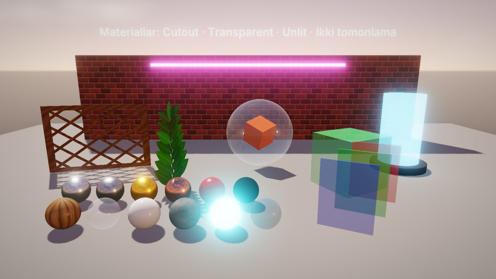

# Zamin Engine: rendering (graphics)

This guide explains how Zamin draws an image and how to control it: cameras, 2D (sprites, atlases and 9-slice, sorting
layers, tilemaps, 2D lighting, pixel-perfect, parallax), 3D (meshes and models, PBR materials and `.zmat` assets,
transparency, lights, shadows, sky and HDRI, fog), post-processing, the particle system, performance (culling,
instancing, render scale, quality levels), the editor's view modes, statistics and tests — in the editor and in C++
scripts.

Terrain: GPU albedo/normal/ORM layers, painting, the control cache and patch LOD — [the Terrain guide](Terrain.md).

The components' full fields: [Components.md](Components.md#2-rendering) (rendering), [lights](Components.md#3-lights),
[effects and 2D helpers](Components.md#7-effects-and-2d-helpers). Animation (sprite clips, tint, property clips,
skeletons) — [Animation.md](Animation.md), the screen UI — [UI.md](UI.md). The examples assume
`#include <Zamin/Zamin.h>` and `using namespace Zamin;`.



*Showcase3D `Scenes/MaterialGallery.zscene` (player): PBR and standard materials, a Cutout grille and leaves, a
transparent sphere and windows, emission + bloom, two-sided surfaces.*

Contents:

1. [Overview](#1-overview)
2. [Cameras](#2-cameras)
3. [2D: sprites, circles, text](#3-2d-sprites-circles-text)
4. [2D: sorting layers, tilemaps, parallax](#4-2d-sorting-layers-tilemaps-parallax)
5. [2D lighting and the pixel-perfect camera](#5-2d-lighting-and-the-pixel-perfect-camera)
6. [3D: meshes, models, import](#6-3d-meshes-models-import)
7. [Materials](#7-materials)
8. [Transparency and surface types](#8-transparency-and-surface-types)
9. [Lights](#9-lights)
10. [Shadows](#10-shadows)
11. [Sky, HDRI, ambient light and fog](#11-sky-hdri-ambient-light-and-fog)
12. [Post-processing](#12-post-processing)
13. [The particle system](#13-the-particle-system)
14. [From a script: color, effects, camera](#14-from-a-script-color-effects-camera)
15. [Performance and quality levels](#15-performance-and-quality-levels)
16. [In the editor: view modes, gizmos, statistics](#16-in-the-editor-view-modes-gizmos-statistics)
17. [Sample scenes](#17-sample-scenes)
18. [Common problems](#18-common-problems)
19. [Tests and benchmarks](#19-tests-and-benchmarks)
20. [Short API reference](#20-short-api-reference)

---

## 1. Overview

- **Graphics API** — OpenGL 4.1 core, behind an RHI abstraction layer (`Renderer`, `RenderCommand`, `RendererAPI`).
  Its context (version, MSAA, sRGB, debug context): *Project settings > Graphics*
  ([ProjectSettings.md](ProjectSettings.md#6-graphics-the-opengl-context)).
- **Who draws** — the scene's **main camera** (`CameraComponent::Primary`). In the game a scene without a main camera
  is not drawn (tests and headless runs rely on this). The editor viewport shows the scene from the editor camera.
- **Frame order** (player): the scene — 3D (sun shadows, opaque meshes, the sky, transparent surfaces, 3D particles),
  2D (sprites, circles, text, tilemaps, 2D particles — in sorting order) and the screen UI — is drawn into an HDR
  buffer; then **post-processing** (bloom, SSAO, exposure, tonemapping, color, FXAA ...), **debug drawing** over it
  (with the scene's depth), the scene transition (fade) and the player's gamma / brightness. With a pixel-perfect
  camera the UI is drawn after post-processing, at screen size.
- **Renderers**: `Renderer2D` (batched drawing: quads, circles, lines, text — `DrawQuad`, `DrawCircle`, `DrawLine`,
  `DrawString`), `Renderer3D` (PBR meshes, shadows, the sky — `SubmitMesh`), `ParticleRenderer` (instanced
  billboards), `PostProcessor`. Game code usually does not call them — components and scene settings are enough.
- **Scene settings** (*Window > Scene settings*, `SceneSettings`, in the scene file): *Environment* (sky, HDRI,
  ambient, exposure, fog), *Sky gradient and sun*, *Rendering* (render scale), *Shadows*, *Post-processing*,
  *2D lighting*. From a script: `GetScene().GetSettings()`.

---

## 2. Cameras

The **Camera** component (`CameraComponent`): `Camera` (`SceneCamera` — **Perspective** or **Orthographic**: field of
view / orthographic size, near / far), `Primary`, `FixedAspectRatio`, `ClearColor` (the background when no sky is
drawn), `Shake`, `PixelPerfect`. To create one: *Object > Camera > Perspective (3D)* / *Orthographic (2D)*. With several
cameras the first one that is `Primary` and active (`SetActive`) draws — cameras can be switched by enabling /
disabling their objects.

```cpp
auto& cam = GetComponent<CameraComponent>();
cam.Camera.SetProjectionType(SceneCamera::ProjectionType::Orthographic);
cam.Camera.SetOrthographicSize(12.0f);      // the view height, in world units
cam.Camera.SetPerspectiveVerticalFOV(glm::radians(50.0f));
```

**Camera 2D Follow** (`Camera2DFollowComponent`) — the camera moves smoothly after its target, after physics and the
scripts: `Offset`, separate smoothing on x / y (`Damping`, in seconds — independent of the frame rate), a dead zone
(`DeadZone`), look-ahead in the direction of movement, world bounds (the camera view does not leave the rectangle), a
jump to the target at the start. The editor draws the dead zone and the bounds. From a script:
`SetCameraTarget(entity)` (adds the component to the main camera), `SetCameraTarget(entity, true)` — jump at once.

**Shake** — `ShakeCamera(intensity, duration, frequency)`: a trauma model — the strength adds up (at most 1) and fades
over the duration, the offset is smooth noise following the camera component's `Shake` settings (the largest offset /
rotation); only the image shakes — the transform, follow and physics do not change; with the same seed it repeats
exactly. `StopCameraShake()`. In the inspector a "Test" button during play.

```cpp
ShakeCamera(0.3f);               // a small hit
ShakeCamera(1.0f, 1.2f, 25.0f);  // an explosion
```

Screen and world: `GetMousePosition()`, `GetViewportSize()`, `GetMouseWorldPosition()` (2D: the z = 0 plane),
`ScreenToWorld(screen, depthZ)`, `ScreenPointToRay(screen)` / `GetMouseRay()` (3D picking, [Core.md](Core.md#4-geometry-aabb-sphere-ray-plane)).

---

## 3. 2D: sprites, circles, text

**Sprite Renderer** (`SpriteRendererComponent`): `Color`, `TexturePath` (or an atlas frame `SpriteName`), `DrawMode`:

| Mode | What |
|---|---|
| `Simple` | the texture is stretched with the transform scale |
| `Sliced` (9-slice) | fills a `Size` (units) rectangle without stretching the corners (border px / `PixelsPerUnit`) — panels, frames |
| `Tiled` | the edges and the middle repeat |

`PixelArt` (crisp pixels), `FlipX` / `FlipY`, `Lit` (affected by 2D lights), sorting layer and order. When leaving the
Simple mode the scale moves into `Size` automatically. Effects (*Sprite Renderer > Effects*): a hit flash
(`FlashColor`, `FlashAmount`; `Flash` in scripts) and an outline (`OutlineColor`, `OutlineThickness` — around the
image's visible pixels; `SetOutline`). To create one: *Object > 2D > Sprite*, or drag an image into the viewport.

**Sprite atlas** — *Window > Sprite editor* (or the scissors button in the image inspector / on the Sprite Renderer):
slicing a texture by a grid (cell size or column / row count, offset, padding, skipping empty cells, a name prefix),
drawing a new frame with the mouse, each frame's name, rectangle, pivot and 9-slice borders. The frames are stored in
the image's `.zmeta` file (`"Sprites"`) — the image itself becomes the atlas. From a script: `SetSprite("idle")`,
`PlaySpriteSequence("run")` (`run_0`, `run_1` ...), `GetSpriteSheet()`.

**Circle Renderer** — a circle or a ring (`Thickness`, `Fade`). **Text** — text in the world (without a UI Transform;
UTF-8, alignment, wrapping — [UI.md](UI.md#6-text)). Both take a sorting layer and order.

**Image import settings** (select an image in the content browser → inspector): filter (smooth / pixel), wrap (repeat
/ clamp / mirror), mipmaps, sRGB (off — linear data, for example a mask or a normal map); **Apply** writes to the
`.zmeta` and the image reloads at once. The inspector shows the image in its R / G / B / A channels, with the pixel
value, the GPU format and the video memory.

---

## 4. 2D: sorting layers, tilemaps, parallax

**Sorting layers** (*Project settings > Tags and layers*): a list of named layers — their order is the drawing order.
Sprites, circles, text, tilemaps and particles choose a layer (`SortingLayer`) and an order within the layer
(`SortingOrder`); the drawing order: the layer, the order, then the distance from the camera. Objects remember the layer
by ID (renaming does not break anything). **Sort by Y** (the layer's "Y" mark, top-down games): within the layer Y comes
first — higher means further back; the sort point is the pivot (the feet), and parts under a parent in the same layer
are drawn together with the parent's Y.

**Tilemap** (`TilemapComponent`) — a tiled level from a tileset: layers (visibility, collision, order, opacity),
auto-tile rules (4 / 8 neighbours), animated tiles, painting in the editor (*Window > Tile palette*; brush `B`,
rectangle `R`, fill `G`, eraser `E`, picker `I`). Drawing goes in chunks of 16x16 tiles, and invisible chunks are culled
(`TilemapChunkSize`). Details: [Components.md](Components.md#tilemapcomponent).

**Parallax** (`ParallaxComponent`) — the object (with its children) moves with the game camera by `Factor` (0 — normal,
1 — fixed on the screen, negative — foreground), `RepeatX` / `RepeatY` — the sprite fills the visible area endlessly.
The transform does not change (no effect on physics or scripts); in the editor *View > Parallax (with the editor
camera)* shows it with the editor camera too.

---

## 5. 2D lighting and the pixel-perfect camera

**Light 2D** (`Light2DComponent`): `Type` — `Point` or `Spot` (along the object's +X axis: `SpotAngle`,
`SpotSoftness`), `Color`, `Intensity`, `Radius`, `InnerRadius`, `Falloff`, flicker (`Flicker`, `FlickerSpeed` —
torches, campfires). Only sprites and tilemaps marked **Lit** are lit (the nearest 32 lights;
`Light2DMath::MaxLights`). The scene's 2D ambient light — *Scene settings > 2D lighting* (`Lighting2D.AmbientColor`,
`AmbientIntensity`; white x 1 — a Lit renderer looks normal even without lights). The editor draws the radius / cone of
the selected light.

**Pixel-perfect camera** (orthographic camera > **Pixel-perfect**, `PixelPerfectSettings`): `PixelsPerUnit` and a
reference size (`ReferenceResolution`, for example 320 x 180) — the zoom is the largest whole number at which that size
fits; `UpscaleRenderTarget` — the scene is drawn at the art size and enlarged with crisp pixels (while the UI is drawn
at screen size, sharp); `SnapCamera`, `SnapSprites` — onto the pixel grid. Sample: Platformer2D
`Scenes/TopDown2D.zscene` (a village at night: sort by Y, lanterns, campfire and crystal lights, tint animations, an
auto-tile path, a 9-slice HUD).

---

## 6. 3D: meshes, models, import

**Mesh Renderer** (`MeshRendererComponent`): a primitive (`Type`: `Cube`, `Sphere`, `Plane`, `Cylinder`, `Cone`) or a
model (`ModelPath`: `.gltf`, `.glb`, `.obj`), a material, `CastShadows`, `MorphWeights`. To create one: *Object > 3D >
Cube / Sphere / Plane / Cylinder / Cone / Model (glTF / OBJ)* or drag a model file into the viewport.

**glTF 2.0** — several meshes, PBR materials, embedded textures, skins and animations
([Animation.md](Animation.md#5-skeletal-animation-and-the-animator)), morph targets; `alphaMode` (MASK / BLEND),
`alphaCutoff`, `doubleSided`, `KHR_materials_unlit`, `emissiveFactor`, `KHR_materials_emissive_strength` are read.

**Model import settings** (the model's `.zmeta`, the asset inspector): scale (cm → m), the up axis (Y / Z — rotated
together with the skeleton and animations), flipping UVs, cutting clips. The inspector has a rotating 3D view, the
submeshes, the materials and the related files (missing ones in red). When the file changes outside (the `.bin` buffer
too) it updates in the scene at once.

---

## 7. Materials

An **embedded material** (`MeshRendererComponent::Mat`) or a **material asset** (`.zmat`, `MaterialPath`;
`SubmeshMaterials` for a model's parts). An asset is one file and one shared object (`MaterialLibrary`): every object
that uses it is the same.

| Property | Meaning |
|---|---|
| `Shader`: `Lit` / `Unlit` | PBR lighting, or just color x texture + emission (lights and shadows have no effect) |
| `BlendMode`: `Opaque` / `Cutout` / `Transparent`, `AlphaCutoff`, `DoubleSided` | [section 8](#8-transparency-and-surface-types) |
| `Albedo` (RGBA), `AlbedoMap` | the base color and texture |
| `Metallic`, `Roughness`, `MetalRoughMap` | metalness (0 — dielectric, 1 — metal), roughness (0 — mirror, 1 — matte) |
| `NormalMap`, `NormalStrength` | the surface relief |
| `Emission`, `EmissionStrength`, `EmissiveMap` | emission — HDR: a result above 1 glows in a scene with bloom on |
| `Tiling`, `Offset` | texture tiling and offset |

A `.zmat` file (`Projects/Showcase3D/Assets/Materials/Bricks.zmat`, shortened):

```json
{
  "Version": 1, "Shader": "Lit", "BlendMode": "Opaque", "AlphaCutoff": 0.5, "DoubleSided": false,
  "Albedo": [0.9, 0.9, 0.9, 1], "AlbedoMap": "Textures/bricks.png", "AlbedoMapUUID": "a606cee7830b630a",
  "NormalMap": "Textures/bricks_normal.png", "NormalStrength": 1.2,
  "Metallic": 0.0, "Roughness": 0.95, "Emission": [0, 0, 0], "EmissionStrength": 0.0,
  "Tiling": [10, 10], "Offset": [0, 0]
}
```

**In the editor**: right-click in the content browser → **New material** (the default or one from the library: metal,
brushed metal, gold, copper, plastic, rubber, wood, glass, ceramic, concrete, neon, water — `MaterialPresets`; the
procedural textures are written once to `Assets/Materials/Standard/Textures/`). The **material editor** in the
inspector: a rotating preview (sphere / cube / plane / cylinder, with the scene's HDRI), changes show in the scene at
once, **Save** / **Cancel**. Drag a `.zmat` onto a mesh in the viewport — it shows on that mesh before you drop it;
dropped with `Shift` onto a model of several parts it asks which part gets it. In the model inspector, exporting glTF
materials to `.zmat`; turning an embedded material into a `.zmat` with one button. `.zmat` thumbnails (on a sphere) in
the content browser and in fields.

**From a script** — a material **instance** changes only this object; the shared asset and the other objects do not
change (it is gone when the game stops):

```cpp
// Showcase3D TowerBuilder: every brick paints its own instance of the shared Clay.zmat by its floor.
if (Ref<MaterialAsset> material = GetMaterial(clone))
    material->SetColor(glm::mix(BottomColor, TopColor, t));

GetMaterial()->SetEmission({ 1.0f, 0.5f, 0.1f }, 4.0f);   // this object glows
GetMaterial()->SetOpacity(0.5f);
GetMaterial(2)->SetRoughness(0.2f);                       // the model's part 2
SetSharedMaterial("Materials/Red.zmat");                  // another asset (the instances are dropped)
ResetMaterial();                                          // the shared material again
Ref<MaterialAsset> shared = GetSharedMaterial();          // shared: changing it changes EVERY object
```

Quick edits of a `MaterialAsset`: `SetColor`, `SetOpacity`, `SetEmission`, `SetEmissionColor`, `SetEmissionStrength`,
`SetMetallic`, `SetRoughness`, `SetTiling`, `SetOffset`, `SetAlbedoMap`, `SetEmissiveMap`, `SetSortPriority`. The
embedded material can also be changed directly: `GetComponent<MeshRendererComponent>().Mat.Albedo = ...` (Showcase3D
`SleepTint3D`, `TriggerGlow3D`). When the file or its textures change outside, it reloads in place.

---

## 8. Transparency and surface types

| `BlendMode` | How it is drawn |
|---|---|
| `Opaque` | alpha is ignored |
| `Cutout` | pixels whose alpha (color x texture) is below `AlphaCutoff` are not drawn; the shadow has the same holes (leaves, grilles) |
| `Transparent` | after the opaque scene and the sky: first by the material's **priority** (`SetSortPriority`, -100 ... 100 — larger on top), then back to front by the distance of its bounds' center from the camera; no depth is written, premultiplied alpha, casts no shadow |

With **Keep reflections** on, reflections and highlights do not fade with alpha (glass). **Two-sided**
(`DoubleSided`): the back side is lit with the flipped normal (a two-sided transparent surface — first the inner side,
then the outer one); when off, back faces are culled (correct for mirrored objects with a negative scale too). In old
scenes a color with alpha below 1 becomes `Transparent` automatically. *View > Transparency order* writes the draw
number, distance and priority over every transparent surface in the viewport. Sample: Showcase3D
`Scenes/MaterialGallery.zscene`.

---

## 9. Lights

| Component | What | Limits |
|---|---|---|
| **Directional Light** (`DirectionalLightComponent`) | the sun: parallel rays in the object's -Z direction; `Color`, `Intensity`, `CastShadows` | up to 4 at once (`Renderer3D::MaxDirectionalLights`); only one casts shadows — the first in scene order with "Shadows" on (the main sun; the sun disc in the sky follows it too) |
| **Point Light** (`PointLightComponent`) | from a point in every direction: `Color`, `Intensity`, `Radius` | up to 32 point and spot lights together (`Renderer3D::MaxLocalLights`) |
| **Spot Light** (`SpotLightComponent`) | a cone along -Z: a soft falloff between `InnerAngle` .. `OuterAngle`, `Range` | within the same 32 |

With more than 32, the ones that affect the camera most are chosen (strength x color; x (radius / distance)² when the
camera is outside the light's radius) — a strong light far away can win over a weak one nearby. An inactive light takes
no slot. The inspector writes every sun's role ("Casts no shadow: '...' casts it"), the Statistics window — the main
sun and the lights used. From a script: `GetScene().CollectLights(viewPosition)` (`LightSet`). The editor draws the
selected point light's radius and the spot cone. To create one: *Object > Light > Sun (directional) / Point / Spot
(cone)*. Samples: Showcase3D `Scenes/Lights.zscene` (29 lights), `Scenes/Sunset.zscene` (3 suns).

---

## 10. Shadows

The main sun casts shadows with **Cascaded Shadow Maps** (texel snapping — the shadow edges do not "shimmer" when the
camera moves). *Scene settings > Shadows* (`SceneSettings::Shadows`, `ShadowSettings`):

| Setting | Values | Default |
|---|---|---|
| Atlas size (`AtlasSize`) | 1024 / 2048 / 4096 | 4096 |
| Filter (`Filter`, `ShadowFilter`) | `Hard`, `PCF3x3`, `PCF5x5`, `Poisson` (16 points) | `PCF3x3` |
| Cascades (`CascadeCount`) | 1 ... 4 (a single cascade takes the whole atlas; an orthographic camera — one) | 3 |
| Split (`CascadeSplit`) | 0 even ... 1 logarithmic (more detail near the camera) | 0.75 |
| `DepthBias`, `NormalBias` | the balance between "acne" and a detached shadow | 0.0005, 1.0 |

The **Shadow distance** in the same section (shadows are drawn up to this distance from the camera; meters, 40 by
default) is not a field of `ShadowSettings` but of the scene settings themselves: `SceneSettings::ShadowDistance`
(`GetScene().GetSettings().ShadowDistance` in a script). The active quality level multiplies it by
`ShadowDistanceScale`.

A mesh whose Mesh Renderer has `CastShadows` off casts no shadow; `Cutout` materials give shadows with holes,
`Transparent` — no shadow. Shadows are culled separately by every cascade's volume and drawn with instancing. The active
quality level can limit these values ([section 15](#15-performance-and-quality-levels)).

---

## 11. Sky, HDRI, ambient light and fog

*Scene settings > Environment* and *Sky gradient and sun*:

- **Gradient sky** (when there is no HDRI): zenith / horizon / ground colors (`SkyTopColor`, `SkyHorizonColor`,
  `GroundColor`), the zenith curve (`Sky.Curve`), the fade to the ground (`Sky.GroundFade`), a **sun disc**
  (`Sky.SunDisc`, `SunSize` in degrees, `SunIntensity`, `SunGlow` — the halo) in the main sun's direction and color.
  The gradient is also used for ambient light and reflections. `DrawSky` off — the camera's `ClearColor`.
- **HDRI** (`EnvironmentMap`: an `.hdr` / `.png` / `.jpg` equirectangular panorama): diffuse light through SH9,
  reflections (specular) by mip level; `EnvironmentIntensity`, `EnvironmentRotation`. HDRI thumbnails in the content
  browser are tonemapped.
- **Ambient light** (`AmbientIntensity`) and **exposure** (`Exposure`; auto exposure — in post-processing).
- **Fog** (`FogEnabled`, `FogColor`, `FogDensity`, `FogHeightFalloff`) — by distance and height.

Sample: Showcase3D `Scenes/Sunset.zscene` (a sunset sky, bloom tint, lens dirt, chromatic aberration, film grain).

---

## 12. Post-processing

*Scene settings > Post-processing* (`SceneSettings::Post`, `PostProcessSettings`); new effects are off by default:

| Effect | Fields |
|---|---|
| Tonemapping | `Tonemap` (`TonemapMode`): `ACES` (default), `Reinhard`, `None` |
| Bloom | `Bloom`, `BloomThreshold`, `BloomKnee`, `BloomIntensity`, `BloomRadius`, `BloomTint` (the glow color), `BloomDirt` (lens dirt) |
| SSAO (3D) | `SSAO`, `SSAORadius`, `SSAOIntensity`, `SSAOBias` |
| Auto exposure (eye adaptation) | `AutoExposure`, `AutoExposureCompensation` (EV), `AutoExposureMinEV` / `MaxEV`, `AutoExposureSpeed` |
| Color | `Saturation`, `Contrast`, `Brightness`, `Tint` |
| Vignette, chromatic aberration | `Vignette`, `ChromaticAberration` |
| Film grain | `FilmGrain`, `FilmGrainSize` (strongest in the mid tones, after FXAA) |
| FXAA | `FXAA`, `FXAASubpixel` (after tonemapping and color) |

From a script during the game:

```cpp
auto& post = GetScene().GetSettings().Post;
post.Bloom = true;
post.BloomIntensity = 1.2f;
post.Vignette = 0.35f;            // for example when the hero is hurt
post.Saturation = 0.2f;           // almost black and white
```

**Render scale** (the *Rendering* section, `RenderScale`, 0.5 ... 2.0 — `Renderer::MinRenderScale` /
`MaxRenderScale`): the scene is drawn at this multiple of the view size and scaled with a linear filter — below 1 is
faster and softer, above 1 is supersampling. Both the editor viewport and the player.

---

## 13. The particle system

**Particle System** (`ParticleSystemComponent`, the simulation — `Scene/ParticleSystem.h`): fire, sparks, smoke, rain,
snow, magic, explosions, fireworks. The inspector is split into **modules** as in Unity — each with an enable checkbox,
an "enabled only" filter and **Add module**:

| Module | What |
|---|---|
| Main | cycle duration, looping, **prewarm**, start delay, simulation speed, space (world / local / another object), **when finished** (disable / destroy; the script's `OnParticlesFinished()`), **Play on start** (`PlayOnStart`) |
| Emission | N per second, a one-time burst at the start, a **burst table** (time, count, cycles, interval, probability) |
| Shape | point, circle, sphere, box, cone, line (2D), **mesh surface** (a primitive, a model or the object's Mesh Renderer) |
| Around the camera | weather: the emitter moves with the main camera, particles left behind wrap around to the front |
| Velocity (over lifetime), Speed limit | linear velocity with a curve, orbit, radial; damping |
| Color, Size (over lifetime) | a multi-point gradient; a curve (random between two curves / gradients) |
| Noise | a smooth 3D noise field (strength, frequency, octaves, seed — deterministic) |
| Collision | a ground plane or 2D / 3D physics colliders (raycasts, layers): bounce, damping, lifetime loss |
| Sub-emitters | at birth / death / collision / over the lifetime a child object's Particle System emits (fireworks, splashes) |
| Texture sheet | flipbook: columns x rows or sprite frames |
| Trail | a ribbon facing the camera |
| Rendering | billboards or stretched along the velocity; sorting (distance / age / none); additive or transparent |

3D billboards use **GPU instancing** — every system in one draw call (`ParticleRenderer`); flat 2D particles go into
the 2D batch with the sprites. In a viewport corner, Play / Pause / Restart / Stop and the particle count for the
selected system; the emitter shape with *Gizmos > Particle shape*.

**Presets**: 9 ready-made effects (the **Preset** menu in the inspector, *Object > Effects*, or `ParticlePresets`), and
**Save as preset** for your own — a `.zparticle` file (`Assets/Particles`), applied by dropping it from the content
browser onto the viewport / hierarchy / the Preset button.

From a script:

```cpp
EmitParticles(30);                                       // 30 from this object's system (nothing when inactive)
auto& ps = GetComponent<ParticleSystemComponent>();
ps.Play();  ps.Pause();  ps.Stop();  ps.Restart();       // Stop(false) - the existing particles stay
bool emitting = ps.IsEmitting();
GetScene().EmitParticles(other, 10);                     // another object's
void OnParticlesFinished() override { Destroy(); }       // a non-looping system has finished
```

Samples: Showcase3D `Scenes/Particles.zscene`, `ParticlesII` (meshes, noise, collision, trails, fireworks),
`ParticlesIII` (prewarm, burst tables, a galaxy of 9000 particles), `ParticlesIV` (presets, rain and snow).
Performance: `build/bin/ZaminBench` in its default mode (the `particle_bench` target) simulates ~50 000 particles
headless ([Benchmarks.md](Benchmarks.md#other-benchmarks)); the particle simulation is compiled with `-O2` even in
a Debug build (`ZAMIN_OPTIMIZE_PARTICLES_IN_DEBUG`).

---

## 14. From a script: color, effects, camera

| What | API |
|---|---|
| The 2D renderer's color (Sprite, otherwise Circle, Text, Tilemap) | `GetColor()`, `SetColor(c)`, `TweenColor(c, seconds, ease, onComplete)`, `FadeTo(alpha, seconds)` |
| Hit flash, outline | `Flash(color, seconds)`, `SetOutline(color, thickness)` |
| Tint animation | `PlayTint(color, duration, mode, cycles)`, `PlayTint()`, `StopTint()`, `IsTintPlaying()` ([Animation.md](Animation.md)) |
| Sprite frames | `SetSprite(name)`, `PlaySpriteSequence(prefix, fps, loop)`, `PlaySpriteClip(name)`, `GetSpriteSheet()` |
| Materials (3D) | `GetMaterial()`, `GetMaterial(submesh)`, `GetSharedMaterial()`, `SetSharedMaterial(path)`, `ResetMaterial()` |
| Particles | `EmitParticles(count)`, `ParticleSystemComponent::Play` / `Stop` |
| Camera | `ShakeCamera`, `StopCameraShake`, `SetCameraTarget` |

```cpp
// When an enemy is hit: a red flash, a camera shake, then a slow fade-out.
void OnMessage(const ScriptMessage& m) override
{
    if (m.Name != "Damage")
        return;
    Flash({ 1.0f, 0.3f, 0.25f, 1.0f }, 0.2f);
    ShakeCamera(0.25f);
    if ((m_Health -= m.Get<float>()) <= 0.0f)
        FadeTo(0.0f, 0.5f, Ease::OutQuad, [this] { Destroy(); });
}
```

---

## 15. Performance and quality levels

- **Frustum culling** — meshes the camera does not see are not drawn, by their world AABBs (a model's parts
  separately, skinned meshes by all their bones); in shadows every cascade by its own volume; in 2D sprites, circles,
  text, particle systems and tilemap chunks.
- **GPU instancing** — the same mesh + the same material (every value the shader takes equal, not skinned, opaque /
  cutout) in one `glDrawElementsInstanced` call; in the shadow cascades too. For many identical objects use the shared
  asset, not material **instances** — instances break instancing.
- **Primitive LOD** — when a sphere, cylinder or cone is small on the screen (its radius below 6 % of half the view
  height) a copy with half the segments is drawn, below 1.5 % one with a quarter (`MeshLibrary::GetPrimitive(type,
  lod)`, `GetPrimitiveLOD`): at 1080p the outline changes by less than 0.3 pixels, and a distant sphere has 576 / 144
  triangles instead of 2 304. The shadow passes draw the same copy. In the Silk Road sample the frame's triangles went
  119K -> 53K.
- **Animation culling** — invisible models are not posed ([Animation.md](Animation.md#16-performance-caching-and-culling)).
- **2D batch order** (`BatchOrder`) — when sprites, circles and text alternate in the sorted 2D list, every switch used
  to flush a Renderer2D batch. Now draws that do **not overlap** on the screen move next to the previous one of their
  kind (the order of draws that cover each other does not change — the image stays identical to the bit); runs of
  sprites using more than 15 textures are grouped by texture. Statistics: `Flush2DTextures`, `Flush2DKind`,
  `Flush2DState` (why a batch was flushed early) and `Reordered2DCount`; for comparison
  `BatchOrder::SetEnabled(false)`. Measurement: [Benchmarks.md](Benchmarks.md#m25-optimization-before-and-after).
- **World transform cache** — the result of `Scene::GetWorldTransform` is kept and recomputed only when the object's
  Translation / Rotation / Scale, its parent or the parent's world transform changes (it notices a script writing to
  `Transform()` directly too); drawing and physics read from this cache every frame.
- **Background loading** (`AsyncLoader`) — when a scene opens in the editor, textures and models are read on worker
  threads and uploaded to the GPU on the main thread at ~4 ms per frame; meanwhile a texture shows a transparent
  placeholder and a model is not drawn (`TextureLibrary::LoadAsync`, `Model::LoadAsync`, `IsReady()` /
  `IsLoading()`). Automatic screenshots (`ZAMIN_SCREENSHOT`, `ZAMIN_MAX_FRAMES`) and the player usually load at once;
  `ZAMIN_ASYNC_LOAD=0 / 1` forces it.
- **Shader cache** (`ShaderCache`, program binaries) — linked shader programs are written to
  `~/.cache/zamin/ShaderBinaries` and on the next run are handed back to the driver instead of being compiled
  (`GL_ARB_get_program_binary`, available in OpenGL 4.1). The key is the program's name, both source texts and the
  driver (vendor, renderer, version): when a shader changes or the driver is updated the old file is not read; a file
  the driver refuses is deleted and the program is compiled from source; when the driver offers no binary format
  (`GL_NUM_PROGRAM_BINARY_FORMATS` = 0) it compiles every time. A "Shader cache" row in the Statistics window,
  `Shaders: N from cache ...` in the log; `ZAMIN_SHADER_CACHE=0` — off.
- **Frame uniform buffer** — the mesh shaders' per-frame values (camera, cascades, the sun and other lights, fog, sky,
  IBL) are in one std140 uniform block (`ZaminFrame`, `UniformBuffer`): `EndScene` uploads it once and all three mesh
  programs (plain, skinned, instanced) read from it — before, there were ~50 `glUniform` calls per program. OpenGL 4.1
  has no `layout(binding)`, so the block is bound with `Shader::BindUniformBlock` (`glUniformBlockBinding`).
- **Culling in the shadow pass** — besides the casters outside a cascade's volume, casters inside the cascade whose
  shadow **cannot fall** where the camera sees at that cascade's depth are not drawn either (objects behind the camera
  or at the edge of the view): the caster's box is extended along the light direction and compared with the camera's
  volume in that cascade's range (with a margin for the filter and the normal offset) — the image does not change.
  Statistics: drawn / culled per cascade and the "invisible shadow" count (`CascadeShadowCasters`,
  `CulledShadowByViewCount`); `Renderer3D::SetShadowReceiverCulling(false)` — for comparison.
- **Packed foliage culling, LOD and HLOD** (`FoliageComponent`, `FoliageBatch`) — up to 65 536 static instances per
  component culled per instance (frustum + distance) with a per-instance near/far LOD: on OpenGL 4.3 by a compute shader
  that writes compacted instance buffers and the indirect draw commands (`glDrawElementsIndirect`), on GL 4.1 (or the
  inspector's CPU choice) by the same rules on the CPU. The same pass builds the shadow set (instances inside a shadow
  cascade's volume), which the cascades draw instead of every instance. Far cells (`HLODDistance`, `HLODCellSize`)
  collapse into a baked, cached clump proxy each, crossfaded with a 16-step screen-door dither over `HLODFade` metres
  (`u_LODFade` / the per-instance fade attribute in the mesh shader). Statistics: `FoliageNear`, `FoliageFar`,
  `FoliageShadowInstances`, `FoliageHLODCells`, `FoliageHLODInstances`, `FoliageCullCPUMilliseconds`,
  `FoliageCullGPUMilliseconds` (timestamp queries); `Renderer3D::SetFoliageLODDebugView(true)` colours the LODs and
  proxies. Details: [Terrain.md](Terrain.md#packed-foliage-and-two-model-lod); measurement (~1M instances, llvmpipe):
  [Benchmarks.md](Benchmarks.md#dense-packed-foliage-zaminbench---foliage).
- **Render scale** — on a slow GPU even 0.75 gives a noticeable speed-up.
- **Quality levels** (*Project settings > Quality*, `Quality`): limit the shadows, SSAO, bloom, FXAA, auto exposure,
  render scale and texture size a scene asks for (Low / Medium / High / Ultra or your own). From an in-game menu:
  `Quality::SetLevel(n)`, `Quality::SaveSettings()`; player: `--quality <name>`
  ([ProjectSettings.md](ProjectSettings.md#5-quality-levels)).

Turning them off for comparison: `ZAMIN_EDITOR_NO_CULLING=1`, `ZAMIN_EDITOR_NO_INSTANCING=1` (in the player
`ZAMIN_PLAYER_NO_CULLING`, `ZAMIN_PLAYER_NO_INSTANCING`); in code `Renderer3D::SetFrustumCulling(false)`,
`Renderer3D::SetInstancing(false)`.

---

## 16. In the editor: view modes, gizmos, statistics

- **View modes** (the viewport toolbar, `RenderDebugView`): normal, lighting only, normals, albedo, roughness, metallic
  (the value views without tonemapping); **wireframe** — edges only or surface + edges (`WireframeMode`). Automation:
  `ZAMIN_EDITOR_VIEW_MODE=lighting|normals|albedo|roughness|metallic`, `ZAMIN_EDITOR_WIREFRAME=1|shaded`,
  `ZAMIN_EDITOR_RENDER_SCALE=<0.5..2>`.
- **Gizmos** (*View > Gizmos*): the camera frustum, light directions, bounds (bounding box — local / world AABB),
  skeletons, normals, the particle shape; the **selection outline** (shader based, around meshes / sprites / text /
  tilemaps).
- **Statistics** (*Window > Statistics* and the statistics overlay in the viewport): FPS, frame time, draw calls,
  triangles, drawn / culled / instanced meshes, shadow draws, packed foliage (instances per LOD, the shadow set, HLOD
  cells, the culling's CPU / GPU time), 2D objects, tile chunks, particles (`Renderer::GetStats()` — `RenderStatistics`). `ZAMIN_EDITOR_STATS=1` / `ZAMIN_PLAYER_STATS=1` log the last frame's
  statistics on exit.
- **Profiler** (*Window > Profiler*): the CPU sections `Render`, `3D`, `2D and UI`, post-processing, and the
  asynchronous GPU timeline time. The GPU row shows the last value, the average/min/max of 120 results, and the pending
  and skipped measurements. Eight timestamp pairs are used; a result that is not ready is not waited for, and when the
  pool is full the measurement is skipped. The result arrives a few frames late, and swap/vsync and the FPS limiter are
  outside the markers. The GPU timeline can also include idle time inside the CPU submission interval; it is not a GPU
  busy percentage. A Mesa llvmpipe result is not used as an estimate for a physical GPU.
  C++ API: `Zamin/Renderer/GPUProfiler.h`; `GetStats()` and `SetEnabled()` on the main GL thread; the Application
  handles Begin/End/Shutdown itself. `ZaminGPUProfilerTests` checks the timer, the toggle and the bounded queue in a
  real GL 4.1 context.

More about the editor: [Editor.md](Editor.md#5-viewport).

---

## 17. Sample scenes

| Project / scene | What it shows |
|---|---|
| Showcase3D `Scenes/Showcase.zscene` | PBR, shadows, bloom, a physics tower (material instances) |
| Showcase3D `Scenes/MaterialGallery.zscene` | surface types, transparency order, a row of standard materials |
| Showcase3D `Scenes/Lights.zscene` | 29 point and spot lights |
| Showcase3D `Scenes/Sunset.zscene` | 3 suns, a gradient sky and sun disc, post-processing effects |
| Showcase3D `Scenes/Particles.zscene` ... `ParticlesIV.zscene` | every module of the particle system and the presets |
| Showcase3D `Scenes/DebugDraw.zscene` | `DebugDraw` shapes |
| Platformer2D `Scenes/Showcase2D.zscene` | parallax, Camera 2D Follow |
| Platformer2D `Scenes/TopDown2D.zscene` | 2D lighting, sort by Y, the pixel-perfect camera, a 9-slice HUD, tint animations |
| Platformer2D `Scenes/Tilemap2D.zscene` | tilemap layers, auto-tile, animated tiles |
| Adventure3D `Scenes/Island.zscene` | a complete 3D scene: a skinned robot, a spot lantern, fog, particles |

---

## 18. Common problems

| Symptom | Cause and fix |
|---|---|
| A black screen in the game / nothing is drawn | No main camera, the camera object is inactive, or the camera looks the wrong way; in 2D an orthographic camera and the objects' Z inside near / far |
| A white / pink rectangle instead of the image, `Texture failed to load: '...' - ...` in the console | Wrong path or a broken file; the red mark in the content browser and the reason in the asset inspector, **Retry** |
| Pixel art is blurry | Filter — pixel in the image import settings, Sprite Renderer `PixelArt`, pixel-perfect on an orthographic camera |
| Transparent objects in the wrong order | `Transparent` surfaces are sorted by their center — give large / intersecting surfaces a `SetSortPriority` (material priority); *View > Transparency order* |
| Shadow "acne" or a shadow detached from the object | Tune `DepthBias` / `NormalBias`; reduce the shadow distance or add cascades |
| Emission does not glow | Bloom is off or `EmissionStrength` x color is below 1 (the bloom threshold `BloomThreshold`) |
| The 33rd light does not light anything | More than 32 local lights — the ones affecting the camera most are chosen; make the unneeded ones inactive |
| Many identical objects are slow | Material instances (`GetMaterial()`) turn instancing off — use a shared material or fewer instances |
| A Lit sprite is dark | No 2D light in the scene and low 2D ambient light — *Scene settings > 2D lighting* |

---

## 19. Tests and benchmarks

- **Rendering regression test** (`ZaminRenderTests`, `Tests/render_tests.sh`): reference scenes are drawn offscreen
  and compared with `Tests/Reference/*.png` — [Testing.md](Testing.md#2-rendering-regression-test---zaminrendertests).
- **Render benchmark**: `ZaminBench --render` (10 000 sprites, 1 000 meshes; `Tests/render_bench.sh`) — [Benchmarks.md](Benchmarks.md).
- **Dense foliage benchmark**: `ZaminBench --foliage` (~1M packed instances, CPU against GPU culling, with and without
  HLOD; `Tests/foliage_bench.sh`, smoke `ctest -R BenchFoliageSmoke`); the GL oracle `ctest -R FoliageGPUCulling`.
- **Unit tests** (the part without a GPU: sorting, culling math, materials JSON, particle simulation, shadow
  settings ...):

```bash
./build/bin/ZaminTests "*Material*:*Particle*:*Sorting*:*Shadow*:*Frustum*:*Instanc*:*Light*:*Sprite*:*Tilemap*"
```

---

## 20. Short API reference

| What | API |
|---|---|
| Camera | `CameraComponent` (`Camera`, `Primary`, `ClearColor`, `Shake`, `PixelPerfect`), `SceneCamera::SetProjectionType`, `SetOrthographicSize`, `SetPerspectiveVerticalFOV`, `Camera2DFollowComponent`, `ShakeCamera`, `SetCameraTarget` |
| 2D | `SpriteRendererComponent`, `CircleRendererComponent`, `TextComponent`, `TilemapComponent`, `ParallaxComponent`, `Light2DComponent`, `PixelPerfectSettings`, `TintAnimationComponent` |
| 3D | `MeshRendererComponent`, `DirectionalLightComponent`, `PointLightComponent`, `SpotLightComponent`, `Scene::CollectLights` |
| Materials | `MaterialAsset` (`SetColor`, `SetOpacity`, `SetEmission`, `SetMetallic`, `SetRoughness`, `SetTiling`, `SetOffset`, `SetAlbedoMap`, `SetSortPriority`), `MaterialShader`, `MaterialBlendMode`, `MaterialPresets::GetAll`; scripts: `GetMaterial`, `GetSharedMaterial`, `SetSharedMaterial`, `ResetMaterial` |
| Scene settings | `SceneSettings` (`DrawSky`, `Sky`, `EnvironmentMap`, `AmbientIntensity`, `Exposure`, `Shadows`, `ShadowDistance`, `FogEnabled`, `RenderScale`, `Post`, `Lighting2D`) |
| Post-processing | `PostProcessSettings`, `TonemapMode`; `PostProcessor::Apply` |
| Shadows | `ShadowSettings` (`AtlasSize`, `Filter`, `CascadeCount`, `CascadeSplit`, `DepthBias`, `NormalBias`), `ShadowFilter` |
| Particles | `ParticleSystemComponent` (`Play`, `Pause`, `Stop`, `Restart`, `IsEmitting`), `EmitParticles`, `Scene::EmitParticles`, `ParticlePresets`, `OnParticlesFinished` |
| Low level | `Renderer2D::BeginScene` / `DrawQuad` / `DrawCircle` / `DrawLine` / `DrawString` / `EndScene`, `Renderer3D::SubmitMesh`, `SetFrustumCulling`, `SetInstancing`, `Renderer::GetStats` (`RenderStatistics`) |
| Quality | `Quality::SetLevel`, `GetLevel`, `GetLevelCount`, `GetLevelName`, `SaveSettings` |


## Visibility of large 2D tilemaps

`GetVisibleTilemapChunks` checks small maps directly. With more than 64 chunks the bounds of large areas are checked
hierarchically: a part that is completely invisible is dropped in one check, and a part that is completely visible is
taken without separate leaf tests. The final chunks are drawn in the same row-major order as before. Without a frustum
every chunk is taken. Rotation, a negative tile size and a perspective camera are supported.
`GetVisibleTilemapChunksWithStats` also returns a bounds-test counter. This is a CPU visibility improvement; it does
not mean asset streaming or a static tile GPU cache was added.
